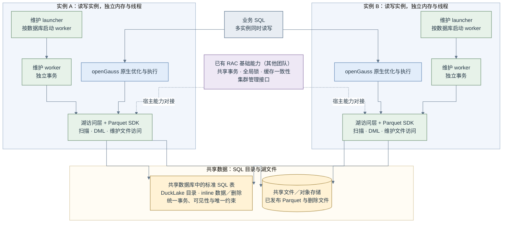
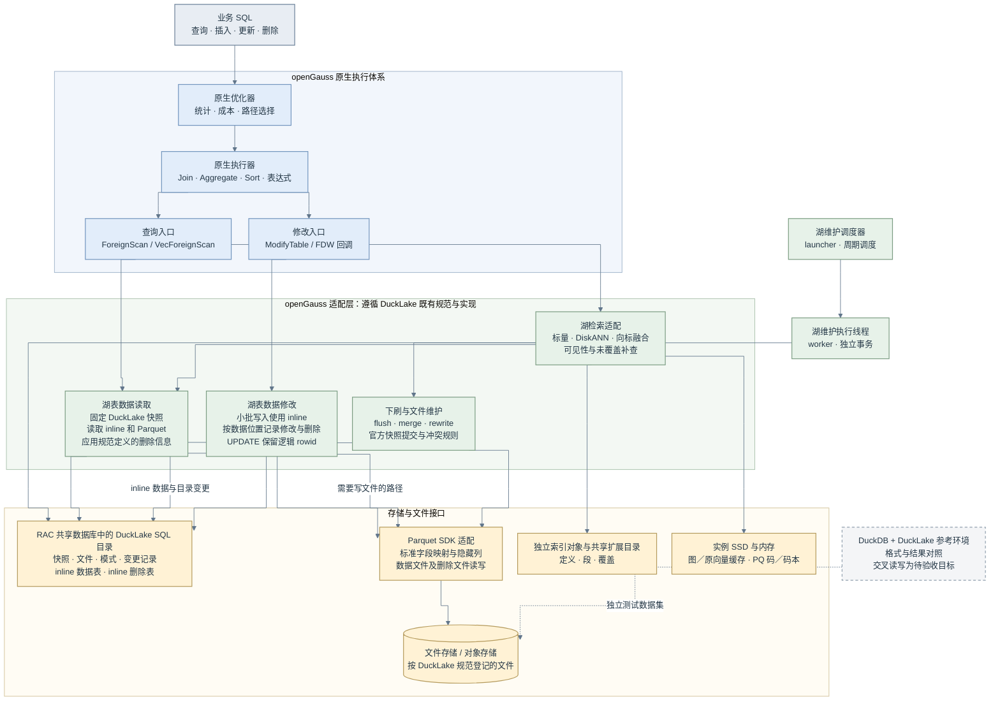
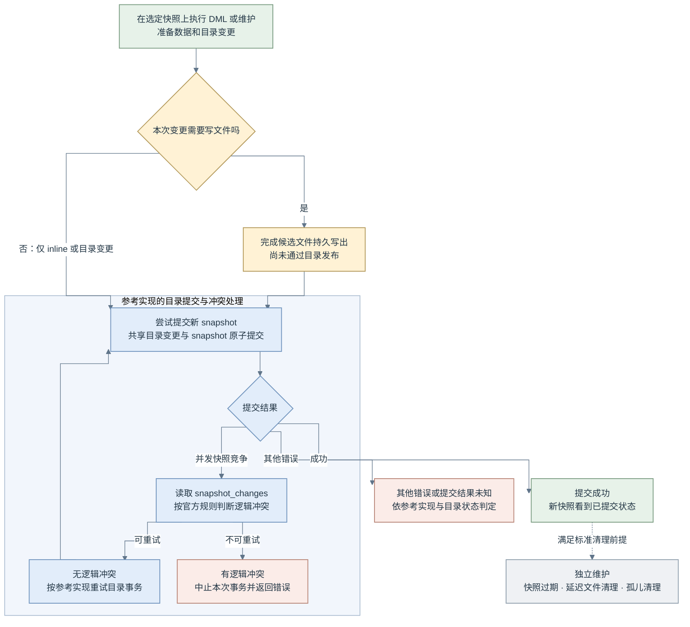
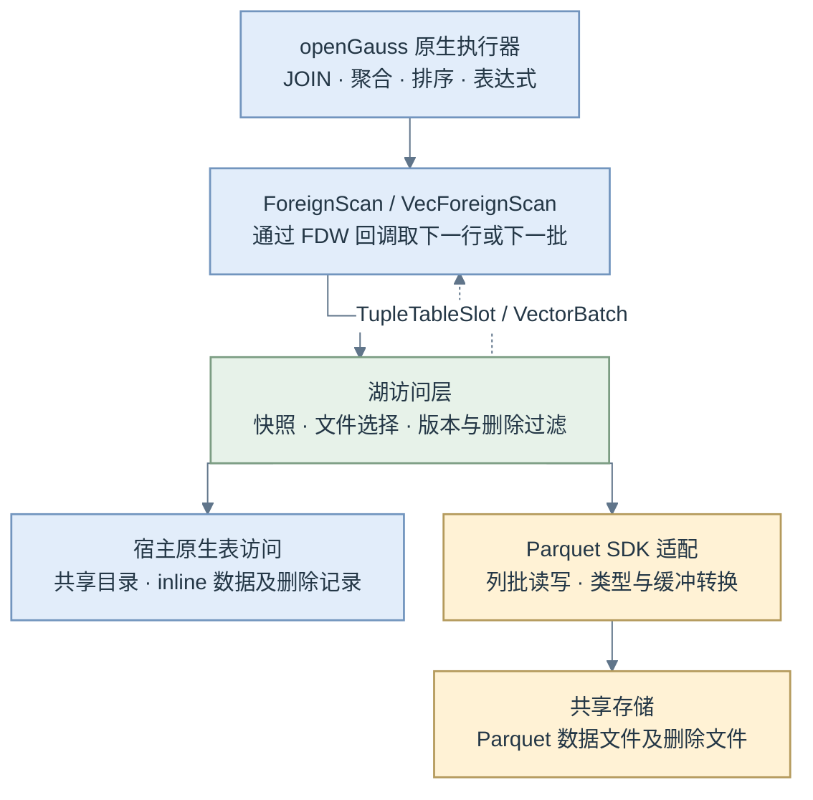
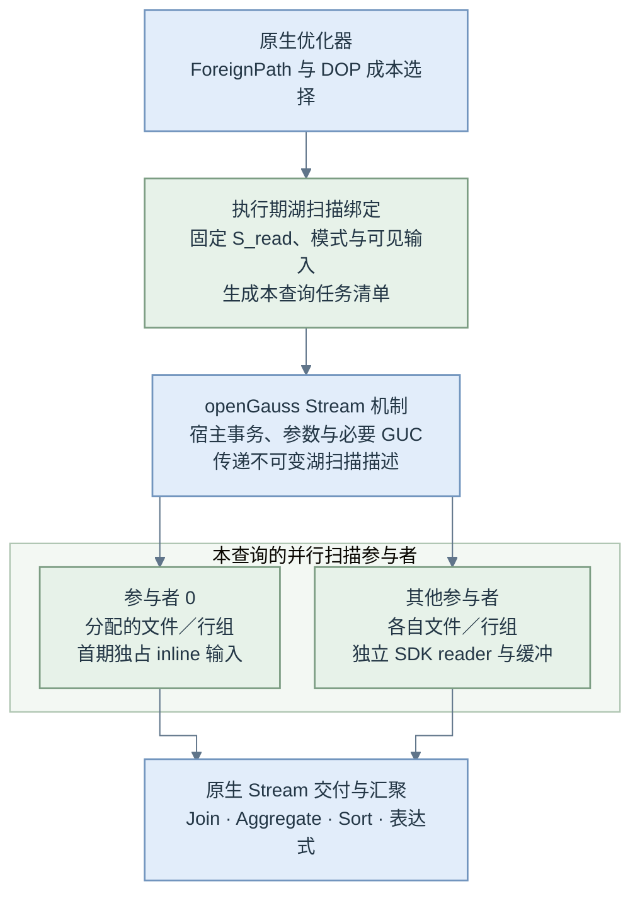
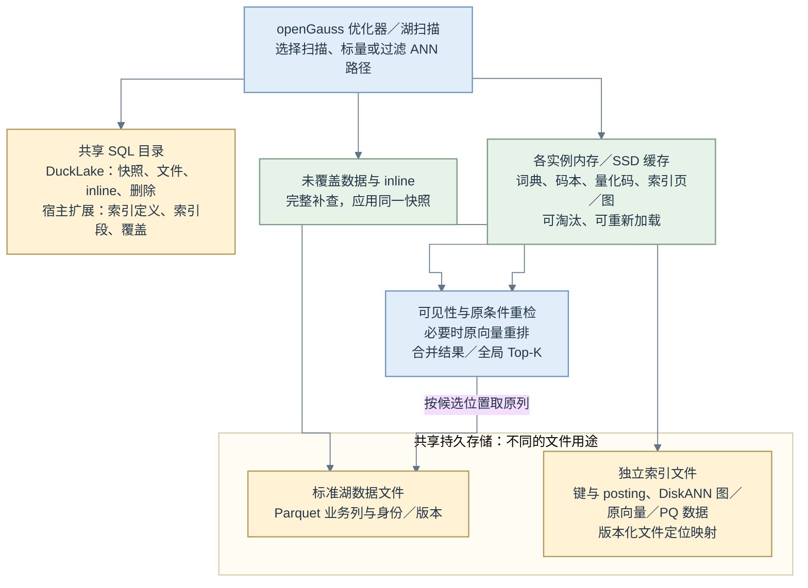

# openGauss 原生湖存储架构与实施设计

当前任务与未闭合范围统一见[§9.5.2](#sec-9-5-2)与[§9.10.6](#sec-9-10-6)。以下开篇记录保留各自历史源码与测试归属，不能把其中的“当前”“正在”当作本机实时状态；正在运行的阶段以实际执行回执核实。

RC接入前的已验证基线（2026-11-09）：`5bd0959409`累计产品**16316行**（既有内核472、湖模块／provider15844，删除128另计），[源码计数](验证/code_count_ann_scalar_filter_5bd_candidate_1109.json)。[官方Debug full／安装／启动](验证/native_ann_scalar_filter_full_1109_01/build.json)及154项输入一致性通过，该基线实测运行846eee00＋SDK5ae。[30组2100项限定验收已严格复核](验证/native_ann_mask_5bd_complete_scoped_verified_index.json)：9组数值／NULL文件mask ANN查询932项、合成图桥梁／预算组件117项、真实2,048行L2过滤图及两组特殊浮点源列207项、17组标量／普通ANN受影响回归844项。限两个分别拥有且二进制相同的本机单实例RC Debug环境；组件与真实查询范围分别保留。2,048行实际候选1,000行、原谓词id>=1024保留，5个更新前固定Top10样本召回均为1，不能外推一般召回。文件mask已接通单个数值比较／NULL，inline／私有及可见性受影响文件仍完整扫描；复杂过滤、过滤inline ANN、PQ／量化缓存、持久bitmap、SMP／成本、后台构建和完整生命周期仍未完成。[原490缺口负例](验证/lake_ann_filter_490_negative_01/result.json)及[组件默认15秒超时失败](验证/native_ann_mask_5bd_frontier_1109_01/result.json)保留，后者只改测试600秒／控制连接闲置设置后重跑通过，自有资源均精确清理。

SQL0.17普通RC接入候选已通过[14例742项严格复核](验证/native_rc017_target_scoped_1110_01/review.json)，运行二进制`eb368449`，163项Native源输入核对一致；支持范围包含同行等待／EPQ、语句读取与自身覆盖、flush搬迁重定位、只读回收界及pending／游标／保存点快照寿命。它仍是未提交工作区改动，不包含Native行头GC／PQ／SMP或商用准入。[本版构建](验证/native_rc017_pending_view_build_1110_01/build.json)及[163项源码字节归档](验证/native_rc017_qualified_source_1110_01/manifest.json)单独保留，以下bitmap基线数字属于前一阶段。

RC接入前的bitmap已验证基线为5bd上的未提交改动，累计产品17007行（既有内核472、湖模块／provider16535；删除128另计），[计数含工作区改动](验证/code_count_bitmap_candidate_1109_01.json)。按链接目标拆分，[内核含内置湖模块／共用接口头为16,111行，独立Parquet provider为896行](验证/code_count_bitmap_linkage_split_1109_01.json)。472行仅指前者中对既有内核文件的新增改动；其余15,639行为内置湖模块及接口，不能将472行当作全部内核实现。计数为本特性新增C/C++／头文件物理行，含注释／空行，删除128另计，不含SQL、测试、文档、构建规则、vendor及未合入的隔离候选。[17个指定源码文件核对后汇入主工作树](验证/native_bitmap_candidate_integration_1109_01/result.json)，[官方Debug full／安装／启动已通过](验证/native_bitmap_full_1109_01/build.json)，158项源输入、wrapper和私有CRoaring依赖前后一致，实际运行a0381147＋SDK5ae，555个archive全局符号没有动态导出。当前37例5440项断言分来源严格复核：[int4 bitmap五例974项](验证/native_bitmap_int4_scoped_verified_index_1109_01.json)、[bigint／FLOAT4／FLOAT8×heap／Ustore六例2690项](验证/native_bitmap_types_scoped_1109_01/review.json)、[原标量受影响十四例626项](验证/native_bitmap_affected_debug_scoped_1109_01/review.json)、[ANN受影响十二例1150项](验证/native_bitmap_affected_ann_scoped_1109_01/review.json)。新增bitmap功能与既有路径回归分别保留scope，不把ANN回归计为持久bitmap融合。限定Native bitmap仅覆盖上述四类数值、本机RC Debug及单源1,048,576行／65,536字典key；PQ、复杂融合、SMP、完整索引及商用准入仍未完成。组件和新候选不并入原5bd的30组2100项。另有a038首次文件行同行更新的[当前提交机制59项通过与普通RC目标真实负例配对证据](验证/native_rc_flushed_first_pair_review_1109_01.json)，不计入37例，也不代表等待／EPQ已实现。

上一限定已验证源码（2026-11-09）：`490b5319bc`累计产品**16138行**（既有内核472、湖模块／provider15666，删除128另计），[源码计数](验证/code_count_scalar_float_include_candidate_1109.json)。FLOAT4／FLOAT8标量索引已通过[官方Debug增量续编／安装／启动](验证/native_scalar_float_include_incremental_1109_01/build.json)，154项原生输入构建前后一致，运行147d07f5＋SDK5ae；heap／Ustore四组浮点索引208项、整数受影响十组418项及三距离ANN／标量先筛选精确TopK三组218项，合计[17组844项已严格复核](验证/native_scalar_float_490_complete_scoped_verified_index.json)。范围限两个分别拥有的本机单实例RC Debug运行环境，未验收PQ、ANN掩码融合、SMP、RAC或性能。b0f的[Debug full失败](验证/native_scalar_float_full_1109_01/build.json)及490补file reader include的原因保留；候选头文件的[31项比较组件](验证/native_float_key_component_scoped_verified_index.json)单独计量。上一441的[17组1135项](验证/native_ann_441_complete_scoped_verified_index.json)保留原源码及规模／召回样本归属。

历史查询接入候选（2026-11-09）：主源码`18826322f0`累计产品**16076行**（既有内核472、湖模块／provider15604，既有内核删除128另计），[源码计数](验证/code_count_file_ann_precision_188_candidate_1109.json)。官方[Debug full／安装／启动](验证/native_file_ann_precision_topk_full_1109_01/build.json)及152项输入一致性通过，运行56562a15＋SDK5ae；真实三距离湖文件ANN查询和极小非零向量建图[4组177项已严格复核通过](验证/native_ann_188_file_query_scoped_verified_index.json)，覆盖显式SQL K不足回退、原始值／距离、重复业务行、参数／通用计划、NULL／零查询、私有／二次更新、未覆盖文件及缺失图回退；限小文件集成本机RC Debug。上一1ca已通过full，但真实查询文件覆盖为0，且极小非零向量遗漏；原[查询失败](验证/lake_ann_1ca_file_query_l2_01/result.json)和[精度失败](验证/lake_ann_1ca_subnormal_negative_01/result.json)保留。188使用原生double范数判零、独立adapter版本2及显式SQL K，按去重后的原始物理地址数量决定不足时完整扫描；不再把图节点数当作返回行数。上一c359的[18组721项限定验收](验证/native_ann_c359_complete_scoped_verified_index.json)保留原源码归属，不扩大188的本轮查询验收范围。

后续混合存储候选`4410577332`仍为**16089行**（既有内核472、模块／provider15617），[源码计数](验证/code_count_file_ann_zero_guard_441_candidate_1109.json)，官方[Debug增量／安装／启动](验证/native_file_ann_zero_guard_incremental_1109_01/build.json)及152项输入一致性已通过，运行4303f7a6＋SDK5ae；本版三距离×heap／Ustore／真实外部纯文件输入、真实LOGIN权限、标量先筛选的精确L2 TopK、更新／flush／取消／回退及受影响标量／配置，合计[14组781项已严格复核](验证/native_ann_441_complete_small_scoped_verified_index.json)。2,048行L2以600秒建图预算完整重跑后[118项已严格复核](验证/native_ann_441_bounded_l2_scoped_verified_index.json)：实际候选截断、5个更新前固定Top10样本召回均为1，原始SQL距离和两次after-image／flush正确。180秒[超时](验证/lake_ann_441_bounded_l2_01/result.json)及前轮117项功能断言通过后控制连接10分钟闲置导致的[清理失败](验证/lake_ann_441_bounded_l2_02/result.json)均保留；后者已用同一次启动的新控制连接[精确清理角色](验证/lake_ann_441_bounded_l2_02/idle-control-cleanup/result.json)，原FAIL不改。内积／余弦同规模也已各通过118项，三个距离的15个更新前固定样本召回均为1；连同小输入与受影响项共[17组1135项严格复核](验证/native_ann_441_complete_scoped_verified_index.json)，不能外推通用规模召回或性能。cfe的官方增量／152项输入一致性通过，运行11e9b417＋SDK5ae；[Ustore混合L2查询64项](验证/native_ann_cfe_ustore_scoped_verified_index.json)和[标量／配置5组171项](验证/native_ann_cfe_scalar_options_scoped_verified_index.json)已严格复核，保留cfe源码归属。随后[纯文件写入实测](验证/lake_ann_cfe_file_l2_02/result.json)确认直接DML写Parquet仍未实现，cfe开放0阈值的依据不成立；441恢复原零值拒绝，保留Ustore完整TableAM＋独立文件ANN的修正。后续纯文件索引测试使用真实DuckLake文件／目录，并用正inline阈值验证native after-image；不能以flush已有文件写出代码推定直接文件DML已实现。

上一已验证源码（2026-11-09）：`c35922b091`累计产品**15761行**（既有内核472、湖模块／provider15289，既有内核删除128另计），[候选计数](验证/code_count_file_ann_build_c359_candidate_1109.json)。1d247官方Debug full和4f085官方增量均通过152项输入一致性；真实L2建图／逐地址核对已执行，整体在重复构建幂等断言失败。c359补齐inspect输出结构体ABI大小，官方Debug增量／安装／启动及152项输入一致性通过，运行3f029a35＋SDK5ae；真实原生建图／发布[8组220项已严格复核通过](验证/native_file_ann_c359_build_scoped_verified_index.json)。c359未接入湖文件ANN查询；1ca已编译但真实查询覆盖与精度负向失败，188正在修复验收。下述45e限定验收保留其原源码归属，湖文件ANN查询／PQ／融合仍待接通。

上一已验证候选（2026-11-09）：主源码`45e7ab3508`累计产品**15137行**（既有内核新增472、湖模块／provider14665，既有内核删除128行另计），[候选计数](验证/code_count_file_ann_45e_candidate_1109.json)。已编码可移植图段、既有DiskANN公共遍历和文件候选搜索入口，官方Debug full／安装／启动及146项源码输入一致性已通过，运行e9761df4；文件图段共享搜索103项、湖inline ANN6组372项及向量数据4组129项合计[11组604项已严格复核](验证/native_ann45e_complete_scoped_verified_index.json)；普通原生DiskANN另[5组50项](验证/native_ann45e_ordinary_scoped_verified_index.json)。尚未接通原生建图导出、文件READY发布和湖文件ANN查询。[SDK BINARY隔离组件64项](验证/sdk_binary_transport_scoped_verified_index.json)及[图段隔离组件33项／5085项C++检查](验证/ann_format_component_scoped_verified_index.json)已严格复核。图段测试使用合成拓扑，只证明存储格式与生命周期；不等于原生建图、文件ANN查询、召回率或READY发布已接通。当前继续开发测试，无远端push。

上一限定已验证基线（2026-11-09）：主源码`206052d151`累计产品**14528行**（既有内核386、湖模块／provider14142，既有内核删除48行另计），[本版计数](验证/code_count_inline_ann_206_candidate_1109.json)。官方Debug增量／安装／启动及140项源码输入一致性通过，运行baed92e0＋SDK9d。同版BKI的独立ann-debug实例已完成heap inline原生DiskANN的L2／内积／余弦各77项、余弦边界57项、L2边界55项及普通LOGIN权限29项，合计**6组372项已严格复核**；[湖inline ANN限定验收](验证/native_inline_ann_206_scoped_verified_index.json)。普通原生全零余弦／NULL插入9项另已复核，文件ANN、PQ缓存、向标融合、SMP及商用验收仍未完成。受影响10组304项也已严格复核，连同inline ANN合计[16组676项限定验收](验证/native_ann206_complete_scoped_verified_index.json)。当前继续文件ANN实施，不能将旧源码全部测试结果移作本版通过。

历史实施与验收（保留各自源码归属）：候选`010755c570`累计产品14520行（既有内核378、模块／provider14142），[候选计数](验证/code_count_inline_ann_010_candidate_1109.json)。a8已通过官方续编／139项输入一致性，L2和内积湖inline ANN各64项、合计2组128项已严格复核；余弦触发原生建图的零向量无效块断言，独立实例已恢复66条原数据并按身份清理。010补原生无效节点跳过及有界查询向量生命周期，官方Debug增量正在执行；新修复尚未验收。当前源码`acb48452cf`在既有DiskANN串行／并行逐节点建图循环加入取消检查，新增6行，累计产品14040行（既有内核360、模块／provider13680）；[本版计数](验证/code_count_acb_current_1109.json)。官方Debug增量／安装／启动及135项输入一致性通过，运行b68df955＋SDK9d；普通DiskANN取消／三个距离生命周期4组41项及受影响向量／浮点5组182项，合计9组223项已分别严格复核；[本版限定证据](验证/native_acb_affected_scoped_index.json)。这不包括湖DiskANN或PQ；f3完整限定42组1235项保留原源码归属。读取首片2e01c41b6b累计产品13876行（既有内核354、模块／provider13522），官方Debug full／安装／启动及134项输入一致性通过，运行e49c0f15＋已受控安装SDK9d。真实DuckLake LIST文件、heap／Ustore inline、精确向量距离／IEEE值、坏维度／NULL／非有限元素、取消恢复、旧SDK拒绝及新旧SDK标量读写下刷，6组183项已逐项严格复核。[当前读取限定验收](验证/native_vector_2e01_read_scoped_verified_index.json)。这不包含向量写入或DiskANN。写入候选31088d7ad0已汇入主树，累计产品14034行（内核354、模块／provider13680），31088的clean full在CREATE适配头文件顺序处编译失败；f3eeecb611仅调整两处CPP include顺序，官方增量续编已完成编译，因独立DiskANN探针阻塞正常停机而保留该失败，受控恢复后的官方增量安装／启动已通过，运行d5713418＋SDK9d、134项输入一致；向量写入62项、浮点NaN统计与真实DuckLake谓词互读53项、向量读取67项及整数索引37组1053项，合计42组1235项已逐项严格复核；[当前限定验收](验证/native_vector_f3_complete_scoped_verified_index.json)。范围限本地单实例RC／Debug，未包括湖DiskANN、融合、SMP、远端SDK、OGRAC或商用验收。上一8c757的41组1171项仍是该旧源码的六标量／整数索引验收，不把它移作新版本全矩阵通过。前基线738f累计产品13509行，官方Debug full／安装／启动及131项输入一致性通过，37组1053项逐项严格复核通过，包含同步索引维修47项、READY列改名25项及既有35组981项；[限定验收](验证/native_scalar_repair_738_complete_scoped_verified_index.json)。浮点／列表SDK5d291组件通过后已汇入原生候选ff98ca01ac，累计13637行；宿主六类型注册表ff98已通过官方Debug full／安装／启动与132项输入一致性；首轮SQL发现配置入口仍用旧四类型白名单，CPP修复8c757为13643行，官方增量／132项输入一致性及本轮41组1171项严格复核通过，运行provider已受控切到8a，浮点及受影响回归限定范围均已复核，范围见§6.15。已验证基线`fbacecd04a`累计产品13361行（既有内核354、模块／provider13007），官方Debug full／安装／启动及131项输入一致性通过；实际文件候选查询4组136项、根目录／兼容9组292项、构建4组112项及受影响11组255项，合计28组795项已逐项严格复核。[限定验收](验证/native_scalar_file_query_fbace_complete_scoped_verified_index.json)。Ustore／UB-tree及状态诊断038c为13435行，官方增量通过但旧读漏行负例未闭合；7d79候选13436行首轮通过但复测仍漏行；1a0a为13439行，官方增量131项及35组981项已严格复核通过，范围限整数标量／Ustore与本地SDK。不将未通过候选计入已验证能力。已验证构建基线`5644c9085f`为完整物理源排序、对象版本绑定及事务性READY／覆盖发布，累计12986行；4368全量在链接发现legacy slot_getallattrs无实现，5644改用现有tableam_tslot_getallattrs后官方Debug增量／安装／启动及131项输入一致性通过，4组原生构建专项112项已逐项严格复核，原0cad SDK兼容9组292项及新SDK受影响11组255项通过，合计24组659项已逐项严格复核；这些结果不覆盖新查询候选。上一`3ce5ccec98`为SQL0.16独立索引目录配置及可移植排序Parquet页组件，累计12624行。组件已通过217项命名断言及422项真实C++消费者检查，含独立SQL、跨进程重开、损坏／有序错误posting及预算；官方Debug full／安装／启动及129项源输入一致性通过，20组547项原生限定回归已逐项严格复核，运行e9db5076；原生文件构建、READY／覆盖发布及查询链路尚未交付。[3ce5原生限定验收](验证/native_index_store_3ce5_complete_scoped_verified_index.json)。[组件限定证据](验证/scalar_format_component_verified_index.json)。前一`e1b644e1d7`原生heap inline整数NULL／NOTNULL、数组及跨整数已通过官方增量125项输入一致与7组333项逐项严格复核，产品12046行，运行4ea5449b。[e1b6限定验收](验证/native_inline_null_e1b6_complete_scoped_verified_index.json)。上一8e48的官方增量／启动、125项输入一致性通过，运行dad7f0a2；IN／ANY62项、跨整数114项、受影响计划／重扫／DML+flush94项，共5组270项已逐项严格复核通过。[8e48限定验收](验证/native_inline_array_8e48_complete_scoped_verified_index.json)。上一8385已通过官方增量／启动、125项输入一致性，运行8631ca81；跨整数边界／generic Param／相关重扫114项及8组受影响索引专项238项，共9组352项已逐项严格复核通过。[8385限定验收](验证/native_inline_cross_8385_complete_scoped_verified_index.json)。上一源码`d8175f2f99`已通过官方增量／启动、125项输入一致性，运行31a3ac8e；inline B-tree专项8组238项、真实EXPLAIN ANALYZE／私有改键及保存点1组21项、受影响11组255项，共20组514项逐项严格复核通过。[限定验收](验证/native_inline_btree_d817_complete_scoped_verified_index.json)。文件侧标量后端、Ustore索引、DiskANN／融合及完整IX1～IX5未完成。此前`8741685687`目录升级修复已通过官方Debug增量、121项输入一致性；目录管理9组212项、受影响11组255项、真实索引定义＋flush／迟到DML／历史组合1组26项，共21组493项逐项复核通过。这只闭合SQL0.14定义目录首片，完整文件索引／覆盖发布及DiskANN／融合仍未完成。用户已解除湖项目的云端专属开发限制，继续本地开发测试，禁止本地代码push远端。新候选范围见§6.14.8。此前改名阶段已验证源码为湖表改名修复`990980d855`，累计11058行；b9b1官方Debug full通过、首8组改名192项通过，但发现自动提交可见性缺陷；9909官方CPP增量／启动及116项输入一致性通过，运行4d295ffc；12组改名308项及8组受影响180项已逐例复核，首片功能范围通过，完整N6仍未完成，详见§7.5.3。上一版`c16ba818af`持久配置首片的官方Debug full／启动SQL及112项源输入一致性通过，二进制ddf8baad；配置5组106项及受影响5组145项已逐例复核，详见§8.4.1。当前仅推进核心功能及必要Debug回归，商用验收统一后置。上一阶段已通过限定回归的flush源码为 `65cceecc7e`，累计产品10502行（既有内核347、模块／provider10155），官方CPP增量及109项源输入一致性通过，运行二进制9d125ace；7组确定性交错169项及120秒激进调度双写26项，共8组195项严格复核通过。本轮23组件949项、3个进程崩溃恢复102项、默认调度31项，共27组1082项及另10组RC边界160项已严格复核通过。当前转入其余核心功能开发；商用项统一后置。前版 `7c817f16c0` 的109项源输入一致性、错误退避29项及8组回归319项通过，但其120秒持续更新场景下4次flush冲突、零发布，维护进展门失败；业务541笔提交／380次对照及最终模型一致。新候选范围与安全退路见§4.8.4，不能称商用完成。前版 `0b9a10d1cf` 的10组精确来源并发RC用例160项及关闭／开启自动维护双120秒对照52项通过；开启组暴露维护错误退避被提交提示绕过的问题，见§5.2。长稳、资源与商用验收仍未完成。前版 `e24e2a54eb` 的五项自动维护功能用例193项通过，但持续双写在维护开启／关闭对照均因整表40001反复冲突而未完成120秒目标，详见§4.8.3；性能与商用门未完成。已验证前版 `486d837100` 官方CPP构建109项源输入一致性通过。手动／自动flush限定闭环6组239项通过，含自动4组161项（SPI中FATAL停库恢复40、launcher替换及四表轮询48、取消与自动重试43、年龄触发30）及手动历史64／并发UPDATE14；原始完成时间为11月7日23:57:54，11月8日另复核原始结果、归档输入、二进制和实际FATAL日志。[严格复核索引](验证/native_auto_486d_verified_index.json)。跨库／持续写入公平性、资源与稳定性、完整旧文件回收／备份保护、真实远端SDK与OGRAC仍未完成，不能视为商用交付。前一SDK组件7aaf已通过官方full与限定原生复核，见§5.5.1。已验证RC基线 `c9202428c6` 为9651行：官方增量、83项准入、28项RC水位、另28项RC语句内迟到首次访问、23专项909项、66读写2468项及3恢复102项通过；原测试定位歧义已修正且失败保留，详见§1.8／§5.5.1。此前源码`b47408e2a3`累计产品9645行，SDK候选清理后再释放保护的CPP修复已通过incremental、同脚本正向时序60项、正常23专项909项、66读写2466项及3恢复102项检查。最近完整回归基线`242db221fc`累计9644行，官方full、23专项909项、66读写2466项及3恢复102项通过；额外SDK时序负向60项定位了随后已修复的释放顺序，见§5.5.1。历史常规回归基线`81de4f2433`累计产品9571行，官方full、19个flush专项813项及66组读写回归2466项检查通过，完整商用flush未完成，见§5.3.7。[本版专项](验证/native_flush81de_19component_acceptance_index.json)。前一修复提交`bec119633a`累计产品9351行，保存点失败准备内存问题已实测修复，限定flush和受影响读写重跑通过；完整商用flush仍未完成。[修复验收](验证/native_flush011_bec119_acceptance_index.json)。已通过限定验证的基线`1e07bb4323`累计产品新增9326行，官方full、安装与SQL检查通过，97项源输入前后一致。SQL0.11有限范围flush的9项专项共360项检查通过，覆盖历史／四类类型、三个并发窗口、事务／保存点／取消及重复flush；这是限定闭环，不代表完整商用flush。[当前flush专项](验证/native_inline_flush011_1e07_acceptance_index.json)。此前815fde的15组565项读写回归及37／9项候选生命周期／拒绝证据保留原提交范围。历史已验证基线`bc31506468`累计自研产品C/C++／头文件新增8362行（既有内核188、新湖模块及provider8174，删除16；不含SQL、测试、文档及第三方源码，含注释／空行）。SQL0.10文件来源DML及当前建表兼容18组845项、受影响兼容48组1621项，共66组2466项断言已通过并逐例严格复核。此前0.9限定读取基线`2c4f107321`的48组1621项保留原范围。源码、构建、实际失败及修正见§6.6.6、§6.12和§10.4。完整文件DML、flush和商用验收仍未完成；限定通过不等于整项湖存储功能闭环。 开发提交`19be9678dc`另已合入原生Arrow写批及可选footer信息，累计新增8607行（内核188、湖模块及provider8419），官方Debug full、安装及启动SQL检查已通过，92项源输入构建前后一致，运行二进制SHA-256为`4e3360679530182968217ccecd97fac1af3a4b1cee994cac2917eed7d6249782`。该提交受影响回归9组360项已通过并逐例严格复核；实际gaussdb导出的Arrow组件在heap／Ustore各39项通过，独立计数。未在该提交重跑全部66组，也未完成flush。[新提交专项索引](验证/native_flush_foundation_19be_acceptance_index.json)。
状态：2026-11-06已按用户授权进入隔离源码开发和实机测试，N0宿主及N1/N2只读inline限定子项已通过；2026-11-07的N3事务性INSERT已有限定事务验收证据。N4首版`a5d97996a5`全量构建通过，但首轮宿主回归中的普通UPDATE触发计划检查断言退出；修复`572e04851e`的宿主回归与普通数据恢复已通过，N4另有12个限定用例、513项本机及213项参考互读断言通过；随后实测发现修改型CTE准入缺口。`cc5896e13d`已通过CTE准入、专用线程兼容及线程池限定INSERT验收。此前统计修复`713ac533a3`已构建通过，7个统计用例的364项本机断言与23个逐提交真实参考检查点通过；线程池限定修改及10项受影响发布用例也已通过，证据范围见§10.7。权限版本0.5的`f5648f3fe0`全量构建和后续`d56130b62e`增量构建先后遇到编译错误，原失败记录保留；此前修复源码`34b9e2ea86`累计产品新增4421行，官方Debug增量构建／安装／启动检查通过；0.5专用线程12组真实普通用户权限用例通过483项本机断言及2次完整固定参考检查，合计15组宿主／旧SQL目录及读写兼容回归通过884项。普通用户线程池9组权限用例及6个真实LOGIN会话的跨角色worker复用也已通过，范围见§10.7。此前0.6源码`f434ba4a11`的官方Debug full、安装及启动检查通过，宿主131项和30个CATALOG用例共347项断言均通过，每例证据哈希已复核。此前`d25228f262`的官方full及参考刷新已通过，17个限定用例共686项断言通过（宿主131、10个统计用例413、6个Ustore用例142）；事务内ANALYZE与SCROLL的原测试失败保留并按宿主规则修正。最新源码`93fb65c12a`补充首次空carrier写入初始化、物理页数与已分析哨兵分离，以及顶层采样测试探针，累计产品新增5387行；官方增量构建及26组限定用例共1414项本机断言通过并逐例复核证据，首次发布相关另有6个完整真实参考检查点、602项子断言；新增取消用例验证部分初始化后的事务回滚及另一连接从row_id 0重新提交，范围见§10.7。各旧版通过证据保留原范围，不自动覆盖新实现。完整N4未通过。湖存储功能闭环和商用验收均未完成。已讨论通过的设计决策作为本稿基线；实现版本、私有 SDK 与宿主 RAC 接口尚有明确准入项，见第 9 章。**宿主共享事务与集群管理由其他团队提供**；本项目负责 openGauss 原生执行器的湖访问适配、DuckLake 兼容存储操作及 Parquet SDK 集成。目标格式为 DuckLake 1.1，代码审查版本与目标产品版本严格区分。

选型已确认（2026-11-05）：用户明确选择 **pg_ducklake／DuckLake 表管理主线**，并要求**迁入 pg_lake 已选定的功能与可复用代码**。产品在 openGauss 中实现原生湖访问模块，主写格式保持 DuckLake；SQL 目录、inline、快照、行身份和下刷沿用该协议，文件访问、导入导出、分区、缓存及管理等功能按既定工作包迁移适配，执行对接 openGauss 原生执行器和现有 SDK。§1.7 规定项目关系与格式边界，§6.11 列出来源与接入模块，§9.8 安排实施工作包。此决定确认架构主线；各项接口和实现仍须按阶段门验证，原代码量估算不覆盖全部新增功能，已实现量按§9.4.1的明确提交单独记录。

评审维护约定：讨论结论按主题融入对应章节，合并被替代的表述，不按问答顺序堆叠。用户转入下一问题且不再持续质疑时，已讨论清楚的设计点视为通过，无需重复确认；未闭合的细节仍标明待设计或待验证。新证据影响已通过结论时说明原因并修订。设计通过与实现、测试完成分别记录。**每次问题形成结论后，同一轮同步刷新本文和[《设计问题与决策汇总》](设计问题与决策汇总.md)**：本文落实设计约束、实现和验收，汇总文档保留问题背景、选择理由、修正原因及待验证项；同一议题在各文档内只设一个主要归属：重复追问合并到原主题，只补新增条件或修正结论；其他章节使用简要说明和链接，不复制整段论述。两份文档按上述职责互相引用，详细接口、SQL 和完整示例优先维护在主设计，汇总保留理解结论所需的背景与理由，避免形成两套重复正文。历史问题的逐项覆盖入口见汇总文档[附录](设计问题与决策汇总.md#question-index)。

开发接手先读 [§9.10 独立开发交接与首轮执行](#sec-9-10)，从 N0 子任务推进；关键技术追踪见 [§9.9](#sec-9-9)，最终能力范围见 [§1.8](#sec-1-8)，验收及真实检查见 [§10.7](#sec-10-7)。当前没有已通过的产品工作包，文档评审完成不能填入产品任务的完成状态。

阅读顺序：第 1～2 章确定边界和架构，第 3 章定义持久数据，第 4～5 章规定前台事务与后台维护，第 6～8 章落实原生接入、DDL 与配置，第 9～10 章用于分工实施和验收。接口契约中的拟新增模块与状态名是宿主适配设计，不是新的湖持久格式，也不表示本地已经存在相应实现。

- [1 设计目标、前提与技术边界](#sec-1)
  - [1.1 RAC 前提与共享边界](#sec-1-1)
  - [1.2 执行体系与协议依据](#sec-1-2)
  - [1.3 实时增量层的选型依据](#sec-1-3)
  - [1.4 DuckLake 与 Iceberg 的格式差异及兼容边界](#sec-1-4)
  - [1.5 原系统故障经验与本方案必须解决的问题](#sec-1-5)
  - [1.6 参考版本、证据等级与能力边界](#sec-1-6)
  - [1.7 以 pg_ducklake 为主线迁入 pg_lake 功能](#sec-1-7)
  - [1.8 本次交付范围与能力开关](#sec-1-8)
- [2 总体架构与组件职责](#sec-2)
  - [2.1 集群视图](#sec-2-1)
  - [2.2 实例内部结构](#sec-2-2)
  - [2.3 组件职责](#sec-2-3)
- [3 持久化数据模型](#sec-3)
  - [3.1 目录表、命名空间与快照记录](#sec-3-1)
  - [3.2 逻辑行身份的选择与持久化表示](#sec-3-2)
  - [3.3 inline 与文件的删除表示](#sec-3-3)
  - [3.4 身份、版本与物理定位的实现契约](#sec-3-4)
  - [3.5 湖文件分区与宿主分区对象](#sec-3-5)
  - [3.6 宿主扩展目录及对象绑定](#sec-3-6)
- [4 读写、快照与事务提交](#sec-4)
  - [4.1 写入路径与连续 UPDATE 数据示例](#sec-4-1)
  - [4.2 逻辑快照与跨实例可见性](#sec-4-2)
  - [4.3 扫描访问流程](#sec-4-3)
  - [4.4 目录提交与冲突处理](#sec-4-4)
  - [4.5 新增行编号分配、发布与锁](#sec-4-5)
  - [4.6 事务内状态、自身写入与保存点](#sec-4-6)
  - [4.7 三类快照、发布接口与失败语义](#sec-4-7)
  - [4.8 事务能力矩阵与执行状态契约](#sec-4-8)
- [5 多实例后台维护](#sec-5)
  - [5.1 调度单位与多实例执行](#sec-5-1)
  - [5.2 实例内调度与执行](#sec-5-2)
  - [5.3 下刷、文件整理与阶段事务](#sec-5-3)
  - [5.4 维护中断与恢复](#sec-5-4)
  - [5.5 文件保留与物理清理](#sec-5-5)
  - [5.6 备份、PITR、恢复与升级](#sec-5-6)
- [6 openGauss 原生接入与模块实现](#sec-6)
  - [6.1 扫描、DML 与执行器接口](#sec-6-1)
  - [6.2 后台线程与外部集群接口对接](#sec-6-2)
  - [6.3 pg_ducklake 与 DuckLake 的代码复用范围](#sec-6-3)
  - [6.4 目录 SQL、SPI 与错误边界](#sec-6-4)
  - [6.5 拟新增模块与现有内核修改点](#sec-6-5)
  - [6.6 规划、扫描状态与 SDK 批次契约](#sec-6-6)
  - [6.7 复用 openGauss SMP 的详细设计](#sec-6-7)
  - [6.8 DML 定位与写回契约](#sec-6-8)
  - [6.9 资源、异常、取消与 SPI 生命周期](#sec-6-9)
  - [6.10 分区裁剪、写出与原生路由接点](#sec-6-10)
    - [6.10.2 带数据的分区规则演进与多个 inline 载体](#sec-6-10-2)
  - [6.11 pg_lake 功能迁入 pg_ducklake 的模块映射](#sec-6-11)
  - [6.12 湖目录统计、ANALYZE 与自动收集](#sec-6-12)
  - [6.13 大湖表采样与 Parquet 读取契约](#sec-6-13)
  - [6.14 标量、向量与向标融合索引](#sec-6-14)
  - [6.15 类型、列映射、谓词与向量编码](#sec-6-15)
- [7 湖表 DDL 与双目录同步](#sec-7)
  - [7.1 原生表对象与湖定义的关系](#sec-7-1)
  - [7.2 openGauss 入口的正向 DDL 与事务边界](#sec-7-2)
  - [7.3 快照触发器的注册、查询与回调](#sec-7-3)
  - [7.4 外部修改的接入边界与时序验收](#sec-7-4)
  - [7.5 目标 DDL、对象绑定与缓存契约](#sec-7-5)
  - [7.6 分区管理、规则集合与 pg_lake 的差异](#sec-7-6)
  - [7.7 对齐 pg_lake 分区能力的影响与边界](#sec-7-7)
  - [7.8 权限、约束与公共管理入口](#sec-7-8)
- [8 配置策略与管理接口](#sec-8)
  - [8.1 持久化湖策略与作用域](#sec-8-1)
  - [8.2 openGauss GUC 与湖对象配置的职责](#sec-8-2)
  - [8.3 set_option 的调用和持久化路径](#sec-8-3)
  - [8.4 参数校验、生效与缓存合同](#sec-8-4)
  - [8.5 资源预算、背压与运行观测](#sec-8-5)
- [9 开发实施、依赖与代码量](#sec-9)
  - [9.1 实施前置条件](#sec-9-1)
  - [9.2 依赖登记与能力准入](#sec-9-2)
  - [9.3 开发工作包与交付依赖](#sec-9-3)
  - [9.4 产品代码量与估算边界](#sec-9-4)
  - [9.5 分阶段实施门](#sec-9-5)
  - [9.6 构建、变更计量与交付方式](#sec-9-6)
  - [9.7 湖文件分区对齐工作包与增量估算](#sec-9-7)
  - [9.8 pg_lake 功能移植的工作包与实施顺序](#sec-9-8)
  - [9.9 全目标闭环、关键技术追踪与新增工作包](#sec-9-9)
  - [9.10 独立开发交接与首轮执行](#sec-9-10)
- [10 验收设计与发布条件](#sec-10)
  - [10.1 验收范围、指标与既定交错](#sec-10-1)
  - [10.2 固定测试基线与证据要求](#sec-10-2)
  - [10.3 共用数据集](#sec-10-3)
  - [10.4 确定性测试用例](#sec-10-4)
  - [10.5 版本、隔离级别与输出位置补充用例](#sec-10-5)
  - [10.6 分区及 pg_lake 对齐验收](#sec-10-6)
  - [10.7 完备性审查补充验收](#sec-10-7)

<a id="sec-1"></a>

## 1 设计目标、前提与技术边界

目标是在保留 openGauss 优化和执行体系的条件下，提供多实例并发读写、实时增量可见和批量下刷的湖存储能力。本章确定宿主前提、协议依据及与既有系统的兼容边界；后续章节分别展开结构、操作和实施要求。

<a id="sec-1-1"></a>

### 1.1 RAC 前提与共享边界

RAC 类多写架构是本设计的确定前提。多个实例同时承接查询和 INSERT、UPDATE、DELETE，共同访问同一逻辑数据库；各实例有自己的内存、执行线程和缓存，目录与持久化数据属于同一共享数据库。跨实例事务、锁、唯一约束、缓存一致性和集群管理由其他团队提供，本项目使用这些能力完成湖存储接入。[Oracle RAC 架构分工参考](https://docs.oracle.com/en/database/oracle/oracle-database/19/racad/introduction-to-oracle-rac.html)

**开发在单个openGauss进程中进行，最终以源码迁入用户另一环境的OGRAC内核。** 湖模块对目录、inline、普通表事务和扫描的使用应与单机一致：通过SPI、TableAM／IndexAM、原生事务回调及失效接口访问数据库，实例间一致性由OGRAC实现。单进程多会话验证这些调用的功能与并发语义，不另行开发RAC模拟平台，也不为每项数据库操作新增一套集群API。迁移时核验目标内核的接口／语义兼容，少数后台协调与外部文件保护差异按§6.2.1集中处理。

| 对象 | RAC 下的归属与约束 |
|---|---|
| DuckLake catalog、inline 数据和 inline 删除 | 同一 catalog 使用共享数据库中的同一组权威表；所有实例通过宿主事务访问 |
| `snapshot_id` | 同一 DuckLake catalog 内统一的提交序列，由跨实例有效的目录主键与提交协议决定 |
| 逻辑 rowid | 按标准分配并保持同表身份；不能由每个实例独立计数后直接发布 |
| 本地缓存、维护槽位和优化用预约队列 | 仅为实例内状态；不能据此决定集群唯一性、数据可见性或文件可删除性 |
| 已发布 Parquet 与删除文件 | 所有承接读请求的实例必须能访问；本地临时文件不能作为已发布数据的唯一副本 |
| 维护任务 | 沿用按数据库派发 worker、库内按表维护的参考结构；RAC 执行实例选择及跨实例防重待适配，见 §5.1 |

本文将目录数据库中的 inline 作为“先写 delta”的标准实现。因此，它在逻辑上是共享持久化表，即使脏页暂存在某个实例的 buffer 中，也不能按独立节点私有 delta 表设计。实例故障后，已提交 inline 数据须能由宿主共享存储和恢复机制继续读取。

共享文件或对象存储中的 Parquet 不会因此自动加入数据库的 WAL/MVCC 事务。文件持久写出、目录原子发布和延迟回收仍按湖协议衔接；宿主数据库事务保护共享 SQL 目录与 inline，SDK 文件操作还须遵循存储访问和中断处理接口。

责任边界如下，后续实施和验收均按此划分：

| 责任方 | 交付范围 |
|---|---|
| 宿主数据库与集群团队 | 已有共享事务、全局锁与缓存一致性；集群管理与实例生命周期机制及其接口 |
| 湖存储团队（本项目） | 扫描与 DML 适配、标准目录与 inline 操作、Parquet SDK 集成、湖维护 launcher/worker；对接宿主通知，正确启停任务和处理在途操作 |
| 联调边界 | 明确维护任务协调、启停、退出通知和 SDK 文件操作所需接口，并验证多实例并发及故障时湖数据与目录保持一致 |

本地 openGauss 源码用于定位湖存储接入点。集群管理保留在架构图中作为外部能力，不纳入本项目的机制设计或开发任务；本项目不实现选主、成员管理、集群锁、隔离算法或接管编排。

<a id="sec-1-2"></a>

### 1.2 执行体系与协议依据

业务 SQL 由 openGauss 原生优化器和执行器处理。pg_duckdb、pg_ducklake 的分析查询路线涉及 DuckDB，因此本方案参考其宿主集成与维护实现，并为 openGauss 实现存储访问适配。DuckDB + DuckLake 用于独立对照验证。[pg_duckdb 项目](https://github.com/duckdb/pg_duckdb)、[pg_ducklake 项目](https://github.com/relytcloud/pg_ducklake)

每个涉及持久化格式、可见性、冲突、提交或回收的设计，都必须标明规范章节及对应参考实现。优先复用已有实现；无法直接复用时，保持协议语义并进行差分验证。无出处的机制不得进入实施基线。

| 部分 | 依据与选择 | 允许的适配 |
|---|---|---|
| SQL 与关系执行 | openGauss 原生优化器、执行器和 FDW 接口 | 计划路径、tuple/VectorBatch 转换、成本统计、类型与表达式适配 |
| 湖目录与文件格式 | DuckLake format 1.1 完整规范；宿主共享数据库事务 | SQL 方言与类型映射；验证跨实例可见性和约束，不另造目录可见性规则 |
| 身份与删除 | DuckLake row lineage、inline 及位置删除机制 | 通过 executor junk 列传递规范要求的定位信息 |
| 下刷与文件整理 | 对应版本 DuckLake flush、merge、rewrite 实现 | 接入 SDK 批读写与 openGauss 资源管理，不改并发语义 |
| 事务与冲突 | DuckLake snapshot、changeset 和冲突处理实现；pg_ducklake 宿主事务集成作为代码审查参考 | 对接 OG 事务回调、失败清理和允许的重试边界 |
| 清理 | DuckLake 延迟清理规则；宿主提供的访问保护及保留条件 | 对接跨实例在途文件、长读事务和删除权限信息；单实例保护不直接移植为全局保护 |
| 调度 | pg_ducklake 按数据库派发 worker；宿主已有跨实例协调与生命周期能力 | 明确库级 worker 的跨实例防重及启停接口，管理后台线程与独立事务；不新增集群调度协议 |
| 校验 | 同版本 DuckDB + DuckLake 参考实现 | 使用隔离数据集对照目录、文件、结果和冲突行为 |

DuckLake 的规范允许独立实现，并要求目录数据库具备事务及主键约束。本方案要求这些语义对不同 RAC 实例的并发访问同样成立。**这不证明目标数据库已通过 DuckLake 目录兼容验证。** 新的引擎适配需要保留语义并重新验收。[格式基础](https://ducklake.select/docs/stable/specification/introduction)

<a id="sec-1-3"></a>

### 1.3 实时增量层的选型依据

小事务采用 SQL inline，是为了在下刷前提供已提交数据的可见性。业界增量层的共同目标是降低小写入成本，但其存储载体和查询可见性不同：

| 已有方案 | 增量的承接方式 | 查询可见性 |
|---|---|---|
| DuckLake | 标准 SQL inline 表，后续 flush | inline 提交后即进入湖表逻辑状态，可在下刷前读取 |
| Hudi Merge-on-Read | 更新、删除通过增量日志与基础文件组合，后续 compaction | Snapshot 查询合并已提交的基础文件与日志；不能据此推导所有查询都等同该模式 |
| Iceberg 与 Flink | 写入器按 checkpoint 下刷文件，并在对应提交阶段发布到 Iceberg | Iceberg 查询以已提交快照为准，不能自动读取其他数据库尚未下刷的 delta |

Hudi 的日志、Flink 的写入器状态都不是 PostgreSQL/openGauss 的普通增量表，不能只借用“增量层”名称便认为它们具备相同协议。[Hudi 表类型](https://hudi.apache.org/docs/table_types/)、[Iceberg Flink 写入](https://iceberg.apache.org/docs/latest/flink-writes/#metrics)

<a id="sec-1-4"></a>

### 1.4 DuckLake 与 Iceberg 的格式差异及兼容边界

Iceberg 的基本作用是：**把一批数据文件组织成具有字段定义、版本和更新规则的一张逻辑表。** 它既有开放的表格式规范，也有实现相关管理操作的软件库；引擎或 SDK 使用这些库，按规范读取、修改和发布湖表。[Iceberg 官方介绍](https://iceberg.apache.org/docs/latest/)

例如订单表 `orders` 的旧快照引用 `a.parquet` 和 `b.parquet`，一次更新后，新快照改为引用 `a.parquet` 和 `c.parquet`。即使三个文件都还在存储中，查询也应按选定快照读取正确的文件及删除信息，不能把目录里所有文件一起读进来。Iceberg 的元数据和提交规则负责表达、发布这种表状态；计算引擎读取相应文件后执行过滤、JOIN、聚合等 SQL 操作。

理解各层时可按职责区分：Parquet 规定单个文件内的数据如何编码；Iceberg 规定文件如何组成有版本的表及其变更如何发布；SDK 是承载某些文件或表管理功能的实现代码；openGauss／DuckDB 等计算引擎执行 SQL。SDK 可以仅实现文件层，也可以同时实现 Iceberg 表管理，所以不能单凭“SDK”这个名称判断职责。

DuckLake 是独立的开放表格式，不是在 Iceberg 上封装一层管理功能。两者都可以使用 Parquet，但文件如何组成表、快照如何发布由各自协议定义。

项目与格式的对应关系为：`pg_ducklake → DuckLake`，`pg_lake → Iceberg`（其受管理湖表）。两者都有“元数据 + 快照 + 数据文件”的管理思路，但这不表示 pg_ducklake 实现的是 Iceberg 协议。此前讨论的 `ducklake_table`、`ducklake_snapshot`、`ducklake_data_file` 是 DuckLake 目录表；Iceberg 则用 metadata JSON 与 manifest 等文件描述表状态。[pg_ducklake 项目](https://github.com/relytcloud/pg_ducklake)、[pg_lake 表与组件](https://snowflake-labs.github.io/pg_lake/concepts.html)

还须区分 Catalog 的承载数据库与表格式：Iceberg Catalog 也可以使用关系数据库保存表的元数据文件入口，这不会把它变成 DuckLake。DuckLake 直接以标准 SQL 目录表保存表定义、快照和文件关联等信息；判断协议应看这些信息的组织、读取和提交规则，而不能只看是否使用 PostgreSQL 或 Parquet。[Iceberg 元数据与 Catalog 提交](https://iceberg.apache.org/spec/#metastore-tables)

以下以目标 DuckLake 1.1 与 Iceberg v2／v3 比较。二者都是管理逻辑表的开放表格式，规定元数据、版本、文件与提交规则；Parquet 是其使用的数据文件格式，不能替代整张表的协议。Iceberg 的版本能力必须分别核验，当前规范中的 v4 仍在开发，本文不将其作为普遍可用基线。[Iceberg 版本范围](https://iceberg.apache.org/spec/#format-versioning)

| 方面 | 本方案 DuckLake 1.1 | Iceberg v2／v3 |
|---|---|---|
| 元数据组织 | SQL 目录表保存模式、快照、文件及删除关系 | 元数据文件与 manifest 等文件描述表状态，Catalog 提供当前元数据入口 |
| 文件选择 | 根据事务可见目录记录、版本和统计确定输入文件 | 根据表元数据、快照清单及文件统计确定输入文件 |
| 快照作用域 | catalog 级快照，可覆盖该目录中多张表的变化 | 基础格式是表级快照；跨表原子提交由 Catalog／宿主实现提供 |
| 发布依据 | 目录事务提交 snapshot 及关联变更 | 原子条件更新当前元数据入口；具体原子操作由 Catalog 实现 |
| 小写入与删除 | 标准 inline 可将数据及小量删除标记保存在目录数据库中，之后 flush | 没有等价的标准 SQL inline 层；外置 staging 不自动进入 Iceberg 快照 |
| 行身份 | 提交时取得表内唯一逻辑 rowid，按协议在更新和搬迁中保留 | v3 提供标准 row lineage；不能概括为 Iceberg 没有稳定行 ID |
| 分区、模式演进和历史读取 | 有相应标准与实现 | 同样具备这些能力，但字段、变换编码和版本规则不同 |
| 对既有表的兼容 | 需要完整遵循 DuckLake 格式并验收 | 继续使用原有 Iceberg 表时须保持其目录、文件及提交协议 |

这一差异来自各自的元数据和读取模型。DuckLake 规范要求目录数据库支持事务和主键；其变更事务通过共同快照发布。Iceberg 也具备原子提交与并发校验，不能将其文件式元数据组织解释为“没有事务”或“不能支持多表事务”。[DuckLake 格式](https://ducklake.select/docs/stable/specification/introduction)、[DuckLake 事务](https://ducklake.select/docs/stable/duckdb/advanced_features/transactions)、[Iceberg 可靠性](https://iceberg.apache.org/docs/latest/reliability/)、[pg_lake 默认目录的混合事务](https://snowflake-labs.github.io/pg_lake/concepts.html#what-happens-when-you-write)

具体比较 pg_ducklake 的表管理时，还要把 PG 接入与湖协议分开：PG 系统目录让 SQL 能解析业务表，DuckLake 普通目录表管理其湖定义及历史状态，Parquet 则承载文件数据与文件内元数据。Iceberg 接入 PG 后同样需要宿主对象登记，但其湖状态仍按 Iceberg 文件与 Catalog 协议管理。两边都要处理字段定义、文件归属、版本、删除、分区及并发提交；差别是这些状态的组织和发布方式，不是只有其中一方具有“表管理”能力。各层登记关系见 §3.1、§7.1。

以一笔符合 inline 条件的 10 行 INSERT 为例，DuckLake 可以在 SQL 事务中写入 inline 数据并发布快照，提交后查询可见，此时尚不需要生成新的 Parquet；之后 flush 把相应数据搬入文件并原子更新目录。Iceberg 文件写入路线需要把新增数据准备成文件，再发布引用这些文件的表状态；应用自行保存在 OG staging 中的数据，在进入这一发布流程前不属于标准 Iceberg 表。**Iceberg 格式并未规定“一条 SQL 必须生成一个文件”**，批量写出策略由引擎实现决定；此前讨论的按语句生成文件是 pg_lake 当前写入路径的行为。[DuckLake inline](https://ducklake.select/docs/stable/duckdb/advanced_features/data_inlining)、[pg_lake 批量写入与 staging](https://snowflake-labs.github.io/pg_lake/iceberg-tables.html#loading-data)

行身份也须与文件位置分开。DuckLake 的逻辑 rowid 在文件搬迁后保持；Iceberg v3 同样定义 `_row_id` 和最后更新序号，不能把“不保留 rowid”当作 Iceberg 格式的固有限制。具体引擎、格式版本和更新方式需要核验，例如 Iceberg 的等值删除式更新不能延续原行身份。此前私有 SDK 在 CoW 中重新编号的观察，不能外推为所有 Iceberg 实现必然如此。[DuckLake 行身份](https://ducklake.select/docs/stable/duckdb/advanced_features/row_lineage)、[Iceberg row lineage](https://iceberg.apache.org/spec/#row-lineage)

删除编码也并非完全无关：DuckLake 1.1 可使用 Iceberg v3 的 Puffin 删除向量编码，但官方将该写入能力标为实验性且默认关闭。共享某种删除文件编码或 Parquet reader，只说明这些组件有复用可能，不表示两者的目录和提交协议兼容；本方案仍按明确准入的删除路径实现。[DuckLake 删除向量](https://ducklake.select/docs/stable/duckdb/advanced_features/deletion_vectors)

工程上的主要取舍是：DuckLake 让 SQL 数据库承担目录查询、提交竞争及 inline 数据负载，更贴合本项目先写共享增量、后续下刷的要求；Iceberg 让元数据文件与 Catalog 共同承担表管理，接入现有 Iceberg 引擎时可沿用其协议。两者都需要处理小文件、冲突和清理，不能仅凭元数据存放位置判断谁一定更快。原生 SMP、缓存、SDK 批处理和 RAC 跨实例正确性属于执行及宿主适配能力，并不会由任一格式自动提供。

既有系统采用的 `OG delta/delete 表 + Iceberg SDK + 视图` 与本稿的标准 DuckLake inline 方案是两条不同的路径。前者仅提交本地增量表，不代表已经产生新的 Iceberg 快照；后者的 inline 属于 DuckLake 正式可见数据，修改提交仍遵循其 snapshot 规则。不能仅因都“先写数据库表”就混用二者的提交语义。

对于现有 Iceberg catalog 和其他引擎的读写兼容，需要单独评估外部访问、数据迁移或独立后端范围。已确认的 DuckLake 主线不能自动接管同一张 Iceberg 表；复用 Parquet SDK 不会使两种格式自动兼容，也不能自行拼接两个目录的提交协议来声称原子性。

对于通过 Catalog 保存元数据入口的 Iceberg 表，“引用”通常是当前元数据文件的位置。新文件及新元数据先准备完成，随后 Catalog 在确认旧入口未被其他提交替换的条件下，将其更新为新入口。

以追加数据文件 C 为例，下表并列说明两种管理路径。M10／M11 是 Iceberg 元数据文件的示意名称，S10／S11 是另一个独立 DuckLake 示例中的快照编号，两套编号没有映射关系。可见性列指重新取得相应已提交状态的读者，旧快照读者仍保留原状态：

| 阶段 | Iceberg Catalog 当前入口 | pg_ducklake 对应的 SQL 目录状态 | 可见数据文件 |
|---|---|---|---|
| 初始状态 | M10 | 已提交 S10，文件记录使 A、B 对 S10 可见 | A、B |
| 文件 C 已写完，新的表状态尚未提交 | 已准备引用 A、B、C 的 M11，但入口仍为 M10 | C 的候选登记与新快照尚未提交，对其他事务仍是 S10 | A、B |
| 发布成功 | 条件切换到 M11，并完成相应 Catalog 提交 | 同一 PG 事务提交 S11、C 的文件登记及相关变更 | A、B、C |

pg_ducklake 这一步不需要生成 Iceberg M11；Iceberg 也不需要复制 DuckLake SQL 目录。两者都不能仅凭文件上传成功就把它视为已发布。移除或替换文件时，同样分别更新版本化目录记录或新元数据中的文件引用，旧文件的物理清理由各自的历史保留与在途读取保护决定。[DuckLake 文件有效范围](https://ducklake.select/docs/stable/specification/tables/ducklake_data_file)

读取入口的变化是发布点；文件 C 已存在本身不代表已发布。已固定旧快照的读者继续使用旧状态，旧文件的删除由后续清理负责。实际实现取决于 Catalog，可以用以下条件更新理解 CAS，表名和字段仅为说明，不能直接当作某个 Catalog 的实际 SQL：

```sql
UPDATE example_catalog_tables
SET metadata_location = 'M11'
WHERE table_name = 'orders'
  AND metadata_location = 'M10';
```

更新一行且其事务提交成功，才能视为该切换成功；更新零行说明入口已经变化。两个写入者均基于 M10 准备修改时，不能让后提交者无条件覆盖先提交者：它必须读取新状态，按操作对应的冲突条件判断能否重试。原子条件更新只提供提交基础，不能代替 UPDATE、DELETE 或文件整理的完整验证。[Iceberg 原子提交与冲突规则](https://iceberg.apache.org/spec/#metastore-tables)

这一动作发生在 **Iceberg 表状态变更的提交阶段**。直接修改 Iceberg 的 INSERT、UPDATE、DELETE 产生需要发布的变化时会涉及；若原项目普通 DML 只写 OG delta/delete 表，则通常要等 flush 调用 SDK 发布时才涉及。对于 `freeze → CoW → import → train → cleanup`，具体在哪个函数发生，必须以 SDK 实际调用 Catalog 提交的位置为准，不能按阶段名称认定。

**外部 Iceberg Catalog 提交和外层 openGauss COMMIT 是两个提交边界。** 仅在 C++ 函数或 pg_job 中连续执行两者，不会自动使它们一起提交、一起回滚。现有 SDK 未核验前，不能把执行 flush 的本地事务提交等同于 Iceberg 发布点。

<a id="sec-1-5"></a>

### 1.5 原系统故障经验与本方案必须解决的问题

原项目源码与运行环境未在当前机器上，本节保留用户提供的流程、实验和反例，作为设计约束及回归输入；它们不等同于本地完成了原产品复现，也不能直接归因于 openGauss 内核或 pg_job。

| 已交流的事实或推演 | 证据性质 | 本方案吸收的约束 |
|---|---|---|
| 每约 10 秒由 pg_job 启动独立 worker；SQL 入口调用 C/C++ tick；事务 A freeze，提交后事务 B 做 CoW/import/train/cleanup，再开事务 C 做任务自修复 | 用户给出的调度与事务流程；调度扫描约每秒一次 | 调度器只组织执行，不能替代湖发布协议；C 函数切事务还须维护外层语句状态。专用 launcher/worker 的选择见第 5 章 |
| freeze 持有视图排他锁，提交时发失效并释放锁，DML 随后继续；实验曾观察到旧 del 写入及旧表被清理后的少数据 | 用户故障观察，实际旧对象定位、锁持有者、提交顺序和删除标记含义尚缺完整原项目证据 | 缓存失效不能重做已经固定的查询结果，也不能单凭收到消息认定在途 DML 已切到新对象；业务入口保持稳定，旧状态写入要参与协议校验 |
| 一组 3 行实验中，INSERT 的负 row_id（如 -1）经 SDK 写成非负编号；已提交更新沿用编号 0；之后另一批存活行写为 3、4 | 用户报告的原 SDK 行身份链路 | 原 SDK 的位置编号与目标 DuckLake 永久逻辑身份分开；不能要求 SDK 在 flush 时重分配已提交逻辑 rowid |
| 100 行推演中第一次更新产生 del1/dt1，freeze 后第二次更新产生 del2/dt2；CoW 漏看当前代删除且重编号，最终可能得到 110 行、100 个业务 ID | 条件成立时的反例，不是对“少数据”观察的同一根因证明 | 比较完整行值、版本和位置；COUNT/DISTINCT 不能独立解释所有异常。旧 del 被清理和旧版本因重编号重现是两条不同候选链路 |
| CoW 输入增加当前代 del 过滤，对读取时已经可见的标记有效；读取状态固定后再提交的 UPDATE 仍可能漏掉 | 已讨论的并发窗口分析 | 测试覆盖固定读取状态、读完、写完、目录发布前后；输出保留身份并进行完整冲突校验，而非只补一次 NOT IN |
| INSERT 常不复现，而 UPDATE/DELETE 需要结束旧版本；CoW 完成、视图发布、cleanup 完成不是同一个时点 | 操作语义分析 | INSERT 通过不能替代 UPDATE/DELETE 验证；文件写完不代表逻辑状态已发布，仍需考虑沿用旧状态的在途写入者 |

原编号反例的必要时序为：CoW 已读入旧版本 R → 并发 UPDATE 提交删除标记 R 和新值 → SDK 将旧版本输出为 R′ → 若发布未校验且旧标记不能匹配 R′，旧新版本可能同时可见。无并发时也应检查版本与编号链，但“读取后新增删除标记”这一反例需要相应交错，不能把顺序测试通过当作覆盖窗口。本方案的对应机制是 §3.2 的身份保留、§4.4～4.7 的提交与冲突、§5.3 的位置转换及原子搬迁；有稳定 rowid 仍不足以省掉位置删除和冲突处理。

原始故障材料 `/mnt/d/tmp/lake_flush_bloat_question.md` 还报告了三组实验：A 的短事务在 freeze 后写新表；B 得到 805 行、204 个不同业务 ID；C 在 cleanup 前合并旧 del 后得到 200 行、200 个不同业务 ID。原文同时提出以 `GREATEST(next_row_id, MAX(row_upper))` 防止编号碰撞。它们分别是特定条件下的用户实验与旧协议修复候选，不能证明所有并发窗口已闭合；旧 del 中已有标记，也不足以证明标记是在本轮 freeze 后写入。完整背景和适用条件见[问题汇总第 3 章](设计问题与决策汇总.md#q-sec-3)。

必须单独保留发布时点的检查：若 train 重建 VIEW 与 cleanup 同属尚未提交的事务 B，其他会话不会仅因该 C/C++ 函数已经执行完 train 就看到新定义。因而“CoW 完成到 cleanup 前的 UPDATE 一定使用新快照”不能无条件成立；测试须区分文件写完、事务内重建、对外提交和在途旧定位写者，不能用阶段名称代替可见性证明。

本地普通事务提交的源码次序为 `RecordTransactionCommit()`（`xact.cpp:2945`）→ `ProcArrayEndTransaction()`（3036）→ `AtEOXact_Inval(true)`（3094）→ 释放事务锁（3122）。`inval.cpp:1139` 的提交分支通过 `SendSharedInvalidMessages` 发送累积消息。因此失效发送位于提交状态处理之后、锁释放之前；“已可见”限定为具备相应新快照的读者，不表示旧快照自动刷新或等待关系锁的访问已恢复。这是当前本地普通提交路径的证据，不能直接替代私有分支／RAC 的全局提交核验。[本地提交顺序](../../openGauss-server/src/gausskernel/storage/access/transam/xact.cpp)、[共享失效发送](../../openGauss-server/src/common/backend/utils/cache/inval.cpp)

若 DML 始终持有同一 VIEW 的冲突锁直到事务结束，freeze 获取 ACCESS EXCLUSIVE 必须先等这些 DML 结束，不能解释为它们带着旧锁穿过切换继续执行。异常路径应核验是否绕过该锁、跨事务保留旧定位或使用了错误缓存／对象。原文还明确 freeze 在重建触发器前后各执行一次旧 dt 负编号翻正；这与后续用户实验观察到的 SDK 写出重编号是不同转换，追踪时须分别记录，不能全部归为同一个 SDK 步骤。

<a id="sec-1-6"></a>

### 1.6 参考版本、证据等级与能力边界

| 对象 | 已核查基线 | 可据此确认什么 |
|---|---|---|
| openGauss 本地代码 | `ba1e4ad2f99295b1b0f65e3880a05cb75a1121d4`，`integration/multimodal-stacked` | FDW、向量、Stream、事务回调、SPI、触发器及 GUC 等宿主入口存在；不代表湖模块已实现 |
| pg_ducklake | `0daf5bbc1020dad4b531b842ad6f82e68287a845` | 宿主集成与维护参考，其 DuckLake 子模块固定为 `93cc490d9b5554f6fd5322dbef23f41d4fa91bb8` |
| pg_lake | `873f51037f40af5cf8b3b3330e919a835bfd8c71`；官网能力说明复核于 2026-11-05 | 分区与完整湖能力的对照对象；依赖 pgduck_server/DuckDB 的执行路径须单独识别，不能算作已有 OG/SDK 能力 |
| pg_ducklake native inline 快路径 | 上述固定版本 | 明确限制 format 1.0 和特定隐式 READ COMMITTED 事务；不作为完整 1.1 DML 的成品 |
| DuckLake 通用机制审查树 | `0aaa8e10d4adfe2ca37da77134e991d20106d0e7` | 默认格式为 `2.0-dev1`；已与匹配DuckDB实际构建并显式按1.1生成参考数据，见§9.10。用于参考对照，完整产品协议基线仍待验收 |
| 目标持久格式 | DuckLake 1.1，规范查阅于 2026-11-04 | 产品版本必须显式锁定兼容实现和格式设置，记录依赖、许可证及所移植补丁 |
| 私有 Parquet SDK、RAC 接口 | 尚未取得可验收的完整合同 | 按 §9.2 列出交付要求；文档中的能力契约不冒充已有函数 |

本文区分“源码已有”“上游参考行为”“目标实现约束”“本地或目标环境实测”。2026-11-06用户授权持续实施开发测试，目标为基本商用；已从上述OG基线建立隔离工作树并进入N0，具体状态与证据以§9.10执行包为准。宿主引导和接口测试不代表湖数据读写已经可用；协议版本、SDK及目标OGRAC依赖按能力门验证，不能以文档或模拟结果代替实测。

<a id="sec-1-7"></a>

### 1.7 以 pg_ducklake 为主线迁入 pg_lake 功能

本项目的产品是 **openGauss 原生湖访问模块**。DuckLake／pg_ducklake 提供表管理协议与目录、事务、DDL、维护实现的主线；**pg_lake 已选定的文件访问、导入导出、分区、缓存和管理等功能，以及适用代码和测试，属于既定迁入范围**，并作为能力对照。各模块按 §6.11、§9.8 的映射主动推进适配和验收。业务计划与关系运算由 openGauss 原生优化器、执行器承担，Parquet 文件访问接 SDK。

“以 pg_ducklake 为主线迁入 pg_lake 功能”指按模块复用、迁移及宿主适配，实际湖模块的主体是OG原生实现与适配；本轮SQL0.22源码的23,530行湖模块代码量不是直接迁移pg_ducklake的行数，也没有可据此计算的上游迁移百分比。pg_ducklake主要提供宿主集成、目录SQL／SPI、DDL配置及维护组织的复用和参考；DuckLake提供标准协议和可抽取算法，OG提供执行器、TableAM／IndexAM、MVCC、锁、SMP、B-tree与DiskANN。直接移植、宿主适配和参照协议实现须分别记录来源，不能宣称原版两个插件已经整体迁入。主写格式、inline 和提交协议保持 DuckLake；标准 Iceberg 读写须单列后端或外部访问范围，现有 Parquet 访问和功能相似性不构成 Iceberg 支持。实时 inline、连续 UPDATE、稳定身份和并发 flush 继续是主线的验收目标。

“在 pg_ducklake 上扩展”包含三类工作：直接迁入可分离的实现和测试；将功能适配到 DuckLake 已有元数据及事务机制；为生产原生执行补齐 OG／SDK 接口。核心快照、冲突与文件整理逻辑还涉及 DuckLake 子模块，工作范围并不限于 pg_ducklake 的 SQL 入口或 worker 外壳。[逐项来源映射](../../.worktrees/opengauss-native-lake/contrib/og_lake/SOURCE_MAP.md)明确记录了原生late-end适配和新增湖索引不等于上游原样功能；[统计边界合并](../../.worktrees/opengauss-native-lake/contrib/og_lake/lake_publish.cpp)是明确标注移植适配DuckLake `MergeBound`的例子。来源映射中的历史候选状态不替代本章各运行回执。当前能核验的直接来源包括DuckLake本体的29条标准目录DDL机械抽取：[目录定义文件](../../.worktrees/opengauss-native-lake/contrib/og_lake/lake_catalog_ddl.inc)共45物理行，29条DDL各占一行，其余16行为许可证、注释及本地数组封装，不能把45行全算成原样上游代码。`LakeMergeStatsBound`含签名和括号共19行，属于移植改写而非原样复制。这些数值是本地机械抽取条目及承载行数，不等同上游源文件的原始物理行数；[直接来源计数审计](验证/ducklake_direct_reuse_count_1111_01.json)记录原文件、函数及SHA。[补充来源核对](验证/native_ducklake_direct_source_followup_1111_01/review.json)结合该回执锁定版本的89份Native文件标注／来源映射，以及DuckLake133份、pg_ducklake与libpgduckdb112份C++／头文件的有界文字检索，未另行确证可识别的DuckLake原样C++实现片段；29条DDL和19行改写辅助函数不重复计数。通用PostgreSQL walker／错误处理模板不因此归为DuckLake专有实现，另有明确标注的DuckDB浮点radix编码适配，按其自身来源记录。短片段、重命名或重组后的复用可能不被该检索识别，不能把本次未发现推成全项目没有其他上游来源。这是已确证范围，不是穷尽审计，也不能归到pg_ducklake。pg_ducklake目前的归属记录仅到宿主参考，尚无可核验的逐段直接搬迁清单，不能声称已直接迁移其具体代码量，也不能把证据缺失写成确认零行；后续须按文件／函数／片段补provenance审计。[来源说明](../../.worktrees/opengauss-native-lake/contrib/og_lake/README.md)。[pg_ducklake 项目与依赖](https://github.com/relytcloud/pg_ducklake)、[DuckLake inline](https://ducklake.select/docs/stable/duckdb/advanced_features/data_inlining)

两项目原有执行链均涉及 DuckDB。pg_lake 使用独立 `pgduck_server` 完成扫描、部分计算与文件写出；pg_ducklake 的常规查询也路由到 DuckDB，原生 inline 快路径有版本和事务限制。最终采用 OG 原生执行时，仍须实施 §6.1～6.9 的适配。该工程量不会因选择 pg_lake 或 pg_ducklake 作为主项目而自动消失，也不能把移植功能理解为两套插件整体链接后即可使用。[pg_lake 组件与执行流程](https://snowflake-labs.github.io/pg_lake/concepts.html)、[下推与性能路径](https://snowflake-labs.github.io/pg_lake/performance.html)

| 目标能力 | pg_lake 的参考范围 | 本项目的建议与影响 |
|---|---|---|
| 湖表读写 | Iceberg 表、数据／删除文件、快照与目录发布 | 产品操作能力由 DuckLake 读写及发布协议承接；保留 inline 和稳定身份，不迁入另一套表状态协议 |
| 文件访问及导入导出 | Parquet、CSV、JSON 等文件外表、模式推断、URL COPY；部分格式有构建依赖 | 首期收敛到业务需要的格式和存储服务；逐项核验 SDK、类型与错误语义，不能把 DuckDB 支持的格式都计为 SDK 已支持 |
| 分区与模式演进 | Iceberg 文件分区及演进、PG 原生父表与湖叶子组合 | 沿用 §7.6～7.7 的两层划分；扩展宿主父子路由，湖文件分区保持 DuckLake 规范，逐项声明变换语义差异 |
| 扫描与分析性能 | 文件裁剪、列读取、并行计算和本地文件缓存 | 保留 OG 原生算子／SMP；SDK 批读、行组裁剪、删除过滤及缓存分别验收，不继承上游 DuckDB 性能结论 |
| 事务和维护 | 默认 PG catalog 原子发布；文件合并、删除整理、快照过期及孤儿清理 | 扩展 pg_ducklake 调度、配置与观测，存储操作沿用 DuckLake 机制；共享 OG 事务、RAC 锁及清理保护继续按原计划联调 |
| 外部生态 | 外部 Iceberg 读取、目录接入和引擎间互操作 | 作为独立适配范围登记，区分读取／导入与外部并发写入；不把 Iceberg manifest、metadata JSON 或 REST 提交写进 DuckLake 表协议 |

文件范围与维护行为以官方文档和固定版本测试为依据；“具备能力”要求对应输入、结果、错误、事务和恢复语义通过，而非只提供同名 SQL 入口。[文件格式](https://snowflake-labs.github.io/pg_lake/file-formats-reference.html)、[维护](https://snowflake-labs.github.io/pg_lake/iceberg-maintenance.html)、[目录与互操作](https://snowflake-labs.github.io/pg_lake/iceberg-catalogs.html)

**实时小写入是这次选型中必须保留的业务约束。** pg_lake 常规写入按语句生成文件，官方建议批写，或先写普通 heap staging 表再事务性批量搬入 Iceberg。这不是 DuckLake 的标准 inline 机制，也没有直接给出透明 delta/delete 合并、连续 UPDATE 和所有并发 flush 窗口的解决方案。其文件缓存保存远端文件副本，不是尚未发布的事务增量表。[写入建议](https://snowflake-labs.github.io/pg_lake/performance.html#faster-writes)、[heap staging 示例](https://snowflake-labs.github.io/pg_lake/iceberg-tables.html#loading-data)

保留原主线也保留了此前的小写入设计依据。DuckLake 已提供 inline、文件分区和维护机制，应先复用这些机制，再补 pg_lake 的差异能力；不需要为移植功能重新建立一套 staging／CoW 可见性协议。[DuckLake 分区](https://ducklake.select/docs/stable/duckdb/advanced_features/partitioning)

| 功能范围 | 在 pg_ducklake 上的实现原则 | 边界 |
|---|---|---|
| 文件外表、导入导出、缓存、统计与运维 | 迁入可复用代码及测试，并接入现有目录、资源管理和 SDK | 已有能力先比对，避免重复实现；最终 OG 路径须有自己的验收 |
| 分区、模式演进、快照和维护 | 在 DuckLake 已有机制上扩展宿主入口、原生分区路由和管理能力 | 同名时间／bucket／truncate 等变换不能直接复制持久编码；格式不支持的组合不得伪称兼容 |
| Iceberg 文件和目录访问 | 如纳入交付矩阵，增加独立 Iceberg 外部访问或导入适配 | DuckLake 表仍是 DuckLake；外部 Iceberg 并发写入与跨目录事务另行设计和验收 |

如果未来明确要求同一业务表直接作为标准 Iceberg 表被其他引擎读写，才需要另评其存储后端、格式转换或双格式发布；仅靠 SQL 接口相似不能实现这种兼容。即使增加第二种后端，每张表也须绑定确定的协议，不能拼接 DuckLake inline 目录与 Iceberg 发布。§1.4 的 Catalog 原子切换、外部目录事务边界和 staging 可见性讨论继续作为这一独立范围的依据，不改变当前 DuckLake 主线。

功能对齐也不意味着把上游未支持的组合纳入承诺。当前 pg_lake 文档说明同表 UPDATE／DELETE 串行执行；外部 REST 写入标注为实验性，固定代码还拒绝含 Iceberg 变更的 PREPARE。这些事实用于界定来源能力；不因此把其 Iceberg 锁与提交流程覆盖到 DuckLake 上。目标事务行为按 DuckLake 协议及宿主接口验收，RAC 语义仍需跨实例验证。[修改及并发限制](https://snowflake-labs.github.io/pg_lake/iceberg-modifying.html)、[REST 目录范围](https://snowflake-labs.github.io/pg_lake/iceberg-catalogs.html)、[事务回调](https://github.com/Snowflake-Labs/pg_lake/blob/873f51037f40af5cf8b3b3330e919a835bfd8c71/pg_lake_table/src/transaction/transaction_hooks.c#L43)

<a id="sec-1-8"></a>

### 1.8 本次交付范围与能力开关

本次入口收敛源码为 `c9202428c6`：在通用湖访问准入中检查宿主隔离级别，包含读取、写入及缓存计划复用；官方CPP增量构建、安装及启动SQL检查已通过，98项源输入前后一致；运行二进制SHA-256为 `6a6764dfc6bbcaa50364a05013316483647e119c7eba1bf3fd7b0c222a84bfbd`。RC专项83项通过，验证三种非RC隔离的读取／DML／建表／flush／缓存计划拒绝、普通表读取不受影响、RC只读及混合事务回滚、真实旧删除文件替换期间RC游标／湖上下文保护；这是限定专项，完整回归与物理GC另行验收。[RC专项](验证/native_rc_admission_contract_20261107_01/result.json)、[官方增量](验证/native_rc_admission_20261107_01/build.json)。累计产品9651行（内核191、模块及provider9460；不含SQL／测试／文档及第三方，含注释／空行）。旧版RR读取的已归档测试只证明旧提交行为，不再作为首版必须支持的能力；后续读取保护用例改为RC并保留原数据／身份／版本断言。

RC收敛源码的23个flush专项909项已通过。首轮完整读写回归在 `CREATE/current_publish_cancel` 失败：测试用 `LIKE ducklake_inlined_%` 无序取首个OID，该条件同时匹配标准目录表／索引，可能将错误对象送入依赖断言；同源码原样重跑通过，但不能据此掩盖歧义。现改用建表前后普通关系OID差集并要求唯一新对象，保留原依赖及真实提交取消断言；受影响目标已重跑51项通过，诊断同时观察到真实临时载体和标准ducklake_inlined_data_tables两条旧模式匹配；修正后18组当前读写846项、48组兼容1622项全部通过，合计66组2468项；3个真实SIGKILL恢复102项也通过，均已逐例严格复核。[66组](验证/native_rc_c920_66case_regression_index.json)、[恢复](验证/native_rc_c920_crash_acceptance_index.json)。原失败、原样通过及修正原因均保留。[测试定位纠正](验证/native_rc_c920_create_cancel_locator_correction.json)、[23专项](验证/native_rc_c920_23component_acceptance_index.json)。

**事务隔离范围（2026-11-07用户明确收敛）：本次只支持宿主 READ COMMITTED（RC，读已提交）。RR（Repeatable Read，可重复读）、SERIALIZABLE及其他隔离级别不纳入实现和验收，在湖业务访问入口以 `0A000` 拒绝，不静默降级。此限制不影响普通表自身的隔离能力。RC 中活动语句、游标、湖读取上下文和SDK引用的保护仍是必须项。**

“完整”以本节的能力清单为边界：覆盖已讨论的湖表、事务、维护、分析、分区和检索能力，不等于默认获得 openGauss 或 DuckDB 的全部功能。以下为目标能力；部分限定路径已有实测，具体状态以本文实施进度、逐项证据及支持矩阵为准，不将限定通过视为整项交付。运行时按已通过测试的能力注册路径和命令，不用一个总开关将尚未验收的组合全部打开。

| 能力域 | 本次必须交付的主线 | 明确边界与开发入口 |
|---|---|---|
| 查询 | 串行及向量湖扫描、inline/文件合并、JOIN/聚合/排序等 OG 上层算子、准备语句与重扫 | SMP 单独准入；不把关系计算委托 DuckDB；§6.1、§6.6～6.7 |
| 写入 | INSERT/UPDATE/DELETE、业务列 RETURNING、自身写入、保存点、与普通表同库原子提交 | 湖内 rowid 不作为业务主键承诺；隔离级别、行锁及 2PC 按 §4.8 明确开放或拒绝 |
| 格式与类型 | DuckLake 1.1 标准目录/数据/删除文件、基础标量、标准列表编码的向量 | 类型与编码矩阵见 §6.15；不把 OG 类型的内部二进制直接写 Parquet |
| DDL | 建删表、名称/列演进、NOT NULL、字面量默认值、配置和两类分区 | 每项按 §7.5、§7.8 实施；唯一性/FK/通用业务触发器不随基础 DDL 自动支持 |
| 维护 | launcher/worker、flush、merge/rewrite、逻辑过期、受保护物理清理、备份恢复 | 物理清理依赖全局保护；§5.3～5.6；不能以禁用清理冒充完整生产维护 |
| 优化与检索 | 文件统计＋宿主 ANALYZE、统一成本、标量索引、DiskANN、向标融合 | 索引和普通扫描分别验收；近似检索须显式选择语义；§6.12～6.15 |
| 分区与迁移 | DuckLake 文件分区、OG 原生父对象＋可写湖叶子、Parquet 文件外表/导入导出 | 先 RANGE 薄切片，再扩展矩阵；CSV/JSON、空间与 Iceberg 互操作按独立能力交付，不混用提交格式 |
| RAC 与兼容 | 多实例读写、维护协调、全局保留和缓存；同版 DuckDB 交叉读取 | 集群基础设施由其他团队交付；外部直接写入/DDL 只有完成同目录连接器、权限及协议验收才开放 |
| 运维 | 权限、资源预算、指标、升级、备份/PITR 演练、明确错误 | §5.6、§7.8、§8.5、§9.9、§10.7；启动和恢复失败必须可诊断 |

各包交付时同步生成支持矩阵，字段至少为 `能力/输入形态/依赖/测试ID/当前状态/拒绝位置/错误类别`。`未实现`、`实现未测试`、`已测试`、`生产准入` 分开记录。新增组合必须补测试；已有能力不因用户未重复追问而被静默删减。后续章节的“首期”是实施次序，不将本节主线能力从最终目标中移除。

<a id="sec-2"></a>

## 2 总体架构与组件职责

集群视图说明多个实例如何并发读写共享湖表，实例视图说明原生执行器如何访问湖表。两者描述同一方案；实例本地状态不承担集群唯一性或持久化可见性的裁决。

<a id="sec-2-1"></a>

### 2.1 集群视图

下图中 A、B 是对等的读写实例，均可同时执行用户查询和 DML，并访问同一 catalog、inline 和已发布文件。两边均展示 launcher/worker 维护组件：launcher 按数据库派发，worker 在该库内执行维护。跨实例选择哪个 worker 执行及如何防重尚需适配，见 §5.1；图中不表示已有数据库或表的节点分配算法。紫色框为其他团队提供的 RAC 基础能力，本项目仅对接接口。



<a id="sec-2-2"></a>

### 2.2 实例内部结构

下图展开任一读写实例的软件结构；维护 worker 连接目标数据库，枚举其中的湖表并执行维护。业务 SQL 由 openGauss 规划和执行。湖访问层依据 DuckLake 的目录、快照、inline 与文件删除规则读取数据；维护功能依据参考实现完成下刷、文件整理和提交冲突处理。DuckDB 放在独立验证环境中。



面向高频小事务，优先使用标准 inline 增量层；大批数据允许按参考实现策略直接写文件。两条路径的适用条件见第 4 章。

维护调度区分跨实例的任务安排与实例内 launcher/worker 执行。pg_ducklake 提供实例内参考；跨实例部分对接宿主已有能力，具体接口须与提供方落实。后台任务的部署范围不改变各实例的业务写入能力，具体职责与生命周期见第 5 章。

向量化批扫描、SMP、目录数据库兼容性及跨引擎交叉读写均需移植验收，图中出现接口不代表已经支持。

<a id="sec-2-3"></a>

### 2.3 组件职责

| 组件 | 本身的职责 | 在当前候选方案中的位置 |
|---|---|---|
| DuckDB | SQL 查询引擎及其文件读写能力 | 独立参考验证环境；不接管生产查询 |
| pg_duckdb | 将 DuckDB 分析执行引擎接入 PostgreSQL | 用于理解宿主集成方式，不作为当前生产执行路线 |
| DuckLake | 开放湖表格式、事务目录及相应的 DuckDB 扩展实现 | 采用其存储、快照、删除、提交和维护协议 |
| pg_ducklake | 在 PostgreSQL 中提供基于 DuckDB 与 DuckLake 的湖表功能 | 参考宿主事务、inline 与维护集成代码；不照搬整条 DuckDB 查询执行链 |
| openGauss | 当前目标数据库及原生执行体系 | 执行关系算子，并通过 FDW 适配标准湖访问协议 |

两张架构图统一使用 Mermaid 源码维护，采用浅色分层容器、细边框和折线。实线表示调用或访问，虚线关系以边标签为准，箭头不代表独立提交边界。紫色为其他团队提供的集群能力，蓝色为原生执行能力，绿色为本项目适配组件，黄色为目录与文件访问，灰色为独立验证环境。

<a id="sec-3"></a>

## 3 持久化数据模型

共享 SQL 目录描述湖表的逻辑状态，inline 表承接小写入，Parquet 承接批量数据。本章定义这些对象、行身份和删除表示；它们的读写与提交顺序见第 4 章。

编号领取、锁与重试算法在 §4.5，前后台如何使用这些结构分别见第 4、5 章。

<a id="sec-3-1"></a>

### 3.1 目录表、命名空间与快照记录

本方案中的“共享目录表”指 **RAC 共享数据库内、保存湖元数据的 openGauss 原生持久化普通表**。其中“目录”是 catalog 的含义，即表定义、文件清单、快照、统计和编号状态等元数据集合；“共享”表示多个实例访问同一逻辑数据库中的同一组表。它不是文件系统目录，也不是共享内存表或每个节点各自维护的独立副本，不需要另造一种表类型。

直白地说，就是在数据库里建几张普通表，登记“湖里有哪些表、每张表的数据放在哪些文件、哪些版本能看到这些文件”。例如订单湖表的业务数据放在远端 `a.parquet`、`b.parquet`，数据库保存以下登记信息。下表是内容示意，不是完整物理表定义：

| 普通目录表 | 登记内容示例 |
|---|---|
| `ducklake_table` | 有一张名为 `orders` 的湖表，表 ID 为 42 |
| `ducklake_column` | 表 42 有 `id`、`amount` 等字段及其类型 |
| `ducklake_data_file` | 表 42 关联 `a.parquet`、`b.parquet`，各文件有自己的生效／失效快照范围 |
| `ducklake_snapshot` | 已登记的快照编号、时间等版本信息 |

查询 `orders` 时，湖访问层先依据本次快照查询这些登记信息，确定应该读取哪些文件，再让 SDK 读取相应文件的数据。新增 `c.parquet` 时，先把文件写好，再在目录事务中登记它及相应版本；提交成功后，采用新快照的查询才会将它纳入读取。文件已经上传但登记尚未提交，只能说明远端存在这个文件，不能说明它已经成为其他事务可见的湖表数据。

因此，“用 SQL 表管理湖表状态”主要指用普通数据库记录管理表定义、文件和版本。大量业务行仍存放在 Parquet；尚未下刷的小量业务行可以按 inline 机制保存在数据库中，inline 数据表与上述文件登记表承担不同职责。

**命名空间设计。** 本项目采用系统目录、湖内部表、业务湖表入口三层布局；`biz` 仅为业务 schema 示例，也可以使用已有业务 schema 或 `public`。

| schema | 放置的对象 | 示例与职责 |
|---|---|---|
| `pg_catalog` | openGauss 原生系统目录 | `pg_class`、`pg_attribute`、`pg_namespace` 等，负责 SQL 对象名称、字段和类型等原生登记 |
| `ducklake` | 湖元数据表及标准 inline 数据、删除表 | `ducklake_table`、`ducklake_column`、`ducklake_snapshot`、`ducklake_table_stats` 等，保存湖的持久化状态；底层均为宿主原生普通表 |
| 业务 schema，如 `biz` | 业务直接访问的湖表对象 | `biz.orders`，通过 §6.1 的 FDW 入口接入湖访问层，读取 inline 与 Parquet 数据 |

例如，业务执行 `SELECT * FROM biz.orders` 时，openGauss 根据原生系统目录解析 `biz.orders`，再通过湖访问层读取相应湖状态和数据。`pg_class` 自身始终位于 `pg_catalog`；其中描述 `biz.orders` 的记录通过 `relnamespace` 指向 `biz`，不意味着为业务 schema 另建一张 `pg_class`。`ducklake.ducklake_table` 自身也是普通数据库对象，同样在原生系统目录中有登记。业务入口通过宿主 DDL 创建、修改和删除，不由湖模块直接拼写系统目录记录。

这一登记覆盖所有已创建的湖内部普通表：`ducklake_table`、`ducklake_column`、`ducklake_snapshot`，以及每张实际创建的 inline 数据表和删除表，都各自在 `pg_catalog.pg_class` 中有对应记录，字段定义登记在 `pg_catalog.pg_attribute` 中。openGauss 的 `heap_create_with_catalog()` 通过 `AddNewRelationTuple()` 和 `AddNewAttributeTuples()` 完成这些登记，见 `src/common/backend/catalog/heap.cpp`。须区分“表对象”和“表中的数据”：向 `ducklake_snapshot` 插入一条快照记录，不会因此新增一个 `pg_class` 表对象；Parquet 文件本身也不会逐文件登记到 `pg_class`，文件清单由湖元数据表保存。

这一布局参考 pg_ducklake：扩展创建独立的 `ducklake` schema，元数据及 inline 访问使用该 schema，业务表则按湖元数据记录的 schema 创建。`ducklake.ducklake_schema` 是保存逻辑业务命名空间的普通元数据表，其记录可以描述 `biz`；承载这张元数据表的 SQL schema 仍是 `ducklake`。目标 openGauss 沿用该命名空间划分，业务入口采用已选 FDW 路线，不能把上游 `USING ducklake` 表访问方法视作 openGauss 已有实现。[元数据 schema 定义](https://github.com/relytcloud/pg_ducklake/blob/0daf5bbc1020dad4b531b842ad6f82e68287a845/pg_ducklake/sql/pg_ducklake--1.0.0.sql#L1)、[inline 表访问](https://github.com/relytcloud/pg_ducklake/blob/0daf5bbc1020dad4b531b842ad6f82e68287a845/pg_ducklake/src/pgducklake_metadata_manager.cpp#L366)、[按业务 schema 建立入口](https://github.com/relytcloud/pg_ducklake/blob/0daf5bbc1020dad4b531b842ad6f82e68287a845/pg_ducklake/src/ducklake_table.cpp#L1070)

在 RAC 多写架构下，各实例访问同一逻辑数据库中的上述对象，不按实例另建一套权威湖目录；跨实例可见性与锁仍由宿主数据库提供。

例如，`ducklake_table_stats` 中某条记录保存 `table_id=42, next_row_id=100000`，实例 A、B 都通过原生数据库访问这份状态，按各自事务的可见性规则读取。该表走宿主的普通表存储、缓存、锁和事务路径；行 ID 分配不调用湖表扫描或 Parquet SDK。每实例可以有缓存，但权威持久状态属于同一共享数据库。

pg_ducklake 中的 `ducklake.ducklake_snapshot` 同样是 PostgreSQL 的普通持久化物理表，`ducklake` 是 schema，`ducklake_snapshot` 是表名。初始化代码使用 `CREATE TABLE` 创建，主键为 `snapshot_id`，另保存 `snapshot_time`、`schema_version`、`next_catalog_id` 和 `next_file_id`；它不是视图，也不是业务数据快照的完整副本。快照记录作为普通表行随目录事务提交，通过宿主 MVCC 对其他事务可见；这解释了 §5.3 获取最大可见编号时无需另加提交状态字段条件。[参考版本建表定义](https://github.com/duckdb/ducklake/blob/93cc490d9b5554f6fd5322dbef23f41d4fa91bb8/src/storage/ducklake_metadata_manager.cpp#L195)

本项目沿用这一分工：`ducklake_snapshot` 落为 openGauss 原生持久化普通表，快照记录与对应目录变更在同一宿主事务中提交或回滚。湖模块通过正常 SQL 读取，由 openGauss 原生 MVCC 结合行版本、事务状态和读快照判断记录可见性，`MAX(snapshot_id)` 仅在当前可见记录中取最大编号。在 RAC 中，该判断使用宿主提供的跨实例事务能力；新读取与已经固定快照的旧事务仍各自遵守隔离级别。这里的原生 MVCC 保护目录事务，湖业务版本的起止快照字段继续负责 §4.2 的持久历史语义。

| 访问对象 | 本方案的承载位置 | 访问路径 |
|---|---|---|
| 快照、文件登记、`next_row_id` 等湖元数据 | openGauss 原生持久化普通表 | 宿主原生表访问与事务 |
| 尚未下刷的 inline 行及相应删除信息 | 同一共享数据库中的标准持久化表 | 湖访问层按规范解释，底层仍用宿主原生表访问 |
| 已下刷的湖业务数据及文件删除信息 | Parquet 数据文件／删除文件 | 湖访问层经 SDK 访问共享文件或对象存储 |

这一划分遵循 DuckLake 的 SQL 元数据与 Parquet 数据存储模型。元数据表自身不会再次建成需要读取 Parquet 的湖表；inline 提交也不要求生成独立的完整快照文件。[格式的两类存储组件](https://ducklake.select/docs/stable/specification/introduction)

标准 pg_ducklake 的湖目录元数据需要持久化，但落在 PostgreSQL 的普通持久表中，由 PG 的表存储、WAL 与恢复机制处理，不要求再通过文件 SDK 生成一套远端 Iceberg metadata JSON／manifest。固定代码的 `PgDuckLakeMetadataManager::Query()` 将目录 SQL 交给 `CreateSPIResult()`，最终调用 `SPI_execute()`；这条路径参与宿主事务，元数据并非只放在 DuckDB 内存里。[目录 SQL 执行路径](https://github.com/relytcloud/pg_ducklake/blob/0daf5bbc1020dad4b531b842ad6f82e68287a845/pg_ducklake/src/pgducklake_metadata_manager.cpp#L146)

须区分另一类“元数据”：Parquet 文件自己的 schema、行组、列块、偏移和编码等文件信息，仍由文件写入器随文件写出，读取时由文件层解析。它描述单个文件的布局，不能替代 SQL 目录记录的“文件属于哪张表、哪个快照可见”。因此“湖目录不交给 SDK 另存”不等于“Parquet 中没有元数据”；本项目复用 SDK 时仍须按格式提供和保留必要文件字段。[Parquet 文件元数据](https://parquet.apache.org/docs/file-format/metadata/)

| 存储对象 | 保存内容 | 与快照的关系 |
|---|---|---|
| `ducklake_snapshot` | `snapshot_id`、时间、模式版本和后续目录对象／文件 ID 分配状态 | 登记有效快照；一行不是整张表的数据副本 |
| `ducklake_table_stats` | 表级统计及 `next_row_id` | 保存该表新增逻辑行身份的分配状态，随目录事务更新；它不是某个历史快照的完整统计副本 |
| `ducklake_snapshot_changes` | 变更摘要等信息 | 为并发提交的冲突判断提供依据 |
| `ducklake_data_file`、`ducklake_delete_file` 等 | 文件位置、关联关系、有效范围和统计等 | 决定目标快照应读取哪些数据及删除文件 |
| 标准 inline 数据与删除表 | 尚未下刷的数据或位置删除信息 | 按规范的快照字段参与同一逻辑读取状态 |

查询根据快照编号联合解释这些记录，而不是仅从 `ducklake_snapshot` 一行中读出整个湖表。[快照表](https://ducklake.select/docs/stable/specification/tables/ducklake_snapshot)、[变更表](https://ducklake.select/docs/stable/specification/tables/ducklake_snapshot_changes)、[数据文件表](https://ducklake.select/docs/stable/specification/tables/ducklake_data_file)

数据文件中也可能有行级快照隐藏列，见 §3.2。目录保存快照及文件组织，隐藏列补充文件内各行的历史可见性。

<a id="sec-3-2"></a>

### 3.2 逻辑行身份的选择与持久化表示

**本项目的设计决策：在 openGauss 共享目录中按表维护计数，按新增数据批次准备编号，在事务提交时确定永久 row ID。** 由发起写入的 openGauss 会话执行湖目录提交逻辑，各 RAC 实例均可执行这条路径；分配状态使用标准 `ducklake_table_stats.next_row_id BIGINT`。实现由 openGauss 湖存储适配层承担，采用 DuckLake 的目录和冲突协议，不依赖生产进程内的 DuckDB 执行器。

首期采用上述事务目录分配作为唯一的永久身份来源；不增加 sequence 发号、节点编码、永久号段租用或本地预约队列。这里“按批”指此次提交涉及的新增数据批次，具体编号范围在该次提交中确定。该选择复用已选湖格式的身份和发布规则，减少另一套分配状态与湖目录之间的协调；其提交竞争成本须实测，不能直接宣称高并发性能已经满足目标。

**选型依据与适用边界。** 在当前“DuckLake 写入协议兼容、复用已有机制、控制移植范围”的约束下，首期选择最终发布阶段按批取号，并将编号、snapshot 和数据登记放在同一事务中。选择依据是协议一致性和实现范围，不是已经证明该方式拥有最高的 RAC 写入吞吐。对比如下：

这里须区分格式可读、统一 openGauss 写入口和未修改标准客户端并发写入三个边界。当前保留标准写入协议，是为了控制适配范围，不代表业务必须同时部署外部 DuckLake 写入者。若后续明确以 openGauss 作为唯一写入入口，允许扩展分配协议且宿主全局 sequence 已通过 RAC 验证，则应优先重新评估 sequence 路线，而不是把当前计数 SQL 固定为不可替换的架构要求。

| 方式 | 主要收益 | 代价与边界 | 本项目选择 |
|---|---|---|---|
| pg_ducklake 读取起点、争用 snapshot、普通 UPDATE 写回 | 可复用完整提交与重试实现 | 仍有 snapshot 发布竞争；native 排队优化是实例内机制 | 作为协议及差分验证参考 |
| 同一协议中用 UPDATE RETURNING 批量分配 | 计数推进与范围返回集中在一条 SQL，返回值含义直接 | 同一计数行互斥仍持续到事务结束，snapshot 竞争不变 | 当前宿主 SQL 适配方案 |
| 宿主原生全局 sequence，配合缓存和非请求顺序发号 | 编号领取不等待使用者的业务事务提交；可复用宿主的缓存、持久化与故障处理 | 允许空洞；必须验证目标 RAC 的跨实例唯一性；不能直接与仍按 next_row_id 分配的标准写入者混用 | 若未来改为统一由本引擎负责写入，再优先评估 |
| 独立短事务预约号段，业务事务随后使用 | 可在业务事务完成前释放预约锁，多行摊薄预约成本 | 增加持久预约、未使用号段和恢复处理；不能绕开标准写入者的分配状态 | 首期不引入独立预约协议 |

仅比较当前 SQL 与 pg_ducklake 原来的普通 UPDATE，不能从语法推导性能胜负：两者仍要读取 snapshot 和 changeset、争用提交资格并完成统计登记；`RETURNING` 不意味着省掉整个目录读取或重试过程。正式移植中若直接复用原写回更简单，也可以保留原 SQL，正确性与性能验收以完整提交链路为单位。

若只解决通用 RAC 发号问题，且宿主已经提供经过验证的全局 sequence，我优先选择宿主的缓存、非请求顺序发号能力，而不在湖模块另造发号服务。Oracle RAC 推荐 `CACHE + NOORDER`，sequence 推进独立于使用者事务的提交或回滚；永久身份还必须禁止循环或人为重置造成重用。这里引用的是成熟机制及选型依据，不表示目标 openGauss/RAC 已具备同等实现或直接支持相同配置语法。普通 `nextval` 也不承诺一个事务连续领取的 N 个值必然相邻，文件仍须正确保存显式身份或使用经验证的连续区间接口。[Oracle RAC sequence 建议](https://docs.oracle.com/en/database/oracle/oracle-database/26/racad/administering-database-instances-and-cluster-databases/oracle-rac-high-availability-best-practices.html)、[sequence 事务语义](https://docs.oracle.com/en/database/oracle/oracle-database/26/sqlrf/CREATE-SEQUENCE.html)

该替代路线不能只改取号 SQL：标准 DuckLake 写入者从 `next_row_id` 取得新行身份，核查实现会把根据已读状态算出的计数作为常量写回。假设标准写入者已读到 S10／1000，独立预约器只把计数推进到 2000 而不改变 snapshot；前者仍可能取得 S11、使用 1000 起的编号并写回 1010，从而与预约范围重叠。这个推演说明直接混用两套分配权威不安全。即使非连续编号通过显式 row ID 列保持了文件可读性，也不等于与未修改的外部写入者兼容。采用 sequence 或独立预约前，必须明确所有写入路径如何统一分配状态、保护已预留范围并衔接发布和恢复；未完成这些工作前不更换当前协议。[标准新增编号来源](https://ducklake.select/docs/stable/specification/queries#insert)、[参考实现统计写回](https://github.com/duckdb/ducklake/blob/0aaa8e10d4adfe2ca37da77134e991d20106d0e7/src/storage/ducklake_metadata_manager.cpp#L5405)

发号方式与湖提交方式分别验收：只要保留同 catalog 的 snapshot 发布协议，替换 row ID 分配器就不会自动消除该处的竞争。若目标小事务吞吐或尾延迟未达标，应依据测量定位计数行、snapshot、目录 SQL 或 RAC 通信的实际瓶颈；不能在没有证据时把 sequence 当作整个湖写入链路的性能修复。


采用 DuckLake 的逻辑 `rowid`，永久身份在插入事务提交时确定，唯一范围是同一张表。UPDATE 改变行内容，文件整理改变存储位置，均保留已提交行的逻辑身份。业务主键值、逻辑 rowid、文件内位置及快照编号是不同概念。[Row Lineage](https://ducklake.select/docs/stable/duckdb/advanced_features/row_lineage)

编号分配的完整 SQL、提交和锁时序见 §4.5。

**持久化表示。** 编号不要求每行都通过数据库 sequence 调用生成，也不要求 Parquet 每行始终重复存储一个值：

| 数据载体 | 逻辑 rowid 的保存和读取 |
|---|---|
| 已提交 inline 行 | 标准数据表的 `_ducklake_row_id` 保存身份；更新的新旧版本用快照可见区间区分 |
| 未带显式身份列的连续编号文件 | 目录保存 `row_id_start`；读取时以起点加文件内从 0 开始的位置得到逻辑 rowid |
| 带显式身份列的文件 | 使用 `_ducklake_internal_row_id`；即使目录也有 `row_id_start`，显式列仍优先 |

文件整理后编号可以不连续。显式列使排序、合并、删除空洞与文件拆分不必改变逻辑身份。含多个插入快照的 partial 文件还涉及 `_ducklake_internal_snapshot_id` 和目录中的 `partial_max`；这些字段表达历史可见性，不能替代 rowid。[数据文件规范](https://ducklake.select/docs/stable/specification/tables/ducklake_data_file)

**哪些操作会改变身份。** 下表讨论逻辑 rowid；文件名、`file_id`、文件内位置可能另外发生变化。

| 场景 | 逻辑 rowid 的行为 |
|---|---|
| INSERT、COPY 新增行 | 提交时分配新身份 |
| UPDATE 同一湖 table_id 内已提交行，包括修改业务键或湖文件分区列 | 保留原身份；新旧内容由版本可见性区分 |
| inline 下刷到 Parquet | 保留已经提交的身份 |
| merge、compaction、按删除信息重写存活行 | 保留身份；文件及物理位置可以改变 |
| 产生新快照，或其他行发生 DML | 不因此重编号该行 |
| DELETE | 结束该行当前可见性，不给存活行重新排号 |
| DELETE 后另行 INSERT 相同业务值 | 创建新逻辑行，分配新身份；业务键相同不等于同一行身份 |
| CTAS、INSERT SELECT 复制到另一张表 | 目标表创建自己的行身份；同表唯一不意味着不同表的数值必须不同 |
| 未提交新行转为已提交行，或提交前发生重试 | 临时／候选编号可以改变；不属于已提交永久身份被修改 |

UPDATE 的存储动作虽然包含删除旧版本、插入新版本，更新路径会携带旧逻辑 rowid；这与用户执行普通 DELETE 后另行 INSERT 的身份语义不同。核查代码中 `DuckLakeUpdate::Execute()` 传递旧编号，`PlanUpdate()` 指定 `WRITE_ROW_ID`。同一事务刚插入、尚未提交的行再被 UPDATE，则仍处于临时身份阶段。[UPDATE 代码](https://github.com/duckdb/ducklake/blob/0aaa8e10d4adfe2ca37da77134e991d20106d0e7/src/storage/ducklake_update.cpp#L92)

flush 与 compaction 的公共 `PlanRewriteScan()` 携带逻辑 rowid，写入器将其保存为 Parquet 隐藏列；这就是搬迁后保持身份的具体路径。已有 [inline flush 测试](https://github.com/duckdb/ducklake/blob/0aaa8e10d4adfe2ca37da77134e991d20106d0e7/test/sql/data_inlining/data_inlining_flush.test)和[排序合并保留身份测试](https://github.com/duckdb/ducklake/blob/0aaa8e10d4adfe2ca37da77134e991d20106d0e7/test/sql/compaction/merge_adjacent_keeps_row_ids.test)包含前后身份相同的断言。[公共重写计划](https://github.com/duckdb/ducklake/blob/0aaa8e10d4adfe2ca37da77134e991d20106d0e7/src/functions/ducklake_compaction_functions.cpp#L592)、[文件隐藏列写入](https://github.com/duckdb/ducklake/blob/0aaa8e10d4adfe2ca37da77134e991d20106d0e7/src/storage/ducklake_insert.cpp#L589)

RAC 适配必须保持上述同表身份与共享目录提交语义，不能让 SDK 在下刷或重写时给已提交行另分一套逻辑编号。稳定逻辑身份也不代替位置删除转换和并发冲突处理：文件位置的区别见 §3.3，提交与维护交错见 §4.4、§5.3。

<a id="sec-3-3"></a>

### 3.3 inline 与文件的删除表示

inline 指把小批业务数据或删除标记保存在目录数据库的普通持久化表中。本项目当前使用openGauss原生行存承载这些表，已测试heap与Ustore；目标RAC中由共享数据库承载。下刷后的Parquet是文件列存，这与把湖文件改造成openGauss原生列存表是不同的存储组织。对应既有系统的术语，**inline 数据表类似 delta 表，inline 删除表类似 del 表**。这是存储用途的对应关系；两者记录的身份及可见性语义仍按下表区分。

| 被修改的数据在哪里 | 采用的标准结构 | 删除如何记录 |
|---|---|---|
| 已提交的 inline 数据 | `_ducklake_row_id`、`_ducklake_begin_snapshot`、`_ducklake_end_snapshot` 及业务列 | 设置被删除版本的结束快照；不生成统一版本删除声明 |
| 已存在的 Parquet 数据文件 | 标准 inline 删除表中的 `file_id`、`row_id`、`begin_snapshot`，或标准删除文件 | 指定文件及文件内位置，并记录删除生效快照 |

**第二行删除表的 `row_id` 是文件内位置，不是第一行的逻辑 rowid。** 这两种同名概念不得混用。inline 数据表还要按标准登记其 schema version。[inline 表规范](https://ducklake.select/docs/stable/specification/tables/ducklake_inlined_data_tables)、[删除内联机制](https://ducklake.select/docs/stable/duckdb/advanced_features/data_inlining#deletion-inlining)

标准 inline 删除表是目录数据库中的持久化 SQL 表，不是会话临时表。在本方案的 RAC 前提下，它和 inline 数据表都由共享数据库承载，受跨实例目录事务保护；各实例访问同一份逻辑数据，不能每个节点维护独立的权威副本。

§5.3 所述 flush 中的 inline DELETE，是在数据或删除标记已经写入对应湖文件后，事务性移除数据库中已搬迁的记录，并与文件登记一起提交。它是存储搬迁的清理步骤，不是再次删除一条业务逻辑行。业务 DELETE 产生的删除状态和 flush 对承载记录执行的 SQL DELETE，必须分别理解；前者决定业务行可见性，后者避免同一份数据同时从 inline 与文件被重复读取。

只有 Parquet 行的相应删除走该表或删除文件；inline 行直接使用结束快照。读取层只应用目标快照可见的删除信息，不能拿“最新全部删除记录”过滤旧快照。文件内位置变化时，还需依赖参考实现的重写与冲突处理，不能把旧文件的位置标记直接套到新文件上。

真实参考文件已独立验证上述区别：3行数据中对id=1连续UPDATE两次后flush，数据文件的5个物理位置分别保存逻辑身份`0,0,0,1,2`，前三个版本的出生快照分别为2、3、4；删除文件记录位置0于快照3删除、位置1于快照4删除。按出生快照及删除生效快照过滤后，独立模型与DuckLake在S2、S3、S4、S5的实际历史查询逐行一致。相同逻辑身份可重复出现在历史物理版本中，不能用文件位置重新生成身份，也不能把逻辑身份当作删除位置。该证据只证明协议解释及真实样本，不表示原生0.8已实现这些输入；当前仍须拒绝未支持的删除／多版本布局。[四个历史快照真实对照](验证/native_file_versioned_reference_oracle_20261107_01/result.json)。

**统一存储的行业先例与本方案取舍。** 增量数据和删除记录采用统一存储是已有的成熟方向，但不同系统统一的层次不同，不能一概理解为合成一张 SQL 表并增加 `xmin/xmax` 两列。

| 参考方案 | 数据与删除的组织方式 | 与本方案的关系 |
|---|---|---|
| DuckLake inline | inline 数据版本自身保存起止快照；Parquet 行的删除另存文件及位置标记 | 当前直接复用的布局；inline 行的删除已经由数据表自身表达 |
| Apache Hudi MOR | 同一套增量日志格式容纳 data block 与 delete block，读取时与 base file 合并 | 证明可以统一日志容器，但仍区分数据和删除语义，并配套日志合并、提交及压缩机制 |
| Apache Paimon 主键表 | 普通数据文件的记录携带 `_VALUE_KIND` 和 `_SEQUENCE_NUMBER`，分别表达增删类型与更新顺序 | 更接近统一变更记录的方案；不是只有供订阅使用的 changelog，也不是直接使用数据库事务号 |

依据：[DuckLake inline 布局](https://ducklake.select/docs/stable/duckdb/advanced_features/data_inlining)、[Hudi 1.0.1 存储布局](https://hudi.apache.org/docs/1.0.1/storage_layouts.html/)、[Paimon 1.2 主键数据文件规范](https://paimon.apache.org/docs/1.2/concepts/spec/datafile/)。这些是存储组织方式的参考，不表示已验证其在本项目 RAC 环境下的性能或事务适配。

**本方案首期保留 DuckLake 的标准物理布局，通过湖访问层统一解释数据与删除。** 选择依据是复用现有协议和降低适配范围，不是认为合表不可行或没有性能收益。若物理合表，仍须精确表达被删除的旧版本或旧文件位置，并区分数据版本与删除标记的生命周期。例如 §4.1 中 S11 产生“屏蔽 F1 位置 0”和新值 20；S12 将新值 20 结束后，对 F1 旧行的屏蔽仍须有效。如果把两者塞进一行并共用同一个结束快照，结束新值时也取消删除标记，旧值 10 就可能重新出现。

统一存储可以通过独立记录类型及版本合并规则解决这些问题，但会扩展扫描、写入、flush、历史查询和回收的适配范围，不能只修改表结构。仅按永久逻辑 rowid 无条件屏蔽也不够，因为 UPDATE 的新旧版本共享该身份。物理合表是否减少写入开销需要实测；它不会自动消除 §5.3 中的提交冲突和 inline 清理持锁窗口。若后续目标转向统一变更存储，应完整评估 Hudi 或 Paimon 对应的存储与合并机制，再调整本方案的协议边界。

<a id="sec-3-4"></a>

### 3.4 身份、版本与物理定位的实现契约

以下为目标实现约束，不新增持久文件格式，也不表示相关 C++ 类型已存在。

| 概念 | 适配层必须携带的信息 | 不变量 |
|---|---|---|
| 湖对象身份 | catalog 身份、table_id、当前模式版本 | 不能仅用业务表名识别对象；重命名与跨 schema 访问不能改变 table_id |
| 已提交逻辑行身份 | table_id + logical rowid | 对同一张表的不同新行唯一；UPDATE、flush、compaction 保留已有身份 |
| inline 版本定位 | inline 表身份、logical rowid、begin_snapshot，以及参考实现要求的版本状态 | 同一 logical rowid 的两个历史版本不能被当作同一物理版本同时结束 |
| 文件版本定位 | data_file_id、文件内位置、logical rowid，以及本次读取的湖状态 | 删除声明针对标准文件位置；逻辑 ID 用于 lineage，不替代位置删除协议 |
| 事务内新行身份 | 所属宿主事务/子事务与事务局部标识 | 仅用于本事务定位，不对外承诺永久编号；回滚、保存点与重试后按状态重新映射 |

新行分配量按“本次需要永久身份的新逻辑行”统计，不能直接等于写出物理版本数。UPDATE 已提交行产生新物理版本但不重新领取身份；同事务新插入又删除的行按参考实现消除，不应仅为已经消除的变化发布一个业务快照。统计字段的 record_count、删除计数与行 ID 分配量分别遵循锁定版本定义，不能用一个 N 更新所有字段。

对 Parquet 写出，首版固定按身份类别拆分候选文件：仅含新逻辑行的文件，在文件完成后通过目录的 `row_id_start + 原文件位置` 确定连续身份；包含已有行新版本的 UPDATE、flush、整理文件，携带标准显式身份列。一个候选文件不混合这两类身份，不把事务局部 ID 写成永久 `_ducklake_internal_row_id`。准备发布前先归并本事务末态，消除已撤销的新行和中间版本，再完成分区、排序及拆文件；提前写出的候选若不再对应末态，必须在争用发布资源前重建或排除。

新增文件的最终物理行数决定其身份区间长度；按事务内稳定文件序号划分本表领取的区间，分配顺序及每个文件的 `row_id_start` 写入本次发布描述。重试重新分配起点，不修改文件内容；保留身份文件及已有逻辑行绝不重新取号。inline 新行和各新增文件的需求一并计入 N，不能为同一末态行重复分配。SDK 若重排／拆分，必须先确认实际输出清单及位置能力再分配；不在持有发布锁后重写 Parquet。该方案沿用标准两种身份表示，须经 ID-04 的混合操作、排序及重试验收。

<a id="sec-3-5"></a>

### 3.5 湖文件分区与宿主分区对象

**2026-11-11用户明确的范围：主要对齐pg_lake的湖表文件分区规则，数据库原生分区维持openGauss现状。** 本轮开发重点是按字段／变换组织Parquet文件、写入分组、文件裁剪及分区规则演进；普通湖表即可独立使用，不以创建原生父子分区为前提。保持DuckLake目录和主写格式，不迁入Iceberg目录协议。

两层职责继续区分：openGauss原生分区沿用宿主已有语义与机制，不为对齐pg_lake另行扩展RANGE／LIST／HASH、子分区或高级分区DDL；已有湖叶适配保留其代码、限定验收与必要兼容性修复。下面的父叶身份和事务约束解释已有适配，不再表示必须完成新的原生分区能力矩阵。

| 层次 | 责任与实现归属 |
|---|---|
| 宿主原生分区 | 维持openGauss已有父子对象、边界、路由及裁剪机制；已有湖叶适配按实际支持范围验证兼容性，不作为pg_lake文件规则对齐的前置条件 |
| 湖文件分区 | DuckLake 目录记录分区定义及文件分区值；湖层负责写出分组和文件裁剪，SDK 负责对应 Parquet 读写 |

湖文件分区模型将一张逻辑湖表组织为按列值或标准变换分组的文件集合。元数据包括 `ducklake_partition_info`、`ducklake_partition_column`，并通过 `ducklake_file_partition_value` 记录文件分区值；分区定义按湖目录版本管理。业务入口由 openGauss 的湖访问适配承载，不把每个湖文件分区注册成一个宿主分区关系。

参考 pg_ducklake 提供 `set_partition/get_partition/reset_partition`，其C实现将设置转为 DuckLake `ALTER TABLE ... SET PARTITIONED BY (...)`。本项目迁移分区元数据与变换语义，管理入口调用原生湖模块，不执行生产DuckDB查询。分区设置属于表定义，不能用一个会话GUC替代表级分区方案。

已有文件与后续写入可以采用不同的有效分区定义。修改当前分区设置不等于立即重写全部旧文件；查询必须按文件关联的分区元数据解释和裁剪，旧数据仍应可查。inline写入尚未形成文件分区目录，flush生成文件时应遵守对应可用分区定义及并发DDL冲突规则。

按最新范围，文件规则的完成条件见§9.7；原先扩展完整原生父子组合的工作安排由此收窄。现有父叶适配仍遵守以下身份合同，未开放组合明确拒绝，不能把宿主本来支持的分区方式直接算作湖适配已支持。本稿固定为**每个可写湖叶子绑定独立 DuckLake `table_id`，同一父对象的全部湖叶子位于同一个 catalog**。父对象不创建额外的 DuckLake 数据表或父级发号器。共享宿主扩展绑定以 `(parent_relid, leaf_partition_oid)` 为键，记录 catalog/table 身份、模式代次及绑定状态；OG 叶子身份来自 `pg_partition`，不能当作 PG 中每叶一张独立 `pg_class` 表。父查询先裁剪叶子，再对各叶绑定同一 catalog 的合法读取快照，按 UNION ALL 语义交付，不能跨叶按相同数值 rowid 去重。

同叶 UPDATE、湖文件分区变化及 flush/compaction 保留 `(table_id,rowid)`；**跨原生叶 UPDATE 是同一宿主事务内结束旧 table_id 的版本，并向新 table_id 插入新身份**。因此不承诺跨叶保持同一个湖身份；业务主键值是否改变由原 SQL 决定。两个叶子的目录变更参与同一 catalog 发布，失败全部回滚，不能分别提交删除/插入。父级统计按选中叶范围汇总，叶级统计独立维护，不把物理行数直接当父表活行数。

外部 DuckDB 看到多张标准湖表，不自动得到 OG 分区父对象。原生叶边界不是标准 DuckLake 约束：首版对包含这类绑定的 catalog 禁止未经适配的外部写者，只开放受控只读访问；仅对业务叶执行 REVOKE 不能限制外部客户端对内部目录/inline 的直接写入。后续外部写入须接通同等路由、边界与模式检查。ATTACH/等价操作先校验候选叶全部可见数据及类型/边界，同事务建立绑定；DETACH 仅解除父绑定并保留该叶 table_id/rowid，DROP 才结束湖对象生命周期。EXCHANGE 等高级操作在组合验收前拒绝。

本地 `src/include/catalog/pg_partition.h:33` 定义 `pg_partition`，包含 `parentid`、`partstrategy`、`boundaries`、`partitionno` 等；`pg_class.h:76` 另用 `parttype` 标识分区、子分区、值分区等。不能把 PostgreSQL 新版的父/叶关系目录表示、`pg_partitioned_table` 或 `relpartbound` 代码原样移植进来。

<a id="sec-3-6"></a>

### 3.6 宿主扩展目录及对象绑定

标准 DuckLake 表保持规范结构。仅属于 OG 对象映射、向量类型和派生索引的状态放在拟新增 `og_lake_internal` 普通持久表，使用宿主 WAL/MVCC、内部主键和权限；它不是另一套业务快照/事务目录，也不是第二套优化器 MCV 表。

| 表/键（设计名） | 字段与约束 | 生命周期 |
|---|---|---|
| `catalog_binding`，PK `server_oid` | 本库内稳定 catalog 身份、metadata schema OID、数据根、凭据引用、协议/适配版本、读写能力；UNIQUE(metadata_schema_oid)，同一可写目录只能有一个规范绑定 | 管理员初始化/绑定，同事务完成；凭据本身不明文存日志/表选项 |
| `table_binding`，PK `binding_id` | catalog/table 身份、对象类型、模式代次、状态；活动可写行上 UNIQUE(catalog身份,table_id)，统一约束普通关系和原生叶，不能只各自建唯一索引 | binding_id为持久UUID，由宿主可用UUID生成能力生成并由PK处理碰撞；仅宿主映射身份，不参与业务rowid分配 |
| `relation_binding`，PK `relation_oid`，UNIQUE/FK `binding_id` | 指向普通湖对象的table_binding；校验对象类型 | CREATE/ATTACH 注册，DROP 同事务撤销绑定；不把业务名称作为主键 |
| `partition_binding`，PK `(parent_relid,leaf_partition_oid)`，UNIQUE/FK `binding_id` | 指向湖叶的table_binding；校验对象类型 | §3.5 父叶映射；DETACH后转普通入口时同事务替换附属绑定，保留湖身份 |
| `column_binding`，PK `(binding_id,column_id)` | 宿主 attnum/OID/typmod/collation、codec 版本；vector 维度；绑定删除属性与重命名不复用旧 ID | 宿主与湖 DDL 同事务更新；外部普通 list 不自动推断 vector |
| `index_definition/segment/coverage` | §6.14 定义、完整产物及源文件覆盖 | 可重建加速元数据；不决定湖业务行存在与否 |

`binding_id` 由统一 table_binding 持有，普通关系/原生叶是互斥的附属绑定，创建/转换时在同事务检查类型与引用；只读别名不获得第二个可写资格。宿主 OID 是本数据库对象标识，恢复/逻辑迁移后可能变化，不能写入 Parquet 当全局身份。逻辑导出恢复按 catalog/table/column 及宿主对象重新建绑定；物理恢复按数据库目录恢复。安装脚本为这些表建立需要的 PK/唯一索引和受限 owner，目标字段类型及升级版本随 N1 冻结；运行期不能以缺行自动创建猜测映射。

同一事务多表的永久ID按一段连续范围分配，具体哪张表获得哪个编号是分配器选择，不要求两次独立实现逐表同号。固定参考的`GetNewTables/GetNewTable`在枚举事务新对象时递增计数，本次观察与OG按本地对象token排序的分配顺序不同。验收分别检查每端编号范围、唯一性、全部关联和高水位；独立差分按明确的表身份双射比较，实际native导出／离线transport的任何ID保持原值，并由未修改的固定参考实际读取和续写。行rowid、列ID、snapshot及计数不因该比较规则而改写。

缓存键包含 catalog/table、模式/绑定代次与读取上下文。数据文件按不可变对象身份缓存；目录缓存按有效版本重检；撤权/DDL/索引 DROP 使未来绑定失效。长期读者固定的旧定义仍需保护，不能把“失效后重查”当跨状态拼接的许可。

<a id="sec-4"></a>

## 4 读写、快照与事务提交

DML 先根据写入规模选择 inline 或文件路径，再通过目录事务发布逻辑状态。查询按选定的湖快照解释目录、inline 与文件；数据库 MVCC 保护这套目录读写过程。

<a id="sec-4-1"></a>

### 4.1 写入路径与连续 UPDATE 数据示例

本方案保留“先写 delta，再批量下刷”的目标，以共享数据库中的 DuckLake 标准 inline 表承接符合条件的小写入。这里 delta 指 RAC 各实例共同访问的持久化增量数据，不是仅在某节点内存或本地盘中的缓冲，也不是另行设计一组 `dtN/delN` 切代表。

**pg_ducklake 的对应结构。** pg_ducklake 已接入 DuckLake Data Inlining；采用 PostgreSQL 元数据目录时，以下结构是目录 schema 中按需创建的普通持久表，不是会话临时表。按 DuckLake 1.1 格式，`ducklake_inlined_data_<table_id>_<schema_version>` 保存业务列、逻辑 row_id 及起止湖快照，对应本文的 delta；`ducklake_inlined_delete_<table_id>` 保存 `file_id`、文件内位置 `row_id` 和删除生效快照，对应本文针对 Parquet 的 del。inline 旧版本结束时直接设置它的 `_ducklake_end_snapshot`，不为此另写一条 Parquet 位置删除记录。表名中的 schema_version 表示表结构版本，不是每次 flush 的代号。该双表职责及显式湖版本来自 DuckLake 格式，不能描述为本项目为了 openGauss 自创的 MVCC 机制。[pg_ducklake 接入说明](https://github.com/relytcloud/pg_ducklake/blob/main/README.md#data-inlining)、[DuckLake inline 表定义](https://ducklake.select/docs/stable/specification/tables/ducklake_inlined_data_tables)

inline 修改随湖事务提交后即可参与查询，不需要等到 Parquet 写出；维护任务随后调用 flush。大批导入可以按参考实现的配置和类型条件直接写文件，避免所有大数据量写入都先经过数据库再读出下刷。是否 inline 需要看具体阈值及类型支持，不能保证所有 DML 必经同一条路径。[Data Inlining](https://ducklake.select/docs/stable/duckdb/advanced_features/data_inlining)

| 写入情况 | 文件行为 |
|---|---|
| 符合 inline 条件的小 INSERT | 本次可以不生成 Parquet，数据进入持久化 SQL 表 |
| 不采用 inline、直接写文件的小事务 | 可能生成小文件；具体数量取决于实际写入策略 |
| 批量 INSERT、COPY 或一次 flush | 可以生成一个或多个文件，取决于分区、数据量、写入并行度及目标文件大小 |

**连续两次 UPDATE 的完整数据示例。** 业务表只有 `id、val` 两列和三行数据，初始均已提交到 Parquet 文件 F1。为完整列出每张表，本例将目标行放在 F1 的位置 0，逻辑 rowid 为 1000；文件还包含另外两行。两次 UPDATE 分别提交为 S11、S12，中间没有 flush、清理或其他写入，数据及删除标记均满足相应 inline 条件。以下逐一列出每个阶段的完整示例数据；S10／S11／S12 表示快照编号 10／11／12，NULL 表示版本尚未结束。delta 的 rowid 是逻辑身份，del 的位置列对应标准删除表中的 `row_id`，两者不同。

**初始状态 S10。**

Parquet 文件 F1：

| 文件内位置 | 逻辑 rowid | id | val |
|---|---|---|---|
| 0 | 1000 | 1 | 10 |
| 1 | 1001 | 2 | 100 |
| 2 | 1002 | 3 | 200 |

delta 表为空，0 行：

| 逻辑 rowid | id | val | begin_snapshot | end_snapshot |
|---|---|---|---|---|

del 表为空，0 行：

| file_id | 文件内位置 | begin_snapshot |
|---|---|---|

查询 S10 的全部业务数据：

| id | val |
|---|---|
| 1 | 10 |
| 2 | 100 |
| 3 | 200 |

**第一次 UPDATE：将 id=1 的 val 改为 20，提交 S11。** 同一事务中为 F1 位置 0 新增删除标记，并将新版本写入 delta；原 Parquet 文件不原地修改。

Parquet 文件 F1：

| 文件内位置 | 逻辑 rowid | id | val |
|---|---|---|---|
| 0 | 1000 | 1 | 10 |
| 1 | 1001 | 2 | 100 |
| 2 | 1002 | 3 | 200 |

delta 表，1 行：

| 逻辑 rowid | id | val | begin_snapshot | end_snapshot |
|---|---|---|---|---|
| 1000 | 1 | 20 | S11 | NULL |

del 表，1 行：

| file_id | 文件内位置 | begin_snapshot |
|---|---|---|
| F1 | 0 | S11 |

查询 S11 的全部业务数据：

| id | val |
|---|---|
| 1 | 20 |
| 2 | 100 |
| 3 | 200 |

**第二次 UPDATE：将 id=1 的 val 改为 30，提交 S12。** 当前版本位于 delta，将其结束快照从 NULL 改为 S12，再新增开始快照为 S12 的新版本；del 保持不变。

Parquet 文件 F1：

| 文件内位置 | 逻辑 rowid | id | val |
|---|---|---|---|
| 0 | 1000 | 1 | 10 |
| 1 | 1001 | 2 | 100 |
| 2 | 1002 | 3 | 200 |

delta 表，2 行：

| 逻辑 rowid | id | val | begin_snapshot | end_snapshot |
|---|---|---|---|---|
| 1000 | 1 | 20 | S11 | S12 |
| 1000 | 1 | 30 | S12 | NULL |

del 表，仍为 1 行：

| file_id | 文件内位置 | begin_snapshot |
|---|---|---|
| F1 | 0 | S11 |

查询 S12 的全部业务数据：

| id | val |
|---|---|
| 1 | 30 |
| 2 | 100 |
| 3 | 200 |

每次更新的旧版本结束／删除标记、新版本和对应快照由同一业务事务发布，回滚时不应留下部分更新。第二次 UPDATE 不再标记原 Parquet 位置，因为它定位到的是 delta 中当前有效的 `val=20` 版本。S12 后 delta 的两个物理版本仍共享逻辑 rowid=1000；当前快照只返回 30，历史 S11 仍对应 20，不会因保留旧版本而让当前查询多出一行。[行身份规范](https://ducklake.select/docs/stable/duckdb/advanced_features/row_lineage)、[更新携带原身份](https://github.com/duckdb/ducklake/blob/0aaa8e10d4adfe2ca37da77134e991d20106d0e7/src/storage/ducklake_update.cpp#L120)

若两次 UPDATE 在同一事务内，或中间已经发生 flush，则提交快照及定位路径不同，不能直接套用本例的两次提交状态。

若被更新的已提交旧行本来就在 inline 数据表中，则将旧版本的结束快照设为 S11，并写入同一逻辑 rowid、开始快照为 S11 的新版本；本次无需为该旧版本向 Parquet inline 删除表追加标记。新旧两个物理版本可以暂时都在 delta 中，但在任一相应快照只暴露应当可见的版本。上述示例以可用的 inline 路径为前提：如果大小、类型或配置不满足条件，新版本或删除信息可能写入文件；如果更新移除了某文件的全部旧行，参考实现也可能直接结束该文件引用，省去逐行删除标记。因此不能把所有 UPDATE 固定理解为“delta 加一行、del 加一行”。[inline 数据及删除语义](https://ducklake.select/docs/stable/duckdb/advanced_features/data_inlining)、[整文件删除优化](https://github.com/duckdb/ducklake/blob/0aaa8e10d4adfe2ca37da77134e991d20106d0e7/src/storage/ducklake_delete.cpp#L408)

高频小事务先进入 inline，减少的是每次创建远端小文件的成本，不会省略数据库持久化、事务提交及湖快照记录。维护调度还需调用相应函数；DuckLake 的 `auto_compact` 开关本身不等于每次写入后自动 flush。[inline 下刷与调度条件](https://ducklake.select/docs/stable/duckdb/advanced_features/data_inlining#interaction-with-auto_compact)

<a id="sec-4-1-inline-update-storage"></a>

#### 4.1.1 delta 为什么保留逻辑版本，而不直接覆盖业务值

这里必须区分两层：湖层把同一逻辑行的不同已提交版本表示为多条 inline 记录，以 `_ducklake_row_id`、`_ducklake_begin_snapshot`、`_ducklake_end_snapshot` 判定身份及可见区间；宿主层则负责每条普通记录的物理 MVCC。前者不是 Astore 的 tuple／ctid 版本链，也不要求底层只能用 Astore。inline 读取已通过原生 TableAM 区分 heap／Ustore，索引相应选择 B-tree／UB-tree；创建载体的普通 `CREATE TABLE` 没有在湖代码中统一强制指定某一种存储格式。能适配 Ustore 不等于当前所有 delta 都已采用 Ustore，也不等于每次物理 UPDATE 都能原位完成。

当前提交实现 `LakePublishTable` 先按逻辑 row_id 和原 begin_snapshot 精确执行 `UPDATE ... SET _ducklake_end_snapshot=提交快照`，再为同一 row_id 插入 begin_snapshot 为本次提交编号的新业务版本。旧版本的业务值和出生快照不被覆盖。这样既能按 `begin<=S AND (end IS NULL OR S<end)` 解释湖快照，也能把版本及其结束时间搬入 Parquet，而不依赖另一种执行引擎读取 openGauss 的内部 Undo。历史读取及外部互操作仍须分别按其实际验收范围判断，不能因该表示已经存在就宣称所有历史接口已完成。

并发 flush 也依赖这个约定。`LakeWriteLateFlushEnds` 明确假定准备范围中的业务值、row_id 和出生快照不变；候选文件写完后，发布阶段重新检查范围并把期间新增的结束快照转成准确文件位置的删除标记。与此同时，新业务值属于另一个出生快照版本。只把现有流程改成覆盖旧记录的业务列，会破坏这套输入重验及位置映射协议，不能仅更换 UPDATE 语句就保持正确。具体搬迁与并发协议见§4.8.4、§5.3.7。

**原位更新本身并非不正确。** 本地 `UHeapUpdate` 支持原位或非原位更新，并生成 Undo；仍受保护的宿主语句快照可以据此重建旧值。所以即使只考虑 RC，也不能说一致性必然要求湖层追加完整记录。当前选择保留 DuckLake 显式版本，是为了统一 inline／文件的湖快照、历史保留与搬迁语义。若改为“delta 只存最新值，历史完全依靠宿主 Undo”，需要另外设计湖快照到宿主历史的映射、Undo 保留和回收、flush 输入固定及晚到修改处理、文件历史与外部读取，属于协议改造，不是简单把 Astore 换为 Ustore。

**既然宿主已有版本链，湖层是否重复建设？** 只为普通 RC 的并发读写和回滚，不需要再实现一套 MVCC；这些职责继续交给宿主。额外保留的是受湖保留策略管理的持久数据历史。例如 S12 提交后、两条 inline 记录尚未迁移或清理时，宿主当前快照可以同时扫描到 `(20,S11,S12)` 和 `(30,S12,NULL)`：前者虽然在湖 S12 已结束，在宿主看来仍是一条有效普通记录，不会仅因湖 end_snapshot 非空而被普通 VACUUM 当死元组回收。这样新启动的查询也能以当前宿主快照取得两条记录，再按目标湖 S11 或 S12 选择业务值。普通 `UPDATE val=30` 则通常使 20 仅存在于宿主旧 tuple／Undo 中，其回收边界不会自动等于湖历史保留边界，也没有天然的湖 snapshot_id 到宿主历史快照映射。可以另行利用宿主历史能力，但必须显式实现这些保留和映射契约，不能假定存在版本链就已满足。

因此当前方案确实增加了逻辑版本管理和存储开销，选择依据是既定 DuckLake 格式及跨存储湖历史目标，而不是宿主 MVCC 不够用。“当前 flush 依赖不可变业务版本”只是本实现的安全约定，不能反推所有 flush 都必须采用显式多版本。如果产品范围仅要求当前状态的 RC 读写，不要求既定湖历史及标准历史互操作，可以重新评估直接复用宿主 MVCC 的 delta，并另外完成文件发布、删除及并发搬迁协议；不能在当前方案中直接删掉版本字段。RC 隔离级别与是否提供历史查询是两个独立选择；历史能力仍受快照／文件保留策略约束，不能承诺任意过期版本可读。

代价也需明确：跨事务反复更新会增加完整 after-image、结束字段更新及索引维护的开销；Ustore 可以改变宿主物理版本的存放方式，但不会自动减少这些湖层逻辑版本。当前发布仅输出同一事务中每个身份的最终有效写集，未把私有中间值逐个写入共享 delta。flush 主要改变存放位置，不能等同于历史回收；保留与清理仍按§5.5执行，不能无界保留所有旧版本。

2026-11-16只读源码核对：`contrib/og_lake/lake_publish.cpp:1069`（提交）、`:1171`／`:1216`（新版本及最终写集）、`:2030`（flush 晚到结束标记），`lake_inline_reader.cpp:79`／`:380`（宿主扫描及湖区间过滤）、`lake_business_create.cpp:142`（载体创建）、`lake_inline_index.cpp:112`（宿主索引选择）；Ustore 物理语义见 `src/gausskernel/storage/access/ustore/knl_uheap.cpp:2433`。此处澄清设计与现有实现，没有修改产品代码、切换表格式或新增运行测试。

<a id="sec-4-2"></a>

### 4.2 逻辑快照与跨实例可见性

DuckLake snapshot 标识一次提交后的逻辑状态，包括可见数据和模式，不只是某个时刻的 Parquet 文件清单。一个包含数据或 DDL 变更并成功提交的事务对应一个快照；同一事务内多条 DML 不逐条独立发布。只读事务，以及只插入随后在同一事务中全部删除这些新行等情况，不产生快照。[DuckLake 事务规则](https://ducklake.select/docs/stable/duckdb/advanced_features/transactions)

以已经提交的数据为例，文件 `F1` 原有 `id=1`，随后通过 inline 插入 `id=2`：

| 逻辑快照 | Parquet 文件 | 该快照可见的 inline 数据 | 查询结果 |
|---|---|---|---|
| S10，插入前 | F1 | 无 | id=1 |
| S11，插入提交后 | 仍是 F1 | id=2 | id=1、id=2 |

两个快照引用同一个数据文件，但表的可见内容不同。新增 inline 行记录从 S11 开始可见：使用 S10 的历史查询不读取它，使用 S11 的查询可以在下刷前读取它。快照编号标识稳定的已提交逻辑版本，文件清单不变时，inline 的变化仍须得到表达。官方快照示例也将 `inlined_insert` 记录为一次快照变更。[DuckLake 快照语义](https://ducklake.select/docs/stable/duckdb/usage/snapshots)

文件写出与快照提交的关系应分别理解：标准 inline DML 可以提交新快照而不写文件；有实际存储转换的 flush 需要生成文件并提交对应目录变更。flush 不是这批已提交 inline 数据首次对查询可见的时刻。

| 机制 | 负责的可见性 |
|---|---|
| 宿主数据库跨实例事务与 MVCC | 保护共享目录及 inline 普通表的读写、提交、回滚和恢复 |
| DuckLake `snapshot_id` | 作为湖的持久逻辑版本标识，统一解释模式、inline、文件及删除历史，并供兼容引擎使用 |

二者需要正确衔接，不能把 openGauss 事务号直接当 DuckLake 快照号，也不能只依赖数据库当前行的 MVCC 就省略标准的起止快照字段。湖历史查询还依赖保留相应目录、inline 历史和文件；有一个快照编号并不足以恢复已经物理删除的数据。

inline 的起止快照与 PostgreSQL `xmin/xmax` 在“结束旧版本、产生新版本”这一思想上相似，但不是同一种标识。对于已经提交、且由目录事务可见的 inline 版本，湖快照 S 使用 `begin_snapshot <= S` 且 `end_snapshot IS NULL OR S < end_snapshot` 判断其湖版本区间；当前事务自身尚未提交的写入另按事务内规则处理。PostgreSQL 的 `xmin/xmax` 是事务相关系统字段，可见性还须结合事务状态和读快照，不能直接套用上述整数区间判断；例如 `xmax` 非零的版本仍可能可见。[PostgreSQL 系统列语义](https://www.postgresql.org/docs/18/ddl-system-columns.html)

因此，目录中的一条 inline 记录同时受宿主数据库 MVCC 和湖起止快照约束。本方案沿用 DuckLake 1.1 的内部持久列 `_ducklake_row_id`、`_ducklake_begin_snapshot`、`_ducklake_end_snapshot`；该版本保留 `_ducklake_` 列名前缀以避免与业务列冲突，不新增名为 `xmin/xmax` 的湖伪列，也不把宿主 tuple header 当作 Parquet 搬迁后的持久可见性依据。[内部列及保留前缀](https://ducklake.select/docs/stable/duckdb/advanced_features/data_inlining#insertion-inlining)

实例 A 提交后，实例 B 新操作按其隔离级别和目标湖快照选择目录状态；B 已固定旧快照的读者继续读取旧状态是合法行为。各实例的计划、目录及文件缓存必须遵循宿主跨实例失效和标准快照读取规则；共享磁盘不等于缓存自动一致，收到失效消息也不能把已固定的读事务强行切到最新湖快照。

<a id="sec-4-3"></a>

### 4.3 扫描访问流程

`ForeignScan / VecForeignScan` 是 openGauss 执行器调用湖表的入口；湖访问层实现入口后面的实际存储读取。执行器要求下一行或下一批数据时，它完成以下工作：

1. 使用本次操作选定的 DuckLake 快照，取得可见的模式、文件及 inline 数据，避免在同一次扫描中混用不同提交状态。
2. 按目录与可用统计确定需要访问的文件和列，从持久化 inline 表及 Parquet 读取数据。
3. 对 inline 行应用起止快照区间；对文件行应用对应的删除信息和必要的行级快照条件。
4. 按参考实现的存储转换规则选择数据位置，避免同一批数据下刷后被同时从 inline 和文件重复返回，再把结果交给原生执行器。

上述路径描述已提交数据的读取；当前事务自身写入的可见性还须按参考实现单独适配。JOIN、聚合、排序和不能安全下推的表达式继续由 openGauss 执行。官方目录查询规范定义了文件、删除信息和快照的读取关系，不能把这个访问层简化成对所有行执行一次自定义 delete 表反连接。[DuckLake 读取协议](https://ducklake.select/docs/stable/specification/queries)

**已知 rowid 的 inline 命中快路径。** 对同一 catalog／table_id 下的逻辑 rowid 点查，或已知 rowid 集合的逐行取数，明确增加“inline 命中后不重复远端取行”的执行优化。先固定 §4.7 的合法读取状态并叠加本事务自身修改，按当前模式映射查找该身份唯一可见版本；若此版本在 inline 中且可提供本次所需全部列，直接返回或计算该行，不再为取得同一版本打开远端 Parquet。inline 保存的是行版本及业务列，不能把仅有修改列的私有补丁记录当成完整行。[标准 inline 字段与版本语义](https://ducklake.select/docs/stable/specification/tables/ducklake_inlined_data_tables)

| 命中情况 | 是否可停止该 rowid 的远端取行 |
|---|---|
| 找到本次快照及自身写入规则下唯一可见的完整 inline 版本 | 可以；若该可见版本不满足业务谓词，则该 rowid 不返回，不能转而返回远端旧值 |
| 只有相同 rowid 的历史版本、其他事务未提交版本，或缺少所需列 | 不可以仅凭该记录命中停止；继续按合法版本和数据位置解析 |
| 只见一条 del 位置标记或某个 inline 版本已结束 | 不能当作找到了可返回的行；也不能仅据某个旧版本结束就断言整条逻辑行不存在 |
| 范围、全表或 ANN Top-K 查询找到部分 inline 行 | 只能省掉已正确定位版本的重复取数，其他候选／文件仍须处理；不能因此终止全查询 |

例如 §4.1 的 S12 中，rowid=1000 的 `val=30` 版本在 inline，点查直接返回 30；S10 读取不能使用 S12 的版本，应取得其快照所需的文件版本。此优化不取代对 Parquet 旧位置的标准删除标记，文件扫描仍按原协议排除旧行。它也不要求所有全表扫描逐行先查一次 inline；路径按规模和索引选择。若输入是携带文件位置与版本的旧 ANN 候选，必须先判定候选有效性，不能仅按相同 rowid 换成新 inline 向量并沿用旧距离；inline 新版本由自己的完整检索分支参与。并发 flush 的目录与 inline 状态须在同一合法读取边界绑定，禁止两次读取跨状态拼接造成漏行。

这是对既有合并读取合同新增的目标快路径，尚未实现；目标是在上述条件下无需为该行读远端数据，不表示完全不查共享目录、版本状态或存储映射。现有完整合并扫描仍承担正确性，因此该优化按§9.5.2的顺序在核心功能之后实施，保留SCAN-03的独立验收，不据此宣称当前已达到零远端取行。

当前普通混合扫描还保留首行前的文件校验：先应用文件裁剪掩码，`LakeFileAdmitSelected`只对未排除文件验证footer、对象身份及必要的删除输入，`LakeInlineReaderNext`在返回inline行前要求该校验已完成。因此，普通谓词查询即使inline先命中并带有`LIMIT 1`，也不能绕过仍属候选输入的坏文件；被安全裁剪排除的文件则无需打开。这与上面的已知rowid专用取行优化是不同的执行路径，不能据inline先返回就声称远端I/O为零。后续实现点查快路径时，要分别证明候选范围、版本正确性和该行业务数据不被重复读取。

<a id="sec-4-4"></a>

### 4.4 目录提交与冲突处理

下图是官方冲突处理机制的结构说明，不是完整事务伪代码。底层事务的建立、回滚、保存点与重试粒度必须依据锁定的参考版本核验后移植。



DuckLake 通过新 snapshot 编号的主键竞争发现并发提交，并结合 changeset 区分可重试的元数据提交与必须中止的逻辑冲突。文件整理与针对同一输入文件的并发删除有冲突检查；inline flush 也有专门的并发规则。不能简化为“提交前看目录编号是否变化”，更不能用自行设计的行锁或长锁替代参考实现的协议。[冲突处理](https://ducklake.select/docs/stable/duckdb/advanced_features/conflict_resolution)、[changeset 结构](https://ducklake.select/docs/stable/specification/tables/ducklake_snapshot_changes)

**目录发布顺序。** DML 与维护沿用参考实现先争用 snapshot、再执行统计等目录写回的顺序；多表统计写回使用一致的表顺序。§4.5 的批量取号不得反转这一顺序。它只能减少目录之间的反向等待，不能证明整个事务无死锁：若原生 DML 适配在执行阶段已锁住旧 inline 版本，维护占有发布资源后等待该版本，而业务再等待发布资源，仍可能形成等待环。参考实现将 inline 逻辑删除也放进发布批次；适配必须审查提前写入的差异，按宿主超时、死锁检测和事务回滚规则处理，并纳入 §10.1 的确定性交错测试，不能为避免该风险而在业务事务开头长时间持有目录发布资源。[参考发布批次](https://github.com/duckdb/ducklake/blob/0aaa8e10d4adfe2ca37da77134e991d20106d0e7/src/storage/ducklake_transaction_state.cpp#L2826)、[inline 逻辑删除写回](https://github.com/duckdb/ducklake/blob/0aaa8e10d4adfe2ca37da77134e991d20106d0e7/src/storage/ducklake_transaction_state.cpp#L2420)

在 RAC 中，实例 A、B 对同一 catalog 的提交必须进入同一权威目录事务及主键约束。跨实例冲突等待、失败回滚、重新读取目录和重试均须符合参考语义；每实例维护独立快照序列不满足该协议。该设计依赖宿主跨实例事务，不新增湖层全局提交器。同 catalog 高频小事务的 snapshot 主键竞争及共享页通信成本需要单独测量。

<a id="sec-4-5"></a>

### 4.5 新增行编号分配、发布与锁

本节展开 §3.2 的既定身份方案；编号分配属于湖事务发布的一部分，不是独立发号事务。

| 实现位置 | 本项目负责实现的行为 |
|---|---|
| openGauss 湖 DML 适配 | 跟踪事务内新增行和临时定位；按表准备新增身份需求；UPDATE 已提交行时携带原逻辑 ID |
| 湖目录提交适配 | 完成冲突检查与 snapshot 竞争后，以 `UPDATE … RETURNING` 推进计数并取得新增编号范围，再登记数据；保留完整提交与重试协议 |
| openGauss 事务衔接 | 将编号发布与用户事务提交绑定，处理保存点与回滚；目录重试不能误提交或回滚用户其他修改 |
| Parquet SDK 适配 | 读写约定的行身份与隐藏列；flush、UPDATE 和文件整理保留已有逻辑 ID |
| RAC 宿主（其他团队） | 提供跨实例有效的共享事务、唯一约束和可见性；本项目调用这些能力完成目录提交 |

执行分为四步：DML 阶段保存事务内变化；提交准备阶段统计各表新增身份需求并检查冲突；目录阶段取得本次 snapshot 提交资格后推进计数、取得编号并登记湖状态；openGauss 事务成功提交后永久身份对外生效。**取号不启动独立事务，也不单独 COMMIT：计数更新、inline 修改、文件登记、snapshot 和 changeset 由同一个业务事务统一提交。** 业务事务回滚时，计数更新及本次发布一起撤销，本次取号结果不能继续作为已分配身份使用。目录尝试失败时按下文协议处理回滚和重试，成功释放内部子事务不等于业务事务已提交，也不会提前解除外层事务的计数行更新互斥。事务内缓冲或预写载体、提交回调与保存点的具体接口仍需按第 6、9～10 章完成实施适配和验证；共享提交主链已有纯inline限定实现，文件与目标RAC适配仍须完成相应验收；当前范围见§10.7。

<a id="sec-4-5-1"></a>

#### 4.5.1 生成与提交

每张表的分配状态保存在 `ducklake_table_stats.next_row_id`，不是 `ducklake_snapshot.next_file_id`，也不是每个 RAC 实例单独维护的计数器。以一次普通新增为例：若起点为 1000，插入 3 行，可分配 1000、1001、1002，并把下一起点更新为 1003；编号与目录变更在成功提交后一起生效。这是分配语义的示例，不承诺业务值对应的编号顺序或所有操作都无空洞。[表级分配字段](https://ducklake.select/docs/stable/specification/tables/ducklake_table_stats)、[INSERT 目录操作](https://ducklake.select/docs/stable/specification/queries#insert)

在所核查的 `pg_ducklake@0daf5bbc1020dad4b531b842ad6f82e68287a845` 中，实际对象为 PostgreSQL 普通持久化目录表 `ducklake.ducklake_table_stats`，`next_row_id` 是其中的 `BIGINT` 字段。它不是 `CREATE SEQUENCE` 建立的序列，也没有 `SERIAL`／`IDENTITY` 或 `DEFAULT nextval(...)` 属性。该版本锁定的 DuckLake 子模块 `93cc490d9b5554f6fd5322dbef23f41d4fa91bb8` 创建普通表，通过 INSERT 初始化统计记录，再用 UPDATE 写回对应 `table_id` 的新起点。[普通表定义](https://github.com/duckdb/ducklake/blob/93cc490d9b5554f6fd5322dbef23f41d4fa91bb8/src/storage/ducklake_metadata_manager.cpp#L207)、[分配状态写回](https://github.com/duckdb/ducklake/blob/93cc490d9b5554f6fd5322dbef23f41d4fa91bb8/src/storage/ducklake_metadata_manager.cpp#L4410)

| 对比项 | PostgreSQL sequence | DuckLake `next_row_id` |
|---|---|---|
| 存储对象 | 专门的 sequence 对象 | 普通表中的表级状态字段 |
| 推进方式 | 调用 `nextval()` | 存储实现计算起点和增量，再通过目录 SQL 写回 |
| 事务回滚 | 已执行 `nextval()` 的推进不因调用事务回滚而撤销 | 字段 UPDATE 随所在事务／子事务回滚；之后依据最新目录重新准备 |
| 唯一性依据 | 序列自身的并发取值机制 | 下文的共享分配状态与完整目录提交协议 |

这一区别不意味着 DuckLake 编号无空洞，也不能把普通的 SELECT 后 UPDATE 单独视为安全发号方案。[PostgreSQL sequence 语义](https://www.postgresql.org/docs/18/functions-sequence.html)

pg_ducklake 的常规路径由 DuckLake 生成目录 SQL，`PgDuckLakeMetadataManager` 将目录占位符替换为 PG 的 `ducklake` schema，再经 SPI 执行；目录提交批次用内部子事务承接失败回滚。另有 native inline 快路径直接读取并更新同一状态字段：先争用 snapshot，再登记最终编号和统计；实例内预约队列只预测候选编号，发布仍以事务目录为准。这个优化不是 sequence，也不能作为 RAC 跨实例权威发号器。[PG 元数据适配](https://github.com/relytcloud/pg_ducklake/blob/0daf5bbc1020dad4b531b842ad6f82e68287a845/pg_ducklake/src/pgducklake_metadata_manager.cpp#L344)、[native 发布实现](https://github.com/relytcloud/pg_ducklake/blob/0daf5bbc1020dad4b531b842ad6f82e68287a845/pg_ducklake/src/direct_insert/native_inline_writer.cpp#L752)、[预约队列边界](https://github.com/relytcloud/pg_ducklake/blob/0daf5bbc1020dad4b531b842ad6f82e68287a845/pg_ducklake/include/pgducklake/direct_insert/native_writer_queue.hpp#L7)

版本与事务边界须保留：上述 pg_ducklake 的 native inline 快路径明确只接收 metadata version 1.0，且 `PrepareNativeInlineWrite()` 仅允许隐式 READ COMMITTED 事务，拒绝显式事务块、事务级固定快照和进入时已经存在的子事务。这些限制属于该优化路径，不能泛化为 pg_ducklake 的全部写入能力，也不能据此宣称已经满足本稿的 1.1 移植及用户事务要求。本设计采用标准目录字段与提交语义，是否移植该优化需另按版本、事务和 RAC 条件验收。[版本检查](https://github.com/relytcloud/pg_ducklake/blob/0daf5bbc1020dad4b531b842ad6f82e68287a845/pg_ducklake/src/direct_insert/native_inline_writer.cpp#L185)、[事务检查](https://github.com/relytcloud/pg_ducklake/blob/0daf5bbc1020dad4b531b842ad6f82e68287a845/pg_ducklake/src/direct_insert/native_inline_writer.cpp#L982)

新数据在提交前可以已进入事务内缓冲，或已写成尚未发布的文件。事务内定位使用的临时编号不能当作永久身份。提交冲突后，允许重试的操作读取最新目录状态重新准备提交；尚未发布的新行编号可能调整，已提交旧行的身份保持。

**已有空表的首次INSERT如何取得起点。** 固定DuckLake的真实CREATE在inline开启且类型受支持时，已经建立空carrier，但可以尚无`ducklake_table_stats`及列统计；不能因缺少统计记录就把合法首次写入永久拒绝，也不能对任意缺失状态直接假定起点为0。`93fb65c12a`新增的限定实现只在赢得本次snapshot发布资格之后重新检查：同表只有预期carrier；该carrier全部宿主MVCC可见物理版本为空，包括已结束版本；全历史data/delete file及列统计均为空；本次幸存写集全部是新身份。满足这些条件才在同一次目录尝试、同一外层业务事务中插入`(table_id,record_count=0,next_row_id=0,file_size_bytes=0)`种子，再执行§4.5.3的批量`UPDATE … RETURNING`。不改carrier结构，不添加私有唯一约束，不单独提交种子。

首次发布M个幸存新版本时，永久身份为`[0,M)`、`record_count=M`、`next_row_id=M`、`file_size_bytes=0`；每列统计由这批真实值建立，全NULL列的min/max及exactness保持NULL。snapshot和该表inline批次的file ID各推进一次，schema_version与next_catalog_id不变。INSERT后连续UPDATE只发布最终版本；INSERT→UPDATE→UPDATE→DELETE净空时不建统计、不分配永久身份、不发布快照。并发首次写入仍先竞争snapshot：失败者重读后使用赢家已推进的起点，或在赢家回滚后重新证明未初始化状态。这个顺序没有绕过既有重试与外层原子性。

缺失统计但carrier已有物理历史行仍报`XX001`，保留既有损坏准入合同；有额外carrier、历史文件或残余列统计等不支持初始化条件明确拒绝。已有一条统计记录时沿原路径校验，NULL的分配前沿不能当0，NULL的`record_count`作为UNKNOWN保留，不能据其精确回答COUNT；无carrier首次写入仍不在本片范围。d252已真实复现该首次提交缺口；93fb的四个真实EMPTY_TABLE子例已通过191项本机断言及5个完整真实参考检查点，覆盖全NULL首批及更新保ID、净空发布、外层／保存点回滚，以及同一空快照下两个真实claim等待者的并发首次提交。随后独立用例以列统计表的真实SHARE锁阻塞首个列统计INSERT，按完整锁身份确认发布者等待后取消COMMIT；实际返回`57014`，CONTEXT为列统计INSERT。此前同事务的统计种子、carrier写入、快照／计数变化及普通heap修改全部回滚到初始可见状态；释放屏障后另一连接成功首次提交，row_id为0/1，完整真实参考互读与清理通过，新增62项本机及99项参考断言。这里的回滚断言针对已提交／MVCC可见状态，不要求物理页逐字节还原；另一连接在取消结束后才重试，未覆盖同时等待发布者接替、崩溃恢复或RAC。[首次发布中途取消实测](验证/inline_93fb65_first_publish_cancel_20261107_01/cases/N3%252Fempty_insert_publish_cancel/205731000237-55faabc2/result.json)。整批范围见§10.7，不将该限定故障窗口通过外推为全部发布故障通过。[首次初始化合同](验证/inline_first_insert_analyze_fix_20261107_01/first-insert/CONTRACT.md)、[正式集成记录](验证/inline_first_insert_analyze_fix_20261107_01/integration.json)。

<a id="sec-4-5-2"></a>

#### 4.5.2 跨实例唯一性的保证

同一张表的不同逻辑行，在所有 RAC 写实例上共用一个编号空间。不同表可以同时存在 `rowid=1000`；跨表引用逻辑身份应结合 `table_id`，跨 catalog 还需结合 catalog 身份，这是引用时的作用域，不是新增一种编码格式。同一逻辑行的历史版本共享 rowid，因此不能在所有历史物理行上简单增加一个仅含 rowid 的唯一约束。

保留参考实现的“共享表级分配状态 + 目录事务原子提交 + snapshot 主键竞争 + 正确重试”组合；本项目把计数推进与范围返回合并为一条原生 SQL，具体发布顺序为：

1. 按表汇总本次需要新增身份的行数，依据最新目录与 changeset 检查本次操作能否提交。
2. 在目录事务中登记下一 snapshot。两个写入方争用相同编号时，主键不允许二者都成功登记；登记成功仍是未提交状态。
3. 对普通新增执行下文的 `UPDATE … RETURNING`，推进共享 `next_row_id` 并取得编号范围，完成 inline／文件登记和 changeset。所有这些变更一同提交或回滚。
4. 失败方回滚本次目录尝试，重新读取 snapshot、统计和 changeset。允许重试时重新取得提交资格及编号，不能沿用已经回滚的尝试所分配的号码。存在逻辑冲突或超出重试限制时返回错误。

snapshot 主键本身不是 rowid 唯一索引；上述共享状态、原子性和重试规则缺一不可。[官方冲突协议](https://ducklake.select/docs/stable/duckdb/advanced_features/conflict_resolution)

以同表两个普通 INSERT 为例，假设 A 先提交且 B 的操作允许重试：

| 阶段 | 实例 A：新增 3 行 | 实例 B：新增 2 行 | 已提交的目录状态 |
|---|---|---|---|
| 初始 | 读取 S10，起点 1000 | 读取 S10，起点 1000 | S10，`next_row_id=1000` |
| 准备提交 | 需要 3 个新身份，尝试 S11 | 需要 2 个新身份，尝试 S11 | 尚未取得本次永久编号 |
| A 提交成功 | 取得 S11，推进计数并发布 1000～1002 | 相同 S11 的登记失败，回滚本次尝试 | S11，`next_row_id=1003` |
| B 重试成功 | 无需改变已提交编号 | 读取新状态，取得 S12，分配并发布 1003～1004 | S12，`next_row_id=1005` |

若 A 回滚而没有发布，B 可能直接成功使用原起点；发生竞争不意味着必须废弃编号。对已成功提交状态，两个不同新行不会占用相同身份。RAC 适配要求宿主主键、事务及可见性跨实例有效，并保持用户外层事务和保存点语义；不能把参考实现内部目录重试机械搬过来，意外回滚用户其他修改。前者由宿主提供，湖模块负责按接口正确接入，验收见第 10 章。

<a id="sec-4-5-3"></a>

#### 4.5.3 计数推进 SQL 与返回值

`next_row_id` 不会因业务 INSERT 自动递增。本项目将取号落实为 `UPDATE … RETURNING`，由同一条语句推进计数并返回可用范围。以下是 `table_id=42` 分配一个 ID 的核心 SQL，应在上述目录提交事务内执行；它不是完整的湖提交脚本：

```sql
UPDATE ducklake.ducklake_table_stats
SET next_row_id = next_row_id + 1
WHERE table_id = 42
RETURNING next_row_id - 1 AS allocated_row_id,
          next_row_id AS next_available_row_id;
```

`RETURNING` 中直接引用列，默认使用 UPDATE 后的新值。原起点为 1000 时，字段被推进到 1001，`allocated_row_id` 返回 1000，`next_available_row_id` 返回 1001。`next_row_id - 1` 是对新值求表达式，不是额外查询一次旧行。这个返回值含义来自字段“下一可用编号”的定义。[UPDATE RETURNING 语义](https://www.postgresql.org/docs/18/dml-returning.html)

本地 openGauss `ba1e4ad2f99295b1b0f65e3880a05cb75a1121d4` 已具备普通行存表的 `UPDATE … RETURNING` 支持：`gram.y` 的 `UpdateStmt` 接受 `returning_clause`，`transformUpdateStmt()` 转换返回表达式，`ExecUpdate()` 在更新完成后通过 `ExecProcessReturning()` 对更新行计算返回值，已有 `returning.sql` 回归用例覆盖更新返回表达式。列存表则在语义分析阶段明确拒绝 UPDATE RETURNING，因此本方案的计数元数据表须使用支持该语法的原生行存表。这里确认的是本地代码已有能力，尚不代表目标 RAC 上的并发分配、失败重试与事务集成已通过实测。[语法入口](../../openGauss-server/src/common/backend/parser/gram.y)、[语义分析与列存限制](../../openGauss-server/src/common/backend/parser/analyze.cpp)、[执行器](../../openGauss-server/src/gausskernel/runtime/executor/nodeModifyTable.cpp)、[已有回归用例](../../openGauss-server/src/test/regress/sql/returning.sql)、[openGauss 官方 UPDATE 说明](https://docs.opengauss.org/en/docs/7.0.0/sql_reference/update.html)

一次普通新增 10 行时，计数只更新一次，增量为本批新增身份数 10：

```sql
UPDATE ducklake.ducklake_table_stats
SET next_row_id = next_row_id + 10
WHERE table_id = 42
RETURNING next_row_id - 10 AS row_id_start,
          next_row_id AS row_id_end_exclusive;
```

例如原值为 1000，更新后为 1010，返回区间 `[1000, 1010)`，即 1000～1009 共 10 个编号。执行器给本批第 i 行分配 `row_id_start + i`（i 从 0 到 9），无需逐行再次访问计数表。SQL 返回一条范围记录，不是执行 10 次取号；若需要 10 条编号记录，可在取得范围后展开，但展开不承担并发分配职责。一般批次 N 行将增量与减量同时改为 N；N 必须来自本次实际新增身份需求，不含保留已有 row ID 的更新行。编号分配及这批数据的发布仍在同一事务中完成，不在取号后单独提交计数。

2026-11-06已在隔离OG实例的普通临时行存表实测这两项语法：加10后`RETURNING n-10,n`返回`(1000,1010)`；冲突的`INSERT ... ON CONFLICT(k) DO NOTHING RETURNING k`返回0行。测试最终回滚并关闭连接，不改变湖目录。它只证明语法和单会话返回语义，不证明并发snapshot竞争、目录原子发布或RAC分配已通过。[实测记录](验证/n3_sql_syntax_probe_20261106_02.json)

返回区间为 `[row_id_start, row_id_end_exclusive)`。初始化阶段必须为对应湖表建立正确的分配状态，调用方必须验证更新恰好一条记录、`next_row_id` 非空且在有效范围内、批量数为正且不会溢出 BIGINT；任何检查失败都回滚本次尝试。后续统计写回须使用已分配的结果，不能再次推进计数或用旧的 `next_row_id` 覆盖它。上述 SQL 是本项目的宿主适配设计，完整提交路径尚未完成目标 openGauss/RAC 验证。

固定参考实现还有一项必须执行的兼容边界：`common/index.hpp` 将非负且不小于 `10^18` 的 row ID 识别为事务内临时编号。因此本版持久化的新行编号必须小于 `10^18`，区间的排他终点可以等于 `10^18`。先校验原计数，再用 `N <= 10^18 - next_row_id` 判断容量，不能先相加后检查溢出；达到边界且无新身份需求时可以跳过取号，有新增需求则明确报错并回滚。这个范围来自锁定参考版本的兼容要求，不声明为 DuckLake 所有版本的格式上限。[固定源码](../../.reference/opengauss-native-lake/ducklake/src/include/common/index.hpp)

<a id="sec-4-5-4"></a>

#### 4.5.4 pg_ducklake 的实际分配流程

pg_ducklake `0daf5bbc` 的 native inline 路径先读起点、预写未提交行，再在发布时重新读状态、争用 snapshot、写回计数。其安全性依赖整个发布协议，不能只摘出 SELECT 和 UPDATE 两条语句。以下以已有统计记录的表新增 3 行为例；SQL 展示对应源码的关键部分，省略元数据版本、表状态、changeset 和列统计等读取或写入，不是可独立执行的完整提交脚本。

1. `PrepareNativeInlineWrite()` 调用 `ReadPublicationState()`，在一条 SELECT 中读取最新 snapshot 及目标表统计。这里没有 `FOR UPDATE`，读取本身不占有编号。假设读到 snapshot 10、`next_row_id=1000`，候选 snapshot 为 11，候选编号为 1000～1002。生产端按候选值预写 inline 行，这些行属于当前未提交事务；启用实例内预约队列时，候选值也可能来自队列预测。

   ```sql
   SELECT s.snapshot_id, ts.record_count, ts.next_row_id
   FROM ducklake.ducklake_snapshot s
   LEFT JOIN ducklake.ducklake_table_stats ts ON ts.table_id = 42
   WHERE s.snapshot_id = (
       SELECT MAX(snapshot_id) FROM ducklake.ducklake_snapshot
   );
   ```

2. `PublishNativeInlineWrite()` 在每次发布尝试前重新调用 `ReadPublicationState()`，并验证表绑定及期间 changeset。`SPI_execute(..., false, ...)` 在该路径要求的 READ COMMITTED 隔离级别下取得新的语句快照；代码用此次读取计算 `final_snapshot_id=state.snapshot_id+1`、`final_row_id=state.next_row_id`。发现目标表删除、结构改变等逻辑冲突时直接报错，不能只把 snapshot 编号加一后继续。

3. `RunPublicationAttempt()` 开启内部子事务，首先争用下一 snapshot。下面的冒号参数代表 C++ 已计算的值，源码实际将数值格式化到 SQL 中：

   ```sql
   INSERT INTO ducklake.ducklake_snapshot
       (snapshot_id, snapshot_time, schema_version, next_catalog_id, next_file_id)
   VALUES (:new_snapshot_id, NOW(), :schema_version,
           :next_catalog_id, :next_file_id_plus_one)
   ON CONFLICT (snapshot_id) DO NOTHING
   RETURNING snapshot_id;
   ```

   `snapshot_id` 的主键约束负责竞争裁决，`claimed = (SPI_processed == 1)`。例如预约队列未启用或失效回退时，双方都可能基于 S10 尝试插入 S11：一方插入后尚未提交，另一方的唯一性检查可能等待；前者提交后，后者不插入也不返回记录，`claimed=false`；前者回滚时，后者可能直接插入成功。这里返回的是 snapshot 编号，不是 row ID。

4. **只有 `claimed=true` 才修改编号和统计。** 最终编号或 snapshot 与预写候选值不一致时，先调用 `RetagPrewrittenRows()`，调整本事务预写行的 `row_id` 和 `begin_snapshot`；不修改其他事务或已提交旧行。随后用 C++ 计算出的常量写回统计，例如原记录数为 500、本批 3 行、最终起点为 1000：

   ```sql
   UPDATE ducklake.ducklake_table_stats
   SET record_count = 503, next_row_id = 1003
   WHERE table_id = 42;
   ```

   代码校验更新恰好一行，再更新列统计并写入 `ducklake_snapshot_changes` 的 `inlined_insert:42` 记录。若统计行尚未建立，另走初始化 INSERT 分支。内部子事务正常释放后，这些修改仍属于外层事务；直到外层提交，snapshot、inline 行和计数才一起对其他事务可见。

5. 正常争用失败时，没有执行 retag 和统计写回，函数释放本次内部子事务并返回 false；外层循环退避、重读最新目录、重新检查冲突再尝试，不沿用旧起点。如果 S11 的成功方使用了 1000～1002，失败方下一轮读取 S11 和起点 1003，尝试 S12。达到重试上限则报错。内部 SQL 异常会进入 catch、回滚内部子事务并重新抛出，不属于自动吞错重试；外层语句事务随之中止，使本事务预写行不能发布。

代码入口：[状态读取](https://github.com/relytcloud/pg_ducklake/blob/0daf5bbc1020dad4b531b842ad6f82e68287a845/pg_ducklake/src/direct_insert/native_inline_writer.cpp#L138)、[生产端预写](https://github.com/relytcloud/pg_ducklake/blob/0daf5bbc1020dad4b531b842ad6f82e68287a845/pg_ducklake/src/direct_insert/direct_insert.cpp#L1474)、[候选行调整](https://github.com/relytcloud/pg_ducklake/blob/0daf5bbc1020dad4b531b842ad6f82e68287a845/pg_ducklake/src/direct_insert/native_inline_writer.cpp#L713)、[snapshot 竞争与计数写回](https://github.com/relytcloud/pg_ducklake/blob/0daf5bbc1020dad4b531b842ad6f82e68287a845/pg_ducklake/src/direct_insert/native_inline_writer.cpp#L752)、[重读与重试](https://github.com/relytcloud/pg_ducklake/blob/0daf5bbc1020dad4b531b842ad6f82e68287a845/pg_ducklake/src/direct_insert/native_inline_writer.cpp#L1091)。

因此，普通 UPDATE 的行更新互斥并不足以解释这段代码为何安全：两个事务都先读取 1000，再串行执行 `SET next_row_id=1003`，仍然可能重复分配。真正阻止旧起点被重复发布的是同 catalog 的 snapshot 主键竞争、失败后重读与冲突检查、以及所有相关状态的事务原子性；前提是所有目录写入者遵守这一协议。实例内预约队列只减少等待和候选编号调整，不取代目录约束。

<a id="sec-4-5-5"></a>

#### 4.5.5 本项目的 SQL 适配差异

参考代码的计数 UPDATE 不带 `RETURNING`，起点来自发布前的状态读取。本项目用 `UPDATE … RETURNING` 合并计数推进和范围返回，仍保留 snapshot 竞争、changeset 检查及原子提交；这是宿主适配设计，不能说成上游原样实现。取号写回安排在本次 snapshot 竞争成功之后，与 flush 保持相同的目录发布顺序；不能先更新统计行再争 snapshot，形成与其他发布路径相反的等待顺序，具体约束见 §4.4。

<a id="sec-4-5-6"></a>

#### 4.5.6 锁范围

无论普通 UPDATE 还是 UPDATE RETURNING，计数推进都需要相同的更新互斥。设计中同表普通新增按批推进，不为每一行业务数据单独更新计数记录。

普通 UPDATE 自带写入并发保护，本方案不另外引入计数表的整表排他锁，也不额外用 `SELECT FOR UPDATE` 建立另一套取号协议。应区分以下三处并发控制：

| 位置 | 保护方式与实际影响 |
|---|---|
| 元数据表关系 | 普通 UPDATE 使用表级 `RowExclusiveLock`；该模式彼此兼容，名称含 Exclusive 不代表整张表只能有一个写入者 |
| 对应 `table_id` 的计数记录 | 同一条记录的并发更新存在事务级互斥，不能由两个事务无序覆盖；其他事务可能等待，也可能按隔离级别和宿主配置得到并发冲突错误 |
| 同 catalog 的下一 snapshot | 唯一约束检查可能等待另一事务完成，随后判定是否可插入；不同湖表的提交也可能在这里竞争 |

本地 openGauss heap 路径中，`heap_update()` 根据编译／版本条件和是否修改 key，选择 `LockTupleNoKeyExclusive` 或 `LockTupleExclusive`，两者都与同一行的其他更新冲突。表级锁兼容性见 [lock.cpp](../../openGauss-server/src/gausskernel/storage/lmgr/lock.cpp)，行更新与事务等待见 [heapam.cpp](../../openGauss-server/src/gausskernel/storage/access/heap/heapam.cpp)，唯一性等待见 [nbtinsert.cpp](../../openGauss-server/src/gausskernel/storage/access/nbtree/nbtinsert.cpp)。这是本地普通 heap 的代码依据，不能代替目标 RAC 宿主和其他原生存储引擎的接口验收。

更新产生的事务级互斥通常延续到事务提交或回滚；成功释放内部子事务不等于外层事务已提交。函数内的短期 buffer 内容锁、用于争用排队的 tuple 锁可以更早释放，但其他写入者仍会根据行上的事务状态等待。无冲突路径不一定每次都新申请一个 heavyweight tuple lock，因此“有行级更新互斥”和“每次调用一次显式加锁函数”不能等同。[锁模式与生命周期参考](https://www.postgresql.org/docs/18/explicit-locking.html)

锁的生命周期按事务计算，不按取号次数计算：一个事务可以多次执行取号 UPDATE，但在保留这些更新的情况下，其他事务修改同一计数行仍要等它提交或回滚，也可能按宿主配置或隔离级别得到冲突错误。自动提交模式下，独立 UPDATE 语句完成后会结束自己的事务；显式事务中的 UPDATE RETURNING 返回后，不能据此认为锁已释放。回滚到相关保存点可以撤销本次取号及其新增锁，但撤销的编号不能继续当作成功分配的编号使用。普通 MVCC SELECT 通常可以读取该行的可见旧版本，不会仅因这次计数更新而被阻塞；其他表的计数行也不受这一行锁直接阻塞，不过同 catalog 的 snapshot 发布仍可能竞争。

本项目将候选文件生成安排在目录发布之前，把计数写回安排在最终提交阶段，按本事务各表的新增身份需求批量分配，再与数据登记、snapshot 和 changeset 一起提交。业务事务执行期间使用事务内身份，避免在事务开头取得永久编号后长时间占用计数行；这不保证最终提交阶段持锁时间恒短，也不取消目录提交的串行化成本。不能为了释放计数行而在取号函数中提前提交用户业务事务，成功释放内部子事务也达不到这个目的。若另用独立短事务先持久预约号段，再由业务事务使用，就变成另一套号段预留协议，需要处理业务回滚后的空洞、预留与发布的关系及故障恢复；它不是本稿当前采用的“计数与湖状态同事务发布”方案。

编号按一批新增数据准备，避免逐行进行跨实例取号。取号路径访问原生元数据表，不为获得起点扫描业务湖表或请求远端对象存储；它仍有 SQL 执行、MVCC、WAL、锁和 RAC 跨实例页一致性的成本。不能据此承诺每次都在内存中完成或只需一次索引访问；`table_id` 等访问条件的索引和实际执行计划须在适配中核查。

<a id="sec-4-5-7"></a>

#### 4.5.7 并发提交的重试与等待成本

同 catalog 的 snapshot 提交仍存在共同竞争点，不同湖表也可能竞争同一个下一 snapshot，元数据成本不能仅归因于 `next_row_id`。在没有有效排队的情况下，若 10 个事务都读取 S10 并尝试 S11，最终只能有一个成功提交 S11；其他事务需要重新读取状态并尝试后续 snapshot，也可能因逻辑冲突或重试耗尽而报错。这个例子说明竞争机制，不是实测概率。提交尝试重叠越多，状态读取到取得提交资格之间的窗口越长，重复读取、冲突检查和候选编号调整的压力越大。批量分配摊薄每行成本，但每事务只插入一行时，每次仍需完成目录提交。

核查版本的 pg_ducklake native inline 快路径默认启用 `native_writer_reservation_queue`：在同一 PostgreSQL 实例的共享内存中，按 catalog 排列发布次序，并按表及已知批量行数预测候选编号范围。成功发布的 ticket 保留到顶层事务提交，后继才继续发布，从而把一部分 snapshot 冲突重试转成有序等待。队列满、等待超时、前驱失效或所属进程退出时，回到普通目录竞争及重试路径。排队不消除目录发布的串行成本，也不能把该实例内队列直接当作 RAC 全局队列。[默认配置](https://github.com/relytcloud/pg_ducklake/blob/0daf5bbc1020dad4b531b842ad6f82e68287a845/pg_ducklake/src/guc.cpp#L75)、[队列作用与回退条件](https://github.com/relytcloud/pg_ducklake/blob/0daf5bbc1020dad4b531b842ad6f82e68287a845/pg_ducklake/include/pgducklake/direct_insert/native_writer_queue.hpp#L7)、[等待顶层提交](https://github.com/relytcloud/pg_ducklake/blob/0daf5bbc1020dad4b531b842ad6f82e68287a845/pg_ducklake/src/direct_insert/native_writer_queue.cpp#L355)

本项目首期未采用该实例内队列，因此不能直接引用其排队收益作为 RAC 多实例性能依据。`UPDATE … RETURNING` 合并的是计数推进与范围获取，不能消除前面的 snapshot 竞争。多实例可以并发准备和执行写入，但高并发小事务的发布等待、重试和共享元数据开销仍须按 §4.4 及 §9.1 验证；未通过性能验收前，这部分保持为待验证的设计取舍，不能因编号正确就视为性能已经满足要求。

本节同时只读核查了官方源码 `duckdb/ducklake@0aaa8e10d4adfe2ca37da77134e991d20106d0e7`：该树支持 format 1.1，但默认最新格式已经是 `2.0-dev1`，因此仅用来核对下述通用代码链路，**不把该开发树当作已锁定的 1.1 产品基线**。正式实施仍须完成 §9.1 的版本锁定与回归。[版本定义](https://github.com/duckdb/ducklake/blob/0aaa8e10d4adfe2ca37da77134e991d20106d0e7/src/include/common/ducklake_version.hpp)

| 核查的代码入口 | 与身份分配相关的行为 |
|---|---|
| `DuckLakeTransactionState::GetNewDataFiles()` | 从表统计取 `next_row_id`；为普通新增准备起点；inline 更新保留已有编号，只为其中真正的新行推进分配状态 |
| `DuckLakeMetadataManager::FormatInlinedDataInsert()` | 已提交行的编号原样写入；事务内临时编号转换为此次提交分配的永久编号 |
| `DuckLakeMetadataManager::UpdateGlobalTableStatsSql()` | 将新的表级分配状态写回目录 |
| `DuckLakeTransactionState::Commit()` | 失败后回滚；可重试时检查新提交及最新统计，再构造下一次目录提交 |

对应代码见 [transaction_state](https://github.com/duckdb/ducklake/blob/0aaa8e10d4adfe2ca37da77134e991d20106d0e7/src/storage/ducklake_transaction_state.cpp#L1573)、[inline 编号写入](https://github.com/duckdb/ducklake/blob/0aaa8e10d4adfe2ca37da77134e991d20106d0e7/src/storage/ducklake_metadata_manager.cpp#L3959)、[统计写回](https://github.com/duckdb/ducklake/blob/0aaa8e10d4adfe2ca37da77134e991d20106d0e7/src/storage/ducklake_metadata_manager.cpp#L5405)、[提交循环](https://github.com/duckdb/ducklake/blob/0aaa8e10d4adfe2ca37da77134e991d20106d0e7/src/storage/ducklake_transaction_state.cpp#L2772)。本次是代码与已有测试断言审查，没有运行这些测试，也没有完成 openGauss 移植验证。

<a id="sec-4-6"></a>

### 4.6 事务内状态、自身写入与保存点

湖模块为每个参与湖访问的宿主顶层事务保存事务内状态，并按 catalog 区分湖状态；不得以线程静态变量冒充用户事务状态。下面是逻辑字段契约，实际类名和成员名由代码布局确定：

| 状态内容 | 产生时机 | 使用与释放规则 |
|---|---|---|
| 首次业务访问的湖快照与模式版本 | 第一次需要湖目录时 | 同一湖事务后续操作按锁定版本语义使用；不能因提交重试偷偷切换业务读取结果 |
| 按表的新增/更新/删除集合 | 执行 DML 时 | 扫描自身写入、准备 changeset 和统计新身份需求；语句失败或保存点回滚时可撤销相应增量 |
| 候选文件描述符及 SDK 资源 | 文件生成时 | 完成持久写出前不得发布；abort 时关闭资源并交给标准孤儿处理，不把无目录引用等同于立即可安全全局删除 |
| flush 输入截止点、inline 表清单及待删范围 | 维护读取开始与完成时 | 发布重试不扩大范围；只登记实际有输出的输入；记录对应格式版本与模式信息 |
| 单次发布尝试的 snapshot、永久 ID 范围和目录 SQL | 每次尝试开始 | 失败后全部失效；禁止让失败尝试的返回值继续进入成功提交 |
| 已完成目录准备、等待宿主提交的标志 | 发布批次成功后 | 仍未提交，仍可能回滚；禁止在该状态继续把其他表的慢 I/O 接在已持锁事务后 |

DML 的 `EndForeignModify` 或语句结束只结束本条语句的执行资源，不提交用户事务。`SELECT`、再次 `UPDATE` 和 `DELETE` 应把基础湖状态与本事务待提交变化合并，保证 read-your-writes。当前已提交数据的可见性仍由标准 snapshot 区间与宿主 MVCC 共同决定；对本事务新行使用事务内状态，不伪造已经提交的快照号。

保存点边界需要保存可回滚的变更索引、候选文件集合和新身份需求。子事务成功仅将状态归并到父事务；子事务回滚移除其新增变更并恢复被覆盖的父状态。顶层回滚移除全部未提交湖变化，并保留用户其他存储的宿主事务回滚语义。不能通过在 C 函数内部 COMMIT 来实现资源释放。

本地 openGauss 已有 `RegisterXactCallback()`、`RegisterSubXactCallback()`。`XACT_EVENT_PRE_COMMIT` 位于 `AfterTriggerFireDeferred()` / `PreCommit_Portals()` 循环之后、`AfterTriggerEndXact(true)` 之前；回调若产生新的延迟触发事件或 portal 动作，须证明它们得到正确处理，否则限制回调动作及相应 DDL 组合并明确拒绝，不能把未处理事件留到事务服务关闭。此项纳入 TX-PRECOMMIT 验收；目录发布应接在经核验仍允许 SPI、错误传播与回滚的提交前阶段，不能等到提交完成通知才首次登记湖数据。提交成功回调用于资源清理，不再次尝试可失败的业务发布。若启用 PREPARE TRANSACTION，必须另行实现并验收 PREPARE/COMMIT PREPARED/ROLLBACK PREPARED 的湖状态生命周期；未实现时应在准备前明确拒绝相关湖事务，不能只准备宿主普通表而遗漏湖变化。

本地证据：`src/include/access/xact.h:60–86,513–516`；`src/gausskernel/storage/access/transam/xact.cpp:2802,4880,4931`。这些证明宿主入口存在，不能证明直接复制 PostgreSQL 插件回调即可满足线程池及 RAC 生命周期。

另须防止“提交回调中首次访问湖”漏发布：其他扩展的回调可能在湖回调之后首次执行INSERT，惰性注册的湖回调不能保证在本轮遍历得到执行。宿主在整轮PRE_COMMIT／PRE_PREPARE回调外设置会话相位，新的湖业务访问在建立状态之前拒绝；已登记写集的发布器通过既有状态执行，不重新进入业务入口。正常退出和错误均恢复相位，顶层清理即使尚无湖状态也复位。N3实现已接入该防线，须用真实C回调的首次访问、前后顺序、保存点登记撤销／归并及错误后同会话复用验证，不能由静态审查宣布通过。

提交期目录重试还必须适配宿主内部子事务的返回状态。双INSERT并发提交实测在`RollbackAndReleaseCurrentSubTransaction()`尾部断言退出：其入口`BeginInternalSubTransaction()`允许父态`TBLOCK_END/TBLOCK_PREPARE`，子事务回滚恢复的父态不变，而旧断言只接受普通执行态。`8365eecf99`按该既有入口合同补齐父态校验，并要求底层事务仍为`TRANS_INPROGRESS`；不修改事务状态、不提前提交，也不开放湖2PC。该修复已构建通过，普通并发、强制争用同一候选snapshot后重试、发布中途取消分别通过6／9／16项断言；取消后全目录、inline和混合普通表一起回滚，原会话可继续提交。原断言崩溃后的122项恢复检查还确认已响应成功的501持久、失败方502无发布，完整30表无部分状态，证据见§10.7。

<a id="sec-4-7"></a>

### 4.7 三类快照、发布接口与失败语义

实现中必须区分以下三个值，不能统一命名为一个“最新 snapshot”：

| 值 | 含义 | 可否在提交重试时改变 |
|---|---|---|
| 业务读快照 | 本次湖事务据以执行用户读取和定位旧版本的状态 | 不得改变已经执行的业务读取；遵循锁定版本的事务语义 |
| 维护输入截止快照 | 本次 flush 允许读取及搬迁的已提交范围 | 不因最终发布编号增大而扩大 |
| 校验与发布候选快照 | 检查业务/维护基准之后发生的 changeset，争取下一发布编号 | 可在允许的目录重试中重新读取和准备 |

核心发布顺序为：完成候选文件持久写出 → 根据最新可合法读取的目录检查 changeset → 在可回滚的尝试范围内争用 snapshot → 按稳定表顺序分配新身份并写回统计 → 登记文件和 inline 版本变化 → 删除已搬迁 inline 记录 → 登记 changeset → 返回宿主顶层提交。具体 SQL 批次内各子项顺序以锁定协议版本为准；这里不能被解释为允许绕过参考代码的一致性检查。snapshot、统计、inline、文件引用和 changeset 必须在同一个宿主原子提交中生效。

**新建对象也需要发布映射，不能只实现行号分配。** CREATE 后同事务读写时，湖事务保存按宿主 OID／事务局部对象键索引的绑定覆盖表，记录新 schema／table、列映射、模式及未提交数据；本事务先查该覆盖表，再查已提交绑定。宿主关系按自身DDL事务创建，新增湖 `table_id` 尚未确定时不向最终 `table_binding` 写临时编号。覆盖表及依赖它的写集纳入保存点journal，其他事务看不到这些未提交对象。

发布尝试在争用snapshot之后，按同版参考代码从快照计数分配 catalog/file/mapping 等对象ID，形成此次尝试的重映射表；先准备新schema／table／列映射及新表统计，再处理该表rowid范围、文件／inline变更、宿主最终绑定和changeset。目录引用、统计及绑定须在同一宿主提交内完整生效，不提前另开事务“注册表号”。失败回滚整个尝试并丢弃全部永久ID映射；重试重新映射，事务局部对象键和有效用户变更仍保持。CREATE→DROP未提交对象可消除有效输出；保存点撤销对象必须同时撤销绑定、写集及相关候选，不能留下悬空文件引用。

若先INSERT snapshot取得提交资格，再完成对象ID分配，必须在同次发布尝试中把该snapshot行的`next_catalog_id/next_file_id`更新为分配完成后的最终高水位，并校验恰好更新一行；失败随尝试整体回滚。也可依同版参考代码先计算本次最终计数再构造INSERT，但不允许已提交snapshot保留分配前的计数而导致后续对象ID重用。DDL-04同时核验这两个计数及下一事务的新对象分配。

候选对象名采用标准允许的不可变唯一名称，不把尚未分配的table/file ID硬编码为必须重命名的路径。对象ID与rowid属于不同计数范围，溢出、缺字段和受影响行数分别校验。参考审查入口为 `ducklake_commit_state.hpp` 的 `committed_schemas/committed_tables/committed_mapping_indexes` 及 `ducklake_transaction_state.cpp` 的对象分配与发布逻辑；映射字段以DEP-01锁定的1.1路径为准，不能将开发版额外字段直接加入标准目录。N1验证内部目录事务，业务CREATE→INSERT闭环在N3及DDL-04验收。

`UPDATE … RETURNING` 的输入为目标 table_id 和严格为正的新增身份数 N；输出为一个半开区间 `[start,end)`。必须检查恰好更新一行、计数非空、合法范围及 BIGINT 溢出。后续统计写回使用本尝试的 end，禁止再次增加 N 或用尝试前的旧计数覆盖 end。N=0 的保留身份操作不执行取号 UPDATE，但仍可能更新该表统计。

目录冲突重试接口只接受参考实现确认可重试的错误及 changeset，不能泛化为“任意 SQL 异常重试”。以下结果需要分别处理：

| 结果 | 行为 |
|---|---|
| snapshot 竞争失败、无逻辑冲突且宿主允许重新读取目录 | 回滚本次目录尝试，丢弃候选 snapshot/ID，有限退避后重新准备；不得持有失败尝试的发布锁睡眠 |
| UPDATE/DELETE 与 flush/重写产生协议规定的逻辑冲突 | 中止相应操作并向用户返回错误；不透明重放已经执行的任意用户事务 |
| 普通 SQL 错误、SDK 错误、取消、越界或返回行数异常 | 完整失败，不将部分发布当作成功 |
| 保存点内失败 | 依据宿主规则回滚至该保存点，并恢复湖事务状态；用户其他修改不得被内部重试误提交或误回滚 |
| 提交结果未知 | 从宿主及已提交目录恢复判断；不因客户端超时就认定未提交，也不直接再执行一次业务 INSERT |

**隔离级别必须作为实现能力门。** 上游事务第一次获取湖快照后会缓存该状态；openGauss READ COMMITTED 语句快照、固定事务快照与湖快照不是同一个对象。内部子事务并不保证能绕过外层固定快照取得别人刚提交的目录记录。若目标隔离级别下无法在不改变用户读取语义的前提下重新校验，必须返回可识别的并发/序列化失败，不能强行推进用户快照。混合普通表与湖表事务需分别验收“原子提交”和“读取隔离语义”，前者通过不代表后者已经等同原生表。本次只实现自动提交RC及显式RC；固定快照隔离明确拒绝，不再为其扩展提交重试能力；两阶段提交仍按下表拒绝。

本地依据：`src/common/backend/utils/time/snapmgr.cpp` 的 `GetTransactionSnapshot()` 及 `IsolationUsesXactSnapshot()`；参考快路径 `PrepareNativeInlineWrite()` 限制隐式 RC、拒绝既有子事务，不能把该优化路径当成完整用户事务适配。

<a id="sec-4-8"></a>

### 4.8 事务能力矩阵与执行状态契约

本节区分SQL0.17已通过限定验收的普通READ COMMITTED接入、后续完整目标和历史SQL≤0.16的原型。SQL0.17的14例742项覆盖每语句读取、同行等待／EPQ、flush重定位及快照寿命；该范围之外仍按实际能力门和后续验收开放。旧版固定事务级读取、提交冲突返回40001的证据保留其版本归属，不再作为SQL0.17当前行为。固定 pg_ducklake `0daf5bbc` 还在活动 DuckDB 事务中拒绝用户 SAVEPOINT（`duckdb_manager.cpp:353–397`）；其接入位置不能直接替代本项目的可回滚journal和宿主执行器适配。

#### 4.8.1 支持矩阵与快照选择

完整目标是普通RC：每条普通语句使用相应读取状态，同一行的竞争更新先等待，再按最新目标版本执行宿主重检。同行UPDATE／DELETE的等待与EPQ、每语句湖快照及自身写入覆盖须一起验收，避免新目标版本与旧读取状态混用。SQL0.17已在下述限定场景通过，完整类型、复杂执行形态、SMP及目标RAC仍须各自验证。

| 事务形态 | SQL0.17限定接入／已有能力门 | 完整RC目标与限制 |
|---|---|---|
| 自动提交 READ COMMITTED | 每语句建立湖读取view，与宿主事务一起提交；同行修改先取稳定行头锁，等待后重取和EPQ。 | 保留同库原子提交；精确来源校验作为兜底，不透明重放事务。内部目录SQL不提前提交。 |
| 显式 READ COMMITTED，多条湖语句 | 各语句使用自己的 `S_stmt` 和共享journal，按command边界叠加自身已完成修改；cursor保留其view。 | 限定overlay／游标／保存点场景已通过；更广执行形态继续验收，不能将共享journal误当共享旧快照。 |
| 显式RC，普通表与湖表混合 | 继续同库原子提交；湖扫描绑定宿主本条语句快照，EPQ只替换正在重检的目标版本。 | 更广混合计划和资源交错仍须验收，不能仅因同库提交就声称所有RC行为已完成。 |
| 同一逻辑行的并发UPDATE／DELETE | 普通heap行头唯一性及tuple锁等待，随后重取最新行／定位器并调用宿主EPQ。提交／回滚等待、条件变false及删除组合已有正例。 | 原SET／WHERE／RETURNING按宿主重检；保留精确来源guard。冷头回收、复杂计划与跨实例等待另验，不把旧40001负例改判。 |
| REPEATABLE READ、SERIALIZABLE及其他非RC隔离 | 湖读取、写入、DDL、维护及缓存计划执行入口以 `0A000` 拒绝。 | 本次不支持，不扩展谓词冲突／串行化保证。普通表原有隔离能力不变。 |
| SAVEPOINT／ROLLBACK TO／RELEASE | 可回滚journal已有专项；子事务不单独发布，内部目录重试与用户子事务分别标记。 | 继续满足下文资源归属；新增行头创建、tuple锁、等待及EPQ状态也须覆盖子事务回滚。 |
| 参与湖写入、DDL或维护的两阶段提交 | 首期拒绝，在 `XACT_EVENT_PRE_PREPARE`、持久准备前报错。 | 后续需单独实现prepared资源保留及提交／回滚，不依赖普通PRE_COMMIT回调。 |
| 业务列RETURNING | 返回声明范围内本次语句的业务值；新行永久row_id在提交前不暴露。 | 发生EPQ时返回重检／重算后的实际结果；不返回等待前过期slot。 |
| 同一宿主事务写多个catalog | 首版拒绝第二个可写catalog。 | 一个catalog内多表／多叶按已验收组合开放；不承诺跨catalog统一读取快照。 |
| 历史快照写入／SELECT FOR UPDATE等显式湖行锁 | 当前能力门继续拒绝。 | 普通DML内部锁定行头，不等于开放这些SQL入口；历史快照仍只读。 |
| 湖表触发器、复杂DDL与用户写入组合 | 仅开放逐项验收的组合。 | 未闭合的延迟触发、SPI递归和提交前动作仍拒绝；PRE_COMMIT不新增未处理事件。 |

历史SQL≤0.16固定 `S_read` 的保护合同仍在其版本内有效：它与当时的宿主业务快照、模式版本和读取保护共同保留，不能用后续的新宿主快照拼接旧湖目录及已被flush清除的inline输入。该合同解释旧原型如何保持读取完整，不把它作为普通RC的最终读取策略。

目标中的 `S_stmt` 从本条语句宿主快照可见的标准目录确定，并与模式／文件保护及该命令可见的own-write overlay绑定；后续普通语句可取得新的状态，正在执行的扫描和已有cursor保持各自合法上下文。同行EPQ只替换其正在处理的目标版本，其余扫描仍遵循宿主语句规则。提交校验另取允许的目录读上下文，不覆盖业务读取状态。SQL0.17每语句对齐已有限定正例，完整组合继续验收；非RC访问仍在建立或复用湖上下文前拒绝。

#### 4.8.2 事务状态、命令边界与同一行多次修改

事务状态归属宿主顶层事务，按 catalog 分开；线程池迁移不改变所有者。实现使用事务内变更集合和宿主可管理的临时资源，需要溢写时使用已支持的临时存储能力，不增加 DuckLake 持久格式或把私有负编号写成永久身份。

| 状态／对象 | 必须保存的信息及约束 |
|---|---|
| 基础读取上下文 | 当前原型保留固定 `S_read`；目标按每语句绑定 `S_stmt`、宿主业务快照、模式、own-write overlay边界及文件保护。每份状态保持到最后一个合法复用它的执行／cursor／SMP参与者结束，不因开始下一语句而提前释放。 |
| 变更项 | table_id、精确源版本／文件位置或事务局部身份、操作、完整新行、产生的命令序号、所属子事务；不能仅按 rowid 判断两个物理版本相同。 |
| 命令边界 | 当前语句的可见变更上界、已修改源版本集合；驱动扫描不把本条语句刚生成的新版本再次当作新的输入。 |
| 回滚 journal | 每次插入、覆盖、结束或移除变更的 before-image，所属子事务、资源和新增身份需求变化；仅有“记录子事务新增键”不足以恢复父事务被覆盖的值。 |
| 候选输出 | 文件描述符、产生它的变更版本／子事务、完成状态；输出回调携带归属，已回滚状态的迟到结果不得进入父事务发布集合。 |
| 发布尝试 | 候选 snapshot、ID 范围、目录批次和内部子事务标记；尝试失败整体失效，不污染业务变更集合。 |

语句读取“基础状态＋在本次命令边界前应当可见的自身修改”。后续语句按宿主命令推进规则看见前一语句结果；触发器／SPI 内部命令也按宿主可见性规则处理，不能一律读取不断扩大的最新变更集合。UPDATE／DELETE 对同一源版本的再次命中必须遵循宿主 ModifyTable 规则，不能重新更新本语句刚产生的版本。`INSERT INTO t SELECT ... FROM t` 不将刚插入的输出无限反馈为输入。这是语句执行正确性要求，不是通过最终 rowid 去重补救。

同一事务将已提交版本 `V0` 连续更新为 `V1`、`V2` 时：第二条语句读取 `V1`；最终提交仅发布有效末态 `V2` 并结束／删除 `V0` 一次。中间版本使用事务局部版本身份管理，不发布两个相同 `(rowid, begin_snapshot=S_commit)` 的有效版本。INSERT→UPDATE 保留同一新逻辑身份需求；INSERT→DELETE 消除该新行需求；UPDATE→DELETE 最终仅结束原已提交版本。保存点回滚可以恢复被折叠前的父状态，因此折叠不能丢弃 journal 的 before-image。

固定参考的真实事务实验已经验证上述净变化规则：同事务两次UPDATE、INSERT后两次UPDATE、INSERT→UPDATE→DELETE以及已有行UPDATE→DELETE四组共16项断言通过；提交后head依次为4、5、5、6。净空组全部30张标准目录／inline表保持不变，已有行最终DELETE只结束原版本。该组证据来自固定DuckLake `0aaa8e10`；随后572原生连续修改用例通过25项本机和107项参考互读断言，证明该限定输入的净发布行为一致，不代表完整N4通过。固定参考不支持`UPDATE … RETURNING`，首次Binder失败保留；对照回放仅去掉受限的末尾纯列清单RETURNING，保留业务SET／WHERE／参数，原生RETURNING仍须独立逐值验收。[真实参考实验](验证/n4-reference-netchanges-20261107-01/实验结论.md)、[16项断言](验证/n4-reference-netchanges-20261107-01/result.json)。

同catalog多表用例采用固定参考实际CREATE／INSERT生成的T、U，table_id分别为2、3，两表各有独立inline载体。最初参考准备已校验123个artifact并导出完整31表；572正式用例另按当时源码锁生成并导入真实输入，没有把旧锁fixture冒作新锁验收。跨表零命中意图冲突54项、双表净发布39项、双表发布中途取消24项断言通过，覆盖“只在U有净写时，T的零命中UPDATE／DELETE仍参与冲突检查”、双表身份分配、changeset组序以及目录／inline／普通表回滚原子性。这些只证明当前管理员拥有的纯inline输入。[最初参考输入校验](验证/n4_multitable_reference_a5d979_20261107_01/validation-result.json)、[最初31表导出校验](验证/n4_multitable_reference_a5d979_20261107_01/export-validation.json)、[572限定用例与各自输入证据](验证/n4_572e04_bounded_acceptance_index.json)。

#### 4.8.3 保存点、提交与错误路径

SAVEPOINT 记录 journal 边界及资源归属。RELEASE 将仍有效变更归并到父子事务层级；ROLLBACK TO 逆向应用 journal，恢复父状态、身份需求及有效输出集合，取消子事务资源。嵌套 RELEASE 后再回滚外层保存点仍须撤销这些归并变化。顶层 abort 清除全部未提交状态；无目录引用的候选文件进入已有孤儿处理，不能据此立即全局删除。

状态推进为 `ACTIVE → PREPARING → PUBLISHING → CATALOG_READY → COMMITTED`，失败进入 `ABORTED`；这些是内存状态，不是新持久任务日志。PREPARING 完成必要慢 I/O 和输出校验；PUBLISHING 才争用 snapshot、按固定顺序分配新身份并登记完整目录批次；CATALOG_READY 仍可能随宿主失败回滚，不能继续接受新的业务 DML 或慢 I/O。可重试目录冲突只回退本次发布尝试，有限重试；用户事务已执行的业务语句不透明重放。

PRE_COMMIT 路径先验证未回滚变更、输出持久性、隔离能力及允许的触发器组合，再进行目录准备。重复调用或退出清理不得重复分配身份／发布。COMMIT 回调只作不会再次业务失败的收尾；ABORT/SUBABORT 清理可重入。目录尝试失败时不能留下新触发事件或已失效 portal。原生 C++／SDK 异常必须转换为宿主 ERROR，不跨 C 错误边界逃逸；资源不能只依赖 C++ 析构。

固定DuckLake `0aaa8e10` 的冲突规则以整表为单位：本事务尝试UPDATE／DELETE表T，业务基准后另一事务在T提交`inlined_insert`，即使本次修改零命中，只要还有湖净变更进入发布，仍报冲突。SQL0.10及更早原生路径继续保留该规则；尝试记录按子事务归属，RELEASE归父，ROLLBACK TO撤销；纯零命中且无湖净变更不发布snapshot。[固定参考冲突检查](../../.reference/opengauss-native-lake/ducklake/src/storage/ducklake_transaction_state.cpp)

持续双写测试发现，这个整表规则也会反复拒绝修改不同行的事务。`e24e2a54eb` 在自动维护开启时确认93笔业务事务、关闭时确认51笔，随后分别有写线程连续40次遇40001而中止；两组均未完成120秒目标。关闭维护也复现，不能将该问题归因于flush。同期reader分别完成123／66次同SQL快照的完整多重集对照，没有观察到不一致，但这不等于并发进展或长稳通过。[开启维护原失败](验证/native_auto_workload_e24e_20261108_01/result.json)、[关闭维护对照原失败](验证/native_auto_workload_off_e24e_20261108_01/result.json)、[不同行确定性负例](验证/native_rc_disjoint_e24e_negative_20261108_01/result.json)。

候选源码 `0b9a10d1cf` 只在SQL0.11、私有目录所有者存在、宿主RC的普通DML发布中细化规则：识别到标准inlined_insert／inlined_delete时，继续争用标准snapshot主键，并在取得发布顺序后检查每个精确源版本。inline必须仍为同一(row_id, begin_snapshot)且尚未结束；文件来源必须仍有效，精确(file_id, row_position)不得已有删除标记。同一源版本或文件位置冲突返回40001；结构、未知changeset、flush输入搬迁仍保守拒绝。该路径没有谓词锁保证，不把零命中修改等同于锁住将来插入的行；不透明重放用户SQL，不改变row_id或持久格式。这是针对原生RC的明确适配，不声称上游已有该细化语义；外部并发写入不在当前验收范围。官方增量构建及10组确定性边界160项已通过：inline／file不相交修改、修改与插入共同提交；精确来源重叠、旧定位跨flush及SQL0.10旧策略返回40001。完整业务值、同事务heap原子性、旧读上下文、身份取号、归档输入及自有对象清理均复核。120秒持续双写的维护关闭／开启对照也分别通过26项，共52项：关闭时513笔业务提交／362次在线多重集对照／无外层40001重试；开启时432笔提交／298次对照／4次已知40001整事务重试，并确有自动Parquet发布。两组最终湖表、同事务heap与已确认提交模型完全一致，归档输入、同源二进制及配置／对象清理复核通过。仍只是小规模Debug正确性；开启组最后采样为2个成功批次、184个失败批次，暴露提交通知可能绕过错误退避的资源问题，需另行修复验收；不以短时数据一致掩盖该问题，也不视作长稳或商用完成。[双120秒52项复核](验证/native_rc_0b9a_timed_verified_index.json)。[候选构建](验证/native_rc_row_merge_20261108_01/build.json)、[10组160项严格复核](验证/native_rc_row_merge_0b9a_verified_index.json)。

<a id="sec-4-8-rc-row-update"></a>

**与pg_ducklake并发更新的区别。** 本地固定宿主参考`pg_ducklake@0daf5bbc`的`DucklakePlannerHook`把湖表UPDATE／DELETE送往`PlanDuckDBQuery`，其TableAM的tuple-update／tuple-lock入口没有实现普通heap修改链；它不提供本方案的私有row-head表。DuckLake采用乐观提交：检测读取基准以后其他快照的变化，无逻辑冲突可内部重试元数据提交，有逻辑冲突则结束失败事务、由调用方重试；这不等于等锁后对最新行执行EPQ。同一行更新必然涉及重叠源版本，但冲突粒度可能按操作和版本扩大到文件／表，不能概括为只有同行冲突。本工程普通heap行头＋tuple锁＋EPQ是为了保留宿主RC同行更新语义的明确适配，不宣称直接复用了上游行锁实现。宿主代码与独立存储参考分别固定到0daf和0aaa，不将后者当作前者未初始化的93cc子模块实测结果。[固定宿主规划入口](../../.reference/opengauss-native-lake/pg_ducklake/pg_ducklake/src/hooks.cpp)、[固定存储冲突检测](../../.reference/opengauss-native-lake/ducklake/src/storage/ducklake_transaction_state.cpp)、[官方冲突协议](https://ducklake.select/docs/stable/duckdb/advanced_features/conflict_resolution)。

**普通RC同行更新的SQL0.17接入（限定14例742项已通过）。** 接入前SQL≤0.16的 `LakeExecForeignUpdate()` 接收执行器已算好的slot，仅将定位器与新值写入private journal。发布阶段争用标准snapshot主键取得顺序后，文件来源按精确 `(file_id, row_position)` 检查删除标记，inline按 `(row_id, birth_snapshot, end_snapshot IS NULL)` 检查旧版本；第二个修改者发现重叠便返回40001。这能避免同一来源重复提交，却没有普通heap RC的“等前一个更新者结束，再对新版本重检并继续”能力。历史[同文件同行更新16项](验证/vw_f3_01_base_affected_affected_10_rc_overlap/result.json)仍保留 `f3eeecb611`／运行二进制`d5713418`归属，[对应成功构建](验证/native_vector_write_resume_1109_01/build.json)的modify／txn／publish三个实现SHA与当前相同；a038候选新增的真实场景另记如下，不将旧结果改标为新版本执行。

**a038的首次文件行更新实测。** 真实CREATE／三行INSERT后先更新非目标id=1，再flush完整历史前缀；目标id=3的值为10，实际逻辑row_id=2、birth=2，对应file_id=2、物理位置=3，明确R≠P。目标及全部物理版本已移出inline，初始inline位置删除标记为空；非目标旧版本的远端删除历史单独保留。两个RC事务先读同一文件版本，两个 `UPDATE SET val=val+1 RETURNING` 都在COMMIT前返回11；A提交成功，B提交因相同原(F,P)已删除而报40001。最终仅有一条活inline版本(R2,birth5,val11)和一条新位置标记(F2,P3,begin5)，next_row_id保持3，普通heap marker仅保留赢家101，无重复或漏行。[当前机制59项严格复核](验证/native_rc_flushed_first_current_scoped_1109_01/review.json)。

相同冻结脚本的[普通RC目标负例](验证/native_rc_flushed_first_ordinary_1109_01/result.json)仍为真实FAIL：B在A提交前就返回11，未满足等待后对最新值计算12的目标。该45项执行记录仅等待断言失败，后续湖EPQ／第二次成功提交分支没有到达，不能推作这些分支已验证。独立普通heap对照通过真实pg_locks事务锁等待后返回12。负例finally回滚两湖事务，三行恢复原值、delta／inline删除标记／heap marker均为空，身份前沿及源文件不变；两份输入、artifact、实际a038／SDK5ae及OID／marker清理已经[独立配对复核](验证/native_rc_flushed_first_pair_review_1109_01.json)。它确认当前乐观提交保护与普通RC目标的差距，不是产品修复通过；此59项与bitmap的37例5440项分开计量。

SQL0.17接入候选已写入主工作树：私有行头及权限／OID注册、每语句read view与共享journal、latest业务行／定位器重取，以及ModifyTable前置EPQ接线。首次full在缺少HeapTupleGetDatum声明头处失败；修正与后续源码重定位／快照寿命修正已按官方CPP增量构建，最终[本版构建](验证/native_rc017_pending_view_build_1110_01/build.json)及[14例742项严格复核](验证/native_rc017_target_scoped_1110_01/review.json)通过，运行eb368449／163项输入一致。a038证据仍只对应旧运行行为；新结果也不扩展为NativeGC／PQ／SMP或RAC准入。新代码、测试与工作区改动未提交或发布。

在新0.43／e4d13cd6整合回归中，[BYTEA普通RC同行等待专项](验证/native_u43qa12_1114_01_qa43_f04_002_bytea-rc-epq/result.json)已实际通过487项检查，覆盖inline和已flush文件两种来源。两个独立后端对同一行真实等待；等待者对最新版本重算更新值，条件已不匹配时跳过，并与普通heap逐值对照。两种来源均验证只有一个活逻辑版本、永久R不变而B推进、更新不增加next_row_id，以及flush后的完整物理字节和标准历史读取；自有库与角色已清理。它补充BYTEA限定证据，整轮111项及更广兼容尚未据此验收。

**同一文件行并发 DELETE 的既有专项证据。** SQL0.17／二进制`eb368449`的[delete-delete 用例](验证/native_rc017_wait_1110_02_09_delete_delete_commit/result.json)已通过58项检查，属于上述14例742项中的一项，不额外累加。目标是已下刷的真实Parquet行，逻辑row_id=2、file_id=2、文件位置=3，初始无该位置的inline删除标记。A、B均执行DELETE，B真实发生事务锁等待；A提交后B正常完成，RETURNING为空，最终目标不可见且仅有一条(F2,P3)位置标记，结果与普通heap对照一致。2026-11-17只读重查确认原result SHA与[父审查记录](验证/native_rc017_target_scoped_1110_01/review.json)匹配；这是已实现机制的历史专项通过证据，不是本次重跑或最新整合版本的全面验收。

**同一语句多候选的判重边界。** JOIN可能为同一目标行产生多个候选；首个候选在等待后的EPQ中不再满足条件，只能跳过该候选，不能据此认定目标已被本语句修改。版本集合与逻辑row_id集合均应在`LakeTxnModifyRow`成功后登记，登记原扫描身份；EPQ换出的新locator只供实际修改使用。SQL0.22／4963原版已在[真实UPDATE对照](验证/native_epq_join_original_update_1111_03/result.json)与[真实DELETE对照](验证/native_epq_join_original_delete_1111_03/result.json)复现违反该规则：普通heap分别返回UPDATE 1／DELETE 1，湖表却返回0并留下值2；两组都有真实事务锁等待、直接helper行标记及精确清理，[独立复核](验证/native_epq_duplicate_original_review_1111_01/review.json)确认。619c单CPP修复已[合入](验证/native_epq_seen_fix_apply_1111_01/result.json)，只把两类标记推迟到成功修改后；[官方Debug增量及启动](验证/native_epq_seen_fix_build_1111_01/build.json)通过，运行6615840f。同一v4脚本复测UPDATE与DELETE各325项通过，真实等锁后的RETURNING／命令标签／最终值均与heap一致，[修复前后独立复核](验证/native_epq_seen_fixed_pair_review_1111_01/review.json)保留原FAIL并核对输入与精确清理。随后[保留SQL0.18的六组受影响回归](验证/native_epq_seen_retained18_independent_review_1111_01/review.json)345项、[成功重复候选的四组回归](验证/native_epq_success_duplicate_scoped_review_1111_01/review.json)1392项均已实测通过；后者覆盖已提交／事务私有行的UPDATE与DELETE，分别核对ROLLBACK和COMMIT后的命令标签、RETURNING与最终值，完整目录比较仅覆盖ROLLBACK。三部分合计12组2387项（650＋345＋1392），均保留各自输入、运行身份和精确清理证据；这一限定结果不代表完整RC、父叶修改或商用验收。

**实施选型：稳定的原生行头载体＋普通tuple锁＋原生EPQ。** 每张逻辑湖表对应一张私有的普通heap行头表，首版显式禁用tuple UID；唯一键只有永久 `row_id`，不保存业务列、出生快照或文件位置。行头表在建表／绑定准备阶段创建，行头记录在已提交湖行第一次UPDATE／DELETE时按需创建；未提交的新行仍由本事务journal处理。同行修改者必须找到同一行头，inline与Parquet共用这条路径。行头不参与业务扫描，不是占位delta版本；flush移动数据时不删除行头。一个目录中同一逻辑表的绑定必须指向同一载体，不得因别名产生两套锁。

当前真实SQL由内核SPI在业务事务内执行：`INSERT ... ON CONFLICT DO NOTHING`后执行`SELECT row_id ... WHERE row_id=$1 FOR UPDATE`。两条元数据命令分别取得最新内部快照，并用命令计数推进看见自身插入；不会为取锁单独提交。实际表位于`og_lake_internal`，以绑定UUID生成名称，仅有`row_id int8 PRIMARY KEY`，表选项为`WITH (orientation=row,storage_type=astore,hasuids=false)`；无业务列／文件位置。代码为`lake_row_lock.cpp::LakeLockLogicalRow`与`lake_modify.cpp::LakeRecheckModifyTarget`。

**并发删除同一文件行，是否重复插入 delete 表？** 普通表 MVCC 不会自动把两个事务的相同 INSERT 合并，单独执行“查不到标记再 INSERT”也不能防止并发竞争。当前普通湖表 RC 的防线放在业务行修改之前：即使两个语句最初扫描到同一个文件版本，也必须按永久逻辑 row_id 取得同一个行头锁。首次创建行头时由其主键保证唯一并协调等待；已有行头时通过 `FOR UPDATE` 等待。A 成功提交删除后，B 获锁并使用最新内部快照重取业务行，发现没有可见版本便跳过该目标，不生成第二条删除写集；仅包含该目标时为 DELETE 0。若 A 回滚，B 则可继续删除。若 A 更新而非删除，B 需要对最新版本执行 EPQ 重检条件，不能盲删原扫描位置。行头主键是逻辑 row_id，delete 表中的 row_id 则是文件内位置，两者不能混用。

删除标记实际由提交阶段的 `LakePublishFileDeletion` 写入。标准 `ducklake_inlined_delete_*` 载体的建表语句没有为 `(file_id,row_id)` 增加唯一约束；其中的 INSERT 也不是 ON CONFLICT 去重。当前发布先争用 `ducklake_snapshot(snapshot_id)` 主键，未取得编号的尝试回滚并重新读取已提交状态；取得发布顺序后校验精确来源，并检查该文件位置是否已有更早生效的 inline 删除标记，发现重叠则报 40001。标记、目录及业务事务一起提交／回滚。此检查必须结合发布协议解释，不能把 SELECT EXISTS 单独当作并发锁；早期无行头路径可能在提交时报冲突，不能承诺同样返回 DELETE 0。

同语句重复候选只在实际修改成功后登记；同事务后续命令通过私有写集看到自身已删除状态，发布按最终逻辑身份处理，避免重复结束同一来源。上述 DELETE 0 结论限正常普通湖表 RC 入口；分区开启行移动时的已删除／已移动来源仍可能按其专项路径报冲突要求重试。行头能力由已安装扩展版本及能力函数判定，不存在独立的“开启行头锁”GUC；直接绕过湖接口修改内部表不在该协议的保证范围。2026-11-17仅作源码核对，未新增运行验收：`nodeModifyTable.cpp:1750`、`lake_modify.cpp:248`／`:273`、`lake_row_lock.cpp:360`／`:481`／`:486`、`lake_txn.cpp:664`／`:693`、`lake_publish.cpp:747`／`:1730`／`:1782`，及`lake_business_create.cpp:150`。此前同行等待和重复候选的限定证据仍各归原版本，不据此新增测试计数。

先前提出的逐行长期 `LockTupleUid` 不作为最终选型。本树 `lmgr.cpp` 中该调用持有事务级共享锁条目，批量修改会按行消耗共享锁池；普通heap在tuple header写入锁状态后释放临时的heavyweight排队锁，两者资源模型不同。本树 `lock.cpp` 的DMS入口仅覆盖类型小于 `LOCKTAG_PAGE` 或等于 `LOCKTAG_OBJECT` 的锁，`LOCKTAG_UID` 不在其中；`tablecmds.cpp` 还明确拒绝Shared Storage下的 `hasuids`，不能据此承诺RAC跨实例同行互斥。采用普通heap行头，将唯一约束、tuple锁、事务等待、WAL和回滚交给已有普通表路径，避免新增分布式锁类型；仍须在目标OGRAC验证它的普通表唯一性与行锁能力。

当前加锁及更新链路如下，以下未覆盖组合继续按能力门拒绝：

1. 语句按自身读取上下文定位候选 `row_id=R`。内部执行等价于 `INSERT INTO row_head(row_id) VALUES (R) ON CONFLICT (row_id) DO NOTHING` 的原生唯一性操作，再按R取得普通tuple排他锁；不是用dummy UPDATE制造行头版本。两个事务首次同时创建R时，由唯一索引等待前一个事务结束；冲突后必须按新的内部元数据读取状态找到已提交行头，不能继续用等待前看不到它的业务语句快照。行头创建与业务修改处于同一宿主事务，不单独提交；新建行头在abort时一并撤销。自己刚插入的行头由原生插入事务保护；若继续调用tuple锁，须使用正确的内部命令边界／当前CID，避免旧 `es_output_cid` 引起 `TM_SelfCreated`。缓存的自身行头及保护状态必须随子事务撤销，不覆盖外层业务快照与journal命令边界。
2. 行锁须在接纳该行修改前取得，保持至宿主事务／子事务按原生规则释放；等待时不持snapshot发布主键、buffer latch或SDK资源锁。每次取锁后都重取R最新已提交业务版本及本事务应见修改，同时取得birth和真实定位器；行头没有业务版本，不能用行头是否返回 `TM_Updated` 决定要不要重取。前一个修改者回滚则原版本仍可使用；已提交DELETE则跳过；这次重取只更新目标行，不把整条业务语句的其他输入换成新的读取快照。
3. 目标版本变化时，把完整业务行及新的old-row／locator注入原生EPQ子计划，重新检查WHERE和相关条件，重算SET；不匹配就跳过，匹配才将重算的新值与新定位器写journal，RETURNING来自实际结果。行头tuple不能当业务tuple交给EPQ，等待前算好的slot不能沿用，不透明重放用户SQL。接入点必须位于受影响的BEFORE触发器／生成列等处理之前，按宿主顺序执行；尚未适配的组合继续走现有能力门。
4. 每条普通语句按宿主快照选择 `S_stmt`，本事务overlay按稳定R及command边界遮蔽被替换的旧版本；原birth仍留作精确来源校验。同行等待／EPQ与此读取改造必须一起闭环，不能先在固定事务 `S_read` 上返回新版本、却仍让旧版本在后续扫描中出现。保存点回滚同时恢复journal与逻辑身份映射；同一语句不得反复修改自己刚生成的版本，cursor／portal保持各自的宿主读取规则。
5. 最终仍由journal与宿主事务原子发布，保留精确来源guard。flush只搬迁同一 `(R,birth)` 时，可在发布资格之外准备并验证新位置，争得发布顺序后再核验；再次发生布局变化则回退本次准备重取，不重算业务SET、不在全局发布窗口调用慢SDK，也不能只凭相同R接受另一个业务版本。这个安全重定位闭环实现前，跨flush的旧来源仍按当前40001退路拒绝，不能称普通RC已经全部补齐。

宿主 `fdwapi.h` 没有RefetchForeignRow／RecheckForeignScan回调，原有ForeignUpdate分支没有heap的并发更新EPQ处理。本模块已在ModifyTable增加仅对原生湖启用的`LakeRecheckModifyTarget`衔接，利用`execScan.cpp`支持的EPQ注入tuple和`ForeignRecheck()`路径，复用 `EvalPlanQualBegin／SetTuple／FetchRowMarks／Next`，不整体移植另一版本FDW ABI。湖DML扫描的完整tuple含业务列及两个辅助列；新业务slot与planSlot定位器必须成对更新。新增代码集中在行头载体／原生索引与TableAM访问、latest-row重取、ModifyTable／EPQ接口、statement读取与journal，以及flush安全重定位五处。

行头把长期逐行共享锁成本改为普通heap／索引存储、首次创建及后续tuple锁标记的WAL、常规vacuum成本；并不等于零开销。它按修改按需创建，不预先为全湖每行建头。但永久保留会使头数随历史累计修改量增长：即使每头只有row_id，十亿个曾修改行仍对应十亿个堆／索引条目。同一逻辑行反复更新通常复用一条存活行头；大量不同逻辑行各更新一次则按不同row_id数增长。事务结束释放锁并不删除记录，回收／重建还会产生待vacuum的死版本。若新行头产生速度长期超过回收吞吐，或长事务拖住死版本回收，实际堆／索引占用仍会增长；当前`soft_budget_exceeded`只是压力观测，不是硬容量上限或拒绝业务写入的保证。亿级不同row_id及持续大批UPDATE的峰值空间、WAL和回收吞吐尚未验证，须在后置规模阶段按实际页数／索引大小／死版本及吞吐验收，不能仅看存活头数量。SQL0.17原型保留行头跨flush／DELETE，用于先验证等待／EPQ；SQL0.18已补下述分批回收，不能只据锁原语或小规模回收通过称其空间可商用。普通heap批量更新的资源、唯一插入竞态、提交／abort／保存点、取消／死锁、WHERE变假／目标删除、两次更新和flush交错均须实测。目标RAC复用团队已经提供的普通表共享存储、全局事务等待及唯一性能力，不开发集群管理，但跨实例验收仍不能由单机结果替代。这里是DML内部锁，显式湖 `SELECT FOR UPDATE` 仍未开放。

**批量修改的当前限制。** 365ee版`LakeTxnResolveLatestRow()`在无本事务已有版本时，为每个目标重新取得最新目录视图并扫描完整可见输入，以检查该row_id的唯一最新版本。统计用例准备阶段已实测出现：十万行文件上约千个目标UPDATE超过90秒、千行全DELETE超过90秒，以及SMP末尾约四万行DELETE超过120秒。原FAIL和精确清理均保留（[UPDATE准备](验证/native_n7_stats_1110_08_stats_sampling_1/result.json)、[千行DELETE](验证/native_n7_stats_edges_1110_09_stats_empty/result.json)、[四万行DELETE](验证/native_n7_smp_stats_1110_06_smp_first/result.json)）。这不是ANALYZE或SMP读结果错误，但说明当前逐目标目录刷新／重取路径不可据小规模正确性宣称批量商用能力；具体耗时占比尚未剖析。按用户安排，批量成本优化与规模验收后置，必须保留定位重取的改进任务及同行等待／EPQ不变量。当前统计测试改用有界目标和必要的小型全删除fixture，采样大表规模与统计正确性断言仍保留，不能据测试准备缩小声称解决上述开销。

**大表的行头空间收敛。** 最终需复用普通heap锁定／删除、唯一索引及vacuum，分批回收不再被写者持有的冷行头；flush不直接清空头表，不删除规范的头关系／映射，不为回收另设分布式锁。写者在ensure唯一插入后，以新的内部快照取得该头的tuple锁；若回收者先删除，导致锁定返回零行，须重新ensure与查找，不能继续使用旧ctid或无锁写入。新创建者若仍受旧删除事务影响，由原生唯一性检查等待。此路径必须用持有者、删除者、旧等待者和新建者的确定性交错证明只有一个写者可进入业务修改；SQL≤0.17“零行即ERROR”的历史原型保留安全拒绝；SQL0.18已实现最多32次重新ensure、每批最多512头的SKIP LOCKED回收及持久游标，正在进行原生验收。回收工作由既有维护组织按小批次、资源预算推进，跳过正在使用的头，不能在业务提交时逐头做慢清理。原生DELETE产生的死版本依靠vacuum回收供后续写入复用，不等同立即把文件空间归还操作系统。空间界、饥饿／取消／失败恢复与普通表页复用必须验收；该宿主元数据生命周期是大表准入前置，不因远端文件物理GC后置而遗漏。

SQL0.18首轮原生回收测试完成迁移／回滚等17项后，后台行头VACUUM触发lock.cpp:2326快速路径锁位断言，原整组失败保留。源码审查确认，跨内部COMMIT保留的宿主session AccessShareLock与本树提交后清空fast-path位的检查不兼容。现将该函数宿主pin的获取／释放统一为原生VACUUM同类的ShareUpdateExclusiveLock；它兼容普通DQL/DML，普通短事务回收仍用AccessShare，不修改全局锁管理器。[诊断与修复边界](验证/native_rowhead_vacuum_session_fix_1110_01/diagnosis.json)。官方CPP增量通过，运行68dda7fc；复测已通过迁移、手动、自动和活跃写者／公平性用例。长游标用例的第二轮失败来自测试把诊断SELECT自身的两个注册快照误认为泄漏：已改为同一SQL的基线比较，并在COMMIT前单独检查CLOSE释放，再验证vacuum安全截点推进；完整新矩阵仍在运行。[诊断基线与修正](验证/native_gc_snapshot_baseline_1110_01/index.json)。原失败测试配置已恢复，遗留测试库及角色经原OID／marker和受控重启回执核验后单独清理，[恢复证据](验证/native_gc018_campaign_1110_01_migration/controlled-restart-cleanup-recovery.json)。

行头回收worker在本地删除事务提交后、执行VACUUM前调用原生`pgstat_report_stat(true)`，先报告已提交的删除增量，再让VACUUM扣除实际移除量。后台线程没有前端SQL的空闲命令循环，若只在退出时补报，可能把已回收的末批重新计入死记录估计。GC03无长读用例曾出现安全截点已推进、死记录估计仍为32的失败；该计数是估计，不能直接当作32个物理残留。修复仅调整湖worker的报告时序，不清零全局统计，官方Debug增量构建和启动检查已通过，二进制25a2289e；该二进制已通过vacuum17项、retention27项、生命周期35项、取消14项和并发协议12项；整组仍因并发策略用例失败而保持未通过。关闭allow_concurrent_tuple_update时，私有tuple锁成功后过早恢复该设置，后续DELETE／cursor UPDATE会把自己的锁当成并发错误；20ad1a0e候选已将保护范围覆盖这些已锁定的私有维护操作，并在正常／异常出口恢复原值，业务DML不在该范围内，[策略用例原失败](验证/native_gc018_campaign_1110_04_policy/result.json)。[源码审查与原失败](验证/native_rowhead_pgstat_fix_1110_01/result.json)。 20ad本轮[两组55项验收](验证/native_gc_n7_policy_rel_1110_02/index.json)通过：策略31项包含真实计数溢出、先前DELETE回滚、异常／正常出口恢复及同backend后续成功；多关系24项验证忙表不阻塞其他表推进。配置、库和角色均精确恢复。初轮用例误将湖ensure阶段的唯一键等待当成后续tuple锁，预期55P03而实际statement_timeout57014；[原失败保留](验证/native_gc_n7_policy_rel_1110_01_policy/result.json)，修正后分别验证普通heap FOR UPDATE的55P03与湖ensure超时57014，不修改产品语义。随后[Native行头重试四组327项](验证/native_rowhead_retry_scoped_1110_01/review.json)已按实际断言、执行输入、二进制及精确清理逐项复核：一次真实GC插入窗口后重新ensure成功27项，32次真实ensure／锁定零行后55P03退出247项，ensure前后取消分别25／28项。计数来自内核实际调用，不替换锁定查询结果；失败与取消均不发布业务快照、after-image或删除标记。目标逻辑row_id为2、新文件物理位置为0，两者明确区分；测试另保留前一文件中的历史两行及位置删除。该证据不覆盖RAC／线程池或primitive内部OOM，其余当前版回归继续。

<a id="sec-rowhead-cleanup-current"></a>

**当前行头清理的实际条件（2026-11-17源码核对）。** 业务事务提交只释放行锁，不立即删除行头；业务DELETE及flush也不是行头回收的触发或筛选条件。这里的“冷头”仅指本次能够非阻塞取得独占tuple锁的头，没有按闲置时长判断。即使业务行仍然存活，其行头也可以删除；删除的是同步载体，不是inline／Parquet业务版本。`LakeReclaimLogicalRowHeadsInternal()`按持久主键游标扫描，每轮固定当时最大row_id作为扫描上界，每批最多检查512个候选，并受时间预算约束；`LockTupleExclusive + LockWaitSkip`成功才执行普通heap DELETE，遇到正在使用、已变化或已删除的头则跳过。扫描上界不是湖快照水位；`GetOldestXmin()`在此用于观测，不是逻辑DELETE的资格条件。后续业务修改按同一row_id重新ensure并锁定；若ensure与锁定之间被回收，则重新查找，最多32次，持续争用安全报错，不沿用旧ctid。

自动路径依赖`enable_lake_maintenance=on`及已安装版本支持；该GUC源码默认`off`，因此不能默认承诺后台会自动清理。维护worker独立提交行头删除批次，再按选择和剩余预算执行普通`VACUUM ANALYZE`，并非每批都立即vacuum；worker设置`vacuum_truncate=off`和`vacuum_cost_delay=2ms`。旧事务／快照可能使死元组暂时不能物理回收，空间主要留给后续写入复用，不承诺归还操作系统。手动入口`og_lake.reclaim_row_heads('schema.table'::regclass, 512)`只在调用者事务中做有界逻辑删除，参数范围1～512，不自行提交或执行VACUUM；要求表所有者等准入条件，并由维护／DML互斥规则拒绝同一事务内不允许的混用。依据：`contrib/og_lake/lake_row_lock.cpp`中的`LakeLockLogicalRow`、`LakeReclaimLogicalRowHeadsInternal`、`og_lake_reclaim_row_heads`和`LakeVacuumLogicalRowHeadsInternal`，以及`lake_maintenance.cpp`的worker调用。本次为只读源码核对，未新增运行验收。

<a id="sec-rowhead-vacuum-estimates"></a>

**SQL0.23行头回收的估计值与真实页复用。** 1b72／223项源码／6个包装输入上的普通行头auto模式17项通过；同批vacuum模式在2万行逻辑清空后仍因原90秒内`dead_rows_estimate==0`未成立而失败，原结果保留。[源码及原日志核对](验证/native_gc23_lazy_index_tail_source_1111_01/result.json)确认这次32并非统计采集延迟，也不能套用历史25a的报告时序原因：原生非激进VACUUM对89页中仅1页的少量死项允许跳过批量索引清理，保留32个`LP_DEAD`行指针；ANALYZE按其真实状态计入dead估计，本树`pgstat_send`同步更新共享统计。这不代表还有32条可见业务行，安全水位已越过最后删除事务。

随后在相同1b72构建上进行失败后诊断，原90秒失败与退出码1均保留；先取得自有库维护资格，再向同一规范行头表写入第二批2万个相同键，不事先执行手动VACUUM。实际头数由0变为20000，堆大小由729,088字节保持为729,088字节，业务三行值和唯一性均不变。索引大小在第一批时为466,944字节，第二批前已经为491,520字节，第二批后仍为491,520字节；只能据此确认这次再写入未继续增长，不能称全程没有索引增长。两次运行的配置字节及effective设置恢复、DB／角色及所属进程组清理均已[独立复核](验证/native_gc23_worker453_diagnostic_independent_review_1111_01/review.json)。

本次诊断证明该批堆页实际可复用，但不把原FAIL改成PASS。修正后的限定验收保留单次90秒观察、原2万行及堆增长不超过一页的边界，要求逻辑清空后越过删除事务的安全水位、同一删除前沿下后续worker VACUUM调用完成，再检查实际0→20000行数、业务可见性及页复用；少量策略性保留的死行指针不要求强行归零，也不修改全局VACUUM策略。[新用例22项](验证/native_gc23_worker453_vacuum_reuse_1111_01_vacuum/result.json)已在同一1b72构建实际通过：堆为729,088→729,088字节，索引为466,944→491,520字节，头数、三行业务值及唯一性正确，规范行头OID未变。此次两个安全水位观测的dead估计均为0，不冒称新用例重现了32残留；32的策略与带残留时再写入复用证据分别归属上面的原失败和失败后诊断。[串行运行与恢复回执](验证/native_gc23_worker453_vacuum_reuse_1111_01/index.json)确认配置字节及effective设置恢复、自有库／角色清理、所属进程组无强制信号退出；[42项独立审计](验证/native_gc23_vacuum_reuse_independent_review_1111_01/review.json)已核对33份执行输入归档、223份历史源码及运行身份，安全水位后的两次worker完成观测在同一90秒上限内实际耗时2.233秒；这42项为证据审计，不加到22项Native功能断言。长期空间界、索引持续增长、吞吐及OGRAC仍另行验收。

锁载体原语已在当前a038 Debug独立验证，[1例31项严格复核通过](验证/native_row_head_primitive_scoped_1109_01/review.json)：两个会话首次唯一插入的提交／回滚等待、既有头FOR UPDATE等待、父子保存点、取消57014及恰好一个40P01死锁牺牲者均有真实锁观测。一次锁定20,000头，20,000个tuple header均记录holder XID，持有者 `pg_locks` 仅4条常驻记录、没有长期tuple／UID条目；回滚及专属数据库OID／marker清理通过。它仅证明普通heap锁载体原语，未调用湖UPDATE，未验证C++懒建命令边界、latest业务行重取、EPQ、S_stmt／overlay或RAC，不能替代上述整条湖RC验收。[原始结果](验证/native_row_head_primitive_1109_01/result.json)。

语义对照采用[PostgreSQL18官方Read Committed说明](https://www.postgresql.org/docs/18/transaction-iso.html#XACT-READ-COMMITTED)：普通语句取得相应已提交视图；更新遇到仍在修改目标的事务会等待，其提交后对更新版本重检条件并继续，而删除后的目标不再更新。这里借鉴其可验证行为，不把该文档当成openGauss湖FDW已具备EPQ的实现证据。

本地入口证据：`execMain.cpp:351,369,381` 已有 `es_output_cid` 与注册查询快照，`:4004` 传播命令号；`xact.cpp:3414` 在准备事务前调用 `XACT_EVENT_PRE_PREPARE`。这些入口证明可以接入，不证明完整湖实现已存在。

#### 4.8.4 flush 的并发窗口与最小安全退路

下述时序表记录当前原型可验证的保守退路；普通RC同行等待／EPQ尚未接入，不能将40001退路计作该目标完成。若基准后目标表出现本操作尚不能安全合并的数据／布局变化，使用已有标准changeset判定并返回 `40001`。不增加自创锁协议、不靠重编号、不重放用户事务；后续只能在同版协议和测试证明安全后细化允许并发范围。检测必须覆盖发布序列，而不是读取后仅检查一次；争 snapshot 失败后重新校验，或者按隔离能力直接失败。

| 交错 | 必须保证的结果；无法实现安全合并时的退路 |
|---|---|
| UPDATE 已提交，再开始取得 flush 的 S | flush 按 S 看见更新后的版本与删除历史，保留历史所需身份、位置和结束快照；不得只写存活行后宽泛删除全部历史。 |
| flush 已固定 S，UPDATE 在实际读取前提交 | 若 UPDATE 不在固定输入中，不能悄悄扩大 S；发布前识别相关变化，保守中止本轮 flush，下一维护事务重新选择输入。 |
| flush 已读完，UPDATE 在文件写完前提交 | 输出仍是候选文件；相同冲突检查使 flush 失败或重新开启维护事务，不能仅补一次 delete 过滤后继续发布。 |
| 文件已写完，UPDATE 在目录发布前提交 | 同上；文件完成不是发布点，不因 output 已存在而免除冲突检查。 |
| UPDATE 已定位旧 inline／文件版本但尚未提交，flush 先提交 | UPDATE 的最终校验识别被搬迁／重写的来源；首期返回 `40001`。不能只按相同 rowid 改写新文件位置，或假定失效消息会重做已执行的定位。 |
| UPDATE 在 flush 提交后才取得新读取上下文 | 按新位置更新并生成相应位置删除／inline 版本；不再操作已搬迁旧载体。 |
| flush 发布成功，但旧读取仍在进行 | 读者继续使用合法旧上下文；宿主 MVCC 与集群文件保留保护相应载体。删除目录引用不等于立即允许物理删文件。 |

这些保守失败影响并发吞吐，应记录冲突类型、重试次数及被丢弃候选输出；它们是首期正确性退路，不作为最终性能结论。changeset校验使用§4.8.3定义的操作意图，不只从实际写出行数反推。

**SQL0.11候选：在发布顺序内补齐读取后产生的结束状态。** 7c817的双写用例跑满120秒，541笔业务提交、380次在线完整对照及最终heap／lake／确认提交模型一致，但4次flush均因已知inline修改而回滚，没有发布成功；整批仍为失败。真实“Parquet已完成→另一事务UPDATE提交→flush提交”用例也确定返回40001，说明单纯恢复30秒退避不能解决持续更新下的维护进展。[120秒进展失败及日志](验证/native_auto_cooldown_7c81_acceptance_20261108_01_3_timed_on/liveness-failure-review.json)、[确定性负例](验证/native_flush_late_update_7c81_negative_20261108_01/result.json)。

65cceecc7e候选只细化私有目录、SQL0.11、RC下的已知inlined_insert／inlined_delete变化；它复用标准文件位置删除表示，不改Parquet或DuckLake持久格式，不重编号。固定DuckLake仍采用整表冲突退路，不能称该细化来自上游现成功能。原生实现按以下顺序工作：

1. 原生TableAM按完整(row_id,birth)顺序读取固定输入前缀，在取得发布资格前完成真实数据文件与原有结束历史文件。业务值、逻辑身份和出生快照在受信载体中不可原地改写，普通UPDATE只结束旧版本并追加新版本。
2. 重新读已提交目录并争用标准snapshot主键；丢失竞争就回滚本次尝试、重新校验。取得顺序后，核验准备前缀的实际版本数仍等于已写文件行数、结束快照不超过已提交head。结构变化、其他flush及未知changeset仍拒绝。
3. 在完整前缀上先按(row_id,birth)计算从0开始的物理位置，再筛选end_snapshot大于原cutoff的版本。向标准ducklake_inlined_delete表写入(新data_file_id,物理位置,该版本实际end_snapshot)，不能填flush自己的提交编号，也不能按逻辑row_id替代物理位置。随后原子登记输出／统计并删除完整已转移前缀；cutoff后出生的版本保留在inline，已有文件cutoff后新增的位置删除标记也保留。
4. 文件登记、晚到标记、前缀删除及changeset与宿主一并提交或回滚。此阶段不调用SDK。取得该snapshot主键以后，合作发布者不能越过该顺序提交；若其已定位的inline版本随后被本次flush搬走，其来源精确校验仍返回40001，不能凭旧定位器继续写新位置。

例如准备文件已经含同一逻辑row_id=0的两个历史版本：出生2的版本在物理位置0、已于snapshot3结束，出生3的版本在位置1、准备时尚未结束。并发UPDATE在snapshot4结束后者并写新inline版本，flush须保留原partial删除文件中的(position0,death3)，另写标准inline位置标记(position1,death4)。历史snapshot2读第一版，snapshot3读第二版，snapshot4读新inline版；不能把两个位置仅按row_id=0合并，也不能将death4误写成flush提交编号。

源码新增的SPI只读取／转移隐藏身份及结束列，业务载荷扫描仍由原生TableAM和SDK完成。输入前缀上限不等于大型载体的扫描时间已经有界；新增COUNT／位置排序SQL的索引访问、内存与持锁成本仍须测量。官方CPP构建及109项源输入一致性已通过；7组真实Parquet／历史互读／混合来源／取消用例169项及持续双写26项，共8组195项已严格复核通过。持续用例实际约122秒：101笔业务提交、121次在线完整多重集对照、最后采样83个成功维护批次／零维护失败，最终heap／lake／确认模型一致，配置及对象恢复通过。但业务发生166次已知40001整事务重试；这是激进调度下的Debug正确性和共同进展证据，不代表业务影响可接受或性能达标。完整23组件、3个进程崩溃恢复及默认调度用例继续执行；未知提交结果仍不重放。[8组195项严格复核](验证/native_flush_late_65cc_verified_index.json)、[进行中的组件／恢复验证](验证/native_flush_65cc_components_20261108_01/index.json)。首轮UPDATE与flush都实际提交、当前／旧读正确，但用例错误地使用准备时的next_file_id核对发布编号而失败；并发inline写入也会推进此计数。现改为在全部竞争提交之后、flush提交之前取最新编号，既有文件ID从真实目录取得，不假设为0；物理位置、原结束snapshot及完整历史断言保留，原失败不改判。失败时保留原有安全退路，不靠提高重试上限或放宽工作量条件通过。[观察编号修正](验证/native_flush_late_ends_file_id_observer_correction.json)、[当前候选验收索引](验证/native_flush_late_ends_65cc_acceptance_20261108_02/index.json)。

#### 4.8.5 必须增加的确定性交错验收

1. 同表 INSERT SELECT／可能再次满足谓词的 UPDATE，每个源版本只按宿主语义处理一次；再执行第二条语句能看见第一次结果。
2. 同事务两次 UPDATE、UPDATE→DELETE、INSERT→UPDATE→DELETE：核对提交末态、永久身份需求和历史版本，不能只核对最终 count。
3. 父事务 INSERT／UPDATE→保存点修改同一行→嵌套保存点 RELEASE→回滚外层：恢复父值、rowid 和资源；回滚后 SDK 迟到输出不得发布。
4. 普通RC目标：A在显式事务中先读普通表＋湖表；B修改两者并提交；A用新普通语句再次读取，应按宿主语句语义看见B的新提交并叠加A自己的修改。cursor／portal另验其宿主规则。固定 `S_read` 的旧通过只记录原型读取策略，不作为本目标通过。
5. 提交snapshot争用或未知来源变化无法安全复核时明确失败，不死循环、不覆盖业务读取上下文或保留半发布；湖写入PREPARE在持久准备前拒绝。普通同行更新应按稳定行头等待／EPQ处理，不能仍仅以提交40001通过该专项。
6. 上表每个 flush 窗口以两会话屏障分别重现，交换提交顺序；对尚不能安全合并的实质冲突窗口，保守退路下至少一方明确失败；正常先后提交和受保护旧读允许双方成功。所有成功事务和重试后的新维护事务都不能漏行、重行或丢失历史。
7. PRE_COMMIT 发布前／目录准备后／宿主提交确认前分别注入错误或断连；核验原子性。提交响应丢失只报告结果未知，不自动再次执行用户 INSERT。
8. 两事务修改同一逻辑行：前者分别COMMIT／ROLLBACK，后者真实等待后对最新目标执行EPQ；`SET v=v+1`不得覆盖前者结果，WHERE已不满足或目标已删时不得写入／返回旧结果。
9. 父事务已持行头锁后的保存点重入、子事务首次创建／锁定行头后回滚、等待时取消及多行死锁：核对原生锁／journal／EPQ状态和资源归属；撤销的行头缓存不能复用，不额外全局解锁。
10. UPDATE与flush交错换位：同一stable R对应同一原生行头，flush不删除或逐行锁定它；获锁后解析最新业务位置，发布时复核同一(R,birth)。慢I/O、行头锁与snapshot发布的锁序不能形成新增循环等待，旧读结果仍完整。
11. 在目标RAC上由两个真实写实例同时首次创建同一个R的行头、争同一已存在头，验证普通唯一性／tuple锁等待及释放／失败恢复；另测大批量头的共享锁条目、WAL与维护边界。单实例原语通过不替代全局资格化。

已冻结的普通RC负例准确记录了第二个UPDATE在前者结束前返回11，因此其目标失败结论有效；其中预设的 `tuple_uid` 等待筛选不适用于新行头方案。正向验收须使用新脚本版本／新run-id，观察真实普通tuple／transactionid等待、业务返回值及完整提交结果，不修改旧负例或把锁原语通过直接当作湖RC通过。

<a id="sec-4-9"></a>

### 4.9 公共快照信息与历史查询

本节为后续产品接口的开发合同，当前0.43及私有0.54尚未注册这些历史查询入口。现有`expire_snapshots`继续承担逻辑过期，不重复实现；完整盘点见[固定源码接口清单](../../.codex_tmp/native_lake_create_literal_default49_acceptance_review_1113_01/Public-history-management-R04-local-primary-source-inventory.json)。

独立0.55候选现已实现以下两个信息入口及完整变化记录解析，新增CPP／关键字表／基础与升级SQL，共317份产品输入；66份旧SQL只扩展宿主版本允许值。最终源码通过[整包独审](../../.codex_tmp/native_lake_create_literal_default49_acceptance_review_1113_01/Public-snapshot55-R04-complete-source-independent-review.json)，新接口单元与注册单元已真实完成Debug依赖／语法检查，四个子进程均退出0，并经[实际独立复核](../../.codex_tmp/native_lake_create_literal_default49_acceptance_review_1113_01/Public-snapshot55-two-TU-Debug-syntax-actual-independent-review.json)。此前文本投影类型、逐行内存上下文及token大小写问题均保留原源码审查记录并在后继修正。候选未链接、安装或执行SQL业务；[十模式业务源码](../../.codex_tmp/native_lake_create_literal_default49_acceptance_review_1113_01/Public-snapshot55-business10-R02-complete-source-independent-review.json)已独审，覆盖自身DDL／子事务、并发语句截止点、权限、完整变化语法、超过512条分页及取消等路径，但尚无实际业务结果。55专用安装／构建helper的[Source02独审](../../.codex_tmp/native_lake_create_literal_default49_acceptance_review_1113_01/Public55-install-build-Source02-complete-source-independent-review.json)也已通过：保留317／9／3及原投影，累计差异按55基线的三个helper定义，原13模型精确继承。当前55准入、实际安装／构建及十模式业务仍待完成，现主树0.43与SDK307不变。55运行校验明确选择已安装SQL0.55的控制库，只读确认两接口的真实pg_proc签名／返回、STABLE、invoker和NOT FENCED；升级由显式运维步骤完成，信息采集不隐式升级。业务场景库可另行安装旧SQL并测升级。0.54下的实际74模式将来通过后仍归属0.54历史，新55必须取得317／9／3、owner、二进制和每次重启的新现场；317前向源码视图与退役43证据分开，不能把旧313视图或测试数字改名为55。

55运行接线的源码准备已分别通过[当前准入](../../.codex_tmp/native_lake_create_literal_default49_acceptance_review_1113_01/Current55-complete-source-independent-review.json)、[运行现场捕获](../../.codex_tmp/native_lake_create_literal_default49_acceptance_review_1113_01/Public55-runtime-capture-complete-source-independent-review.json)及[十模式完整执行包Source02](../../.codex_tmp/native_lake_create_literal_default49_acceptance_review_1113_01/Public55-owned10-R02-immutable-legacy-complete-source-independent-review.json)独审。执行包整包核对曾发现旧历史Case与未来55 Case在同一工作区路径要求不同哈希；后继把旧4a字节保存在唯一真实不可变副本中并记录来源，未来live Case仍严格要求30fc。原15份运行程序未改，新增真实完整shared／external／业务来源合并模型覆盖该阻断，旧失败及原封包保留；这不是放宽live源码检查。所有实际安装、full、运行现场及十模式结果仍为空。当前SDK读取修复完成后还须对受影响SDK及其精确引用统一继承，不能直接按旧SDK引用执行；商业后置项未因此提前通过。

#### 4.9.1 快照信息接口及提交可见性

第一片接入显式catalog名称，与已有`expire_snapshots(name,...)`使用同一ForeignServer绑定、可信目录及访问策略：

| 接口 | 返回 | 本片授权 |
|---|---|---|
| `og_lake.current_snapshot(catalog_name name)` | 单行、单列`id bigint` | 存储管理员 |
| `og_lake.snapshots(catalog_name name)` | `snapshot_id bigint, snapshot_time timestamptz, schema_version bigint, changes jsonb, author text, commit_message text, commit_extra_info text` | 存储管理员 |

两入口使用C／STABLE／SECURITY INVOKER并显式`NOT FENCED`、固定search_path，撤销PUBLIC执行权，C入口再次检查管理员和既有访问策略；普通角色即使获EXECUTE授权，也不能借此读取整个catalog中其他表的提交说明。完整普通角色历史授权仍是后续核心工作。`changes`按固定DuckLake完整变化语法映射为JSONB对象，值保留字符串列表；author／message／extra保留SQL NULL与空字符串区别。不得将写冲突检查所用的变化子集解析器直接当作完整公开解析器。

本方案按READ COMMITTED固定一次宿主ActiveSnapshot，绑定、基准ID、分页及关联查询都使用该快照，不切事务、不递增命令计数、不在中途改取最新状态。待提交DML不预先分配公开ID。原生列演进等DDL已经可能在当前事务中写入新的snapshot记录，因此普通MVCC下单纯MAX也会读到自身未提交DDL；公开信息接口须投影元数据行的`xmin`，按原生64位XIDOID及`TransactionIdIsCurrentTransactionId`排除当前父／子事务的新增记录，再选择最大的合法可见ID。该规则只服务本节的公开基准，不改变内部DDL继续读取自身工作版本的逻辑。头部查询以512行为一页继续跳过自身记录，不能LIMIT 1后误报没有已提交基准，也不能静默截断目录。目录只有本事务未提交seed0时返回55000，提交后才返回0。

其他会话尚未提交的记录由宿主MVCC隐藏；同一长语句期间的新提交留待下一RC语句。自身尚未提交的逻辑过期DELETE按本地RC维护语义暂时隐藏旧快照，回滚恢复；不改Snapshot.curcid来伪装DuckLake事务级RR。列表支持合法过期间隙，孤立changes行不能重新生成已过期快照。分页结果使用可溢写tuplestore，取消及错误须恢复快照、SPI、身份和原设置，信息读取不获取发布行锁或产生新快照。

#### 4.9.2 指定版本的原生历史读取

首片采用PostgreSQL／openGauss已有的FROM集合返回函数机制：`time_travel(regclass,bigint)`及时间戳重载返回`SETOF record`，调用方通过`AS (...)`声明完整历史业务列；示例仅说明拟定语法，尚无产品实现：

```sql
SELECT *
FROM og_lake.time_travel('biz.orders'::regclass, 42)
AS h(id bigint, amount numeric(12,2));
```

按同一宿主语句快照解析确实存在且可见的目标snapshot及schema_version，再构造该版本的表／列描述，严格核对输出列数、顺序、类型OID、typmod和collation；AS名称遵循输出别名规则，内部映射始终采用目标历史column_id。空结果也先检查描述。负数、未来、不存在及已过期版本明确拒绝；时间戳解析选择请求时刻以前最大的合法可见版本。第一片要求仍存在、已授权的湖表regclass，复用表／列ACL及访问策略；已DROP宿主对象或尚不能安全解释的权限／RLS情况不绕过校验。

历史读持有独立只读描述和资源上下文，复用现成`LakeTxnCreateQueryReadView`的journal-free模式及inline／文件／位置删除读取器；不修改共享的当前binding，不叠加本事务当前私有新版本。同一查询读取同表两个不同版本时，两套schema、删除区间和资源各自固定。初期采用正确的串行行读取；未经历史覆盖证明的当前索引、ANN及SMP路径回退到该读取路径。typed Datum直接进入tuplestore，不以字符串重转全部业务类型。

[历史TupleDesc源码依据](../../.codex_tmp/native_lake_create_literal_default49_acceptance_review_1113_01/Public-time-travel-history-TupleDesc-native-SRF-feasibility.json)确认：pg_ducklake的自动列推导依赖假行类型、DuckDB历史绑定及整查询规划器，不能直接迁入原生执行器；现有record SRF的列定义、FunctionScan.expectedDesc和get_call_result_type可直接复用。省略AS的自动历史列推导需要另行绑定／解析能力，不列为此首片已实现。

#### 4.9.3 会话最近成功提交的含义

这里的会话范围是openGauss接入的明确适配：固定DuckLake把标记保存在DuckLakeCatalog对象，同一对象的多个DuckDB连接共享；pg_ducklake的DuckDBManager属于单个PG backend。原生实现按逻辑会话保存，不能把DuckLake本体描述成天然按每个连接隔离。其参考用例还明确seed0初始化后为NULL，业务CREATE提交后才推进，DETACH／重新ATTACH重置；[完整11个发布点及生命周期盘点](../../.codex_tmp/native_lake_create_literal_default49_acceptance_review_1113_01/Last-committed-snapshot55R04-all11-publishers-lifecycle-readonly-implementation-inventory.json)记录源码及未运行的参考测试归属。

后续`last_committed_snapshot`表示该会话／catalog对象最后一次真正成功发布的ID，首次使用为NULL，其他会话或实例提交不会把本会话标记替换为全局MAX。状态应沿已有`u_sess->og_lake_state`保存，跟随线程池会话迁移；按绑定身份区分catalog，提交推进、回滚／保存点撤销及attach／rebind／drop重建分别处理。它是会话状态接口，不替代§4.9.1的可见基准查询。

openGauss本地代码的`XACT_EVENT_COMMIT`回调发生在`RecordTransactionCommit`之前，不能在那里宣布成功。复用已有真正late的`LakeHostTransactionEnd(true)`、在`LakeTxnEnd`释放状态前推进预留节点；此时已完成提交及进程数组／失效处理。成功路径只做无分配、无SQL、不可抛错的状态赋值；false路径丢弃pending。所有实际快照发布者均需覆盖后才注册该入口，首片不提供恒NULL占位函数；无新增内核hook或持久格式。 11个写入点中seed0只初始化，另外10个业务／DDL路径才形成候选；pending与committed分开，重试失败、NOOP和保存点回滚均不得推进。按现有catalog UUID及完整绑定身份区分对象，不能只用server OID或当前恒为1的generation；未提交重绑也不能立即清除旧已提交标记。完整宿主源码已确认会话结构初始清零、存储内存组归属SessionTopMemoryContext、会话结束删除该上下文，[内存生命周期补充](../../.codex_tmp/native_lake_create_literal_default49_acceptance_review_1113_01/Last-committed-session-memory-host-source-readonly-supplement.json)保留具体文件和行号；ERROR／FATAL退出回调顺序、全部绑定重置及实际线程池迁移仍待验证。这些只读依据不等于该入口已实现。

<a id="sec-5"></a>

## 5 多实例后台维护

后台维护沿用湖协议完成存储转换，与各实例的业务 DML 并发运行。以下依次说明维护任务安排、实例内执行、维护事务、中断恢复和文件回收。

<a id="sec-5-1"></a>

### 5.1 调度单位与多实例执行

自动flush当前限定复核基线为 `7c817f16c0`：退避专项29项，以及受影响的自动六项241／手动两项78，共8组319项通过；修正后的持续双写维护进展门失败，后续65cc候选见§4.8.4。0b9a双120秒对照见§4.8.3，退避缺陷与配对验证见§5.2。e24e五项193项保留原版本范围。前版 `486d837100` 的官方CPP构建与6组239项限定闭环已通过；其中自动4组161项、受影响手动2组78项，原始完成及复核时间见文首。确定性停库用例的同一worker实际FATAL／元数据SQL日志另已独立核对，未把该复核重复加入239计数。[严格复核索引](验证/native_auto_486d_verified_index.json)。跨库公平性／资源边界／持续稳定性和完整文件回收仍未完成。独立原生launcher／worker已接入postmaster生命周期、后台PGPROC池与共享请求状态；一次最多一个worker，按数据库／关系OID轮询，提交后的有界通知只作调度提示。worker以独立RC事务调用同一个手动flush入口，TableAM抽查待刷物理版本和删除标记，以行数／最早出生快照时间判断触发；限批次、超时和失败退避。`enable_lake_maintenance`默认关闭，开启需重启；`lake_flush_naptime=1000ms`是launcher每轮等待的默认间隔，可被通知提前唤醒，不保证每张表每秒都被检查。某张表有待刷数据，且累计待刷inline物理版本／文件删除标记达到`lake_flush_min_rows=100000`，或最早待刷记录对应的湖快照时间距当前达到`lake_flush_max_delay=10000ms`，即满足自动flush触发条件；对应出生快照已过期查不到时也允许触发，空表无待刷记录则不触发。这里10秒是年龄阈值，不是固定flush周期，也不保证10秒内完成；数据库／表轮询、worker忙碌、预算和失败退避均会影响实际执行时间。单worker默认预算`lake_flush_worker_budget=30000ms`／`lake_flush_max_batches=8`，与上述触发阈值分开解释。 数量触发使用同一个`count`：该湖表所有delta／inline数据源内的版本记录数，加上`ducklake_inlined_delete_<table_id>`删除标记记录数，合计达到10万即可，例如6万条delta版本＋4万条delete标记。计数按维护事务的宿主MVCC快照读取，不按业务row_id去重；已设置湖`_ducklake_end_snapshot`但仍保留的记录计入，宿主MVCC不可见死元组不计，行头表及Parquet数据行不参与这个计数。达到阈值便停止扫描计数，不要求每轮精确统计完整总量。相关GUC是实例资源与调度默认值，不改变湖格式或永久row_id。启动／防重／公平性／取消／重启／停止及实际自动下刷按下列归档版本限定实测，新修正仍需相同边界验证，不使用pg_job。

**业界的flush触发口径（2026-11-21核对）。** pg_ducklake默认由launcher按`ducklake.maintenance_naptime=60`秒安排维护，worker逐表调用`ducklake_flush_inlined_data`；已核对的调用路径没有预先合计delta＋delete行数、字节或最老年龄的触发门槛。函数能同时处理内联数据和内联删除，不等于调度时合并计数。60秒也不是每张表的完成时限。[官方配置](https://github.com/relytcloud/pg_ducklake/blob/main/pg_ducklake/docs/settings.md)、[固定参考源码](https://github.com/relytcloud/pg_ducklake/blob/0daf5bbc1020dad4b531b842ad6f82e68287a845/pg_ducklake/src/maintenance_worker.cpp)。

DuckLake本体提供显式flush和CHECKPOINT维护入口；`data_inlining_row_limit`决定小写入是否内联，对已有Parquet的删除按单语句、每个数据文件判定。它不是内联表累计条数阈值，修改这个值不会刷出现有内联数据；`auto_compact`也不代表每次写入后自动flush。[DuckLake数据内联说明](https://ducklake.select/docs/stable/duckdb/advanced_features/data_inlining)。作为另一类参照，Paimon的Flink写入会在写缓冲满或checkpoint准备阶段刷出，体现的是容量与提交节奏的配合；其内存缓冲／提交语义与本项目已提交到数据库的inline表不同，不能直接套用。[Paimon文件与checkpoint](https://paimon.apache.org/docs/2.0/learn-paimon/understand-files/)。

因此，本项目“delta版本＋delete标记共10万或年龄10秒”是当前自选调度参数，并非来自上述项目的统一行业标准。后置调优建议在已有数量／年龄策略上评估待刷字节量，并分别观测数据版本和删除标记的负载，避免宽向量行与小删除标记一律按一条估算I/O；如需独立删除阈值，应结合其数量、关联文件和耗时实测确定。该建议尚未实现，不改变当前默认值，也不把输出Parquet目标大小、单次写入内联阈值或文件重写删除比例混作flush触发条件。

66bdd6已通过首轮真正启用的行数触发自动下刷，共30项检查：只执行业务CREATE／INSERT，未调用手动flush；独立worker提交一个真实Parquet，3条数据及永久row_id／原出生快照与输入逐行一致，独立固定版本参考端读取物理输出核对通过。维护领取锁跨业务提交期间没有发布；释放后自动完成。结束后配置字节级恢复为默认off，测试库／角色按原OID及标记核验后清理。首次71d7启动失败保留；年龄触发另已通过30项：阈值100000而实际仅3行，由最早出生快照年龄触发，数据、身份、真实物理输出及配置／对象恢复检查通过。测试最初两次错误地要求提交可见时同步取得worker领取锁／读取已更新计数；修正为实际锁释放屏障后重跑通过，产品未改且失败保留。[年龄触发30项](验证/native_auto_age_66bd_20261107_03/result.json)、[观察屏障修正](验证/native_auto_age_claim_wait_correction.json)。故障退避／取消重试、跨库公平性和稳定性仍待验收。[自动行数触发30项](验证/native_auto_rows_66bd_20261107_01/result.json)。

自动取消实测在66bdd6复现真实实例断连，35项检查后停止，不能宣称错误恢复通过。独立调试重现并捕获SIGSEGV：SPI取消回调进入 `maskPassword`，新线程缺少 `mask_password_mem_cxt`，随后在 `is_execute_cmd` 的palloc中访问空上下文。12c1ac9798参照原生autovacuum补建该上下文，统一停止定时器、清理取消标记、回滚并恢复顶层上下文；12c1官方CPP构建通过；原场景重跑中脱敏空指针已消失并正常记录57014，但退出统计回调在被封闭的ThreadTopMemoryContext上分配触发PANIC。bdbcf13cd7改用两类维护线程各自的可分配消息上下文，官方CPP构建及109项源输入一致性检查通过；未挂调试器的原取消场景已通过43项，覆盖实例存活、实际57014后的目录／候选回滚、用户DML保留、新提交触发自动重试以及数据／文件位置删除标记转移。配置恢复及自有库／角色清理通过。多表公平性、launcher替换、当前修正版年龄与受影响手动回归仍在串行验证。[修正版取消43项](验证/native_auto_bdbc_acceptance_20261107_01_1_cancel/result.json)、[进行中的限定回归索引](验证/native_auto_bdbc_acceptance_20261107_01/index.json)。各次失败及精确堆栈保留，配置／自有对象恢复通过。[后续PANIC与恢复](验证/native_auto_cancel_12c1_20261107_01/result.json)、[实际日志](验证/native_auto_cancel_12c1_20261107_01/cancel-and-sealed-context-panic.log)。[原取消失败](验证/native_auto_cancel_66bd_20261107_01/result.json)、[调试堆栈](验证/native_auto_cancel_66bd_20261107_02_debug/gdb-fault.log)。

bdbc限定回归在第二项launcher替换观察上停止：终止请求返回true后，线程编号保持同值但任务generation持续推进。原脚本只比较pthread_t数值，未核对真实线程生存期；现改为同一受控postmaster下的Linux launcher线程TID前后证据，原失败保留。单独的1f8b035e17源码修正为PG_TRY错误跳转后的持久游标／批次计数增加volatile，防止优化构建中使用不确定的栈值；官方CPP构建与新一轮限定回归中。1f8b官方CPP构建及109项源输入一致性检查通过，launcher替换／四表限批轮询48项已通过：同一postmaster980924下，Linux线程980959→981146，而native pthread_t恰好复用130242499835392，证实原判据错误；每worker最多一个成功批次时四张待刷表均完成、未观察到重复worker，数据及row_id分配前沿保持。后续取消自动重试、年龄触发和受影响手动history／并发UPDATE仍在串行验证，不能提前计作通过。[48项限定实测](验证/native_auto_1f8b_acceptance_20261107_01_1_fairness/result.json)。[观察方式修正](验证/native_auto_launcher_incarnation_test_correction.json)。

1f8b该批取消43项也通过；随后年龄触发的数据与真实文件27项通过，但恢复配置的fast shutdown失败，整批未通过，后续手动两项未执行。实际日志发现postmaster给backend设置THRD_SIGTERM后，worker在SPI内部直接FATAL，跳过查询PG_CATCH，晚期事务结束对遗留metadata_scope断言触发TRAP；这不是单纯的停库超时。受控重启、原配置恢复、3条业务数据及自有对象清理已另证实，原失败不改判。486d837100只在proc_exit_inprogress且事务abort时清除不会再恢复的元数据作用域；native AbortTransaction已在此前恢复用户／安全上下文，正常ERROR与COMMIT仍保留空作用域断言。官方CPP构建中，新增锁定SPI发布窗口后fast stop／restart／目录与候选回滚的确定性用例；完成后再跑launcher／取消／年龄及受影响手动回归。[原停库失败](验证/native_auto_1f8b_acceptance_20261107_01_3_age/result.json)、[实际FATAL／TRAP日志](验证/native_auto_1f8b_acceptance_20261107_01_3_age/fatal-metadata-scope-shutdown.log)、[受控恢复与自有对象清理](验证/native_auto_1f8b_acceptance_20261107_01_3_age/failure-recovery.json)。

2026-11-08新增小规模跨数据库并发写入用例42项通过：两个独立数据库及真实数据根目录，热库连续提交时冷库自动下刷，冷库永久身份／出生快照／值正确，热库6笔确认提交均保留且无重复，未观察到重复worker；两库／角色及配置恢复通过。冷库发布时热库仅确认2笔，不能据此宣称压力／持续稳定性已过门；后续已加强预热和发布后的连续提交数量，并另验worker整轮时间预算。[跨库42项](验证/native_auto_cross_database_486d_20261108_01_1_cross_database/result.json)。

资源边界新增真实三表元数据锁等待测试，在486d配置整worker预算1500毫秒，实际从首个SPI等待到退出2.53009秒，超过350毫秒容差；业务数据／目录／候选回滚检查通过，但整轮预算失败，原负例保留。原实现每批重设完整超时且首次目录查询另计时。e24e2a54eb改为连接初始化后固定整轮起点和预算，首次目录选择纳入同一额度，后续事务只获剩余毫秒，额度耗尽不开始下一批；原生计时器无法启动时明确ERROR。参数reload后的新预算由下一worker取得，正在官方CPP构建与原负例重跑，不能预先称修复验收通过。测试最初将SHOW返回的1500ms直接转整数而失败，已改读pg_settings.setting数值，第一份脚本失败保留。[真实预算负例](验证/native_auto_budget_486d_negative_20261108_02/result.json)。

e24e官方CPP构建及109项源输入一致性检查通过。整worker资源负例按单一任务generation观察后38项通过，首个SPI等待到该轮退出约1.4158秒，保持1500毫秒预算和350毫秒容差；最初修正版脚本把立即接续的两轮worker合计为2.7298秒而失败，原结果保留。旧486d的2.5301秒负例仅有一个generation，仍是有效产品负例。[38项正向结果](验证/native_auto_e24e_acceptance_20261108_02_1_budget/result.json)、[观察轮次修正](验证/native_auto_budget_generation_observer_correction.json)。

加强跨库用例的Debug吞吐门仍未通过：采样5.0269秒内确认提交22→37，停止生产者后共38笔、4次已知40001重试，41行与预期41行一致，49次采样未见writer等待／未授权锁，worker提交批次3→6。预热阶段另一次5秒仅完成19／20笔也保留失败。当前功能用例仍要求热库先20笔、冷库发布后再20笔，但两段观察窗改为20秒（15秒语句超时＋5秒观察余量），生产者寿命90秒；这不等于通过原20笔／5秒性能要求，Release性能门仍待验收，不能把Debug数值用于性能结论。随后实施的120秒真实双writer＋单reader对照保留每笔确认提交的普通heap参照及同SQL快照的完整行重数核对；e24e原失败与0b9a修正后结果统一见§4.8.3，均不等于完整稳定性门。[性能观察及作用域](验证/native_auto_hot_progress_gate_scope.json)。

当前e24e源码的五项自动维护功能用例已严格复核通过193项：整轮预算38、加强跨库42、SPI内FATAL停库／恢复40、取消自动重试43、年龄触发30；归档执行输入、相同源码／二进制、配置及两库／角色清理均核对通过。加强跨库按前20笔＋冷库发布后20笔和20秒功能观察窗验收；这不是通过原20笔／5秒吞吐条件，Release性能门仍开。120秒双写线程＋同SQL快照reader、普通heap参照的混合事务验证，在自动维护开启及关闭对照均因整表40001反复冲突中止；原失败和原生RC候选细化集中在§4.8.3，不能称稳定性完成。当前仍需完整文件回收、备份／PITR保护、规模／长时稳定性和真实远端SDK／RAC联调。[五项193检查严格索引](验证/native_auto_e24e_verified_index.json)。

本稿沿用 pg_ducklake 的“按数据库派发 worker、worker 内按表维护”作为适配起点。维护对象来自数据库目录，参考代码的实际划分如下；其版本锁定信息见 §5.2。

| 层次 | 对象如何产生 | 调度或执行单位 |
|---|---|---|
| launcher | 查询 `pg_database`，筛选允许连接的非模板库 | 以 `database_oid` 为单位启动 worker；此时尚未检查库内是否安装扩展 |
| 数据库 worker | 连接该库，检查 `pg_ducklake`；未安装则退出。已安装则从 `pg_class` 和 `pg_namespace` 枚举使用 `ducklake` AM 的普通表 | 在同一 worker 中逐表调用 inline flush，随后逐表调用 rewrite、merge；不是每表各起一个 worker |
| catalog 维护 | worker 调用 catalog 级操作 | 过期快照与旧文件清理由对应 catalog 操作处理，不能全部当作相互独立的表任务 |

这些划分来自 `ducklake_maintenance_launcher_main()` 和 `ducklake_maintenance_worker_main()`，没有按节点编号、行号或哈希将表分配给实例的逻辑。[上游调度与维护实现](https://github.com/relytcloud/pg_ducklake/blob/0daf5bbc1020dad4b531b842ad6f82e68287a845/pg_ducklake/src/maintenance_worker.cpp)

**维护对象的枚举与执行实例的选择是两件事。** 上游解决前者，并在单个 PG 实例内限制同库重复 worker；它没有 RAC 跨实例分配机制。多个 RAC 实例查询共享 `pg_database` 会看到相同候选库，本地槽位不能防止另一个实例启动同库维护。仅有一个业务库时，直接沿用上游也不会自动把库内表拆分给多个实例。

因此，库级 worker 在 RAC 中由哪个实例执行、如何避免跨实例重复派发，仍是明确的适配项。需要核验宿主已有协调接口的粒度和持有生命周期，尤其 worker 内会多次提交事务；不能假设一次事务锁会覆盖整个 worker。宿主集群管理已实现，不代表湖任务调度也已实现。本稿不预设永久的节点分库、分表规则，也不在湖层新增集群调度协议；各实例的业务查询与 DML 能力保持对等。

例如A、B两个实例的launcher同时发现同一个业务库需要维护，各自在本地看不到worker，便可能同时读取同一批inline并上传两套候选文件。发布冲突协议仍应阻止不合法结果提交，但前面的重复I/O已经发生。任务防重负责让这一库级自动维护资格只被一个执行者持有，其他实例可维护其他库，普通业务仍可多写。优先复用OGRAC已有任务协调或满足合同的全局锁；核对的重点是其资格覆盖worker内多次事务切换，而不是新增一套湖集群管理。

调度防重用于控制重复工作和资源占用，维护与 DML 的提交正确性仍遵循 DuckLake 协议。上游允许同表不同文件的 compaction 并发提交，而同表 inline flush 之间存在冲突；这些规则本身不负责选择执行实例。[维护冲突规则](https://ducklake.select/docs/stable/duckdb/advanced_features/conflict_resolution)

<a id="sec-5-1-1"></a>

#### 5.1.1 库级自动维护资格的具体实现

首版固定复用宿主**会话级 advisory 独占锁**，由真正执行维护的worker持有，不由launcher代持。锁身份为“当前数据库＋湖自动维护专用命名空间”，不包含实例号或线程号；同库所有实例争用同一锁。保留专用命名空间，不能与应用advisory key、备份锁或下文catalog清理保护锁混用。首版仍是每库一个自动维护worker，不将这个资格用于业务DML。

1. worker连接目标库并确认扩展后，非阻塞尝试取得该锁；拿不到就结束本轮，不读取维护输入、不上传候选文件。
2. 拿到后逐表运行维护，每表使用独立数据库事务。COMMIT／ROLLBACK不释放该会话锁，避免事务切换时另一个worker插入。
3. 正常结束、取消或不可恢复错误时，先停止本worker的SQL／SDK工作并清理，再显式释放锁。单表错误后继续下一表时仍保持资格；不能把事务回滚误认为会话锁已经释放。
4. 会话退出由宿主释放锁；目标OGRAC负责失效实例不能继续提交、锁释放和接管的一致性。本项目不按心跳超时自行抢锁。新worker重新枚举已提交目录，不照搬旧worker候选输出。

本地代码使用与 `pg_try_advisory_lock` 相同的 `LockAcquire(..., ExclusiveLock, sessionLock=true, dontWait=true)` 路径；结束按相同锁身份执行 `LockRelease`。实际执行在C++ worker内，无需每轮拼SQL。会话锁可重入，因此worker记录`claim_held`，只获取／释放一次；同会话再次取锁成功不能解释为另一个任务拥有者。线程池及会话生命周期按宿主锁归属验收，不能把裸线程ID当会话。

依据：`lockfuncs.cpp` 的 `pg_try_advisory_lock_int8`／`pg_try_advisory_lock_int4`，`proc.cpp` 的 `ProcReleaseLocks()`保留会话级advisory锁。迁到OGRAC只核验这类锁确实跨实例互斥、跨事务保留及故障释放；若其原生任务资格接口已提供同等合同，替换这一小段领取／释放入口即可，维护算法不变。JOB-02验证失败退出、跨COMMIT保持、重入计数及其他库可并行。

<a id="sec-5-2"></a>

### 5.2 实例内调度与执行

启用自动维护的实例采用 launcher/worker 分工：launcher 周期枚举数据库、管理本实例并发名额；worker 连接目标数据库，执行维护并在结束时释放资源。长时间的下刷或文件整理不会占用调度循环，有空闲执行名额时才能安排其他数据库的维护。

参考实现为 `relytcloud/pg_ducklake@0daf5bbc1020dad4b531b842ad6f82e68287a845`。其后台链路为 `InitMaintenanceWorker()` 注册 launcher，`ducklake_maintenance_launcher_main()` 扫描数据库并动态注册 worker，`ducklake_maintenance_worker_main()` 检查扩展并执行维护。这些入口使用 PG 原生 background worker，不经过 pg_job 或 pg_cron。[维护源码](https://github.com/relytcloud/pg_ducklake/blob/0daf5bbc1020dad4b531b842ad6f82e68287a845/pg_ducklake/src/maintenance_worker.cpp)

`DuckLakeMaintenance Data` 共享内存和 `HasWorkerForDatabase(database_oid)` 仅管理一个 PG 实例内的槽位：同库已有维护 worker 就跳过，不同库可在并发限额内分别启动。跨实例协调另按 §5.1 适配。上游默认周期为 60 秒、最多并发 3 个 worker，inline 下刷默认开启、旧文件清理默认关闭；本方案的并发预算须结合集群资源验证，不能把这些默认值直接当成部署结论。[上游设置](https://github.com/relytcloud/pg_ducklake/blob/0daf5bbc1020dad4b531b842ad6f82e68287a845/pg_ducklake/docs/settings.md)

参考 worker 入口还调用 `ForceSingleThreadedDuckDB()`，将维护执行限制为单线程。该措施和 worker 名额控制可作为适配依据，但并不限制一个大表 flush 的全部内存、I/O、网络和 WAL 开销。本项目使用原生执行器及 Parquet SDK，需要分别核验维护线程／SMP 并行度、数据库资源池和 SDK 自身线程、缓冲及请求并发上限；数据库参数未必覆盖 SDK。RAC 并发预算按各实例维护负载合计控制，跨实例准入对接 §5.1 的宿主能力，不能每实例独立启动上限数量后宣称集群负载受控。这些资源限制属于待实现与验证的适配项，不能当作上游已经提供的完整隔离保证。[单线程维护入口](https://github.com/relytcloud/pg_ducklake/blob/0daf5bbc1020dad4b531b842ad6f82e68287a845/pg_ducklake/src/maintenance_worker.cpp#L246)、[线程初始化](https://github.com/relytcloud/pg_ducklake/blob/0daf5bbc1020dad4b531b842ad6f82e68287a845/pg_ducklake/src/duckdb_manager.cpp#L202)

提交提示与失败退避分别处理。未安装扩展／无湖目录的发现缓存允许被新提交提示清除；维护已经失败时，缓存中的30秒错误退避不能被新提示、提示队列溢出或紧急选择分支跳过。该状态属于launcher有界内存缓存，重启后重新枚举，不是持久任务租约或RAC全局调度协议。0b9a在真实SPI发布锁等待中被取消后，新业务提交使同库约0.28287秒就再次启动维护，确定性负例未通过；目录、真实候选回滚及配置／对象恢复通过。候选7c817将错误退避与空目录重发现分开，并在紧急选择前检查可执行时间，官方CPP构建及109项源输入一致性已通过；同一用例脚本的正向29项通过，三次真实提交提示均未绕过冷却，约30.0778秒后恢复自动下刷，最终六条业务值及next_row_id=6正确，原配置／对象清理通过。后续8组受影响回归319项已严格复核通过：自动六项241（整轮预算38、跨库42、SPI内停库恢复40、取消43、年龄30、launcher替换48），手动历史64／并发UPDATE14。相同源码／二进制、归档输入、配置及自有对象清理核对通过；修正后的120秒双写最终未通过维护进展门：541笔业务提交／380次在线对照及最终模型一致，但4次flush均因已知修改冲突而回滚，零发布；原失败保留，新的晚到结束状态合并候选见§4.8.4，不能据这些功能专项称长稳或商用完成。[8组319项严格复核](验证/native_auto_cooldown_7c81_regression_verified_index.json)。[同脚本负正配对复核](验证/native_auto_cooldown_7c81_paired_review.json)。原取消功能用例等待上限由25秒改40秒，以覆盖原定30秒退避；另外的专项仍须证明不会过早重试，不能只靠延长等待判定修复。[真实退避负例](验证/native_auto_backoff_0b9a_negative_20261108_01/result.json)。

资源预算控制与缩短 DML 阻塞窗口分别设计。worker 数量、线程、内存及 I/O 配额按负载实测确定，不将“全局仅一个 flush”固定为架构要求，也不以降低并行度替代 §5.3 的持锁时序优化。流式分块读写可以限制内存，但不等于任意分批提交 flush，更不能改变其输入和删除范围。

选择专用模式，是为了在后台主入口直接组织多阶段事务和维护资源，并与参考实现逐项对照。pg_job 的优势是复用既有任务登记、调度、日志和失败记账；既有 pg_job 调用路径通过 `execute_simple_query()` 进入 C++ 函数，内部事务切换还需兼顾外层语句状态。专用模式需要更多线程及生命周期适配，尚无证据证明其移植后一定更快或更稳定。[pg_job 执行入口](../../openGauss-server/src/common/backend/catalog/pg_job.cpp)、[任务调度器](../../openGauss-server/src/gausskernel/process/job/job_scheduler.cpp)

单库、短任务且允许串行时，一个常驻 worker 也能工作。保留 launcher/worker 并把并发上限设为 1，则只保留生命周期分离，其他任务仍须等待。PG 后台数据库连接不能直接切库，因此多库维护由 launcher 选择数据库、worker 建立对应执行环境。[PG 后台连接](https://www.postgresql.org/docs/18/bgworker.html)

openGauss autovacuum 可作为后台线程组织的参考；手工 VACUUM 由当前会话执行，不经 launcher 派发。autovacuum 允许同库多个 worker 并协调正在处理的表，而已核查的 pg_ducklake 限制同库重复维护；本方案保留湖维护的语义，不照搬 VACUUM 的任务并发规则。[autovacuum 源码](../../openGauss-server/src/gausskernel/process/postmaster/autovacuum.cpp)、[VACUUM 命令入口](../../openGauss-server/src/gausskernel/process/tcop/utility.cpp)

湖表的自动 ANALYZE 作为本方案新增的维护任务接入上述 worker，复用宿主统计计算入口；上游 pg_ducklake worker 没有这项调用。内部普通目录表和 inline 表仍由宿主 autovacuum 按配置维护，湖文件过期回收由湖维护负责。统计类别、采样范围、触发条件及 openGauss 外表准入差异见 §6.12。

<a id="sec-5-3"></a>

### 5.3 下刷、文件整理与阶段事务

按照官方行为，inline 数据及删除可以下刷为文件，并保留历史快照所需信息。已删除 inline 行所对应的删除历史，可通过 partial 删除文件保存；Parquet 行的 inline 删除下刷时还要与已有删除信息正确合并。不能只输出当前可见行后无条件清空历史。[官方 flush 行为](https://ducklake.select/docs/stable/duckdb/advanced_features/data_inlining#flushing-inlined-data)

<a id="sec-5-3-1"></a>

#### 5.3.1 下刷范围

 普通后台 flush 的截止快照 S 取自本次事务首次获取湖快照时可见的最新已提交记录。参考实现 `GetLatestSnapshot()` 在事务尚未加载快照时调用元数据查询，以 `MAX(snapshot_id)` 定位 `ducklake_snapshot` 中的最新可见记录，并缓存完整快照；后续获取继续使用该值。若维护事务此前已访问湖目录并固定快照，flush 沿用该快照，不重新取墙上时间意义的最新值。该编号属于 catalog，不是每张表分别取一个最大编号，也不按文件数量或距当前多少秒挑选。[事务内快照缓存](https://github.com/duckdb/ducklake/blob/0aaa8e10d4adfe2ca37da77134e991d20106d0e7/src/storage/ducklake_transaction.cpp#L2399)、[最新可见快照查询](https://github.com/duckdb/ducklake/blob/0aaa8e10d4adfe2ca37da77134e991d20106d0e7/src/storage/ducklake_metadata_manager.cpp#L5077)

pg_ducklake 已核查版本 `0daf5bbc` 的 PostgreSQL 方言补丁生成以下 SQL（展开默认目录 schema 占位符）：

```sql
SELECT snapshot_id, schema_version, next_catalog_id, next_file_id
FROM "ducklake".ducklake_snapshot
WHERE snapshot_id = (
    SELECT MAX(snapshot_id) FROM "ducklake".ducklake_snapshot
);
```

这里没有额外的 `table_id`、时间或 `status='committed'` 条件：作用域已经由当前数据库中的该 catalog 限定，其他事务尚未提交的快照记录由 PostgreSQL MVCC 排除。SQL 经进程内 SPI 执行，读取遵循宿主隔离级别；READ COMMITTED 下后续元数据命令可以取得新的宿主读快照，但不等于已经缓存的湖输入截止点随之改变。该版本固定的 DuckLake `93cc490` 直接在 `GetSnapshot()` 内完成首次加载与缓存，新版才将这段逻辑抽入 `GetLatestSnapshot()`。后台维护逐表开启外层事务，取到的 S 用于该次维护操作。[实际 SQL 补丁](https://github.com/relytcloud/pg_ducklake/blob/0daf5bbc1020dad4b531b842ad6f82e68287a845/pg_ducklake/third_party/ducklake-003-postgres-metadata-sql-dialect.patch#L144)、[SPI 执行及宿主快照](https://github.com/relytcloud/pg_ducklake/blob/0daf5bbc1020dad4b531b842ad6f82e68287a845/pg_ducklake/src/pgducklake_metadata_manager.cpp#L105)、[固定子模块的快照缓存](https://github.com/duckdb/ducklake/blob/93cc490d9b5554f6fd5322dbef23f41d4fa91bb8/src/storage/ducklake_transaction.cpp#L1476)

确定 S 后，从目录定位目标表对应的 inline 表，按版本字段选择输入。普通后台 flush 自身不含业务 DML 时，数据读取的基本条件为 `_ducklake_begin_snapshot <= S`，删除标记的条件为 `begin_snapshot <= S`，并受宿主目录事务可见性约束。多个历史快照产生的记录可以在同一次 flush 中合并写出，无须逐个快照生成一份数据文件；已经成功搬迁的 inline 记录会随文件登记原子移除，后续普通 flush 处理仍留在 inline 中的记录。[数据扫描条件](https://github.com/duckdb/ducklake/blob/0aaa8e10d4adfe2ca37da77134e991d20106d0e7/src/storage/ducklake_metadata_manager.cpp#L4244)、[文件删除标记的扫描条件](https://github.com/duckdb/ducklake/blob/0aaa8e10d4adfe2ca37da77134e991d20106d0e7/src/functions/ducklake_flush_inlined_data.cpp#L373)

例如本次固定 S100，仍在 inline 中、起始快照为 S98 或 S99 的版本属于读取范围，随后在 S101 新增的版本留待后续维护。已于 S100 结束的旧版本也可随其删除历史搬迁，不能只取 S100 仍存活的行而丢掉历史。S 是输入截止点，最终发布的 snapshot 可以更大，不能因此扩大本次清理范围；并发 UPDATE／DELETE 是否允许发布仍由冲突协议判断，不能仅凭截止条件断言并发安全。

**手工维护的事务组合在首版明确限制。** 每个catalog在事务内记录 `READ_ONLY / USER_WRITE / MAINTENANCE` 使用模式；首次业务DML或湖DDL进入USER_WRITE，手工flush／merge／rewrite进入MAINTENANCE。首版同catalog的USER_WRITE与MAINTENANCE互斥，同一事务只接受一次修改湖状态的维护调用；`UPDATE→flush`、`flush→UPDATE`及重复flush均在第二次操作产生副作用前报`0A000`。普通湖读取继续允许，但维护命令返回不等于文件已发布；同事务读取仍使用合法基础快照与既有读取规则。此限制不替代跨事务冲突检查，也不改变普通表与湖业务DML原子提交目标。

使用模式、维护输入及候选归属一并纳入保存点journal；ROLLBACK TO撤销唯一维护或业务变更后恢复进入保存点前的模式，RELEASE保留其影响直到外层事务结束。失败的第二次操作不得损坏先前合法状态；按宿主事务错误规则回滚或由保存点恢复。后台仍按一表一事务调用。该限制是首版命令组合准入，不是新持久协议；后续开放同事务混合维护必须另交付写集重定位及输入去重实现，不能凭跨事务FLUSH用例通过就删除入口限制。FLUSH-09专门验收这些顺序与保存点。

flush、merge 和按删除信息重写文件采用参考实现各自的操作及冲突规则，其完整并发提交检查是维护正确性的依据，不能仅用逻辑 rowid 稳定证明不会返回过期版本。

固定上游的真实双连接事务实验已经验证三种提交交错：①flush完成文件准备后，另一连接提交UPDATE，flush的COMMIT明确报“flush inline data…another transaction has deleted from it”，更新后的3行完整保留；②旧快照写者在另一连接flush提交后执行UPDATE，其COMMIT报“another transaction has flushed the inlined data”，失败修改未发布；③flush准备后并发INSERT，双方COMMIT均成功，4行及原逻辑rowid完整保留。程序链接既有固定参考静态库，采用两个实际C API连接，未手写协议行；全部9个完整结果检查通过。它证明该版本在同一DuckDB宿主内的行为，不等于OG／共享PostgreSQL目录或RAC验收；原生发布器还必须移植并单独验证相同的changeset检查。[真实交错结果](验证/reference_flush_interleavings_20261107_02/result.json)、[完整事务与冲突日志](验证/reference_flush_interleavings_20261107_02/interleavings.log)。第一次客户端链接缺少静态扩展注册入口的失败保留在`reference_flush_interleavings_20261107_01`，补齐原有注册object后通过，不改上游代码。


维护 worker 通过 `StartTransactionCommand()`、`CommitTransactionCommand()` 和 `AbortCurrentTransaction()` 组织各操作的事务；每张表的一次完整 flush 使用一个维护事务，整轮多表维护分开提交。维护事务独立于用户事务，但并不意味着只在文件写完后才开启一个短事务。参考代码要求失败后回滚，因为操作过程中可能已通过 SPI 修改目录或删除 inline 行，捕获错误后继续提交会留下不完整状态甚至丢失数据；不能为缩短持锁时间，把同一次 flush 的 inline 删除与文件发布随意拆开提交。[维护事务处理](https://github.com/relytcloud/pg_ducklake/blob/0daf5bbc1020dad4b531b842ad6f82e68287a845/pg_ducklake/src/maintenance_worker.cpp#L134)、[逐表事务范围](https://github.com/relytcloud/pg_ducklake/blob/0daf5bbc1020dad4b531b842ad6f82e68287a845/pg_ducklake/src/maintenance_worker.cpp#L322)

<a id="sec-5-3-2"></a>

#### 5.3.2 缩短阻塞 DML 的持锁窗口

 长时间的文件准备只使用与普通读写兼容的锁，可能阻塞业务写入的修改集中到最后发布阶段；同一次 flush 的事务原子性保持不变。计划采用以下时序：

1. 固定协议要求的输入快照，先完成数据读取、排序、编码、Parquet 及删除文件写出和持久化，预先整理可计算的登记内容。此阶段不提前删除 inline 记录，不提前更新表统计或争用下一 snapshot，不额外使用冻结业务 DML 的整表排他锁。维护事务可以已开启，正常读取所需的关系锁仍可能存在；这些读锁不能直接等同于阻塞普通 DML 的写锁。
2. 一次维护操作内的所有候选文件都准备完成后，按原协议执行冲突检查和 snapshot 竞争，再执行表统计／文件登记、已下刷 inline 行删除及 changeset 登记。并发变化使本次候选结果无效时，按参考规则中止或重新准备，不能为了赶快提交而跳过校验。
3. 必要数据库修改完成后立即提交本表的维护事务。不得在这之后继续做其他表的文件生成、合并、远端上传或清理，也不在成功释放内部子事务后继续长时间持有外层写锁。普通发布之外的空间回收及旧文件清理仍按各自规则执行。

这个时序有已有代码依据。pg_ducklake 锁定的旧子模块 `93cc490` 在 inline 数据的 `Finalize()` 中立即执行 `DeleteFlushedInlinedData()`；inline 删除标记的下刷也存在较早执行 DELETE 的路径。因此多 inline schema 或多项下刷工作组合时，已经取得的行更新互斥可能覆盖后续文件处理。较新的审查版本 `0aaa8e10` 将它们改为事务内登记待删范围，在最终提交批次执行 DELETE。本项目优先复用这种延后数据库修改的机制，并在匹配格式 1.1 的实施基线上验证，而不复制旧路径的提前删除时序。[旧版数据下刷删除](https://github.com/duckdb/ducklake/blob/93cc490d9b5554f6fd5322dbef23f41d4fa91bb8/src/functions/ducklake_flush_inlined_data.cpp#L196)、[新版登记待删范围](https://github.com/duckdb/ducklake/blob/0aaa8e10d4adfe2ca37da77134e991d20106d0e7/src/functions/ducklake_flush_inlined_data.cpp#L199)、[新版发布批次删除](https://github.com/duckdb/ducklake/blob/0aaa8e10d4adfe2ca37da77134e991d20106d0e7/src/storage/ducklake_transaction_state.cpp#L2472)

优化后，主要阻塞窗口仍包含必要的目录写入、inline DELETE、WAL 与事务提交。大批 DELETE 本身可能很慢，不能承诺这段窗口恒为毫秒级。降低其成本须结合实际删除谓词、索引、执行计划和待删行数验证；更早触发维护可减少积压，但任意按 N 行拆分操作的限制仍如下文所述。锁等待预算只限制维护等待别人多久，不会自动限制维护拿到锁后阻塞别人多久；持锁时长须另行测量及控制，超时中止也有回滚成本。

不能直接把 inline DELETE 移到提交后的另一个事务。当前参考读取按 inline 版本区间取数，没有可直接用于本设计的“已经 flush、但仍保留原行”的屏蔽水位；`MarkInlinedDataForDeletion()` 只是事务内待删列表。若文件已经发布而对应 inline 行仍可见，读者可能读到两份。要把这部分删除完全移出发布窗口，需要另行落实与标准兼容的逻辑位置切换、历史读取及回收机制；现阶段不把它当作已解决方案。[inline 读取条件](https://github.com/duckdb/ducklake/blob/0aaa8e10d4adfe2ca37da77134e991d20106d0e7/src/storage/ducklake_metadata_manager.cpp#L4199)、[待删状态](https://github.com/duckdb/ducklake/blob/0aaa8e10d4adfe2ca37da77134e991d20106d0e7/src/storage/ducklake_transaction.cpp#L2329)

<a id="sec-5-3-3"></a>

#### 5.3.3 在线业务的影响范围

 flush 搬迁已有身份，不为每条搬迁行重新领取永久 row ID；但其文件登记仍会更新表统计，因而仍可能与同表 DML 的计数写回竞争同一元数据行。DML 与普通 DQL 的锁影响应分别判断：

| 阶段 | DML 的锁影响 | 普通 DQL 的锁影响 | 设计约束 |
|---|---|---|---|
| 固定输入、扫描及写 Parquet | 普通快照读取的关系锁与普通写入兼容；并发更新仍可能在发布时构成逻辑冲突 | 普通读取之间兼容；可能受 I/O、缓存及跨实例页访问影响 | 不提前取得统计行写入互斥，不提前 DELETE inline；先完成本次所有候选文件 |
| 发布存储转换 | 同一 inline 版本、同表统计行可能等待；同 catalog 的其他表也可能争用下一 snapshot | 目录及 inline 的普通行修改通常不阻塞 MVCC SELECT | 文件登记与对应 inline DELETE 原子提交；遵守 §4.4 的发布顺序，完成后立即结束外层维护事务 |
| 后续回收与旧对象清理 | 普通 VACUUM 的关系锁通常兼容 DML；DROP、TRUNCATE 或表重写可能阻塞 | 强关系锁及其等待队列可能挡住查询 | 空间回收独立安排；非必要 DDL 遇忙延期；旧文件保留条件见 §5.5 |

本地 openGauss 普通 heap 路径中，扫描使用 `AccessShareLock`，修改目标使用 `RowExclusiveLock`，两者兼容；因此不能把“flush 持有 DELETE 的行更新互斥”解释为“普通查询必须等 flush”。带 `FOR UPDATE/SHARE` 的查询另有行锁，不能套用这一结论。本方案的宿主目录与 inline 普通表按该语义适配，RAC 全局锁和跨实例可见性由宿主接口验收。[扫描打开关系](../../openGauss-server/src/gausskernel/runtime/executor/execUtils.cpp#L1190)、[修改目标打开关系](../../openGauss-server/src/gausskernel/runtime/executor/execMain.cpp#L1333)、[锁冲突矩阵](../../openGauss-server/src/gausskernel/storage/lmgr/lock.cpp#L65)

<a id="sec-5-3-4"></a>

#### 5.3.4 普通查询的保护

 常规 flush 通过目录事务发布存储转换，业务湖表保持同一对象，不在热路径重建业务 VIEW、TRUNCATE 当前 inline 表或进行表重写。查询按一致的目录与 MVCC 状态读取，发布不会要求已开始的读者强行改用新状态；所需 inline 旧版本由宿主 MVCC 保护，湖文件另按 §5.5 保留。普通 VACUUM 与 VACUUM FULL／表重写需要区分，后者可能取得阻塞读写的强锁。

非必要的旧模式 inline 表 DROP 应在独立清理操作中，保留参考实现的对象判定与目录注销规则，并采用不长时间排队的获取方式；获取不到所需强锁就延期。不能先删掉注册信息、再把失败的 DROP 当作成功。即使 DROP 还没有拿到锁，它申请的 `AccessExclusiveLock` 也可能使后来的 SELECT 排在其后，形成“长查询 → 等待中的清理 → 新查询”的阻塞链；因此只把 DROP 移到提交后还不足以保护查询。[等待队列检查](../../openGauss-server/src/gausskernel/storage/lmgr/lock.cpp#L904)、[参考旧 inline 表清理](https://github.com/duckdb/ducklake/blob/0aaa8e10d4adfe2ca37da77134e991d20106d0e7/src/storage/ducklake_transaction_state.cpp#L2660)

参考实现会在发布批次中删除已搬迁的 inline 记录，条件基于 flush snapshot 及版本区间。因此大量 inline 数据会带来 DELETE 扫描、行更新互斥、WAL 和死元组，不能把这些事务删除全部推迟到独立物理清理任务。文件写出时保持原 row ID，可以避免身份失配，却不能消除上述提交成本。下列代码使用 §1.6 已说明的审查版本，正式移植仍须锁定匹配格式 1.1 的实现。[表统计写回路径](https://github.com/duckdb/ducklake/blob/0aaa8e10d4adfe2ca37da77134e991d20106d0e7/src/storage/ducklake_transaction_state.cpp#L1667)、[inline 删除进入发布批次](https://github.com/duckdb/ducklake/blob/0aaa8e10d4adfe2ca37da77134e991d20106d0e7/src/storage/ducklake_transaction_state.cpp#L2472)、[删除范围](https://github.com/duckdb/ducklake/blob/0aaa8e10d4adfe2ca37da77134e991d20106d0e7/src/storage/ducklake_metadata_manager.cpp#L6101)

<a id="sec-5-3-5"></a>

#### 5.3.5 任务规模与资源退让

**当前一次flush的数量与取值依据。** 当前0.43原生实现每次至多搬迁262,144（2¹⁸）条完整物理版本记录，包含已经结束但仍需保留的旧版本；不是业务当前可见行数，也不是固定字节数。该常量最早见本地提交`1e07bb4323`，属于初版有界实现的工程取值，没有证据表明它来自DuckLake推荐值，亦未经性能验收证明最优。当前分区实现沿用该上限，使32字节的原版本位置映射至多8MiB；这是后续结构的预算约束，不能倒推为最初选数的来源，更不是整个flush的内存上限。大输入按精确身份前缀分次推进，未选版本保留inline；分区输出组数等限制可能使实际搬迁量更少。常量与映射见[`lake_flush.cpp`](../../.worktrees/opengauss-native-lake/contrib/og_lake/lake_flush.cpp)、[`lake_flush.h`](../../.worktrees/opengauss-native-lake/contrib/og_lake/lake_flush.h)。

单次写入缓冲按4,096行或约1MiB分批送SDK，与上述单次事务搬迁上限不同。自动触发默认100,000条待处理版本或最老数据10秒，worker默认最多8个已提交维护批次、整轮30秒预算；这些分别控制触发与调度，不能解释成每次flush固定写100,000行或8×262,144行。当前前缀选择仍可能扫描完整合格载体后排序，行数上限不保证扫描量、持锁时间或总内存有同等上界。后置性能验收应结合平均／最大行宽、目标文件大小、内存、I/O和业务等待测量调整，若改成可配置或按字节预算选择，须保持完整版本前缀、原位置映射和发布删除范围一致；不能只改读取LIMIT。

**业界如何选规模。** 2026-11-14核对官方文档：DuckLake的`target_file_size`默认512MiB；Iceberg的`write.target-file-size-bytes`默认536,870,912字节（512MiB）；Hudi的`hoodie.parquet.max.file.size`默认125,829,120字节（120MiB）。这些是文件输出目标，不能当成一次维护事务的总量，更不能推出固定行数。DuckLake的单次插入inline门限、Parquet行组大小与文件目标也是不同参数。[DuckLake配置](https://ducklake.select/docs/stable/duckdb/usage/configuration)、[Iceberg配置](https://iceberg.apache.org/docs/latest/configuration/)、[Hudi文件大小](https://hudi.apache.org/docs/file_sizing/)

本项目后置规模调优采用这一成熟方向：将目标文件大小、单次事务输入预算、内存结构上限和触发年龄分开；根据实际文件字节／行数与压缩率反馈估计下一批规模，再受未压缩输入、位置映射内存及事务预算约束。文件过小会增加打开、远端请求和元数据开销；文件目标也不能覆盖需要提前停止、分区数据不足或一事务输出多文件的情况。当前262,144条保护仍在，尚未实现上述自适应批量或据此证明默认值最优；未来改变须同时调整输入前缀及发布删除范围，不能仅放大常量。该调优放在核心正确性之后，不修改正在验收的0.43输入与运行参数。

首期由库级 worker 内逐表维护，并限制集群维护并发，依据待下刷量、数据年龄和业务压力安排执行，避免积压到单次巨大 flush。核查代码按选定 snapshot 读取目标 inline 数据，没有可直接复用的任意 N 行 flush 上限；`data_inlining_row_limit` 决定小写入是否 inline，不是下刷批量上限。如果大表必须细分操作，需要先找到或实现与参考语义一致的输入和删除边界并验收，不能只在读取 SQL 加 LIMIT，却仍按整个 snapshot 范围删除。[flush 输入范围](https://github.com/duckdb/ducklake/blob/0aaa8e10d4adfe2ca37da77134e991d20106d0e7/src/storage/ducklake_metadata_manager.cpp#L4245)

本项目对维护连接设置经验证的执行资源预算、锁等待与操作时长上限，并验证 SDK 能响应取消。本地 openGauss 的相关等待参数是 `lockwait_timeout` 与 `update_lockwait_timeout`，单位为毫秒，不直接照搬 PostgreSQL 的参数名称；维护会话的具体预算在验收中确定，不更改用户会话配置，也不把等待超时当作持锁时长上限。[本地参数定义](../../openGauss-server/src/common/backend/utils/misc/guc/guc_storage.cpp#L1883)

业务繁忙时减少新任务准入，维护遇到超时或冲突则回滚完整操作并有界退避；不得带着已取得的发布锁休眠重试，也不得将取消当作已完成提交。限速与事务时长要一起评估：单纯降低上传速度可能延长快照寿命和冲突窗口，甚至延长已经取得的锁。持续写入时还须检查下刷吞吐与积压趋势；若资源预算下无法追上数据增长，应报告容量或写入路径不满足目标，不能以无限延期掩盖问题。这些策略与阈值尚需在目标环境实现和验收。

<a id="sec-5-3-6"></a>

#### 5.3.6 并发 DML 的边界

 普通新增与 inline-data flush 通常没有直接的同表逻辑冲突，但仍有 snapshot 和元数据写入竞争；针对 inline 行的 UPDATE／DELETE 则存在专门的 flush 冲突规则。业务先提交时，旧范围的 flush 可能失败；flush 先提交时，基于旧状态的业务 UPDATE／DELETE 也可能报冲突。因此“维护优先退让”是调度及失败处理目标，不是“所有冲突永远只由后台承担”的保证，不能透明重放任意用户事务。Parquet 行的 inline 删除下刷另有按文件的冲突规则，须与 inline 数据下刷区分。[官方并发规则](https://ducklake.select/docs/stable/duckdb/advanced_features/conflict_resolution)

既有 CoW 路径存在如下并发风险：读取状态固定后，另一事务提交旧编号 R 的删除标记；CoW 却将旧版本写成新编号 R′，最终旧标记无法排除新文件中的过期版本。只在输入 SQL 中追加当前代删除过滤，只能处理读取快照已可见的标记。

因此，验证窗口必须从读取状态固定覆盖到目录发布，并处理仍沿用旧状态的在途写入者。文件写完不等于新状态已发布，目录失效消息也不会重做已固定的结果。普通 INSERT 不涉及移除旧版本，不能代替 UPDATE/DELETE 验证；相关交错统一列入 §10.1。pg_job 调度链本身不是已确认的根因，更换调度器不替代提交协议修复。

<a id="sec-5-3-7"></a>

#### 5.3.7 flush 输入、输出位置与待删集合契约

flush 固定输入截止 S 后，按标准版本表读取 begin_snapshot<=S 的 inline 数据。输出应保留行的原 logical rowid 与开始快照；已结束版本也可搬迁，但必须同时保持相应删除历史。不能只写 S 时刻存活行，再删除所有输入历史记录。

**inline读出后怎样交给SDK（当前代码路径）。** SDK接收的是内存中的Arrow批次：`LakeArrowBuilderWrite()`调用`writer_append(writer, &array, &schema, ...)`，由SDK写候选Parquet。宿主没有先导出一个CSV／完整中间数据文件，再把该文件作为SDK输入。该调用借用宿主批次内存，接口返回后批次才可重用；这不代表扫描、行列组织、编码和压缩全链路零拷贝。

**Arrow发送批次与SDK资源限制。** 当前普通／分区flush调用`LakeArrowBuilderCreate(..., 4096, 1024*1024, ...)`：最多4096行，并受1MiB逻辑输入缓冲预算约束。预算包含构造器估算的固定列／位图／偏移／元数据及变长载荷，不是仅用户值的字节数，更不是分配器或进程RSS上限。不能再加入完整下一行时，先`writer_append`当前批次、重置后重试该行；单行在空批次仍超预算则报错，不拆行、不截断。部分含UUID／DECIMAL128的宽schema会降低行容量以适配固定缓冲；其他固定缓冲本身超预算的schema可能在创建批次时直接拒绝，不能承诺所有宽表都自动缩批。

4096行／1MiB是当前宿主flush调用处的参数，不是Arrow标准或SDK协议的统一硬限制。所核对provider的`WriterAppend()`没有单批4096行判断；`LakeFileLimits()`另向SDK传入64MiB的内部Arrow内存池预算，该预算不含宿主借用批次、宿主排序和所有非池分配，也不是整个flush的峰值内存上限。SDK没有适用于所有schema的统一“单批最多X行／XMiB”承诺，不能将64MiB池预算解释为输入批次上限，也不能解释为无限接收。类型本身还有边界：当前JSON校验逐列限制单批非NULL值的累计字节数不超过`memory_bytes`（当前64MiB，多列分别检查）；普通UTF8／BINARY的32位有符号偏移约束单列数据区，约2GiB是表示边界，不是整批大小或成功保证；普通LIST的32位偏移约束子元素索引。这里的约2GiB不只是某个builder的配置：`BinaryType::offset_type=int32_t`决定数组布局。本地Arrow20的`BinaryBuilder`／`StringBuilder`通过`ValidateOverflow()`执行更具体的`memory_limit()=INT32_MAX-1=2,147,483,646`字节数据区检查（不含偏移数组和有效性位图）。当前宿主自行构造Arrow C Data，SDK通过`ImportRecordBatch()`导入，并未在该接收路径调用`BinaryBuilder`，所以不能把builder常量直接称为SDK的总批次限制；但普通Binary／UTF8的32位布局仍适用。`LargeBinary`／`LargeString`采用64位偏移，当前writer声明仍是普通`binary()`／`utf8()`，要使用大偏移类型须先适配接口和写入实现。全部输入仍须通过Arrow完整校验及编码时的实际内存分配。`INT64_MAX`累计行数检查只是防溢出，不能作为可运行规模承诺。尚无压力测试确定给定schema的最大可成功批次。一次flush可对同一writer连续追加多个批次，随后统一finish；传输批次、Parquet行组、输出文件和一次flush处理的版本上限分别计算。依据：`lake_flush.cpp`的builder调用及`LakeFlushAppend`、`lake_arrow_builder.cpp`的Create／Append、`lake_file_sdk.cpp`的`LakeFileLimits`和provider的`WriterAppend`。

交给SDK之前存在可落盘的处理阶段。普通inline下刷通过TableAM按固定宿主快照扫描当前选定carrier，`LakeFlushOrderInput()`将符合截止条件的记录送入原生`tuplesort`，按`(row_id, begin_snapshot)`排序并选取有界前缀；完整扫描当前选定carrier并调用`tuplesort_performsort`进入可按序取数阶段后，调用方才组装批次、调用SDK；非随机访问的外排可在取数时推进最终归并，不要求先物化全部排序输出。排序内存不足时可使用宿主临时文件。文件分区路径在排序后还使用可落盘`tuplestore`保存本轮输入，再按分组回放，以保持一次一个SDK writer。因而不能称为“读取一行马上写SDK”，也不能称为“所有输入必先写磁盘中间文件”；是否发生宿主临时I/O取决于输入及内存预算。排序／暂存临时文件与SDK生成的候选Parquet是不同用途的文件，后者完成并校验后仍须经过目录事务发布。依据为`lake_flush.cpp`中的`LakeFlushOrderInput`、`LakePrepareIdentityFlush`、`LakePrepareInlineFlushInternal`及`lake_arrow_builder.cpp`中的`LakeArrowBuilderWrite`；本次静态核对未新增测试结论。


固定DuckLake真实执行已验证该契约：3行初始数据、同一行连续两次UPDATE、另一行DELETE形成5个inline物理版本；flush后Parquet保留这5个版本及原逻辑身份／出生快照，3个已结束版本通过输出物理位置及各自结束快照登记删除，当前可见仅2行。4个先前提交快照的完整值均保持可读；next_row_id与record_count不因搬迁再次计数，文件字节数只增加数据文件大小，footer长度不含尾部8字节。26项参考检查通过，这是原生实现的对照合同，不能计作OG flush通过。[真实历史与身份对照](验证/reference_flush_history_oracle_20261107_01/result.json)。

实现至少需要以下三个结果，不应只返回“写了几个 Parquet 文件”：

1. 数据文件描述符：文件路径、实际行数、字节数、列/分区映射、逻辑身份与快照隐藏列信息及标准统计。
2. 删除历史描述符：被结束的具体版本、结束快照与新输出文件实际位置的对应，形成标准删除文件或位置删除表示。
3. 待删 inline 范围：输入 inline 表、固定 S、是否确实产生输出、参考协议要求的版本排除条件。

删除历史匹配必须以 `(logical rowid, begin_snapshot)` 区分同一行的不同版本。输出可能经过排序、分区和文件拆分，不能拿输入第 i 行直接当作新文件第 i 个位置。已审查的 DuckLake 新版 `GetWrittenFileDeletes()` 重新扫描写出文件的 `_ducklake_internal_row_id` 和 `_ducklake_internal_snapshot_id`，以实际输出位置生成删除记录；目标 SDK 适配须提供等价的正确定位能力。若 SDK 能返回经验证的输出映射，可以避免重复读取，但不能在未证明顺序关系时省略映射。

发布时根据已记录输入执行参考版本的待删 SQL。审查树 `GenerateDeleteFlushedInlinedData()` 对真正写出文件的 inline 数据表使用如下条件，字段名需与锁定 1.1 格式一致：

```sql
DELETE FROM <对应的标准 inline 数据表>
WHERE _ducklake_begin_snapshot <= :flush_snapshot
  AND (_ducklake_end_snapshot IS NULL
       OR _ducklake_end_snapshot <= :flush_snapshot);
```

文件位置删除的 inline 表则按本次已处理范围的 `begin_snapshot <= :flush_snapshot` 删除。以上 SQL 不是独立的安全证明：必须同时保留 changeset 冲突检查、本事务特殊修改规则、`wrote_files` 判定以及与文件登记的原子提交。并发或同事务更新导致未搬迁的版本不能被宽泛 DELETE 清除。任意 `LIMIT N` 读取再按完整 S 删除不符合这个契约。

所有数据文件和删除文件准备完成后，再进入 snapshot/统计/inline DELETE 的最终发布阶段。发布结束后立即结束该表的维护事务。强锁 DROP、TRUNCATE 或表重写不进入常规 flush 热路径；没有匹配标准读取语义的逻辑屏蔽状态时，不能把 inline DELETE 拆成发布后的独立事务。

代码依据（均为审查树 `0aaa8e10…`，待同版移植验收）：`ducklake_flush_inlined_data.cpp:102–158` 以版本匹配输出位置；`:199` 登记待删范围；`ducklake_metadata_manager.cpp:4244` 读取输入、`:6101` 生成待删 SQL；`ducklake_transaction_state.cpp:2472` 最终批次执行删除。

<a id="sec-5-3-8"></a>

#### 5.3.8 已落文件的重写与历史区间

文件整理沿用固定 DuckLake 的 `rewrite_delete` 变更类型及文件可见区间。首个开发片提供 `og_lake.rewrite_data_files(regclass,bigint[])`：表所有者显式选择一至两个完整的当前文件，在同一宿主事务内准备并发布；不在函数内部切换事务。它与搬迁 inline 历史版本的 flush 是不同操作，不复用后者的待删 inline 范围。

| 阶段 | 实施合同 |
|---|---|
| 固定输入 | 固定湖截止 S、所选文件及其删除描述，核验完整源身份；首片拒绝分区／排序规格、加密和列映射。按 S 读取这些文件的可见版本，不读取调用者的私有 DML，不用任意行数 LIMIT 截断文件。 |
| 准备输出 | 通过原生文件读取器与现有 SDK 流式写出，保存每行原 `(row_id, begin_snapshot)` 标准隐藏字段。输出物理位置可以变化，逻辑身份和出生快照不变；所有读取、写出、finish 和 footer 校验均在最终发布竞争之前完成。 |
| 验证并发布 | 对照后续标准 changeset，重检所选文件、删除元数据指纹及文件编号水位；所选文件发生并发 UPDATE／DELETE、退休或删除文件替换时中止此次维护。取得新 snapshot 主键后，用真正的 `GetLatestSnapshot()` 再做元数据复核，再原子登记新旧区间。失败的内部发布尝试先回滚、释放其锁，再有界退避。 |
| 历史与索引 | 旧文件 `end_snapshot` 与新文件 `begin_snapshot` 均为实际发布 S；新文件 `partial_max`、`row_id_start` 为 NULL，身份从隐藏字段读取。保留旧数据／删除文件及历史元数据；只停用精确源文件的派生索引覆盖，新输出先完整补查，后台 BUILDING 的保护记录保留。 |

不能把本操作改成把新文件起点回填到旧快照的优化型 `merge_adjacent`，同时删除原历史元数据；保存出生字段与历史 CDC 的组合必须按固定参考协议另外验证。发布前固定旧位置的业务写入者，仍须经过既有 RC 同行等待和 `(row_id,birth)` 精确重定位，不能仅因识别出一个布局 changeset 就略过原版本核对。`deleted_from_table` 不因此对普通 DML 全局放开。

整理不改变逻辑 `record_count`、`next_row_id` 或业务修改计数。已知全表文件字节数按“减去所选旧数据文件、加上输出数据文件”更新；全局值为 NULL 时继续保留未知，不能拿局部文件之和冒充全表精确值。新文件的实际行数、字节数、NULL 数量来自本次完整输出，未计算的 min/max、浮点 NaN 状态继续未知。零存活行时不生成空 Parquet，但仍推进一次标准 `next_file_id` 代次以刷新参考实现的统计缓存；这是允许的文件号空洞，不分配业务行号。

[21文件隔离候选及根审查](验证/native_n9a_rewrite_root_review_1110_01/result.json)已修正纯标量输出的SDK嵌套字段参数及未知全局字节数处理；当前已随[SQL0.21合并](验证/native_sql021_cache_merge_1110_01/result.json)进入主开发树，保留相关参数延迟初始化和语句缓存修复，使用重新实际验证的新SDK／PQ资格链，[官方全量构建及安装启动已通过](验证/native_sql021_cache_full_1110_01/build.json)，运行e9a6e6ee。随后在e9a／SDK4dd上完成[双源重写9例1271项实际检查及限定复核](验证/native_sql021_core_scoped_1110_01/result.json)：纯标量、向量、未知全局字节数、零输出、所选源并发冲突、旧写入者重定位、保存点／回滚、派生索引覆盖失效及20→21升级均通过；真实DuckLake当前／历史／CDC读取和精确库／角色清理按各例核验。此结果限于显式选定两份源文件的本地RC Debug场景，单源矩阵及更广故障／取消时点仍需补验，不能外推自动整理或商用准入。自动整理、优化型合并和逻辑快照过期尚未由此交付；物理 GC 继续保留到最终商用阶段。

**同分区文件重写的后续实现。** [私有48实施清单与独审](验证/native_partition_rewrite48_design_source_1113_01/index.json)采用锁定DuckLake的分组／继承语义：只允许同一历史partition_id、相同有序分区键和完整类型化值元组的一至两个源，NULL独立于文本NULL；新文件登记原partition_id及全部有序partition_value，不分配新规则或业务row_id。当前表规则已改变或RESET时仍按源文件的历史规格解释，不用最新表规则替换。首片保持原生创建证明、稳定业务列及普通表限制，继续拒绝ADD／DROP列交集、排序、加密、映射、不同规则或分区值；候选仅作串行文件整理，不读取历史inline载体。

准备时捕获原数据／删除描述、历史partition_info／partition_column和全部file_partition_value，沿用发布竞争前及取得主键后真正最新快照两处完整复核。文件读取器只在重写入口显式启用窄校验：在同一批次、可见性跳过之前解码历史分区键，逐物理行验证完整元组，连已结束行也重置独立scratch；普通扫描不开启该hook，不额外读全列。当前NOT NULL不能否定旧历史已结束NULL。沿用SDK已有expectedVersions桥接，输出完成后在竞争主键之前核对源对象结束token；主键锁内只有元数据操作。现本地stat token能识别可观察替换和属性变化，不是内容hash，不保证外部违反immutable文件合约的同属性改写或最后核验之后的变化；真实对象存储须提供其既定对象版本保证。旧文件／索引退休、空输出、保存点、取消、冲突及历史区间继续按上表合同处理。此切片已完成私有源码独审、五TU Debug参数语法和回执独审，仍未正式构建、合入或Native运行；无物理GC、SDK ABI或新持久格式变更。[六组业务源码](验证/native_partition48_business_source_1113_01/index.json)也已独审，尚未运行：包括同key／历史规则、NULL及empty、异key／spec原子拒绝、选中源DML冲突、保存点和真实取消；隐藏行负例仅在owned管理员事务篡改规范分区值并精确要求physical hook错误，提前被权限或私写保护拒绝不能计作该hook通过。分区索引仍关闭，只复用原未分区索引退休控制，不制造分区索引正例。

**有界同组多文件整理的后续实现。** 私有SQL0.51继续使用现有`rewrite_data_files(regclass,bigint[])`及`rewrite_delete`区间替换，不新增自动分组器或后台调度。分组依据固定DuckLake的schema兼容桶、历史`partition_id`和完整有序类型化值元组；本片由调用者显式给出一组文件，不扫描出任意前16个文件冒充同组。精确安装SQL0.51后，一次可选1～16个完整当前文件；同一51二进制执行SQL0.50及以前版本时仍限1～2，保留其原列演进能力。新增3～16文件只接受已有可信身份证明的永久普通原生CREATE、稳定业务列、无ADD／DROP交集，不把混合schema、原生父表或新类型一起开放。分区来源还须逐一匹配同一历史规格及全部有序分区值，SQL NULL不等于文本NULL。表中当前文件超过16并不妨碍选择其中合法的一组。

入口在展开数组前限制所选数量，检查所有ID为互不重复的永久当前文件；按ID与文件描述成对排序，再以真正最大ID核对分配水位，不能沿用只比较前两个ID或只为双源排序的代码。操作内五组源状态数组有固定16项容量，只存在于事务内存上下文，不按struct原始字节持久化、传输或哈希，标准元数据仍按实际`source_count`逐项登记。既有读／删除／元数据／写出预算继续生效，16不是无限数据量或无限内存承诺。

完整来源准入、每物理行分区键校验、P/E删除、原R/B、晚到标记冲突及输出finish／footer证明沿用已审实现。所有源的元数据／删除指纹在发布竞争前后复核；对象generation重读的既有边界不扩大：分区重写保留竞争主键前的对象token复查，未分区路径仍按原reader准入和provider不可变对象合同，不新增内容hash或外部租约保证。SDK I/O仍在注册／快照主键竞争之前完成；锁模式和顺序不增加，但源文件增多可能延长准备及宿主事务时间，不能承诺总持锁时长与双源相同。旧文件区间和派生索引覆盖逐源退休，历史元数据及物理对象保留，零输出、回滚、保存点、取消、源变动和旧定位写者继续按原合同处理，不做物理GC。

该51切片已生成独立于当前主树的完整302份产品／8份wrapper／3份辅助入口源码，两次真实私有patch重放及源码独审通过；六个必要Debug编译单元的真实语法检查也已通过并独审。六次依赖预处理及六次syntax子进程均实际退出0，900个实际观察头具有逐TU前后SHA，51版本头及扩容结构头的真实消费已核实，302份私有源首尾相同。[源码／语法证据索引](验证/native_bounded_merge51_source_1114_01/index.json)只记录此限定结果，尚未合入、正式全量构建、安装或Native验收，不改当前50交付目标。旧SQL边界、真实3／16源、17源／跨位置重复ID拒绝、超过16文件的表内合法选择、混组拒绝、物理隐藏行负例、R/B与历史／CDC、晚到标记及失败清理必须分别验收；混合schema的3～16来源、自动整理和更广故障组合保留为后续范围，不能由窄矩阵代替整个rewrite完成。

在纠正后的50源码基础上，另封存了[继承列标签修复的新51源码及8组纯业务用例](验证/native_bounded_merge51_source_1114_02/index.json)，完整产品源审和执行接口交叉复核均通过。用例已按真实接口覆盖3／16源、17源及非相邻重复ID、全表17文件中选择16个、描述符与水位对齐、历史规格／NULL分区值、完整P/E、晚到UPDATE／DELETE导致COMMIT 40001后回滚及重试、保存点，以及真正ADD／写五列文件／DROP后的旧1～2源兼容。前述六TU语法回执仍只归属原候选；新302份源码及8组业务均未编译、安装或运行，不作为51能力已通过的证据，实施顺序仍在当前43与最终50实际验收之后。 后续[50／51联合预算修复继承](验证/native_joint_budget50_51_source_1114_01/index.json)已独立源审：在各自原有txn／header／catalog／publish上精确叠入四处预算修复，逆变换逐字节恢复各自旧版本，其余功能和8组纯业务保持，未用43整文件覆盖50／51。50为300／8／3、51为302／8／3；均未为此编译或运行，也未重绑实际H43／后续执行链。

<a id="sec-5-4"></a>

### 5.4 维护中断与恢复

维护任务可能因取消、实例退出或故障而中断。本项目负责停止派发、处理在途任务、回滚未完成事务并释放 SDK 资源，后续执行按宿主通知与标准恢复规则进行。故障检测、故障实例隔离及集群恢复由其他团队的现有机制完成；这些是异常处理的外部依赖，不限定正常运行时可写实例的数量。

目录提交和对象存储需分别联调：实例已不能提交 SQL，不代表其在途 SDK I/O 已经停止。SDK 文件操作必须遵循宿主与存储接口的访问约束，并正确处理中断、拒绝访问及延迟完成；不能只用目录锁状态证明文件删除安全。

恢复以共享数据库中已经提交的目录状态为依据：候选文件已经写完但没有目录提交，不代表数据已发布；提交响应丢失时，不能只按旧 worker 的失败状态判定事务未提交并重复执行。恢复和孤儿处理沿用锁定参考版本及宿主数据库恢复规则，不自行增加任务日志协议。恢复后的维护事务重新枚举已提交目录并重新选择待处理输入，不直接重发上次候选文件；若原操作已提交，相应 inline/文件状态应使其不再被当作原待办。用户 DML 的未知结果只报告并交由调用者核实，不透明重放。

<a id="sec-5-5"></a>

### 5.5 文件保留与物理清理

实施顺序：物理GC已由用户明确后置，作为独立功能保留，不作为当前flush完成条件。以下保留完整设计与验收要求；当前不会据此启动全局物理删除。正常flush提交后的inline记录转移、失败事务对自己可确认的候选文件进行abort清理继续执行；崩溃遗留／已退休文件的全局扫描删除留待该独立阶段。

沿用标准的待删除文件记录、保留延迟与孤儿清理规则。官方延迟清理依赖读事务时长前提；孤儿清理只排除同一 DuckDB 实例中相关活动事务正在写出的文件。在本方案中，安全条件必须覆盖全部 RAC 实例及允许接入的外部读写者：本机没有 reader 或在途文件，不能证明文件可删除。[清理规则与前提](https://ducklake.select/docs/stable/duckdb/maintenance/cleanup_of_files)

无论维护任务部署在几个实例，清理都必须考虑其他实例正在写候选文件或读取旧文件。自动清理须有可执行的集群级保留条件与既有保护机制；这些条件尚未闭合时，物理清理默认关闭。中断后的在途 SDK 操作同时按 §5.4 处理。

例如A的查询固定旧快照，仍需要文件F1；B把数据整理成F2并提交，新快照已不再引用F1。B不能仅查最新目录就调用SDK删除F1，否则A后续读取可能失败。数据库MVCC保护旧目录记录的可见性，不会自动拦截对象存储的DeleteObject。清理须通过已有保护机制确认所有实例的读者、允许的历史／备份范围及在途操作都不再需要F1，再实际删除；候选文件也不能因为尚无目录引用就当孤儿删除。若OGRAC／存储层已有相应能力，湖模块接入并核验即可，不重新实现全局锁或集群故障协议。

**逻辑快照过期不级联删除 `ducklake_snapshot_changes`。** 长事务可能仍需检查其业务基准之后的变更，即使对应快照已经不能供新历史查询选择。审查树 `DuckLakeMetadataManager::DeleteSnapshotsSql()` 明确保留这些changes用于冲突检测；目录DDL不得增加会破坏这一行为的级联外键，N9a也不得按snapshot缺行直接清理changeset。首版沿用该保留行为；将来若要压缩冲突历史，须有同版协议及覆盖全局活动事务的安全证明，不以文件保留期限代替。GC-02验证“旧事务开始→其他事务修改→相关快照过期→旧事务提交”仍能识别冲突。

<a id="sec-5-5-logical-expiry"></a>

**N9a逻辑过期首片。** 私有SQL0.50候选采用`og_lake.expire_snapshots(catalog_name name, versions bigint[] DEFAULT NULL, older_than timestamptz DEFAULT NULL, dry_run boolean DEFAULT true)`，返回所选快照的标准五列；`catalog_name`是已登记的foreign server名称。版本数组与时间条件互斥；无条件或空数组不处理，重复／NULL数组项不产生额外删除，负编号拒绝。显式版本数组上限512；时间条件按编号升序每次最多选择512个可过期快照，调用者下一事务继续，先排除保护再限量，避免受保护前缀阻止推进。始终排除当前MAX和活动原生分区证书的`certified_snapshot`锚点。为保持现有每次元数据SPI仅限一个可信namespace的身份门，先用内部schema查询完整锚点，再作为参数排除；每catalog至多65536个不同活动锚点，查询65537项判超限并在任何删除前整次报54000，绝不截断保护集。这是首片资源边界，最终规模验收仍待完成；证书token的anchor正从该列读取，不能为允许过期而放宽其schema／changes连续性校验。参考固定DuckLake源码`0aaa8e10`的过期选择和`DeleteSnapshotsSql()`，首片仅删除`ducklake_snapshot`中这些行，保留全部changes、其他目录、inline版本、删除标记及物理文件；不创建新业务快照、不声称已实现公共历史查询，也不调用上游后续`CleanupExpiredSnapshots()`。

实际过期仅管理员、可写catalog、READ COMMITTED及独立湖维护事务可执行，复用保存点感知的binding-DDL标记，双向禁止同事务混入湖DML／flush／rewrite。按既有顺序持注册关系ShareRowExclusive锁、catalog生命周期共享保护及snapshot关系ShareRowExclusive锁；后者与publisher的RowExclusive冲突，与普通AccessShare读取兼容。**等待结束后**执行CCI并注册`GetLatestSnapshot()`，head、候选、全部证书锚点及删除前重验均显式用这同一轮新快照进入SPI；不得沿用外层SQL旧ActiveSnapshot。`DELETE RETURNING`逐项核对选定集合并受宿主事务／保存点原子回滚，锁由宿主持有至COMMIT／ROLLBACK，不在函数返回时释放。dry-run只取普通语句一致读及AccessShare锁，不拿上述写注册／snapshot锁，其返回列表不保证之后仍可删除。原已注册的活动读取／业务snapshot依靠宿主MVCC继续看到所需旧元组；物理文件保持不变。**当前仅私有源码候选，尚无SQL0.50安装、完整构建或Native验收通过证据，N9a完成项仍不勾选。**

保护建立不能存在“读出旧文件清单后、登记保护前已被清理”的窗口。首版通过下节catalog共享保护锁，在固定湖读取绑定之前建立保护；保护延续到所有cursor、事务复用、SMP和SDK在途引用结束。候选写入在开始创建对象前同样取得保护。接口角色可称`BeginProtectedRead`，其实现复用原生锁与MVCC回收边界，不要求宿主另外开发同名API，也不自建集群租约／故障检测。

物理删除的资格取以下条件的交集：标准目录已逻辑退休且保留期限已过、全局活跃/历史读者不再需要、备份/PITR 保留不再需要、无合法候选写入/迟到 I/O、已获存储删除资格。目录去引用与实际 DeleteObject 分离且重试幂等；未确认删除不伪报成功。未接入保护的外部客户端只能配合保守保留或关闭清理，不能宣称任意长读安全。

<a id="sec-5-5-1"></a>

#### 5.5.1 物理文件清理的首版具体流程

采用保守、可直接测试的实现：**catalog级共享／排他会话锁＋宿主安全MVCC回收水位＋标准保留检查**。仅围绕物理清理增加保护，不改变DuckLake快照、目录格式或flush发布协议。

锁身份为“当前数据库＋湖GC专用命名空间＋该catalog规范绑定的server OID”；所有绑定别名须解析到同一规范身份，不加入实例号，也不以有碰撞的字符串hash直接代替对象身份。同一catalog的普通湖读取、业务写入、DDL和flush取得ShareLock，相互兼容；物理清理取得ExclusiveLock。执行流程如下：

| 阶段 | 实施动作与生命周期 |
|---|---|
| 普通湖访问 | 在固定湖读取绑定、选择文件或创建候选之前取得共享锁；与可能冲突的湖目录DDL锁保持一致顺序。持有到事务不再复用该绑定，且cursor／Stream／SDK引用已结束；不能只在单条SQL结束时释放 |
| 共享引用释放 | 按session/catalog维护受控引用计数，一次原生加锁对应一次解锁；保存点只释放其独占的新引用，不撤掉父事务保护；SDK完成与worker退出确认先于最后解锁 |
| GC领取 | 由独立清理worker非阻塞尝试排他锁，失败就延期，不排队等长读结束；禁止用户持共享锁的事务现场升级为排他锁。自动worker先持§5.1.1资格，再尝试该锁 |
| GC重新检查 | 成功后开启新的READ COMMITTED检查事务，重新读取此前已提交的标准待删记录、保留快照和对象引用，不沿用之前语句缓存的目录检查结果。取得最新、保守的宿主安全回收水位，进行下文退休事务检查 |
| GC物理删除 | 只处理有限个已证明可删的不可变对象，持续持有排他锁直到SDK删除已完成或确认停止；校验完整路径／对象身份，未确认删除不从待删记录中抹除 |
| GC完成 | 成功删除后按标准目录流程移除待删记录并提交，再释放排他锁。对象已删但事务回滚时，重试确认同一不可变对象已不存在后可幂等收尾；绝不先删待删记录再调用SDK |

共享锁不会让正常查询、DML与flush互斥，但GC持排他锁期间**新湖访问可能短暂等待**。每轮限制对象数和I/O预算，之后释放重试；取消不等于I/O已停止，不能为缩短等待提前释放保护。持续有活跃湖事务时GC可能长期取不到锁，必须报告积压并纳入性能验收；首版不宣称零阻塞，也不通过强行等待／取消业务来保证回收进度。逐文件保护属于未来经实测需要时的优化，不能跳过当前正确性合同。

本机宿主原语专项另通过22项检查：在本项目独占测试库中，以原生SQL advisory共享／排他会话锁验证多读者兼容、GC非阻塞尝试、事务提交／回滚及保存点后保留、重入计数的成对释放、排他阶段新共享尝试失败、显式释放及后端退出释放；普通heap写入仍可独立执行。这只证明专用线程模式下的单实例锁原语。静态核验确认LakeLoadCatalogHeader已经在读取标准目录前调用LakeAcquireCatalogGuard，普通湖读取、修改及候选准备经该路径取得共享保护；现有元数据schema／catalog_id唯一约束下以server OID作为当前支持的身份，不支持任意别名复用。这一锁原语用例本身未验证SDK退出时序和安全XID水位；这两项随后已有独立限定专项，见下文。SMP、别名扩展、原生物理GC、外部客户端及OGRAC全局覆盖仍未验收。[宿主会话锁原语实测](验证/native_gc_session_lock_contract242_20261107_02/result.json)。

动态SDK时序专项已在`242db221fc`复现具体缺陷：事务回滚和保存点回滚中，LakeHostTransactionEnd／LakeHostSubTransactionAbort先释放catalog共享保护，随后RESOURCE_RELEASE_LOCKS／AFTER_LOCKS阶段才执行LakeFileCandidatesEnd。测试只在真实SDK的abort入口增加有界等待，其余Parquet读写及最终abort均转交原版a424 provider；独立读者确认候选为真实4行数据及1行历史删除文件。等待期间仍有SDK句柄与候选对象，而另一个backend已能拿到同catalog排他诊断锁，两种作用域各30项、合计60项验证；测试后原SDK字节及运行进程已通过官方重启恢复。修复源码`b47408e2a3`将保护释放移到候选close／abort完成后，子事务仅处理自己归属的保护；普通原生锁仍先按原流程释放，维护资格锁独立保留。累计产品9645行，修改仅CPP及说明；官方incremental、安装与启动SQL检查通过，98项源输入构建前后一致，二进制SHA-256为`60d62c82ba88d492666f8dca2f747e722d66e654bf0c0153bdc515cfa10774bb`。同一测试脚本、同一生命周期等待适配器和同一真实a424 provider，修复后两个作用域各30项、合计60项通过：SDK abort尚未完成时排他尝试均失败，完成后才可取得。原SDK字节及运行环境再次官方恢复后，正常23专项909项、66组读写2466项及3个真实SIGKILL恢复102项均已通过并严格复核。[23专项](验证/native_sdk_guard_b474_23component_acceptance_index.json)、[66回归](验证/native_sdk_guard_b474_66case_regression_index.json)、[恢复专项](验证/native_sdk_guard_b474_crash_acceptance_index.json)。该限定修复不等于SDK远端异步契约、RAC或物理GC完成。[修复前后配对复核](验证/native_sdk_guard_b474_order_acceptance_index.json)。[两作用域原缺陷实测](验证/native_sdk_guard_order242_negative_20261107_01/index.json)、[修复源码计数](验证/code_count_b47408e2a3_unbuilt.json)。

**RC仍须保护已经取得的读取上下文。** 不再要求支持“RR先读普通表、随后首次读湖”的事务窗口。但RC语句可能已经取得宿主语句快照，游标或显式事务也可能保留合法湖读取上下文；共享保护、宿主注册快照与SDK引用必须覆盖这些实际生命周期。不能由“不支持RR”推导出“发布后即可删除旧文件”。首版使用标准 `ducklake_files_scheduled_for_deletion` 记录的**宿主元组xmin**作为保守退休事务依据，不新增snapshot→XID映射表：

- 待删记录必须与移除最后所需目录引用同一事务登记，或登记得更晚，且已经提交；当前GC事务刚退休的对象不立即物删。
- 仅在退休事务严格早于宿主安全 `OldestXmin` 时继续。该水位用于保护活动RC语句、注册快照等实际引用；未涉及湖表的其他事务保守地延后回收可以接受。使用本树完整TransactionId访问器与 `TransactionIdPrecedes`，处理xid_base及冻结事务，不将snapshot_id当成宿主XID；未知状态延期。
- 本地沿用VACUUM的保守回收口径，不启用未经验证的激进边界。迁入OGRAC时核验现有原生水位覆盖全部实例，不另行实现集群协议。

该检查只保护宿主纳入水位的事务，不替代保留的湖历史快照、备份/PITR和未结束的文件I/O。排他锁持有期间再检查这些条件，全部满足才删除。备用恢复环境、外部DuckDB及工具若不参加同样的锁／保留合同，相应catalog不开放自动物理清理；数据库锁不会自动锁住对象存储客户端。

托管对象路径不可复用，已退休或删除结果未知的旧URI禁止重新登记为新数据。SDK删除超时不代表请求已经停止，必须保留待删记录；正常解锁前停止并等待相关SDK任务，worker线程退出也不能当作SDK线程已退出的证据。若宿主故障释放锁后旧删除请求才完成，不复用路径可防止其误删后来新建／重新引用的数据。备份也须先取得共享保护，再确定恢复点并建立持久保留；持久保留生效后才释放临时共享保护，避免GC与保留登记之间出现空窗。

**RC语句内迟到首次访问已实测28项。** A以READ COMMITTED调用STABLE的PL/pgSQL函数，函数先在真实应用advisory锁上等待，尚未规划／访问内部湖查询；B完成DELETE与原生flush替换，退休旧删除文件F1。此时GC实际取得同catalog排他锁，但退休xmin69804不早于宿主安全水位69790，所以仍须延期。释放GC锁与函数等待后，A第一次读取湖表返回旧的两行，并直接返回其快照内的F1路径；新RC查询只返回剩余一行。文件保持完整。这证明该保护针对RC语句生命周期也必要，未要求支持其他隔离级别。首轮因与正在运行的参考驱动互斥而未进入原生SQL，串行第二轮通过；不计作产品数据错误。[实际RC语句28项](验证/native_gc_late_rc_c920_contract_index.json)。

**SDK删除入口与宿主资格判断分离。** 维护使用可选C ABI3 `OgLakeParquetMaintenanceApi::delete_file(root,relative_path,limits,removed,error)`；ABI1读取／写入与ABI2候选abort保持原布局。调用前由宿主证明退休、回收水位、引用／保留与排他保护，SDK只同步删除指定对象并同步父目录。失败或取消保留标准待删记录；文件已删而目录事务失败时，用“不存在”的幂等成功重试收尾。当前本地组件拒绝绝对对象路径、越界组件、目录及所有层级的符号链接，不将其能力外推到远端SDK。

该SDK入口与宿主可选加载器已合入源码 `7aaf826b51`；累计产品9773行（原内核191、模块及provider9582，删除16，仍不含测试／SQL／文档及第三方）。该提交官方full、安装及SQL检查已通过，98项源输入前后一致，运行二进制为8f24ad24e6…；新SDK0cad已换入并通过限定原生复核：旧SDK拒绝新删除能力11项、旧／新SDK各RC83项、新SDK删除适配25项、10个flush用例433项及18组读写846项，SDK组件313项与原生命周期6场景另计。新SDK保持安装，仍未实现目录物理GC。[SDK及原生限定验收](验证/native_sdk_delete_7aaf_acceptance_index.json)。此前工作树外候选的编译代码与合入实现一致，但组件证据不自动代替新提交的产品验收。以真实原生Parquet输入进行313项路径／删除／取消／权限／目录fsync失败／幂等及FD清理检查，并复用原ABI1／2的6个真实候选生命周期场景，均通过；原生回归仍使用原a424 SDK。首次真实样本驱动因假设文件名模式而未运行消费者，保留失败记录并修正实际选择规则。[SDK组件313项与原生命周期6场景](验证/sdk_retired_delete_c920_draft_genuine_20261107_02/result.json)。此证据不等于目录清理、备份保护或物理GC交付。

**孤儿文件另处理。** 首版只自动清理有可验证退休记录的对象。仅靠列目录发现“未登记文件”不能推导可删；孤儿清理必须在同一保护下额外覆盖全部候选写者、迟到上传和对象保留期限。该覆盖未通过时仅输出待核查清单，不自动删除；不能把GC排他锁取得成功当作SDK故障退出后无迟到I/O的证明。

RC安全水位组件另通过28项：真实原生删除文件替换生成标准待删记录，取得完整宿主xmin；活动RC湖上下文阻止清理排他锁，且退休xmin不早于实际 `GetOldestXmin`，旧文件保留。读者结束、普通表真实事务提交推动宿主延迟快照环刷新后，水位从67229推进到67239，退休事务67238才满足比较；同时核验大于2^32的完整XID比较。首轮仅只读轮询15秒未推进，整例保留FAIL；核对 `CalculateLocalLatestSnapshot` 的事务完成刷新逻辑后，用正常宿主提交驱动第二轮，未改水位参数或放宽安全断言。最早探针加载路径错误的失败也保留，修正为独占 `$libdir` 测试模块，不改产品实现。此为RC及水位组件验证，不是物理删除／备份／OGRAC验收。[83＋28项复核](验证/native_rc_c920_admission_watermark_index.json)、[水位原失败](验证/native_gc_xmin_c920_rc_contract_20261107_01/result.json)。

本地依据：`snapmgr.cpp`的RC语句／注册快照生命周期、`procarray.cpp:GetOldestXmin()`及`vacuum.cpp`的安全回收使用。参考DuckLake的`DeleteOverwrittenDeleteFiles()`、`CleanupExpiredSnapshots()`将目录移除与标准待删登记组合；本项目在保持这些原子操作的基础上增加宿主安全回收检查。GC-03／04／05覆盖活动RC语句／游标、保护生命周期、删除失败及延期；只有真实OGRAC锁／水位和SDK退出合同通过后才开放对应集群能力。

<a id="sec-5-6"></a>

### 5.6 备份、PITR、恢复与升级

实施顺序：本节备份/PITR接入与文件保留已后置保留，复用已有openGauss备份引擎，不另建备份系统，也不计为flush前置工作。flush普通事务回滚／进程崩溃后的原子性检查属于当前Debug正确性验证，和本节恢复点／备份集成分别记账。

备份对象是“宿主数据库＋其恢复点引用的不可变湖对象”。SQL 目录、inline 数据/删除、宿主对象绑定及扩展索引目录随数据库备份；数据/删除文件需单独保留或备份。索引可以重建，但恢复时必须将缺失/不匹配索引置为不可用，不能留下 READY 后漏读。WAL 可恢复数据库中的这些普通表，不包含远端 Parquet 内容；只恢复 WAL 不能找回已经物理删除的湖文件。官方同样要求 PITR 对应的数据文件仍可访问。[DuckLake 备份恢复边界](https://ducklake.select/docs/stable/duckdb/guides/backups_and_recovery)

生产恢复按以下合同实施，不在湖模块重新实现宿主备份引擎：

1. **先保护，再备份。** 接入宿主备份负责人提供的保留资格，在备份开始前保护所需目录历史、数据/删除对象和在途提交对象；资格覆盖整个备份/PITR 保留窗口。无法获得证明时先停物理清理。不能从完成备份后才开始延长保留。
2. **同库一致备份。** 使用宿主受支持的逻辑一致备份，或物理备份＋WAL 恢复；覆盖 `ducklake`、inline 所在 schema、`og_lake_internal`、业务对象和依赖。不得分时独立导出几张目录表，再假定它们属于同一快照。凭据以受保护的配置方式另行恢复。
3. **验证对象集合。** 从恢复点目录解析全部仍可能读取的数据/删除文件，生成备份校验清单并核验大小、校验值/对象版本和可读性。清单仅是备份产物，不替代 DuckLake 目录。PITR 需要保留恢复时间范围内各合法提交所需对象，不能只保留最近一次 MAX(snapshot_id) 的活文件；发布前持久化仍是必要条件。
4. **隔离恢复。** 新环境先禁用写入、后台维护及全部物理清理，恢复宿主数据库至目标点，校验 catalog 身份、协议版本、路径和对象完整性，再跑当前/历史查询和 inline＋文件多重集合对照。备份期间仅存在 inline 的已提交数据也必须恢复，不要求先 flush 才能备份。
5. **明确恢复分支。** 恢复环境不能与原环境独立写同一份被回退的目录并共用删除权限。演练采用独立目录与对象命名空间，或对原对象只读；正式切换由宿主运维流程停止旧写入口并确定唯一的新数据库历史。路径迁移按标准路径规则逐项验证，不盲目替换 Parquet 文件内字符串。
6. **解除保护。** 数据、删除、历史查询、权限和新写入演练通过后才恢复维护；只有备份保留期、活跃读者和合法在途写者同时不需要某对象时，才允许物理回收。对象存储生命周期策略、人工删除和标准客户端 cleanup 也必须服从该边界。

逻辑快照号不是 LSN，不能用两者数值大小互换恢复位置；由宿主恢复点确定已提交目录，再解析该目录可见的湖状态。只缺派生索引可降级扫描并重建；缺数据/删除文件必须报完整性错误，禁止静默跳过文件或把删除文件缺失当作无删除。

升级分为代码/SDK ABI、DuckLake 格式、宿主扩展目录和索引段编码四个版本。启动时检查兼容矩阵，未知更高版本拒绝写入；只有已声明读兼容时才允许只读。首版安装创建 1.1 目录；已有旧版目录迁移由管理员在备份、停写和暂停维护后显式执行，禁止普通 attach 自动升级。标准目录迁移使用匹配版本的脚本与修复逻辑，扩展目录使用版本化事务脚本；索引编码升级新建段再替换，旧读者继续持有原段。升级中断重复执行、升级后旧版本拒绝、备份恢复回退分别验收；降级程序不等于数据格式可逆降级。[1.1 格式与迁移](https://ducklake.select/docs/stable/specification/introduction)

<a id="sec-6"></a>

## 6 openGauss 原生接入与模块实现

本地核查基线为 `openGauss-server@ba1e4ad2f99295b1b0f65e3880a05cb75a1121d4`。本章确定现有代码接点、复用范围和拟新增适配模块；宿主事务和集群接口以其他团队交付的接口契约为准。

<a id="sec-6-1"></a>

### 6.1 扫描、DML 与执行器接口

本稿所说的“OG 湖扫描器”，具体指**新增的湖 FDW 扫描回调及其 reader 实现**；外层复用 OG 已有的 `ForeignScan/VecForeignScan` 执行节点。执行节点通过 `FdwRoutine` 中注册的回调要求下一行或下一批，湖模块负责取数并返回。“解释 DuckLake 目录”具体指：模块在 OG 数据库执行线程中通过 SPI 读取 `ducklake_table`、`ducklake_data_file` 等 SQL 元数据表，按已绑定的湖快照、模式和删除规则，确定本次应读取的文件及 inline 输入。这里的“目录”是 catalog 元数据表，不是文件系统目录；SQL 仍由 OG 执行，模块实现这些记录所表达的湖存储规则。

“对接已有 SDK”具体指：模块将选定的文件、列、必要隐藏字段和读取范围传给 Parquet SDK 适配层，由它执行文件访问及批解码；行组定位等能力须经 SDK 验证后使用。模块结合文件、inline 及本事务自身写入，应用湖可见性与删除规则，再以 `TupleTableSlot` 或 `VectorBatch` 返回 OG；合并输入不按业务值去重，残余条件及 JOIN、聚合、排序继续由原生执行器处理。模块在 OG 执行线程中运行，不要求每返回一行都新增一次远程调用；SDK 底层是否访问对象存储取决于真实文件接口。

原生优化器通过 `GetForeignRelSize`、`GetForeignPaths`、`GetForeignPlan` 等接口构造扫描计划；目录统计用于估算，执行时再绑定本事务的湖快照及合法文件范围，不能把规划时的可见文件永久缓存为后续执行输入。



一次扫描按以下接口运行。表中的函数名来自本地 openGauss；SDK 的真实函数、批格式和所有权约定仍待接入，不能把示意的“打开、读批、关闭”当作已有 SDK API。

| 执行阶段 | openGauss 接口 | 湖访问层的工作 |
|---|---|---|
| 初始化 | `BeginForeignScan` | 绑定事务与湖快照，准备所需业务列及隐藏定位列、可见文件和 inline 输入，建立扫描状态 |
| 行式取数 | `IterateForeignScan` → `TupleTableSlot*` | 从 inline 原生读取或 SDK 解码批中取数，应用湖可见性与删除规则，转换为行槽 |
| 向量取数 | `VecIterateForeignScan` → `VectorBatch*` | 按列批完成类型、NULL、有效行和必要定位信息的转换，交给原生向量执行链 |
| 重扫 | `ReScanForeignScan` | 按重扫参数重置 reader 与游标，遵守既有事务快照，不能自行切到更新快照 |
| 结束 | `EndForeignScan` | 释放 reader、批缓冲与文件句柄；不在扫描结束回调中提交用户事务 |

inline 输入走宿主普通表的 MVCC 访问，不经过 Parquet SDK。文件输入由湖层指定文件、列及所需行位置／逻辑身份，再交 SDK 读取；SDK 若实施过滤下推，必须保留或正确传回原文件行位置，避免位置删除标记因批内行号变化而错配。湖层按 §4.3 合并这些可见输入后，上层继续执行 openGauss 的关系算子。只下推语义已经验证的过滤条件，其余表达式留给原生执行器。

SDK 输出与 `VectorBatch` 的布局、类型和生命周期须逐项适配，不预设零拷贝。取数回调运行在短期表达式内存上下文中，跨批次 reader 与缓冲应归扫描状态（如 `fdw_state`）管理；正常结束、报错及取消路径均须释放资源。向量接口存在也不等于新 FDW 自动具备 SMP 准入，相关适配见下表。[行式回调调用处](../../openGauss-server/src/gausskernel/runtime/executor/nodeForeignscan.cpp#L54)、[向量回调调用处](../../openGauss-server/src/gausskernel/runtime/vecexecutor/vecnode/vecforeignscan.cpp#L121)

DML 通过 `ModifyTable` 调用 `BeginForeignModify`、`ExecForeignInsert/Update/Delete` 和 `EndForeignModify` 进入湖写入层。符合条件的小写入进入 inline，文件写入通过 SDK 准备候选文件；UPDATE／DELETE 的旧版本定位由 junk 列传递。目录、版本和文件的发布由 §4.4 的宿主事务衔接完成，扫描或修改回调结束不代表事务提交。SDK 对象存储操作与数据库事务的边界继续遵循 §1.1、§5.3。

| 接点 | 本地代码依据 | 工作边界 |
|---|---|---|
| 扫描与修改入口 | [fdwapi.h](../../openGauss-server/src/include/foreign/fdwapi.h) | 实现现有回调，将标准存储身份传给修改路径 |
| 向量批次 | [vecforeignscan.cpp](../../openGauss-server/src/gausskernel/runtime/vecexecutor/vecnode/vecforeignscan.cpp) | SDK 批次到 VectorBatch 的转换和向量准入 |
| 原生 DML | [nodeModifyTable.cpp](../../openGauss-server/src/gausskernel/runtime/executor/nodeModifyTable.cpp) | 对接标准 INSERT/UPDATE/DELETE 语义 |
| 身份传递 | [execJunk.cpp](../../openGauss-server/src/gausskernel/runtime/executor/execJunk.cpp) | junk 列仅负责传递 inline 或文件定位，不另定义持久身份 |
| 外表准入 | [foreign.cpp](../../openGauss-server/src/gausskernel/cbb/extension/foreign/foreign.cpp) | 当前 DML 有 FDW 名称白名单，需明确适配 |
| SMP | [pathnode.cpp](../../openGauss-server/src/gausskernel/optimizer/util/pathnode.cpp) | 现有 server 类型分支不自动支持新 FDW；需实现标准同快照扫描的任务分配 |
| COPY | [copy.cpp](../../openGauss-server/src/gausskernel/optimizer/commands/copy.cpp) | 外表逐行写回调现状与批写优化需分开验证 |

<a id="sec-6-2"></a>

### 6.2 后台线程与外部集群接口对接

openGauss 已有 autovacuum 的 launcher/worker 线程管理模式，以及自身的 background worker 接口。其 `RegisterBackgroundWorker` 结构与启动语义不同于 PG，本地源码未提供对应的 `RegisterDynamicBackgroundWorker`，不能原样复制上游注册代码。适配须覆盖线程启动、数据库初始化、信号、资源释放和退出。[后台 worker 接口](../../openGauss-server/src/include/postmaster/bgworker.h)、[实现](../../openGauss-server/src/gausskernel/process/postmaster/bgworker.cpp)

worker 必须使用独立维护事务，避免继承用户查询的并行事务上下文。下表列出需要与宿主团队对接的能力和本项目响应；具体 API、任务粒度及可用性以其交付契约为准，不能将这些接口需求直接视为现成的湖任务调度功能：

| 需要对接的宿主接口或能力 | 本项目的接入工作 |
|---|---|
| 跨实例协调能力 | 落实库级维护 worker 的执行实例选择及防重，核验跨多次事务的持有与退出释放语义；本地槽位只控制本实例并发 |
| 实例退出、任务停止或调整通知 | 停止对应任务派发，按接口约定取消或等待在途任务，完成事务回滚及资源清理 |
| 退出确认与任务重新执行通知 | 汇报本项目线程和 I/O 的退出状态，重新执行前核实已提交目录状态 |
| 跨实例目录和缓存一致性接口 | 将湖目录、计划和文件元数据缓存接入宿主通知及版本校验，保留已固定快照的正确语义 |
| 文件存储访问授权与隔离接口 | 让 SDK 操作使用约定的授权路径，正确处理中断与拒绝访问，并联调延迟完成的 I/O |

通用 BGWORKER 的独立线程分支与 autovacuum 的生命周期并不完全相同。仅设置 `BGWORKER_FLAG_INDIVIDUAL_THREAD` 不代表这些对接已经完成；本项目仍须覆盖线程登记、信号处理、SDK 中断及等待退出。上述工作不包括实现宿主集群管理或修改其隔离与接管算法。

<a id="sec-6-2-1"></a>

#### 6.2.1 RAC 对湖核心透明及最小源码迁移边界

目标是同一套湖代码在本地openGauss与目标OGRAC中运行。这里的依赖隔离仅指把实际存在的宿主接口差异集中处理，不要求隔离业务实例、开发分布式事务层或模拟完整RAC。**已有原生接口足够时直接复用，不为SPI、TableAM或每个锁调用再包一层single／RAC实现。**

| 部分 | 两个环境共用的实现 | 迁入OGRAC时的工作 |
|---|---|---|
| 目录、inline、快照及rowid | 相同SQL、原生SPI／表访问、唯一约束及事务回调；沿用DuckLake发布协议 | 核验目标内核原生接口及跨实例语义，兼容时无需更改湖算法 |
| 扫描、DML、类型、统计及索引 | 相同FDW回调、槽／批处理、版本与删除过滤和SDK适配 | 移植既定内核接点；仅处理目标源码中实际存在的签名／结构差异 |
| 湖模块缓存 | 标准失效回调、按对象与持久版本校验、读取上下文内固定状态 | 使用OGRAC已有失效能力；通知延迟不能让新读取误用旧绑定，也不能强迫旧读切换快照 |
| 后台维护 | 相同launcher／worker与逐表事务、flush／重写算法 | 对接已有库级任务防重资格；其生命周期须跨worker内多次COMMIT，不能依靠本进程槽位决定全局防重 |
| 外部文件及物理清理 | 相同不可变对象、SDK读写和目录发布 | 对接已有全局读者／候选写／备份保留及在途I/O保护；Parquet不由宿主heap MVCC自动回收 |

数据库事务始终由当前宿主会话执行：不能迁移后用另一连接或RPC提交“共享目录”，否则普通表与湖表的原子提交会被拆开。不能为保证rowid唯一再加节点号、本地计数器或湖层全局锁；共享数据库的标准约束及原协议已经承担该责任。湖协议、扫描和发布代码不散布`if (rac)`分支，实际接口差异集中在已有宿主接点、`lake_worker`和`lake_resource`等边界。

后台资格和清理保护优先复用目标已有接口，不新建选主、租约或隔离算法。资格有效性与发布之间必须按宿主合同协调，不能只在COMMIT前检查一次布尔值就假定其后不会失效；文件保护也须覆盖选定清单、打开文件和迟到I/O的全过程。若目标已经提供这些合同，接入是适配工作；尚未提供时保持相应能力关闭，不以本地互斥替代集群保证。

**迁移交付物是源码、SQL、测试和分开的内核补丁，不是复制单机gaussdb二进制。** 核心库保持一份源码；构建／静态函数注册／planner与Stream接点的补丁独立于协议实现，目标分支按自身基线重新编译。N0就记录目标OGRAC的commit、原生接口头文件／相关接点和构建方式，列出与本地的真实差异；接口未变化的部分不额外改造。当前未取得目标源码，不能声称已核验零改动或给出可靠迁移行数。

单进程阶段使用同库真实事务和多会话运行ID／TX／DML／FLUSH用例，缓存可独立清空／失效，维护资格须检验跨提交与退出行为；不把全局可变单例作为正确性依据。迁入目标后复用同一套用例，增加跨实例取号、缓存、后台防重及读保护验证，之后再做实例故障与性能测试。这样将大部分功能缺陷留在本地发现，目标环境集中验证兼容与跨实例边界，详见PORT-01及G5。

<a id="sec-6-3"></a>

### 6.3 pg_ducklake 与 DuckLake 的代码复用范围

**本项目选择代码迁移与适配。** 从 pg_ducklake 及其 DuckLake 依赖中迁入相关实现，替换宿主接口及生产执行依赖，在 openGauss 中形成原生湖访问模块。这个模块是迁移代码与 OG／SDK 适配代码的组织和执行载体，不是把未改动的 pg_ducklake 当黑盒再包一层调用，也不是仅参考其名字从零重写全部湖协议。

本项目以 pg_ducklake 及其 DuckLake 依赖为源码扩展基线，按模块完成宿主适配与功能移植：pg_ducklake 提供目录、事务接入和维护组织，DuckLake 本体提供湖存储协议实现，pg_lake 提供 §6.11 的差异功能及测试来源；openGauss 原生 FDW 与 Parquet SDK 承接生产执行和文件访问。这是基于现有项目的移植和扩展，必须保留可追踪的源代码与补丁，不能只借用项目名称重新发明湖协议。这里三类存储核心代码的职责如下：

| 类别 | 具体职责 | 典型操作 |
|---|---|---|
| 目录访问 | 读写描述湖表状态的元数据表，包括表定义、文件登记、快照、删除信息关联和统计 | 查询某张湖表在 S100 对应哪些文件与 inline 表；登记新文件和新快照 |
| 事务接入与湖提交 | 把湖变更纳入宿主事务，执行 snapshot 竞争、changeset 冲突检查及允许的重试；保持目录、inline 与删除状态一起生效或回滚 | UPDATE 的旧版本删除与新版本写入原子生效；flush 的文件登记与 inline 清理原子提交 |
| 后台维护 | 在独立维护事务中调度和执行存储整理、历史保留与安全回收 | inline 下刷、文件合并、按删除信息重写文件、快照过期和旧文件清理 |

事务部分使用 openGauss 已有的 MVCC、WAL、提交与回滚能力，RAC 跨实例事务由宿主提供；本项目移植的是湖层的提交衔接与冲突规则。维护调度还需调用 DuckLake 本体对应的存储操作，pg_ducklake 的 worker 骨架本身不包含全部 flush 算法。代码迁移保留来源版本、原始行为及对应回归，协议变更与宿主接口替换分别审查。

已核查的 pg_ducklake `0daf5bbc` 没有可直接接到原生执行器的湖扫描实现：`ducklake_fdw.cpp` 的 `BeginForeignScan`、`IterateForeignScan`、`ReScanForeignScan` 会直接报错，要求查询路由到 DuckDB。因此 §6.1 的扫描与批次适配是本项目需要实现的部分，不能用复制该 FDW 文件替代。[原 FDW 扫描回调](https://github.com/relytcloud/pg_ducklake/blob/0daf5bbc1020dad4b531b842ad6f82e68287a845/pg_ducklake/src/ducklake_fdw.cpp#L551)

**读取代码按具体操作确定迁移来源和目标执行入口。** 目录查询 SQL 的生成、文件有效区间和删除文件关联规则主要来自 DuckLake 本体，pg_ducklake 提供将目录操作接到宿主 SPI 的适配，也有覆盖实现及专用查询，不能把全部 SQL 都归于同一来源。inline 读取沿用 DuckLake 的列映射及起止快照语义，参考 pg_ducklake 的对应实现，目标由 OG reader 取列并检查版本。文件内位置删除的批次过滤逻辑从 DuckLake 扫描／删除代码抽取，文件内容通过匹配格式的读取适配取得。FDW 回调、直接调用 OG TableAM／IndexAM 的 reader、SDK 适配及 `TupleTableSlot/VectorBatch` 交付需要新增或改写。`libpgduckdb` 的宿主表读取机制可作适配参考，但其现有结果交给 DuckDB，不能原样成为目标 reader。“新增”指目标接口和执行实现，湖协议仍沿用参考实现；实际复用行数与比例须在逐模块抽取后统计。

| 来源模块 | 复用内容 | 本项目的移植边界 |
|---|---|---|
| pg_ducklake `pgducklake_metadata_manager.cpp` 及元数据补丁的目录执行适配 | 将目录 SQL 接到宿主 SPI；处理目录名／快照参数替换、结果转换及内部子事务错误 | 适配 openGauss SQL、类型、内存及错误机制；替换 DuckDB `QueryResult/DataChunk/Value` 转换。目录查询的规则和 SQL 生成还来自下一行的 DuckLake 本体，不能全部归为插件实现 |
| DuckLake metadata manager 的目录查询及文件清单实现 | 查询表／列定义；根据指定快照筛选有效文件，关联删除文件及统计 | 迁移生成 SQL 和解析结果的实现，经过上述宿主适配用 OG SPI 执行；取得文件描述后交给 reader，不在 SPI 中读取 Parquet 业务行 |
| DuckLake inline 读取语义及 pg_ducklake 的 `ReadInlinedData`／flush 读取适配 | 指定所需列、按起止快照选择业务可见版本；flush 保留所需历史及输出定位语义 | 普通读取改由 OG TableAM／IndexAM reader 取数，按列映射和湖版本条件处理；原 `ExecuteRaw`／DuckDB 调用链不能原样保留。flush 的不同读取合同见 §6.4.1 |
| DuckLake transaction state、changeset 与提交代码 | 标准目录变更、冲突分类及原子发布流程 | 抽取与适配相关实现，替换宿主查询和事务执行接口；保持重试与逻辑冲突的区别，不仅移植成功提交路径 |
| pg_ducklake `native_inline_writer.cpp`、`inline_col_stats.cpp` | 批量 inline 插入、统计更新和提交发布流程 | 当前快速路径只支持 format 1.0、隐式 READ COMMITTED 且无子事务，不能直接充当 format 1.1 的完整 INSERT/UPDATE/DELETE 实现；取号按 §4.5 适配 |
| pg_ducklake `maintenance_worker.cpp` | 按库／表维护、逐表事务、失败 ABORT 与任务生命周期 | 线程接入 openGauss；把调用 DuckDB 维护 SQL 的正文替换为湖访问层与 SDK 操作，flush 采用 §5.3 的时序 |
| pg_ducklake 事务回调及 SPI 提交补丁 | 提交前发布、回滚、错误传播和资源清理的接入位置 | 上游回调实际驱动 DuckDB 事务，本方案改为驱动湖事务状态，并接入宿主事务；保存点等未覆盖行为单独验证 |
| DuckLake 的扫描及删除过滤实现 | 解释文件中的行身份／版本；根据文件位置及适用快照，叠加本事务修改后从读取批次中排除已删除行 | Parquet 数据／删除文件通过 SDK 读取，其他删除编码按选定格式验证读取适配；inline 位置删除行经原生 reader 读取。过滤逻辑适配成 OG 湖模块的 C++ 实现；目录中关联删除文件与实际屏蔽业务行是不同操作 |
| DuckLake 的 flush 和文件重写实现 | 稳定身份、历史保留、输出位置及并发维护规则 | 将绑定器、执行流水线和文件写出依赖替换为 §6.1 的原生执行与 SDK 适配；SDK 需要保留标准字段与位置语义 |
| 两项目的回归与隔离测试 | inline、历史读取、并发 flush、提交冲突、失败回滚的输入及交错 | 迁移到 openGauss 测试驱动，保留结果及错误语义，再增加 RAC 跨实例用例 |

上述复用以真实源码为起点，但这些模块仍依赖 DuckDB 的类型、上下文及执行对象，并非已经独立的湖存储库。`ducklake-001/002/003` 补丁展示了元数据接口、宿主提交和 SQL 方言的替换位置，可用来确定拆分边界；移植前须核对匹配 format 1.1 的版本是否已有对应改动，不能把旧版补丁无审查叠到新版。[SPI 目录适配](https://github.com/relytcloud/pg_ducklake/blob/0daf5bbc1020dad4b531b842ad6f82e68287a845/pg_ducklake/src/pgducklake_metadata_manager.cpp#L344)、[宿主提交补丁](https://github.com/relytcloud/pg_ducklake/blob/0daf5bbc1020dad4b531b842ad6f82e68287a845/pg_ducklake/third_party/ducklake-002-transaction-spi-commit.patch)、[原生插入范围](https://github.com/relytcloud/pg_ducklake/blob/0daf5bbc1020dad4b531b842ad6f82e68287a845/pg_ducklake/src/direct_insert/native_inline_writer.cpp#L985)、[维护调用入口](https://github.com/relytcloud/pg_ducklake/blob/0daf5bbc1020dad4b531b842ad6f82e68287a845/pg_ducklake/src/maintenance_worker.cpp#L145)

#### 6.3.1 三部分在一次 UPDATE 和后续 flush 中如何协作

三部分区分的是源码来源和实现职责，迁移后共同组成 OG 湖模块，不代表部署三个独立服务。pg_ducklake 提供“如何接入宿主”的代码，DuckLake 本体提供“湖数据如何组织和改变”的代码，OG／SDK 适配提供目标执行与文件访问接口。目录 SQL 的规则和生成也可能来自 DuckLake；pg_ducklake 的 SPI 适配负责把这些操作接到宿主执行，不能把所有目录 SQL 都归为插件自己实现。SPI 指 C/C++ 代码在当前数据库事务中执行内部 SQL 的接口。

以旧行在 Parquet 中、更新后的完整新版本满足 inline 条件为例，执行 `UPDATE orders SET amount=200 WHERE id=1`，随后由后台 flush：

| 过程 | pg_ducklake 来源代码的迁移职责 | DuckLake 来源代码的迁移职责 | openGauss／SDK 适配职责 |
|---|---|---|---|
| 表已创建，准备执行 UPDATE | 宿主对象和湖 table/column 的绑定、事务接入框架 | 按读取快照解释模式、文件、inline 与删除关系 | OG 规划/执行过滤；湖扫描产生旧文件位置和版本定位；OG 计算新 amount |
| 形成这次修改 | 将宿主语句与事务生命周期接入湖状态 | 组织旧文件位置删除、保留逻辑 rowid 的完整新版本及修改意图；处理自身写入 | 修改回调接收旧定位和新槽，写入事务内状态；类型、命令边界和保存点按原生合同处理 |
| 用户 COMMIT | 适配后的提交回调触发湖发布；SPI 在当前 OG 事务执行内部 SQL | 检查并发冲突，准备 snapshot、inline、删除、统计和 changeset 的一致变更 | OG 最终原子提交或回滚；RAC 共享事务由宿主提供，不提前另开事务提交湖数据 |
| 后台决定执行 flush | 维护组织代码选择数据库/表，启动独立 worker，管理逐表事务及错误退出 | 固定输入截止，选择搬迁版本，保留逻辑身份/历史，确定输出与待移除范围 | 原生读取 inline，SDK 写出数据/删除文件并给出可靠输出位置与持久化结果 |
| flush 发布 | 宿主事务桥接和目录执行适配完成本轮发布 | 根据最新合法目录校验冲突，生成文件登记、删除历史和对应 inline 移除操作 | 文件准备完成后，在同一个 OG 事务内使上述目录变化生效；失败回滚，不把候选文件当已发布数据 |

超出 inline 类型、大小或配置范围的更新可使用标准文件路径，不能把所有 UPDATE 都限定成一张 delta 表追加。其他 pg_ducklake 迁移职责包括：CREATE/ALTER/DROP 时同步宿主对象与湖定义，配置入口校验并持久化选项；这些依赖同样的目录执行和事务桥接。其原始事务回调驱动 DuckDB，本项目改为驱动原生湖状态；其维护入口原来执行 DuckDB 维护 SQL，本项目调用迁入的存储操作及 OG／SDK 适配。

SMP 属于第三部分的执行适配：同一快照下把文件/行组输入分给 OG Stream 参与线程，统一回收结果；它不重新定义快照、删除或提交协议。批次解码与 `TupleTableSlot/VectorBatch` 转换同样属于执行接入。具体版本算法仍以 §4～5 为准，本表仅明确合作边界，不新增第二套提交顺序。

实施按依赖推进：先锁定参考版本和对照用例，再移植目录访问及只读扫描，然后接入事务发布与 inline DML，最后接入 flush、文件重写和多实例维护。每阶段核对目录状态、结果、失败及冲突行为；生产执行链保持 openGauss 原生执行器，DuckDB 保留为独立对照环境。抽取完成前不以 pg_ducklake 的总行数推算可直接复用比例，也不把接口名称相似视为移植完成。

<a id="sec-6-4"></a>

### 6.4 目录 SQL、SPI 与错误边界

**目录 SQL 与 SPI 的适配内容。** SPI 用于 C/C++ 代码在当前数据库会话/事务内执行目录访问、提交发布和维护 SQL，其中可以包含 inline 写入、版本结束及搬迁后的删除。普通查询读取 inline 数据采用下文 §6.4.1 的原生扫描接口，不把所有 inline 访问概括为 SPI。目录及发布 SQL 的具体范围如下：

| SQL 类别 | 典型内容 |
|---|---|
| 初始化 DDL | 创建标准目录表、主键及所需 inline 对象 |
| SELECT | 读取最大可见 snapshot、表及列定义、可见文件、删除信息关联、表统计和并发 changeset |
| INSERT | 登记新 snapshot、数据文件／删除文件、提交 changeset，以及走 SQL 路径的 inline 记录 |
| UPDATE | 更新统计和 `next_row_id`，设置目录对象或 inline 旧版本的结束快照 |
| DELETE | 移除已原子发布到文件的对应 inline 记录，按保留规则清理过期目录记录 |

**SPI 负责目录 SQL 的执行，reader 负责数据内容读取及行过滤。** 例如先用 SPI 取得 S100 有效的数据文件及关联删除文件，再由 SDK 读取文件内容，最后在 C++ 批次处理中排除该快照下已删除的位置。文件有效区间已由目录 SQL 检查，文件内部的行版本／位置删除仍按湖规则处理，不需要每返回一行就调用一次 SPI。inline 的列映射、版本条件与位置删除行读取入口见 §6.4.1；各部分代码来源见 §6.3。

SPI 适配使用 openGauss 已有的 `SPI_connect`、`SPI_execute`／相应参数化接口、结果读取和 `SPI_finish`，并处理宿主读快照、错误传播、内部子事务及内存／资源所有者恢复。原 pg_ducklake 将 `SPI_tuptable` 等结果转换成 DuckDB 对象，本方案改为湖访问层所需的数据结构。语句仍由宿主优化执行，遵守宿主 MVCC、锁和事务；`SPI_finish` 只结束 SPI 调用环境，不提交业务事务。这里移植的是调用与转换代码，openGauss 的 SPI 基础设施直接复用。[openGauss SPI 接口](../../openGauss-server/src/include/executor/spi.h#L90)、[参考 SPI 包装](https://github.com/relytcloud/pg_ducklake/blob/0daf5bbc1020dad4b531b842ad6f82e68287a845/pg_ducklake/src/pgducklake_metadata_manager.cpp#L88)

**SPI SELECT返回行是否复制。** 对默认`SPI_connect()`（`DestSPI`）加`SPI_execute("SELECT * FROM xx", ...)`、结果保存至`SPI_tuptable`的路径，每个实际交给接收器的结果行均由`spi_printtup()`调用`ExecCopySlotTuple()`，在`SPI TupTable`内存上下文中建立独立元组；已有物理tuple时复制，虚拟slot则由各列Datum物化成tuple。这是默认SPI结果保存的要求：执行器slot会复用、底层buffer引用会释放，SPI返回结果必须具有自己的生命周期。它不是仅凭SQL文本`SELECT *`即可判定所有执行方式都必有该复制；零行没有结果行可复制，其他DestReceiver另按其实现判断。`SPI_cursor_fetch()`同样指定`DestSPI`，分批可减少驻留结果量，但不会消除每行这次复制／物化。物理tuple复制不等于必然展开每个外部TOAST值的全部正文，已有外部引用可能随元组复制；后续解TOAST、表达式或行列转换还可能产生额外复制，所以也不承诺全链路恰好一次。源码：`spi.h`的默认dest、`dest.cpp`的接收器绑定、`spi.cpp`的`spi_printtup/SPI_cursor_fetch`、`execTuples.cpp`的`ExecCopySlotTuple`及`heaptuple.cpp`的`heap_slot_copy_heap_tuple`。

**SPI与1GiB内存边界。** 本地openGauss的`MaxAllocSize=0x3fffffff`，即1GiB−1，约束普通`palloc/repalloc`等路径的单次内存请求，不是一个SPI结果集或一个内存上下文的累计上限。这里指执行`AllocSizeIsValid`检查的常规分配路径；本树另有Huge专用分配接口及受配置控制的opt allocator，不能据此断言所有分配实现均有相同硬上限，也不应依赖特殊路径绕过类型与资源边界。普通varlena字段（如text/bytea）的长度头也只有30位长度空间，约1GiB的边界针对单个字段值并包含其头部，不能理解为这一列跨所有结果行的总量。`spi_dest_startup()`建立`SPITupleTable`及连续`HeapTuple`指针数组，`spi_printtup()`通过`ExecCopySlotTuple()`逐行复制，并在指针数组耗尽时翻倍`repalloc`；所以结果行的累计内存可以超过1GiB，但单个分配、指针数组扩容、语句／会话预算及可用内存仍会限制实际规模。“单行1.001G是否必然失败”必须先明确计量对象：若复制时实际连续申请1.001GiB，且经过常规`AllocSizeIsValid`检查，则一定超过`MaxAllocSize`并报错；若仅多列逻辑内容合计1.001GiB，而物理tuple保留TOAST外部引用，则不能据逻辑总量断言此处必然申请超过1GiB。普通heap复制按`HEAPTUPLESIZE + tuple->t_len`申请，业务值之外的元组头／对齐也计入。GB与GiB不能混用，十进制1.001GB仍小于1GiB。大结果应使用`SPI_cursor_fetch`分批消费并释放已消费的`SPI_tuptable`，避免无界累积；这不消除单个大值或单块分配的边界，也不保证底层执行计划完全不物化。当前flush的inline主体输入采用TableAM扫描及可落盘排序，不经SPI一次性收集整个结果集。该1GiB边界与Arrow普通Binary/String单列数组约2GiB的偏移边界属于不同层次。源码依据：`src/include/utils/memutils.h`、`src/include/postgres.h`、`src/common/backend/utils/mmgr/mcxt.cpp`和`src/gausskernel/runtime/executor/spi.cpp`；本次为静态核对，未进行大内存压力测试。

**UPDATE是否也会触发单块限制。** 会，这不是SPI SELECT专属限制。普通heap更新的`ExecUpdate()`先由`tableam_tslot_get_tuple_from_slot()`取得待写新元组；经`ExecMaterializeSlot_impl → tableam_tslot_materialize → heap_slot_materialize`处理时，如果已有本地自有且未压缩的物理tuple，会直接复用，不代表每次UPDATE必在此重新分配。需由virtual slot形成新元组时，`heap_slot_copy_heap_tuple → heap_form_tuple → heap_form_tuple_impl`计算物理行长度，再通过`heaptup_alloc(HEAPTUPLESIZE + len)`调用`palloc0`；普通非opt分配表最终进入`MemoryContextAllocZeroDebug()`并执行`AllocSizeIsValid(size)`检查。已有其他物理tuple则走复制分支。计算SET表达式时也可能发生大值解TOAST／构造及普通内存分配。若这些实际单块请求超出常规`MaxAllocSize`检查，UPDATE即会失败，不能因为最终可由TOAST外置就假定此前的物化一定成功；该heap写入路径的`toast_insert_or_update()`位于随后`heap_update()`阶段。未变更字段若仍保留外部引用，并不一定展开其全文，因此不以逻辑总量直接判定超限。无`RETURNING`的普通UPDATE不把所有更新行收集到SPI结果表，但仍有新元组／表达式分配；带`RETURNING`并由默认`DestSPI`接收时，还会复制／物化返回投影。更新很多小行累计超过1GiB不等于某一单块超过上限。依据：`nodeModifyTable.cpp:ExecUpdate`、`heaptuple.cpp:heap_form_tuple_impl`、`htup.h:heaptup_alloc`、`heapam.cpp:heap_update`及`spi.cpp:spi_printtup`。以上是源码路径核对，不是已执行GiB级压力用例。

上述范围不表示所有业务 DML 都通过 SPI：原生批量 inline 插入还可使用宿主表访问接口；Parquet 列批读取走 §6.1 的 SDK 适配。目录 SQL 的快照／schema 参数替换、标识符处理和 SQL 方言转换也在移植范围内，不能只替换 `SPI_execute` 函数名。

DuckLake 本体通过元数据管理器的 `Query` 等抽象接口执行目录 SQL；SPI 是 pg_ducklake 及目标 OG 宿主适配所提供的执行方式，不是本体各处直接调用 OG SPI。文件筛选 SQL 与 C++ 行过滤的边界在迁移时均须保留。

<a id="sec-6-4-1"></a>

#### 6.4.1 inline 数据读取与 SPI 的分工

**普通查询的 inline 数据读取采用 OG 原生 TableAM/IndexAM 扫描，目录查询和提交/维护 SQL 使用 SPI。** flush 读取待搬迁 inline 行也复用该流式 reader，但使用维护截止和历史保留规则，不套用业务查询只返回可见版本的过滤。以下为已明确的实现选择，尚未交付目标代码。

**这不是固定 pg_ducklake 的逐项原样实现。** 对 `0daf5bbc` 的源码核对如下；其子模块基线及受限快速路径不能直接代表目标 format 1.1 的全部能力。

| 环节 | 固定 pg_ducklake 的行为 | 本项目的迁移边界 |
|---|---|---|
| 元数据查询/执行 | `PgDuckLakeMetadataManager::Query/Execute` 调用 `CreateSPIResult`，最终执行 SPI SQL | 复用调用与协议语义，改为 OG 类型/错误/事务适配 |
| inline 可见数据读取 | `ReadInlinedData` 生成 `SELECT ... FROM pgduckdb."ducklake".<inline表>`，带 begin/end 过滤，再 `transaction.ExecuteRaw`；由 DuckDB 组织读取 | 去掉该 DuckDB 执行依赖，目标由 OG 湖 reader 直接调用原生扫描接口 |
| flush 的 inline 输入 | `ReadAllInlinedDataForFlush` 同样走 DuckDB，但保留结束版本并按 row_id、begin_snapshot 排序 | 保留截止/历史/位置语义；输出定位按本稿 §5.3.7，不能以任意 heap 顺序替换参考顺序后仍按输入序号删除 |
| 宿主 inline 表的底层读取 | libpgduckdb 的 `PostgresTableReader::InitUnsafe` 调用 PG 解析/规划/执行接口，批量给 DuckDB 提供宿主行 | 上游也会使用宿主原生执行；区别在组织链路，不是“上游不使用原生存储” |
| inline 写入及提交 | 常规目录/inline 发布批次经元数据管理器的 SPI 路径；受限原生插入/COPY 快路径还用 `table_multi_insert`，随后通过 SPI 发布 snapshot/统计/changeset | 不能概括为全部 inline 写入都走 SPI；直接写入优化独立准入，不直接移植其受限就地重编号机制 |

固定版本的 native writer 要求隐式 READ COMMITTED、无外层子事务及 metadata 1.0 等条件；`RetagPrewrittenRows` 可按条件选 heap inplace 或 SPI UPDATE。这些是特定预写/发布优化，不是通用 UPDATE 或目标 1.1 的已验收实现。

源码依据：[元数据Query与inline读取](https://github.com/relytcloud/pg_ducklake/blob/0daf5bbc1020dad4b531b842ad6f82e68287a845/pg_ducklake/src/pgducklake_metadata_manager.cpp#L344)、[PG表读取器](https://github.com/relytcloud/pg_ducklake/blob/0daf5bbc1020dad4b531b842ad6f82e68287a845/libpgduckdb/scan/postgres_table_reader.cpp#L54)、[原生批插入](https://github.com/relytcloud/pg_ducklake/blob/0daf5bbc1020dad4b531b842ad6f82e68287a845/pg_ducklake/src/direct_insert/direct_insert.cpp#L1647)、[发布及受限重编号](https://github.com/relytcloud/pg_ducklake/blob/0daf5bbc1020dad4b531b842ad6f82e68287a845/pg_ducklake/src/direct_insert/native_inline_writer.cpp#L713)。

**“直接接到 OG”具体替换的是取数调用与结果交付。** 上游 `ReadInlinedData` 生成内部 SQL，交给 DuckDB，后者调用 PG reader，取得的数据继续由 DuckDB 的湖查询处理。目标路径则是：OG 已有 ForeignScan 节点调用新增扫描回调；回调驱动 `lake_inline_scan`，调用 OG 表/索引扫描接口获取 inline 元组；湖模块按标准 codec 解码并应用湖版本/删除规则，以 `TupleTableSlot` 交回该 ForeignScan 节点。Parquet 分支由同一湖模块调用 SDK；通过验收的向量路径以 `VectorBatch` 交付。

例如业务执行 `SELECT SUM(amount) FROM biz.orders`，目标是 OG 的聚合算子持续向 ForeignScan 取行，湖模块依次交付同一快照下的合法 inline/文件输入，再由 OG 聚合 amount。“谁要求取数、谁组织 inline 读取、数据交给谁继续算”均由目标 OG 执行链承担；inline 的宿主 MVCC 与 DuckLake 版本规则仍须完整保留。

实现改动对应三处：将上游 `ExecuteRaw`/DuckDB 查询入口替换为 OG FDW 回调和 reader 的启动/重扫/关闭；把相关湖读取规则迁入并结合宿主快照实施；把 DuckDB 结果对象的交付改为 OG 槽/批。直接 TableAM/IndexAM 是本稿选择的 inline reader 实现，不是“原生执行”这个概念唯一允许的方式；SPI 游标和原生子计划同样使用 OG 原生执行。不能把整条查询依然交给 DuckDB，仅更换入口名称后称为完成本次改造。

本项目的目标分工如下：

| 访问内容 | 目标入口 | 作用 |
|---|---|---|
| snapshot、模式、inline 表清单、文件/删除关联及统计 | SPI 参数化 SQL | 确定合法读取范围，不从这些记录直接返回全部业务数据 |
| inline 数据行、inline 位置删除行的流式读取 | TableAM；有已验证索引路径时用 IndexAM | 按已绑定宿主快照获取元组，再按读取用途应用湖规则 |
| 本事务尚未发布的新版本 | §4.8 的事务私有写集 | 按命令边界叠加，不假设 SPI 能读到只在模块写集中的数据 |
| inline 发布写入、结束旧版本、flush 的对应 DELETE | SPI 及已单独准入的原生写入接口 | 与 snapshot/目录在同一宿主事务生效，不由 reader 提前提交 |
| Parquet 数据和删除文件 | SDK 适配 | 保持标准字段、原位置与已绑定读取范围 |

实现归 `lake_inline_scan.cpp`，由 `lake_scan`/维护读取路径调用：按已校验的 OID 打开内部关系并取得 `AccessShareLock`；使用 §4.8 已绑定的宿主快照建立 scan，逐行取得宿主可见元组。普通表路径可用 `tableam_scan_begin → tableam_scan_getnexttuple → tableam_scan_end`，重扫用 `tableam_scan_rescan`；涉及额外存储包装时复用本树 `scan_handler_tbl_*` 的对应路径，未验收的表 AM/布局不开放。不能直接读页面来绕过宿主 MVCC/锁。[TableAM 接口](../../openGauss-server/src/include/access/tableam.h#L1053)

已知 rowid 点查等场景可按已验证的索引及比较语义使用 `index_beginscan/index_rescan/index_getnext/index_endscan`；索引候选仍回表判断宿主可见性，并处理 `xs_recheck`。首版只枚举已支持的索引/ScanKey，找不到安全路径则原生顺序扫描，不在湖层重写一个通用 SQL 优化器。inline 的物理列可能采用标准 BYTEA/文本编码，业务谓词不因有同名列就自动成为安全 ScanKey。[索引扫描接口](../../openGauss-server/src/include/access/genam.h#L138)、[索引条件重检](../../openGauss-server/src/gausskernel/runtime/executor/nodeIndexscan.cpp#L134)

TableAM 只负责宿主可见性，湖模块继续检查起止快照、存储转换、删除及自身写集，按标准 codec 解码业务值后交付槽/批。flush 使用固定输入范围，读取需要保留的历史版本；不能误用业务可见过滤漏搬历史再宽泛删除。关系/索引/scan/批的释放纳入 ResourceOwner 和 ERROR/取消清理；SMP 首版 inline 仍仅由一个参与者读取。原生行扫描组成 VectorBatch 不代表底层自动变成向量化存储扫描。

SPI 本身也调用 OG 原生优化器/执行器，`SPI_prepare` 配合游标可以复用计划并批量取数，并非每行都解析一次 SQL。本次选直接扫描，是为减少嵌套 SQL 执行和结果转换、统一控制定位及扫描生命周期；具体收益须与 prepared SPI 游标在同快照、同投影、同索引条件下测量。SPI 游标可用于验证对照或明确的管理读取，不作为普通 inline 查询默认路径，不能用低效的逐行 SPI 作性能对照。

<a id="sec-6-5"></a>

### 6.5 拟新增模块与现有内核修改点

固定用 `contrib/og_lake/` 组织湖代码，采用本地 `file_fdw` 的现有方式：**运行库静态链接到 gaussdb，control／SQL 按库安装启用**。不生成依赖会话动态加载的 `og_lake.so`，生产路径不嵌入 DuckDB 执行器。在现有内核文件仅做必要的函数解析、准入、线程生命周期及执行接入；具体链接与初始化合同见 §6.5.1。下列文件划分是实现单元，不新增湖格式或分布式协议。

| 拟新增单元 | 负责内容 | 主要输入、输出与依赖 |
|---|---|---|
| `og_lake.cpp`、`lake_fdw.cpp`、`lake_plan.cpp` | handler、功能注册、FDW 规划与准入 | 宿主 OID、查询属性与限定条件 → `FdwRoutine`/`ForeignPath`/`ForeignScan`；只保存可序列化计划描述，不保存打开的 reader 或固定文件清单 |
| `lake_catalog.cpp`、`lake_spi.cpp`、`lake_types.cpp` | 标准目录 SQL、标识符和数据值绑定、结果类型转换 | catalog 绑定、表 ID、目标 snapshot、列 ID → 表描述、文件/inline 描述、统计；SPI 在当前宿主事务内执行 |
| `lake_scan.cpp`、`lake_inline_scan.cpp`、`lake_vector.cpp` | inline 原生表/索引读取、文件读取、可见性和删除过滤、槽/批交付 | 已绑定快照与投影 → `TupleTableSlot`/`VectorBatch`；保留完整文件位置和逻辑身份 |
| `lake_analyze.cpp` | 湖表采样、行数估算与统计收集适配 | 固定快照下的完整逻辑湖表 → 代表性样本和行数估计；交给宿主 ANALYZE 计算并保存列统计，见 §6.12 |
| `lake_modify.cpp`、`lake_txn.cpp` | 新版本准备、旧版本定位、changeset、发布与回滚 | 业务槽、旧行定位、宿主事务事件 → 事务私有变更集、候选文件及最终标准目录变更 |
| `lake_parquet_adapter.cpp`、`lake_resource.cpp` | SDK 能力映射、类型/NULL/缓冲转换、取消和资源释放 | 标准文件规格及所需列 → 可验证的文件内容、批次与候选文件描述；真实 SDK API 在接入时绑定 |
| `lake_ddl.cpp`、`lake_options.cpp` | 本地湖入口与标准目录的 DDL 同步，GUC 与持久选项管理 | 原生 DDL/管理调用 → 同事务的宿主对象与标准元数据变化；按已支持清单校验 |
| `lake_maintenance.cpp`、`lake_worker.cpp` | flush/merge/rewrite/expire/cleanup、launcher/worker 宿主适配 | 经宿主协调的数据库任务 → 按表独立维护事务、状态和指标；不实现集群选主/租约/隔离算法 |
| `lake_index_catalog.cpp`、`lake_index_scan.cpp`、`lake_diskann.cpp` | 派生索引定义/段/覆盖、标量候选、DiskANN 与融合路径 | 同一湖读取绑定 → 版本合法候选＋未覆盖补查；独立 IX 工作包，不算已由原生索引页完成 |
| `lake_partition.cpp`、`lake_binding.cpp` | pg_partition 叶子绑定、写路由/移动、宿主列类型绑定 | parent/leaf OID、catalog/table/column ID → 原生与湖对象一致映射；标准数据目录不存 OG 私有类型 |
| `lake_admin.cpp` 与运维脚本 | 能力/版本校验、备份保护接入、诊断与恢复校验 | 使用宿主备份/保护接口，验证对象集合；不重写 RAC 备份或集群管理 |
| `sql/`、`expected/`、隔离测试驱动 | 安装、升级与回归 | 固定版本标准目录 DDL、SQL 输入、预期结果、确定性交错屏障与故障点 |

必须修改的原有内核位置作为单独 patch 审查，不将整个外部参考文件复制进任意核心目录。主入口如下：

| 已存在的宿主入口 | 接入工作 |
|---|---|
| `src/include/foreign/fdwapi.h:28` | 按本树签名提供回调；`FdwRoutine` 使用零初始化，仅启用已实现能力 |
| `src/gausskernel/optimizer/commands/analyze.cpp:586,950` | 接入湖 FDW 的分析资格及真实采样分支；本树采样另检查 FDW 类型，不能仅注册回调就宣称 ANALYZE 可用 |
| `src/gausskernel/cbb/extension/foreign/foreign.cpp:261` 的 `CheckSupportedFDWType()` | 审查新湖 FDW 的 DML/COPY 准入，避免仅改其中一个调用点 |
| `src/common/backend/parser/analyze.cpp:1672`、`optimizer/plan/createplan.cpp:10795`、`optimizer/commands/copy.cpp:4330` | 与上述准入函数共同核验解析、规划、COPY 行为 |
| `src/gausskernel/optimizer/util/pathnode.cpp:4162` 的 `create_foreignscan_path()` | 按真实 server 分类与本地 Stream 机制做 SMP 准入，不能伪装成 OBS/HDFS 以绕过能力检查 |
| `src/include/access/xact.h:63,513`、`storage/access/transam/xact.cpp:2802` | 注册 PRE_COMMIT/ABORT/子事务等回调，验证事件顺序；已有机制够用时不改提交主体 |
| `src/include/postmaster/bgworker.h`、`process/postmaster/bgworker.cpp` | 对接独立维护线程与启动/退出，不复制 PG 动态 background worker API |
| `src/include/utils/inval.h:92` | 分清会话和线程缓存回调，适配线程池迁移及宿主跨实例失效通知 |

<a id="sec-6-5-1"></a>

#### 6.5.1 静态运行库、SQL 注册与会话初始化

采用本地 `contrib/file_fdw` 可核查模式，解决内核需要直接调用Lake接口而动态模块未加载的问题。构建和运行边界固定如下，N0-HOST先验证空库启用及非湖回归，再逐项接入业务能力：

| 落点 | 必须实现的内容 |
|---|---|
| `contrib/og_lake/Makefile` 与主程序Makefile | 参照file_fdw列出对象、引入`src/gausskernel/common.mk`生成objfiles；在gausskernel的SUBDIRS／OBJS及安装规则中汇总，SQL/control随安装交付 |
| CMake构建 | 同步定义`contrib_og_lake`对象target并加入gausskernel对象汇总，不留一种构建可用、另一种缺符号 |
| control／SQL | 以`$libdir/og_lake`作为静态函数解析标识，使用本树支持的LANGUAGE C／NOT FENCED注册handler、validator及管理入口；该标识不要求存在同名so |
| `fmgr.cpp`／`pg_proc.cpp` | 参照file_fdw静态库分支，在函数调用解析与创建验证两处识别og_lake；由只读符号表返回已链接函数地址及正确调用信息。未知符号明确报错，不返回空指针，也不泛化为任意库免校验 |
| 内核可见接口 | 拟新增`src/include/access/og_lake.h`声明`LakePrepareDmlLocatorPlaceholders`、`LakePrepareStreamBindings`及必要资源接点；实现来自已链接运行库，不对动态模块符号直接extern调用 |
| 会话／事务初始化 | 只有首次实际湖访问才初始化会话状态并注册所需事务／资源回调；注册须幂等且遵循本树session/thread生命周期，不能把一次`_PG_init`视为所有线程均已注册 |

本树`planner_hook`、`ExecutorStart_hook`和`ProcessUtility_hook`存在THR_LOCAL状态，故关键内核接点不依赖业务会话先执行LOAD或安装这些hook。非湖计划在Lake入口快速返回，不查询湖目录、不创建SDK。没有安装扩展的数据库也能正常执行普通SQL；安装扩展不隐式对全部数据库创建catalog。静态只读代码与符号表可共享，可变事务／扫描状态仍按session、transaction、query和Stream合同管理，禁止进程全局可变单例保存用户湖状态。

DROP EXTENSION遵守宿主对象依赖和锁，不能卸载运行中代码；对后续语句撤销SQL入口／绑定并使缓存失效，已合法运行的查询按原生命周期结束。线程池切换、新会话、重启及Stream参与者都应能进入同一静态实现，且不沿用其他会话状态。真实SDK库的加载方式由其ABI决定，不改变湖核心静态接入选择；缺SDK时未安装／未使用湖能力的数据库仍须正常启动，相关文件能力在入口明确不可用。

N0-HOST可链接明确返回“能力不可用”的provider完成宿主原型；不得让尚未交付的SDK动态库成为gaussdb启动时不可缺的DT_NEEDED依赖。正式provider及其依赖仅在已验证的打包组合中启用，空provider不接受文件读写且不计入G1／DEP-02通过。

源码依据：`contrib/file_fdw/Makefile`、`contrib/file_fdw/CMakeLists.txt`、`src/gausskernel/Makefile`／`CMakeLists.txt`，以及 `src/common/backend/utils/fmgr/fmgr.cpp` 的file_fdw静态解析和 `src/common/backend/catalog/pg_proc.cpp` 的创建验证。2026-11-06的`11da9d7f56`已接入静态模块并完成Debug full构建，`e03a84ce0c`修复宿主状态内存上下文；这只证明宿主薄片可构建和运行，不代表完整扫描、写入或SDK已实现。增加头文件及链接方式后仍必须full构建。

<a id="sec-6-6"></a>

### 6.6 规划、扫描状态与 SDK 批次契约

**行存与列批执行分别约束不同层。** 本地inline数据、删除标记和目录仍使用openGauss原生持久行存，远端数据文件为Parquet。默认宿主执行路径按行输出TupleTableSlot；可选列批路径把多行组织成VectorBatch供算子批量计算，并不要求改成本地列存表。选择此路径时复用openGauss已有向量化执行节点，不另写或替换整套执行引擎；主方案仍是现有行式执行器＋行存inline＋Parquet SDK，SDK批次可由湖扫描器逐行输出。SDK读写的Arrow批次转换是现有文件接口的一部分，不能与可选的宿主列批加速混为一谈。按2026-11-12用户明确的“主要聚焦行执行器”，本轮开发、交付和验收以行式执行路径为准，包括湖表查询、DML、flush、索引、统计及行式SMP。已经实现和限定验证的列批路径保留；不继续扩展列批类型或安排SMP＋Vec等组合验收，列批后续能力作为可选优化，不作为当前交付或商用验收的阻塞项。SDK批接口和向量数据类型／DiskANN功能不因此取消。

<a id="sec-6-6-1"></a>

#### 6.6.1 规划阶段

`GetForeignRelSize` 读取当前可见的目录统计与表定义，以行数、投影宽度、文件/inline 规模估算；统计缺失时用明确的保守估计并在 EXPLAIN 标记，不能把未知当零。`GetForeignPaths` 首先只提供已实现的串行路径；向量或 SMP 通过各自能力门后才加入候选。`GetForeignPlan` 保存 catalog/table 绑定、逻辑列 ID、业务与隐藏投影、可安全下推条件、需宿主重检的条件以及 schema 校验信息。

计划中不持久保存 SDK 指针、SPI 结果指针、事务私有 snapshot 或文件列表。预备语句/缓存计划再次执行时必须按本次宿主事务解析合法表定义与湖 snapshot；发生兼容性变化按宿主规则重规划或报错。仅 EXPLAIN 允许规划所需的目录与统计读取，但不扫描业务数据、不打开 SDK 数据流、不创建文件或发布 snapshot。

<a id="sec-6-6-2"></a>

#### 6.6.2 扫描运行状态（拟新增纯内存结构）

| 状态部分 | 最少信息 | 生命周期 |
|---|---|---|
| 表绑定 | 宿主 relation OID、catalog 绑定、湖 table ID、schema 版本、列映射 | 查询/扫描；DDL 失效后按规则重建 |
| 快照绑定 | 宿主活动快照的合法引用、所选湖 snapshot、自己的未提交变更视图 | 本次逻辑读取；重扫不任意换 snapshot |
| 输入游标 | 可见 inline 表及游标、可见文件/删除描述、当前文件与行组 | 扫描；不能在不同 worker 中重复领取同一输入范围 |
| reader/批缓冲 | SDK 句柄、解码批、NULL/类型信息、原文件位置向量、租用/释放回调 | 明确到下一取数或显式 release；不能引用已结束的 SPI 结果 |
| 删除过滤状态 | 与当前文件相关的位置删除及历史范围，内存使用记账 | 文件或扫描；巨大删除集须有上限与经验证的处理路径 |

上表不引入新的持久格式。`rowid`、文件位置及快照边界仍使用固定 DuckLake 版本的定义。

“文件DML扫描”指UPDATE／DELETE从湖文件找出旧业务行，并取得逻辑身份、出生快照和原文件位置；“事务缓冲”指当前事务的私有写集，暂存新版本与删除意图，不是接入openGauss Buffer Pool。inline数据、删除载体和目录是普通行存表，持久读写经过原生缓冲管理与WAL／MVCC；当前本地Parquet走SDK的pread及Arrow解码批，不经过OG数据页Buffer Pool。Arrow MemoryPool约束缓冲分配，也不能直接称为数据库页缓存。0.10的内存写集在提交前供自身后续命令读取，提交时才一起登记删除位置和持久inline新版本；当前限定DML验收范围见§6.6.6，完整flush仍待实现。


<a id="sec-6-6-3"></a>

#### 6.6.3 回调契约

| 已有回调 | 输入与输出 | 必须满足的后置条件 |
|---|---|---|
| `BeginForeignScan(node, eflags)` | 读取计划描述，建立 `fdw_state` | 表/列映射合法；固定读取状态；EXPLAIN_ONLY 不打开实际数据流；部分初始化失败可完整释放 |
| `IterateForeignScan(node)` | 返回可读业务槽或 EOF 槽 | 每条可见行返回一次；hidden locator 与原行同步；变长值不引用已释放 SDK 批；本次空过滤批继续取数，不能误报 EOF |
| `VecIterateForeignScan(node)` | 返回 `VectorBatch` 或结束状态 | 行数、NULL、选择向量、变长数据所有权正确；定位列不因过滤重排而变成批内编号；空批和结束遵守本地 executor 约定。现有批描述按关系 rd_att 创建，自定义定位/距离列须补描述适配；未接通的形态只生成行式路径 |
| `ReScanForeignScan(node)` | 接收参数变化并重置游标 | 重新计算参数化筛选；保留合法快照语义；不保留上轮 SDK 位置或漏重置删除过滤 |
| `EndForeignScan(node)` | 关闭扫描与 SDK 资源 | 释放可重复调用/初始化未完成均安全；不提交用户事务；不依赖已经销毁的向量 `m_scanCxt` |

<a id="sec-6-6-3-vector"></a>

**原生列批首片实现与限定验收。** N7-VECTOR 已随47文件候选合入本地工作树，接入真实的 `FdwRoutine::VecIterateForeignScan`，由 OG 原有 `VecForeignScan` 节点调用并返回 `VectorBatch`。它直接驱动现有可见 reader，将同一扫描已固定的语句快照、自身写集、湖版本及文件位置删除检查后的行组成批；不另选快照，不把逻辑 row_id 或原文件位置改成批内编号。inline 仍经原生 TableAM，文件仍经 SDK 解码。底层可见行流组批与将Arrow列直接接入批缓冲的优化分别验收，当前实现不宣称零拷贝。

**2026-11-21 SQL0.73（`VecForeignScan` 列裁剪／直填列批 ＋ 元数据 SPI 计划缓存与矢量旁路 ＋ `DiskANN+PQ` 构图／查询加速）：**
- **元数据 SPI 旁路与计划缓存（`contrib/og_lake/lake_spi.cpp`）**：在 `LakeMetadataPlannerState` 与 `LakeMetadataQuery` 保存并恢复 `u_sess->attr.attr_sql.enable_vector_engine`（及 `OFF_VECTOR_ENGINE`），避免 `try_vector_engine_strategy='force'/'optimal'` 将内部 `og_lake_internal` 元数据 SPI 推入矢量 `VecSort`/`VecLimit`/`VecToRow`；并在 `u_sess->cache_mem_cxt` 挂载受 `MemoryContextRegisterResetCallback` 保护的 64 项线程安全 `SPI_keepplan` LRU 缓存（命中校验 `LakeCheckQueryPermissions`，`PG_CATCH` 自动摘除失效条目）。
- **空条件索引剪枝（`contrib/og_lake/lake_inline_index.cpp`）**：`LakeAddInlineIndexPaths` 在 `relation->baserestrictinfo == NIL` 时直接早退，省去无谓 `LakeLoadInlineBinding` 元数据查询。
- **投影列裁剪与直接列批（`contrib/og_lake/lake_file_reader.{h,cpp}`、`lake_inline_reader.{h,cpp}`、`lake_inline_scan.cpp`）**：仅解码/投影必需列并直接填充 `VectorBatch`，消除宽表扫描冗余解码。
- **DiskANN/PQ 构图与查询路径优化（`src/gausskernel/storage/access/datavec/diskannutils.cpp`、`src/common/backend/utils/adt/vector.cpp`、`diskannbuild.cpp`、`lake_ann_*`、`lake_file_pq.*`）**：`OccludeList` 提升局部向量缓存切片并用内联 x86_64 SSE4.2 4 路累加距离核替代逐对 `GetDistance → ComputeDistance → VectorInnerProduct` 串行循环，同步在 `vector.cpp` 增加 x86_64 SSE4.2 `VectorInnerProduct`/`VectorL2SquaredDistance` 与 PQ/ANN 缓存路径优化。
- **实测（Release `-O2`）[native_073_release_perf_03/index.json](验证/native_073_release_perf_03/index.json) ＋ [native_073_extra_perf_02/index.json](验证/native_073_extra_perf_02/index.json)**：`60k` `Vec` 由 `106.075 ms` 降至 **`37.517 ms`**（全面反超 `Row 48.029 ms`，`1.280x`；`count_star` `26.515 vs 33.739 ms`〔`1.272x`〕、`proj_sum_v` `33.908 vs 43.642 ms`〔`1.287x`〕、`full_all_cols` `52.411 vs 65.204 ms`〔`1.244x`〕）；`240k` `Vec DOP=4` 降至 **`81.603 ms`**（较 `Row DOP=1 199.830 ms` **`2.449x`**，并优于 `Row DOP=4 100.358 ms`）；`1,200` 条 32 维 `DiskANN+PQ` 构图由 `338,580.541 ms` 降至 **`7,176.930 ms`**（`47.2x`）、查询由 `1,207.066 / 1,637.036 ms` 降至 **`50.904 ms`（DOP=1）/ `66.500 ms`（DOP=4）**，`Recall@10 = 1.0`；`8,000` 条（`4×2000`）32 维 `DiskANN+PQ` 构图 **`13,151.688 ms`**，温热查询 `DOP=4 106.762 ms` 优于 `DOP=1 154.882 ms`，`Recall@10 = 1.0`。

**2026-11-20 SQL0.72（`N7-VECTOR` 完整闭环：SMP + 向量化并行、扩展类型、分区与逐行开销优化）：** 在 SQL0.21 首片基线之上，SQL0.72 通过 `OG_LAKE_VECTOR_SMP_SQL_VERSION "0.72"` 开放 `VecForeignScan` 下的多进程 SMP 并行（`DOP=2/4`，含 `'force'` 与 `'optimal'`）：
- **计划器 `'optimal'` 选路修正**：在宿主 `src/gausskernel/optimizer/plan/planner.cpp` 的 `CheckForeignScanExpr` 中对 `IsVecOutput(resultPlan)` 返回 `false`，避免对原生已输出 `VectorBatch` 的 `VecForeignScan` 误扣 `RowToVec` 转换代价或强制回退行执行器。
- **SMP 工作线程与时间/扩展类型向量化**：`lake_stream.cpp` 与 `lake_inline_scan.cpp` 打通 `T_VecForeignScan` 的 worker 绑定、分区挂起状态（`state->partition_pending`）与 `LakeStreamWorkerFirstRow`/`LakeStreamWorkerAddRows` 行分发；共享 `LakeVectorType` 与 `LakeVectorBindingSupported` 在 SQL0.72 解锁 `INT2`、`DATE`、`TIMESTAMP`、`TIMESTAMPTZ`、`BYTEA` 与定长/高精度 `NUMERIC`，`LakePartitionPruneCreate` 同步放行无索引/ANN 下的 `VecForeignScan` 分区裁剪。
- **批构建与文件读取逐行开销消除**：`LakeInlineIterateVector` 取消每行无条件 `MemoryContextReset(vector_row_context)`（改为每批及 `>= 512 KiB` 中途重置）、预先缓存 varlena 列元数据、仅在超出 `VAR_BUF_SIZE` 时重置 `VarBuf`；`LakeFileReaderNext` 将 `LakeCheckBatch`、版本校验、位置删索引号校验从逐行移至每 Arrow batch（`batch_offset >= num_rows`），`present_field_ids` 隐藏列定位移至 `reader == NULL` 打开路径。
- **实测与边界**：通过 Debug 三运行态 [native_072_vec_smp_campaign_07/index.json](验证/native_072_vec_smp_campaign_07/index.json)（SHA256 `3890082a`，259 项）及 Release（`-O2`）[native_072_release_campaign_01/index.json](验证/native_072_release_campaign_01/index.json)（SHA256 `7c154fab`，97 项）＋[native_072_release_perf_01/index.json](验证/native_072_release_perf_01/index.json)（SHA256 `34ac6c64`：`240k` 8 文件 `Vec DOP=1` `227.425 ms` 优于 `Row DOP=1` `246.16 ms`〔`1.082x`〕→ `Vec DOP=4` `181.76 ms`〔`1.251x` / 较 `Row DOP=1` `1.354x`〕；`60k` `Vec` 由 `128.558 ms` 降为 `106.075 ms`）。单节点外集群分布式协同、SQL<0.72 降级拒绝边界与单行 `>8 MiB` `54000` 门控均保持。

以下保留早期 SQL0.21 首片历史合同与局限记录：

该列批切片按安装SQL能力准入，当前实测为SQL0.21，另测保留SQL0.17拒绝列批；正向范围限定DOP1、普通SELECT、无索引／ANN 路径及无隐藏定位扩展描述，实际已开放的业务标量类型为 boolean、integer、bigint、real、double precision、text。当时列批装载函数虽含INT2分支，湖类型注册及SDK尚未开放SMALLINT，[正向测试类型修正](验证/native_vec_supported_types_qa_fix_1110_01/result.json)保留原稿及变更；后续SQL0.20／0.21已完成SMALLINT限定行路径验收，但INT2列批及SMP仍明确关闭，不能由类型注册或组批函数中的分支自动解锁。复用 `enable_vector_engine` 和 `try_vector_engine_strategy`，不新增开关；后者默认 off，默认普通查询仍走行式扫描。显式 force／optimal 只允许该 FDW 申请列批输出，完整计划仍由 OG 原有类型／表达式检查决定是否回退。未支持的 vector(n) 列、DML whole-row／locator／距离扩展批描述，以及 SMP 与直接列批的组合均未启用，不能因两个入口分别存在就组合开放。

每批最多 1000 行，非 NULL 值按对齐后大小累计的有效载荷最多 8 MiB；该上限不代表 SDK 解码批、目录、OG 固定向量数组或进程总内存。text 先在 FDW 所有的行上下文中 detoast，再由 `ScalarVector::AddVar` 复制到批的 VarBuf，保证原生表达式上下文重置后仍有效；下一批边界释放上一批 VarBuf 的保留页，避免不同宽列轮流达到峰值后持续累积。已从 reader 消费、但放不下当前批的一行，连同原逻辑／版本／文件位置身份保留为 pending，下一批首先交付，不能丢行或重读；单行有效载荷超过 8 MiB 明确报 54000。NULL 标志、各列行数和选择向量随批重置，重扫清除 pending 并重置原 reader。转换上下文归查询状态所有，End 不依赖 OG 已提前删除的向量 `m_scanCxt`。

原47文件候选的合并／构建与[冻结输入](验证/native_vector_batch_candidate_1110_01.json)保留历史归属。随后e9a／SDK4dd完成[heap／Ustore各335项，共10例670项限定验收及复核](验证/native_vec_sql021_scoped_1110_01/result.json)，真实Vec批选路、混合文件／inline与可见性、长文本跨批、通用参数重扫、LIMIT／游标部分消费、相关资源释放／取消及9MiB私有行的明确54000边界按用例验证；原生普通表逐值对照、实际批数／1000行及8MiB上界、回退计划、保留SQL17负例、冻结输入和精确库／角色清理均通过，监督器观察退出码0。范围仅上述DOP1标量类型；SMP＋Vec、INT2／vector(n)、DML定位描述、父叶组合与性能仍未通过。 正向文件测试的单行文本改为512 KiB以满足现有flush的1 MiB Arrow总批预算，23个非NULL宽值合计11.5 MiB，仍能触发8 MiB列批边界；独立9 MiB单行拒绝用例保留。这是[用例前置条件修正](验证/native_vec_flush_fixture_qa_fix_1110_01/result.json)，不扩大产品flush能力，也不构成运行通过。

SDK 合同必须列明：支持的物理类型、decimal 精度与溢出、时间单位/时区、字符串编码与排序规则、嵌套类型、NULL、schema evolution、row group 与文件偏移、逻辑身份字段和删除文件读写。首期无法无损适配的类型在建表或规划阶段显式拒绝。可安全执行的 min/max 跳过与过滤下推须通过差分用例，其余条件保留为宿主 quals。不能仅为了提高性能而让 SDK 使用不同的 NULL、浮点 NaN 或字符串比较语义。

<a id="sec-6-6-4"></a>

#### 6.6.4 SQL 目录对 SDK 交互的影响

须先区分原版调用链与本项目接入目标。已核查的 pg_ducklake 文件操作主链路调用的是 DuckDB／DuckLake，没有本文所说的私有 Parquet SDK 接口。例如维护 worker 通过 `DuckDBQueryOrThrow()` 执行 `ducklake_flush_inlined_data`，由 DuckLake 组织下刷并使用 DuckDB 的文件能力；目录查询则由 `PgDuckLakeMetadataManager::Query()` 转为 `CreateSPIResult()`，在 PostgreSQL 中执行。原生 inline 快路径属于另外的宿主写入路径，不能据此认为所有操作都经 Parquet 层。[下刷调用](https://github.com/relytcloud/pg_ducklake/blob/0daf5bbc1020dad4b531b842ad6f82e68287a845/pg_ducklake/src/maintenance_worker.cpp#L145)、[目录 SPI 适配](https://github.com/relytcloud/pg_ducklake/blob/0daf5bbc1020dad4b531b842ad6f82e68287a845/pg_ducklake/src/pgducklake_metadata_manager.cpp#L344)

本项目是在迁移这些存储操作时建立湖访问层与现有 SDK 的文件接口边界，不能把它描述为上游已经提供的通用 SDK 插槽。拟交互内容如下，真实函数签名由 DEP-02 核验后确定：

| 文件操作 | 湖访问层交给 SDK | SDK 返回湖访问层 |
|---|---|---|
| 读取 | 已选定的文件路径、列与类型映射、读取范围及可安全下推的过滤 | 数据批次、NULL／类型信息、必要隐藏字段及对应原文件位置 |
| 写出 | 数据批次、标准身份／历史字段及文件布局要求 | 已持久完成的文件清单、行数／大小／可用统计及必要输出位置信息 |

快照选择、目录登记和发布规则属于湖访问层与宿主事务；SDK 承接文件处理。SQL 目录表通过 OG 原生访问，inline 数据也不需要先经过文件 SDK。

这里的文件接口不要求传递 **Iceberg 的 `metadata_location`（metadata JSON 地址）**。DuckLake 的湖访问层已通过 SQL 目录确定当前快照对应的文件，因此传给 SDK 的是具体 Parquet 文件路径／对象标识，以及所需列、映射和读取范围等信息。SDK 读取文件自身的 Parquet footer 元数据，属于文件解码过程，与读取 Iceberg 表元数据入口是两回事。

例如读取 `orders` 中 `id=100` 的一行，若已有合法定位信息，可指定相应文件和原文件行位置；如果尚不知道它在哪个文件，则先进行目录／统计裁剪，再按条件读取候选文件，不能假设任意业务主键都能直接换成一个文件偏移。最终返回行仍需符合当前湖快照、删除和版本规则；文件 SDK 读出物理行，不自动证明该行在湖表中可见。

如果现有 SDK 只能接受 Iceberg 表标识或 metadata JSON，并在内部选择文件，则它暴露的是另一层接口，需要按 §6.6.5 拆分或新增指定文件的读取能力。不能为适配这个入口而给 DuckLake 虚构一个 Iceberg metadata location。以上是目标文件接口的约束，不表示原版 pg_ducklake 已有相同的 SDK 调用签名。

采用 SQL 表管理湖状态，会影响 SDK 的调用边界：由湖访问层决定“读哪些文件、如何解释版本与删除、何时发布”，SDK 承担已经选定的文件读写。是否需要修改 SDK 本体，取决于现有 SDK 暴露的能力，不能仅凭它使用 Parquet 就判断可以原样接入。

| 现有 SDK 的职责 | 本方案的复用与适配方式 |
|---|---|
| 仅提供指定 Parquet 文件的读写、上传、批次、统计等能力 | 文件编解码与 I/O 是复用候选；调用方改为根据 SQL 目录传入文件、列和读取范围，并验证 DuckLake 所需类型、隐藏列与位置能力 |
| 同时解析 Iceberg 元数据、选择快照／文件、分配行身份并提交 Catalog | 拆分或绕过其 Iceberg 管理与提交层，复用可独立调用的文件能力；若 SDK 只有整表 Iceberg 接口，须新增底层接口或替换这一部分，不能直接读取 DuckLake SQL 目录 |

读路径是：湖访问层固定当前湖快照，查询可见目录得到文件、列映射和删除描述，再调用 SDK 读取指定文件；inline 行直接通过 OG 原生表访问。SDK 过滤、排序或分批后仍须返回正确的原文件位置，湖层才能应用位置删除与行版本规则。可以把经过验证的部分处理下推到 SDK，但协议解释与结果正确性仍由湖访问层负责。目录信息按扫描批量准备并保存在合法生命周期内，不要求每读取一行业务数据就额外执行一次目录 SQL。

行列转换的参考边界也须保持清楚：标准pg_ducklake已有“PG行tuple→DuckDB列向量批次→DuckLake flush→Parquet”的完整能力，PG扫描接入的`InsertTuplesIntoChunk()`负责组批转换，维护入口调用上游bind_operator／flush及Parquet写出，并非插件自己另造一种列存格式。本项目保留OG执行器，因此适配为“OG TableAM行tuple→标准Arrow C Data列批次→Parquet SDK”。复用的是列批接口、文件编解码及湖发布协议；OG行到列批的适配仍须实施，已有SDK writer通过不等于inline到文件的完整flush通过。[PG扫描组批](../../.reference/opengauss-native-lake/pg_ducklake/libpgduckdb/scan/postgres_scan.cpp#L617)、[上游flush入口适配](../../.reference/opengauss-native-lake/pg_ducklake/pg_ducklake/src/functions.cpp#L287)。

写路径是：湖访问层准备数据及必须保留的身份／历史信息，SDK 写出并持久完成文件，返回文件位置、行数、大小和可用统计等产物信息；湖访问层再按 §4.4、§5.3 完成冲突校验、目录登记和原子发布。SDK 写文件成功不等于用户事务已提交，文件调用不得隐式提交另一个 Iceberg Catalog。文件产物与发布失败的清理仍遵守延迟回收和在途访问保护。

与原 CoW 问题直接相关的是：SDK 可以重新分文件和改变物理位置，但已经提交的逻辑 rowid 须按 DuckLake 规则保留。新增行可按标准使用目录起点推导身份，已有行搬迁则使用适用的显式身份表示；不能将重新生成的物理行号冒充已有逻辑 rowid。输出经排序、过滤或拆分后的实际位置，也必须足以支持 §5.3 的删除信息转换。[DuckLake 文件身份定义](https://ducklake.select/docs/stable/specification/tables/ducklake_data_file)

当前私有 SDK 的源码和完整接口合同尚未取得，上表是接入判定条件，不是已验证的兼容结论。实施前按 DEP-02 核验是否能脱离 Iceberg 整表管理独立读写文件，以及身份、位置、持久完成、取消和错误退出能力；满足后再确定哪些 SDK 接口保持不变、哪些由适配层补齐。

<a id="sec-6-6-5"></a>

#### 6.6.5 判定现有 SDK 是否承担 Iceberg 表管理与发布

核验 SDK 时须分别记录三层能力：文件 I/O、Iceberg 元数据读取／准备、Catalog 发布。SDK 可以只负责其中一部分；解析快照或生成 metadata 文件，不等于已经负责最终提交。以下名称是通用线索及上游示例，不是私有 SDK 的既有 API。

| 观察点 | 具体特征 | 可以判定什么 |
|---|---|---|
| 输入对象 | 只接文件路径、列和行组，还是接 Catalog、namespace、表名及 snapshot／branch | 后者提示存在表级抽象；还需追踪实际调用，不能仅凭参数名称认定会提交 |
| 文件选择 | 调用方未提供完整文件清单，SDK 解析 Iceberg 元数据，自行确定数据／删除文件和扫描任务 | 说明它已参与 Iceberg 快照解释或扫描规划；只读能力不证明具有发布能力 |
| 写出产物 | 除 Parquet 外，还创建具有 Iceberg 内容的 metadata JSON、manifest／manifest list | 说明它至少参与元数据准备；仅看文件后缀、上传完成或返回 snapshot ID 仍不够 |
| 管理操作 | 暴露表级 append、overwrite、row delta、schema／partition 更新、snapshot 过期等操作 | 是管理层的重要线索；须区分创建操作、准备变更和真正发布 |
| 提交调用链 | SDK 或其调用的 Catalog 客户端校验旧版本，并条件替换当前 metadata location／提交表更新请求 | 可以确认该调用路径承担发布；数据库行更新还需确认何时提交，对外可见性不能仅凭 UPDATE 返回判断 |
| 并发行为 | 表版本变化后刷新元数据，校验冲突、重建候选提交或重试，而非仅重试网络上传 | 支持其参与表级提交的判断，但仍需与实际 Catalog 更新调用对应 |

静态检索优先定位 `Catalog`、`Table`、`Snapshot`、`TableMetadata`、`manifest`、`metadata_location`、`current-snapshot-id`、`commit` 等符号及其调用方；名称仅用于找入口。运行时核查 Catalog 的 REST／数据库／metastore 调用及具体提交内容。SDK 使用对象存储鉴权、产生文件统计、写 Parquet footer、执行上传重试或重排物理行号，本身都不足以证明它管理 Iceberg 表。

上游例子说明这一分层：Iceberg Java 的 `TableScan.planFiles()`／`planTasks()` 负责表级文件规划；`newAppend()`、`newOverwrite()` 等创建表更新操作。在 `Transaction` 内，子操作的 `commit()` 只将操作加入事务，`commitTransaction()` 才将组合变更发布到表。PyIceberg 还提供直接从 metadata JSON 加载的只读 `StaticTable`，证明“能读 Iceberg 元数据”与“能提交 Catalog”并非同一能力。[扫描与事务 API](https://iceberg.apache.org/docs/latest/api/)、[只读静态表与 Catalog 表](https://py.iceberg.apache.org/api/#load-a-table)

动态核验应使用独立测试表并排除其他写入者，先记录目标 Catalog 中的 metadata location 及目标分支快照，再分别观察 SDK 的文件写完、元数据准备、最终提交和外层数据库提交四个时点。由另一个重新加载同一 Catalog／表的读者确认发布后的文件与数据，同时用调用跟踪确认究竟由 SDK、Catalog 服务还是宿主回调执行更新。如果 SDK 只返回候选 metadata location，调用方后来另行发布，则应记录为“SDK 准备、宿主发布”；如果 SDK 在外层 SQL 提交前已让独立 Catalog 中的新状态可见，则存在独立发布边界。反过来，提交前看不到新状态也不能证明 SDK 不参与提交，它可能通过 SPI 或回调加入同一宿主事务。[Iceberg 元数据提交规则](https://iceberg.apache.org/spec/#metastore-tables)

最终接口清单须写明：谁选择快照／文件、谁生成元数据、谁决定重试、谁提交 Catalog、该提交属于哪个事务，以及能否关闭表级管理只调用文件层。该结论决定 SDK 接入 DuckLake 时的改造范围；目前尚未对私有 SDK 执行上述核验。

<a id="sec-6-6-6"></a>

#### 6.6.6 SDK 适配接口与所有权

下列为 `lake_parquet_adapter` 的拟实现接口角色，须映射到真实 SDK API；名称不表示私有 SDK 已有这些函数。接口均传递不可变对象身份、模式映射和取消令牌，返回结构化错误；不把 SDK C++ 异常直接越过 OG 的错误恢复边界。

N0-SDK须先交付可编译的适配头文件及最小provider验证：批次类型／列编码、NULL位图、原位置向量、隐藏字段、错误码与错误文本所有权、EOF及释放函数全部落实为具体类型；reader/writer/provider句柄使用不透明类型，header不泄露DuckDB的DataChunk／Value或私有SDK内部C++类。SDK ABI与编译器不兼容时，在适配边界用稳定C ABI隔离，不把两套C++标准库对象直接跨边界传递。验证provider可供错误与生命周期单元测试，但不能据此通过真实Parquet或持久性验收。

2026-11-07本机只读盘点尚未识别私有SDK。虽有`gsiceberg`的Arrow／Parquet桥源码，但其Makefile所指`gsvector-deps/install`路径不存在，当前pkg-config、已检查的头／库路径及默认Python的pyarrow均未提供可确认版本与ABI的安装。该桥现有整文件列读取也不等于本节的行组批读、field_id、物理位置、取消及持久化合同；源码存在不能算SDK已接入，更不能把它直接认作私有SDK。N0-SDK／DEP-02继续保留未通过，待实际provider与golden读写证据准入。[本地桥构建入口](../../gsiceberg/Makefile)、[读取接口](../../gsiceberg/data/arrow_chunk.h)。

本机另行固定Apache Arrow20.0.0 commit `3ad0370a04ccdae638755b94c3c31c8760a11193`，在`.reference/opengauss-native-lake/sdk/`隔离构建文件provider。产品接线只经过版本化纯C ABI和Arrow C Data，规划、执行及DuckLake事务仍由OG负责。当前`0c02240af8`将PIC静态Arrow／Parquet及其依赖封装进一个DSO，内部C++符号隐藏，仅导出`og_lake_parquet_sdk_v1`；动态依赖不再包含Arrow／Parquet共享库，避免其他扩展已加载的同名C++库介入。单DSO复制到隔离位置后，去掉原安装库搜索路径仍能读取真实文件。许可证和NOTICE随provider保留。[静态依赖构建](验证/native_sdk_arrow20_static_20261107_01/build-result.json)、[封装构建](验证/native_sdk_sealed_build_20261107_01/build-result.json)。

独立C11宿主的四组真实文件专项及重定位加载通过，绑定同一provider SHA-256、依赖及316个安装头文件汇总哈希，脚本和源码均已归档。读取覆盖四类类型、NULL／极值、列投影重排、行组选择、绝对原位置、空投影、EOF、批次晚于reader释放、取消及Arrow缓冲预算；写入覆盖借用输入正常释放后finish、双向EXCEPT ALL差异为0、空文件、独占创建、放弃、取消及替换路径保护。实际syscall故障注入覆盖部分write后ENOSPC、文件／目录fsync、close及清理失败，失败不报告可发布。独立5种压缩格式（无压缩、ZSTD、Snappy、GZIP、LZ4）的真实写出和DuckDB回读也已通过。Arrow池预算不是完整进程RSS上限；local fsync不是RAC／远端持久确认；每次append同步形成行组的首版尚未优化小批合并。[封装provider专项完整索引](验证/native_sdk_sealed_local_20261107_01/index.json)、[5种压缩格式](验证/native_sdk_sealed_codecs_20261107_01/result.json)。standalone断言不与内核回归重复累加，也不据此通过完整SDK、flush或商用阶段门；原共享库版本证据保留于[历史专项](验证/native_sdk_local_20261107_01/index.json)。

为后续flush登记准备的隔离provider候选补充了原始Thrift footer长度：ABI1的FooterInfo追加可选字段，以struct_size及FOOTER_BYTES能力位识别，既有字段前缀保持不变。Arrow元数据size()与6个真实输出文件尾部长度逐一相等，均不包含尾部8字节长度／magic；未改动的旧编译C11 reader和writer也已在候选DSO上通过，包含空文件。该可选后缀源码已与Arrow组件合入`19be9678dc`；运行provider尚未替换；官方full及使用原48字节前缀provider的9组受影响原生回归已通过，独立footer候选不据此构成flush准入。[footer精确值](验证/native_sdk_footer_draft_acceptance_20261107_01/result.json)、[旧reader兼容](验证/native_sdk_footer_old_client_20261107_01/result.json)、[旧writer兼容](验证/native_sdk_footer_old_writer_20261107_01/result.json)。

原生写入批次转换已另用测试插件验证：实际SQL0.10建表／INSERT及两次UPDATE生成45个inline物理版本，直接经TableAM扫描、原生Arrow C Data缓冲和现有SDK写入Parquet。heap专项38项、Ustore专项39项检查通过，逐条独立核对四类业务类型、NULL／极值／UTF8长文本、逻辑身份／出生快照与输出位置；按1行、2行及字节预算分别形成45、23、2个实际row group。输入批次在最终finish前释放，文件内容仍正确；读取不修改源目录，writer报告的本地fsync及文件字节数亦经核对。随后组件源码合入`19be9678dc`并增加先查TOAST原始长度、再解压复制的预算检查，官方全量构建已通过。新测试插件只引用实际gaussdb导出的builder，不包含builder副本；heap／Ustore各39项检查通过，覆盖相同45个历史版本及实际输出。先前38／39项保留原范围，不重复累计。[实际产品组件及受影响回归](验证/native_flush_foundation_19be_acceptance_index.json)。组件尚未接入产品flush；不包含目录登记、删除文件、原子搬迁、失败候选回收及RAC／远端持久确认。初次复用已存在根目录被正常拒绝，已改用真实生成的独占EMPTY根后验证，原失败保留。[转换专项独立索引](验证/native_arrow_writer_conversion_index.json)、[插件编译及810项实际依赖头文件](验证/native_arrow_writer_probe_build_20261107_01/result.json)。此专项不与产品回归断言相加。

候选文件的事务清理必须区分普通close与明确abort：原ABI1的writer_close保留已经finish的文件，目录事务失败时不能依靠它删除成品。隔离ABI2候选增加显式writer_abort，保留ABI1结构和行为，已验证未完成／已完成候选删除、NULL重复清理、替换路径不误删及FD回归基线；初版实际暴露“finished标记与输出retained标记不一致”导致未删除，修复后保留原inode句柄防止重建路径复用inode。未改动的旧C11 reader／writer均通过。此时仅为独立provider证据，宿主事务接线已在815fde提交通过限定内核生命周期测试；独立cleanup故障已通过，崩溃孤儿清理仍待完成，不是完整flush通过。[实际原失败](验证/native_sdk_lifecycle_draft_acceptance_20261107_01/result.json)、[修复后四种生命周期](验证/native_sdk_lifecycle_draft_acceptance_20261107_02/result.json)、[ABI1兼容](验证/native_sdk_lifecycle_old_clients_20261107_01/result.json)。

开发提交`1e07bb4323`新增SQL0.11有限范围inline历史数据flush，累计产品新增9326行（内核191、模块及provider9135）。准备阶段读取固定截止快照的原生版本，保留逻辑ID／出生快照，将结束版本登记为输出位置及结束快照删除文件；提交末尾复用快照争用、目录登记及对应inline物理删除，失败候选由已验证宿主生命周期回收。首片限定管理员、READ COMMITTED、4类基础类型、最多262144个物理版本、1个数据输出及可选历史删除输出；既有文件的inline删除载体保留，不宣称已合并。官方Debug full、安装及SQL检查已通过，97项源输入前后一致，运行二进制SHA-256为`71e2dbd4217901831b6ead069811f4b9aedd1bd080292ab42ac106938c8363b7`。实际9项专项、360项检查已通过，验证历史／四类基础类型、读后UPDATE冲突、旧写者拒绝、并发INSERT合并、回滚／保存点／取消，以及文件来源DML连续更新后的第二次flush和空flush。全部结果及14795项实际产物哈希已归档。首轮历史用例64项功能检查通过但测试驱动清理接口错误，整轮保留FAIL；修正独立管理员连接和带OID／marker核验的清理后，第二轮全部通过，未修改产品代码或放宽功能断言。同提交18组当前读写和48组兼容回归共66组2466项已通过并逐例严格复核；追加的“inline物理删除后取消提交”独立用例21项通过。该追加用例首次因测试驱动使用正在COMMIT的连接读数据而等待，经外部取消后即使原JSON显示pass也明确失效、不计准入；改用独立观察连接的第二次运行才计为通过。[66组严格索引](验证/native_inline_flush011_1e07_66case_regression_index.json)、[独立取消21项](验证/native_flush011_cancel_after_delete_20261107_02/result.json)、[失效原运行说明](验证/native_flush011_cancel_after_delete_20261107_01/test_driver_invalidation.json)。N5保持in_progress，大规模多输出、已有文件删除标记合并、崩溃孤儿回收、维护与真实RAC／远端合同仍未通过。[本版限定flush验收](验证/native_inline_flush011_1e07_acceptance_index.json)、[原测试清理失败](验证/native_inline_flush011_history_20261107_01/result.json)、[清理驱动修正](验证/native_inline_flush011_cleanup_driver_fix.json)。[未构建计数](验证/code_count_1e07bb4323_unbuilt.json)。

当前提交`81de4f2433`补齐已有文件的inline位置删除下刷，累计产品新增9571行（内核191、模块及provider9380）。实现复用读取侧完整校验，按同一物理位置保留最早删除快照，写合并Parquet删除文件；提交时原子登记新文件、移除旧删除元数据、登记标准ducklake_files_scheduled_for_deletion并清理已转移inline标记。旧物理文件保留供旧SQL快照读取，不提前删除。仅在准备阶段读写文件，目录阶段不做SDK I/O；同一操作仍受16个候选输出和既有位置数预算限制。官方Debug full、安装及SQL检查已通过，98项实际源输入构建前后一致，运行二进制SHA-256为`9e9c17f4a96c4682d63638ed33243ecec537aeb488beaea86dea39b6a170f537`。本版19个专项共813项检查已通过并核验输入及31478个证据文件哈希：文件删除合并8个／408项、原数据下刷9个／361项、失败保存点内存23项及物理inline删除后取消21项；历史快照、旧SQL读者、逻辑ID不等于文件位置、并发冲突与插入合并均有真实运行及独立DuckLake读取证据。本版重新完成读取／DML回归：当前18组845项及兼容48组1621项，共66组2466项，均逐例严格复核通过。[当前18组](验证/native_file_delete_flush81de_current_20261107_01/index.json)、[兼容48组](验证/native_file_delete_flush81de_compat_20261107_01/index.json)。此提交不等于大规模分批／大行、完整崩溃故障矩阵、安全孤儿回收、物理GC和商用完成。[本版专项复核](验证/native_flush81de_19component_acceptance_index.json)、[官方full](验证/native_flush_file_deletions_full_20261107_01/build.json)、[源码计数](验证/code_count_81de4f2433_unbuilt.json)。

当前开发源码`242db221fc`（含批量发布提交`1fb6e10da2`）累计产品新增9644行（既有内核191、模块及provider9453，删除16）。此前两个真实负向用例以262162个inline物理版本、18个各带删除标记的数据文件，确认81de会分别因版本／候选文件预算以54000拒绝，并保持原行、标记、目录与文件完整，合计29项检查；这说明原预算保护原子性但无法推进大输入。新实现用原生TableAM扫描及可溢写宿主排序选择(row_id,birth)有序前缀，每次至多转移262144个版本，提交DELETE同时限定原截止和精确身份区间；边界额外读取一个键检测重复，未选版本保留inline。文件删除按每次可用的16个候选输出预算选择完整file_id标记集合，未选集合保留原表。排序内存取较小session work_mem且至多16MiB；文件I/O仍在争用目录提交前完成。inline发布改为每条参数化INSERT至多512行／8192参数，保持同一宿主事务、原编号顺序和统计合并。官方Debug full、安装及启动SQL检查已通过，98项实际源输入构建前后一致，二进制SHA-256为`0eb5d62111a57c7f801cf0da02de7616461fb91289e0818d5c55690e0d0fd29d`；独立参考按新锁准备通过。首个1537行／四类型保存点用例中，业务值、NULL、永久身份及回滚均已通过，但测试脚本误用不存在的统计表名，整例仍记FAIL并保留原始记录；仅修正脚本为标准ducklake_table_column_stats后，以新run-id重跑整批，不修改产品或弱化断言。修正后4个新目标专项共96项检查通过并核验6788个证据文件哈希：两项1537行四类型／NULL批量发布覆盖保存点及行已写入后的真实COMMIT取消；18文件删除标记按16＋2分两次完整下刷，旧读者及独立DuckLake历史读取正确；262162个原始物理版本加准备后并发INSERT1个版本，先转移262144、保留19，再转移剩余19，最终262161个唯一逻辑行当前值及4个历史读取点逐行规则／rowid校验全部通过。原数据值、编号与快照断言未放宽。随后完成其余专项：本提交23个flush／发布专项909项、完整66组读写2466项、3个真实SIGKILL恢复场景102项均通过并严格复核；SDK候选晚清理与保护锁的先后关系由额外负向专项复现，修复状态见主设计§5.5.1。大单行、安全孤儿GC、自动维护及远端／RAC仍未补齐。[本版23专项](验证/native_partial_flush242_23component_acceptance_index.json)、[本版66回归](验证/native_partial_flush242_66case_regression_index.json)、[本版恢复专项](验证/native_partial_flush242_crash_acceptance_index.json)。[本版4项目标复核](验证/native_partial_flush242_4target_acceptance_index.json)。[本版full](验证/native_partial_flush242_full_20261107_01/build.json)、[脚本纠正及原失败](验证/native_publish242_batch_test_table_name_correction.json)。[原限制实测](验证/native_flush81de_bounded_refusal_index.json)、[开发源码计数](验证/code_count_242db221fc_unbuilt.json)。

三个真实本地SIGKILL恢复用例另通过102项检查：分别在候选文件已完成／尚未提交、提交已执行inline物理DELETE并阻塞在最后changeset、以及COMMIT成功已返回后终止本项目专用gaussdb。前两种恢复后目录、inline历史和同事务普通heap写入均完整回滚；后一种三者完整保留，并由独立DuckLake验证当前及更新前版本。三个独立重启的实际日志均记录interrupted、redo starts和redo done；源码、安装及运行二进制与SDK字节均复核一致。前两种均实测留下2个未登记候选文件，查询未引用它们，安全孤儿回收仍待实现；这是恢复缺口，不能将本专项等同于完整N5／GC或机器断电、远端及RAC恢复验收。原始崩溃收据与重启后的OID／owner／marker复核、独立清理收据分别保留，不改写原所有权证据。[本地恢复复核](验证/native_flush81de_crash_acceptance_index.json)。

此前实际失败重试测试发现保存点内的flush准备上下文未及时回收：同一外层事务中4次超预算行失败／ROLLBACK TO后，事务内存依次从630784增长到811576、992368、1173160、1353952字节，每次约180792字节。原负向用例保留FAIL。修复提交`bec119633a`以外层context guard包住全部准备构造，ERROR时先关闭原生扫描，再释放整个准备上下文；候选writer仍由会话记录在普通锁释放后清理，不将文件删除移入持锁路径。此修复仅改CPP，官方incremental、安装与启动检查已通过，97项源输入前后一致，累计产品新增9351行（内核191、模块及provider9160）。相同脚本／相同断言重跑通过，4次回滚后的事务内存始终为630784字节；内存专项23项、9项flush专项360项、独立删除后取消21项及15组受影响读写565项分别通过，严格索引保留各自范围。此前66组2466项仍属于1e07基线，未冒称本修复版重跑全部66组。当前每批1MiB逻辑输入预算包含固定缓冲，装不下的单行会显式拒绝；大行预算扩展及大规模分批仍待实施。[修复版完整专项](验证/native_flush011_bec119_acceptance_index.json)、[同脚本内存验证](验证/native_flush011_failed_prepare_memory_20261107_02/result.json)。[实际内存负向](验证/native_flush011_failed_prepare_memory_20261107_01/result.json)、[修复计数](验证/code_count_bec119633a_unbuilt.json)。

当前继续开发提交`815fde00cc`接入候选文件的宿主事务生命周期：在普通资源／锁释放后完成close或abort，保存点RELEASE继承、ROLLBACK TO仅清理子级候选，PREPARE和pre-commit新建候选均拒绝。单事务最多16个候选，成品保留目录句柄与原inode句柄等待结局。累计产品新增8812行（既有内核191、模块及provider8621）；官方Debug full、安装及SQL检查已通过，92项源输入前后一致。实际内核生命周期37项与旧provider拒绝9项检查分别通过；受影响读写回归15组565项通过并逐例严格复核。新SDK已原子替换并经官方脚本重启实例，实际运行PID2387999，二进制SHA-256为`acfda64d1ea2188ae18c058b38939947506b322341379fffaa6e3d2fb9d49207`，SDK为`a42439c6b1c552c09e48fc8baedcc38c5dde079991f18c94a8dd28fffd3d15d3`。提交源码的独立SDK六种生命周期／故障测试及未改动ABI1客户端也通过，包含目录fsync失败和取消待处理时的回收，全部回到5个FD基线。[本版完整专项索引](验证/native_candidate_815fde_acceptance_index.json)。当前仍无flush目录发布入口；进程崩溃后的持久孤儿回收另待实施。[源码计数](验证/code_count_815fde00cc_unbuilt.json)、[独立SDK实测](验证/native_sdk_lifecycle_product_acceptance_20261107_01/result.json)。

当前开发提交`19be9678dc`的产品新增8607行和官方full单独留证；仍无产品flush入口、文件登记及原子inline清理。其读取侧仅要求ABI1的原始48字节FooterInfo前缀，写入侧按能力及完整结构尺寸读取可选footer长度，避免强迫旧provider提供新尾部。[候选计数](验证/code_count_19be9678dc_unbuilt.json)、[已通过的官方full收据](验证/native_flush_arrow_foundation_full_20261107_01/build.json)、[新提交9组360项与实际转换组件](验证/native_flush_foundation_19be_acceptance_index.json)。

原生0.8本地文件读取已经提交`0c02240af8`，产品新增7903行。官方Debug全量构建后，cpp中断边界和catalog的created_by版本标记先后修正；最终提交版官方增量构建、安装及SQL检查通过，运行二进制SHA为`c071b23f2666cac0bc7161b600cb3253dd202bd794e2b6b6884065f1819089c8`。初轮兼容回归真实发现created_by仍写0.7而运行时为0.8，原失败保留；修复使用当前运行版本，未放宽测试oracle。当前提交版39组专项及兼容回归共1480项断言全部通过，并逐例复核；其中12组本地文件专项159项、27组既有功能兼容1321项。新发现的inline文件删除准入缺口不在该矩阵内，仍须单独修复及验收。[提交版构建](验证/native_file08_0c022_committed_build_20261107_01/build.json)、[当前回归](验证/native_file08_0c022_acceptance_20261107_01/index.json)、[原created_by失败](验证/native_file08_compatibility_20261107_01/index.json)、[7903行计数](验证/code_count_0c02240af8.json)。

读取接线采用固定安装位置的C provider，库句柄保留到进程结束；query memory context回调同步释放批次／reader／footer，中断在provider返回后由OG处理。固定业务snapshot下枚举文件，检查相对路径、field ID／类型、文件大小、行数及原位置，再合并原生inline流。仅SQL0.8开放受限`local_file_scan`，旧SQL继续拒绝文件；广义`sdk/file_scan/data_scan`能力仍为未通过。首片最多4096文件，读取全部业务列；SDK本身的投影能力尚未接到原生列裁剪。当前拒绝删除文件、映射、加密、partial多版本、显式隐藏身份／演进列，以及文件表DML／ANALYZE／SMP。真实用例随后复现inline文件删除标记的准入缺口：UPDATE应返回3行而原生返回4行（新值11和旧值10同时出现）；DELETE应返回2行而原生仍返回3行。提交`af47c5b673`增加按固定目录／湖快照检查标准inline删除载体的拒绝路径，官方增量构建、安装及启动检查已通过，运行二进制SHA为`743b42fd2c3561aa342beb95d07801149053b0c9216e2f824b74688ce50c4d61`；两组新增拒绝及8组受影响兼容回归合计10组323项断言已全部通过并逐例复核。[修复验收](验证/native_file_inline_delete_af47_acceptance_20261107_01/index.json)、[构建](验证/native_file_inline_delete_af47_build_20261107_01/build.json)。它只阻止不支持布局产生错误结果，不表示已经实现删除过滤。[真实UPDATE／DELETE原始失败](验证/native_file_inline_delete_baseline_20261107_01/index.json)。当前测试范围包括本地读取、重扫、ACL、错误回滚、LIMIT／游标／父执行器错误清理、34304字节文本、12288行跨批、混合inline，以及持有实际输入时取消／终止后的FD归零；取消发生在持有批次的父执行阶段，不冒称强制命中provider内部指令。[首轮12组159项历史限定证据](验证/native_file08_local_read_acceptance_index.json)、[全量构建](验证/native_file08_full_20261107_01/build.json)、[中断边界审查](验证/native_file08_static_review_20261107_01.json)。

SQL0.9候选`d1658e50a4`的官方Debug full及启动SQL已通过，87项原生构建输入前后保持一致；其二进制为`27d164c72dc4ac3f76bccab514d2656dae165027d9a2c8316b9fceab07913e21`。随后静态边界修正`2c4f107321`已提交，累计产品新增8196行，官方cpp增量构建、安装及启动检查通过，实际运行二进制为`cd64573496fc7d4d76b5c72905ead0b2899e376620732f90e6a5b71cefb1ad9b`。当前提交48组1621项限定断言已通过并逐例复核：7组新增版本／删除读取、13组既有文件及旧SQL拒绝边界、27组CREATE／inline／权限／统计兼容，以及1组跨批次版本专项。[48组当前复核索引](验证/native_file09_2c4f_read_acceptance_index.json)、[cpp修复构建](验证/native_file09_zero_footer_incremental_20261107_01/build.json)。旧SQL0.8继续按af47拒绝版本／删除输入，0.8→0.9升级只开放新的读取能力，不迁移持久目录布局。此片仍读取本地相对Parquet及四类业务类型，最多4096个数据文件、每个binding最多1048576个删除输入位置；限制的是输入规模，不是进程RSS。读取前以同一目录快照选择生效的数据／删除文件和inline位置记录；旧文件的已退休删除记录不参与当前文件读取。

SQL0.10文件来源DML候选已提交`e7c124c431`：扫描保留逻辑身份／出生快照及原文件位置，事务私有写集遮蔽自身旧版本，提交时共同发布标准位置删除和inline最终新版本。首次载体在争得快照后的内部发布事务内创建，回滚须同时撤销DDL、注册、快照、统计及普通表修改；大于有效inline限制且需要直接写文件的批次仍明确拒绝。首次官方full在catalog版本宏缺少头文件处失败，cpp修正`a2e23b1887`已通过官方incremental、安装及启动检查，90项构建输入前后一致，安装／运行二进制同为`560defd916436ab07135acd3c3d5904a1614aba2651e02e4a825a9f9be89e5d3`。首个真实文件UPDATE通过57项限定断言，随后统计专项发现未知全局边界错误收窄，修正及统计合同见[§6.12](#sec-6-12)。修正`bc31506468`已通过官方incremental、安装及启动检查，90项构建输入保持一致，实际二进制为`4d7ccf67ef681905381aafd1c6085dea33be3c9deec8748beecde3dea6bd4c26`；当前15组文件DML专项及3组SQL0.10建表兼容共18组845项断言已通过并逐例严格复核；当前受影响48组1621项也已通过；合计66组2466项逐例按当前源码／二进制／锁文件／脚本／合同／产物严格复核，不继承0.9旧证据。范围包括自身写入／会话隔离、两次更新、删除再插入、保存点、真实版本化文件的准确位置、有效inline限制、并发冲突及重试、提交取消回滚、普通用户权限、参考继续写入及无关DDL引起的schema版本变化。各持久写入场景以实际目录离线交给固定DuckLake核对逻辑行及身份；这不是共享目录实时外部写者验收。完整N4／SDK／flush／RAC／商用阶段门仍未通过。兼容回归先后遇到旧定位符错误文本与扩展测试辅助参数不兼容，均只修测试准备／版本化文本期待，原SQLSTATE和检查项保留；受辅助文件变化影响的10个已成功用例已实际重跑，其余成功项重新严格复核，失败批次未删除。[失败及文本适配](验证/native_file_dml010_bc315_locator_message_adaptation.json)、[辅助文件刷新审计](验证/native_file_dml010_bc315_create_helper_refresh_audit.json)。[当前66组最终严格索引](验证/native_file_dml010_bc315_acceptance_index.json)、[8362行计数](验证/code_count_bc31506468.json)。[原full失败](验证/native_file_dml010_e7c_full_20261107_01/build.json)、[首次修复构建](验证/native_file_dml010_version_include_20261107_01/build.json)、[当前构建](验证/native_file_dml010_file_bounds_fix_20261107_02/build.json)。

| 0.9候选读取对象 | 解释及校验 |
|---|---|
| 无显式身份列的数据文件 | 使用`row_id_start + 原文件位置`；缺起点或隐式范围重叠报错 |
| field ID 2147483540 | 作为永久逻辑rowid读取，优先于目录起点；不因位置变化重编号 |
| field ID 2147483539 | 作为每行出生快照；读取时过滤晚于本次湖快照的行，校验partial最大值 |
| 标准inline文件删除载体 | 同一目录／湖快照下读取已生效的file_id与位置，按活动数据文件归属过滤 |
| 两列／三列Parquet删除文件 | reserved field ID分别为2147483546路径、2147483545位置，以及可选2147483539删除快照；位置严格递增、非NULL、不越界，路径须匹配输入数据文件 |
| 多来源删除 | 合并已生效的inline与Parquet位置并去重；逻辑rowid相同的另一个版本不因此被删除 |
| 输出与资源 | 全部footer及删除输入校验后才返回首条业务行；重扫保留固定快照和已校验的位置集合；SDK句柄由query context释放 |

Puffin、映射／加密、模式演进、文件DML／ANALYZE、列裁剪、SMP、flush及远端／RAC合同仍未实现；本片原生历史查询语法也尚未提供。上述范围已验证之前真实旧行残留用例的正确读取、五个物理版本过滤为三个当前行、位置重扫、普通用户权限、升级回滚，以及计数／大小／快照／NULL标记损坏后的拒绝与FD清理。另以正常DuckLake INSERT／两次UPDATE／flush生成28672个物理版本和16384条位置删除，原生读取及游标跨批后准确返回12288行。原生身份／出生快照／文件位置的独立诊断已在小样本和12288行大样本上通过16项断言，逐行与真实参考的逻辑rowid、出生快照、data_file_id和原文件位置一致；该诊断调用当前二进制中的同一个FileReader，不新增产品SQL接口，也不与常规48组重复计数。测试插件按本机C函数路径规则安装到项目私有prefix，记录450个实际依赖头文件与二进制哈希；最初安装头文件缺项、宏链接及绝对路径加载失败均保留。[原生身份直接验证](验证/native_file09_identity_acceptance_20261107_02/index.json)、[插件构建](验证/native_file09_identity_probe_build_20261107_03/result.json)、[专用安装](验证/native_file09_identity_probe_install_20261107_01/result.json)。静态审查发现“删除计数为0时跳过footer”的候选边界，`2c4f107321`已修正为即使目录计数为0也必须读取并核对实际footer；cpp增量及零计数负例均已通过。不得提前把候选代码量或参考样本算为产品通过。[候选代码量](验证/code_count_d1658e50a4_unbuilt.json)、[当前全量构建](验证/native_file09_d165_full_20261107_01/build.log)。

上述依赖和服务均使用项目私有prefix，不改变系统编译器或其他数据库实例。私有SDK仍按独立合同核验；该新增开源文件实现不代表私有SDK或目标OGRAC已交付。

| 接口角色 | 输入 → 输出 | 完成/失败合同 |
|---|---|---|
| ProbeCapabilities | SDK/格式版本 → 类型、隐藏字段、范围/行组、取消、计量能力 | 安装与启动核验；缺能力影响功能开关，不伪造成功 |
| ReadFooter | 路径＋版本/校验身份 → 行数、行组/列块定位、schema | 缓存按不可变身份；缺/坏 footer 报错，不将文件当空 |
| OpenReader / ReadBatch | 文件/行组范围、列映射、谓词 → reader、业务批、原物理位置及隐藏列 | reader 归创建线程；批有独立 EOF 标记，0 条有效行不等于 EOF；ReleaseBatch 前数据有效 |
| CreateWriter / Append | 候选唯一对象名、标准写出模式、分区/排序、业务与隐藏列 → writer | 与正式对象不重名、不覆盖；Append 消费/复制时点明确，调用后不能仍偷持短期 Datum |
| FinishWriter | writer → 完整候选文件描述、统计、输出位置能力及持久化凭据 | 返回成功要求所有实例可读且满足存储持久性；不是只写完客户端缓存。返回失败/未知不得登记文件 |
| ResolveWrittenPositions | `(rowid,begin_snapshot)` 等输入身份 → 输出 `(file_id,row_position)` | 使用标准隐藏列读取或可信写出映射，验证一一对应；排序/拆文件后不能沿用输入序号 |
| Read/WriteDeletes | 标准位置删除描述 → 删除批/完整删除文件 | 保留对应开始快照及文件定位；文件缺失不能按无删除处理 |
| Cancel / Close | 资源句柄 → 已停止或仍在途状态 | 取消请求不等于停止完成；退出确认前不得释放回调仍访问的内存，Close 对部分初始化安全 |
| Stat / DeleteObject | 不可变对象身份和已取得删除资格 → 已确认结果/失败/未知 | 删除只由维护模块调用；对象存储 ETag 不一概当内容 hash；未知结果经查询确认再按幂等规则重试 |

候选文件描述至少包括完整/相对路径及基准、对象版本/校验算法与值、大小、物理行数、列/分区模式、隐藏字段能力和删除历史关系。标准目录存规范字段；不支持存储侧版本号的字段仅用于适配校验，不擅自向标准表添列。无可信不可变对象身份时不得复用陈旧缓存。数据、删除文件都完成持久写出后才允许发布。

OG `MemoryContext`/ResourceOwner 管理适配状态，SDK 自有内存通过显式释放并计账；可能触发 OG ERROR 的调用使用已审查的清理边界，不依赖 C++ 析构一定跨 longjmp 执行。异步 SDK 回调只交付缓冲/完成状态，不从任意 SDK 线程调用 SPI、palloc 或宿主执行器。SDK 不保证并发安全时每个参与者独立实例/reader，不能让共享静态状态突破 RAC 或 Stream 隔离。

**读取批次与内存边界。** `batch_rows`是交付行数上限，不要求每批填满，也不是字节上限；写端有界append／行组不保证读端不会再跨组合并。SDK读取须保留所选行组顺序、绝对物理位置、部分消费和批次释放合同，释放旧迭代器后再进入下一组；空投影仍按真实位置生成行，不把空投影、零选组或暂时无有效行混同EOF。单行组内的变长数据也须受同一内存预算约束。内部内存不足回退只能缩小未交付批次，准确接续已经交付的组内行数；不得重交或丢弃行，不得对取消、I/O或模式错误作重试，无法容纳单行／单页／字典时保留资源不足错误和错误后reader不可重用的语义。取消在开组及恢复跳读过程中继续检查。内存池扩容时同时计旧、新缓冲的瞬时占用，不能先减旧缓冲伪造预算充足；footer平均字节数也不能作为字典解码后的硬上界。

[原73MB组件复现及私有候选独审](../../.codex_tmp/native_lake_create_literal_default49_acceptance_review_1113_01/QQ23-spill73-original-private-reader-component01-independent-review.json)已证实SDK307在4096／512行批次失败，而逐行组候选在原286行、73,138,176字节输入上完整通过；原64MiB预算未改。[单大行组实测](验证/native_spill73_reader_component_1116_03/execution.json)进一步确认：小页文件在4096行批次仍失败、64／16／1行均通过；巨大单页／字典在1行批次也会超过预算。自动缩批接续的私有实现已通过[原15项完整SDK合同实际独验](../../.codex_tmp/native_lake_create_literal_default49_acceptance_review_1113_01/SDK307-reader-repair-actual15-complete-independent-review.json)，无诊断日志的正常DSO另通过[73MB／169MB全值、原位置及Slice布局检查](../../.codex_tmp/native_lake_create_literal_default49_acceptance_review_1113_01/SDK307-reader-repair-normal-wide-Slice-layout-actual-independent-review.json)：已交付65行后缩为32／16行，并准确恢复非整除的组内边界。正常SDK保持core v1及v2／v3／v4扩展完整合同；原内核、编译SDK和新运行SDK来源分别记录。[真实部署](验证/native_readerfix43_runtime_deploy_1116_01/execution.json)的停ann、原子安装和官方复用重启三步均实际退出0；新运行DSO为`bcff01d6`，旧内核ELF仍为`af332803`，旧SDK副本保留。[新只读现场](验证/native_readerfix43_ann_runtime_1116_01/runtime-readonly.json)通过；[原5项溢写Native专项](验证/native_u43qa24_1116_01_qa43_f34/index.json)现已全部通过，361项业务断言、真实叶退出0及精确库／角色清理均已复核，覆盖原提交后OOM场景、分区、保存点、事务回滚及临时空间限制。其余受影响回归继续，不把5项成功外推为全111验收。

<a id="sec-6-7"></a>

### 6.7 复用 openGauss SMP 的详细设计

以下图为目标执行结构；文件与 inline 任务的唯一归属及 Stream 上下文传递通过后才开放 SMP。



原生关系算子继续在 openGauss 内执行，首期不把 JOIN/聚合/排序下推给新的 DuckDB 子引擎。向量扫描是输出表示，SMP 是同一计划的任务划分，两者分别验收。SMP 任务以合法文件/row group 或受验证的 inline 分片为读取单位，所有参与线程使用同一逻辑扫描绑定及正确宿主事务上下文；每个输入范围恰被读取一次。任务状态只服务本次查询，不是新的持久协调协议。

先交付 `dop=1` 行式正确性，再交付向量等价，最后打开 SMP 准入。SMP 需要测试空文件、全部被删除行、偏斜大文件、取消、一个 worker 报错、部分 worker 启动失败、重扫及 LIMIT 提前结束。`query_dop` 增大后没有重复/漏行和资源泄漏，才允许对外宣称新 FDW 支持 SMP；吞吐收益另测。

**可复用的 openGauss SMP 机制。** `create_foreignscan_path(..., int dop)` 已负责建立 ForeignPath，并按既有 server 分类设置 DOP；`ParallelDesc`（`src/include/optimizer/stream_cost.h:53`）及 Stream 节点负责参与度和交付关系。`StreamProducer::init(..., StreamTxnContext, ParamListInfo, ...)` 提供宿主事务与参数接入；`StreamSaveTxnContext()` / `StreamRestoreTxnContext()`（`src/gausskernel/process/stream/execStream.cpp:337`）保存和恢复事务、快照、combo CID 与失效上下文。`streamProducer.cpp:1674` 的 `setUpStreamTxnEnvironment()` 在参与线程上恢复环境。复用这些宿主能力及现有队列、流控、汇聚、错误传播，不为湖扫描另建一套线程池或跨实例查询引擎。

需要新增的是湖扫描任务及其准入适配：现有 Stream 事务上下文不会自动携带湖 snapshot 编号、文件清单和 SDK reader 状态；`fdw_private` 可以存规划描述，但执行期绑定对象必须按正确生命周期传给扫描参与者，不能把会话裸指针写入可复制计划树。参数化扫描所需 `ParamListInfo`、投影、下推谓词、当前模式映射和新增湖 GUC 也须与业务线程一致；GUC 已有同步列表仍需注册和验证，不自动假设新参数均被复制。

**执行期扫描描述与任务划分（拟新增内存契约）。** 在分发文件任务前，只绑定一次本次读取所用的 `S_read`、宿主读取状态和表模式版本；得到不可变的扫描描述。描述包含可见文件、对应删除信息、inline 输入及事务自身待可见写集。以下内容只在本次查询中存在，仍按标准湖元数据解释，不创建新的持久任务表：

| 字段/对象 | 约束 |
|---|---|
| 读取身份 | 同一 catalog/table、同一 `S_read`、同一模式映射和必要宿主快照环境；worker 不重新读取最新 MAX(snapshot_id) |
| 文件任务 | `(file_id, row_group_range 或 whole_file, required_columns, delete_descriptor)`；仅 SDK 已验证支持 row group 定位时才切行组，否则整文件一个任务 |
| 任务身份与归属 | 本查询内稳定的 task index；首期可按确定性静态分配给一个参与者；所有任务覆盖输入且互不重复，不能每个 worker 都遍历全部文件 |
| inline 任务 | 首期整个 inline 部分交给一个指定扫描参与者；其他参与者不扫描这部分。只有宿主已验证的分片与同快照访问能力就绪后才进一步拆分 |
| 事务自身新行 | 与 inline 或专有内存输入一起确保只读取一次；若 SMP 尚不能安全传递，含自身未提交湖写集的查询保留串行路径 |
| reader 与缓冲 | 由领取任务的参与者创建、关闭；不在各线程间共享一个 SDK reader、SPI 连接或短期批指针 |

首期静态分配降低共享队列实现范围；是否采用动态任务领取只影响本查询负载均衡，必须继续满足唯一归属并经测量后决定。DOP 不能超过有效任务数和宿主资源预算；单文件且 SDK 不支持拆分时自然保持低并发。对行组过滤，输出行必须携带其真实文件位置，不能使用“本 worker 已读取行数”构造删除定位。

**重扫、提前结束和错误。** 以下重扫是扩展后的目标合同，首个 SMP 版本按 §6.7.1 将需要重扫的路径保留串行。重扫由宿主计划节点传播新的表达式参数，所有参与者在重新执行前统一结束上一轮任务并释放 reader；任务轮次重新开始仍使用合法绑定的 `S_read`，不得把旧轮次在途结果混入新轮次。LIMIT 提前结束和用户取消必须经 Stream 的结束/取消路径停掉所有参与者并等待 SDK 资源释放。任一参与者发生不可恢复错误时，由宿主汇总为整条查询失败，不交付其余参与者的部分结果冒充成功。已输出部分结果后不透明切成串行重跑；能力不足应在规划阶段选择串行，或在执行前失败。

**首期能力边界。** 这里复用 SMP 的对象是只读湖扫描及其上层原生 JOIN、聚合、排序、表达式等计划。首期湖 DML 的发布由单个宿主事务路径处理，后台单表 flush/merge/rewrite 也先串行执行；维护 worker 并发是任务调度，与单条扫描 DOP 不同。后续 COPY/bulk INSERT 或维护内部并行需另行验证读写集、文件唯一性、事务发布及资源预算，不能随扫描 SMP 一起默认开放。

**必须落地的准入阻塞。** 开启湖 ForeignPath 的 `dop>1` 前，需完成：新 FDW 的 server 类型/能力判断；执行期湖描述的生命周期与 Stream 传递；inline 唯一归属；SDK 文件/行组能力与原文件位置；参数与 GUC 同步；全部参与者的重扫/结束/错误清理。`FdwRoutine` 向量回调存在，只覆盖其中的批交付，不覆盖上述条件。

SMP 验收应对同一绑定状态比较串行、向量串行和 DOP 2/4 的完整有序结果或多重集合，而不仅检查总行数。至少覆盖：仅 inline、仅一个文件、多个文件、多行组、inline+文件、全部被删除的输入、业务合法重复值、参数化重扫、自己的未提交写入、并发提交不改变本次绑定、LIMIT/取消、worker 报错和启动不足。EXPLAIN 需能确认实际 DOP；运行指标至少能追踪文件/行组/inline 任务归属，证明无重复扫描与漏扫。

#### 6.7.1 启动接点、绑定所有者与首个 SMP 版本

新增 `LakePrepareStreamBindings(PlannedStmt*, EState*, StreamNodeGroup*)`，接入 `execStream.cpp` 的 `StartUpStreamInParallel()`，在遍历 `pairList`、调用任何 `StartupStreamThread()` 之前运行。遍历本次计划及引用子计划，按唯一扫描节点建立绑定；使用 `estate->es_snapshot` 和本事务已有湖读取状态，同一 catalog 使用同一合法 `S_read`。普通主线程此前已建立的湖绑定必须复用，不能重新选最新快照。

新增查询期 `LakeStreamBindingRegistry`，由 Stream 查询全局对象拥有，在其可跨线程存活的共享内存上下文中分配；键为 `(execution_nonce, plan_node_id, cursor_expr_level, cursor_owner_node_id)`。值为不可变模式/读取身份、投影/谓词描述、可见文件和删除描述、任务数组、参与者数量以及 inline 唯一归属。计划树只存规划信息，不写执行指针；producer 的运行期字段携带 registry 引用/绑定 ID，工作线程只读引用，reader/批内存各线程独有。

预绑定全部成功后才继续现有 `StartupStreamThread → StreamProducer::init → initStreamThread`。`StreamProducer::init()` 会复制子计划，复制前按稳定 plan_node_id 关联绑定 ID；worker 的 BeginForeignScan 查 registry 并核验 schema/参数身份，不再通过 SPI 选择文件或 MAX(snapshot_id)。现有 `StreamSaveTxnContext/StreamRestoreTxnContext` 继续负责宿主快照与事务环境，湖绑定不替代它。

任务固定静态分配：按不可变任务序号 `task_index % actual_participant_count` 唯一归属；inline 全部归参与者 0。SDK 行组定位未通过能力门时，一个文件一个任务。DOP 在绑定时确定，线程不足即取消并失败，不能少启动一个参与者后继续返回残缺结果；自身未提交湖写集、参数化扫描/重扫、递归 Stream、DML 及维护写入首期规划为串行。

首次 SMP 只开放不要求 Stream 重扫的只读路径；串行 `ReScanForeignScan` 必须已实现。需要参数变化/重复执行扫描的计划不得选此 SMP 路径，EXPLAIN 显示降级原因；完整语句再次执行创建新的 execution_nonce，不共享旧任务状态。后续开放 Stream 重扫必须先实现全参与者停机屏障、任务轮次重置和旧结果丢弃，不能以现有普通 FDW ReScan 回调代替。

预绑定失败时关闭已绑定资源再抛错；启动后失败、取消、LIMIT 提前结束，先经 Stream 取消并等待所有参与者退出，再释放 registry/快照引用/SDK 资源。任何 worker 报错使整个查询失败；不能输出部分结果后透明重跑。GUC 同步、外部参数拷贝、实际 DOP 和每个任务归属均纳入观测。 `enable_lake_smp` 同时作为规划与执行期准入开关：若已缓存的并行湖计划在执行前切为 off，主线程识别该湖扫描后、第一 worker 启动前报 0A000 并提示重新规划；不继续运行旧并行计划，也不在已启动后透明重试。普通非湖 Stream 不受这项检查影响。

**源码落点：** `execStream.cpp:1364/1414` 为统一启动及逐 pair 调用，`:1316/1322/1335` 为宿主快照、producer init 和线程启动；`streamProducer.cpp:209/217` 为 init 及子计划复制；`execMain.cpp:1651` 调用统一启动。上述 Lake* 接口和 registry 已由湖模块新增，并接入宿主启动／结束流程；宿主原有接口不会自动传递湖读取身份。

**当前限定验收（2026-11-10，365ee／SQL0.18）。** [第七轮SMP单表扫描316项](验证/native_n7_smp_stats_1110_07_smp_first/result.json)全部通过，[43项根复核](验证/native_smp_scoped_review_1110_01/review.json)逐值检查原断言、424份冻结输入及归档、实际DOP2／4、固定快照与并发UPDATE＋flush、取消／错误／部分启动回收及精确库／角色清理。无排序LIMIT实际只产出4行，而完整可见输入40,808行；独立4文件＋inline小表真实删除9行后，保留物理源的DOP4扫描返回0行。此结论只覆盖单表、整文件任务、本地SDK、行执行首片；参数化重扫／JOIN走串行，索引SMP、SMP＋列批、远端／RAC及性能另列。父N7 campaign仍FAIL：后续stats-small在日志收集上限处失败，不影响已独立核验的SMP子例，也不代表统计组通过。

**数值索引SMP已验证范围。** 排序页／bitmap的目录读取在consumer预绑定；worker接收不可变文件身份与索引描述，自建私有SDK reader和候选位置，无可用覆盖时完整扫描。inline仍由参与者0完整扫描，由宿主重检SQL条件。文件、对象版本及索引描述数组均按参与者实际文件数分配，已修正四文件DOP2时的单槽容量问题。6d9首例在NULL外部参数处发现排序选择器要求一个参数、调用层传零个而回退全扫；ce4e保留NULL标志并补忽略参数，原失败保留。该修正版[11组2888项限定验收](验证/native_scalar_smp_scoped_1110_01/result.json)通过：整数／heap两后端的DOP2／4、谓词、generic参数、连续更新及flush后的读取、损坏回退与真实取消／启动错误；另补double／Ustore排序、bigint／heap bitmap及real／Ustore bitmap谓词。浮点样本为有限整数值；NaN／Inf、分数舍入、浮点数组、重叠写者及相关Stream重扫不在该证据范围。

**原始图ANN并行的首个实施范围。** 已在同一预绑定／Stream框架中增加SQL0.19、两个以内文件、DOP2、L2原始图和单个数值标量leaf的候选路径，inline仍完整扫描。consumer核对目录／源版本并复制POD及字符串；worker按file_id选择自己的描述，自行打开SDK和生成候选。派生图缺失／损坏可完整扫描该源，权威数据文件身份变化报错。当前不开放PQ、其他距离、复杂布尔mask或SMP＋列批，缓存计划在执行前再次检查能力／参数／预算。

ANN层不按SQL K提前截断每文件候选；原始向量经宿主距离表达式排序。宿主可以在每个worker精确Sort后取完整K，再在全局合并取K，不能把K除以DOP，也不能使用PQ／图内部近似距离代替SQL排序键。WITH TIES／PERCENT沿宿主上游无界排序路径先gather；测试另验证跨文件与inline的同距边界。ann_candidates统计候选生成，不能当作跨Stream传输行数。

该首片按两个参与者的SDK／原生候选及共享绑定结构给出224 MiB湖模块准入预算，保留64 MiB单SDK池，不是实测RSS上限；SQL Sort、Stream和宿主缓存另计。文件行组／物理行数、删除输入、列数、向量维度及描述长度均有限制。代码已[合入18文件组合](验证/native_ann_cost_merge_1110_01/result.json)，20项真实头文件语法检查通过，[官方Debug full／安装启动已通过](验证/native_ann_cost_full_1110_01/build.json)，运行f6ba80d5，188份Native源与4份wrapper一致；原始L2图的[七场景850项限定验收及输入／清理复核](验证/native_ann_smp_l2_scoped_1110_01/result.json)已通过：实际两个参与者、两个文件及完整inline、单源／仅inline过滤、generic外部参数和NULL参数均与DOP1 ANN及普通表结果一致；另覆盖连续更新／flush后读取、图损坏完整回退、取消／worker错误／部分启动回收、准入拒绝及WITH TIES／PERCENT的同距行保留。snapshot模式实际暂停一个worker，另一事务提交UPDATE＋flush后，旧语句仍读原快照、下一语句见新值；visibility模式仅使用顺序提交，两者不混称并发。上述f6ba证据限于L2；随后5ef48f5c／SQL0.19通过[14组1908项原始向量多距离SMP验收](验证/native_ann_smp_metrics_scoped_1110_01/result.json)：L2补充domain／boundaries，内积和余弦各覆盖domain／visibility／fallback／cancel／boundaries／metric-edges。逐行向量、业务值和距离类别使用独立参考，实际参与者、输入归档、二进制及精确库／角色清理均复核；不据此宣称PQ并行、复杂布尔SMP、召回率／性能或完整SMP通过。首例把`vector_send()`放入投影，因宿主将其标为不可下推的STABLE函数而使整个查询串行；测试改为返回原始vector Datum，按其标准最短可往返文本及原始SQL距离比较，并保留原表达式的串行负例。未改函数易变性或放宽DOP断言；诊断期间单机未注册日志GUC的失败亦保留，见同一复核回执。

**首次候选及故障记录（2026-11-10）。** 首个只读候选已实现主线程预绑定、固定 producer 任务归属、inline 单参与者、可见删除位置共享、参数与 GUC 核验、worker 私有 reader 和 join 后释放。47文件候选已合入，移除旧SMP占位后，官方Debug续编／安装／启动通过，二进制20ad1a0e包含182项源输入。首次实际DOP4空湖查询在规划阶段触发`ResourceOwnerConcat`旧布局断言：PQ记录新增16字节，而检查仍为448／480，实际为464／496。该失败先于worker启动，不证明共享快照或SDK路径已通过；[原始失败](验证/native_n7_smp_stats_1110_02_smp_first/result.json)和[独立资源生命周期审查](验证/N7资源所有者布局断言崩溃审查.md)保留。已保留完整搬移／重绑／释放逻辑，将已审计的布局改为编译期检查；[官方增量／安装／启动已通过](验证/native_n7_resowner_fix_1110_01/build.json)，运行e1d77158，182项源输入及4份wrapper[逐字节归档](验证/native_n7_resowner_source_1110_01/manifest.json)，相对20ad仅修改resowner.cpp。DOP2／4、取消、报错及串并行等价正在重新实测，仍未形成通过结论。实例已按官方入口恢复，原测试库／角色核对OID及标记后[单独清理](验证/native_n7_smp_stats_1110_02_smp_first/controlled-restart-cleanup-recovery.json)，不覆盖失败结果。文件索引SMP、参数化重扫、多表联合扫描及批执行优化继续保留在后续范围，不能用首期单表扫描覆盖。

**目录SPI的规划状态隔离。** e1d复测已越过布局断言，但空湖串行回退仍报`mark_stream_unsupport`；[原失败](验证/native_n7_smp_stats_1110_03_smp_first/result.json)及精确清理保留。宿主`BuildCachedPlan`会重设Stream状态，而`ResetStream`只在协调节点恢复，单机下内部目录查询会重新开启外层已经关闭的Stream。湖侧`LakeMetadataQuery`因此在内部串行规划期间保存并恢复`query_dop/smp_enabled/is_stream/is_stream_support/is_dngather_support`，正常出口和异常出口（含GUC回滚后）都恢复；不修改通用宿主的恢复函数。该修复与真实PQ句柄Concat诊断已通过[官方CPP增量／安装／启动](验证/native_n7_spi_pq_concat_fix_1110_01/build.json)，运行365ee37f，182项源输入与4份wrapper[逐字节归档](验证/native_n7_spi_pq_concat_source_1110_01/manifest.json)。随后实测空湖／纯inline串行及真实单文件DOP2的16,388行和线程完成检查通过，整组因脚本误读启动日志而未通过；实际任务记录位于collector的`pg_log`，[独立日志诊断](验证/native_smp_log_source_1110_01/result.json)保留原FAIL，修正日志读取后，DOP2／4完整结果、任务唯一分配及线程结束检查通过；[下一轮79项处失败](验证/native_n7_smp_stats_1110_05_smp_first/result.json)是GUC测试把不允许下发的`current_setting()`放进查询却要求DOP4。实际目录记录该函数为STABLE，宿主`pgxc_is_func_shippable`在本单机路径不允许它下发；将其保留为串行正确性用例，另用普通并行SELECT及每个worker已有的预绑定GUC一致性检查验收同步。修正后[第六轮](验证/native_n7_smp_stats_1110_06_smp_first/result.json)279项断言逐值通过，覆盖ANN开／关的实际DOP4、参数、聚合、并发UPDATE＋flush固定快照、取消／worker错误／部分启动错误回收及无排序LIMIT真实提前结束；整组仍为FAIL，因为最后构造全不可见输入时，单条DELETE约40,808行超过120秒。已精确清理原库／角色，批量DELETE耗时及原因保留为后置规模／性能问题，不能称已修复。零可见扫描用例改用独立4个真实小文件（8行）和1条inline行，真实DELETE后核对源文件仍在并运行DOP4，原大数据读及并发用例不变，完整复测待通过。新诊断分别覆盖直接／后代资源移交、删除源owner后继续距离计算、目标owner持有期间取消和ERROR；已有子事务reparent结果不能替代这些路径。

**SMALLINT行式SMP的后续窄域。** [私有0.47候选](验证/native_int2_rowsmp47_source_1113_01/index.json)已通过源码独审及五个受影响TU的真实Debug参数语法／回执独审，尚未正式构建或运行。只让原生创建且已保护的普通湖表plain全扫显式进入新INT2域；外部ATTACH、索引／ANN、分区／历史多载体及未验收的新类型组合保持原门。含INT2的缓存计划若带indexData，在启动worker前拒绝；无INT2的已有并行路径不进入新域。leader读取实际SQL0.47资格并绑定原查询／扫描／快照，在全部绑定完成后再次核对；worker仅校验现有Entry中的只读事实及原nonce、扫描和快照身份，不新增SQL／SPI。沿用原有typed slot、Arrow INT16和本地Stream通道，无需新执行器、序列化协议或SDK分片接口。另有[46／47七组业务源码](验证/native_int2_46_47_business_source_1113_01/index.json)通过独审，覆盖真实标量索引／后台发布、plain并行与串行全行差分、ATTACH闭域及资源路径，尚未运行或接入后续实际资格。正常SQL无法生成的cached INT2 indexData＋并行计划保留源码覆盖缺口，不伪造计划或新增测试hook；标签篡改仅作专门准入的owned负例，不称为版本降级。

<a id="sec-6-8"></a>

### 6.8 DML 定位与写回契约

`AddForeignUpdateTargets` 为 UPDATE/DELETE 增加 executor junk 信息，`PlanForeignModify` 固化类型和位置映射。定位至少能区分 inline 来源、文件来源、湖表身份、旧逻辑版本/快照以及必要的 `file_id + file_row_position`。不能只把业务主键或稳定 rowid 当成任意历史版本的完整定位，也不能用批内行号代替文件位置。适配层可以定义内存定位结构，但其内容来自已选格式与宿主内部状态，不新增持久删除协议。

`BeginForeignModify` 建立语句状态并挂入当前事务的湖变更集；`ExecForeignInsert/Update/Delete` 产生新版本或删除意图，返回支持的业务 `RETURNING` 槽；`EndForeignModify` 仅关闭本条语句的工作状态。最终目录发布由外层事务完成。无法验证的 ON CONFLICT、行锁、分区路由、触发器/生成列组合或系统伪列语义必须在执行副作用前拒绝，并在能力表中明确列出；不得以普通 INSERT 成功推定所有这些功能已支持。

提交末尾才分配永久 rowid 时，自己写入的未提交行需要由事务私有变更集或规范允许的宿主暂存路径参与本事务读取。业务 `RETURNING` 与对外永久 rowid 的可用时机分开定义，不能向用户返回一个后续重试会改变的永久身份。这里是实现前必须闭合的接口问题，不用临时负数号段直接宣称符合 DuckLake 持久身份规范。

#### 6.8.1 隐藏定位的实际编码与计划传递

**编码固定为 `bytea` 的 `LakeRowLocatorV1`，有效载荷 112 字节，不含 varlena 头。** 多字节字段显式按小端编码/解码，禁止强转 C struct、保存进程指针或挪用 `ctid`。字段如下；未使用字段置零，是否有效由 `source_kind` 决定，不能以 ID 等于零判空。

| 偏移 | 类型 | 字段/约束 |
|---:|---|---|
| 0 | 4 bytes | magic=`OLKR` |
| 4 / 6 | uint16 / uint16 | version=1 / payload_length=112 |
| 8 / 9 / 10 | uint8 / uint8 / uint16 | source_kind：1=INLINE、2=FILE、3=TXN；flags=0；reserved=0 |
| 12 / 16 / 20 | uint32 各一 | database_oid / foreign_relation_oid / foreign_server_oid；共同解析并验证 catalog 绑定 |
| 24 / 32 | uint64 各一 | schema_version / table_id |
| 40 | int64 | 已提交行的 logical_rowid；TXN 新行尚未分配永久 ID 时此字段无效 |
| 48 / 56 | uint64 各一 | begin_snapshot / read_snapshot；分别为已绑定旧版本起点和本次湖读取身份 |
| 64 / 72 | uint64 各一 | data_file_id / 原文件中的绝对行位置；仅 FILE 使用 |
| 80 / 84 | uint32 各一 | inline_relation_oid / leaf_partition_oid；前者仅 INLINE 使用，后者普通湖关系为0，原生叶使用真实pg_partition OID |
| 88 / 96 / 100 | uint64 / uint32 / uint32 | 本宿主事务 nonce / producer_command_id / reserved=0 |
| 104 | uint64 | transaction_local_version_token；仅 TXN 使用，每个事务私有版本重新分配 |

分区定位由 `(foreign_relation_oid,leaf_partition_oid)` 解析为父/叶绑定并核验 table_id；非分区关系的 leaf 字段必须为0。FILE 必须校验文件属于绑定表且文件行位置合法；INLINE 用 `(inline_relation_oid, logical_rowid, begin_snapshot)` 定位旧版本；TXN 用 `(transaction_nonce, transaction_local_version_token)` 定位私有版本。nonce 是运行期绑定校验，不能替代 SQL 权限检查。未知版本、长度/保留位错误、对象不匹配或已失效定位均 ERROR，不静默退化为按业务键更新。

**固定采用“内部 marker＋基表 PlaceHolderVar＋扫描槽”传输，实施顺序如下。**

1. 新增内部 `og_lake_internal.row_locator(anyelement) RETURNS bytea` marker，参数为目标 RTE 的 whole-row Var；函数为 STABLE/STRICT，撤销 PUBLIC EXECUTE，其真实执行体直接 ERROR。它只标识规划期隐藏值，不能从业务列重新算出 locator。
2. `AddForeignUpdateTargets` 添加名为 `og_lake_row_locator` 的 resjunk TLE。增加 `LakePrepareDmlLocatorPlaceholders(root, tlist)`，在 `planmain.cpp` 的 `build_base_rel_tlists()` 前执行：只识别此内部 OID 及目标湖 RTE，使用现有 `make_placeholder_expr()` 包装 marker，`phrels={目标 RTE}`，并维护同一 PHV 身份；不靠任意同名函数匹配。
3. `GetForeignPlan` 给目标扫描建立包含业务列及该定位值的 `fdw_scan_tlist`；定位投影必须与上述 PHV/表达式一致。使用现有 setrefs 将上层引用变为扫描槽引用；`IterateForeignScan` 直接填充 bytea，不执行 marker。最终计划检查不得遗留可执行 marker；未能完成槽位改写的形态在执行前拒绝。
4. `PlanForeignModify` 保存列类型/隐藏投影约定；`BeginForeignModify` 从对应子计划 targetlist 用 `ExecFindJunkAttributeInTlist()` 查 resno，校验 BYTEAOID，存入语句状态。不要依赖此时尚未建立的 `ri_junkFilter`。UPDATE/DELETE 在回调中用 `ExecGetJunkAttribute(planSlot, resno, &isnull)` 获取旧行定位，业务新值来自 `slot`。
5. `BeginForeignScan` 绑定的版本/读取状态产生 locator；不能让 Modify 回调重新读取最新快照来解释旧行。读取自己的未提交写入时，生成 TXN locator；提交阶段才将私有身份解析为永久 rowid。
6. 同一命令反复命中同一个旧版本，语句级集合按完整来源/旧版本身份判重：首次执行，后续回调返回 NULL，不重复写入、不重复计数或 RETURNING；不同命令可继续修改新版本。嵌套触发器跨命令改动同一目标按宿主 self-modified 规则报错；首期 MERGE 不准入。保存点回滚须撤销相应事务变更和判重状态。

先完成非分区单表 UPDATE/DELETE，再验收 JOIN、Sort、物化、RETURNING、保存点、同事务多次更新及重复命中；原生叶路由按 PGL-3 补齐上述父/叶字段，向量 DML 后续单独准入。本地向量 ForeignScan 的批描述目前来自 relation->rd_att，不能假定它自动包含新增 hidden bytea。

**源码落点：** `rewriteHandler.cpp:1735` 调用 AddForeignUpdateTargets；`planmain.cpp:180` 构建基表目标列；`placeholder.cpp:39` 建 PHV；`setrefs.cpp:1698` 明确 nullable join 对普通表达式与 PHV 的差异，`:2858` 处理 fdw_scan_tlist；`nodeForeignscan.cpp:209` 从自定义 tlist 建扫描槽；`nodeModifyTable.cpp:4337/4664` 展示 BeginForeignModify 先于 junk 初始化；`postgres_fdw.cpp:1482/1618` 展示 resno 查找及 planSlot 读取；`nodeModifyTable.cpp:2440` 展示重复更新规则。

最终计划检查还须遵守宿主的两种目标列表形状：`Query.resultRelations`为平坦`IntList`，`PlannedStmt.resultRelations`为`List<IntList>`。后者按组再按RT索引遍历，先校验列表类型和索引范围，再累计实际目标数；不能用外层组数判断是否为单目标。`execMain.cpp:1318–1331`与`setrefs.cpp:997–1000`使用这一分组合同。N4首版误将最终列表当成平坦列表，使普通表UPDATE也在进入湖目标判断前断言退出；`572e04851e`已修正遍历和边界检查，普通宿主回归及locator专项已通过，原失败与限定证据见§10.7。这一检查必须回归普通表DML，不能只测试湖表。

修改型CTE的准入必须检查完整最终计划，不能仅依据顶层commandType：SELECT或INSERT父语句也可包含湖表INSERT／UPDATE／DELETE子语句，而子Query本身不带父级hasModifyingCTE标志。572真实测试中十种本应拒绝的形态全部被接受，包括零行及未引用修改CTE；测试逐例回滚，完整标准目录和普通表保持原状。cc5896扩展最终检查入口，再依据全部实际目标是否含湖表执行原有拒绝，不禁止纯普通表的修改型CTE；修复后108项CTE准入断言通过，覆盖纯普通表正向对照、湖修改拒绝及回滚恢复；该结果不表示开放湖修改型CTE。

零行修改计划不要求默认一律删除ForeignScan：约束排除关闭时，false gate下可保留从未执行的扫描。实际EXPLAIN ANALYZE应证明扫描未执行及全目录不变，并在constraint_exclusion开启、列约束互相矛盾时额外覆盖真正的无子计划dummy节点。commands01曾因强求默认无scan而误报；commands02按这两种实际形态测试，44项断言通过。

<a id="sec-6-9"></a>

### 6.9 资源、异常、取消与 SPI 生命周期

所有 SDK 资源具备唯一所有者与幂等 close/cancel。普通 EOF、LIMIT 提前结束、ERROR、用户取消、保存点回滚、会话结束和后台退出必须走到释放路径。C++ 对象析构不能作为跨 `ereport(ERROR)` 的唯一回收保证；以宿主内存上下文、事务/子事务回调和经过核验的资源清理方式共同兜底。SDK 自建线程不得直接调用 SPI、宿主内存或会话目录接口；其 I/O 结果与异常先回传宿主执行线程，再转换为宿主错误。

后续真实缓存移交诊断的隔离候选在静态审查中发现所有权次序缺口：宿主删除MemoryContext时先删除子上下文、再调用父上下文回调，原候选把私有ResourceOwner放在查询上下文内，可能在回调Forget前释放owner。该稿未进入当时的e9a运行版本；[c6修正候选](验证/native_ann_cache_owner_storage_fix_candidate_1110_01/result.json)改为在真实父owner的`ResourceOwnerGetMemCxt()`中保存私有子owner，正常／context-first路径Forget后仅删除该空私有子owner，owner-first及Reparent先清除私有删除标记，Concat用捕获的父指针核验移交结果。该修正已随SQL0.22合入4963baa9；[新生命周期八模式矩阵](验证/native_cache_lifecycle_sql022_1111_02/index.json)已实际退出0并通过219项断言：cursor30、subxact32、multi-budget27、concat24、concat-error25、concat-cancel29、target-miss24、abort-before-load28。[独立原始证据终审](验证/native_cache_lifecycle_full_independent_review_1111_01/review.json)另计2,131项只读核验，逐项比对219条observed／expected、2,216份原件／归档及1,735项冻结依赖闭包，核对201份Native／6份wrapper、4963二进制、SDK4dd与PQ／owner身份，以及八库／角色精确清理。范围为SQL0.22内核、安装SQL0.21的串行L2／PQ、两个各512行文件，600000ms SQL及1200秒整例门保持；生命周期完整查询为8组相关参数，不替代前述512次重扫压力。实测覆盖FETCH／CLOSE／WITH HOLD、保存点RELEASE／ROLLBACK、真实ResourceOwnerConcat后的正常／XX000／57014清理、目标未命中和装载前ERROR及恢复。三ForeignScan同语句的保留缓存峰值为26,627,784字节，低于32MiB限额，并观察到16次实际容量回退且原PQ路径完整关闭；这不是全进程RSS或临时SDK内存峰值。每例End／异常后cache live与bytes归零，取消后actor确实退出；受控ERROR同时核对精确文案，目标未命中则保留未消费标记后显式disarm，未以通用事务中止的清标记冒充注入点命中。旧隔离稿／监督器失败及原始证据保留原归属；本组不替代其他距离的缓存验收，IP已另通过[§6.14.6所述原512次串行压力](#sec-6-14-6)，cosine仍在实际运行，SMP-PQ及商用／通用召回率未据此验收。

SPI 适配必须成对管理 connect/finish、内存上下文与错误栈，数据值参数化，schema/table/column 标识符按宿主规则转义。结果在下一次 SPI 调用、SPI_finish 或相关上下文释放前转换到正确所有者。提交重试所需内部子事务只能包住明确允许重试的目录尝试，不能在失败后用残留 SPI 结果重跑整个业务 SQL。取消检查应覆盖每次批读取和有限间隔的长 CPU 循环；阻塞 SDK I/O 还须具备经验证的取消/超时合同。

事务缓存的保存点回滚必须实际释放内存，不能只置inactive而让顶层上下文积累。N3将catalog／table置于独立子上下文，行先在短期上下文展开TOAST并构造，再转为事务所有；失败释放未链接分配。子事务回滚在宿主关闭其portal和BEFORE_LOCKS资源之后删除对应状态、归还暂存额度及snapshot引用，再释放目录保护。存活父扫描在解引用缓存行游标前检查变更代号，并按单调事务内token恢复位置。常规游标和延迟初始化的SQL SRF须分别实测；后者可能在子事务FETCH时才建立湖扫描，不能只凭DECLARE发生在父事务就断言其所有引用归父所有。验收同时检查有效行数、计费字节、真实上下文内存和父游标续读，64 MiB原型写集限制不等于整个backend内存上限。

本地实测中，延迟SQL SRF在子事务首次FETCH后回滚，该函数的缓存会失效，父游标继续FETCH时重新扫描函数输入：普通heap与湖表均先返回`1`，回滚后返回`1,2,3`。这是该宿主函数游标的重建行为，不是持久湖表产生重复行；测试必须比较完整顺序及多重集，不能去重或强加“跨回滚始终恰好一次”的预期。N3已验证湖table状态经历`DECLARE=0 → 子事务FETCH=1 → 回滚=0 → 续读=1`，并覆盖回滚后直接CLOSE；初次错误的测试预期及修正后24项断言证据均保留于§10.7。

线程池内存观测必须使用宿主实际身份口径。本地`pv_session_memory_detail()`的sessid前缀是转换后的Unix秒，而`pg_current_sessionid()`使用原始TimestampTz；完整字符串直接相等会误报“没有湖上下文”。池模式改按sessid的逻辑会话ID及同一SQL中的当前attach线程匹配，仍要求实际观测到`Native lake%`上下文且usedsize大于0。修正后的实测保留两种原始session字符串，第10、100、200次读保存点回滚后的采样均为224字节；没有删除正向观测断言或用空结果当零内存。[修正后的完整内存观测](验证/n3_pool_writes_8365_20261107_02/children/n3_pool_writes_8365_20261107_02_thread_pool/cases/N3%252Finsert_memory/172518037778-27caf124/test-result.json)。

本地宿主还明确规定**活动事务固定在当前worker**：`WorkerThreadCanSeekAnotherMission()`在blockState不等于`TBLOCK_DEFAULT`时返回false，`ThreadPoolWorker::WaitMission()`因此不detach。会话所有权和跨事务迁移仍须正确，但不能要求活跃私有写集在本宿主事务内发生线程迁移。原验收02因未观察到这类迁移而保留blocked，这是测试前提与宿主合同不符，不是已证实的产品迁移失败；cc5896已按正确合同实跑：私有写集215项断言证明活动事务固定worker、顶层提交／回滚后资源清零；另一宿主23项断言实际观测事务间迁移，不能合称为活事务迁移。五个N3子例另通过343项断言，旧8365的blocked原记录保留、不改判通过。[宿主事务准入](../../.worktrees/opengauss-native-lake/src/gausskernel/storage/access/transam/xact.cpp)、[worker调度](../../.worktrees/opengauss-native-lake/src/gausskernel/process/threadpool/threadpool_worker.cpp)、[cc5896完整线程池证据](验证/n3_pool_cc5896_20261107_01/test-result.json)。

本地向量初始化先执行行式 `ExecInitForeignScan/BeginForeignScan`，再建立 `m_scanCxt`；结束时先销毁 `m_scanCxt`，再调用 `EndForeignScan`。因此跨批 reader 与清理状态归行式 `scanMcxt` 或经核验的查询生命周期，不能依赖向量上下文在 Begin/End 时可用。本树提供 `CacheRegisterSessionRelcacheCallback`、`CacheRegisterThreadRelcacheCallback`，资源清理须核对本地接口，不能直接填入 PG 的 `CacheRegisterRelcacheCallback` 或未查到的 `RegisterResourceReleaseCallback` 名称。

<a id="sec-6-10"></a>

### 6.10 分区裁剪、写出与原生路由接点

湖扫描在选定快照中取得文件及其分区定义，根据经过语义验证的谓词计算可排除文件。分区裁剪只能移除确定不匹配的文件；无法证明等价的表达式留给原生执行器逐行过滤，不能以更少读文件为由漏行。

SDK/湖写出适配须按选定分区定义对输出分组，并持久登记分区值、文件关联与必要统计。bucket散列、日期/时间变换、NULL和数值/文本转换必须与锁定DuckLake版本一致；不能直接把openGauss同名函数或默认hash函数当作等价实现。过滤下推之后仍须保留原文件位置，保证位置删除与行身份匹配。在同一 DuckLake table_id 内，UPDATE 改变湖文件分区键时，新版本可写入不同文件分区，已有逻辑 rowid 保留，旧版本删除与新版本发布仍原子完成。

这些是原生湖访问层和SDK的新增适配契约，不能因为pg_ducklake已有分区管理SQL就认定目标扫描、inline flush或SMP自动具备分区支持。

最初identity单int4键、至多两组输出的隔离首片经审查确认了[维护公平性缺口](验证/native_partition_group_algorithm_review_1110_01/review.json)：每次都从最小`(row_id,birth)`选前缀，低row_id的两个键持续更新会反复占满两组，高row_id的第三键可长期留在inline，数据仍可见，但不能保证积压最终排空。[上游与反例核对](验证/native_partition_group_algorithm_review_1110_01/upstream-and-fairness.json)确认锁定DuckLake在固定快照一次读完输入，并没有替本项目的有界分组调用提供公平保证。采用的修正是持久固定一轮birth截止H，分批选取／清理`birth<=H`直至该轮排空；新版本留到下一轮。H与每次准备快照S必须分开，捕获结束点／晚到结束点仍按S区分，输出row_id、实际birth及文件partial_max不得替换为H；[固定轮次H候选](验证/native_partition_flush_fair_round_candidate_1110_01/result.json)已在隔离目录实现，使用宿主绑定表四个可空维护字段及SQL0.22安装／升级迁移；选择和清理共同受H约束，进度CAS与源发布处于同一事务，捕获／晚到删除仍分别使用S。该修正已随SQL0.22合入并完成官方Debug全量构建；下述fair-round／upgrade-round实测已覆盖原低row_id持续更新反例、固定H推进、回滚和升级，所测反例已通过。在宿主私有H只由当前Native API写入、准备共用同一MVCC快照且搬源与H原子提交的前提下，[只读可达性审查](验证/native_partition_active_h_empty_reachability_1111_01/review.json)未发现existing H而eligible_rows=0的自然可达反例；stale H恢复／外部目录写边界尚未验，须随相关能力准入，未将该Native分支记为测试通过。更广任务公平性及规模仍未验收，分区不计作完整完成。

**SQL0.22当前运行边界。** [官方Debug全量构建、安装及启动](验证/native_sql022_fair_cache_full_1111_01/build.json)通过，315f0053二进制与201份Native／6份wrapper绑定。首轮实际矩阵的definition、groups、prefix、rollback四例分别通过534／624／732／530项，合计2,420项；[原矩阵整体仍FAIL](验证/native_pgl_sql022_1111_01/index.json)。第五例发现真实策略漏洞：已有纯inline分区表将标准inline限额设为0后，INSERT仍提交。独立[原场景诊断](验证/native_pgl_direct_diagnosis_1111_01_direct-refusal/result.json)确认没有数据文件或Parquet，inline从4增至5并保留新增行，普通heap标记同时提交，湖快照从3推进到4；这是绕过配置限制的inline写入，并未实现分区直接文件路径。原FAIL与精确库／角色清理保持。

原因是直接文件准入已经拒绝分区，而inline限制检查仅覆盖有文件或无carrier的表，漏掉已有纯inline分区布局。窄修正在该检查条件中加入与直接文件门相同的`LakeIdentityPartitioned(binding)`，保留其他表的原准入及既有0A000错误；正限额下本事务最终待发布版本超额时仍整事务拒绝，不将物理carrier总行数当本事务行数。限额0沿用通用策略，也拒绝分区UPDATE／DELETE及零命中尝试；RESET后仍留有分区inline／文件的布局同样受门控。[4963baa9官方增量构建及启动](验证/native_pgl_inline_policy_build_1111_01/build.json)通过；[补充QA](验证/native_pgl_inline_policy_qa_1111_01/result.json)保留1000行阈值、原SQL／整例时限及limit0断言，增加恰好1000条接受、1001条拒绝且heap／目录／文件／身份分配完整回滚。[修正版八模式矩阵](验证/native_pgl_sql022_1111_02/index.json)已实际退出0并通过5,114项断言：definition537、groups627、prefix735、rollback533、direct-refusal550、guards575、fair-round772、upgrade-round785；[独立160项原始证据复核](验证/native_pgl_scoped_independent_review_1111_01/review.json)另计，核对2,426份归档及110项hash-only输入引用、201份Native／6份wrapper、源契约、完整SDK4dd身份和八库／角色精确清理。真实DuckLake当前／历史／CDC输出按原始DML重建，捕获及晚到删除均按各文件物理位置核对，所测高row_id与位置明确不同；原315f失败和四例局部通过不重复计入5,114。限定范围为单int4 identity、每批至多两键及既有inline输入；持续低row_id更新时固定H能排空旧批，21→22升级／保存点／owner及源绑定、1000／1001／0原子性、NULL／零／int4极值和不支持的索引／SMP／Vec交叉门均有实测。零限额UPDATE／DELETE／零命中策略仍来自源码，此边界专项实际执行INSERT；stale H恢复／外部目录写边界（不计为空输入分支实测通过）、完整16候选预算、更多类型／变换、直接分区文件写、原生父叶路由／裁剪、远端／RAC及商用范围仍未完成。

`src/common/backend/parser/gram.y:11512` 的 CREATE FOREIGN TABLE 使用 `OptForeignPartBy`。`gram.y:11773` 支持 `PARTITION BY (...)` 和 `PARTITION BY (...) AUTOMAPPED`，构造 `ForeignPartState`；`parse_utilcmd.cpp:751` 专门从 `CreateForeignTableStmt.part_state` 获取分区状态。因此不能笼统说 openGauss 不支持分区外表。

`src/include/foreign/fdwapi.h:110` 提供 `PartitionTblProcess(Node*, Oid, HDFS_PARTTBL_OPERATOR)`，枚举是 `HDFS_CREATE_PARTITIONED_FOREIGNTBL`、`HDFS_ALTER_PARTITIONED_FOREIGNTBL`、`HDFS_DROP_PARTITIONED_FOREIGNTBL`。`foreigncmds.cpp:1862` 在外表创建后调用该回调；`heap.cpp:3768` 在删除时调用。它是已有特定外表分区管理接点，不能被解释为任何 FDW 已具备通用可写叶子路由。

本树 `FdwRoutine` 的修改接口为 `AddForeignUpdateTargets`、`PlanForeignModify`、`BeginForeignModify`、`ExecForeignInsert/Update/Delete`、`EndForeignModify`。此次未发现新版 PostgreSQL 为运行时 foreign 叶子路由提供的 `BeginForeignInsert/EndForeignInsert` 接口。实际适配需依本地结构实现，不靠同名插件移植自动补齐。

<a id="sec-6-10-1"></a>

#### 6.10.1 原生写路由与 FDW 回调边界

**既有原生适配范围，不是本轮文件分区对齐目标。** 用户已明确数据库原生分区维持openGauss现状，主要对齐湖文件规则。当前湖叶适配仍限定单个INT4键、恰好两个真实RANGE叶；这是适配边界，不是openGauss自身的能力限制。文件层独立的已验收范围为单int4 identity、有界分组与固定H轮次。SQL25修改、COPY、ANALYZE和认证的36项已有[26,070条实际断言归档验收](验证/native_parent25_scoped_matrix_acceptance_1111_01.json)，SQL26维护17项已通过5,690条断言并完成历史归档核验；SQL27／28及自动维护候选保留，后续应用顺序服从文件层优先级。已有代码继续保留必要兼容性修复，不再为对齐pg_lake新增原生分区方式或高级DDL目标。以下历史记录保持原版本与范围归属。

同事务维护与DML互斥也是父叶适配范围：分区父表行头回收不能与同一事务的湖DML混用，先执行任一方后再执行另一方应拒绝且保留前面的有效状态；保存点ROLLBACK必须撤销该子事务的操作标记，RELEASE则把有效标记保留到父事务。SQL26的实际用例以UPDATE验证两个方向和保存点恢复。该规则不禁止独立事务中的后台维护与DML并发，后者仍按真实行头锁、条件加锁和MVCC处理；普通湖表既有规则不能替代真实分区父／叶身份下的验收。

`src/gausskernel/runtime/executor/nodeModifyTable.cpp:1193` 的外表分支直接调用 `ExecForeignInsert`（1227 行）；普通 heap 的 `PARTTYPE_PARTITIONED_RELATION` 分支在后续另一条路径中，于 1420 行附近执行 `heapTupleGetPartitionOid()`、查找子分区和存储写入。

UPDATE 同样先在外表分支调用 `ExecForeignUpdate`（2295 行），普通表分区键路由在后续路径中调用 `partitionRoutingForTuple()`（2597 行附近）。因此即使给新湖 FDW 添加了分区定义，也仍需决定并实现谁负责把新行送往正确湖分区、谁承担跨分区 UPDATE 的原子旧版本结束和新版本创建。

普通分区的物理重写和清理也不能直接复用为湖文件操作。`tablecmds.cpp:10012` 在表重写处理中跳过 FOREIGN TABLE，因为它们没有宿主本地存储；湖表的重写、DROP/TRUNCATE 和文件保留须走湖协议。本树有 `TruncateForeignTable` 回调（`tablecmds.cpp:4941`），但“能调回调”不意味着已经实现了按 partition spec 安全截断或历史快照保护。

原生父叶SQL0.23的**受限读取与有界INSERT组合**已按[48产品文件＋4驱动文件合入回执](验证/native_parent23_apply_1111_01/result.json)落地主线，初次221项源码包含既有619c修复；[绑定SQL23控制文件的SDK完整owner安装](验证/native_parent23_sdk_owner_1111_01/result.json)已完成。[官方Debug full](验证/native_parent23_full_build_1111_01/build.json)已通过，运行08be／221项源码／6个包装输入。basic01整体仍为真实FAIL：576项准备／绑定检查通过后，首次SELECT把普通父OID当外表查询pg_foreign_table，实际栈在setrefs.cpp:2902的分类调用；[失败与清理独立复核](验证/native_parent23_basic_failure_independent_review_1111_01/review.json)保留原结果，确认DB、角色及nonce进程组均精确清理。[5ca两CPP分类修复](验证/native_parent23_classification_apply_1111_01/result.json)已合入222项输入，[官方增量](验证/native_parent23_classification_build_1111_01/build.json)已有成功构建／安装启动回执，运行3d51a789；修后[basic02的595项](验证/native_parent23_basic_scoped_review_1111_02/review.json)、[certify02的599项](验证/native_parent23_certify_scoped_review_1111_02/review.json)，以及[readonly03的599项、snapshot的593项、lifetime的603项和permissions的589项](验证/native_parent23_four_mode_independent_review_1111_02/review.json)已限定通过，合计六模式3578项真实Native断言，覆盖真实父／heap逐值、PartIterator裁剪、认证与权限拒绝、固定游标快照及生命周期。readonly02仍保留[测试预期失败](验证/native_parent23_readonly_expectation_review_1111_01/review.json)：普通INSERT被正确拒绝25006，旧QA却期待0A000；581项记录中580项通过，该失败及精确清理不改判。仅修正该INSERT预期后的run03在fusion中断：DEBUG4等待统计输出触发网络flush并重入pgstat奇偶更新区间，导致原有断言退出；[原始失败及现场归档](验证/native_parent23_fusion_assertion_failure_review_1111_01/review.json)和[未绑定父表即可复现的实际GDB诊断](验证/native_parent23_fusion_guc_diagnostic_1111_01/result.json)均保留。单CPP修复210b经[独立源审](验证/native_wait_bitmap_independent_review_1111_01/review.json)后已[合入223项源码／6个包装](验证/native_wait_bitmap_apply_1111_01/result.json)，[官方增量构建／安装启动](验证/native_wait_bitmap_build_1111_01/build.json)已通过，运行ce42a71b／223／6；[原九条GUC及后续三条SQL的独立复核](验证/native_wait_bitmap_fixed_receipt_independent_review_1111_01/review.json)确认同一保留库中命令全部完成，实际返回42／7／43且启动时间未变，随后[失败库／角色的精确OID与marker清理](验证/native_parent23_fusion_cleanup_recovery_1111_01/result.json)完成，原FAIL不改判。原崩溃复现场景修后通过；[fusion04](验证/native_parent23_fusion_1111_04/result.json)未再崩溃，但583项中在“prime actual select fusion”计划断言失败，582项局部通过不计入通过矩阵。[fusion05独立复核](验证/native_parent23_fusion_independent_review_1111_01/review.json)随后确认617项通过，仍归属ce42构建；缓存SELECT在宿主失效后重新规划，不据此声称运行时fence分支或新INSERT factory已命中。首次INSERT RETURNING又暴露父描述符复制遗漏约束／UID属性，insert05原FAIL保留；[dcba精确描述符修复及官方增量](验证/native_parent_tupledesc_build_1111_01/build.json)产生1b72构建，普通路径与严格描述符比较不放宽。该构建的[insert06共624项](验证/native_parent23_insert06_independent_review_1111_01/review.json)、[insert-rollback07共615项](验证/native_parent23_insert_rollback07_independent_review_1111_01/review.json)、[two-writers07共613项](验证/native_parent23_two_writers07_independent_review_1111_01/review.json)、[insert-cursor08共631项](验证/native_parent23_insert_cursor08_independent_review_1111_01/review.json)、[upgrade08共629项](验证/native_parent23_upgrade08_independent_review_1111_01/review.json)及[utility-guards08共684项](验证/native_parent23_utility_guards08_independent_review_1111_01/review.json)均已限定通过；最后三项的[串行编排](验证/native_parent23_cursor_sqlstate_campaign_1111_08/index.json)终态通过。原rollback06失败以及cursor07把宿主实际34001错期待为34000的QA失败仍保留，修正后的用例另用新ID，未改产品错误码。由此受限SQL23读取／正inline限额INSERT的13模式矩阵累计7991项：3d51六模式3578项、ce42的fusion617项、1b72六模式3796项，保留各自官方构建、QA和输入归属，不是同一二进制重新通过全套。各通过叶的原始值、DB／角色及nonce进程组清理均闭合；不把历史失败的局部通过重复计入，也不扩展为完整分区或商用资格。首片限定单int4键、两个真实RANGE叶对象：OG原生边界与PartIterator负责路由和裁剪，每叶绑定独立DuckLake table_id；同值row_id仍须与bindingUUID、真实父OID／叶OID及分区编号共同解释。静态认证和事务读视图复用既有湖读取及可见性规则，游标在祖先事务创建时准备全部选中叶的视图，物理读取保持惰性；有界INSERT在同一宿主事务追加各叶journal并一次发布，不开放跨叶UPDATE／DELETE。普通外表的行头域为0/0，父叶使用正叶OID／编号；SQL23新建先建立完整18列行头map及partition_binding，再调用既有C初始化辅助，22→23对非空map保留原16列及head身份后增加零域，不重跑要求空目录的bootstrap。早期[46项typed-heads静态核对](验证/native_parent_typed_heads_static_1111_01/review.json)保留原归属；本次合入已包含普通行头worker新增类型检查的事务顺序修正，使syscache读取发生在Start／Push及原有条件锁成功之后，普通行头后续auto模式17项已通过；同批vacuum的原90秒零估计断言仍保留FAIL。已核实32来自原生VACUUM保留少量LP_DEAD的策略，失败后诊断已证明第二批2万行复用原堆页，修正后的新用例22项亦实际通过；原失败、精确清理与验证边界统一见[行头空间治理](#sec-rowhead-vacuum-estimates)。当前认证加载还要求目录head等于绑定的certified快照，仅对发布者自身claim放行：即使推进来自同目录中的无关湖表，新的读／写也会拒绝。此为受限首片的认证边界，后续须改为核验所属表及其模式、源身份；当前read／INSERT不能称为完整分区商用能力。

该候选的[utility独立审查](验证/native_parent_sql023_combination_prepare_1111_01/reviews/native_parent_utility_gate_independent_review_1111_01/review.json)要求显式ANALYZE、VACUUM、CREATE INDEX、REINDEX和CLUSTER在真实父关系上返回标记专用0A000，不能沿空本地叶采样或重写；自动／数据库级发现按目录标记跳过，新增发现逻辑不增加业务关系锁，实际操作持锁后再验父对象。该结论只覆盖新增路径，不改变宿主原有临时表探测的锁行为。旧SQL能力继承、固定H目录门、inline策略及cursor修正在[48产品文件＋4驱动文件的最终私有合并复核](验证/native_parent_sql023_combination_prepare_1111_01/reviews/native_parent_sql023_combined_independent_review_1111_01/review.json)中保留，未混入另行开发的mutation候选；临时SQL片段不属于产品补丁。

在该读取／INSERT组合之外，typed UPDATE／DELETE已有独立闭门产品候选及[QA03十一模式准备稿](验证/native_parent_mutation_copy_prepare_1111_01/result.json)，现已随SQL0.24／0.25组合合入源码，官方构建通过并开始真实运行测试，run03的same-leaf及savepoint两模式已限定通过，随后wait-commit观察门失败；其后定位并修复EPQ上下文生命周期错误，新构建的wait-commit及多行EPQ另有707／724项限定通过，完整修改矩阵仍未通过；已验收SQL23的mutation能力仍关闭。实现把宿主rewrite／成对业务槽与typed定位接到行头锁、等待后最新版本和原生EPQ；同叶保留身份，跨叶在同一宿主事务结束旧版本并向目标叶追加，不另行提交。QA的原生分区heap对照来自独立原始DML，刻意构造跨叶相同数值R及文件R≠物理P。其100项静态／纯prepare检查不是运行验收：真实tuple／XID等待、COMMIT后的单行SET重算和同语句两行EPQ已有下述707／724项限定证据；随后ABORT等待及WHERE谓词重检分别有702／704项限定通过，行移动开启／关闭时的DELETE及等待DELETE也有下述分项通过；对向路由／反向死锁已有下述分项通过，完整RETURNING、ERROR／取消和portal资源所有权组合仍须逐项验收。这些实现与表级认证、COPY及手动父ANALYZE的[43文件准备记录](验证/native_parent_sql025_private_prepare_1111_01/result.json)保留原静态归属；[43产品文件精确合入](验证/native_parent_sql025_product_apply_1111_01/result.json)、[3个公共helper合入](验证/native_parent_sql025_helpers_apply_1111_01/result.json)和[绑定SQL25控制文件的SDK owner安装](验证/native_parent25_sdk_owner_1111_01/result.json)已实际完成。该231项Native源码／6个包装输入的[官方Debug full构建、安装及启动](验证/native_parent25_full_build_1111_01/build.json)已通过，二进制73270f46，旧“构建中”状态由此完成。SQL24拟开放mutation／COPY及表级认证，SQL25继承这些能力并增加手动ANALYZE；已验收SQL23不开放上述能力。四类QA叶及35模式串行计划已落地并开始运行；表级认证十模式及仅选择未改高叶的拒绝仍须实测，不能据构建或激活合同解除现行全目录head限制。

首次SQL25矩阵[run01](验证/native_parent25_matrix_1111_01/index.json)在第一项same-leaf的[679项检查之后于COMMIT失败](验证/native_parent25_matrix_1111_01_c01/result.json)：发布期间准备表级认证，误走禁止在pre-commit中创建新湖操作的公共读取准入，整例与矩阵均保留FAIL，不把前置断言当修改通过。自有库792086、私有角色及nonce进程组清理已完成，未强制终止backend。[单CPP修复](验证/native_parent25_publish_context_fix_1111_01/result.json)仅在已验证发布者身份的证书准备路径传递publication上下文，保留公共读取／pre-commit保护；[修复后的官方Debug增量、安装及启动](验证/native_parent25_publish_fix_build_1111_01/build.json)通过，运行55d649d4／231／6。八份新版[测试激活合同](验证/native_parent25_publish_fix_activation_1111_01/index.json)绑定实际修复构建与QA，状态仅为ready_for_tests_only；[run02](验证/native_parent25_matrix_1111_02/index.json)也已终态FAIL：[首same-leaf的704项检查](验证/native_parent25_matrix_1111_02_c01/result.json)确认连续两次UPDATE及DELETE／COMMIT后的值与独立分区heap一致，随后`UPDATE ... WHERE false`被执行入口误判为cached heap scan而拒绝。定位到`LakeCheckNativePartitionExecutor`只对顶层调用`is_dummy_plan`，而该空输入写计划顶层为ModifyTable、空BaseResult在其下；该次空输入准入缺陷已有后续修复，原run02仍为FAIL，不能据704项局部通过将整例改判。自有库792533、私有角色及nonce进程组已精确清理，进程组自然退出、没有强制信号。原73270发布错误和55d649空输入错误分别保留源码、QA、SDK与失败归属，余下COPY／ANALYZE／表级认证和完整父叶能力仍待实际验收。

空输入修复仅在“缺少原生扫描”检查处识别单一原生目标的串行UPDATE／DELETE及其无子节点、常量FALSE输入，不放宽原有标记、版本、权限、目标、junk列和扫描保护；[27项独立源审](验证/native_parent25_empty_mutation_independent_review_1111_01/review.json)后已[应用单CPP补丁f78e](验证/native_parent25_empty_mutation_apply_1111_01/result.json)。[官方Debug增量、安装和启动](验证/native_parent25_empty_fix_build_1111_01/build.json)已通过，运行e03941d4／231项源码／6个包装输入；四类QA的[108项准入差异审查](验证/native_parent25_empty_fix_admission_independent_review_1111_01/review.json)及[新激活合同](验证/native_parent25_empty_fix_activation_1111_01/index.json)只允许按精确构建开始测试。[run03首same-leaf](验证/native_parent25_matrix_1111_03_c01/result.json)已通过722项、实际退出0，覆盖连续更新／删除提交和原失败的零行修改，保持独立分区heap对照，DB792980及私有角色精确清理完成；[savepoint模式](验证/native_parent25_matrix_1111_03_c02/result.json)随后713项通过、实际退出0。因此安装SQL0.24／运行SQL0.25已有这两个限定模式通过，不外推其他修改、COPY、ANALYZE、认证或父叶维护。

[run03矩阵](验证/native_parent25_matrix_1111_03/index.json)在第三项wait-commit终态FAIL／退出1：[原结果](验证/native_parent25_matrix_1111_03_c03/result.json)记录689项后，未在原10秒窗口内观察到湖表目标的tuple／XID等待，而同例普通heap已实际观察到XID等待。[原失败、精确清理及取消栈回执](验证/native_parent25_wait_observation_failure_1111_01/result.json)表明，取消时湖查询仍在`ExecInitForeignScan → LakeTxnProbeNativeLeaf → LakeLoadNativePartitionLeaf → LakeMetadataOwner`的执行器初始化／元数据读取链中；现有证据不能据此判定行锁语义错误，也不能认定只是性能问题。DB793874、私有角色和nonce进程组清理均闭合、无强制信号。后续40秒观察尾部只用于独立诊断，原10秒未命中与FAIL保留，不把延长观察结果当验收通过；其余模式尚未继续，源码和e03941d4构建不变。

该[私有尾部诊断](验证/native_parent25_wait_startup_diagnostic_1111_01/result.json)随后也失败：约19.016秒实际观察到湖表等待者对持锁事务XID的ShareLock等待，但持锁事务COMMIT后，`finish_worker`在原30秒完成期限超时；drain时连接断开，Debug实例3890298退出。[失败现场归档](验证/native_parent25_wait_crash_preservation_1111_01/result.json)中的原服务日志确认`pfree`在`mcxt.cpp:1475`触发MAXALIGN断言，故不能将问题归结为仅有10秒观察窗偏短，更不能把实际观察到锁等待当作并发修改验收通过。诊断监督退出1、子进程退出2，库794321及私有角色保留，未执行清理；原run03 c03的失败与已清理库793874是另一组现场，二者不混用。已有[同一e03941d4 ELF的官方受控重启及启动SQL回执](验证/native_parent25_wait_crash_restart_1111_01/build.json)，其用途是恢复诊断环境；该重启本身没有证明修复或并发场景通过，后续GDB定位与新构建复测分别记录如下。

[GDB复现及源码因果链](验证/native_parent25_epq_uaf_diagnosis_1111_01/result.json)已定位到EPQ内存上下文寿命错误：`LakeNativePartitionRecheckMutation`在逐行`state->rows`上下文中调用`EvalPlanQualBegin`，使EPQ执行器成为该逐行上下文的子对象；结束修改时先释放湖目标状态，随后宿主`EvalPlanQualEnd`仍访问已经释放的EPQ状态。实际栈为`pfree → bms_free → ExecEndNode → EvalPlanQualEnd → ExecEndModifyTable`，坏指针为调试释放填充值`0x5a5a5a5a5a5a5a5a`。第二次诊断同样失败，两个原失败库794321／801172及角色在诊断阶段保留，后续归档与精确退休另见下文，不能与正常复测库混用。[单CPP补丁7ce63已应用](验证/native_parent25_epq_context_apply_1111_01/result.json)，将EPQ初始化、重检、结果物化和清除注入tuple放在外层`estate->es_query_cxt`中，之后切回逐行上下文；不改变逻辑行身份、锁、快照或权限。产品源变为0879a8，[官方Debug增量、安装及启动](验证/native_parent25_epq_context_build_1111_01/build.json)已通过，实际ELF为d28bc387，仍是231项源码／6个包装输入。

该构建的[首个wait-commit正式结果及独立验收](验证/native_parent25_epq_wait_commit_acceptance_1111_01/result.json)已通过707项／退出0，安装SQL0.24、运行模块0.25，绑定e529测试及[精确激活合同](验证/native_parent25_epq_timing_admission_1111_01/mutation-024.json)。这次确认真实holder／waiter的XID等待、持锁事务提交后基于最新行重算SET，以及与独立原生分区heap的逐值一致；309份执行输入归档和6项二进制／SDK等hash复核，DB809364、私有角色及nonce进程组精确清理完成，无强制信号。湖等待在SQL发起后18.9156秒被观察到，整条等待语句26.6924秒完成；因此原10秒观察门仍未命中，结果明确记录该事实，原FAIL不改判。新测试的等待观察和完成共用从SQL发起时计起的原60秒SQL期限，不另起可累加的完成预算；额外诊断／清理宽限不作为通过期限，也不据本例宣称性能合格。707项只验收本次单行RC等待提交场景，不外推完整分区功能或商用资格。

同一d28bc387／e529组合的[多行EPQ正式验收](验证/native_parent25_epq_wait_multirow_acceptance_1111_01/result.json)随后通过724项／退出0：一条等待UPDATE读取同叶两个真实Parquet原始行，持锁事务提交后，两行都使用新值重算，经过逐行上下文重置及query End后仍与独立原生分区heap完全一致；逻辑R不变、两版半开区间和原文件物理P删除均已核对。该次实际XID等待在18.6239秒观测到，整条等待语句27.6722秒完成，原10秒门仍未达且保留记录；没有伪称取得运行时EPQ次数计数。309份输入归档及DB809811／角色／进程组清理已复核，无强制信号。

两项修复版用例通过后，先[只读归档两个原崩溃库各49张表](验证/native_parent25_crash_scene_readback_1111_01/result.json)，并[记录保留原四个Parquet物理文件及hash](验证/native_parent25_crash_scene_readback_1111_01/retained-physical-files.json)，再使用既有受控跨重启清理流程完成[原库794321／801172及私有角色的精确退休](验证/native_parent25_crash_scene_retirement_1111_01/result.json)。清理核验OID、marker与原owner凭据，未终止业务backend；原FAIL、原日志／输入、表内容归档及四个物理文件仍保留，不把测试库退休称为备份恢复验收或物理GC。

[后续34项串行回归](验证/native_parent25_remaining_matrix_1111_01/index.json)选择原编号1、2及4～35，实际完成下列四项后，在编号6的测试数据准备阶段终态FAIL／退出1；不能继续将该控制器写为运行中。

| 原编号／模式 | 本次真实通过项数 | 证据 |
|---|---:|---|
| 1／same-leaf | 729 | [逐值对照与空输入等检查](验证/native_parent25_remaining_matrix_1111_01_c01/result.json) |
| 2／savepoint | 720 | [保存点及事务回滚](验证/native_parent25_remaining_matrix_1111_01_c02/result.json) |
| 4／wait-abort | 702 | [等待持锁事务回滚](验证/native_parent25_remaining_matrix_1111_01_c04/result.json) |
| 5／wait-predicate | 704 | [等待后最新WHERE谓词重检](验证/native_parent25_remaining_matrix_1111_01_c05/result.json) |

编号6的[原始失败与精确清理](验证/native_parent25_rowmovement_fixture_failure_1111_01/result.json)保留660项通过、1项失败：测试需要行移动关闭，但自建heap对照表默认启用行移动，原fixture只在on模式执行ENABLE，off模式未执行DISABLE。错误发生在独立heap初始化，尚未建立目标父表绑定或执行目标DML，不能归为产品的DELETE／行移动缺陷。309份输入已归档，DB812046、私有角色及进程组精确清理完成，进程自然退出，无强制信号。只修改测试的[一行显式ENABLE／DISABLE选择](验证/native_parent25_rowmovement_fixture_apply_1111_01/result.json)已应用，mutation QA变为2c69fc6d；产品仍是107b0087构建／d28bc387二进制，无源码修改或重编译。

经[行移动QA准入合同](验证/native_parent25_rowmovement_admission_1111_01/index.json)封存后，[剩余30项回归](验证/native_parent25_remaining30_1111_01/index.json)实际完成以下四项，再于编号10终态FAIL／退出1。其通过结果绑定2c69fc6d QA和不变的107b0087构建／d28bc387二进制。

| 原编号／模式 | 本次真实通过项数 | 证据 |
|---|---:|---|
| 6／delete-rm-off | 705 | [关闭行移动的DELETE](验证/native_parent25_remaining30_1111_01_c06/result.json) |
| 7／delete-rm-on | 702 | [开启行移动的DELETE](验证/native_parent25_remaining30_1111_01_c07/result.json) |
| 8／delete-wait-rm-off | 721 | [关闭行移动的真实等待DELETE](验证/native_parent25_remaining30_1111_01_c08/result.json) |
| 9／delete-wait-rm-on | 717 | [开启行移动的真实等待DELETE](验证/native_parent25_remaining30_1111_01_c09/result.json) |

编号10 opposite-routing的[原始失败及精确清理](验证/native_parent25_opposite_deadline_failure_1111_01/result.json)仍为FAIL：`finish_worker(one,15)`触发原Python 15秒完成等待超时。两个已核对身份的会话被测试取消时，都在目录表／schema证书的`EXCEPT ALL`元数据比较中，栈落于`heapgetpage`；这不是源／目的业务行死锁的证据，也不能证明功能已正确完成或性能通过。309份输入及取消上下文已归档，DB814259、私有角色和进程组精确清理完成；有两次明确归属的SQL取消请求，进程组自然退出、无强制进程信号，数据库服务未重启。

[仅QA的一行计时修正](验证/native_parent25_async_deadline_apply_1111_01/result.json)已应用为4770be1c：所有异步SQL从提交时即使用已记录的`submitted_monotonic + 60s`绝对期限，此前只有经过`wait_holder`的路径启用该期限。原15／30秒调用实参及其超限记录保留，第二个future不重新获得60秒；实际完成时间超过期限即失败，5秒诊断宽限中的完成结果也不转为通过。该修改确实调整了先前未经过`wait_holder`路径的Python完成门，不能写成原15秒标准已经达标。业务断言、40P01死锁预期、服务器SQL60秒和既有case900秒／清理预算未变，产品无修改或重编译。

经[新的全部异步SQL准入封存](验证/native_parent25_all_async_admission_1111_01/index.json)，[编号10～35的26项回归](验证/native_parent25_remaining26_1111_01/index.json)已在编号10～20完成以下实际通过，随后编号21在Native执行之前因合同输入hash不一致而终态FAIL／退出1。通过项仍绑定107b0087构建／d28bc387二进制，修改／COPY使用各自封存的QA，不能用本轮结果改判之前的15秒失败。

| 原编号／模式 | 安装SQL | 本次真实通过项数 | 证据 |
|---|---|---:|---|
| 10／opposite-routing | 0.24 | 709 | [实际结果](验证/native_parent25_remaining26_1111_01_c10/result.json) |
| 11／reverse-deadlock | 0.24 | 697 | [实际结果](验证/native_parent25_remaining26_1111_01_c11/result.json) |
| 12／same-leaf | 0.25 | 731 | [实际结果](验证/native_parent25_remaining26_1111_01_c12/result.json) |
| 13／closed | 0.23 | 685 | [实际结果](验证/native_parent25_remaining26_1111_01_c13/result.json) |
| 14／text | 0.24 | 690 | [实际结果](验证/native_parent25_remaining26_1111_01_c14/result.json) |
| 15／csv | 0.24 | 689 | [实际结果](验证/native_parent25_remaining26_1111_01_c15/result.json) |
| 16／rollback | 0.24 | 707 | [实际结果](验证/native_parent25_remaining26_1111_01_c16/result.json) |
| 17／errors | 0.24 | 714 | [实际结果](验证/native_parent25_remaining26_1111_01_c17/result.json) |
| 18／policy | 0.24 | 692 | [实际结果](验证/native_parent25_remaining26_1111_01_c18/result.json) |
| 19／permissions | 0.24 | 689 | [实际结果](验证/native_parent25_remaining26_1111_01_c19/result.json) |
| 20／text | 0.25 | 690 | [实际结果](验证/native_parent25_remaining26_1111_01_c20/result.json) |

编号21 binding-stats的[失败闭合回执](验证/native_parent25_analyze_contract_failure_1111_01/result.json)确认：仅合同`cpp_candidate_inputs`中的`lake_native_partition_modify.cpp`仍为旧d0ae62，而实际源码和已审QA期望均已是EPQ修复0879a8。该次`executed=false`，未分配测试数据库，没有数据库清理或进程信号，服务未变；这是准入合同不一致，不能记成ANALYZE产品失败，也不能略过准入继续执行。原合同失败保留。[两处源码输入映射修正后的准入封存](验证/native_parent25_analyze_maps_admission_1111_01/index.json)已经通过；[编号21～35的新回归](验证/native_parent25_remaining15_1111_01/index.json)随后实际启动，但编号21第二次失败，控制器退出1。该次已创建真实fixture并完成498项前置检查，生成数据的参数化SQL却把取模`%`直接交给psycopg2格式解析，引发客户端`IndexError: tuple index out of range`，目标ANALYZE尚未执行。[原始失败与精确清理](验证/native_parent25_analyze_modulo_failure_1111_01/result.json)确认DB819466及私有角色已清理，进程自然退出，无backend终止、进程信号或服务操作；330份输入归档及六项二进制hash已核对。另用真实psycopg2 `mogrify`核验八组参数，旧写法均复现客户端异常，转义为`%%`后得到正确的取模SQL；这八组仅验证客户端绑定，没有执行数据库SQL，不能算ANALYZE通过。[af12bd89仅QA转义修正已实际应用](验证/native_parent25_analyze_modulo_apply_1111_01/result.json)，[八份实际合同重新封存](验证/native_parent25_analyze_modulo_admission_1111_01/index.json)通过；[第二轮剩余15项回归](验证/native_parent25_remaining15_1111_02/index.json)现已终态FAIL／退出1：编号21 binding-stats、22 whole-visible、23 sampling-skew分别实际通过806／587／609项；编号24在590项检查之后未于原20秒观察窗命中第二次first-kept采样屏障，编号25～35未执行。[失败与清理闭合](验证/native_parent25_analyze_barrier_failure_1111_01/result.json)区分两次取消栈：第一次确实位于采样advisory hook，第二次仍在`LakeNativeParentAnalyzeBegin`的权限遍历、尚未到首行，不能把第一次屏障当作第二次并发INSERT场景的通过证据。DB821299、私有角色与进程组已精确清理、无强制进程信号，无遗留前台连接；输入归档与六项二进制hash已核验。原20秒未命中保持失败。经独立审查后的[3be595b7仅QA修改已实际应用](验证/native_parent25_analyze_deadline_apply_1111_01/result.json)：采样启动屏障与完成等待共用原SQL提交起60秒的绝对期限，保留原20秒屏障、25秒完成的观测与诊断记录，不重新给每段等待分配完整预算。这用于正确性回归，不据此宣布原计时门或性能达标。[八份实际合同重新封存](验证/native_parent25_analyze_deadline_admission_1111_01/index.json)通过后，[首次剩余12项回归](验证/native_parent25_remaining12_1111_01/index.json)在编号24再次终态FAIL／退出1。[失败闭合回执](验证/native_parent25_analyze_oracle_failure_1111_01/result.json)记录：第二采样屏障在24.578秒真实命中，原20秒观察仍为miss；旧快照与并发INSERT检查已完成，随后新快照的完整pg_stats对照失败。湖侧统计包含提交后的43行，普通heap对照在INSERT后未重新ANALYZE，仍保留42行的旧统计；这定位到对照数据刷新遗漏，不能据此宣布产品统计通过。DB821735及私有角色已精确清理，无进程信号；332份输入归档及六项二进制hash已核验。[52fbc465仅QA修正已实际应用](验证/native_parent25_analyze_oracle_apply_1111_01/result.json)：仅在全部旧快照断言之后、新快照比较之前补普通heap的ANALYZE，完整统计相等断言、共享60秒绝对期限及清理规则不变。[新的八份实际合同封存](验证/native_parent25_analyze_oracle_admission_1111_01/index.json)通过后，[第二次剩余12项24～35回归](验证/native_parent25_remaining12_1111_02/index.json)也已终态FAIL／退出1。[权限夹具失败闭合](验证/native_parent25_analyze_role_failure_1111_01/result.json)确认：编号24已记录的681项断言全部通过，包含补齐后的新快照完整统计比较与utility守卫；随后NOLOGIN的stats_reader执行SET ROLE被宿主认证拒绝，非拥有者ANALYZE尚未执行，不能将681项局部通过计作本模式验收通过。第二采样屏障实际20.764秒，原20秒仍miss。DB822174、两私有角色及进程组自然精确清理，无信号；333份归档与六项二进制hash已核验。经独立审查，[11183d02权限夹具修正已实际应用](验证/native_parent25_analyze_reader_login_apply_1111_01/result.json)：使用既有owned LOGIN连接，显式核对非表／数据库拥有者，保留原跳过告警、完整统计／协议断言、60秒SQL预算与连接清理。[本轮八份实际合同封存](验证/native_parent25_analyze_role_admission_1111_01/index.json)完成后，[第三次剩余12项24～35回归](验证/native_parent25_remaining12_1111_03/index.json)现已终态FAIL／退出1：编号24～29分别通过689／775／769／779／766／757项，覆盖ANALYZE完整守卫与权限、两父表及无关表发布、无关DDL与首个载体、并发父表发布、自有claim下旧目录快照和固定湖快照游标。编号30在753项局部检查通过后，真实DuckLake生产端新增`ducklake_inlined_data_4_3`，固定物理表集合的回放夹具拒绝该新增载体；目标负例断言尚未执行，不能计为产品证书拒绝通过或直接判定产品缺陷。[原始失败与清理闭合](验证/native_parent25_certificate_carrier_failure_1111_01/result.json)保留753通过／1失败，309份输入归档与六项二进制hash已核验，DB825612、私有角色及进程组精确清理完成，无强制信号；编号31～35未执行。后续[不受影响的31／32／34／35串行回归](验证/native_parent25_unblocked4_1111_01/index.json)分别通过792／770／774／775项，数据库、私有角色和进程组精确清理，无信号。复制新载体的f065候选因缺少可信OID登记而未应用；现有attach入口不能刷新既有目录。编号30改为通过真实DuckLake公开set_option在原INSERT事务内关闭目标表inlining，以验证原文件追加场景；strict回放、目标变化和高叶裁剪拒绝断言保持。首次外部inline载体注册仍为核心接入缺口，不能用文件追加通过替代。原FAIL不改判。历史编号21～23仍归属af12统计QA；编号25是原3f42证书专项，不随编号24替换。产品、SDK及107b0087构建／d28bc387二进制、231份Native／6份包装输入均未改动；此前所有失败和原计时观察继续保留。

此前30项、21,361条断言的[历史汇总](../../.codex_tmp/native_parent25_aggregate_review_1111_01/partial04.json)保留；新增31／32／34／35后，同一产品构建已有34项、24,472条断言通过[实际归档汇总复核](../../.codex_tmp/native_parent25_aggregate_review_1111_01/partial05.json)。原编号3的wait-commit707项、编号36的多行EPQ724项仍由各自独立回执承接；各次QA修订和执行归档分别核对，不称同一QA完整运行36项。原父控制器FAIL和10／15／20／25／30秒等历史计时观察保留；后续共用原60秒SQL期限仅验证正确性，不证明原计时门或性能达标。

[编号33原4097次真实提交用例](验证/native_parent25_history_bound_1111_01/index.json)通过792项，仅证明超限安全拒绝；[编号30真实文件追加用例](验证/native_parent25_file_append_1111_01/index.json)通过806项，真实表级set_option(0)与INSERT在同一事务，新增文件及高叶裁剪拒绝均验证。原首次inline载体回放失败保留，可信载体登记仍待实现。同一107b／d28bc构建的[36项限定矩阵逐归档复核](验证/native_parent25_scoped_matrix_acceptance_1111_01.json)共26,070条断言通过，各自QA归属及原FAIL／计时未达保持，不扩大为完整分区验收。之后已完成[SQL26精确源码和QA合入](验证/native_parent26_reviewed_apply_1111_01/result.json)、[SDK owner26安装](验证/native_parent26_sdk_owner_1111_01/result.json)，[正式Debug全量构建、安装与启动](验证/native_parent26_full_build_1111_01/build.json)已通过，构建56482d7／二进制6b8dda50，233份Native及6份包装输入；[SQL26的17项运行验收](验证/native_parent26_maintenance17_1111_01/index.json)已退出0，5,690条断言全部通过，并经[完整历史回执核验汇总](验证/native_parent26_maintenance_acceptance_1111_01/acceptance.json)确认，SQL27显式单叶flush仍为私有候选。

下一步候选与当前SQL25回归分开记账：[SQL26行头维护组合](../../.codex_tmp/native_parent_sql026_activation_1111_04/manifest.json)已合入并通过正式Debug full与SDK安装，17个限定模式已通过5,690条断言及[完整历史核验](验证/native_parent26_maintenance_acceptance_1111_01/acceptance.json)；SQL27显式单叶flush的29模式、七组准入合同及16份QA已通过[230项独立静态审查](../../.codex_tmp/native_parent_sql027_admission_independent_review_1111_01/review.json)，SQL26前置已完成；仍缺SQL27官方full、SDKowner27及实际测试，后续集成服从文件规则优先级。静态审查不计入上述36项实际通过，也不表示父表自动flush、完整分区维护或全部pg_lake能力已经开放。

分区可持续维护仍有核心缺口：目录提交历史超过4096项后的有界追赶和重新认证（re-anchor）尚未实现。编号33计划只验证真实4097次提交后按界限安全拒绝，现已通过792项，仍不表示已经支持持续追赶或重新认证。这项与父叶维护、完整DDL及组合能力一起保留在核心开发范围，不推迟到商用收尾，也不因36项限定矩阵通过而宣称完整分区功能完成。

COPY FROM另有[五文件私有候选及七模式QA](验证/native_parent_mutation_copy_prepare_1111_01/result.json)（产品39c860f、QA42f7a4a0），基于上述读取／INSERT组合，不依赖mutation；现已随SQL0.24／0.25合入且官方构建通过，已验收SQL23的COPY门仍关闭；同一产品构建后续编号13～20已取得上述SQL23闭门及SQL24／25限定COPY通过，保留各自QA和安装版本归属；这不扩大原有能力边界。首片仅串行RC、正inline限额下的STDIN text／CSV，原生COPY完成解析、列重排及错误行定位，已解析slot交给既有typed INSERT状态与journal路由到两个真实RANGE叶；CID及原始语句快照在湖SPI前捕获，快照注册到调用方当前ResourceOwner，策略初始化在首个NextCopyFrom读取数据行前完成，空输入也执行；此时宿主可能已发送COPY IN，不能据此宣称所有策略都在协议响应前拒绝。现有nullable／NULL默认值／无CHECK边界不扩大；DEFAULT表达式、NOT NULL、CHECK、binary／file／program、忽略错误／load、直接文件或spill均未开放。关系形式COPY TO仍拒绝，COPY(SELECT...)只是既有查询读取链的对照。六项真实头raw／PQ语法及66项静态／prepare检查只证明候选可继续准入，输入前拒绝、保存点／ERROR后的snapshot与叶视图释放、普通COPY不受影响仍须实际验收。

原[待激活source-contract](验证/native_parent_sql023_combination_prepare_1111_01/source-contract.pending.json)绑定产品、三个helper和独立审查的精确SHA，ready_for_native_qualification与INSERT测试准入均为false，历史记录不改写。13模式测试稿包含非空22→23升级／保存点、普通同行更新复用head、只读与提升写模式的utility拒绝；原始DML确定值先校验湖源，再填普通heap对照，不由同一湖读取结果生成预期。初版full后已生成[可开始测试的激活契约](验证/native_parent23_active_contract_1111_01/source-contract.json)，basic01失败证据不改判。分类修复已另以222项输入／6个包装、官方增量、依赖及实际运行二进制绑定[新测试合同](验证/native_parent23_classification_active_contract_1111_01/source-contract.json)，原7c5叶测试的basic02／certify02已通过；readonly的普通INSERT预期在8bef中单独改为25006，其他断言／错误码／时间门不变，并另绑定[QA修正合同](验证/native_parent23_readonly_qa_active_contract_1111_01/source-contract.json)约束新run03，原FAIL以及basic／certify与其后四模式通过均保留各自归属；ready只表示可以开始验收，不是功能通过，既有SQL22的运行通过数不转移。父表手动统计的闭门准备见[§6.12](#sec-6-12)；父叶统计／索引／SMP／Vec、COPY、跨叶修改、完整分区DDL、父叶GC及远端／RAC组合继续保留为未完任务。

<a id="sec-6-10-2"></a>

#### 6.10.2 带数据的分区规则演进与多个 inline 载体

修改分区规则不能只解除DDL拒绝条件。已有inline版本必须保留其写入时的模式和分区定义；新的写入使用变更后的定义。同一逻辑湖表可以暂时对应多个内部行存载体，读取、更新和flush都必须识别实际来源。

采用固定DuckLake的现有组织方式：`ducklake_inlined_data_tables`登记每个载体的`table_id/table_name/schema_version`，`ducklake_schema_versions`给出该表模式版本的起始快照，再按该快照解析对应分区定义。本地[真实DuckLake＋PG目录实验](验证/native_reference_multicarrier_1112_02/result.json)执行无分区→`epoch_month`→`bucket(8)`→RESET，每段均先写入数据，确实形成四个不同schema_version的载体。旧源UPDATE把旧版本结束标记留在原载体，新版本写入当前载体，逻辑row_id保持；flush后当前七行及初始两行历史查询均正确。这是参考实现证据，不是本模块多载体功能已经验收。

本轮实施限于分区规则变化，业务列的稳定column_id、类型和顺序保持一致。增加、删除、重排或改变业务列类型须另行完成完整schema演进适配，不能因为分区DDL也推进schema_version就顺带开放。

| 接点 | 实施合同 |
|---|---|
| 绑定 | `LakeInlineBinding`持有不可变的来源数组，每项包含实际关系OID、标准载体名、schema_version、对应起始快照、按column_id核验的物理列映射及历史分区描述符；当前可写来源单独标识，尚不存在时明确表示缺失，不能指向旧来源代替 |
| 建立当前载体 | 首次向新模式写入时，按标准命名和目录登记创建或取得当前载体；目录登记、业务新版本、统计和湖快照随原提交协议原子发布，保存点／事务失败一并撤销 |
| 原生读取 | 在固定语句读取上下文中逐来源调用TableAM，保留宿主MVCC及湖begin/end可见性；空来源必须继续下一来源，Rescan重新遍历完整集合；业务扫描不改成SPI逐行读取 |
| UPDATE／DELETE | locator中的inline关系OID必须来自实际扫描源；取得逻辑行头锁后的最新版本重取可跨来源或文件。旧版本结束写入其实际来源，新after-image进入当前写源，再由既有EPQ核验原谓词 |
| flush | 每次有界准备选择一个明确的来源，使用该来源的列映射和历史spec；固定轮次H及进度必须与来源OID／schema_version绑定并原子更新，不能把前一来源的H继承给另一来源。调度须保证旧来源得到处理，新写入不能不断挤占旧积压 |
| 发布与晚到结束 | 沿用逻辑行R、出生B、文件位置P及结束快照E的映射；准备后新增的结束记录按原发布协议转移。新来源的同R新B不能与旧来源的R/B混淆，也不能只按R删除或去重 |
| 索引与并行 | 访问计划必须覆盖所有可见来源；某个来源没有对应索引时补扫该来源，不能只扫描当前写源。SMP工作划分、重扫和成本统计也要纳入整个来源集合，未适配的交叉组合保持明确准入边界 |
| 回收 | 来源登记或文件引用的逻辑退出与物理删除分开；本轮不照搬参考实现flush后立即删除旧载体的动作。保留读者及历史快照的保护规则、物理GC工作项仍按后置范围执行 |

参考实验还观察到：最终规则已RESET，flush仍为较早的epoch_month及bucket来源写出带原partition_id的文件，不能一律套用当前规则。[实际六个Parquet文件与rowid复核](验证/native_reference_multicarrier_file_audit_1112_01/result.json)逐文件读出了对应来源的业务行，并确认跨来源更新及flush后逻辑rowid保持。文件包含已结束版本以服务历史读取，物理记录总数10、当前可见7，不应将这类物理版本数量误判为逻辑膨胀。具体输出仍需在本模块测试中按原始行值、R/B/P/E和各文件spec逐项比对，不能只比较COUNT。

READ COMMITTED还要求区分“此前读过该表”和“已经开始修改该表”。事务先读取旧定义、其他事务随后提交SET／RESET，本事务下一条语句才首次修改时，应按这条修改语句可见的定义建立该表的写入基线。不得直接推进整个湖目录的事务读取快照：同事务内已打开的游标仍使用原读取视图，已经修改过的其他表也必须保留各自的冲突基线。只有该表尚无私有写集、行身份、修改尝试及维护／DDL操作时，才能在权限和形状校验通过后采用新的语句绑定；基线之后的并发定义变化仍走提交冲突检查。保存点回滚必须恢复祖先的绑定和基线，RELEASE则转移其归属；零行INSERT与已经建立修改尝试的零命中UPDATE／DELETE按各自真实状态处理。这项已形成独立源码及测试候选，尚未取得实际运行验收。

已验收的SQL0.32与已构建的SQL0.33均保持单载体准入，多载体改造在独立候选中开发。验收至少覆盖公开SET／RESET的四段带数据演进、旧源的两次更新与删除、行头等待和EPQ、参数重扫、规则及写入回滚、旧源flush与当前源写入并发、准备后的晚到结束、历史读取及缺索引来源补扫；另验证前述首次修改基线与旧游标、已修改的另一张表及保存点的组合。创建期反复设置或内部目录改写不替代这些正向用例。

<a id="sec-6-11"></a>

### 6.11 pg_lake 功能迁入 pg_ducklake 的模块映射

本节落实 §1.7 已确定的功能与代码迁入范围。先保留 pg_ducklake 和 DuckLake 子模块的来源记录，再迁入 pg_lake 的可复用实现及用例；表中“pg_ducklake 扩展落点”标识主线中需要复用、拆分和适配的职责，最终落到 OG 原生湖模块及 SDK 接口，不是同时装载两套原版插件。下表的来源按 §1.6 固定版本核对；目标“新增”是计划工作，完成状态按 §9.8 和对应验收证据逐项记录，不表示当前已有相应模块或可直接链接的库。最终 OG 产品不以运行 pgduck_server 作为这些能力的前提。

| 功能 | pg_lake 来源及代表性测试 | pg_ducklake 扩展落点 | OG／SDK 接入与格式约束 |
|---|---|---|---|
| 外部文件表 | `pg_lake_table/src/fdw/pg_lake_table.c` 与格式相关测试 | 新增文件访问入口，与受 DuckLake 快照管理的业务表明确区分 | 原生 FDW 扫描接 SDK；保留投影、过滤和类型语义，不把任意远端文件自动登记为 DuckLake 数据文件 |
| COPY、URL 导入导出、模式推断 | `pg_lake_copy/src/copy/copy.c`、`copy_io.c`、`src/ddl/create_table.c`；`test_parquet_copy.py`、`test_json_copy.py`、`test_column_inference.py` | 比对现有 `direct_insert/copy_from.cpp`，扩展文件入口、批写及推断 | 使用 OG COPY／原生批次与 SDK reader/writer；导入湖表仍进入 DuckLake 事务，外部导出文件的发布和失败语义单列 |
| 原生父子分区和湖文件分区 | `pg_lake_table/src/fdw/partitioning/`；`test_create_table.py`、`test_partitioned.py`、`test_partition_evolution.py` | 扩展 `ducklake_table.cpp`、`partitioned_by.cpp` 及宿主 DDL；新增父子对象绑定与路由 | 父子分区接 OG 原生对象，文件规则接 DuckLake 标准目录；时间、hash、truncate 编码按 §7.6～7.7 逐项处理 |
| 文件缓存和观测 | `pg_lake_engine/src/pgduck/cache_control.c`、`cache_worker.c`；`tests/e2e/test_cache_public.py` | 增加缓存管理入口、容量策略与观测，复用已有 SDK 缓存能力时避免重复缓存 | 上游通过 pgduck_server 控制缓存，并非独立通用缓存库；对接 SDK／文件服务，缓存只保存文件副本，不接管 inline 事务数据 |
| 统计、裁剪及成本信息 | `pg_lake_table/src/fdw/data_file_pruning.c`、`data_file_stats_catalog.c`，`pg_lake_engine/src/data_file/data_file_stats.c`；`test_data_file_pruning.py`、`test_nan_pruning.py` | 扩展 `direct_insert/inline_col_stats.cpp` 及 DuckLake 标准文件统计读取，复用适用裁剪算法与测试 | OG 负责成本和文件选择，SDK 承接已验证的行组裁剪；不复制 Iceberg 统计目录覆盖 DuckLake 目录，NULL／NaN／类型边界必须保守裁剪 |
| 维护与失败恢复 | `pg_lake_table/src/ddl/vacuum.c`；`test_writable_table_vacuum.py`、`test_vacuum_failure.py` | 扩展 `maintenance_worker.cpp` 的管理、配置、观测及恢复测试 | flush、合并、删除重写和快照维护依托 DuckLake 本体；接 OG 后台线程、共享事务与 SDK，RAC 防重及清理保护按已有合同联调 |

来源代码入口：[pg_lake 固定版本](https://github.com/Snowflake-Labs/pg_lake/tree/873f51037f40af5cf8b3b3330e919a835bfd8c71)、[pg_ducklake 固定版本源码](https://github.com/relytcloud/pg_ducklake/tree/0daf5bbc1020dad4b531b842ad6f82e68287a845/pg_ducklake/src)。上游 `pg_lake_copy`、`pg_lake_table` 与 `pg_lake_engine` 的职责及依赖见[组件说明](https://snowflake-labs.github.io/pg_lake/concepts.html#components)。这些文件是复用候选，进入产品前仍须完成依赖拆分与许可证检查。

每项功能先判断 pg_ducklake／DuckLake 是否已有等价机制。已有标准文件分区、模式演进、快照、inline flush 和文件维护应以补差、宿主适配及测试扩展为主；不因 pg_lake 存在同名功能就替换已选提交协议。外部文件读取和导入在原项目中也可能经 DuckDB reader 提供，最终生产路线需要核验 OG／SDK 的对应能力，不能重复算作完全新增或直接算作已经可用。

迁移统一经过四项检查：①来源与依赖可追踪；②接口输入、结果、错误及类型语义有测试；③所有受管理湖表修改仍由同一 DuckLake 事务发布；④原生执行、资源退出与 RAC 联调通过。新文件导入、分区键变化和维护输出都须保留 §3～5 的身份、版本与位置约束；缓存、裁剪或批写优化不得绕过这些约束。

Iceberg 的 manifest、metadata JSON、REST 提交及专属持久编码不写入 DuckLake 元数据。如果交付矩阵需要外部 Iceberg 访问，从 `pg_lake_iceberg` 等模块单列适配，独立说明读取、导入与写入范围；不因此改变所有 DuckLake 表的存储格式。

<a id="sec-6-12"></a>

### 6.12 湖目录统计、ANALYZE 与自动收集

**文件与inline合并时的未知边界。** 未知min/max不能当作全NULL：真实DuckLake `skip_stats_columns`写入文件后再清空配置，会留下未知全局边界，同时文件仍含值0。0.10首版的原生UPDATE将另一条NULL行改成7时，仅检查前代inline载体，错误把边界恢复为7/7。实际文件原值0仍存活，错误范围可能使兼容引擎裁剪该行。`bc31506468`对仍有文件输入的未知边界保守保留，不在已经争得发布快照后扫描文件；全NULL文件的精确边界恢复留待发布前准备可验证证明，不能以增加发布锁内SDK I/O来换取收窄。当前18组专项已严格复核，其中本例通过原生提交及固定DuckLake条件查询，确认`WHERE val=0`仍返回原文件行；受影响兼容回归也已通过。[原始存活值失败](验证/native_file_dml010_a2e_stats_survivor_20261107_01)、[正常DuckLake对照](验证/reference_file_unknown_bounds_update_20261107_01/result.json)、[当前专项批次](验证/native_file_dml010_bc315_current_20261107_01/index.json)。

**统计体系的整合目标。** 将业务湖表接入 openGauss 现有的统计收集、存储、刷新和优化器接口：湖表拥有对应业务对象的关系规模及列分布统计，手工与自动分析使用同一条生产链。DuckLake 标准文件统计仍由写出／发布维护，作为这条适配链的基础信息和文件裁剪输入；不另建一套业务湖表 MCV／直方图目录，也不改变 DuckLake 持久格式。

整合范围包括对象身份、两类数据输入、宿主统计生成和统一刷新入口，具体合同见本节“统一统计入口与数据采集适配”；后文的联合规划是整合结果的消费端。采用 pg_ducklake 的表管理方式不会自动完成这些接入。`d25228f262`的pure-inline显式ANALYZE及基础规划统计已有10个限定用例通过；`93fb65c12a`继续修正物理页数计费并适配合法顶层采样探针，官方增量构建已通过，新专项回归仍在进行。文件采样、自动调度及完整成本标定仍是待实现目标，不能由本片通过外推。

**系统目录变更边界。** 本次统计整合首版不扩展 `pg_catalog` 中既有表的列，也不在该 schema 新建湖专用统计表。复用 `pg_class`／适用的 `pg_partition` 现有规模字段，以及 `pg_statistic` 现有列统计字段和槽位，通过宿主统计维护入口为业务湖表增加或更新对应记录；`pg_stats` 保持现有展示视图，不为文件 min/max 等追加视图列。生成湖表计划时，逻辑上结合两个 schema 中的统计：核心优化器沿用 `pg_catalog` 的关系规模与列分布接口，调用湖 FDW 读取 §3.1 的 `ducklake` 文件统计并返回扫描估计，随后统一选择计划。候选文件规模、预计读取字节及路径成本等派生估计仅保存在本次规划内存中。文件统计表作为普通表在 `pg_class/pg_attribute` 中的正常对象登记，不表示其内容也复制进系统目录。统一的是统计对象、采集维护与消费接口，不要求所有粒度的数据共用一个 schema。对象绑定以 §3.6 的共享扩展目录为权威，FDW options 只作声明输入；这不新增 pg_catalog 统计表。新增开发集中在湖采样、统计输入适配、ANALYZE 类型准入、更新链和规划回调；不以新增系统目录列代替接口接入。

| 对象与用途 | 如何收集、保存在哪里 | 本方案责任 |
|---|---|---|
| 文件／表基础统计：行数、大小、列值范围及 NULL／NaN 信息；表级聚合用于估算，安全裁剪须使用对所选快照有效的文件统计 | inline 写入累积；Parquet 写出／flush 返回文件统计；文件规模登记在 `ducklake_data_file`，列统计登记在 `ducklake_file_column_stats`，表级状态按协议维护 `ducklake_table_stats`、`ducklake_table_column_stats`；均随对应发布事务提交 | 保留 DuckLake 统计协议，SDK 返回已验证的文件统计；不能把 unknown 当 0 |
| 业务湖表总体规模：完整逻辑表的可见行数估计及适用的关系规模 | 湖 ANALYZE 取得总体估计，通过宿主维护入口更新业务对象的 `pg_class`；原生分区按对象映射适配 `pg_partition` | 与列统计使用一致的分析范围，避免把内部 inline 表或文件物理行数当成业务表总体 |
| 业务湖表列分布：NDV、MCV、直方图、NULL 比例及平均宽度，用于选择率与连接估算 | ANALYZE 从完整逻辑湖表采样，由 openGauss 通用代码计算并写 `pg_statistic`，通过 `pg_stats` 查看 | 新增湖 FDW 采样和自动调度；文件 min/max 不能替代直方图或 MCV |
| 宿主内部普通表：目录表、inline 数据／删除表 | 普通 ANALYZE／autoanalyze 收集各物理表的统计；VACUUM 清理其已可回收的宿主死元组 | 沿用宿主机制与配置；其统计帮助目录 SQL／SPI 计划，不代表整张业务湖表 |

**文件统计的含义与粒度。** 文件统计是单个 Parquet 数据文件的内容摘要：文件有多少物理行、占多少字节，以及各列的值范围、非 NULL／NULL 数量、适用的 NaN 标志和列大小。其中文件行数 `record_count` 指文件中存储的数据记录数；一条记录即使有很多列也只算一行，Parquet 按列组织存储不改变这个计数。

**各项统计的精确性。** 文件行数精确，不能推广为所有文件统计均精确且必定存在。正常完成写出、元数据有效时，按下表解释；以下均描述文件物理内容，不是过滤删除／历史版本之后的存活数据。

| 统计项 | 精确性及消费约束 |
|---|---|
| 文件行数、文件大小 | 是实际记录数及最终文件字节数，正常 writer 精确累计；Parquet `FileMetaData.num_rows` 为必填行数。SDK 返回值、文件登记及 footer／行组计数须一致，不以采样或平均行宽估算替代 |
| 列 min/max | 不保证是实际极值，可以是安全下界／上界。按 `min_is_exact`／`max_is_exact` 区分精确边界，标志未知不等于已知精确；安全的保守边界仍可裁剪，缺失或比较语义不安全则不裁剪 |
| 列 NULL／非 NULL 数量 | 完整计数有效时是精确值；来源可能不提供，缺失为未知，不能补成 0。简单标量列的两项可与行数核对；嵌套字段不能机械用文件行数减 NULL 数推导 |
| 列占用字节数 | 来自实际压缩列块大小并跨行组累计时精确；必须核对来源和口径，未知／默认占位不能当真实零。它不等于文件总大小，也不等于某次查询实际远端 I/O |
| 是否含 NaN | 完整检测时可得到精确布尔值；元数据缺失或只能保守判断时，应按可能含 NaN 处理，不能默认 false，也不能仅凭有限 min/max 推断没有 NaN |

DuckLake 标准明确允许非精确 min/max；Parquet 的 NULL／NaN 统计是可选字段，未知与零必须区分。[文件列统计及精确性标志](https://ducklake.select/docs/stable/specification/tables/ducklake_file_column_stats)、[Parquet 元数据定义](https://github.com/apache/parquet-format/blob/master/src/main/thrift/parquet.thrift)

参考版本的正常 Parquet writer 按行组累加 `total_compressed_size`，从 `file_meta_data.num_rows` 返回行数，并以实际写出字节取得文件大小。DuckLake 导入路径同样使用压缩列块大小；目录发布仅在计数有效时写入 NULL／非 NULL 数，缺失计数和 NaN 标志可写 SQL NULL。列大小结构存在默认 0 且没有独立有效性位，故不能笼统地把任意已存 0 视为可靠实测值。目标 SDK 必须保留来源与有效性，不能把私有 SDK 的估算或占位值当成已经验证的标准统计。[固定 DuckDB writer](https://github.com/duckdb/duckdb/blob/069cc9f9b5be802405797faecc284961b07c70ef/extension/parquet/parquet_writer.cpp#L998)、[固定 DuckLake 导入](https://github.com/duckdb/ducklake/blob/93cc490d9b5554f6fd5322dbef23f41d4fa91bb8/src/functions/ducklake_add_data_files.cpp#L438)、[统计缺失处理](https://github.com/duckdb/ducklake/blob/93cc490d9b5554f6fd5322dbef23f41d4fa91bb8/src/storage/ducklake_metadata_manager.cpp#L3522)、[列大小默认值](https://github.com/duckdb/ducklake/blob/93cc490d9b5554f6fd5322dbef23f41d4fa91bb8/src/include/storage/ducklake_stats.hpp#L39)

这里的文件 `record_count` 与 `ducklake_table_stats` 的同名字段不同：表级统计允许近似或未知。实际查询的读取字节、耗时也仍是成本估计，会受行组裁剪、缓存、范围读取及额外元数据访问影响，不能由某个精确字节数直接得出。[文件行数定义](https://ducklake.select/docs/stable/specification/tables/ducklake_data_file)、[表级估计允许范围](https://ducklake.select/docs/stable/specification/tables/ducklake_table_stats)

2026-11-06固定参考`0aaa8e10d4`显式1.1实测提供了直接反例：纯inline表跨事务INSERT一行再DELETE，业务查询为0行，`ducklake_table_stats.record_count=1`、`next_row_id=1`，物理inline旧行仍在且`end_snapshot=4`。这不是应由测试修正的数据；读取必须按版本区间过滤，不能因表统计非零就返回旧行，也不能直接用该字段实现精确COUNT。源码的仅删除分支不生成新增数据统计，committed-inline删除更新结束快照；精确COUNT另走净文件计数与净inline计数。当前纯inline发布路径按实际存储的新版本增加该计数，纯DELETE只结束版本、不扣减计数；它不等于当前`S_read`可见的业务行数。完整丢文件或重写又有统计扣减／重算路径，因此不把它进一步概括为“永远累计插入数”。[真实空表manifest](验证/n0-reference-host-lock-20261106T152200Z/N-manifest.json)、[固定事务实现](../../.reference/opengauss-native-lake/ducklake/src/storage/ducklake_transaction_state.cpp)、[净计数扫描实现](../../.reference/opengauss-native-lake/ducklake/src/storage/ducklake_scan.cpp)。

**全NULL与未知范围的发布规则。** 真实固定参考输入复现了旧版`cc5896`的兼容缺口：全NULL列首次写入非NULL时，原生保留NULL范围，而参考建立新界；原先因跳过统计而未知的列，在仍有旧非NULL值时应继续未知，直到前驱可见数据确实全NULL后才可恢复新界。旧版业务值、版本及计数检查通过，差异发生在列统计，不能据此声称发生漏行。`713ac533a3`在当前纯inline范围内补充前驱证明：仅在本次发布之前的合法可见版本中不存在该列非NULL值时，才允许用本次净发布的新值建立边界；不是把未知范围直接换成本批min/max。已有真实值但范围未知时仍保留未知，NULL、false、0和空串分别处理。此证明基于发布读取上下文，不把业务固定`S_read`偷偷推进到最新提交。[旧版全NULL差异](验证/n4_stats_cc5896_repro_20261107_01/cases/N4%252Fstats_all_null/181907863856-42a82e07/result.json)、[旧版未知范围差异](验证/n4_stats_cc5896_repro_20261107_01/cases/N4%252Fstats_unknown_bounds/181922307053-5741b7fb/result.json)。

修复版7例已实测通过：全NULL后首次UPDATE、首次INSERT、极值修改／删除、私有中间极值、NULL方向变化、净空发布及未知范围恢复，共364项本机断言；23个逐提交检查点均由独立真实DuckLake回放业务操作并比较完整标准目录。原713首轮在第三次提交被参考回放helper误拒合法无WHERE的单目标DELETE，前两次差分已通过；只修正该精确语法准入后第二轮7例全过，原失败保留。范围限定为管理员纯inline的bool/int4/int8/text，不代替文件统计、ANALYZE、SDK或完整N4验收。[7例逐提交验收索引](验证/n4_713ac5_statistics_acceptance_index.json)、[原helper拒绝记录](验证/n4_stats_713ac5_20261107_01/cases/N4%252Fstats_all_null/182623466770-d7206935/result.json)。

若文件原有 10000 条记录，之后当前快照仅通过删除标记屏蔽其中 1000 条且无其他可见性过滤，原文件行数仍为 10000，当前可见行为 9000；文件行数不会随逻辑删除直接减为 9000。例如某文件 `amount` 的安全范围为 `[100,5000]`，查询 `amount > 10000` 可以跳过该文件；查询 `amount > 1000` 则仍需读取或进一步裁剪，仅凭范围无法知道命中多少行。min/max 可以是保守边界，缺失或比较语义不安全时不据此排除文件。

§3.5 的湖文件分区使用这些标准文件元数据，首版不为每个文件或隐藏文件分区创建一个宿主统计对象，也不新增一套持久化分区统计目录。写出、登记、查询使用的单位如下：

| 粒度 | 权威载体 | 采集与消费 |
|---|---|---|
| 单个数据文件 | `ducklake_data_file` 的文件 ID、`record_count`、`file_size_bytes`、快照有效区间和 `partition_id` | writer／SDK 返回本次输出规模，随文件登记提交；规划时估算候选文件的物理规模 |
| 文件中的列 | `ducklake_file_column_stats`，按文件、表及列 ID 关联 | 写出时累积列大小、非 NULL／NULL 计数、min/max 及适用的 NaN 信息；用于列投影成本和安全范围裁剪 |
| 文件分区值 | `ducklake_file_partition_value` 及对应分区定义 | 记录经过变换的分区键值；结合文件关联的定义筛选文件，不把对象存储目录名作为分区真值 |
| 文件内行组 | Parquet 元数据及经验证的 SDK 接口 | 执行时可进一步裁剪行组；不假定标准文件列统计表已经提供逐行组统计，也不为精确规划而打开所有远端 footer |

以上目录字段来自 DuckLake 标准，原生采集、SPI 登记及优化器适配属于本项目待实现能力。文件列计数描述物理文件内容，嵌套类型的值数量不一定等于行数；序列化的 min/max 须按原列类型解码比较，不能直接按 VARCHAR 字典序求数值范围。[数据文件字段](https://ducklake.select/docs/stable/specification/tables/ducklake_data_file)、[文件列统计字段](https://ducklake.select/docs/stable/specification/tables/ducklake_file_column_stats)、[文件分区值](https://ducklake.select/docs/stable/specification/tables/ducklake_file_partition_value)

一个湖文件分区的文件数、字节数和候选物理行数，由本次快照可用的文件集合按需汇总。分组键包含湖表、分区定义身份及完整分区键值，不能把不同历史定义下恰好相同的字符串值合成同一分区；无分区或旧定义文件仍按各自规则处理。先确定去重的文件 ID 集合，再汇总文件规模，避免连接多列统计／多分区键记录后把同一文件重复累计。允许在合法快照和模式绑定下缓存结果，但不把一次规划汇总变成永久有效的分区状态。

例如文件按日期分区，查询某一天：湖层先选择与该日期条件相容的文件，再利用这些文件的其他列范围继续排除不可能命中的文件；剩余文件／投影列规模进入扫描成本。对应 inline 数据仍按本次快照单独计入逻辑输入，不能因尚无文件分区记录而漏掉。日期条件对候选文件数量的影响，不等于其对最终返回行数的选择率，二者按下文统一估算。

flush／merge／rewrite 生成新文件时重新收集输出统计，与新文件登记、旧文件有效区间及 inline 搬迁同事务发布；不会因文件写完就先让规划器使用未发布统计。仅有位置删除时，原文件物理行数和范围不必重新扫描收窄，活行估计及实际过滤仍结合删除／版本信息；旧快照继续使用对它有效的文件统计。不得把所有文件 `record_count` 之和当作精确存活行数。

隐藏文件分区的基础规模汇总，不产生该分区自己的 MCV、NDV 或直方图。首版列分布统计仍以完整可见逻辑湖表为单位，覆盖文件和 inline；原生父对象／叶子级分布统计随 §9.7 的对象映射接入宿主统计体系，不能把一份全表直方图冒充每个文件分区的条件分布。若文件分区间分布差异显著，须在验收中暴露相应基数误差；单靠文件 min/max 不能保证分区内选择率准确。

**收集方式的取舍与选型依据。** 从已核查的写入链路看，DuckLake 随写入收集基础统计适合湖文件：writer 已经遍历本批数据，累积行数、min/max、NULL 信息通常无需为这些指标额外读取整张湖表；新文件发布时便有裁剪依据。文件内容不变时，其物理统计也可继续使用。这个优势不表示统计维护零开销：仍要比较列值、写入或合并元数据，删除标记还会使物理文件范围相对于当前可见行偏宽。[文件统计定义](https://ducklake.select/docs/stable/specification/tables/ducklake_file_column_stats)

PG 的后台 ANALYZE 面向整表值分布，通过抽样定期更新优化器统计，而不在每次 DML 时同步重建全表直方图及常见值。其自动触发参考自上次分析后的 INSERT／UPDATE／DELETE 数量；优势是把统计计算从每次业务提交中分离，代价是额外读取、抽样误差和两次分析之间的滞后。[PG 统计维护](https://www.postgresql.org/docs/18/routine-vacuuming.html#VACUUM-FOR-STATISTICS)、[自动分析触发](https://www.postgresql.org/docs/18/routine-vacuuming.html#AUTOVACUUM)

两类信息不能互相替代。例如，两张表的取值范围都为 0～10000，但 `x > 9000` 的行可能分别占 1% 和 90%；仅有 min/max 无法区分这种分布。文件范围适合判断“这个文件是否可能命中”，MCV／直方图等适合估计“约有多少行命中”。这也是原生优化器下必须补齐列分布统计的原因。

| 选项 | 适用价值 | 对本方案的判断 |
|---|---|---|
| 只使用现有 DuckLake 写时基础统计 | 新文件立即具有范围、大小等信息，减少重复读取 | 保留该机制，但它不足以提供 OG 所需的完整列分布信息；不能据此保证选择率或 JOIN 估算质量 |
| 只依赖后台采样统计 | 复用宿主的分布统计及优化器接口 | 不能替代文件级安全裁剪元数据；为已在写出时可获得的信息再次扫描远端文件并不合算 |
| 写时基础统计＋按变化触发 ANALYZE | 文件裁剪及时，原生优化器另有完整逻辑湖表的分布估计 | 采用此方案；沿用现有两类机制，补湖采样、调度和原生统计桥接，性能与估计误差按验收用例实测 |

NDV 不能把各文件的 distinct 数简单相加，直方图也不能任意拼接后当作全表分布；可合并草图、增量样本等技术是可选后续优化，但需要另外验证误差、删除、版本和跨实例发布语义。首版不要求每次 DML 同步更新同一份表级 MCV／直方图，避免额外增加共享写竞争与提交成本；这不改变原协议已经需要的表统计更新。后台采样仍须有资源预算，不能因使用后台线程就认为对业务没有影响，也不能把全行流蓄水池基线宣称为低 I/O 生产实现。

**缺少分布统计的影响与交付优先级。** 分布统计缺失本身不改变 SQL 的过滤和连接语义，但可能严重影响行数估计及执行路径选择；开销影响取决于数据分布和候选计划，不能仅凭“没有 MCV／直方图”断言整个 DuckDB／DuckLake 引擎一定慢。下表针对本项目采用的 OG 原生优化器作风险判断，不是已测出的性能差距。

| 查询形态 | 缺失统计的主要影响 |
|---|---|
| 无过滤、无 JOIN 的简单全表扫描／聚合 | 通常仍以读取规模为主，列分布统计带来的计划选择收益可能较小 |
| 热点值占比较大的等值过滤 | 缺 MCV 容易把热门值和冷门值按相近概率估计，低估或高估返回行数 |
| 分布不均匀的范围过滤 | min/max 只能给边界，缺直方图难以估计范围内部的行数比例 |
| 多表 JOIN、过滤后 JOIN、分组 | 基数误差可能逐层传播，影响连接顺序、算法及代价估算；分组和连接还依赖 NDV，不能只补 MCV／直方图 |

示意：某状态列有 100 个取值，其中“有效”占 80%；若只知道 NDV 并按均匀分布估计，该条件会被估成 1%，与实际相差 80 倍。这是分布缺失的算术示例，不是声称当前湖查询一定采用该默认值或实测慢了 80 倍。PG 原生估算对等值使用 MCV／NDV、范围使用 MCV／直方图的机制见[官方行数估计示例](https://www.postgresql.org/docs/18/row-estimation-examples.html)。

本地 OG 还区分“完全没有列统计”和“有统计但没有直方图”：`selfuncs.cpp:652–728` 在缺列统计的通常范围估计中回退到 1/3；`758–766` 在已有 MCV 而缺直方图时，对未被 MCV 覆盖的非 NULL 剩余部分使用默认比例。因此 `histogram_bounds` 为空不等于统计失效；低基数列若所有值已经由 MCV 覆盖，没有直方图可以正常。等值、唯一列、表达式和上下界组合另有分支，不能把某个 `0.333333` 数值单独当成未采样的证据。[本地选择率实现](../../openGauss-server/src/common/backend/utils/adt/selfuncs.cpp)

交付上，将适用类型的 NDV、MCV、直方图、NULL 比例及平均宽度采集能力列为 OG 湖表生产基线，允许早期只读功能阶段暂缺，但不把缺少分布统计的实现当作完整成本优化交付。默认整表分析及自动任务覆盖所有支持统计且未显式关闭统计的业务列，样本来自完整可见逻辑湖表。热点过滤、JOIN、分组列可优先验收，并按需要提高列统计目标；这不意味着默认省略其他可统计列。资源不足时按预算延期或调整整体采样规模，不静默删除待分析列。并非要求每列都同时生成 MCV 和直方图，其是否存在由类型、分布和宿主算法决定。多列相关条件还可能需要宿主扩展统计，作为单列基线后的专项能力核验，不能承诺仅补齐单列统计就解决所有基数误差。所有宿主统计保存在宿主统计体系，不修改 DuckLake 标准文件格式或把 PG 专属直方图硬塞入标准湖目录。

验收同时比较统计缺失、统计已收集和统计滞后的计划估计行数／实际行数、连接路径、读取量、临时文件及耗时；保持相同数据、查询、快照和资源条件，统计收集造成的缓存预热也要控制。不得以一次 EXPLAIN 的估计数字接近就宣称整体性能通过，亦不要求每条简单扫描查询都因增加统计而提速。

**参考实现的实际行为。** 固定 `pg_ducklake@0daf…` 中，`direct_insert/inline_col_stats.cpp:238,300` 在写入过程中累积 min/max、是否有 NULL／NaN，`native_inline_writer.cpp:799–844` 在发布时更新表计数和列统计。这里的 `contains_null` 是布尔标志，不能当作精确 NULL 数量。DuckLake 文件统计规范另包含 `value_count`、`null_count`、min/max、大小等；写文件或 flush 时登记这些信息，不依赖一次定期全表 ANALYZE。[inline 统计源码](https://github.com/relytcloud/pg_ducklake/blob/0daf5bbc1020dad4b531b842ad6f82e68287a845/pg_ducklake/src/direct_insert/inline_col_stats.cpp#L238)、[发布写回](https://github.com/relytcloud/pg_ducklake/blob/0daf5bbc1020dad4b531b842ad6f82e68287a845/pg_ducklake/src/direct_insert/native_inline_writer.cpp#L799)、[文件统计规范](https://ducklake.select/docs/stable/specification/tables/ducklake_file_column_stats)

该版本 `ducklake_table.cpp:361–371` 的 PG 分析块回调直接返回 false，分析元组回调未实现，VACUUM 回调也没有湖文件维护逻辑；`maintenance_worker.cpp` 执行 flush、过期、重写／合并和清理，没有调用 ANALYZE。因此准确结论是“原版没有实现 PG 对完整湖数据的 ANALYZE 采样”，不是“ANALYZE 语句一定报错”。原版查询经 DuckDB／DuckLake 消费湖目录统计；本方案改用 openGauss 优化器，必须显式补齐采样路径。[表访问回调](https://github.com/relytcloud/pg_ducklake/blob/0daf5bbc1020dad4b531b842ad6f82e68287a845/pg_ducklake/src/ducklake_table.cpp#L348)、[维护 worker](https://github.com/relytcloud/pg_ducklake/blob/0daf5bbc1020dad4b531b842ad6f82e68287a845/pg_ducklake/src/maintenance_worker.cpp)

**原版 PostgreSQL 优化器如何使用。** 上述湖统计并没有自动进入 PG 对业务湖表的原生成本优化：`hooks.cpp:499–508` 检测湖表／湖函数后调用 `PlanDuckDBQuery()`，经 `pgddb::PlanNode()` 生成 DuckDB CustomScan；湖查询主体由 DuckDB 优化和执行。作为直接证据，`ducklake_fdw.cpp:526–539` 的行数和路径成本是占位值（`baserel->rows = 1000`），直接扫描回调报错要求转交 DuckDB；AM 的 `duckdb_estimate_rel_size()` 也没有读取真实湖规模。不能把“统计普通表存在于 PG 中”解释成“PG 优化器会自动识别其中的 record_count/min/max 并用于业务湖表”。[规划路由](https://github.com/relytcloud/pg_ducklake/blob/0daf5bbc1020dad4b531b842ad6f82e68287a845/pg_ducklake/src/hooks.cpp#L499)、[FDW 占位估算及扫描回调](https://github.com/relytcloud/pg_ducklake/blob/0daf5bbc1020dad4b531b842ad6f82e68287a845/pg_ducklake/src/ducklake_fdw.cpp#L524)

PG 仍会规划扩展通过 SPI 发出的目录／inline SQL，也可以使用这些内部普通表自身的统计；例如“统计目录有多少条记录”的统计，与目录某一行保存的“业务湖表有多少行”是两层不同含义。原版亦有专门的 native INSERT 快路径及部分 PG 输出表达式，不能据查询主体交给 DuckDB 推导为所有语句都完全绕过 PG。目录 SQL 入口见 `PgDuckLakeMetadataManager::Query()` → `CreateSPIResult()` → `SPI_execute()`。[SPI 桥接](https://github.com/relytcloud/pg_ducklake/blob/0daf5bbc1020dad4b531b842ad6f82e68287a845/pg_ducklake/src/pgducklake_metadata_manager.cpp#L344)

整合后的统计通过宿主原有关系／列统计接口和湖 FDW 的文件规模接口进入规划器。`pg_stats` 是 `pg_statistic` 的展示视图，优化器不通过查询该视图取得统计；关系／列统计由本节的统一分析流水线生成，文件级记录保留标准湖目录，普通查询不改写这两类持久统计。具体分工如下：

| 输入 | 接入方式 | 优化器／访问层如何使用 |
|---|---|---|
| 湖表总体行数、文件大小、候选文件／行组规模 | 湖 FDW 的 `GetForeignRelSize`／`GetForeignPaths` 主动读取并提供估计 | 设置总体规模、过滤后返回行数与扫描成本，供宿主比较候选路径；远端读取、解码、inline 扫描及返回行成本分别计算 |
| 完整逻辑湖表的 NDV、MCV、直方图、NULL 比例 | 湖 ANALYZE 采样，宿主写入 `pg_statistic`；FDW 调用适用的宿主选择率估计 | 等值条件利用 MCV／NDV，范围条件利用 MCV／直方图，随后估计过滤及连接结果行数，影响连接顺序、连接算法、排序和聚合成本 |
| 文件／行组 min/max 等安全范围 | 湖访问层及 SDK 按同一快照做裁剪，向规划层反馈预计读取规模 | 减少读取文件／行组的成本；范围相交不等于其中所有行都命中，不能用文件保留比例直接替代业务条件选择率 |

**pg_class、pg_stats 与文件统计的结合合同。**

| 宿主字段／统计 | 与湖文件统计怎样结合 | 不能怎样替代 |
|---|---|---|
| `pg_class.reltuples` | 保存最近一次维护得到的逻辑湖表可见行数估计，包含 inline 与文件并考虑删除／版本；规划时作为总体规模基线，有更适用的湖目录规模时仅校正本次规划的 `rel->tuples` | 不能直接用物理文件行数之和；也不能把本次 WHERE 裁剪后的候选行数写回全表字段 |
| `pg_class.relpages` | 保存整表数据存储规模按宿主 `BLCKSZ` 折算的等效页估计，具体范围见下文；湖 FDW 独立估算本次路径成本 | 不能把等效页直接乘 heap 页单价，也不能通过放大页数表示远端更慢；文件、行组及 Parquet 内部 page 均不等于宿主数据页 |
| `pg_class.relallvisible` | 保持宿主可见性图语义；当前外表规划的 all-visible 比例为 0，湖数据可见性由湖协议处理 | 不因湖文件不可变或目录记录已提交就把所有文件当作 heap all-visible 页 |
| `pg_stats.null_frac` | 首版与其他列分布一起由完整逻辑湖表 ANALYZE 生成；文件 NULL 计数首先用于安全裁剪及一致性核查 | 不能直接用部分文件 NULL 比例替换整表比例，不能漏掉 inline／删除／历史过滤 |
| `pg_stats.avg_width` | 用宿主表示下的列宽估计输出元组、排序／哈希等开销；文件列字节用于磁盘／远端读取成本 | 压缩列块字节除以行数不等于宿主列平均宽度；压缩率不是内存行宽 |
| `pg_stats.n_distinct`、MCV、直方图 | 用于条件、连接和分组的基数估算；文件 min/max 负责判断某文件是否可能命中 | 不把文件端点拼成分位数，不把分文件 NDV 相加，不把 NaN 存在标志当成出现频率 |

父对象／子分区的总体规模与列统计按 §9.7 的对象映射接入；OG 子分区规模还涉及 `pg_partition`，不能照搬 PostgreSQL 的父叶目录模型。隐藏文件分区没有独立宿主统计对象时，沿用上文的文件范围裁剪和逻辑湖表分布估计，明确分区内分布偏差。[本地关系规模字段](../../openGauss-server/src/include/catalog/pg_class.h)、[分区规模字段](../../openGauss-server/src/include/catalog/pg_partition.h)、[pg_stats 视图定义](../../openGauss-server/src/common/backend/catalog/system_views.sql)、[PG 列统计字段语义](https://www.postgresql.org/docs/18/view-pg-stats.html)

**等效页与湖扫描成本。** `relpages` 表示关系规模，单位代价属于访问路径，两者分开维护。首版湖表等效页口径为 `ceil((B_data_files + B_inline) / BLCKSZ)`：`B_data_files` 是统计快照引用的活动数据文件按唯一文件身份去重后的完整物理字节，`B_inline` 是该对象所使用的 inline 数据存储物理规模估计；不按查询条件或投影缩小，不纳入已退役且只为历史读取保留的文件。文件内尚未物理回收的删除记录仍占字节。索引、目录和删除辅助数据不混入这项数据规模，其访问成本另计。字节未知时保留估计来源，不能当成零；这也不要求为了更新统计对远端逐文件发起大小查询。`ANALYZE` 的 `BlockNumber totalpages` 回调有范围限制，适配层须检查转换、大湖规模不得截断或回绕，完整字节规模保留在湖目录及规划估计中。

本地堆表 `cost_seqscan()` 的 I/O 基础项是 `spc_seq_page_cost × baserel->pages`，另有 CPU 与 SMP 处理。湖扫描使用自己的分项估计，不能因都有 `relpages` 就套用这个公式：

```text
湖扫描总成本 = 启动成本
             + 远端请求成本 + 预计远端读取字节 × 远端每字节成本
             + 预计缓存读取字节 × 缓存每字节成本
             + 解压／解码成本 + 删除与版本检查成本
             + 条件计算及结果物化成本 + inline 访问成本
```

这是待实现的成本分解，不是现有 GUC 名称或已标定常数。读取字节须考虑安全文件裁剪、实际所需列、范围请求合并及读取放大；所需列包括过滤、删除／版本判断所需数据，不能只统计 SELECT 输出列。请求次数按实际请求策略估计，不能假定一文件一次请求或每个等效页一次请求。缓存命中时减少远端 I/O 项，仍按实际缓存层次计读取与解码；没有可靠命中依据时不得假定全命中。inline 通过宿主路径估算其本地访问，分项按实际工作各计一次。相同字节拆成大量小文件，可能因请求数增加而更贵；`relpages` 不需要因此增加。

**成本单位的行业依据与具体标定。** openGauss `costsize.cpp` 开头定义的是由 `seq_page_cost/random_page_cost/cpu_*` 建立的相对成本，不存在自动、精确的全局“毫秒转 cost”接口。PostgreSQL 同样以顺序页成本作为通常的参考，并明确没有适合所有负载的唯一理想参数求法；可以参考业界结构并针对本项目改进，不能把某个项目的常数当作硬件事实。[本地成本定义](../../openGauss-server/src/gausskernel/optimizer/path/costsize.cpp)、[PG 成本尺度说明](https://www.postgresql.org/docs/18/runtime-config-query.html#RUNTIME-CONFIG-QUERY-CONSTANTS)

| 已核查参考 | 实际做法 | 本方案借鉴与改进 |
|---|---|---|
| PostgreSQL `postgres_fdw`；本地 OG 也有对应实现 | 获取远端估计或本地估计，再加启动与逐取回行的附加成本；本地实现见 `postgres_fdw.cpp:2286–2292,2348–2351` | 复用可配置分项和 `startup_cost/total_cost` 接口；对象存储没有远端 PG 的 EXPLAIN，不能直接套远端估计；网络与解码改按实际读取字节／工作量区分 |
| `pg_lake@873f510…` | `estimate_path_cost_size()` 使用固定取回行数 1000，并加启动和逐行成本；部分排序／LIMIT 下推另用启发折扣。其 `ExplainPGDuckQuery()` 在展示链，不是提供该估算的 DuckDB 成本接口 | 参考 FDW 接入结构；不复制固定 1000、任意折扣或声称它已有完整的湖 I/O 标定模型 |
| `parquet_fdw@d15664e…` | `estimate_costs()` 以所选行组中的行数乘 `cpu_tuple_cost`，源码承认 Parquet 元组与普通元组等价是近似 | 借鉴按实际候选输入计算工作量；补充远端请求、投影字节和不同编码的解码开销，不把简单近似当成完整对象存储模型 |

参考来源：[postgres_fdw 官方成本参数](https://www.postgresql.org/docs/18/postgres-fdw.html#POSTGRES-FDW-OPTIONS-COST-ESTIMATION)、[本地 FDW 实现](../../openGauss-server/contrib/postgres_fdw/postgres_fdw.cpp)、[pg_lake 固定源码](https://github.com/Snowflake-Labs/pg_lake/blob/873f51037f40af5cf8b3b3330e919a835bfd8c71/pg_lake_table/src/fdw/pg_lake_table.c#L3249)、[Parquet FDW 固定源码](https://github.com/adjust/parquet_fdw/blob/d15664ebdcb1cbb759a7bb39fd26fb2fa2fff3ea/src/parquet_impl.cpp#L1110)。这些参考补充成本实现证据，不改变本方案以 pg_ducklake／DuckLake 为格式与事务主线的选择。

具体采用以下离线标定步骤；下面的比值公式是本项目在相对成本框架下的适配方法，并非宣称参考项目已提供相同的自动标定器：

1. **固定 I/O 参考。** 明确一个本地参考表空间、缓存条件和并发档。令 `S` 为其有效顺序页成本，`t_ref` 为该条件下顺序读取每 `BLCKSZ` 字节的平均增量 I/O 耗时（毫秒），用成批测量摊销，隔离 CPU／启动开销。得到 I/O 标尺 `a_io = S / t_ref`，单位为 cost／毫秒；这只是该标定档的参考，不是所有查询耗时的通用换算率。
2. **换算远端分项。** 在同一目标环境测量多种范围读取大小，将固定请求开销 `L`（毫秒／次）与纯传输速率 `V`（字节／毫秒）联合拟合。令 `c_request = a_io × L`、`c_byte = a_io / V`。串行基线的远端项即 `Q × c_request + B_remote × c_byte`；`Q` 是实际范围请求策略的预计请求数，`B_remote` 是预计远端读取字节，不是整表 relpages。若带宽测量已含请求延迟，必须先拆分，不能重复收费。缓存读取系数按其相应层次另测。
3. **复用 CPU 标尺。** 宿主执行的条件直接复用 `cost_qual_eval` 等表达式成本，宿主行处理复用适用的 `cpu_*`。对 SDK 独有工作，在缓存数据上测量各类型／编码的每解码值增量 CPU 工作，除以同环境参考宿主操作的增量 CPU 工作，得到无量纲比值 `k_decode`，按 `解码值数 × k_decode × cpu_operator_cost` 作初始估计。解压可另按字节分项；若解码测量已包含解压则不能重复增加。删除检查、物化和实际执行的过滤同样各计一次，不既在 FDW 计入又由宿主重复累计。
4. **验证与固化系数。** 上述比值只给初始系数，最终用代表性负载及独立留出用例验证整条路径的优劣排序，包括本地／湖混合 JOIN、少列／全列、大／小文件、缓存和不同已准入 SMP 档。请求并发、I/O 与解码重叠、带宽饱和须按 [§6.7](#sec-6-7) 另行标定；不能把串行公式无条件视作并发墙钟耗时或全部除以 DOP。宿主 CPU／I/O 原有比例若不适合实际环境，也不能仅凭湖系数量纲一致就宣布整套计划合理。

换算示意（假设值，非默认值或实测）：`S=1`、`t_ref=0.02 ms`，则 `a_io=50 cost/ms`；一次请求的固定开销 `2 ms` 对应 `100 cost`，纯传输 `1 MiB` 用 `10 ms` 对应 `500 cost`。一次串行请求传输这 `1 MiB` 的远端 I/O 项为 `600 cost`，再分别加入未包含的 CPU 等成本；这不代表该扫描总耗时为 600 毫秒。若希望用等效页单价表达传输项，可令 `c_lake_page=BLCKSZ × c_byte`，但固定请求与 CPU 项仍须单列。

系数由受控标定／运维配置提供，归宿主执行环境，允许 RAC 不同实例按自身访问条件取值，不写入 DuckLake 标准目录。规划阶段只读取系数和规模估计，不临时访问远端测速，也不自动改全局 GUC。保存标定所用参考参数；相关成本设置变化时据新的有效基准重新计算或要求重新标定，不沿用失配的绝对数。没有有效测量时采用显式配置的保守估计并标记未标定，不能填零或声称性能已验收。`t_ref/V` 必须为有限正值，其余成本非负且结果有限。

`GetForeignPaths` 将结果写入 `startup_cost/total_cost`，由 `create_foreignscan_path()` 建立候选路径，再交核心优化器比较。`startup_cost` 只含返回首行前必要工作，不把整表远端传输都算成启动开销。两者均由同一分项账本生成，启动项只在总成本中计一次；留出验证还须覆盖 LIMIT、重扫及重复执行的成本变化。上述远端系数仍待标定，尚未执行本项目湖 SDK 的标定测试；当前逐源估算实现及验证状态见下段。[外表路径直接接收成本](../../openGauss-server/src/gausskernel/optimizer/util/pathnode.cpp)、[FDW 官方成本接口](https://www.postgresql.org/docs/18/fdw-callbacks.html#FDW-CALLBACKS-SCAN)

**当前逐文件成本实现。** 已新增lake_cost规划账本：分别保留ANALYZE可见行数与文件物理行数，每个源只选全扫、排序索引、bitmap或ANN的一种工作估计，覆盖重复记录不重复减成本。排序／bitmap候选初始化、PQ模型和codes／LUT恢复、标量mask读取等首行前工作计入startup；总成本只计算一次。原始图缺少持久节点／字节统计时保留明确的保守估计，不用虚构热缓存或零成本。现有PQ代码按每查询、每文件恢复，成本不假定跨查询量化缓存命中。

SMP按实际文件归属分别累计每条执行路径的准备及扫描工作，inline全量归参与者0，再取各参与者最大工作量并加consumer与线程启动成本；不把完整总成本简单除以DOP。LIMIT可缩减后续扫描估计，不能把候选初始化按返回行比例缩掉。EXPLAIN的标准Startup Cost保留宿主真实路径值，湖扫描原始基线使用Base Planner Startup Cost，避免JSON同名键覆盖。这些结构性估算已通过官方Debug full，f6ba80d5下排序索引226项与bitmap229项、合计[455项限定成本验收](验证/native_cost_scoped_1110_01/result.json)通过：物理／可见总体分离、零候选、LIMIT启动成本、四个不同大小文件中两覆盖／两回退及DOP2／4实际分配均核对普通表完整结果；远端系数、缓存和自然选路收益仍按后置性能阶段标定。实现及构建身份见[组合回执](验证/native_ann_cost_merge_1110_01/result.json)。

**规划时的具体流程。**

1. 在 `GetForeignRelSize` 中确定本次关系的总体行数估计 N：读取宿主规模基线及合法湖目录状态，考虑 inline、删除和历史版本，分别记录估计来源。更适用的目录规模可覆盖本次内存规划状态，不在 SELECT／EXPLAIN 中更新 `pg_class`。
2. 按查询条件和投影，用文件分区值、min/max、NULL／NaN 信息选择可能命中的文件，计算候选物理行数和预计读取字节 B。缺失统计保守保留；只用于估计的过时分布不能裁掉真实数据。
3. 通过宿主选择率框架读取匹配对象／列的 `pg_statistic`，估计条件选择率 s，得到过滤后的输出行数；简单未分区情形可表达为 N × s。分区、JOIN、相关谓词、参数路径沿宿主规则处理，不能把同一条件在文件裁剪和行数估计中重复扣减。
4. `GetForeignPaths` 用 B、请求、解码与过滤工作量计算湖扫描成本，以输出行数和宿主列宽向后续 JOIN、排序、聚合及已准入的 SMP 计划提供规模。候选文件清单、参数及选择率校正仅保存在本次规划上下文，执行时再按合法快照绑定。

原始宿主提供的接点：`plancat.cpp:1594–1599` 读取外表的 `relpages/reltuples`，但 `costsize.cpp:6817` 随后仍把输出行数设为占位 1000；`allpaths.cpp:1507,1541` 才分别调用 `GetForeignRelSize/GetForeignPaths`。因此更新宿主统计还不够，湖FDW须主动调用基表／条件估算；本轮pure-inline实现已接入该调用，等待新二进制验证，不再把占位1000当作本模块的正确估计。湖 ANALYZE 更新持久规模与列统计时复用宿主维护入口，须适配当前关系类型及分区分支；不让 Parquet 落入 heap visibility map 访问。[外表目录规模读取](../../openGauss-server/src/gausskernel/optimizer/util/plancat.cpp)、[默认外表估算](../../openGauss-server/src/gausskernel/optimizer/path/costsize.cpp)、[FDW 规划调用](../../openGauss-server/src/gausskernel/optimizer/path/allpaths.cpp)、[宿主统计维护](../../openGauss-server/src/gausskernel/optimizer/commands/analyze.cpp)

**相似字段的补充使用边界。** 首版由 ANALYZE 统一生成 `null_frac/avg_width/NDV/MCV/直方图` 这一组相互关联的分布统计。后续若用文件元数据减少重复统计工作，必须覆盖相同表／分区、列、快照和完整可见总体，包括 inline，并正确扣除删除及版本过滤。以简单标量列为例，只有条件满足时才能由总 NULL 数与总可见行数计算 NULL 比例；不能平均各文件比例，也不能单独替换 `stanullfrac` 而保留不匹配的 MCV 频率。此类优化通过受控统计维护统一归一化，不在单条查询中拼写全局 `pg_statistic`。当前 `nulltestsel()` 直接读取 `stanullfrac`，范围估计还与 MCV 占比一起计算剩余概率，必须保持整组统计自洽。[本地选择率实现](../../openGauss-server/src/common/backend/utils/adt/selfuncs.cpp)

**统计存放位置与代码分工。** 文件统计确实保存在 openGauss 数据库中的 `ducklake_*` 元数据表里，RAC 各实例共享访问；按 §3.1，它们是宿主原生持久化普通表，不是为了此功能新增另一种“共享系统表”。湖访问层也在 openGauss 内部运行。“由湖访问层读取”具体指优化器在规划阶段调用本实例的湖 FDW 回调，回调通过 §6.4 的目录／SPI 访问读取这些本库记录，再返回估计。这里没有为了读取目录统计而另起 DuckDB 服务或读取远端 Parquet 的要求；共享数据库本身的存储和跨实例访问仍遵循宿主机制。

表中保存的是文件行数、大小、范围及版本等事实，查询成本还取决于本次条件、投影、可见文件、删除信息和所选扫描方式，因此仍须有代码解释这些记录并计算估计。把这段代码直接写进核心优化器也可以实现；本方案放在其调用的湖模块中，是为了复用现有 FDW 扩展接口，把 DuckLake 目录和版本规则集中在一个适配模块内，降低核心对湖格式的耦合。这个分工不限制优化器访问本库，也不表示必须等执行扫描时才知道成本。宿主 `pg_statistic` 的列分布统计仍由原有选择率框架使用，两条通道在湖路径估算中协调。

成本模型区分“读取多少数据”和“条件最终返回多少行”。例如，统一数据口径下有 100 个文件、每个 100 万行；文件范围裁剪后保留 5 个文件，其候选物理行数为 500 万。若整表分布统计估计同一条件命中 1%，最终行数应估为 100 万，而不是再次乘文件保留比例得到 5 万。前者用于估计读取／解码和过滤工作量，后者用于下游连接等成本；这是示意模型，实际还须处理 inline、删除、投影和统计滞后，不能将物理行数直接当作存活行数。对同一个谓词，不得把文件裁剪比例与全表选择率重复相乘。

规划期读取可用目录统计并控制其访问开销，不为了获得精确成本而逐个远端打开所有 Parquet footer。DuckLake 文件列统计和 SDK 从 Parquet 取得的行组统计属于不同粒度；行组信息若规划时不可得，成本采用明确估计，执行时仍可在已验证的 SDK 能力范围内进一步裁剪。执行开始后按 §4.7 的合法读快照重新绑定文件、inline 和删除信息；规划时用于估算的文件列表不作为永久扫描清单。参数只有在绑定且满足安全下推条件后才参与运行期裁剪。MCV／直方图等采样结果只用于估计，不作为排除真实数据的依据；文件范围裁剪还须满足类型、排序规则、NULL／NaN 和模式版本等语义，缺失或不安全时保留文件。

PG 的原生机制可在本地 `postgres19@7873db5` 对照：`selfuncs.c:6054–6071` 经统计 hook 或 `STATRELATTINH` 缓存取得列统计，等值／范围估计分别读取 MCV、NDV 和直方图；`costsize.c:5493` 按总体行数乘条件选择率估计返回行数。FDW 则由 `GetForeignRelSize` 补齐自己的规模与选择率估算，不能期待默认外表估计自动理解 DuckLake 目录。目标 openGauss 沿用同类分工，但签名与准入按本树代码适配，不直接复制 PG19 调用。[PG 优化器统计说明](https://www.postgresql.org/docs/18/planner-stats.html)、[FDW 规划接口](https://www.postgresql.org/docs/18/fdw-planning.html)

**统一统计入口与数据采集适配。** 对外沿用 `ANALYZE biz.orders`，湖维护 worker 调用同一实现；统一列范围、统计目标、资源预算及失败处理，不维护手工和自动两套湖统计算法。按以下顺序整合：

1. **绑定业务对象。** 沿用 §7.5 的宿主／湖对象绑定，将业务湖表 OID 对应到 catalog／table_id，将业务列 attnum 对应到稳定 column_id，并校验模式版本；不通过易变表名或文件位置匹配。更名保留身份，删列、类型变化及重建对象使不再适用的映射／统计失效。原生父叶映射仍按 §9.7 实施。
2. **固定分析总体。** 按 §4.7 取得合法分析快照。目录提供文件、版本、删除及规模信息，湖采样器读取文件和 inline，形成该业务对象的完整可见总体。只有证明覆盖同一总体的目录行数，才可复用为 `totalrows`；否则返回明确的总体估计，不为拿到精确 COUNT 强制全湖扫描。
3. **接入宿主计算。** 湖 FDW 提供本树 `AnalyzeForeignTable/AcquireSampleRows`，返回宿主所需 `HeapTuple[]` 无权样本、总体行数估计及规模信息。复用 OG 的类型分析器和统计算法，统一计算 NULL 比例、宽度、NDV、MCV 和直方图，不另写一套同义的湖分布算法。
4. **登记宿主结果。** 通过适配后的 `update_attstats()` 和关系规模维护链，分别更新业务湖表的 `pg_statistic`、`pg_class`／适用分区目录，`pg_stats` 自然展示结果。普通目录／inline 物理表自身的 ANALYZE 不能代替这一步；全表分布也不能由某条查询的候选文件临时拼写。
5. **保持文件协议与刷新协同。** SDK 写出返回带有效性信息的文件统计，随湖发布事务登记标准目录；分析输出则按本轮覆盖点单独提交。文件重写但逻辑分布未变化时更新文件统计即可，实际 DML 变化按下文策略触发统一分析。失败时列统计沿宿主事务回滚，关系规模遵循宿主inplace语义并可由后续分析修正；不撤销已完成的flush。

因此需要适配两类输入：一类是 SDK／目录的文件事实，另一类是符合宿主规则的可见行样本；不需要把每个文件的统计复制为 `pg_statistic` 中的一行。首版分布包由宿主采样生成，可复用的精确基础信息须满足上文同口径约束，不孤立覆盖单个分布字段。

**手动整父表ANALYZE的实现与待验范围。** 原生父叶另有[11文件闭门候选与具体QA准备](验证/native_parent_analyze_plan_prepare_1111_01/result.json)（full01为5a091d），该历史准备记录不作运行证据；实现现已随43产品文件组合合入，SDK owner25已安装，231／6输入的官方Debug full及后续发布上下文修复增量均已通过，具体回执与运行边界见§6.10.1。已验收SQL23的独立ANALYZE门保持关闭，SQL25的手动整父准入仍待四模式真实运行验证。首片只准备单实例串行RC下两个真实RANGE叶的显式整父表分析：用同一复制／注册的宿主语句快照与CID建立两叶视图，将文件与inline物理位置合成一个抽样域，使用同一个纳入概率和整次调用预算，再应用出生／结束版本及位置删除；不跨叶按相同数值R去重，也不分别等额抽样再拼接。普通单表保留n+4内部布局，双叶spool才增加owner形成n+5；宿主typanalyze、MCV／直方图和标准pg_statistic登记继续复用，父pg_class规模以事务更新写回，不增加统计水位表。分区指定、数据库级／自动分析及VACUUM ANALYZE仍不开放；全父分布不能冒充各叶或隐藏文件分区的条件分布。

新绑定在原父对象AX事务内清理旧parent／真实leaf的列分布及pg_class／pg_partition规模，意图是原子失效旧scaffold统计且ROLLBACK可恢复；[独立静态审查](验证/native_parent_manual_analyze_independent_review_1111_01/review.json)不替代该实际证明。已有绑定的受控安装／升级遍历及统计失效接线已实现为[96b私有候选与独立审查](验证/native_parent_analyze_upgrade_independent_review_1111_01/review.json)：仅允许精确extension安装／升级脚本以管理权限调用，按父OID顺序取得条件AX锁，忙时55P03使整个操作回滚；全部锁定后用fresh快照重验映射、叶及源身份，再统一失效旧统计。该四文件增量的六项真实头语法通过；已验收SQL23的ANALYZE门仍关闭，该升级不属于旧读取／INSERT验收；SQL25组合已将升级脚本和早期utility准入修正合入且官方构建通过，尚无Native升级验收，不能直接开门后沿用旧统计。产品七个CPP的14项真实头raw／PQ语法，以及既有采样暂停probe准入增量2fde的两项语法均通过；这些历史准备检查本身不等于构建／运行验收，后续构建成功另以§6.10.1的官方回执为准。probe仅在真实parent标记和独立ANALYZE门同时成立时增加准入，原superuser／autocommit／身份及实际advisory等待规则不变；没有新增table_count、owner或viewcount诊断字段。四模式方案按真实scaffold统计／绑定回滚、双叶完整可见样本与sameR、大小悬殊全域概率样本、实际首行暂停后取消及整父入口拒绝组织；普通单表SQL0.18的旧采样入口另作回归，原方案的36项源／纯算术／prepare检查保留原范围，四模式Native runner及三组真实随机seed的唯一性／位置多样性检查已落地并绑定新版测试合同，ANALYZE模式尚未运行；不得把seed解析修正或静态检查算作概率分布资格。统计原子回滚、锁／取消／ERROR所有权、采样精度与迁移前置均待实际资格，不宣称父叶统计完成。

原始宿主接点为 `fdwapi.h:76–90,173–176`、`analyze.cpp:586–627,950–985`；本轮只为受信pure-inline湖表补了类型准入及`update_pages_and_tuples_pgclass/vac_update_relstats`链路的VM处理，分区与文件分支尚未适配。不能仅注册回调就宣称整个目标接通，不伪装成postgres_fdw／HDFS或落入普通heap采样。[FDW 接口](../../openGauss-server/src/include/foreign/fdwapi.h)、[ANALYZE 与统计保存](../../openGauss-server/src/gausskernel/optimizer/commands/analyze.cpp)

**当前pure-inline实现合同。** `d25228f262`实现下面这条限定链路，`93fb65c12a`补充下述物理页数边界与顶层采样测试支撑；两版的构建及实测状态分别见§10.7。它只服务已准入、模式映射一致且不含文件的现有湖表；不改变后续文件＋inline完整总体的目标。

| 接点 | 当前实现及必须验证的语义 |
|---|---|
| 显式入口与维护权限 | 注册本树两个FDW分析回调；持久湖表与普通持久heap一致，必须使用独立顶层ANALYZE命令，显式事务内由宿主PreventTransactionChain拒绝25001。临时表例外不适用于此湖表。宿主仅为受信湖FDW增加采样类型准入及关系规模写回接点。沿用owner／数据库owner／`ACL_VACUUM`规则，不误要求SELECT；SELECT-only用户的warning／skip不能被当作分析成功。元数据SPI短时切私有owner，采样及宿主统计计算恢复业务owner／原安全标志 |
| 同一可见行流 | 查询和采样共用`lake_inline_reader.cpp`；合法独立ANALYZE固定命令的宿主／湖快照，排除结束版本。采样开始后并发提交不得混入本轮总体，下一条独立ANALYZE再读取新状态。reader对查询保留自身净写集/命令界能力，但公开ANALYZE不能在有私有写集的显式事务内执行，不能声称已分析该事务写集；提交后分析验证净结果，读写混合及保存点继续服从§4.6～4.8 |
| 样本与读量 | 对完整可见流做蓄水池采样，保留至多`targrows`个`HeapTuple`，按原扫描序号排序后交宿主计算相关性；返回实际可见总体和样本数量，湖结束版本不冒充heap dead tuples。保留样本变少不表示读量减少；当前没有Parquet跳读 |
| TableAM生命周期 | Ustore会在相邻getnext间保留同页tuple；扫描描述符及缓存使用独立持久context，输出datum复制到调用方逐行context。重扫按end→清理context→同快照重开，关闭先释放TableAM资源再删context；不能让逐行scratch reset释放尚被TableAM引用的行 |
| 宿主登记 | 列分布写业务OID对应的`pg_statistic`，总体写其`pg_class`；物理规模取carrier及TOAST MAIN页，排除目录／索引／VM／FSM，`relallvisible=0`。宿主ANALYZE回调在空规模时返回最小1页作为业务pg_class已分析哨兵；规划的`data_pages`独立使用carrier及TOAST的实际物理页数，允许为0，不能把哨兵当作真实I/O页计费或页／宽回退的输入。该分离已在93fb实现，待新二进制验收。空样本可按宿主规则保留旧列统计；pg_statistic沿宿主事务更新，pg_class部分路径使用inplace估计，不能承诺任意晚期取消都会回滚关系规模。采样尚未返回宿主统计写入阶段时的取消，必须保持两类旧统计不变 |
| 估计与成本 | 优先最近ANALYZE的`reltuples`，调用`set_baserel_size_estimates()`一次应用MCV／NDV／直方图及qual估算；缺统计时标明存储版本数或页／宽回退，`record_count`不作精确COUNT。全carrier读页、物理版本检查、可见业务行转换／qual及输出target分别计费，复用宿主seq_page_cost／CPU单位；过滤返回少不意味着读页少，EXPLAIN明确未标定 |
| 合法空布局与未知 | 固定参考的支持类型CREATE在inline开启时即登记空carrier，但可无table_stats；显式limit0才得到无carrier空布局。0条stats或NULL估计按unknown处理，重复记录拒绝。无已提交carrier仅说明已提交布局空，不证明事务私有变化为空；首版规划可不计尚未发布变化，不能据估计判空。TOAST页／逻辑宽度回退可能偏大，仍只是成本近似 |
| 能力门与异常 | 仅显式单表、正统计目标、单机串行pure-inline；百分比、分区／继承、Stream、RLS／masking和不支持文件布局保持拒绝。`inline_analyze`／`inline_optimizer_statistics`声明已实现接口，`file_analyze`／`autoanalyze`仍false，标志不代替验收；采样取消必须发生于真实采样接点并保留旧统计，受限诊断不作为产品SQL入口安装 |

当前采样是全流正确性基线，基础成本是可审计的未标定模型。d252的10个统计用例413项及6个Ustore用例142项已通过，包含真实12000行分布输入与3000行样本、列指定、权限、两种CREATE空布局，以及同页／长文本／跨页读写、重扫和采样；不是完整STAT门。原private用例在显式事务ANALYZE处收到宿主25001，原SCROLL用例在语法入口收到0A000，失败保留。修订用例要求heap与湖表同拒绝并在提交后分析净结果；前向游标只验证交付，真实重扫由独立ForeignScan loops证据证明。snapshot／cancel通过单独arm后紧接的顶层ANALYZE，在真实采样首行后以完整锁tag和请求身份观察暂停，验证并发提交不混入本轮样本、取消前不半发布统计及下一事务恢复；这些修订用例和93fb的页数修正仍待实测。[d252限定验收索引](验证/analyze_inline_d252_acceptance_index.json)、[原集成合同及代码](验证/analyze_inline_integration_20261107_01/integration.json)、[原真实测试合同](验证/analyze_inline_integration_20261107_01/analyze-tests-contract.md)、[独立静态审查](验证/analyze_inline_integration_20261107_01/native-review.md)、[宿主合同修订及新测试](验证/inline_first_insert_analyze_fix_20261107_01/analyze-tests/CONTRACT.md)。

采样器遵守以下合同：

1. 固定本次分析的宿主读快照和湖快照，读取该快照下可见的 inline 与 Parquet 数据，并应用相同版本及删除规则。不能只采 inline、只采最近文件，或把历史版本和已删除行当作存活样本；并发 flush 不得导致同一版本重复采样。
2. 先以对可见行流做蓄水池抽样建立正确性基线；该路径仍可能扫描全表，不能称为低 I/O 方案。大湖表的读取路径按 §6.13 实现。优化文件／行组／位置采样时，必须证明最终可见行的抽样概率适合宿主不带权样本接口，处理文件大小、删除比例及分区倾斜；不能简单每文件抽相同行数后直接拼接。SDK 随机定位能力未确认前不承诺可跳读。
3. 样本数与统计目标沿用宿主框架；行数估计和实际样本数分别返回。湖文件历史版本、位置删除和宿主 heap 死元组是不同概念，不把它们混填到 `totaldeadrows`。取消或预算不足时保留上一份有效统计，不发布部分样本冒充完整分析。
4. 物理相关性必须有明确的扫描布局含义；并行乱序、跨文件任意拼接的样本不能形成虚假的“物理有序”结论。分区级和整表统计在所选分区模型下分别验证，不能把子表统计直接当全表分布。

命令枚举也须单独适配：当前 `vacuum.cpp:1007` 的无表名枚举以普通表／物化视图为主，`utility.cpp:11984–12020` 对普通 ANALYZE 与 `ANALYZE FOREIGN TABLES` 分别筛选关系，后者仍限于现有 HDFS／PG FDW 判定。先验收显式指定湖表的 ANALYZE，再接入批量枚举；不能因单表成功就宣称全库分析已覆盖湖表。自动任务显式提交候选湖表 OID，沿用相同权限、对象存在性和采样资格检查，不借用 HDFS 的 CN／DN 调度身份。[VACUUM／ANALYZE 枚举](../../openGauss-server/src/gausskernel/optimizer/commands/vacuum.cpp)、[命令分发](../../openGauss-server/src/gausskernel/process/tcop/utility.cpp)

**自动收集的调度。** 当前本地 `autovacuum.cpp:2134–2136` 仅枚举普通表／物化视图，外表被跳过；`relation_support_autoavac()` 也限制支持关系种类。故注册 FDW 分析回调不会自动得到 autoanalyze。本方案先复用湖维护 worker 调用同一 ANALYZE 命令入口，不为了湖文件回收去改变原生 VACUUM 语义。[autovacuum 实现](../../openGauss-server/src/gausskernel/process/postmaster/autovacuum.cpp)

自动任务按“缺失统计、已提交数据变化量、距离上次分析的时间”决定是否需要分析，参考宿主的基础阈值加表规模比例阈值。变化量包括 UPDATE／DELETE，不能只看净增行数；外部允许写者也必须被统计，不能只累计本实例收到的 DML。触发状态可从同版标准提交变化记录及宿主维护状态适配，属于宿主调度信息，不给 DuckLake 标准目录随意加字段；若某种写者无法提供可靠变化量，使用定期分析兜底并明确估计质量。分析启动时记录统计覆盖点，完成后不清除启动后新提交的变化。

任务沿用 §5.1 的跨实例防重和资源预算，自动分析与 flush 分别排队、分别提交；分析失败或延期不回滚已经成功的 flush。纯存储搬迁不改变逻辑值分布时，无需每次 flush 都重建列直方图，但文件数量、大小及布局成本信息仍须更新。是否扩展原生 autovacuum 接管外表自动分析，可在单独适配通过后替换调度入口；本版设计不假定已有该能力。

**自动分析的当前实现与限定验收（SQL0.21／f9）。** 湖发布在同一提交中按每表一次累计净新身份和结束旧版本，私有中间版本及纯flush不重复计数；分析启动固定覆盖点，成功仅推进本轮水位，保留采样期间的新提交。候选发现通过私有SPI按`last_attempt NULLS FIRST, relation_oid`作64行keyset分页，只读取绑定、变化量、年龄与退避状态；关系类型、`reltuples/relpages`由原生RELOID syscache读取，不扩大通用元数据访问权限。缺统计、变化阈值或最长间隔触发分析，沿用同一宿主采样入口及独立维护领取；64限制每批元数据内存，不是每轮最多检查64张表，也不承诺总扫描CPU固定。该修复已[官方增量构建及启动通过](验证/native_autoanalyze_selector_build_1110_01/build.json)，运行f9f0bc39，196份Native／6份wrapper及SDK4dd分别绑定。

[前轮四个成功模式](验证/native_aa_sql021_1110_02/index.json)与[后续四个模式](验证/native_aa_sql021_1111_01/index.json)合计八模式4,402项真实断言通过，覆盖提交计数／保存点、自动触发、并发分析覆盖点、取消、真实不支持统计目标拒绝及旧统计保留、升级、旧SQL关闭门和生命周期；[独立111项原始证据复核](验证/native_autoanalyze_eight_mode_independent_review_1111_01/review.json)另计。各例保留原90秒等待门、历史叶源码、输入归档及精确OID／角色清理。前轮整体仍为FAIL：其拒绝测试在不支持的外表ALTER准备阶段收到42809，不能当作worker拒绝；后续仅将该QA改为自有数据库的`default_statistics_target=-1`，fresh会话和真实worker分别核对生效及0A000，原统计／覆盖未变，并在自有库中RESET。首轮因元数据查询跨到`pg_class`而55000的失败也保留；只修复选择器，不放宽通用ACL或外表DDL，列级百分比统计目标仍未验收。

另有[70表候选发现回归779项](验证/native_aa_discovery64_supervisor_1111_02/index.json)实际通过：正常CREATE／INSERT后，真实worker先完成70表首次分析；随后按真实排序选择第70张表，以UPDATE令其超过阈值，确认越过69个未到阈值的前驱并推进目标覆盖点100→200，前驱分析时间和水位保持不变。70张表均与普通heap逐值及统计行数核对，库／角色按原OID清理；未手改维护状态或用手动ANALYZE伪造进展。此前fixture路径guard拒绝的失败保留。以上是本地专用backend的有界资格，跨实例／允许的外部写者计量、分区、远端读取收益、全局资源／公平性及统计误差范围仍待验收，N7保持进行中。

**统计误差与查询正确性的边界。** DuckLake 规范允许表级 `ducklake_table_stats.record_count` 近似或未知，删除后范围也可能仍覆盖已经删除的值；`next_row_id` 不是存活行数。最新全表列统计`ducklake_table_column_stats`是可变聚合状态，删除文件或上述NULL-only恢复都可能收窄边界，不是每个历史快照的完整统计副本。它用于估算；没有证明适用于本次读取状态时，不得据此排除行、判空或裁掉历史快照中的值。历史查询先按`S_read`选定合法不可变文件，再使用覆盖这些文件物理内容的安全文件／行组统计剪枝；文件版本和位置删除仍照常过滤。用于成本的采样统计可以过时；用于跳过文件／行组的统计必须对本次快照、类型、NULL／NaN 和范围精度安全，否则放弃裁剪。`GetForeignRelSize` 结合目录规模和宿主列统计估计，缺失时显示估计来源及降级状态，不把缺失统计解释成空表。[表统计规范](https://ducklake.select/docs/stable/specification/tables/ducklake_table_stats)、[列统计的快照有效性](https://ducklake.select/docs/stable/specification/tables/ducklake_table_column_stats#snapshot-validity)

<a id="sec-6-13"></a>

### 6.13 大湖表采样与 Parquet 读取契约

pure-inline正确性基线读取完整可见流，样本内存有界而I/O不因样本较少自动降低；文件／行组采样按本节合同实现，现行本地限定结果见本节末尾，尚未据此完成远端SDK质量／I/O门。

目标是在读取层选择部分存储单元，采样其中可见行的全部待统计业务列及必要隐藏信息，再形成有代表性的样本。默认整表分析覆盖所有可统计列，主要通过减少读取的行组／页及样本行来控制成本；只有显式指定部分列或关闭某列统计时，才相应缩减业务列读取集合。Parquet 的一个大文件由多个 row group（行组）组成，每个行组内按列保存 column chunk；footer 记录定位信息，因此具备相应接口的 reader 可以读取指定行组和列，而不必下载整个文件。这里选择的是 OG 列存 ANALYZE 已有的“存储单元抽样＋列投影＋行样本”思路，并新增湖文件与 SDK 适配；不是把参考思路直接当作湖采样已完成的证据；本地实现状态按本节末尾的运行回执限定。[Parquet 文件布局](https://parquet.apache.org/docs/file-format/)

**成熟实现的复用边界。** 本地 `analyze.cpp:3451,3466` 按 delta 与 CU 主体行数分配样本，`3491` 使用 `BlockSampler` 选择 CU，`3404` 只读取待分析列，`3579/3636` 检查删除标记。这些步骤可作为湖表“inline＋Parquet”的适配依据，但不同大小 CU／行组的入样概率仍须核验，不能直接宣布为严格的行级等概率抽样。OBS CSV/TXT 的 `dist_fdw.cpp:603,626–686` 虽然选择部分文件，仍会把选中文件读到 EOF 再做 reservoir；不能把这一路径当作 Parquet 跳读实现。[原生列存采样](../../openGauss-server/src/gausskernel/optimizer/commands/analyze.cpp)、[OBS 文本文件采样](../../openGauss-server/src/gausskernel/storage/bulkload/dist_fdw.cpp)

固定 pg_lake 参考版本的 `pg_lake_table.c:607–608` 将 `AnalyzeForeignTable` 设置为 NULL，残留的样本 SQL 构造没有形成已接通的业务湖表 ANALYZE 路径。其提交时对 `lake_table.files` 等元数据表执行 ANALYZE，也不等于采样湖文件。因此本模块可借鉴 OG 原生统计框架和 Parquet 定位能力，不能宣称直接移植了 pg_lake 已完成的湖采样器。[pg_lake 分析回调](https://github.com/Snowflake-Labs/pg_lake/blob/873f51037f40af5cf8b3b3330e919a835bfd8c71/pg_lake_table/src/fdw/pg_lake_table.c#L607)、[元数据表 ANALYZE](https://github.com/Snowflake-Labs/pg_lake/blob/873f51037f40af5cf8b3b3330e919a835bfd8c71/pg_lake_table/src/transaction/track_iceberg_metadata_changes.c#L1346)

目标执行流程如下：

1. **固定输入。** 按 §4.7 绑定分析读快照，取得合法文件、inline 描述及删除／历史规则。文件读取期间使用既有读者保留保护，不为整次远端采样冻结业务 DML。
2. **确定样本量及预算。** 由宿主列统计目标确定样本需求，同时限制远端字节、请求数、时间、内存和并行度；不固定为“扫描全表的 1%”，也不把样本行数当作 I/O 预算。
3. **选择存储单元。** 根据数据来源、分区及行数规模设计随机抽样范围，再对候选文件读取或复用 footer，选择需要读取的行组。文件列表、footer 和删除元数据自身也有读取成本；支持缓存时按不可变文件身份校验，不能把读取所有 footer 称为零成本操作。
4. **读取分析列并处理可见性。** 默认读取选中行组中所有可统计业务列及版本／位置等必要信息；显式列清单分析才按该清单投影。按湖协议排除不可见版本和删除行，保证同一行样本跨列对齐。样本包含 NULL，不下推业务 WHERE 条件或根据业务值挑选“容易命中”的行组。
5. **形成宿主样本。** 在选中单元内抽取行，将 inline 与文件来源按总体规模和既定概率合并为宿主可接受的无权 `HeapTuple[]`，再由 OG 计算 NDV、MCV、直方图等。删除率高而有效样本不足时，不在正式轮内按已见结果扩大范围；按下述规则不发布本轮统计，并安排更高预算的独立一轮，不能只补最近文件或最快返回的结果。

**默认列范围。** “采样部分行”和“分析部分列”是两个独立选择。`ANALYZE biz.orders` 及自动分析默认采样可见行，覆盖所有支持统计且未关闭统计的业务列；删除属性、类型能力及列统计目标沿用宿主规则。若表含 `id, amount, status, remark, payload` 且全部符合统计条件，默认五列都采样。只有显式执行 `ANALYZE biz.orders (amount, status)` 等指定列操作时，才可跳过其他业务列的数据块；必要的 footer、索引或可见性隐藏信息仍需读取。自动任务不因某条查询仅使用两列或某列不热门，就默认省略其他列。pure-inline显式命令已按§6.12实现但待动态验收；文件采样和自动任务尚未接通。

**行业参考。** 不同系统的默认行为并不完全一致，且应区分优化器列统计与文件裁剪统计：

本地 OG 的默认行为已有直接依据：`analyze.cpp:1313–1329` 在未指定列清单时遍历全部业务属性；`extended_statistics.cpp:526–538` 排除已删除或 `attstattarget=0` 的列，类型分析器再决定适用统计。`autovacuum.cpp:3397` 构造空列清单，已纳入自动分析的表也使用该默认范围。这说明应保留默认全可统计列语义，但不意味着当前湖外表已自动进入 autovacuum 调度。[OG 分析列枚举](../../openGauss-server/src/gausskernel/optimizer/commands/analyze.cpp)、[属性过滤](../../openGauss-server/src/common/backend/utils/adt/extended_statistics.cpp)

| 系统／统计类别 | 已核查的列范围规则 | 对本方案的意义 |
|---|---|---|
| PostgreSQL ANALYZE 列统计 | 不指定列清单时默认所有列；允许指定列，并以列统计目标等控制收集；大表使用随机样本 | 我们沿用宿主的默认全列语义，同时减少抽样行和存储单元，显式调优可改变列目标 |
| Spark SQL ANALYZE TABLE | 普通 `COMPUTE STATISTICS` 收集行数和大小；收集列统计要用 `FOR COLUMNS ...` 或 `FOR ALL COLUMNS` | 不能把其他系统的“执行过 ANALYZE”一概理解为已覆盖所有列；列分布字段与采样方式也不能直接按 PG 假定 |
| DuckLake 文件统计 | 当前文档的 `skip_stats_columns` 默认空；该选项可按列省略 min/max，但仍记录计数 | 属于文件统计配置，不等于控制 OG `pg_statistic` 的 MCV／直方图列范围；具体类型支持按锁定版本核验 |

依据：[PostgreSQL ANALYZE 默认列及抽样说明](https://www.postgresql.org/docs/18/sql-analyze.html)、[Spark ANALYZE TABLE 语义](https://spark.apache.org/docs/latest/sql-ref-syntax-aux-analyze-table.html)、[DuckLake 统计配置](https://ducklake.select/docs/stable/duckdb/usage/configuration#skipping-column-statistics)。本方案的默认选择以保留 OG 优化器和普通表使用习惯为依据，不因文件很大而自动改成只统计热点列；I/O 收益按默认全列场景验收。

**概率与布局要求。** `AcquireSampleRowsFunc` 没有逐行权重参数，因此最终样本必须适合其无权统计接口。不能每个文件固定抽 100 行后直接拼接；也不能按压缩后的文件字节数代替行数权重，否则压缩率和行宽会改变代表性。inline、文件、分区之间的样本分配应参考同一可见总体的行数；原始文件行数可能包括已删除或历史版本，缺少可靠存活行数时必须区分物理规模和存活率估计。

**首个低 I/O 实现固定为等长虚拟块抽样，复用宿主 BlockSampler 的等概率块选择思想。** 虚拟块仅是分析期间的内存地址划分，不改变 Parquet 行组或湖持久格式：

1. 在固定读状态中，按稳定文件身份排列全部候选物理行位置；inline 在同一宿主快照枚举一次，必要时使用可落盘 tuplestore，建立同一候选位置域。文件/inline 的协议合并先排除搬迁重复输入；不可见历史版本暂时留在候选域，抽中后按可见性拒绝。以精确物理行数建立前缀和，总数 P。
2. 选固定逻辑块长 L，把该位置域切为 M=ceil(P/L) 个等长虚拟块，末块补虚位。依据预算预先固定 B 和 r，均匀无放回选 B 个块，每块均匀无放回选 r 个位置，满足 B≤M、r≤L、B×r≤宿主 targrows。随机种子记录到测试结果；选择不依赖业务列值、文件压缩率或读取速度。
3. 将抽中位置映射到真实文件/行组，只读取命中行组的分析列及隐藏信息，同一行组只读一次；inline 从已固定的枚举中取数。整行组解码后仅保留预选的原始物理位置，未抽中的行不得混入样本；再丢弃补虚位、不可见历史和删除版本，**不为了补满样本改选容易命中的文件**。留下的可见行全部作为无权样本，不再按每文件固定配额拼接或截取最先返回的行。
4. 每个真实候选位置的一阶入样概率均为 `p=(B/M)×(r/L)`；协议保证每条逻辑可见版本在输入中只出现一次，因此可见行具有相同入样概率。存活行数可用 `可见样本数/p` 估计，结合独立目录规模作一致性检查。块内相关性仍存在，不能宣称严格简单随机样本或无误差 NDV；须通过排序/聚簇/高删除率矩阵验证宿主统计估计。
5. B/r/L 在正式采样前固定。可使用独立且不并入正式结果的小型预探测估算删除率/成本；正式采样质量不足则保留旧统计并安排更大预算的新一轮，不基于已见业务值提前停样后把结果冒充原设计概率。小表选全候选域，高删除率或单巨大行组可能退化为高成本，明确报告而不许诺固定比例 I/O。

该算法消除了文件/行组大小不等与压缩率带来的直接配额偏差；是否达到 MCV/NDV 精度和读取预算由 STAT-05/06 验收。仍保留全可见行流 reservoir 作正确性对照。实现时用整数前缀和及溢出检查，位置采样覆盖文件/inline、空表和最后不足 L 的块；不将 `relpages` 当真实可定位页。

**实现候选（2026-11-10）。** `lake_sample.cpp` 已在隔离目录实现固定 4096 位置虚拟块、最多 8 块、每块固定配额、私有 rand48 状态和可重放随机种子；通过现有 SDK 只读取选中行组，inline 以同一宿主快照枚举并使用 tuplestore。存活行估计送入宿主 ANALYZE，CBO 保留有效的宿主逻辑行数，文件物理行数单独估计 I/O。采样上限为 32 文件／64 行组／128MiB reader 观测字节／512MiB 计划与解码预算／64MiB 返回元组及 30 秒；独立 footer 打开的传输字节尚无 SDK 计数，明确保留预算而不声称已测总 I/O。合并语法检查见[阶段证据](验证/native_next_phase_syntax_1110_01.json)；位置选择循环已追加中途取消与时间预算检查，并在合并源码上完成语法复核。该候选期尚未进行运行验收；后续本地采样证据见下文，自动分析的现行限定结果见§6.12。

**SDK 必须提供或核实的能力。** 能力探测归 DEP-02，不预设私有 SDK 已支持以下接口：

| 能力 | 目的与缺失时的边界 |
|---|---|
| footer 元数据与行组行数／列块定位 | 根据元数据选择读取范围；整个文件只有一个巨大行组时，组级采样收益会受限 |
| 指定行组、指定列及对象存储范围读取 | 真正跳过未选数据；如接口内部总是下载整文件，不能宣称已实现低 I/O 采样 |
| 原始物理行位置及隐藏字段交付 | 应用位置删除、版本可见性，并确保跨列样本来自同一行 |
| 可选的页索引／按行位置定位 | 进一步减少行组内读取；Parquet OffsetIndex 可支持按行索引定位页，但它是可选能力，不能作为所有文件共有前提 |
| 读取字节、请求数、解码量、取消与预算 | 验证真实读取放大，约束对业务的影响，并完整释放 reader／批次 |

即使抽到一行，reader 也可能需要读取和解压一个或多个页、字典，甚至所选列的整个行组。反过来，在全表均匀选出几万个随机行号，也可能触及绝大多数行组，并不天然省 I/O。因此以“实际读了多少行组、哪些列、多少远端字节”验收，而不是只看最终样本数。页级优化需文件带有适用索引且 SDK 实际使用；无该能力时按列块／行组粒度估算成本。[Parquet 页索引与行定位](https://parquet.apache.org/docs/file-format/pageindex/)

例如，一个文件包含 64 个行组和 20 个可统计业务列，本次整表分析选中其中 4 个行组，就读取这 4 个行组中的全部 20 个业务列及必要辅助信息，再形成行样本。这里省的是另外 60 个行组的数据读取，不是省略 17 个业务列。此例说明读取粒度，不是固定抽样比例，也不承诺实际字节数恰好是整文件的 4/64；压缩、字典、预取和范围合并均会影响真实开销。

默认自动采样只有在低 I/O 路径和误差验收通过后启用。SDK 只能顺序读时，允许明确成本的手工全流 ANALYZE 或延期任务，不能后台静默升级成无预算的全湖扫描；预算耗尽或样本质量不达要求时保留既有有效统计并报告原因。当前尚未接入私有 SDK，也未实测以上范围读取收益。

**当前文件采样限定验收（365ee／SQL0.18）。** [六组边界137项](验证/native_n7_stats_edges_1110_10/index.json)、[39项根复核](验证/native_stats_edges_scoped_review_1110_01/review.json)及[70项独立复核](验证/native_stats_edges_independent_review_1110_01/result.json)通过：小型全不可见物理源、全NULL／int32极值、统计目标及事务准入、40万行输入上的精度上限、真实暂停采样期间UPDATE／DELETE固定快照、真实采样取消后原统计保留与同backend复用。随后[五组采样247项](验证/native_n7_stats_sample_1110_11/index.json)及[38项根复核](验证/native_stats_sample_scoped_review_1110_01/review.json)通过，覆盖小型混合输入、三次不同种子的10万行双文件采样、真实可见样本不足的55000拒绝及旧统计完整保留。三轮物理域100098、统计请求3000，由真实输入独立推得入样概率15/512；逐位置重建可见样本、核对宿主pg_stats，并实际验证只解码选定行组。两组共11个用例384项Native断言，复核检查另计；每组424份冻结输入／归档、182项Native源及精确库／角色清理分别核对。全删除边界使用32条原始行；随机用例保持两个50000行文件、每文件20条目标各更新两次；拒绝用例保留344物理版本、实际删除338条可见行，再以目标300触发不足拒绝。这些准备调整不解决§4.8的批量DML规模问题，原失败保留。普通Debug消息与目标采样记录分开限额收集，目标记录不得丢弃。随机种子复演只证明选点一致性，不能冒充方差／NDV精度或远端I/O收益验收。自动分析现行结果见§6.12，更广成本整合另验。[五组独立离线复核115项](验证/native_stats_sample_independent_review_1110_01/result.json)另计：概率、文件位置／行组、真实目录与清理均可从归档核对；第二、三轮随机样本的inline物理有序列表未单独归档，不能离线逐ordinal复演其全部取值。原运行时已用ctid顺序独立读取并比对宿主统计，247项真实断言不因此失效；后续用例补存该有序列表，不改写旧证据，也不为复核计数重跑旧版本。

<a id="sec-6-14"></a>

### 6.14 标量、向量与向标融合索引

本节实现湖表检索加速层；保留 DuckLake 数据和提交协议，索引是可重建的派生结构，不成为第二套数据权威。“向标融合”指标量条件约束下的向量近邻搜索。当前已有数值标量、限定bitmap、非PQ DiskANN及简单融合的运行证据；PQ原生接入正在补齐多距离／多文件验收，复杂融合、后台维护、索引SMP及成本选路继续开发。各版本证据和范围集中在§6.14.7～§6.14.9，当前剩余项见§9.5.2；性能与完整商用验收后置。

#### 6.14.1 上游能力、业界依据与无索引性能

**pg_ducklake 并未提供这里需要的三类搜索索引。** DuckLake 当前官方说明不支持二级索引。固定 `pg_ducklake@0daf5bbc…` 的 `CREATE INDEX ... USING ducklake_sorted` 仅设置排序规则：`sorted_by.cpp:1–6` 明确不存索引数据、不参与规划，`:50–59` 构建为空，`:156–157` 没有 tuple／bitmap 搜索回调；`:429` 转为 `ALTER TABLE ... SET SORTED BY`。宿主索引对象是排序定义的标记，排序配置同步到湖目录，真正排序后的行仍在业务数据文件中，没有另一份 B-tree／ANN 搜索结构。内部目录／inline 普通表可有宿主索引，也不代表业务湖表已有这三类能力。[官方限制](https://ducklake.select/docs/stable/duckdb/unsupported_features)、[固定排序实现](https://github.com/relytcloud/pg_ducklake/blob/0daf5bbc1020dad4b531b842ad6f82e68287a845/pg_ducklake/src/sorted_by.cpp#L1)

“业界一般不建索引”不是本方案的前提。事务数据库通常为点查和约束使用索引；分析型数据湖常以分区、文件／行组范围裁剪、列投影、压缩及批量并行扫描服务范围分析；Lance、Milvus 等面向检索的系统则提供标量和 ANN 索引。本项目同时有分析与低时延检索需求，应按负载选择扫描或索引，不为每个字段默认建立全部索引，也不因 DuckLake 无二级索引就承诺任意查询都快。

无二级索引时，文件排序可让相近值聚集、缩小 min/max 范围，提高 §6.12 所述安全裁剪的效果；这与通过键直接定位某行是两类能力。若随机分布导致每个文件的范围都与条件相交，即使条件只返回一行，仍可能读很多文件。大范围聚合本来要读大量符合条件的数据，列式批量扫描可能比大量索引回查更划算。原 pg_ducklake 的计算性能来自 DuckDB，本项目须以 OG 向量执行／SMP 和实际 SDK 能力实现、验收，不能自动继承上游成绩。[分区机制](https://ducklake.select/docs/stable/duckdb/advanced_features/partitioning)、[投影、裁剪与异步读取](https://duckdb.org/2026/07/31/asynchronous-io)

单次时延没有脱离查询和环境的统一值。若有效读取为 1 GB/s，100 MB 与 10 GB 的纯传输量级分别为 0.1 s 与 10 s，尚未计请求等待、解码及运算；这只是算术示意。可核查的官方扫描例子是 DuckDB 2026-07-31 的 TPC-H Q6：约 6 亿行、22 GB 单 Parquet，64 vCPU／512 GB，同区域 S3，关闭外部文件缓存，五次均值分别为 1.5.5 同步 I/O 的 8.230 s 和 2.0.0-dev 异步 I/O 的 2.844 s。它是一条过滤聚合的 Parquet 扫描，不是点查或 ANN，也不表示读取了整份 22 GB，更不是本项目湖目录、inline 和删除组合的实测。索引是否值得做，以业务 P95/P99、吞吐、读字节和维护成本共同决定。[公开实验条件与单查询结果](https://duckdb.org/2026/07/31/asynchronous-io#parquet)

| 参考 | 借鉴的机制 | 不直接照搬的部分 |
|---|---|---|
| Lance／LanceDB | 独立不可变索引段、明确覆盖哪些数据片段、未覆盖数据扫描补齐；标量索引与向量预过滤 | 不把业务 Parquet 改成 Lance 数据文件，不引入其表事务替换 DuckLake；具体索引读写库须检查与其文件／row ID 的耦合 |
| Milvus | 标量过滤得到段内 bitset，再交给向量检索；历史不可变段与在线增量的结果合并，索引文件持久化与加载分开 | 不引入独立 Milvus 服务或第二套事务／集群管理；候选仍由 DuckLake 可见性校验 |
| 本地 openGauss | 原生表达式、向量距离、Top-K、批处理、SMP；已有 ANN 扩候选与重检逻辑 | 现有 HNSW／DiskANN 使用 heap TID 和原生索引页，不能直接作为 Parquet 文件索引 |

依据：[Lance 索引格式与覆盖](https://lance.org/format/index/)、[LanceDB 过滤](https://docs.lancedb.com/search/filtering)、[Milvus 标量过滤](https://milvus.io/docs/v2.6.x/scalar_index.md)、[Milvus 数据与索引处理](https://milvus.io/docs/v2.6.x/data_processing.md)。参考机制可改进，但每项改进须有独立语义与性能验收。

#### 6.14.2 索引放在哪里及共同目录

**文件层索引主体放共享文件／对象存储的专用索引路径；定义和覆盖关系放共享数据库中的宿主扩展目录；节点内存／SSD 只做缓存。** 它们可以与业务数据使用同一个存储服务，但不作为业务行写入湖表，也不登记成 `ducklake_data_file`。索引可能复制键、量化向量或用于重排的向量，这是派生数据；Parquet 自身的 footer、可选页索引／Bloom 等文件内辅助结构另按 SDK 能力使用。



拟在独立 `og_lake_internal` schema 增加以下普通持久表，使用宿主 WAL／MVCC／共享事务；这些名称是设计名，不是已有 DuckLake 标准表。索引扩展不改变 §6.12“统计整合不新增 pg_catalog 列或湖统计表”的决定。

| 目录 | 最少字段／责任 |
|---|---|
| `index_definition` | catalog／table 身份、宿主 OID 绑定、index UUID／定义代次、稳定列 ID、类型／collation／算子语义、算法及参数；向量维度与距离定义；DDL 状态 |
| `index_segment` | 不可变 segment UUID、定义代次、算法／序列化版本、训练模型身份、对象 URI／校验值／大小、BUILDING／READY／RETIRED／FAILED 状态、构建快照与适用范围 |
| `index_coverage` | 段与不可变源文件身份／校验值、模式映射及完整覆盖范围的对应；同一查询对同一定义的一段输入只能选择一份有效覆盖 |

覆盖关系不是只记“建到了 snapshot 100”。必须与本次湖快照得到的源文件集合匹配，才能发现外部写入、部分建成和文件重写。首版以完整文件为覆盖单元，可将多个文件合为一个索引段控制小索引数量；不默认一个文件一个 HNSW。业务表 DROP／重建、列类型／排序语义变化、距离或编码变化均须使不兼容定义不可选。权限沿业务表执行，原始索引文件可能含敏感值，访问授权／加密遵守相同数据策略。

索引路径必须由本模块独立管理，避免标准 DuckLake 的孤儿文件清理把不认识的索引文件删除。共享索引对象持久化完成且校验通过后才事务性登记 READY；节点失效不丢唯一副本。本地缓存键包含段 UUID、格式／模型版本和校验信息，不能只按表名缓存。[Lance 独立索引存储](https://lance.org/format/index/#index-storage)

#### 6.14.3 三类检索的目标结构

| 类型 | 文件数据的结构 | inline 数据与查询行为 |
|---|---|---|
| 标量索引 | 首期范围／高基数字段采用排序键＋稀疏页目录的 B-tree 类索引；低基数字段采用字典＋压缩 bitmap／posting。posting 返回原文件行位置；文件 min/max 和分区裁剪仍在前面执行 | 可复用 inline 物理表上的原生 B-tree，但须再应用湖 begin/end 快照和本事务可见性；没有相应物理索引则扫描。首期为非唯一加速索引，不据此承诺跨文件 UNIQUE／主键约束 |
| 向量索引 | 按用户选择，以 DiskANN 为主方案：不可变段保存图、原向量、PQ 码本／量化码及节点到湖位置的映射；共享存储持久化，执行实例 SSD 装载图／向量，内存装载活动段 PQ 数据与热点缓存；精确扫描作为对照 | 首期精确扫描可见 inline 与未建索引文件，并入 DiskANN 候选；不漏刚提交的新数据。PQ 小样本训练不满足条件时走精确路径，不发布无效段 |
| 向标融合 | 复用上面两类结构，形成“标量匹配集合＋湖可见集合”掩码，再约束 ANN；首期不另建第三种独立持久树 | 条件保留很少行时选标量定位＋精确距离；保留较多行时选带过滤 ANN；覆盖缺失部分须扫描求过滤集合和距离，最终统一重检与合并 |

标量索引参照 [Lance B-tree](https://lance.org/format/index/scalar/btree/) 和 [bitmap](https://lance.org/format/index/scalar/bitmap/) 的分工，实际比较器必须与宿主 SQL 的 NULL、NaN、collation 和类型转换一致。表达式、组合键、OR／NOT、前缀匹配等按已实现能力枚举；首期只开放经过差分验证的列和谓词，不能用近似集合错误排除真值。

**向量算法选型已按用户意见改为 DiskANN 主方案。** 原先 IVF-PQ 首期、DiskANN 后续的安排被本次决定替代；PQ 仍作为 DiskANN 搜索中的量化结构，不代表继续采用 IVF 索引。优先复用本地距离、量化和图搜索可分离部分，并参考成熟 DiskANN 的磁盘搜索组织；湖索引段格式、装载及原生 TID 依赖仍需适配。SDK 只有 Parquet reader 时，不能视为已有湖 DiskANN 后端。首期采用不可变段构建／替换，增量由共享 inline 和补查承接，不另引入 FreshDiskANN 的更新协议。[DiskANN 上游](https://github.com/microsoft/DiskANN)、[Milvus DiskANN 参考](https://milvus.io/docs/v2.6.x/diskann.md)

DiskANN 存储分三层：共享存储保留完整不可变段；执行实例的本地 SSD／NVMe 装载该段图、原向量及定位数据；内存持有活动段 PQ 码与码本、热点图节点、过滤 bitmap、距离查找表和候选工作区。PQ 数据是主要内存项，须按段规模和同时活动段数量预算。原向量副本须无损且与索引定义的距离语义一致，不能把量化恢复值称作原向量精确距离。本地现有 DiskANN 把 PQ 数据组织在原生节点页中，目标集中装载是存储适配工作，不是修改一个开关即可得到。[本地节点结构](../../openGauss-server/src/include/access/datavec/diskann.h)、[搜索读取路径](../../openGauss-server/src/gausskernel/storage/access/datavec/diskannscan.cpp)

先完整装载一个段并核验图、向量、PQ 和映射属于同一代次，之后才在该段搜索；并发查询固定引用，不能中途淘汰。按 SSD／内存预算分批处理多个段，无需每个 RAC 实例复制全库，但不能漏掉本次查询应访问的段。缺段时装载并计入冷启动成本，或在输出前选择完整精确路径；预算／资源不足无法完成时明确失败，禁止跳过该段。逐跳对象存储随机读取不作为首期热路径。本地 SSD 是可重建搜索副本，不保存唯一已提交数据；容量、加载、恢复和跨实例缓存行为属于 DiskANN 主方案验收项。[Milvus 的磁盘图、内存 PQ 及 NVMe 建议](https://milvus.io/docs/v2.6.x/diskann.md)

向量 SQL 类型与湖列编码须先通过 SDK 类型门：可以评估用标准可读的浮点列表保存数据，再由 OG 检查固定维度；不能假定标准 DuckLake 支持 OG vector 类型或 DuckDB 的所有固定数组类型。距离、NULL／非法值、归一化、模型与维度变更均写入定义合同。候选用原始向量重新计算统一距离后重排，避免把不同 PQ 模型的近似值与未索引数据的精确距离直接混排；重排只改善候选排序，不把 ANN 变为精确全局 Top-K。

**向标融合的具体执行路径。** 以 `WHERE city = '北京' AND price < 100 ORDER BY embedding <-> :q LIMIT 10` 为例，`<->` 仅示意已匹配的距离算子；先固定同一湖快照及列／距离定义，再按以下合同执行：

1. **得到合格位置集合。** 标量索引输出原文件身份／行位置；应用该快照的行版本与删除条件，必要时回查列重检原谓词。按每个 DiskANN 段的节点到文件位置映射生成候选掩码。掩码是本次查询状态，不持久化成第三份融合索引，也不能只用逻辑 rowid 连接新旧版本。未被标量索引覆盖的文件／inline 必须扫描求条件真值，不能把“没有 posting”当作“不匹配”。
2. **标量定位＋精确距离路径。** 对全部合格位置批量读取原向量（可从同版本 DiskANN 段的无损向量副本读取，或经 SDK 回查），计算同一距离并维护 Top-K。按文件／行组或 SSD 位置组织读取，考虑随机回查放大。它可以提供精确 Top-K，前提是所有输入和版本完整覆盖；新增 inline、未索引文件同样参与。
3. **标量约束 DiskANN 路径。** 掩码决定哪些节点可进入结果集，搜索仍允许经过不匹配／不可见但结构有效的导航节点；不能简单遇到掩码为假就停止访问邻居。只有已验证支持这种语义的搜索后端才能启用此路径。通过 PQ 比较和 SSD 图搜索取得足够合格候选，按候选预算／搜索宽度逐步扩搜，候选取原向量重排。无法下推的条件在候选层重检，不能只取前 10 个再过滤。
4. **跨来源合并。** 在同一过滤条件和距离语义下合并各段候选及未索引部分的精确候选，做全局 Top-K；未索引数据不以 ANN 为理由省略。预算耗尽时不得把不合格行补足数量；按显式近似搜索合同返回、选择精确路径或报资源不足。获得 K 个合格候选并不证明它们是全局精确最近邻，精确 SQL 契约仍走精确路径。

路径选择复用 §6.12 的成本框架。规划时先用列分布／覆盖统计估计合格数，不为了选计划先执行一遍完整过滤；两条路径共同计入标量集合和可见性处理，分别比较 `候选向量实际读取＋全部候选精确距离` 与 `段装载＋PQ／图 I/O＋候选重排＋未覆盖补查`。行数、维度、缓存、SDK 回查放大、过滤选择性及其与向量分布的相关性均会改变交叉点，不能规定一个脱离环境的固定行数阈值。示例上，亿行表过滤只剩约 2000 行时优先评估精确路径；留下数千万行时优先评估过滤 DiskANN，最终以标定成本和召回验收选择。首期不因运行中得到实际候选数就任意替换已经输出的计划；如增加运行期自适应，须在首行输出前单独定义路径切换与重扫合同。[Milvus 标量过滤集合](https://milvus.io/docs/v2.6.x/scalar_index.md)、[本地 ANN 候选扩批与重检](../../openGauss-server/src/gausskernel/runtime/executor/nodeAnnIndexscan.cpp)

**文件ANN过滤的首个实施合同（5bd已通过限定验收）。** 首期只接单个int4／int8／FLOAT4／FLOAT8内建比较或NULL测试，右侧为Const／Param；复杂AND／OR、数组及函数表达式继续保留精确路径。执行前投影原始文件的一个标量列，以宿主比较函数形成原物理位置Bitmapset，逐批核验对象版本和连续位置；每个源文件的mask在候选准备期间独立分配、使用后释放。它不依赖先建持久化标量索引，代价仍包含标量读取／比较；后续可增加已验证标量索引产出同一集合的替代实现。复用已有DiskANN遍历的删除结果语义，不匹配的节点仍展开出边，混合posting只保留匹配位置。候选去重后不足SQL K、导航超过有界访问预算或派生图不可用时，在首行输出前按文件完整扫描；已证明mask为空的文件可直接排除。原始行再经过原SQL标量谓词、快照／删除与距离重排。过滤计划的inline／私有版本完整TableAM扫描，可见性受影响文件保守完整读取，尚不宣称过滤inline ANN已实现。计划内部版本7独立携带向量和标量参数，重扫重新求值并重建mask；NULL／零余弦查询及ANN关闭仍走完整SQL。此合同没有在输出后换计划，持久bitmap、PQ缓存和成本标定仍为独立工作。

**复杂条件的扩展合同（已编码，运行验收尚未闭合）。** 继续复用宿主Bitmapset集合运算和原生表达式重检；按每个源文件保存条件为True／False的位置集合，Unknown为两者之外的物理域。AND采用True交集／False并集，OR采用True并集／False交集，NOT交换True与False；只有已证明完整且精确的叶才能据此排除位置。IN须保留NULL参数带来的Unknown状态，现有标量叶为了求True集合会移除数组NULL，不能直接对该集合取补集实现NOT IN。缺覆盖、未知表达式或错误的索引不作为空集合：首片对不能证明的文件完整计算原条件，尤其不能忽略OR中的未支持分支。集合身份绑定binding／table、file ID／对象版本／源摘要、物理行数、湖快照／command limit及参数epoch，重扫重新绑定。

已有P12融合分支提供pre／in／post的组织及Heap可见TID到HOT root的映射，但当前setter明确拒绝orderedBatch与PQ，湖inline ANN入口正在使用orderedBatch；P12及湖侧也没有资格化Ustore ANN回调。因此下一片先组合文件物理位置集合，inline／private保留完整扫描；Heap HOT、orderedBatch、Ustore及PQ组合逐项适配验证，不通过直接复制TID协议宣称支持。小集合精确路径读取的是完整合格集合的原向量，不能用ANN已发现的少量结果冒充完整集合。[P12过滤协议](../../openGauss-vector-filter-p12/src/include/access/datavec/diskannqueryfilter.h)、[P12设置器](../../openGauss-vector-filter-p12/src/gausskernel/storage/access/datavec/diskannscan.cpp)、[湖inline入口](../../.worktrees/opengauss-native-lake/contrib/og_lake/lake_inline_reader.cpp)

**相关参数的执行时序。** 对相关扫描，`BeginForeignScan`仅初始化参数表达式状态，不读取其值；相关`PARAM_EXEC`的向量、数组及数值值必须等外层执行器赋值后，在首次读取或合法ReScan时求值，每轮重新构造过滤状态。未赋值的零化Datum不是SQL NULL，不能用空指针改判NULL掩盖错误。f6ba的串行复杂过滤在前392项检查后，于相关子计划初始化阶段崩溃；[同二进制真实GDB复现](验证/native_ann_bool_correlated_crash_1110_01/confirmed.json)确认`LakeInlineBegin → LakeInlineIndexRescan → LakeInlineReaderUseAnn(query=0,isnull=false)`提前复制未赋值向量，无内存监测查询亦能复现。单CPP延迟初始化修复已[官方构建通过](验证/native_ann_param_exec_fix_build_1110_01/build.json)，0a8c4817在[原失败库重跑512次相关查询](验证/native_ann_correlated_retained_verify_1110_01/result.json)逐行匹配普通表；[常量向量＋仅标量／数组相关及外层零行](验证/native_ann_correlated_boundaries_1110_01/result.json)也通过。原失败现场保留；随后原始图L2、内积、余弦三组串行复杂过滤各1509项，共[4527项限定检查](验证/native_ann_bool_raw_metrics_scoped_1110_01/result.json)完整通过，并核对输入归档、二进制及精确库／角色清理。范围为SQL0.19、heap、两个各64行文件，包含布尔三值逻辑、数组、通用及512次相关重扫；PQ与并行复杂条件组合、Ustore尚未据此通过。同一0a8c修复还通过[纯标量相关参数重扫两组检查](验证/native_scalar_param_exec_scoped_1110_01/index.json)：B-tree315项、bitmap316项，共631项，覆盖INT4／INT8、两份文件与inline、32轮改变参数、首值NULL、零外层行及LIMIT提前结束；完整普通表结果、实际文件覆盖、source／binary归档及精确清理均核实。它不改变前述仅允许外部参数的ANN SMP限定通过范围。

#### 6.14.4 共同读取、发布和维护协议

1. **先定义数据，再使用索引。** 固定合法湖快照、模式和自身写入；从标准目录得到全部可见文件、inline 及删除信息，再分出索引覆盖与补查输入。其并集必须覆盖本次读取范围且不重复。不能由索引目录反过来定义“湖里有哪些行”。外部 DuckDB 新增的文件自动进入未覆盖集合，无须它理解本索引扩展。
2. **候选保存物理来源与版本。** 最少携带 catalog／table、源文件身份、原文件位置以及逻辑 rowid／必要版本信息；inline 用其原生定位与湖版本字段。UPDATE 保留 rowid，同身份旧新版本不能只按 rowid 提前去重。必须先校验湖可见性、删除和业务条件，再按同一版本合并。标量与向量段内部编号可不同，交集须经同一个文件／行位置域映射，禁止直接相交两个不相干的段内整数。
3. **覆盖完整性与历史读取。** 首版文件索引覆盖绑定源文件的全部物理行，包括建索引时对当前快照已不可见、但历史可能可见的版本；NULL／无可索引向量的行须有明确排除语义。首期无法覆盖全部物理行的构建结果不发布为完整覆盖，查询走扫描；后续只有证明指定快照范围覆盖完整时，才可在该范围启用。不能只记构建快照下界：历史快照扫描 partial 文件时还可能漏掉开始快照更晚、以后才可见的物理行。partial 文件继续应用行级快照字段，文件可见不等于每行可见。
4. **过滤先于最终 Top-K。** 标量集合与可见集合交集后传给支持过滤的 ANN；无法安全下推的谓词必须重检并扩大候选。不能先截取 K 个结果再过滤后直接宣称满足请求。图搜索不能因节点本身不符合标量条件就擅自截断必需的导航路径。预算耗尽时遵循显式 ANN 契约或切换精确搜索，不能以近似搜索为由返回已删除行或漏掉未索引输入；精确 Top-K 契约必须保留精确路径。
5. **在线建索引和发布。** 固定文件／定义版本并保护输入，事务外长时间构建不可变产物；完成持久化与校验后，在短宿主事务中核验定义和源文件身份，发布段及覆盖。两 RAC worker 对同一覆盖竞争时由唯一约束／版本检查选出可用代次，失败候选延后清理。索引发布不修改业务行，也不为了索引维护另造业务快照语义。
6. **flush／compaction 不等待全部索引完成。** 数据按既有协议发布，新文件暂时扫描，后台补建索引。重写改变文件位置，旧索引不得只因 rowid 没变就继续指向新文件；首期重新构建，不引入未经验证的位置重映射协议。源文件消失／变化的段不适用时，对其仍需读取的数据重新计算补查范围。索引滞后影响性能，不允许影响提交数据的可见性。
7. **故障和清理。** READY 不完整、格式不兼容或源文件不匹配时在输出前改走完整补查；已输出后发生损坏，不能再扫一遍造成重复，无法安全恢复时整条语句报错。DROP／重建先停止新绑定，物理回收仍等所有 RAC 读者及合法历史保留条件满足；索引候选文件、正式文件和本地缓存分别管理，读者保护未闭合前禁止物理清理。

该设计采用 [Lance 的覆盖与补查模式](https://lance.org/guide/indexing/)，并把 DuckLake 的快照／位置删除合同显式叠加。默认不提供跳过未索引数据的 fast-search 模式。覆盖完整不等于 ANN 召回 100%，两者分别验收。

#### 6.14.5 openGauss 接入、成本与实施顺序

业务湖表仍通过 `GetForeignPaths` 枚举全扫描、标量候选回查、精确过滤向量和带过滤 ANN 路径；`ForeignScan` 私有状态保存定义／段选择，执行时重新绑定合法快照。首期用扩展管理入口创建／重建／删除湖索引；需要兼容 `CREATE INDEX` 时单独适配语法、权限、依赖和 DROP 行为，不冒充现成普通 IndexScan。

路径只在实际交付已按所需距离全局有序时声明对应 pathkeys；条件、距离表达式、K及参数绑定保存为可序列化计划信息。下推LIMIT须证明全部必要过滤已完成且查询形态受支持，否则由宿主执行。未实现隐藏距离槽时保留宿主按原向量重算，不沿用普通表 AnnOrderByRef 假设。原生分区父查询逐叶使用局部湖索引并合并结果；首版不建立父级持久全局索引，管理入口对父关系要求 definition 中显式 partition 名称，解析为叶binding_id后创建该叶索引，未指定则明确拒绝。不同叶的同名索引不冲突，未来父级索引模板另行实现。

本地 `allpaths.cpp:1532–1541` 对普通 FDW 调用其路径回调，普通外表建索引在 `indexcmds.cpp:5277` 有限制。HNSW／DiskANN 候选分别在 `hnswscan.cpp:466`、`diskannscan.cpp:349` 写入 heap TID，`nodeAnnIndexscan.cpp:225–243` 仍取宿主 heap／ustore 元组。因此优先复用独立距离计算、候选扩批与重检逻辑；原生页、构建扫描、TID 回查、MVCC 和湖定位都要适配，不能把 64 位逻辑 rowid 塞入 `ctid`。[FDW 路径](../../openGauss-server/src/gausskernel/optimizer/path/allpaths.cpp)、[索引创建边界](../../openGauss-server/src/gausskernel/optimizer/commands/indexcmds.cpp)、[ANN 执行器](../../openGauss-server/src/gausskernel/runtime/executor/nodeAnnIndexscan.cpp)

**复用现有索引仍需湖存储适配。** inline普通行存上的标量索引可走宿主IndexAM；Parquet文件侧需要将现有算法的输入／输出接到文件ID及原文件行位置，并叠加湖版本重检。索引定义、段、覆盖目录用于判断每个新旧文件能否用该索引；flush／外部新增／重写后未覆盖的数据仍走完整扫描。IX1开发的是这些定位、覆盖与发布衔接，算法复用在IX2／IX3落实；当前原生inline B-tree／Ustore UB-tree及整数文件排序页后端已按§6.14.8～6.14.9接通并通过限定验证；后续FLOAT4／FLOAT8、非PQ湖DiskANN及单条件文件mask也已接通，当前限定范围见下表；PQ、复杂融合及并行仍待补齐。原生DiskANN返回heap TID并经Buffer／TableAM回查宿主元组，湖段必须改接经过验证的文件／物理位置及湖版本重检。

成本沿 §6.12 的同一尺度，增加索引打开／加载、词典／量化数据读取、bitmap 生成、候选原列回查和未覆盖数据扫描；比较选择性、召回目标、缓存、SMP 并行和远端请求数。不能为鼓励索引给固定低成本，也不能把两个 bitmap 都存在当作零代价交集。EXPLAIN 展示算法、已覆盖／未覆盖文件与行数估计、精确／近似属性及过滤位置；执行指标另含缓存、量化数据内存、探测／扩批、拒绝候选、原向量重排和实际 I/O。

实施顺序为：IX1 索引目录／文件发布／覆盖补查及精确基线 → IX2 标量索引与原生 inline 适配 → IX3 DiskANN 段构建、SSD 装载、PQ 内存与统一距离重排 → IX4 标量精确／过滤 DiskANN 路径选择 → IX5 DiskANN 并行、在线维护与生产性能。每阶段先过正确性与生命周期，再测性能；索引源码来源、许可证和后端适配合同在 IX1 前固定，序列化 ABI 在 IX3 能力原型结束且任何 READY 发布前冻结；未知 ABI 不能注册可用索引段。现有 §9.4 估算不包含本节新增索引层，“向量执行批次”不等于“向量搜索索引”，后续应单列增量代码量。

当前完成范围以5bd0959409的30组2100项限定验收和各自旧版专项证据区分，历史记录保留在§6.14.7～6.14.9。完整三类索引尚未交付。

| 分类 | 已实现且有限定验证的范围 | 尚待实现／验收 |
|---|---|---|
| 索引定义与生命周期 | 版本化定义／权限、同事务READY及物理源覆盖、回滚候选清理、退休；ANN图段格式及发布已接通 | 一般在线构建、更多DDL／模式演进、旧读者及全局维护组合验证 |
| inline标量 | heap原生B-tree、Ustore原生UB-tree；int4／int8／FLOAT4／FLOAT8；等值／范围／ANY-IN、NULL／NaN、跨同族参数及重扫 | 文本／日期等更多类型、bitmap、组合／表达式及更广谓词 |
| 文件标量 | 四种数值类型排序页；物理位置回查、对象版本／内容验证，未覆盖／坏段／预算不足完整回退 | bitmap等更丰富后端、短事务后台构建及并行 |
| 维修与维护 | 同步手动build全叶核验，坏段以新UUID替换，回滚恢复原覆盖、健康段复用 | 自动调度／定向维修、共享领取、有界公平进展、native inline维修及VACUUM边界 |
| DiskANN | 复用原生非PQ建图与遍历；inline heap、湖文件图、原向量／位置映射及原生SQL距离重排已接通；Ustore inline完整扫描加文件ANN；441另有三距离2,048行固定样本验收 | PQ码本／量化编码／内存缓存及预算、一般规模召回、SMP和性能 |
| 向标融合 | 已有标量先筛选精确距离路径；5bd单个数值比较／NULL的文件位置mask约束ANN三距离、heap／Ustore及数值参数9组932项严格复核；inline完整扫描 | 复杂条件、过滤inline ANN、一般稀疏过滤／扩批与召回、成本选路及剩余回归 |

当前5bd的13组过滤／图组件／真实受限召回及特殊源列1256项、17组标量／普通ANN受影响844项，合计[30组2100项严格复核](验证/native_ann_mask_5bd_complete_scoped_verified_index.json)。441与490历史专项保持原源码归属。六类后续核心工作覆盖PQ及缓存、复杂和inline融合、丰富标量／bitmap、后台构建维修、SMP／成本及生命周期；商用门后置，保留全部任务。

**“已有”与“湖接入完成”的区别。** PQ已有原生调用接口、原索引页中的编码，以及`InitDiskPQParamsOnDisk()`在`rd_indexcxt`内缓存转置码本／centroids／offsets的路径；真正量化计算由外置库提供，当前本地x86初始化直接返回错误，不能把接口存在当作可用后端。湖接入还需按段／模型／内容版本持久化与加载，不能把Relation指针用作不可变湖文件身份。原生`TIDBitmap`表示本地heap页／tuple位置，CRoaring提供成熟集合与portable格式；它们均不自动提供“湖文件物理位置→持久字典→覆盖发布”的完整链路。既有向标融合分支本机HEAD72778fe2的`DiskAnnQueryMember`携带owner/root/visible TID，回调负责HOT可见性；其pre/in/post协议可参考复用，但必须适配湖文件地址、birth／删除及未覆盖补查，不能直接混入另一个特性分支。5bd已复用原生图遍历实现单条件文件mask，其余适配仍按本章验收。源码：[PQ接口与缓存](../../.worktrees/opengauss-native-lake/src/gausskernel/storage/access/datavec/diskannutils.cpp)、[查询期TIDBitmap](../../.worktrees/opengauss-native-lake/src/include/nodes/tidbitmap.h)、[既有融合协议](../../openGauss-vector-filter-p12/src/include/access/datavec/diskannqueryfilter.h)。

**DiskANN既有实现复用的实际探针。** 在已验证读取二进制e49c0f15（2e01源码）上，仅对自有普通TEXT表测试表达式索引，没有启用湖ANN路径。`v::vector(3)`被原生IMMUTABLE检查拒绝：`vector_in`（OID8423）实际为STABLE，不修改全局函数易变性来绕过约束。[原直接转换失败](验证/native_diskann_expr_2e01_1109_01/result.json)。`string_to_array`及原生real[]→vector转换的替代探针未直接报该错，但2048行建索引长期未返回，45秒语句超时及精确OID／marker会话取消均未使其及时退出，随后官方fast stop也失败。已精确核验自有PID／运行二进制并immediate停止，仅恢复本项目实例；[原探针失败](验证/native_diskann_array_expr_2e01_1109_01/result.json)、[定向取消](验证/native_diskann_array_expr_2e01_1109_01/explicit-cancel.json)、[受控停止](验证/native_diskann_array_expr_2e01_1109_01/owned-immediate-stop.json)保留，重启后已确认原数据库OID627579／owner／marker一致，2048条已提交行保留且未提交索引不存在，并以[独立恢复清理回执](验证/native_diskann_array_expr_2e01_1109_01/recovery-cleanup/result.json)单独清理，不重写原失败。此结果要求先核查既有建图的取消／锁边界及较小独立用例；不能把表达式方案写成已完成复用，也不因此另造DiskANN算法。向量原值、图、量化缓存、物理／逻辑身份映射和可见性合同仍按本章实施。

**复用的确切边界与后续探针。** 这里的复用，是保留openGauss已有DiskANN建图、图遍历、距离内核及PQ实现，在湖层补输入和定位、版本／删除过滤、未覆盖补查及发布生命周期。PQ量化数据／码本及热点缓存属于关键内存结构，原向量、图节点、查询候选／访问集合和节点映射分别计量；图搜索不能替代最终原值重检。普通表的heap TID不能直接当湖row_id，查询距离复用也不能在尚未证明来源和SQL尺度时默认开启。

f3／d571的隔离探针先发现测试环境初始化身份不一致：旧bootstrap使用其他Release安装的gs_initdb／BKI，其中diskann.amcanreturn指向当前源码没有实现的diskanncanreturn，导致查询规划失败；[原失败](验证/annf3t01/result.json)、[只读目录核对](验证/annf3t01/catalog-bootstrap-observation.json)保留。隔离测试改为复制同版gs_initdb／gaussdb并使用同版BKI，不修改运行中主实例的pg_am或函数易变性。之后64行typed vector和标准TEXT→原生数组→vector表达式的建图／实际Ann Index Scan均通过，服务正常fast停止；[typed探针](验证/annf3t02/result.json)、[表达式探针](验证/annf3a01/result.json)。这只确认小规模原生入口可用，既没有覆盖PQ、湖版本过滤或文件节点映射，也没有消除原2048行探针的超时疑问。表达式中的浮点输入还可能归一化负零；索引派生表示、业务原值和最终精确距离须分别校验，不能据此改变业务编码。

64行表达式索引的L2、内积、余弦三个隔离生命周期探针各11项通过，覆盖实际ANN计划、精确扫描对照、索引更新／删除、事务自身INSERT及回滚、参数重用和VACUUM；[L2](验证/annf3l01/result.json)、[内积](验证/annf3ip01/result.json)、[余弦](验证/annf3cos01/result.json)。这33项属于已有普通表IndexAM，不能并入湖42组1235项验收。PQ开启探针在建索引阶段明确拒绝当前实例未加载动态库，[原结果](验证/annf3pq02/result.json)保留，不能把非PQ通过写成量化／缓存已验证。进一步源码核对确认`DiskAnnPQInit()`在本分支的`__x86_64__`直接返回PQ_ERROR，因此本机除缺少`libdisksearch_opgs.so`外，还受上游平台准入限制；只补环境变量或动态库并不足以开放PQ。后续须取得可验证的同版PQ实现并适配目标平台，不删除量化设计或改用假provider冒充。原生PQ读取时由`InitDiskPQParamsOnDisk()`把转置码本、centroids和offsets缓存在relation的`rd_indexcxt`中；湖段接入须按段／内容版本绑定缓存并单独验收关闭、退休、内存不足及重载，而不能照搬本地Relation指针作为跨实例身份。源码：[PQ平台准入与装载](../../.worktrees/opengauss-native-lake/src/gausskernel/storage/access/datavec/diskannutils.cpp)、[PQ库名](../../.worktrees/opengauss-native-lake/src/include/access/datavec/diskann.h)。

2048行同版表达式探针仍超出5秒SQL超时和30秒外层预算，fast停止失败，独立自有实例经immediate停止，[原失败](验证/annf3s2048b/result.json)保留；未影响主实例。该表没有parallel_workers选项，`PlanCreateIndexWorkers()`以0为缺省，确认串行建图。首轮测试显式设置0被原生reloption范围1～128拒绝，[测试参数失败](验证/annf3s2048/result.json)独立保留。对子进程使用GDB取得建图线程的Link／InterInsert／OccludeList距离计算调用栈，并单步确认采样时的原子锁操作能够返回，不能凭一次锁帧就宣称死锁；[诊断记录](验证/annf3s2048b/child-debug/gdb.log)、[独立诊断清理](验证/annf3s2048b/child-debug/cleanup.json)。源码明确串行和并行逐节点Link循环缺少CHECK_FOR_INTERRUPTS，acb候选在节点之间、原页锁已释放处各补检查点，不改变距离、图规则或格式。acb官方Debug增量、135项输入一致性及运行b68df955已通过；2048行真实建图在约5.18秒返回57014，索引DDL完整回滚、2048条原数据保留、同连接继续建64行索引／查询及正常fast停止均通过。三个距离的生命周期回归各11项，连同取消8项共4组41项已严格复核；[普通DiskANN限定验收](验证/native_ann_acb_scoped_verified_index.json)。并行循环也加了检查点，但本轮不包含并行构建验收。受影响的原生向量CREATE／DML／flush及独立DuckLake回读62项、浮点NaN统计／谓词互读53项、文件／heap／Ustore向量读取67项，共5组182项另已严格复核；[数据通路限定验收](验证/native_vector_acb_functional_verified_index.json)。两类合计9组223项，不等于湖ANN接通，不把取消响应期限当成性能对标。

**inline DiskANN候选切片（81885500e0，尚未验收）。** 为先把已有IndexAM接入湖版本协议，新增`lake_inline_ann.cpp`，不改变最终不可变文件段的设计。定义JSON显式使用`kind=vector, method=diskann, metric=l2|ip|cosine, enable_pq=false`；规范化定义保存列ID、业务类型、维度及比较语义。只接受heap标准TEXT inline向量，维度1～1536；Ustore、文件专用ANN、PQ和SMP尚不开放。已有文件与事务私有after-image继续完整读取，所有候选的最终SQL距离由原生执行器按原向量计算、排序；不声明ANN输出精确全局有序，不注入距离复用槽。

`enable_lake_ann`为默认off的会话GUC；只有显式开启并存在可用定义时枚举近似候选路径，成本仍保留未覆盖文件／私有输入工作，不给予固定低价。首片仅接受单表、单个升序距离ORDER BY、1～1000常量LIMIT、Const／Param查询向量及显式`v IS NOT NULL`；余弦另要求`vector_norm(v)>0`，排除原生余弦索引不记录的零向量。一般标量过滤、JOIN、聚合、窗口、DISTINCT、OFFSET及不支持形态保留完整扫描，向标融合另行实施。NULL查询参数、零范数余弦查询或缓存计划执行时关闭GUC，执行前恢复完整输入流。

构建使用固定内置`btrim → string_to_array → real[] → vector(n)` AST，不把STABLE的`vector_in`伪装成IMMUTABLE。私有载体在relcache可能求值表达式或初始化AM之前，从原生系统目录检查owner、完整AM回调、单一规范表达式、内置opclass／collation；不会为迁就旧bootstrap修改运行中pg_am。候选通过原生heap MVCC取行后，再检查保留湖快照的begin/end及事务私有删除，并按`(row_id,birth)`有界去重，避免原生ANN扩搜轮次重复候选造成重复行。保留快照的建图准入沿用已有原生CSN／XidVisibleInSnapshot检查。

因为原debug数据目录由旧Release BKI初始化，专设同源`ann-debug`测试运行目录／端口55580；它复用正式Debug二进制，必须引用成功的实际编译回执，逐项核对源码输入和二进制后，才用该安装的gs_initdb／BKI初始化并通过官方restart部署。原debug数据和目录不改。新测试将真实比较索引结果与普通heap，覆盖两次UPDATE、DELETE、私有修改与保存点、参数计划、开关关闭、保留旧读者、flush后文件补查及再次写inline。以上为已编码合同；在真实用例通过并独立复核前，保持候选状态。

a8候选另补两项实施边界。ANN定义的`registered_snapshot`在首个物理后端成功登记时，刷新为获得carrier ShareLock后重新读取的源快照，作为该后端可用的保守下界；这不改变语义定义hash或DuckLake业务快照。不能沿用早于锁等待／flush的定义创建水位。低于此下界的保留读者执行完整扫描；当前新数据仍由原生索引维护，旧版本还需通过native CSN检查。重扫先结束原生扫描，再清空／释放旧查询向量的所有权，只有新key登记后才标记ANN生效，防止打开失败后的错误清理重复释放。JOIN、CTE和修改型CTE明确不进入首片路径。818的[真实编译失败](验证/native_inline_ann_818_full_1109_01/build.json)与a8续编分开，以上仍需实际用例证明。

**a8的实际湖ANN结果与010修复候选。** a8官方Debug增量续编／139项输入一致性通过，运行9f97ccbe；同版BKI初始化的ann-debug55580真实部署通过。L2、内积两例各64项，实际ForeignScan采用native DiskANN候选，覆盖两次UPDATE、DELETE、私有写集与保存点、参数计划和关闭开关、flush文件补查、旧读及晚建图快照下界，合计2组128项已严格复核；[限定验收](验证/native_inline_ann_a8_l2_ip_verified_index.json)。两例不包括余弦、文件ANN、PQ、Ustore、并行或商用验收。

余弦例含合法业务零向量：原生`InsertTuple()`依既有规则返回InvalidBlockNumber，但`AddTupleToSort()`仍将其加入blocksList并计入indtuples；后续GetVector把该值作为P_NEW取得空页，触发diskannutils.cpp205的行指针断言。仅独立ANN实例退出，主debug仍正常。测试的错误回执又被datetime序列化错误掩盖，原驱动stderr、TRAP、归档脚本及[有限失败观察](验证/lake_ann_a8_cosine_01/failure-observation.json)保留，不伪造原断言列表。受控同版恢复后，精确核对原DB OID17104／owner10／marker，66条已提交原值与普通heap一致，未完成索引不存在；[独立恢复与清理](验证/lake_ann_a8_cosine_01/recovery-cleanup/result.json)证明仅清理该DB和私有角色，不把原例改为成功。

010候选在入队前跳过原生拒绝的无效块，不改变余弦对零向量的原有规则；另改用已有`diskann_advance_ordered_batch()`，每次扩搜只归一化一次并释放查询向量，图耗尽后停止扩批，仍按湖版本去重并交原生Sort重算距离。测试脚本无论清理成功与否都写经脱敏／类型转换的结果，并先保存原执行失败，避免再次丢失错误。将先用普通原生全零余弦索引验证无效节点修复，再跑三种湖ANN用例；这些修复当前仍未验收。

**206的当前限定验收与失败保留。** 010官方增量及三个距离首版各64项通过后，增加“建成空余弦图后插入NULL／零向量”的探针：实际NULL插入在detoast前报错，原失败[ann010insertneg01](验证/ann010insertneg01/result.json)保留。206在原生insert入口先跳过NULL，且不把余弦归一化拒绝的无效节点送入首顶点／链接逻辑；不修改业务行或距离算法。官方Debug增量／安装／启动和140项输入一致性通过，二进制`baed92e0`。普通表实测NULL和零向量仍是业务行、不会成为余弦顶点，首次非零插入可建立可查询图，删除后剩余66条NULL／零业务行保留；[独立9项复核](验证/native_ann_206_null_zero_verified_index.json)。

同版BKI的ann-debug部署复用206正式Debug二进制；L2／内积／余弦扩展核心分别77项，覆盖索引建成后的NULL／零INSERT、向量转NULL／零后再恢复、两次UPDATE、DELETE、保存点、参数计划、flush／旧读／迟到建图水位。余弦边界57项和L2边界55项包含NULL／零查询参数、坏维度、执行报错及取消后同连接继续、JOIN／CTE／聚合等完整扫描回退。普通LOGIN29项包含owner自建／管理、只读grantee真实ANN计划、列权限及私有目录拒绝。**6组372项逐条断言、归档输入、源码／二进制及按OID／marker清理都已严格复核**；[本版证据](验证/native_inline_ann_206_scoped_verified_index.json)。限定为本地单实例RC／Debug、heap inline非PQ，所有文件和事务私有新行仍完整补查；不能据此开放文件ANN、Ustore ANN、PQ、融合或SMP。测试用ann-debug已正常停止，主debug保留用于受影响回归。

两次测试准备失败不计通过：`lake_ann_206_cosine_01`在执行期间更新了测试脚本，最终输入一致性检查失败，保留原记录，重新执行的cosine02才进入验收；`lake_ann_206_permission_01`在普通用户复制种子数据时缺少源表SELECT授权，尚未进入目标权限检查，补齐精确授权后的permission02才计入验收。[原输入一致性失败](验证/lake_ann_206_cosine_01/result.json)、[原准备授权失败](验证/lake_ann_206_permission_01/result.json)均不重标成功。受影响标量／向量10组304项已严格复核，[本版合并限定验收16组676项](验证/native_ann206_complete_scoped_verified_index.json)，不把f3历史37组移作本版重新运行证据。

文件ANN继续按本节和§6.14.6的独立湖后端合同推进。首先增加可选SDK原始BINARY传输能力，供不可变索引内容使用，保留标准Parquet字节列及现有ABI布局；这只是组件准备，不能把原生索引页直接当已冻结可移植段，也不等于已经实现节点映射、图装载、版本／删除过滤、PQ缓存或READY发布。新组件只在隔离树构建／测试，不替换正在回归的SDK9d。


<a id="sec-6-14-6"></a>

#### 6.14.6 索引发布状态机与段格式实现门

首期索引以完整不可变文件为覆盖单位，管理 SQL 接口使用表内索引名；不冒充 `pg_class` 原生索引或保证 UNIQUE 约束。三个扩展目录固定以下关键约束；DDL 迁移脚本须提供实体主键、外键、检查约束和唯一索引，不能只靠 C++ 注释。

| 表 | 主键及唯一性 | 必备状态/身份 |
|---|---|---|
| index_definition | PK(index_uuid)；FK(binding_id) ON DELETE SET NULL；部分UNIQUE(binding_id, index_name) WHERE state='ACTIVE' | catalog/table 绑定、definition_generation>0、definition_hash；状态 ACTIVE/DROPPING；正常重建不改变语义代次 |
| index_segment | PK(segment_uuid)；FK(index_uuid)；UNIQUE(artifact_root_uri)；UNIQUE(segment_uuid,index_uuid,definition_generation)供覆盖复合FK引用 | definition_generation、build_token、构建快照、源清单摘要、算法/格式版本、对象 manifest 校验；BUILDING/READY/RETIRED/FAILED |
| index_coverage | PK(segment_uuid, source_file_id)；复合FK(segment_uuid,index_uuid,definition_generation)；部分 UNIQUE(index_uuid, definition_generation, source_file_id) WHERE active | 来源文件校验/模式映射、整文件范围、active；发布代码保证 active 只关联 READY 段且与其定义一致 |

目录生命周期补齐：ACTIVE定义必须关联非NULL的宿主binding；DROP／宿主解绑先将定义置DROPPING、停用覆盖、使BUILDING失败或READY退休，然后才能删除宿主binding。FK仅将已退休定义的binding_id置NULL，保留server/table/UUID及段对象元数据，避免解绑使待保护清理的对象变成无依据孤儿。名称唯一性仅约束ACTIVE定义，允许逻辑DROP后复用名称；物理回收仍延后。覆盖的复合FK同时约束segment/index/generation，READY与active的一致性仍由原子发布器在锁内验证。

定义变更在持有 definition 行锁时递增代次、使不兼容旧段退出可选集；正在运行的查询继续持有已固定的旧描述及文件引用。物理 REBUILD 使用新的 segment_uuid/build_token，不覆盖旧 URI；新段激活与旧覆盖失活在同一个宿主事务完成，因而同一定义的每个源文件最多有一份当前有效覆盖。历史查询未命中当前索引覆盖时走完整扫描，不能把覆盖缺失当作无行。

固定状态转换：创建 BUILDING → 校验成功 READY；失败或取消 BUILDING → FAILED；完全替换或 DROP 使 READY → RETIRED。一个段覆盖多个文件时，部分文件的覆盖被替换只关闭对应 active 行；其他仍有效覆盖继续使用，直到全部覆盖失活才退休整段。查询按 active 文件范围设置候选掩码，不能因旧段中仍有被替换文件而重复输出。段及对象内容不可变，禁止 READY 回到 BUILDING、FAILED 直接转 READY 或复用失败对象 URI。DROP 先锁 definition 并置 DROPPING，再使覆盖失活/段退休；文件删除由既有读引用与回收协议决定，不在 DROP 内立即删除。

构建发布短事务按“definition 行 → source_file_id 升序的覆盖行”加锁；重新核验宿主表/catalog 身份、定义代次/hash、源文件校验与模式映射、任务 build_token 和 BUILDING 状态。源文件已被替换/退休、定义已改变或 DROP、宿主构建任务资格/任务尝试已失效时拒绝迟到发布；已上传对象按失败构建清理。此检查必须调用既有任务所有权合同，不另造 RAC 仲裁协议。

发布使用带 `segment_uuid + build_token + state='BUILDING'` 条件的更新并检查受影响行数，不能先无锁检查再无条件 UPDATE。重复完成请求仅在同 token、同 manifest 校验且已 READY 时幂等返回；其他状态不激活。源文件的后续位置删除不要求重建整段，读取仍按本次快照过滤；源文件重写后的新文件没有覆盖，必须补查。

**后端固定采用“本地算法抽取＋独立湖存储适配”。** 复用经过隔离的距离、PQ 与图搜索算法；移除原生 heap TID、BufferManager 和索引 Relation 依赖，返回 `(source_file_id, original_file_row_position)`，逻辑 rowid/版本由映射及湖可见性处理。向标过滤只能限制结果候选，不能截断经过不可见/不匹配节点的导航。

格式 ABI 先做能力原型再冻结：构建并持久化图、无损向量、PQ 码本/码和节点映射；关闭构建进程后重新装载同一段，逐项校验数量/维度/距离/校验值；具备截断/错误版本拒绝和跨构建版本兼容策略后，才接目录 READY 发布。固定格式声明算法版本、字节序、对齐、浮点表示、索引整型宽度、section 长度/校验与模型身份；不得直接持久化 C struct 或声称本地原生 DiskANN 页文件能被 SDK 直接打开。

**文件图段与共享搜索的45e实施候选。** 新增`lake_ann_format.{h,cpp}`负责存储，不实现另一套ANN算法；`diskann_graph_search.h`抽取原生SearchFixedPoint的队列／访问集合／入口重启和节点扩展流程。原生页后端仍使用原有GetDistance、PQ和邻居迭代器；`lake_file_ann.cpp`用同一流程及原生L2平方／负内积内核读取不可变图页。余弦查询沿原生`l2_normalize`归一化，存储向量必须已按原生建图规则归一化，实际读取时检查；最终业务SQL仍按原向量计算公开距离。移除队列成员后先保存节点ID，再导航它的边，避免继续解引用已移动的队列元素。公共循环的取消点位于存储读取／原生页锁之间。

候选格式合同如下；尚无READY产物使用该格式，仍处于本章约定的能力原型和冻结前阶段：

| 结构 | 编码和读取约束 |
|---|---|
| `ann_nodes.parquet` | 每64节点一个行组；`node_id`、flags为INT64，vector／neighbors／postings为标准Parquet BINARY；flags含entry和deleted，删节点仍可导航 |
| 向量／边 | 显式IEEE float32小端字节、uint32小端邻居ID；1～1536维、每节点至多96条边；保留原生拓扑，不把原生Page／C struct落盘 |
| 节点定位 | 每posting显式4个非负int64：file_id、原文件position、稳定row_id、birth_snapshot；每节点0～10个；导航节点可无结果posting，重复向量／入口副本不等于新业务行 |
| `ann_lookup.parquet` | 页ID、节点／入口／posting数量和页SHA256；目录根绑定版本、维度、距离、源／定义context及逐页摘要 |
| 按节点读取 | 打开时核验结构、页目录及根摘要；一次缺页只读一个行组，逐页校验后返回节点；单页缓存，返回的向量／边指针在下次缺页失效，搜索先复制邻接ID再读取其他节点 |
| 容量／资源 | 每段至多16384页，即1048576个节点；目录和单页组件内存有静态上界，SDK使用显式至少8MiB预算。两者分开计量，尚未宣称统一会话预算／LRU或性能达标 |
| 搜索结果 | 返回物理／逻辑／版本地址及内部候选距离；不声明最终SQL排序。调用者仍负责源版本绑定、保留快照／删除重检、去重、标量条件、未覆盖完整补查和全局原向量重排 |

SDK新增可选`BINARY_VALUES`位及type8，ABI1～4结构布局不变；旧provider明确拒绝type8，不把任意字节冒充UTF8或新增业务bytea类型。新SDK5ae仅位于隔离目录，运行SDK9d未换。任意字节、NULL／空值、三压缩、行位置／部分行组、保留批次、取消／预算／失败清理、跨进程及DuckDB双向互读，连同原有浮点／LIST兼容3组64项已严格复核；[组件证据](验证/sdk_binary_transport_scoped_verified_index.json)。第一次独立SQL对照因HUGEINT JSON为字符串而非int失败，原记录保留，明确cast BIGINT后重跑。

图格式当前33项命名检查及5085项真实C++消费者检查已严格复核，独立SQL核验所有向量位、边和源地址，独立Python按合同重算页／根摘要；另覆盖坏节点、覆盖不足、损坏页／目录、截断、跨进程和删除／无posting导航节点。[当前图格式证据](验证/ann_format_component_scoped_verified_index.json)。首轮临时探针遗漏空图verify的取消检查，原compile/probe日志保留，已在verify及finish入口补Poll后重跑；不把旧原型结果混作当前格式验收。共享遍历与文件候选入口属于45e新增内核代码，已通过官方Debug full／安装／启动及146项输入一致性，运行e9761df4，搜索探针的103项结果见下文。在45e时原生建图导出／覆盖发布尚未接通；c359的实际构建验收见本节后文。湖文件查询、PQ码／码本缓存、融合和SMP仍未完成。

**45e内核搜索的实际验证与诊断模块ABI修正。** 官方Debug full／安装／启动及146项源码一致性通过，运行e9761df4。真正导入gaussdb格式／搜索符号的测试模块在同版ann-debug上通过103项并已严格复核，覆盖三距离的原生内部距离逐值对照、跨页候选地址、有限beam、删除桥节点继续导航、空图、错误维度／零余弦拒绝、取消及同连接恢复；[搜索限定验收](验证/native_file_ann_45e_frontier_scoped_verified_index.json)。测试图是定向链，由诊断程序调用真实格式writer和余弦归一化生成，**不是原生建图导出，更不是湖FDW文件索引查询或召回率验收**。运行SDK9d保持原样，测试读取隔离SDK5ae。

首轮探针因绝对模块路径被原生CREATE FUNCTION复制规则拒绝，未执行到搜索；改用独立`$libdir`目录与NOT FENCED。第二轮L2正向20项后，错误维度造成实例退出。实际GDB栈在`FreeErrorData → free_exception_stack`；DWARF核对表明旧探针的`PG_exception_stack`偏移14472，恰好是内核PL异常链位置，内核正确偏移为14480。`pg_config`未带Makefile.global追加的USE_SPQ等宏，导致探针PG_TRY覆盖了另一条异常链。修正测试模块编译宏，并在加载前严格比较t_thrd／session大小和10个真实字段布局；新探针匹配后103项完整通过，**没有修改内核异常处理来绕过测试问题**。前两次失败、两次预检失败、原模块与GDB证据保留：[原失败](验证/native_file_ann_45e_frontier_1109_02/result.json)、[原生／旧模块偏移](验证/native_file_ann_45e_diag_1109_01/native-layout-offsets.log)、[新模块布局校验](验证/native_file_ann_45e_probe_build_1109_04/abi-layout.json)。

主实例受控同版恢复后，原测试DB的OID／owner／marker及143条已提交原向量逐值一致，[恢复证明](验证/native_file_ann_45e_frontier_1109_02/recovery-proof/result.json)。原失败DB和独立诊断DB都以新一代postmaster下重新核对的身份单独清理，原失败回执不改：[原失败的独立清理](验证/native_file_ann_45e_frontier_1109_02/recovery-cleanup/result.json)、[诊断清理](验证/native_file_ann_45e_diag_1109_01/recovery-cleanup/result.json)。两个DB清理完毕才删除精确SHA／owner匹配的旧测试模块，产品文件及其他测试资产未清理。

**混合物理输入的构建边界。** 湖文件ANN在私有astore临时关系上调用原生建图器，与inline carrier的AM分开：已有湖文件且配置有效index_root时，Ustore carrier仍完整TableAM扫描，文件侧可发布和使用DiskANN，不注册不支持的Ustore inline ANN OID；只有Ustore inline而无文件后端时仍明确拒绝。重复构建须复核并复用不可变文件覆盖，不能因本轮新建文件数为0而错误地尝试Ustore ANN。直接DML写Parquet尚未实现，公开data_inlining_row_limit=0仍拒绝；纯文件只读输入可由真实外部DuckLake产生并绑定，配置正inline阈值后，native更新按既有after-image路径创建／写入inline carrier。配置操作本身不删除或迁移原行。修改策略仍与普通目录表一样遵循宿主提交、保存点及DDL排斥规则。此段修正由441延续，cfe的Ustore混合L2已通过64项限定验收，其余距离、外部纯文件与权限仍须独立验证。

**PQ已有接口、CPU算子试验与接入边界。** 当前x86原生`DiskAnnPQInit()`仍直接拒绝初始化，本机也没有`libdisksearch_opgs.so`；这条供应方loader并未因CPU试验而开放。既有`ComputePQTable`、`ComputeVectorPQCode`、`GetPQDistanceTable`、`GetPQDistance`及`DiskPQParams`保留为核对入口：训练实际接收含Vector头及MAXALIGN步长的行，编码入口则接收连续float数组；训练输出由new[]分配并由原生释放函数delete[]，不能只对照同名函数便认为ABI可互换。[供应方DiskPQ接口说明](https://www.hiascend.com/document/detail/en/mindsdk/2610/Indexn/indexug/docs/en/api/05_more_functions/05_DiskPQ.md)要求多线程调用先串行化；目标库的线程与所有权合同须按实际版本单独验收。[本地接口与接入可行性核对](验证/pq_cpu_adapter_feasibility_1109_01.json)同时记录原生步长、度量编码、分配所有权及湖文件接点。

CPU算子已从“只读参照”推进到独立进程数值执行：锁定微软DiskANN cpp_main提交`78256bbab4685e1774e78d331e081a153be26823`（上游legacy分支），提取真实训练、编码、查表及math_utils函数体，使用本机serial OpenBLAS 0.3.18的LP64 CBLAS，未启用`-fopenmp`、不链接OpenMP runtime，子进程内观测为单线程。[封存试验](验证/pq_cpu_openblas_component_1109_03/result.json)通过12项命名断言及54,996次数值检查，覆盖d=8／M=2、d=16／M=4、d=32／M=8，每组512条训练向量和257条编码向量。L2／内积查表结果与PQ重建向量的逐项距离比较，只证明本次有限输入下算子可运行与数值一致性，不是原向量精确距离保证，更不是ANN召回率。原始训练入口在chunks=0时先执行取模，已在一次性独立进程真实复现SIGFPE并保留负例；不能直接暴露原函数为内核入口。

CPU算子的C调用边界随后已形成[独立限定验收](验证/pq_cpu_c_boundary_scoped_verified_index.json)：Debug与ASan／UBSan／LSan各575项命名断言、1,061,102次消费者检查，并逐点注入553个实际C++分配失败（训练538、编码12、query LUT2、distance1），均无部分句柄发布或遗留分配。维度1／3／1536、训练256～1024行及百万节点低M编码已执行；预算计入模型／codes／LUT及原始批次距离矩阵，高M百万节点超预算时拒绝。原始算法的chunks=0故障由边界参数验证拒绝，有限但过大的1e30输入也明确拒绝；subnormal、全零及重复向量的训练／编码有实际通过记录。句柄不可变，close幂等，取消仅通过poll返回码，异常留在C++边界；输出是对PQ重建向量的近似距离，不能冒充原SQL距离。

该C边界尚未接Native：当前编码接口仍借用完整连续向量输入，接湖构建器前必须补流式／range编码；持久模型／codes校验重开也须有明确API，不能将Parquet数据或原生opaque指针强转成C++对象。查询缓存的原向量读取、统一内存预算、库的生产线程安全及不可取消BLAS调用段仍待接入验证。当前本机serial库未证明USE_LOCKING，私有显式locking构建与并发资格正在独立准备；未因此打开Native的x86供应方PQ loader，也未计为湖PQ／量化缓存完成。

**后续CPU PQ适配保持已有图算法与原SQL重排。** 继续由原生非PQ暂存索引完成完整向量建图、导出及图遍历，再由湖adapter为该段的稠密node ID生成PQ码、模型和估距分支，最终按原湖行与原SQL距离函数重排。缓存以node ID定位，不以row_id定位；同一逻辑身份的版本或重复图节点不能共用一个未经映射验证的码槽。模型／缓存必须同时绑定定义与源对象版本、节点数及映射、维度／M／K=256、度量与归一化／均值处理、backend／算法／持久格式版本及码本摘要。首个所有者拟为reader持有的不可变单段缓存，不能描述为已完成跨查询或跨实例共享缓存。现有原生码本relation缓存只是复用参照，不代替该身份合同。

尚未解决的接入条件包括原函数`N×256`的float距离工作区及大维度训练输入、完整码缓存的统一内存准入，训练循环取消与异常清理、参数边界及可复现采样／seed，以及serial OpenBLAS的`USE_LOCKING`与多会话并发安全；“内部单线程”不能证明外部多线程调用安全。当前训练仍使用random_device，产物hash只能标识本次模型，不能当作可复现训练证明。上述是首次试验时的未闭合项；后续CPU、恢复及PQ Parquet组件已分别资格化，当前接入候选见§6.14.9。Native查询和缓存生命周期尚待原生运行验收。该首次试验没有构建或启动Native，不计为PQ／量化缓存完成；x86准入、`enable_pq=false`及当前非PQ产品验收边界保持不变。

**188查询计数及兼容边界。** 图node_count包含原生frozen入口复制及重复向量节点，posting_count也可能重复同一原始地址，均不等于业务行数。候选按源file_id内原始物理位置去重，少于SQL请求K时保守完整扫描该文件；图中没有可索引行时单独处理。SQL K通过内部计划版本6传递，图格式仍为1，索引adapter算法版本升为2、上下文摘要域升为v2；旧adapter覆盖不参与查询，重新构建后才能使用。DuckLake1.1和扩展SQL0.16不变。余弦判零调用原生double精度vector_norm，避免float平方和把极小非零向量误判为0。原生近邻图允许未遍历节点，构建地址全覆盖不能当作搜索召回证明；本版实际三距离小文件SQL回查已验收，通用规模召回、PQ、融合和SMP尚未验收。

**湖文件DiskANN索引的含义。** 本节的“文件图／文件图段”统一指湖文件DiskANN索引：它为已经下刷到Parquet数据文件的向量保存近邻图，节点承载向量表示，边承载近邻连接，posting承载(file ID、原始行位置、稳定row_id、birth_snapshot)回查地址。索引存放在独立的派生文件中；查询沿图选候选，再读取原始湖行、检查可见性／删除并用原向量计算最终SQL距离。inline上的原生DiskANN服务数据库内的行版本，此索引服务湖文件中的行版本。当前非PQ实现使用原生建图向量表示；PQ码、码本及量化缓存仍是明确待实现项，不隐含在“文件图”一词中。

**原生建图与发布的1d247实施候选。** `lake_ann_build.cpp`通过原生DefineRelation创建会话私有临时heap，以五列保存file ID、原始物理位置、稳定row_id、birth_snapshot和原生vector；批量heap_insert生成真实TID，再由原生DefineIndex／DiskANN非PQ构建图，不重写建图算法。暂存heap强制行存astore，所有源向量与必需隐藏身份列经原SDK逐批读取；不在业务扫描路径用SPI逐行取向量。openGauss实际拒绝临时表ON COMMIT DROP，因此成功后按新建OID显式删除，失败由同事务回滚，不使用不存在的宿主能力。

`lake_ann_export.cpp`在私有索引ShareLock下检查原生meta版本、尺寸、非PQ、页边界、真实TID、入口及边；原生block依次映射为段内node ID，slave沿原生语义使用master边但保留自身向量／posting。先在buffer锁内复制，再释放buffer锁，随后取暂存heap地址或调用SDK，禁止在原生buffer锁下执行远端I/O。NULL及余弦零向量计入完整物理输入但不进可索引集合；查询准入仍必须满足非NULL及余弦正范数，其他情况完整扫描。

建图输入和导出posting分别维护物理位置位图，要求每个可索引位置均有真实的(file,position,row_id,birth)地址；重复向量或frozen导航节点的重复posting不增加业务行，缺失或越界直接ERROR，不发布部分覆盖。首片单源文件上限为1048575个物理位置；超限拒绝显式构建并保留正常查询，后续分片必须有全文件完整性合同，不能把前缀当覆盖。暂存表锁不锁业务湖表，业务表仅保留既有管理准入及目录保护；CPU／I/O限流与异步构建另属后续维护任务。

发布复用标量后端的同事务BUILDING→READY、定义generation／build_token条件更新及完整物理coverage，唯一UUID目录放ann_nodes.parquet和ann_lookup.parquet；结束写入后完整重开验证，再复核源object version。schema摘要同时绑定永久列ID、类型和typmod，context绑定定义、源、代次、段及token。已存在健康READY段重开验证后跳过，丢失／损坏派生文件重新生成新段，不原地覆盖；文件候选继续受事务和保存点清理保护。元数据inspect从footer／小目录推导计数后仍必须验证目录保存的manifest根，不能仅凭计数信任文件。[inspect隔离限定验证33项／5093项C++检查](验证/ann_format_inspect_component_scoped_verified_index.json)。

1d247已通过[官方Debug full及152项输入一致性](验证/native_file_ann_build_full_1109_01/build.json)，运行31d2098c。首个L2真实建图在导出页校验失败，尚未完成READY发布；[原失败及精确DB／角色清理](验证/lake_file_ann_build_l2_1109_01/result.json)保留。根因是导出器将页尾空间与sizeof(DiskAnnPageOpaqueData)=12比较，而原生PageInit明确以MAXALIGN保留16字节。4f085修正该CPP判断，已通过[官方Debug增量／152项一致性](验证/native_file_ann_build_align_incremental_1109_01/build.json)，运行6f441c42。15秒用例保护发生[实际超时](验证/lake_file_ann_build_l2_1109_02/result.json)，独立栈显示原生Link／Prune／ComputeDistance仍在工作；60秒明确预算下[真实L2建图、全物理地址、向量与拓扑核对完成后在幂等断言失败](验证/lake_file_ann_build_l2_1109_03/result.json)，整体仍为失败，不归入通过汇总。根因是重开inspect的输出OgLakeAnnSpec未初始化struct_size，接口按既定ABI拒绝后被错误视为坏段。c359补齐调用方大小字段，保留接口严格检查，已通过[官方Debug增量／152项输入一致性](验证/native_file_ann_inspect_size_incremental_1109_01/build.json)，运行3f029a35，SDK5ae。其[8组220项真实建图限定验收](验证/native_file_ann_c359_build_scoped_verified_index.json)已严格复核归档输入、每项断言、产物／源文件SHA及独立OID／marker清理凭据：L2、内积、余弦各24项，完整／保存点回滚35项，修复30项，全NULL24项、余弦全零24项及真实取消35项。重复构建保持同一健康段；修复以新UUID发布并独立核对全部原始版本地址；取消不发布目录、不保留暂存表且同连接继续读写。测试使用明确60秒SQL预算，早期15秒超时与调试失败另留原归属，不据此宣称性能达标。文件ANN读取仍在隔离树中、未编译启用，不能把构建通过称为完整ANN查询完成。SDK5ae已通过[完整安装资格检查](验证/sdk_binary_local_qual_1109_01/index.json)，两个共享安装实例停止后，先[完整保留旧SDK9d](验证/sdk_binary_native_archive_1109_01/result.json)，再[受控安装5ae](验证/sdk_binary_native_install_1109_01/result.json)；新组合的原生数据回归仍待执行。

**隔离诊断失败的归属与恢复。** 4f085首次调用栈在独立ann-debug取得，未改变产品异常处理。后续断点诊断曾因调试附加暂停超过连接预算而在建立连接前失败；再一次附加阶段实例因SIGTRAP退出，诊断记录保留且不作为产品通过／缺陷修复证明。主Debug实例未受该诊断退出影响。ann-debug以同一6f441c42安装[受控恢复](验证/native_file_ann_build_diag_recovery_1109_01/build.json)后，原测试DB的OID／owner／marker重新核验，167条可见业务行的原生向量字节和其他列逐值一致、170条物理版本完整、未提交图段为0：[恢复证明](验证/lake_file_ann_build_4f085_ready_diag_1109_02/recovery-proof/result.json)。随后仅按新启动代次下复制并复验的身份[清理失败诊断DB和角色](验证/lake_file_ann_build_4f085_ready_diag_1109_02/recovery-cleanup/result.json)，原失败回执不改。后续采用普通SQL验收，不依赖调试器断点来宣称通过。

**湖文件ANN查询的1ca接入候选。** `lake_file_ann_catalog.cpp`在执行前选择ACTIVE定义、同generation的READY段及完整source coverage；逐一核对表UUID、列ID／类型、metric、源路径／字节／行数、object version和schema摘要。schema摘要现包含LIST子字段ID，旧摘要覆盖不能误用，新版本不匹配时完整扫描，显式重建后才激活。inspect输出先初始化ABI大小，再由目录manifest根约束计数与页摘要；随后用同一原生DiskANN公共遍历搜候选。缺失／损坏派生图在输出前使对应文件回退完整扫描，取消、参数维度及全局内存错误继续报错，不吞掉源数据错误。

首片每文件beam为1000、每节点最多10个posting，候选按原始位置排序并去重，跨文件保留候选单独受预算限制；SDK工作内存和组件页／目录内存仍分别记账，未宣称全会话统一缓存。完整选择结束后，先投影读取所选行组的隐藏row_id／birth_snapshot及原始位置，并逐批复查同一object version；所有候选地址须与原始文件一致，错误派生地址令整个文件完整扫描。通过后才由原FileReader读取选定行组中的业务列、执行原有版本／删除／私有覆盖检查。最终距离由原始vector和openGauss SQL算子计算，全部文件、inline及事务私有after-image共同交给原生Sort／LIMIT做全局排序，不把图的内部平方距离或负内积缓存直接当公开距离。

为避免无效旧版本耗尽候选却使LIMIT不足，首片对存在可见删除标记、未来／未知最大birth或本事务修改的文件保留完整扫描；其他未覆盖／旧版／损坏文件也完整扫描。这是明确的保守准入，后续可见候选扩批和标量融合尚未实现。查询NULL、余弦零向量或缓存计划执行时ANN开关关闭均复用原完整行流；无inline或Ustore inline时保留对应原生完整读取，未宣称Ustore ANN已支持。planner不下传图距离排序键，保留最终原生距离排序；metadata READY和运行时实际使用分别在EXPLAIN显示。

本候选仍保持未校准的保守成本：文件基线成本不因元数据coverage直接减去，再计入图读取，验收可显式关闭seqscan确认路径，不能据此声称自然CBO或性能胜出。查询改动涉及内部头文件，正在官方Debug full；专用SQL用例已准备，计划核验两个湖文件加inline／重复业务行、三距离、参数重扫、GUC关闭、私有和重复UPDATE、未覆盖新文件、损坏图回退与原始距离全局重排。文件only、Ustore组合及更广权限边界仍须实际用例约束，源代码分支存在不等于已验收。PQ／量化缓存、融合、SMP和最终商用门继续保留。

#### 6.14.7 IX1定义目录的首个实施切片

SQL0.14首片08d首次官方Debug full因本地JsonbValue匿名union接口差异失败；CPP修复`91772e06be`已通过官方增量／安装／启动，121项源输入前后一致，运行二进制c7cb89cf。首个定义用例在configure_internal_owner拒绝55000；实际GDB回溯定位index_definition数字CHECK，原始conbin证实显式0::bigint被保存为FuncExpr而非Const。SQL修复`eee5c5be29`统一为既有目录使用的普通整数常量，利用既有builtin int8/int4比较重载；不放宽信任验证。eee5官方安装／启动通过后，数字CHECK已63/63验证；下一处拒绝由实际GDB定位到partial predicate。宿主index.cpp625在pg_index保存显式OpExpr／Var，原校验误按单元素隐式AND List解析；6ceb直接检查原始Expr（或精确单元素List），保留原来的两个builtin谓词白名单，不先求值或归一化未知表达式。6ceb随后官方Debug增量／安装／启动通过，121项源输入一致、运行二进制eb894df0；新安装定义用例27/27通过，但配置过private owner的0.13→0.14升级在owner交接断言失败（前10项通过，第11项失败），专项整组停止，受影响回归未启动。产品11568行，IX1整体仍未通过。原始失败、GDB栈及清理凭据分别保留于`验证/native_index_registry_9177_20261108_01/index.json`、`验证/native_index_owner_9177_diagnostic_20261108_03/`及`验证/native_index_owner_eee5_diagnostic_20261108_02/`；负向测试另覆盖两种谓词被替换的拒绝。已写入三张`og_lake_internal`持久目录、对应固定CHECK／PK／UNIQUE／FK／内建RI验证、两种精确部分索引谓词验证，以及新安装和已配置0.13升级的private owner交接。标准DuckLake目录、业务行与文件不因定义注册改变；目录使用宿主WAL/MVCC，无新湖快照或独立提交。

升级失败的实际原因已由本地extension.cpp749–754证实：扩展脚本中的普通SELECT只创建并释放QueryDesc，没有执行函数；所以原脚本两个SELECT迁移／验证调用均被跳过，新表保持管理员owner。`8741685687`将这两处改为DO／PERFORM调用原有受保护C函数，不增加事务提交或第二套迁移协议。8741随后已完成真实重新验证：新安装27项、已配置owner升级26项，以及事务／名称／真实LOGIN／解绑／准入／篡改／并发共9组212项逐项复核通过；另11组受影响255项及1组真实flush混合26项通过。首次篡改用例原误期望0A000，实际固定目录校验先返回55000；保留原失败，只修正这两处精确错误码并定向复测，不放宽产品校验。原始整轮失败仍保留为失败，成功证据按各自归档脚本合并复核。[21组493项限定证据](验证/native_index_8741_foundation_verified_index.json)。6ceb逐项结果、归档输入、实际运行hash及清理凭据已只读复核于[接续复核](验证/native_index_8741_readonly_review_20261109_01.json)；当时源码8741与6ceb构建／source-lock不同的接续断点已由新构建和新锁定清单追平；上述只读复核保留原时点归属，旧回执未用于新源码验收。

首片`og_lake.create_lake_index(regclass,name,jsonb)`仅接受`{"version":1,"kind":"scalar","method":"btree","column":"id"}`四项，解析为永久列ID、int4／int8类型和collation身份，规范化定义后以table UUID为域计算SHA256。普通表、事务内新湖表、只读绑定、其他类型／表达式／算法及未知字段保持拒绝。接口只登记ACTIVE定义，尚无构建worker、READY产物发布或索引读取路径；`og_lake.lake_index_status(uuid)`明确返回`usable=false`及后端未实现原因，查询继续原有全量扫描。不能把定义UUID误称已建索引。

`drop_lake_index(uuid)`在同事务停用覆盖、使BUILDING→FAILED、READY→RETIRED并将定义置DROPPING；不删除对象。宿主解绑复用相同退休步骤，再由受保护SET NULL FK解除binding引用。定义注册／删除与lake DML／CREATE／改名／flush暂不混合，普通heap操作仍共同成败。状态／管理首片按host表owner或管理员授权，调用者不直接获得私有目录权限；孤立退休记录仅管理员维护。

升级时新目录先由extension administrator创建并验证为空，再转交已登记private owner，最后补跨域binding FK并验证完整信任图；新安装后的首次owner交接同时移动八个控制表。C升级辅助入口仅允许管理员在扩展脚本中调用。算法来源冻结为本项目基线ba1e4ad2f9中的datavec/DiskANN及仓库许可证，当前尚未抽取heap-TID／原生页依赖后端。必要Debug验证将覆盖安装／升级、真实LOGIN、定义哈希／重名、保存点／回滚、宿主解绑保留、受损约束及并发，完成后再记录通过；标量构建／查询、DiskANN、融合和最终商用任务仍保留。

#### 6.14.8 原生inline B-tree的实际接入候选

SQL0.15候选`3228edfd00`直接调用已有`DefineIndex`和IndexAM，并未重写B-tree算法。定义目录新增可空`inline_index_oid`，`build_lake_index(uuid)`对已注册heap inline载体构建单列非唯一int4／int8 B-tree，再在同一用户事务登记物理OID；失败／保存点回滚复用宿主索引和目录事务清理，不分配湖快照／row_id，不自行提交。私有身份下只构造固定列和pg_catalog整型opclass的原生IndexStmt，先验证carrier／类型／权限，ERROR和成功都恢复调用者身份。旧SQL0.14继续只提供原定义目录能力；0.14→0.15脚本扩展目录并用DO调用已有受保护验证函数。

规划保留完整扫描，再比较简单同类型整数比较的inline B-tree路径。Const／Param参数进入fdw_exprs并在重扫时重算，所有原业务条件保留。索引仅替换inline物理元组来源；宿主物理可见性、湖begin/end、本事务after-image和全部文件输入继续使用原来的同一读取语义。文件没有覆盖时仍完整扫描，不假定业务id唯一，也不因inline查到一行就跳过其他湖输入。3228首片未实现IN／IS NULL专用键及跨整数匹配，后续进展见本节下文；任何未支持条件继续全扫描。

执行开始复查ACTIVE定义、表／列及物理index OID，按native plancat的indcheckxmin／CSN规则对实际保留的business snapshot再次检查HOT构建水位；失配在输出前走完整扫描。查询固定引用后，定义退休保留物理B-tree，供已开始查询完成并交后置保护清理。索引ReScan／LIMIT／取消沿原IndexAM资源生命周期，文件和私有行同样重扫；不将heap TID用作Parquet定位。

3228官方Debug full／安装／启动和125项输入一致性已通过，运行babe70cf；第一个0.15用例在create_catalog版本准入清单遗漏处失败，原6项断点和清理证据保留于`验证/native_inline_btree_3228_20261109_01/index.json`。CPP修复d817将该独立installed变量的清单纳入0.15，官方增量／安装／启动通过，125项输入一致、运行31a3ac8e。专项8组238项已逐项复核通过，覆盖真实原生index对象和规划路径、重复／NULL／范围、参数／相关子计划重扫、全事务和保存点回滚、普通LOGIN权限、旧读者及flush／文件更新、升级、退休与缺失index的完整回退；全表结果与独立普通heap逐值比较。[8组238项限定证据](验证/native_inline_btree_d817_verified_index.json)。首轮测试误调用set_table_option，已改成既有公开set_option，产品未改；随后bigint最小值参数被psycopg2展开为无引号负常量，普通原生标量查询同样报22003，改用十进制文本显式cast并只重跑bigint；前七组保留原归档脚本，原失败整轮未重标通过。独立真实EXPLAIN ANALYZE执行路径及事务内改键after-image补查21项通过，含三条同键旧版本改键、子保存点插入／第二次更新及回滚、提交后原生索引维护和DELETE回滚；确认Actual Inline Access为native B-tree。[9组259项严格复核](验证/native_inline_btree_d817_functional_verified_index.json)。11组受影响回归255项已逐项复核通过，覆盖改名、配置、迟到DML及取消、RC重叠／非重叠和自动flush取消／重试，恢复原运行配置；与9组259项合计20组514项。[完整限定验收](验证/native_inline_btree_d817_complete_scoped_verified_index.json)。Ustore索引、文件标量段／READY覆盖、DiskANN和融合仍未交付，不能把inline路径当作全湖索引完成。[11987行候选计数](验证/code_count_3228edfd00_unverified.json)。

下一CPP候选`8385ea14fc`遵循原生nodeIndexscan.cpp的ExecIndexBuildScanKeys，将ScanKey的subtype设置为比较算子的RHS类型，而非强制使用索引列类型。int4／int8索引列可匹配builtin整型B-tree族中的int2／int4／int8常量及参数；规划和执行均核验左右类型与算子族，禁止把超出int4范围的int8参数截断成int4。numeric或需要表达式转换的谓词继续完整扫描。计划布局、持久目录及SQL版本不变，未改头文件，官方Debug增量／启动已通过，125项输入一致、运行8631ca81；独立边界／generic Param／相关重扫114项通过，其中10个真实EXPLAIN ANALYZE均确认native B-tree。另8组受影响238项通过，合计9组352项已逐项复核，保留源锁未重建参考回执而在夹具前被拒的原失败；随后正式重建DuckDB参考并重新生成真实夹具，没有放宽锁验证。[8385限定验收](验证/native_inline_cross_8385_complete_scoped_verified_index.json)。

下一CPP候选`8e488c891f`只对builtin整型等值的ScalarArrayOpExpr(useOr=true)和Const／Param数组增加索引路径，直接复用原生IndexAM的SK_SEARCHARRAY及nbtutils数组预处理。空数组、全NULL、NULL数组和重复元素由既有B-tree处理；ALL／NOT IN或其他数组比较仍完整扫描。每次重扫重新求数组参数，保留原条件、私有after-image和全文件补查；成本按native estimate_array_length计入多次查找。未改头文件、持久格式或SQL版本，官方Debug增量／启动及125项输入一致性已通过，运行dad7f0a2；独立数组／宽边界／generic重扫／事务／真实Parquet62项、跨整数114项及计划／重扫／DML+flush94项，共5组270项已逐项复核通过。[8e48限定验收](验证/native_inline_array_8e48_complete_scoped_verified_index.json)。[12020行候选计数](验证/code_count_8e488c891f_unverified.json)。

下一CPP候选`e1b644e1d7`将plain整数列的IS NULL／IS NOT NULL按原生nodeIndexscan.cpp的NullTest分支转为SK_ISNULL+SK_SEARCHNULL／SK_SEARCHNOTNULL；strategy、subtype及函数OID均为Invalid，不调用比较函数。规划同时检查AM支持null search，扫描保留完整原谓词、私有行和文件输入。内部计划私有布局升为5并显式携带null mode，拒绝未知模式／操作数，不改变持久目录、Parquet或SDK格式，未改头文件；官方Debug增量／启动及125项输入一致性通过，运行4ea5449b；选择性NULL／NOTNULL、相关重扫、事务／保存点及真实文件来源更新32项、数组62项、跨整数114项和4组受影响125项，合计7组333项已逐项严格复核通过。[e1b6限定验收](验证/native_inline_null_e1b6_complete_scoped_verified_index.json)。[12046行候选计数](验证/code_count_e1b644e1d7_unverified.json)。

<a id="sec-6-14-9"></a>

#### 6.14.9 文件排序页组件及原生接入边界

文件标量首片参照Lance的两层页组织：页目录保存边界和页号，数据页保存排序键及物理地址。[Lance BTree规范](https://lance.org/format/index/scalar/btree/)。候选3ce5通过已有Parquet C ABI实现`page_lookup.parquet`和`page_data.parquet`；宿主负责原生tuplesort、完整物理源输入、权限／快照、目录发布和候选生命周期，组件只处理文件组织及整数谓词。地址明确为`(source_file_id, original_file_row_position)`；逻辑row_id不承担文件定位。

组件固定4096行一页，数据列为nullable signed-int64键及非NULL的file_id／row_position，int32定义另做范围验证。目录列为min／max、null_count、page_idx、row_count和页SHA256。显式字节序和NULL规范化绑定每页内容，目录根摘要另绑定键类型、宿主context及总行／页数；不持久化C struct。宿主context必须覆盖索引／定义代次及完整源清单身份，原生READY发布器仍须单独实现并验证该合同。查询先加载并验证目录与实际行组，再读命中页、核验整页后收集位置；全部候选完成后才交回宿主。预算或校验失败不交出部分候选；原生层后续在首行输出前据错误类型选择完整扫描或报错，已输出后的错误按既定协议终止语句。

真实本地provider的组件验证包含int4／int8边界、跨页重复键、全NULL／空文件、164组独立DuckDB SQL位置对照、完整输入逐值解码及另进程重开；故障包括截断／CRC页损坏、模式互换、合法Parquet中有序但错误的posting、取消及候选预算。组件命名断言178项、定向故障39项，以及消费者内部422项均通过并逐项复核；两次故障脚本失败分别来自日志JSON转义及memory/footer测试参数不合法，修正测试后通过，组件字节未改，原失败保留。[限定证据](验证/scalar_format_component_verified_index.json)。这些结果仅证明3ce5的可移植文件组件；其当时尚无原生文件构建／覆盖发布／候选回查，`host_status.lake_index_file_build`保持false。独立路径配置见§8.4.2；DiskANN、融合和商用任务仍保留。

文件覆盖必须绑定实际不可变对象版本，不能把路径／大小等元数据拼接摘要称作内容校验和。下一SDK候选仅在ABI1的footer及batch结构末尾增加由capability和struct_size保护的object_version；limits及函数表布局不变。版本令牌由provider提供且视为不透明值，本地实现绑定已打开对象的设备／inode／大小／mtime／ctime；它不是内容SHA，也不据此宣称远端SDK已适配。批次独立持有令牌，reader关闭后仍有效；旧provider没有该能力时维持普通读取，不能生成可裁剪覆盖。新旧消费者双向兼容、同尺寸修改并恢复mtime、对象替换拒绝旧reader及组件217项／消费者422项均在隔离provider上通过；原生provider未替换，后续完整物理源读取须逐批核对令牌。[SDK与组件限定复核](验证/sdk_object_version_component_verified_index.json)。

4368原生构建候选将以上组件接入build_lake_index：对每个完整物理文件仅投影整数键，用宿主tuplesort按键NULLS LAST／file_id／原位置排序，保留所有已结束及晚生版本，不使用构建时存活行集合代替物理覆盖。每段两份Parquet沿用session-owned候选和晚期abort清理，在用户原事务中以UUID／build_token条件发布READY及完整覆盖，不提交业务快照、不重分配row_id。source_checksum字段以object-version-v1前缀明确存对象版本令牌，source_manifest_hash另外绑定路径／大小／行数／源版本及字段映射；字段映射不含名称，改名不强制重建。每事务既有16个候选上限对应最多8个文件段，后续调用跳过不变READY源并继续余下文件；查询仍完整扫描全部文件。

此首片为同步构建：已有registration／definition锁覆盖本次IO，因而串行化相关管理DDL，但不阻塞既有湖表普通DML／DQL；inline原生建索引锁在文件IO结束后才获取。短事务后台构建与资源调度仍属于后续维护工作，不声称已实现。index_root必须先提交再写文件；改变路径要求旧／新目录为空，避免事务回滚或崩溃遗留目录失去定位。SDK候选独立验证额外通过340项本地删除故障、6个原始候选生命周期和55项借用Arrow／写入故障；其本地安装不等于远端能力通过。[SDK限定准入](验证/sdk_object_version_local_qualification.json)。4368官方full在链接阶段发现legacy slot_getallattrs只有声明而无实现，原失败保留；CPP修复5644与现有flush一致改用tableam_tslot_getallattrs，官方增量／安装／启动及131项输入一致性通过，运行ffd9b3af。4组真实原生构建专项共112项已逐项严格复核通过：完整物理键／NULL／地址与独立DuckDB逐行一致、同事务READY及覆盖、全事务／保存点回滚后已完成候选物理删除、原目录保留、源对象版本变化重建／退休，以及真实LOGIN owner／其他角色和只读拒绝。此为构建首片限定通过，此前构建基线未启用文件索引查询；后续11组受影响255项也已通过，总计24组659项逐项严格复核。[完整限定验收](验证/native_file_scalar_5644_complete_scoped_verified_index.json)。[4组112项限定证据](验证/native_file_scalar_5644_build_scoped_verified_index.json)。新内核配合原0cad SDK的9组292项兼容已通过；SDK切换保护发现历史ABI3替换未同步owner清单，核对原7aaf验收及全部其他文件后，仅修正清单并原样归档0cad前缀，现安装独立验证过的142b SDK。首个真实构建的12224个物理键／NULL／地址已与独立DuckDB全部一致；后续页目录SUM比较因HUGEINT JSON字符串与整数类型不同而停测，改为显式BIGINT后上述4组已通过，产品未改，原失败保留。[SDK切换及原清单](验证/sdk_object_version_switch_20261109_02/result.json)。[原full失败](验证/native_file_scalar_4368_20261109_01/build.json)、[CPP修复构建](验证/native_file_scalar_slot_fix_20261109_01/build.json)。[12986行候选计数](验证/code_count_4368ab9c62_unverified.json)。

fbace查询候选在保留完整扫描的同时增加文件候选路径：只以当前物理输入文件集合查询覆盖成本记录，避免历史段无限累积到规划内存；使用既有native seq／random page和CPU单位计算目录／叶页、保守行组回查及未覆盖文件开销，暂为未校准的本地模型。执行前重新验证ACTIVE定义／字段映射、源版本与描述、段根路径、上下文及目录／页摘要；收集全部命中位置并校验完成后，再仅读取相交源行组。源地址逐行仍须符合实际行组的原始位置，宿主／湖可见性、全部删除输入、私有after-image和原SQL条件继续保留。缺失／损坏索引或候选预算不足使对应文件完整回退，取消传播；源文件在回查期间违反不可变版本约定则终止语句。Const／Param、跨整数、NULL及等值数组均沿原ScanKey语义，重扫释放上轮C++候选并重算参数；上下文回调采用本树std::shared_ptr非拥有别名合同，不套用PG的void*回调。规划／实际文件路径及已验证覆盖／完整回退数量分开解释。fbace已通过官方Debug full／安装／启动及131项源输入一致性，运行二进制e71de1ce；4组真实查询136项通过，包含EXPLAIN ANALYZE实际文件候选、独立heap逐值对照、混合未覆盖文件、私有版本／保存点、缺失／截断索引与源版本变化、参数重扫和12次提前关闭cursor的文件描述符释放。连同根目录／兼容、构建和受影响回归，共28组795项已逐项严格复核；仅覆盖整数标量与本地SDK，不覆盖DiskANN、融合、SMP或商用准入。[查询及受影响限定验收](验证/native_scalar_file_query_fbace_complete_scoped_verified_index.json)。[13361行源码计数](验证/code_count_fbacecd04a_unverified.json)。


Ustore接入候选直接复用宿主UB-tree：根据实际inline carrier的TableAM选择原生btree或ubtree，固定pg_catalog内置整数opclass／family及owner，控制目录仍仅允许原有B-tree。Ustore取行沿nodeIndexscan的IndexGetnextSlot路径，slot先于index scan释放；保留湖快照／删除／私有版本检查及native索引建立水位，不能直接套用当前事务RC特例为较旧湖快照授权。038c官方Debug增量／安装／启动及131项输入一致性已通过，整数／bigint／重扫／回滚分项通过，但旧读暴露准入缺陷，当前不宣称Ustore限定验收完成：湖读先保留旧快照，flush搬迁旧物理行，新建UB-tree后再提交两笔普通heap事务，旧读应有2行而实际0行。原生Ustore用SnapshotNow建树且不索引RECENTLY_DEAD，indcheckxmin标记必须对照保留快照；原适配沿用会随RC语句推进的会话TransactionXmin快捷判断，会绕过实际旧CSN保护。7d79仅把快捷比较改为业务snapshot.xmin，官方增量131项通过，首轮原时序20项通过，但相同时序复测仍实际丢失2行，原失败保留。第二个必要条件在transam.cpp：CSN查询传NULL会依据当前RecentXmin读取CLOG并返回FROZEN占位，或复用FROZEN缓存，不能证明旧快照可见性。1a0a改用宿主XidVisibleInSnapshot，完整传入保留快照，让原生接口处理实际CSN、缓存与共享存储事务路由；不另写一套可见性算法。1a0a官方Debug增量／安装／启动及131项输入一致性通过，运行339c24b0；7组Ustore170项、4组实际文件查询136项、根目录／兼容9组296项、构建4组124项与受影响11组255项，合计35组981项已逐项严格复核。搬迁时序连续6轮普通RC推进、建树前旧读回退、建树后undo索引读取均通过，不能因单次值相等放行。[完整限定验收](验证/native_ubtree_1a0_complete_scoped_verified_index.json)。长嵌套运行名触发96字符测试上限、尚未建测试数据库的失败保留，缩短名字补跑对应5项，其他成功结果按归档输入保留，不修改失败回执；复核器已核对自动维护的restart-cleanup独立子目录及OID回执。[首轮修复复测漏行](验证/native_ubtree_horizon_cases_20261109_02_1_old_build_transfer/result.json)。[实际漏行负例](验证/native_ubtree_transfer_negative_20261109_04/result.json)。此前不含建树后事务推进的搬迁时序通过，不能据此关闭该窗口；首轮typed列名、inline配置及file ANALYZE准入的测试错误均保留，并未据此放宽产品检查。状态接口另将当前源集合中的元数据READY覆盖计数与执行时内容验证分开；file_index_ready不表示每条语句均选择索引，实际采用路径以EXPLAIN ANALYZE为准。

索引维修仍属IX5未闭合工作：查询遇到缺失／损坏派生文件会完整回退，主验证1a0a的build调用仍只按未变化READY源跳过；缺失lookup后查询完整，但再次build没有新段，已通过真实repair模式负例确认，不能宣称能够修复同源坏段。[维修缺口负例](验证/scalar_repair_neg_1a0_1109/result.json)。后续必须提供明确重建或流式校验／定向维修，按段及对象版本去重，保留每批最多8段的进展，防止反复重建前8段饿死后续文件。只读SELECT不能直接写维护目录；可发节点提示，由既有launcher／worker经短共享事务领取和复核，并区分瞬时IO／本地缓存损坏与共享索引损坏。该工作不能因查询有安全回退而删除。738f已集成073b源码，为同步build增加维修：跳过不变READY前流式核验所有叶，丢失／损坏时沿原候选与事务发布新UUID段并退休原覆盖；新段在READY前也核验所有叶。不收集全量posting结果；取消／预算／不支持错误传播，身份元数据损坏仍报错。738f官方Debug full／安装／启动及131项输入一致性通过，运行043db639；缺失lookup、真实末叶损坏、新UUID替换及健康段复用的47项、READY文件列改名和保存点回滚25项，连同既有35组981项，合计37组1053项均已逐项严格复核。维修回滚恢复原覆盖并删除已完成候选，业务快照／row_id／原业务文件不变。改名首轮误用ALTER TABLE，按宿主既有约定改为ALTER FOREIGN TABLE后通过；原失败回执保留。[原生限定验收](验证/native_scalar_repair_738_complete_scoped_verified_index.json)。此结果只闭合同步手动维修，自动维护与商用准入仍未完成。当前738组件178项命名断言／430项消费者检查及40项故障已逐项复核，当前源码与归档、真实provider及独立产物hash一致，含1MiB下全叶验证成功而posting收集超预算；仅覆盖可移植组件，不覆盖原生维修发布。[组件限定复核](验证/scalar_verify_738_component_verified_index.json)。此前首轮组件记录仍保留原字节归属。自动调度／定向hint及商用任务仍未实现。

**FLOAT4／FLOAT8标量索引的实现与限定验收。** 在既有B-tree／UB-tree及两层Parquet排序页上扩展浮点，继续使用原生float_ops、扫描键和跨float操作符。文件键按固定DuckDB radix.hpp EncodeDouble适配为有序int64：FLOAT4无损拓宽，正负零统一、所有NaN置于正无穷之后，再按IEEE符号变换排序；FLOAT8查询参数不缩窄。派生浮点段algorithm_version=2、整数仍为1、页格式仍为1；原类型／定义摘要和算法版本共同验证，旧codec不能参与候选。业务Parquet值及NULL不变。490已通过官方增量续编、154项输入一致性及[四组208项真实产品测试](验证/native_scalar_float_490_scoped_verified_index.json)：heap／Ustore×FLOAT4／FLOAT8，用独立DuckDB核对存储键顺序与原生SQL排序，覆盖NaN／无穷／正负零、相邻FLOAT4之间的FLOAT8边界、数组／通用计划、私有回滚、两次更新、旧codec完整回退及资源清理。首轮测试SQL漏END的失败保留，只修测试后重跑；b0f full漏include失败也保留。整数十组418项及三距离ANN精确筛选三组218项受影响回归另已严格复核，合计17组844项。相同头文件的[原生比较组件31项](验证/native_float_key_component_scoped_verified_index.json)是独立编码验证，不重复计入产品测试；每类1052个IEEE位样本及10项DWARF布局／导出核验仍保留其原执行身份。

**持久bitmap后端的组件与限定Native接入进展。** 复用锁定的CRoaring v4.7.2／2e8395f1标准portable格式，以源文件内uint32物理位置为位号，不以逻辑row_id为位号。解码前核对长度、容器数量、递增高位key和源文件行域，并约束反序列化分配，随后执行safe反序列化与内部语义校验。最新[编解码与位置导出组件](验证/native_bitmap_codec_export_oomstatus_1109_01/result.json)通过4,345,575次消费者检查，包含5组有效位图完整域逐位对照、2万段随机输入、重复array位置／重叠run／部分容器越界等负例，以及输出容量与边界检查；循环检查次数不计入原生产品的命名断言数。

实际分配失败测试发现了依赖缺陷：[原175例矩阵](验证/native_bitmap_codec_alloc_1109_01/result.json)有34例ASan中止，run解码器的初始容量不足会触发未检查的扩容分配。只在私有源码副本将构造调用改为按已知n_runs预分配，保留上游已有NULL处理与清理路径，形成[精确补丁依赖](验证/native_bitmap_roaring_oom_dependency_1109_01/build.json)，原reference及原安装不变。[同输入矩阵复核](验证/native_bitmap_codec_alloc_memstatus_1109_01/matrix-review.json)确认修复后175／175通过，其中159个实际C分配失败点（142个malloc、17个aligned_malloc）及7个C++ wrapper new失败点均返回MEMORY，C／C++跟踪的未释放分配均为0；这些用例没有调用calloc／realloc。分类成立的前提是输入在调用期间不可变、预检通过且依赖与精确补丁身份匹配。此补丁只关闭已复现的解码分配缺陷，不证明其他add／grow接口安全。

Parquet字典组件已在真实SDK上完成[Debug验证](验证/native_bitmap_format_component_1109_04/result.json)及[ASan／UBSan验证](验证/native_bitmap_format_asan_component_1109_01/result.json)，每套283项命名断言、1,699次消费者检查，包含38个实际builder分配失败点、独立DuckDB逐payload读取及跨进程重读。读取在发布句柄前验证上下文绑定摘要、所有bitmap、地址互斥及并集等于完整物理源；8种保持合法Parquet schema的损坏负例涵盖key顺序／重复、cookie、尾随字节、基数、位置重叠、缺失覆盖及仅修改合法payload／key引起的根摘要变化。字典行数与物理源行数分开处理；候选限单源1,048,576个物理位置、65,536个字典key，并非通用大文件支持。sanitizer只覆盖wrapper／probe，SDK及CRoaring静态依赖自身未插桩。

Native method、READY／coverage发布、同步维修及保守成本路径已接入a038未提交候选，[官方Debug full](验证/native_bitmap_full_1109_01/build.json)与158项输入一致性通过。[int4五例974项](验证/native_bitmap_int4_scoped_verified_index_1109_01.json)验证真实等值／范围／IN／NULL、参数重扫、混合输入、更新／flush、损坏完整回退及维修、事务／保存点和格式隔离；[bigint／FLOAT4／FLOAT8×heap／Ustore六例2690项](验证/native_bitmap_types_scoped_1109_01/review.json)补齐64位边界、NaN／正负无穷／正负零、跨float精度参数、逐key物理位置与原生SQL排序对照及旧codec回退。上述新增功能共11例3664项；[原标量十四例626项](验证/native_bitmap_affected_debug_scoped_1109_01/review.json)和[既有ANN十二例1150项](验证/native_bitmap_affected_ann_scoped_1109_01/review.json)是另外26例1776项受影响回归，合计37例5440项。ANN部分仍验证原source-column mask／普通ANN／标量先筛精确距离，不证明持久bitmap已经约束ANN。各自scope、[逐文件汇入身份](验证/native_bitmap_candidate_integration_1109_01/result.json)与原5bd的30组2100项分开保留。

IN参数临时数组会及时释放，保留参数与结果扣入后续读取预算；所有宿主／SDK内存池的统一查询记账仍待完善，不宣称全查询64MiB硬上限。当前支持仅限上述四类数值的Native bitmap闭环，保守成本未经性能校准；更多类型、一般大文件、复杂融合、PQ／量化缓存、SMP、自动维护及完整生命周期／商用准入仍待完成。隔离组件的消费者循环和分配失败检查不并入37例的原生命名断言。

**SMALLINT标量索引的后续切片。** [私有SQL0.46候选](验证/native_int2_scalar46_source_1113_01/index.json)已源码独审，11个受影响TU以真实Debug参数语法检查退出0，尚未官方构建、合入或Native验收。复用inline的int2_ops与原文件有序／bitmap格式，SDK字段仍为真实INT16，键按既有有符号int64存储并在各读取边界验证16位范围；不以INT64标签冒充类型。首片只开放同类型五比较与NULL，创建／维护预约／发布均核对实际SQL0.46；ANY、跨类型新加速及INT2的ANN／Vec／索引SMP继续关闭。既有65,536字典key预算不变，全INT2值域再加NULL超过预算时仍拒绝。

<a id="sec-6-15"></a>

**PQ持久化与当前原生接入边界（2026-11-10）。** 格式2保留图节点及查找文件，新增模型、码和manifest三个派生Parquet；五文件共同绑定图根与PQ根，走事务候选、完整重开验证和READY发布。查询在单源活跃租约内持有模型、全码与距离表，PQ只为搜索前沿评分，返回业务行后仍以原向量计算SQL距离。租约同时登记ResourceOwner和MemoryContext，子事务提交转交父owner；这不是跨查询全局缓存。CPU C边界、流式恢复及私有locking OpenBLAS已有独立资格化；[PQ Parquet组件](验证/pq_parquet_scoped_verified_index.json)在Debug／ASan各通过72项命名断言、12,882次消费者检查，组件结果单独保留。

历史运行二进制10ac6cca来自[官方CPP增量](验证/native_pq_eof_build_1110_01/build.json)，170项Native输入和四项wrapper构建前后一致，[完整输入归档](验证/native_pq_eof_source_1110_01/manifest.json)可核对。SQL0.18的L2单文件真实运行完成486项功能检查，覆盖实际PQ覆盖、原向量SQL距离、完整／保存点回滚、真实owner／context释放与子事务转交、活跃租约取消、同backend复用、三类sidecar缺失及合法schema内容损坏后的六次回退／重建、小样本保持原始格式1。初建及六次修复共七组独立参考核对包含全部码字。[功能与证据复核](验证/native_pq_l2_combined018_1110_06/review.json)。**该轮原始整例仍为fail**：全部功能检查结束后，清理角色使用的管理连接已被默认10分钟空闲超时关闭；服务日志确认Session unused timeout，postmaster未变，数据库已删除，角色随后按原OID／标记精确清理。[原结果](验证/native_pq_l2_combined018_1110_06/result.json)、[独立清理恢复](验证/native_pq_l2_combined018_1110_06/role-cleanup-recovery.json)。后续脚本对专用会话设置session_timeout=0，保留查询120秒／取消屏障30秒时限，扩充helper归档；多源每批最多三个PQ候选允许显式900秒构建预算，单源默认300秒。仍需完整成功重跑及IP／cosine、多源、融合、SMP等验收，不据486项宣称整套索引或商用通过。

**真实PQ句柄的ResourceOwnerConcat专项（365ee／SQL0.18）。** 在匹配原生DiskANN目录的ann-debug实例上，单源512条L2向量的[89项实际检查](验证/native_pq_concat_l2_1110_02/result.json)与[60项根复核](验证/native_pq_concat_scoped_1110_01/review.json)通过；另有[43项独立只读复核](验证/native_pq_concat_independent_review_1110_01/result.json)核对源码／依赖／运行二进制、原始输入归档、实际Concat路径及精确清理，三种检查分开计数。直接源owner及带后代源owner都先移交到私有目标、删除源，再移交回调用者；实际各记2次reparent、0次subcommit，移交后仍计算512次距离，句柄只关闭／销毁一次。首轮移交后注入ERROR或在精确门锁暂停时取消，均由目标owner释放，owner=1／context=0、active=0；同backend后续真实查询可复用。库及角色精确清理通过，监督进程正常退出。该专项不包含其他距离、多文件、完整PQ回退维修矩阵或SMP-PQ资格；此前单纯子事务reparent不是Concat证明。首次误用旧debug数据目录的[16项后BKI准入失败](验证/native_pq_concat_l2_1110_01/result.json)保持失败，未修改系统目录绕过，改用官方同365ee部署的ann-debug重跑。

本轮确认并修复两个原生接入缺陷：其一是16MiB footer上限超过组件每SDK句柄8MiB池，现按组件报告的句柄池限制footer，[原失败](验证/native_pq_l2_combined018_1110_02/result.json)与[官方修复构建](验证/native_pq_footer_budget_build_1110_01/build.json)保留；其二是空inline DiskANN扫描在EOF读取未定义xs_recheck，现按宿主IndexScan约定只在found时检查，真实返回元组的复核保护保留，[原查询失败](验证/native_pq_l2_combined018_1110_05/result.json)包含此前通过的54项及2052个码字核对。测试准备阶段的库路径拼写和短bytes的JSON记录问题也已修正，[序列化终止审计](验证/native_pq_l2_combined018_1110_04/terminal-audit.json)不将旧running状态改写为通过。此前[官方full](验证/native_combined018_full_1110_01/build.json)及[回收CPP增量](验证/native_combined018_gc_followup_1110_01/build.json)属于构建证据，旧run05安装SQL0.17的边界保留在其原始结果中。

**当前四文件L2 PQ限定结果（0a8c／SQL0.19）。** [589项实际检查及证据复核](验证/native_pq_l2_four_source_scoped_1110_01/result.json)通过：四个源文件各512条向量，真实格式2及PQ距离表、原向量SQL距离、完整／保存点回滚、NULL查询、owner／context释放与子事务移交、活跃租约取消和同backend复用、六种sidecar损坏／缺失后的回退及重建、小样本原始格式1。四次初建和六次修复共十组独立Parquet／码字参考核对；22项冻结输入及精确库／角色清理已核实。原父监督器的1800秒总预算漏算多次构建，受控移交后仍从子进程原始启动计5400秒；SQL及叶测试输入未变。原父结果保留FAIL，新的非父监督器观察到pidfd退出和叶终态PASS，但不能取得waitpid退出码，故没有补造exit_code=0。该功能／证据结论与监督器退出状态分开。随后单文件IP的[492项检查与独立证据复核](验证/native_pq_ip_single_source_scoped_1110_01/result.json)通过，包含七组独立sidecar参考及精确清理。cosine首轮因测试SQL遗漏`vector_norm(v)>0`而按现有安全门完整扫描，严格PQ覆盖断言失败；[诊断及单行QA修复](验证/native_pq_cosine_qa_fix_1110_01/result.json)保留原FAIL，不修改Native门或L2／IP语句。修正后的单文件cosine已通过[492项实际检查与独立证据复核](验证/native_pq_cosine_single_source_scoped_1110_01/result.json)，七组独立码字参考、真实退出码0及精确清理均已核实；此范围要求查询具备正范数条件。PQ复杂融合在[512次相关重扫用例](验证/native_pq_boolean_rescan_timeout_1110_01/result.json)触发600秒SQL超时：此前459项通过，第460项失败；23862次采样与精确库／角色清理已复核，原失败保留，不能据此宣布完整PQ融合通过。源码确认0a8c每轮重扫重新打开图和PQ模型／码字，LUT也随参数重建。后续[语句内缓存实现与SQL0.21合并](验证/native_sql021_cache_merge_1110_01/result.json)已完成[独立审查](验证/native_ann_rescan_cache_review_1110_01/review.json)，已通过[官方Debug全量构建及安装启动](验证/native_sql021_cache_full_1110_01/build.json)，运行e9a6e6ee，并完成[同二进制ann-debug部署及启动](验证/native_sql021_cache_ann_deploy_1110_01/build.json)。随后[串行L2缓存用例](验证/native_sql021_cache_l2_1110_01/result.json)实际通过1609项检查，[监督器观察退出码0](验证/native_sql021_cache_l2_1110_01_controller/index.json)。范围为两份各512条向量的文件，原512次相关重扫及600秒SQL门保持不变，EXPLAIN实际执行512轮；相关语句只装载两份不可变源，命中563次，对非空掩码实际新建541次LUT，保留缓存峰值17,751,696字节，语句结束后保留字节及活跃缓存均为0。最低候选数不足的完整回退、真实22012异常和57014取消后的缓存释放、私有／提交更新及flush后新源检查均通过，库和角色按原OID／标记清理。此项补足限定L2串行缓存验收，不外推内积、余弦、SMP、一般召回率或商用完成。缓存只用于专用线程中的串行相关参数扫描，以新鲜READY及源身份校验绑定不可变图、模型和码字；每轮重建LUT、过滤掩码和候选，保留最低候选数不足时完整回退。每reader最多8项，线程内所有该类缓存的保留预算合计32MiB；SDK装载临时内存、查询LUT及宿主其他内存另计，不能称SQL峰值上限。ResourceOwner与MemoryContext共同保护释放及移交；旧PQ诊断入口绕过此缓存，不能用旧Concat通过记录替代新缓存生命周期实测。SMP-PQ仍未完成，不据本项宣布整个索引完成。

**SQL0.22内核的串行IP缓存限定结果。** [原两文件／512次相关重扫用例](验证/native_sql022_cache_ip_1111_01/result.json)已实际通过1,609项断言，[监督器观察退出码0](验证/native_sql022_cache_ip_1111_01_controller/index.json)，整例1,256.185秒；[原值／输入／清理复核](验证/native_cache_ip_doc_update_1111_01/root-review.json)保留独立口径。范围为4963baa9、SDK4dd、ann-debug专用线程，运行SQL0.22模块、安装SQL0.19，两份各512行文件；原512epoch与600000ms SQL门保持不变。实际装载2次、命中563次、对非空掩码新建541次LUT，保留缓存峰值17,751,704字节；End、真实ERROR及取消后live／bytes均归0，库和角色精确清理。随后[同口径cosine缓存用例](验证/native_sql022_cache_cosine_1111_01/result.json)也实际通过1,609项，[监督器退出0](验证/native_sql022_cache_cosine_1111_01_controller/index.json)，同样为2次装载／563次命中／541次新LUT及17,751,704字节保留峰值，End／ERROR／取消后live和bytes归0；[独立逐值、输入与清理复核](验证/native_metric_cosine_independent_review_1111_01/review.json)完成，精确清理DB97202及测试角色。本轮补足上述串行IP／cosine范围；不据此扩大SMP-PQ、通用召回率、完整索引或商用完成结论。

### 6.15 类型、列映射、谓词与向量编码

本文的SQL0.43、0.44～0.49等编号是`og_lake`扩展内部开发切片及安装SQL合同编号，不是openGauss数据库版本，也不是DuckLake或Parquet格式版本。模块编译身份与数据库实际安装的扩展SQL版本分别核验；同一新二进制可以按不同安装SQL的原合同验收，不能据模块编号提前开放能力。“0.43回归”具体指湖表DDL／类型等111个原业务模式及其完整前置、清理与独立验收流程，不表示这些流程已通过。

**SMALLINT组件进展（2026-11-10）。** 新SDK `4dd3353c`已通过[12类独立组件检查及严格复核](验证/native_sql020_sdk_pq_scoped_1110_01/result.json)，包括真实C ABI布局、signed16全部65,536个值和NULL组合、独立DuckDB回读、旧provider能力拒绝、旧类型读写、故障及资源生命周期。对应新头文件重新编译的PQ依赖完成普通／ASan各6例、各72项命名检查，以及静态库真实Parquet消费者验证。新SDK与旧`5ae9`资格链分别保留，不通过修改旧摘要接受新库。随后e9a／SDK4dd完成[SMALLINT五例299项原生检查及限定复核](验证/native_sql021_core_scoped_1110_01/result.json)：基本事务读写、flush、有界直接文件INSERT、回滚、改名和统计，真实DuckLake当前／历史互读，19→20／19→21升级，以及保留19拒绝该类型的边界均通过；索引、Vec和SMP保持明确不准入。组件的65,536值全域检查与这些原生用例分开计数。随后[genuine5ae旧SDK原生负例41项](验证/native_sql021_old_sdk_scoped_1110_01/result.json)也通过，SMALLINT合计六例340项限定验收；旧SDK不支持的文件写入保持明确拒绝及事务回滚，不能据此宣布完整类型／跨组合验收完成。

**类型转换实现为一套注册表，供 DDL、inline、SDK、表达式下推和统计共同使用。** 每项记录 OG OID/typmod/collation、DuckLake 逻辑类型及稳定列 ID、标准 inline 编码、Parquet 物理/逻辑类型、精确转换函数、比较语义、向量化转换和读写能力。不能在五条路径分别手写近似转换。下表固定产品映射方向；启用前仍须由同版 golden 文件和 SDK 实测证明。

任务清单中的“类型支持矩阵收尾”按“业务类型及精度 × 实际访问／修改路径”逐格确认：能SELECT或INSERT不自动证明flush、文件直写、UPDATE／DELETE、COPY和历史读取均可用。每格核对NULL、边界值、精度／编码及错误回滚；已有同范围证据保留，只补未实现或尚未覆盖的组合。索引和行式SMP的类型组合归§6.14／§6.7的对应工作，避免重复计项；列批扩展按§6.6后置。下表是产品映射方向，不是所有列示类型已经开放的状态表。

SQL0.35的`lake_types.h`统一注册表已登记bool、int2／int4／int8、text、float4／float8、vector及date／timestamp／timestamptz；0.43进一步接入BYTEA，当前仍在本章所述限定合同下回归。UUID0.52、JSON0.53和NUMERIC0.54属于后续私有开发；其余规划类型不能据映射表称为已支持。所有入口继续受安装SQL版本、SDK能力、精度和来源限制，登记类型不表示其全部批量、索引或并行组合均已验收。

后续三类业务验收已形成[源码独审通过的统一登记](../../.codex_tmp/native_lake_create_literal_default49_acceptance_review_1113_01/Native54-three-domain-disabled-registry-complete-source-independent-review.json)：UUID七个、JSON七个、NUMERIC八个，共22个模式。拟在同一0.54编译模块下，分别保留安装SQL0.51→0.52、0.52→0.53和0.53→0.54的真实版本门，并复用原有普通表／参考读取、事务回滚、文件核验及精确清理。登记仍关闭，22个模式的Native业务结果及完整0.54构建、安装和汇总资格均为空；隔离SDK54及匹配PQ已有实际组件资格，详见本章NUMERIC接入边界，不能代替Native业务验收。源码审查不授予运行资格。当前主树0.43与已安装SDK307保持原有范围。

| OG 业务类型 | 湖逻辑表示 | 转换及开放条件 |
|---|---|---|
| bool、int2/int4/int8 | boolean、int16/int32/int64 | 整数有符号与边界无损；外部较小整数按可表示范围映射，不重解释符号 |
| float4/float8 | float32/float64 | 保留 NaN、±Inf、±0 的数据语义；统计比较/裁剪另走已验证算子，不用 C 比较结果替代 OG SQL |
| numeric(p,s) | decimal(p,s) | 首版限定明确 p/s 且 p≤38、0≤s≤p，并同时满足 SDK；超界、舍入、溢出按宿主规范报错；无界 numeric 不隐式降为 double |
| text/varchar | varchar | 编码、NULL 和长度逐项校验；业务文本含宿主不可表示字符时明确拒绝；文件字节比较不能替代 locale collation |
| bytea | blob | 保存原始字节；NULL与零长度分开，允许内嵌NUL及非UTF8内容，不进行文本转码；具体准入和预算见下文BYTEA合同 |
| date、time、timestamp、timestamptz | 对应微秒时间类型 | 内部 epoch 转换显式实现；timestamptz 保存同一时间点；超出双方范围/精度、infinity 未验证前拒绝；纳秒不静默截断 |
| uuid、受支持 json | uuid、json | 保留 UUID 字节序；JSON 文本/数值/NULL 与 SQL NULL 区分；jsonb 若会改写语义则单列转换，不直接作为 json 二进制 |
| OG vector(n) | 标准 list<float32> | 见下述维度与外部写入合同；不写专有向量二进制或非标准固定数组 |
| interval、timetz、嵌套 list/struct/map、更宽整数、空间等 | 仅使用格式的标准表示 | 作为扩展类型逐项启用；没有无损业务映射时拒绝注册该列，不以字符串化冒充已支持全部算子 |
| domain/enum/自定义类型、生成列相关结果 | 无默认自动映射 | 未列能力先拒绝，不能因 SDK 可写 bytes 就宣称标准类型兼容 |

湖逻辑类型、业务类型和 **inline 物理 SQL 类型是三个层次**。例如标准 PostgreSQL catalog 映射可用 BYTEA 保存 VARCHAR/JSON，以保留宿主 TEXT 无法容纳的字节；日期/时间及嵌套值也存在标准文本编码。目标须从锁定参考版本提取相应 catalog 编解码，不能直接把业务槽的 Datum 塞进同名 SQL 列，或假设内部列都与业务列同类型。基础映射见[标准类型与 catalog 编码](https://ducklake.select/docs/stable/specification/data_types)。注册表同时用于读取外部文件，不认识的逻辑/隐藏类型明确失败。

**删除列的物理占位与计划合同。** 宿主DROP列后保留物理attnum空洞，live列仍通过显式映射对应湖列ID；完整修改槽不得把后续字段向前挤。UPDATE补出的空洞必须在最终输出表达式中保持真正`Const(NULL)`，不能仅保证槽位运行值为NULL。原ForeignScan的非Var匹配会将相同NULL常量替换成`INDEX_VAR`，与执行器`ExecCheckPlanOutput`要求冲突；沿现有`build_tlist_index(..., true)`保留常量，其他Var／Param／函数／PHV及整行定位仍按原规则映射，执行器检查不放宽。该规则与本地PG19成熟实现一致。单文件修复已源码独审、应用并通过官方Debug构建；原完整ANN存活列用例已通过1,195项检查及独立回执复核，包含DROP后的UPDATE／DELETE／INSERT／flush。新runtime完整111项仍在运行，限定用例通过不替代整体验收；运行证据见§9.5.2。

**BYTEA接口与实施边界。** 私有SQL0.43候选将业务`bytea`、标准湖`blob`、inline物理BYTEA及SDK既有`BINARY_VALUES`能力对应起来，文件使用Arrow `z/Z`与无字符串注解的Parquet `BYTE_ARRAY`，不修改SDK ABI或DuckLake格式。TableAM、事务写集及带类型参数的SPI传递真实字节；文件结果复制到当前行上下文，在释放输入元组或前进批次前完成所有权转移。NULL、空字节串、内嵌零字节及非UTF8值必须逐字节保持。读取先检查布局和逻辑索引边界，再访问有效位，NULL也不能跳过该检查；Arrow未提供真实缓冲区长度，仍依赖受信SDK的缓冲区合同，不能宣称能够验证任意外部地址。

BYTEA解压／复制前按原始未压缩长度计费；单行多个二进制结果的复制累计受64 MiB限制。这不是进程RSS或整个查询内存上限。事务行内容继续使用既有有界写集及溢写机制，flush／rewrite的1 MiB批次和直接文件写入的16 MiB批次预算保持，单行超出对应写出预算须原子拒绝，不能因inline可保存就承诺一定能flush。私有首版开放受保护的普通CREATE、串行行式读写、现有COPY文本／CSV路径及nullable ADD／改名／DROP的稳定字段映射；已有合法分区键可以携带BYTEA业务列。BYTEA本身的分区键、非NULL默认值、NOT NULL及未知外部生产者／原生父子绑定尚不开放；含BYTEA表的索引、ANN和SMP／列批加速保留明确拒绝或完整串行回退，不能算已实现这些组合。其他类型原有能力不随之收窄。

[接口合同、源码独审及语法证据](验证/native_bytea_design_1113_01/archive.json)保留首版13个Debug头文件语法单元和解码／有效位访问顺序模型；独立DuckDB核心BLOB的35项hex往返仅验证测试传输。基础六组、版本升级／回滚一组及缓存计划／同行等待两组，合计九个BYTEA原业务模式，均已完成源码审查：[原七组](验证/native_bytea_design_1113_01/qa-seven-review-archive.json)、[两补充组及原执行器](验证/native_bytea_design_1113_01/qa-nine-review-archive.json)、[原调用控制流](验证/native_bytea_design_1113_01/runner02-review-archive.json)、[原独立读取器](验证/native_bytea_design_1113_01/strict-reader-archive.json)。这些独立九模式草稿及其“必须先有单独0.42历史链”的启动方式已由§9.10.6的统一111模式流程接续：采用同一实际0.43二进制，按安装SQL0.36～0.43分别验证，九个BYTEA模式全部保留，不虚构单独0.42运行版本。统一源码及读取器已独审，当前仍待真实合入／Debug全构建／111模式及独立最终验收，不能把当前0.35范围扩写为已支持BYTEA。原测试要求的旧generic计划重建、串行完整扫描、普通heap对照、等待后完整二进制RETURNING／SET重算／WHERE重检与严格清理均保留。

普通事务缓存根描述符必须保留host的非空、默认值及完整约束信息，供后续语句作严格一致性比较。保护路径使用原生CreateTupleDescCopyConstr并保留tdhasuids，新增约束数组／adbin等内存先计入现有预算，再由事务上下文持有；不能用会清掉约束位的row-only副本替代，也不能删掉严格比较来绕开不一致。worker或查询内仅承载行布局的短命副本仍按原用途处理。此规则同时覆盖pending CREATE和已提交表读取；[源码缺陷与纠正记录](验证/native_descriptor_constraints_fix_source_1113_01/index.json)单独追踪，尚不代表运行验收。

**BYTEA非空和默认值的后续切片。** [私有0.44／0.45源码及语法记录](验证/native_binary_defaults44_45_source_1113_01/index.json)已完成独立源码审查，九个改动TU以真实Debug参数语法检查全部退出0；尚未官方构建、运行或合入。精确安装SQL0.44才允许CREATE BYTEA NOT NULL及已有表的一列SET／DROP NOT NULL；SET验证当前完整逻辑可见行，修改检查EPQ／默认值／COPY之后的最终NULL位，空字节串不算NULL。物理Arrow／Parquet字段仍nullable，保留旧NULL历史，ADD NOT NULL继续拒绝。精确安装SQL0.45再开放受限BYTEA非NULL的initial／current常量默认值；43／44保留原拒绝，SET／DROP current不改initial默认、首次引入快照或稳定列ID。

缺列默认值由原生读取层的LakeMaterializeInitialDefault填充，SDK只读取真实存在的字段，不新增SDK默认值通道、ABI或Parquet格式。默认值采用锁定DuckDB Blob::ToString标准ASCII编码：引号、反斜线及非可打印字节写为大写\xHH；四字节ASCII NULL的current值以duckdb／expression种类的精确`'NULL'::BLOB`区分无默认哨兵，真实带引号的同形内容使用\x27编码，初始SQL NULL与空BLOB仍独立。Native仅识别规范文字及这个精确哨兵例外，不执行任意表达式。沿用1MiB编码文本限额，全需转义的原始内容最多256KiB，不能宣称任意原始1MiB默认值均可用；预预算正确处理BYTEA的typlen=-1。inline／文件两读取器对缺列填充值转移到行上下文并与已有BINARY列共用一次64MiB行预算；未具备完整引入／出生及历史证明时拒绝补值。BYTEA边界统计保持未知，不随默认值开放裁剪。上述是后续合同及私有实现，不替代43／44／45的实际分阶段验收。

已另行准备[五个聚焦业务用例](验证/native_binary_ddl44_45_business_source_1113_01/index.json)，复用现有Binary与独立DuckDB BLOB对照：44覆盖逻辑可见NULL／历史已结束NULL和COPY保存点；45覆盖旧文件＋旧inline的initial／current代际、ASCII NULL哨兵／同形原字节、编码文本限额。用例已完成源码独审与内存语法检查，未导入、建库或执行；尚需实际资格接入，且不覆盖全部EPQ／损坏／聚合64MiB场景，不计入原111模式。另有[两个前向升级用例源码](验证/native_binary_ddl_upgrade_source_1113_01/index.json)已独审：真实43→44和44→45的旧SQL拒绝、子事务释放后祖先回滚、整事务回滚及提交后的约束／默认值行为。AX持锁期间观察连接只查扩展目录；一个试验事务仅一项Native业务DDL，不在其中混入DML或嵌套提交，正式提交升级后另起DDL及DML。它们同样尚未运行，未来须绑定实际构建／SDK／源和owned上下文。

**CREATE时的字面常量默认值（私有开发切片0.49）。** 此切片补齐受保护湖表创建时的默认值，范围为bool、int2／int4／int8、UTF8 text及标准BLOB对应的BYTEA字面常量。宿主`DefineRelation`在外表默认值拒绝检查和`atthasdef`设置之前，只对精确Native服务器、`binding_mode=create`且实际安装SQL0.49的声明认证唯一DEFAULT／raw_expr配对；可信typed `Const`随后继续经过原`cookDefault`／`StoreAttrDefault`，并核对完整宿主默认值、类型、列标志及数量。SQL NULL在此之前归一化，只移除已认证的那项DEFAULT，因此没有pg_attrdef；空文本／空BLOB仍是非NULL默认值。允许既有受限的同目标单次cast，不求值任意表达式；函数、算式、子查询、float／时间／vector默认值以及domain／数组／生成列等未验收入口仍拒绝。旧安装SQL0.48及更早版本、普通heap和其他FDW保持原路径，不消费新Native预算，也不借模块编译号获得该能力。

内存核算分为宿主创建过程和事务持久副本两个独立的64MiB逻辑载荷门。新增`DefineRelation`局部累计量一次计入TupleConstr和natts对应的char／bool数组；每个非NULL默认值在交给宿主cook／store之前，计入Const／AttrDefault、按真实typlen取得的Datum载荷、两份规范文本和实际`nodeToString(Const)`／adbin长度及终止字节。辅助文本计量后释放，累计量不跨语句缓存。原规范编码文本1MiB门保持，实际adbin只受聚合64MiB约束，不另加1MiB单列门。后续Native创建捕获预算继续保留；pending journal还在分配持久上下文前独立预核完整真实宿主约束、adbin等字符串、约束／默认数组及owned默认Datum，计入累计staged_bytes后深拷贝。两门约束所跟踪的载荷，不能宣称整个后端RSS或宿主全部临时拷贝均不超过64MiB。

创建字段的initial／current默认值和owned typed Datum沿原事务对象、保存点及回滚生命周期保存，空CREATE和提交前也验证默认值映射。发布继续使用标准十三列参数化目录记录，与创建表、稳定列ID及引入快照同事务成败，不改SDK ABI、provider或文件格式。SQL NULL、空数据、文本ASCII NULL、BLOB四字节ASCII NULL分别保留；后者current采用duckdb／expression的精确`'NULL'::BLOB`哨兵，真实含引号及后缀的原字节串经标准codec成为`\x27NULL\x27::BLOB`文字，不能与哨兵混淆。沿用编码文本1MiB而非任意原始1MiB承诺；之后SET／DROP只改current，不改initial、引入快照和列ID。

创建时有initial常量，仍不能据此填补原文件中缺失的创建字段。只有精确安装49且具原生创建来源证明时，目录读取才允许非NULL initial的引入快照等于tableStart；早于tableStart仍拒绝。原`initial_value_proven`／`initial_null_proven`继续仅对后来ADD且缺失物理字段的情形成立，新创建字段两项证明均为false。两读取器、出生证明、flush及SMP等消费者保持原字节，缺失原始字段继续报错，不把创建常量误当后来ADD的缺列补值资格。

源码状态与运行状态分别记录：[创建默认值源码及语法索引](验证/native_create_literal_default49_source_1113_01/index.json)。revision03完成独立SOURCE审查；首轮真实Debug参数语法检查有5个单元退出0，Txn因遗漏`lake_column_default.h`而退出1，tablecmds未执行，原失败保留。revision04仅补这一行include且已完成精确源码微审；失败单元及未执行单元的真实续验均退出0；原5项成功仅在源及实际消费头文件字节保持相同时继承，最终7个不同编译单元通过，共8次真实编译调用，原失败保留。独立语法回执及六组业务源码审查已通过；业务源码尚未执行。此处没有49官方完整构建、Native／参考业务或SQL验收通过结论，不扩大当前43回归范围。

**时间类型首轮接口与互通边界（2026-11-12）。** 首轮实现范围是有限值 `date`、微秒 `timestamp`／`timestamptz`，不同时开放 `time`、纳秒或 infinity。锁定 DuckLake PostgreSQL 元数据后端把这三类 inline 值存为 **VARCHAR**；业务槽和事务写集仍保存 openGauss 原生时间 Datum。原生 TableAM 读到文本后按明确的公历 ISO 格式解码；提交写入 inline 时显式生成标准文本，`timestamptz` 输出 UTC `+00`。普通与多列分组 flush 都先解码，再由统一 Arrow 边界把宿主 2000 纪元转换为 Unix 1970 纪元。日期使用天数，时间戳使用微秒；加减、乘法和范围检查先于运算，不把时间伪装成普通 INT4／INT8。执行器处理业务 SQL 输入时仍遵循宿主语义，内部 carrier 编解码不依赖会话 DateStyle／TimeZone。非整数 datetime 构建明确拒绝时间戳传输。

**宿主文本输入范围单独核验。** `timestamp`、`timestamptz`和`date`不能共用一个最早日期的SQL字面量预期。本地openGauss的`TimestampTypeCheck`对无时区时间戳额外限制天文年为−4712至9999；实测`4713-01-01 00:00:00 BC`可输入，`4714-11-24 00:00:00 BC`和公元10000年被宿主以22020拒绝，而对应DATE／TIMESTAMPTZ探针可输入。此处约束文本输入入口，不将其等同于时间类型、内部编解码或SDK完整范围。[显式转换实测](验证/native_timestamp_cast_boundary_1112_01/result.json)确认`DATE::timestamp`可产生BC4714、公元10000及294270年的值；后续谓词用例须通过可达的类型转换构造常量。纯宿主SELECT不代替这些边界值的湖表INSERT／扫描／flush验收，超出SDK范围的值仍须原子拒绝。测试须分别保留宿主正负边界，并用实际参考结果核对可输入值的八种变换；不能因为SDK可表示就要求宿主接受该字面量。[宿主边界与固定DuckDB参考实测](验证/native_timestamp_text_boundary_1112_02/result.json)。

首轮验收聚焦“本库原生写入 → 标准 VARCHAR／Parquet → 真实 DuckLake 互读”。本地已应用的SQL0.31业务准入仅开放受保护的原生CREATE湖表路径；初次外部attach及每次非CREATE绑定读取都拒绝时间业务列，原生父子分区入口暂不扩展时间类型。复用已有、不能由普通ALTER伪造的binding_mode，不增加私有湖格式标记；旧SQL版本的选项类型白名单继续排除时间类型。参考写入与读取固定并记录 **Gregorian、公历 UTC**，已有外部PostgreSQL carrier实测只作为编码兼容性证据，不能代替运行期生产者来源证明或据此放开未知外部绑定。原因是上游大批量路径可能使用 ICU 会话 Calendar 输出年月日，非公历文本仍可能形似 ISO；历史时区的秒级偏移还可能在上游输出时截为分钟。仅凭字符串及数值时区后缀无法还原这些生产者条件，因此未知生产者、非 Gregorian 与上述历史秒级时区互通明确未支持，不以猜测解析或新增私有湖格式标记解决。此限制不阻塞本库确定公历 UTC 的时间类型链路，也不扩大首次外部 carrier 自动登记能力。小批量和超过 100 行的批量写入分别验证，不能用 DuckDB 元数据后端或测试目录回放代替 PostgreSQL carrier 互通证据。

时间 SDK 采用独立类型枚举和能力位，保留原 ABI 结构布局；旧 SQL／旧 SDK 缺少准入时明确拒绝。该能力发布前须完成新头文件对应的 SDK／PQ 依赖核验、官方 Debug 构建以及实际 DDL、DML、COPY、回滚、两次更新、flush／rewrite 和互读用例。本片沿用宿主列绑定的`atttypmod=-1`准入，仅接默认时间精度；`timestamp(p)`／`timestamptz(p)`的精度声明及完整类型矩阵仍需后续适配与验收。时间 min/max 暂为未知，不参与文件裁剪；时间分区变换另行接入。原生时间字段现已[应用到本地SQL0.31源码](验证/native_temporal_sql031_apply_1112_01/result.json)。首轮官方Debug full因时间文本头缺少TupleTableSlot声明而[编译失败](验证/native_temporal31_header_failure_1112_01/result.json)，尚未进入Native业务测试；仅补齐executor/tuptable.h依赖后，[重新全量构建、安装、启动和基础SQL检查](验证/native_temporal31_header_full_1112_01/build.json)已通过，业务逻辑未改，原失败保留。该结果绑定245项产品、8项包装输入及运行二进制`ec46e179`；2026-11-12已完成[十八组时间字段实际验收](验证/native_temporal31_acceptance_1112_01/acceptance.json)：三个批次在同一Debug二进制与SDK下选取18个不同模式，12,305项检查包含输入身份及清理校验，不能等同于独立业务场景数。覆盖inline与会话格式／时区、普通及分组／桶flush、连续两次更新、准备输出后的晚到UPDATE／DELETE、事务与保存点回滚、COPY、六种无限值拒绝及无副作用检查、参考Parquet逐值读取、rewrite、SQL30兼容与升级回滚、外部绑定及原生父子入口拒绝、新连接读取与更新。finite-reject曾因测试将宿主22020误写为22008而[失败](验证/native_temporal31_finite_sqlstate_failure_1112_01/result.json)，仅修测试预期后六项全部通过；原失败及OID限定清理仍保留，未改产品。结论限于本地Debug／READ COMMITTED及本节类型范围，时间分区规则、完整精度／类型与商用能力另行验收，也不计入SQL29／30的已运行功能。

显式时间精度继续按独立合同推进，不能只放开`atttypmod`。对[本地固定DuckLake 1.1及当前候选的源码核对](../../.codex_tmp/native_lake_create_literal_default49_acceptance_review_1113_01/Explicit-temporal-precision-fixed-DuckLake11-currentR04-readonly-contract-research.json)确认：其类型有秒／毫秒／微秒／纳秒单位，但没有任意`timestamp(p)`参数或被独立客户端执行的precision标签；原pg_ducklake也不恢复这种typmod。最小可实施片是显式`timestamp(6)`／`timestamptz(6)`与原默认精度共用标准微秒类型，宿主共享`pg_attribute`保留声明，逻辑typmod不能套到物理VARCHAR载体。该片无需新增SDK ABI，仍须覆盖CREATE／绑定／列演进、inline、文件、flush／rewrite、回滚及重连，当前尚未开发。p0～5的跨独立客户端声明与赋值语义另行设计；不能把标准秒／毫秒类型或任意column tag当成已经保留完整OG精度合同。源码公式还提示两库舍入的epoch不同可能影响半值边界，现仅为源码推断，未作SQL实测，不写成已复现问题。

隔离时间 SDK 已于2026-11-12[完成组件构建](验证/native_temporal_sdk_build_1112_02/build-result.json)，[真实消费者](验证/native_temporal_sdk_probe_1112_01/index.json)核对10,017行、70,119个值并验证9个写入拒绝及旧provider能力拒绝；[独立PyArrow与DuckDB检查](验证/native_temporal_independent_inspect_1112_01/result.json)核对全部值、NULL、物理／逻辑类型及标准字段ID；[14个外部文件检查](验证/native_temporal_reject_probe_1112_01/index.json)验证13个不支持格式被拒绝、伪造时间元数据不改变普通INT64值。上述早期组件结果随后由[完整独立SDK验收](验证/native_temporal_full_sdk_1112_01/index.json)补齐：15类、44条实际命令均成功，覆盖原ABI布局、旧读写端、int2全域、I/O故障、生命周期、float／list／binary、时间往返与独立文件检查；新构建归档了SDK五份源码及共享Arrow ABI头，前后身份一致。新头文件对应的PQ也已完成[普通组件测试](验证/native_temporal_pq_normal_1112_01/index.json)、[ASan／UBSan测试](验证/native_temporal_pq_asan_1112_01/index.json)和[独立静态库构建及实际消费者](验证/native_temporal_pq_static_1112_01/build.json)：107条实际命令成功，保留六组形状／距离、模型与编码完整比较及故障／取消检查。上述组件的独立构建目录保留；新SDK现已[按所有权受控安装](验证/native_temporal31_sdk_install_1112_01/result.json)，对应时间PQ静态库已在本轮官方full中接入。原生时间SQL验收采用前述独立18组实际证据，组件结果不替代Native验收。 另已通过[真实参考PostgreSQL后端29项检查](验证/native_pg_temporal_carrier_scoped_1112_01/result.json)：8行小批与150行批量均落入标准VARCHAR carrier，两次更新、删除、历史快照及flush由固定DuckLake参考实际执行；每个进程明确使用Gregorian／UTC。该结果验证参考生产者与读取链，不代表openGauss原生时间SQL或跨库互读已通过。

这里的vector(n)是业务数据类型；N7-VECTOR的VectorBatch是列式批执行接口，DiskANN是近似检索索引，三者分别实现和验收，不能互相代替完成状态。

**向量持久编码在本稿固定为标准 `list<float32>`。** OG 业务入口映射为 `vector(n)`；维度 n、对应湖列 ID 和 OG 距离算子定义登记在宿主扩展绑定中，标准客户端看到的是浮点列表。写入校验列表长 n、元素非 NULL、有限浮点值和目标距离的额外要求；允许整列 SQL NULL，并明确其排序与索引排除规则。零范数余弦等非法输入在操作入口拒绝。数据库不原地归一化覆盖业务原值；需要的派生表示由索引持有，最终重排按公开距离定义计算。维度/距离改变使旧索引不可选，跨文件不能混用不同定义。

这些约束不是 DuckLake 对所有列表的全局约束。首版包含 OG vector 绑定的 catalog 只允许 OG 受控写入口，外部目录账号只读；若未来已有逐表可信写入隔离才可缩小限制范围。仅禁止业务表 DML 不能约束直接写内部目录的外部客户端。后续开放外部写入须证明相同校验在外部链路执行。扫描遇到外部非法长度/类型明确报错，不能把坏行当不可索引后漏返回。向量的 inline 标准列表编码也须通过差分，不能只测试 Parquet 路径。本地 `vector.cpp:412` 的公开数组转换可作 Datum 构造参考；内部静态校验函数不能当可链接 API。DiskANN 参数还需满足其维度与 PQ 分组限制，不能仅凭列表合法就接受任意 pqM（本地 `diskannbuild.cpp:62–67,109–111`）。

浮点SDK首片`c8652d468f`仅增加capability保护的FLOAT32／FLOAT64枚举和Arrow f/g编解码，不改变字段数组、limits或函数表布局；浮点列关闭字典编码以保留±0及NaN有效载荷。隔离provider 05be87b6通过三种压缩、8193行、偏移／NULL／逆序投影及跨批释放的216093项C消费者检查、21项命名检查和独立DuckDB类型／值分类；以旧头文件编译的消费者另通过16120804项旧类型兼容检查，新消费者对旧142b provider拒绝未宣告的浮点写入且不生成文件。[组件限定验收](验证/sdk_float_c865_component_verified_index.json)。原生运行仍使用142b；该证据不开放原生float SQL、向量列表或DiskANN。向量下一步必须读取标准LIST父列ID及子列元数据，标准PostgreSQL目录的nested inline使用VARCHAR文本（锁定参考postgres_metadata_manager.cpp:422），不能擅自改成PG real[]；SDK C ABI字段数组不可追加维度以免破坏旧消费者步长。维度继续由宿主vector typmod与索引定义校验，非标准固定数组不得代替list。

标准列表SDK下一片`5d291add28`已在隔离provider 8a6fcf7f实现一层LIST<float32>：footer使用父group的列ID，元素ID从标准目录单独提供，绝不按父ID加1猜测；新增可选ABI4的writer_open接收子ID／可空定义，ABI1 writer_open遇到list明确拒绝，原ABI1／2／3的字段数组、limits和函数表不变。批次仅克隆根／list／元素三层描述符，借用缓冲及释放回调不转移；保留空列表、NULL列表、NULL元素、offset和原物理位置。该通用codec不执行vector维度／有限值约束，宿主入口仍须另验。锁定DuckLake真实DDL／INSERT产生的目录确认list父ID2、element子ID3，SDK生成文件另以父73／子9验证不依赖相邻编号。三压缩、8193行、两级offset、乱序行组、关闭reader后释放batch、ID冲突、坏offset、未支持子类型、非NULL元素约束及取消共26项命名／269334项C消费者检查通过；同provider浮点回归21项／216093项、旧头文件writer10706874项和reader16120804项通过，并由独立DuckDB核对文件字段ID与全部值分类。首两轮把未支持子类型误期待为INVALID，修正测试期待UNSUPPORTED，产品字节未改，原失败保留。[组件限定验收](验证/sdk_list_5d291_component_verified_index.json)。该SDK另通过55项真实写入故障／借用内存检查、340项本地删除故障及原ABI1／2生命周期6项，实际对象版本替换与脱离Arrow共享库的迁移重开也通过；[本地安装资格](验证/sdk_list_local_qual_1109_02/index.json)仅允许后续受控安装，不等于原生SQL准入。已在确认测试连接退出、停止自有实例后，精确保留原142b SDK前缀，安装8a6fcf7f并经官方restart恢复原1d2f47f8内核；[受控切换回执](验证/sdk_float_switch_1109_01.json)。该安装不计入原生vector、DiskANN或远端SDK验收。

宿主下一片`ff98ca01ac`把六种标量的OG OID、DuckLake类型、inline SQL类型、SDK类型和Arrow布局集中到lake_types.h；新增float4／float8的CREATE、普通inline值、文件解码和有界Arrow flush准备，类型表尚不登记vector或list。浮点文件读写要求SDK显式能力，旧provider在产生文件前拒绝；所有浮点目录min/max和contains_nan保持未知，写入必须使外部旧范围失效，不能保留较窄边界误裁剪新值；MCV／直方图仍由原生ANALYZE采样构建。官方Debug full／安装／启动及132项输入一致性通过，真实SQL／flush／事务／统计及旧provider拒绝测试进行中；文件侧标量索引仍仅支持整数，不因float扫描候选存在就放开浮点索引。首轮真实SQL在set_option被残留四类型SQL白名单拒绝；8c757改为从同一注册表生成绑定text[]参数，并显式拒绝NULL逻辑类型。原[失败回执](验证/native_float_old_1109_01/result.json)保留，8c757官方增量／132项输入一致性通过，同例及后续受影响回归已纳入41组1171项严格复核。测试首次角色清理误传函数参数，原DB已按OID安全删除；修正测试后依原OID／marker另行清理角色，单独回执见同目录late-role-cleanup.json，不重标原失败为通过。

浮点测试另确认宿主float.cpp的float4in／float8in显式把文本-0归一化为+0，不能把这种原生输入规则误判为湖层丢失符号。原native_float_old_1109_02的负零预期失败保留；后续通过普通heap二进制COPY生成负零、正负次正规数及NaN载荷，再以普通INSERT SELECT写湖表，对照float4send／float8send的实际字节。测试不更改宿主SQL输入语义，也不伪造湖元数据。8c757配旧SDK的37项与新8a SDK的45项真实原生断言已通过：含特殊IEEE值、普通DML／保存点／参数、原生MCV统计、旧SDK拒绝原子性、两次数据／删除flush和独立Parquet读取；另真实DuckLake→heap／Ustore→native flush→DuckLake各18项通过，合计4组118项已逐项严格复核；同步标量维修／改名及7组Ustore旧回归共9组242项另已严格复核。其余文件／兼容／构建及受影响28组811项也通过；与上述13组360项合计41组1171项已逐项严格复核。本轮只闭合六标量扫描／读写和整数索引的限定范围；vector、DiskANN、融合、SMP及商用门未完成。[完整限定复核](验证/native_float_8c_complete_scoped_verified_index.json)。[浮点限定复核](验证/native_float_8c_functional_verified_index.json)、[9组限定复核](验证/native_float_8c_ubtree_repair_scoped_verified_index.json)。[旧SDK专项](验证/native_float_old_1109_03/result.json)、[新SDK专项](验证/native_float_full_cases_1109_01/result.json)、[heap互通](验证/native_float_interop_heap_1109_01/result.json)。此处“无损”约束的是已确定业务值在inline／Arrow／Parquet间的传输。

向量宿主适配按下表逐项落地。353d13ad11新增受capability／struct_size保护的LIST元素ID footer后缀；原64字节footer前缀和ABI1／2／3／4函数表保持兼容。隔离provider 9daba30的52项命名／485456项C消费者检查通过，另55项写入故障、340项删除和6项原生命周期、67项对象版本及脱离依赖重开均通过，[组件限定复核](验证/sdk_list_ids_353d_component_verified_index.json)、[本地安装资格](验证/sdk_list_ids_local_qual_1109_01/index.json)已归档；已停止自有实例并精确保留8a前缀，安装9d并官方restart恢复e49c0f15，[受控切换](验证/sdk_vector_switch_1109_01.json)。宿主2e01c41b6b已汇入主树：按根／元素ID解析列树、绑定vector(n)、TEXT inline与Arrow LIST转换、错误及写入拒绝已实现；累计产品13876行（内核354、模块／provider13522），[计数回执](验证/code_count_vector_read_2e01_candidate_1109.json)。官方Debug full／安装／启动、134项输入一致性及6组183项限定读取／标量兼容断言已逐项复核，[限定读取验收](验证/native_vector_2e01_read_scoped_verified_index.json)。读取版CREATE／DML／flush仍明确拒绝，向量写入和DiskANN须后续独立验收。历史隔离写入候选74a33f3978当时累计产品14031行（内核354、模块／provider13677），尚未汇入2e01主树或编译运行；其后已按下述f3汇入并验证：补inline标准TEXT发布、向量写集预算、CREATE父子列定义、ABI4候选与原ABI2清理、嵌套Arrow预算和保留row_id／birth的flush。旧元素范围失效，尚未验证的嵌套叶计数不冒充父行数；[隔离计数](验证/code_count_vector_write_74a_candidate_1109.json)与对应读取候选分开，不扩大已验证范围。其后26ad补运行能力描述，0c8d将未测量的浮点文件NaN标记改为UNKNOWN，新文件统计检查已在旧2e01上复现42项中的末项失败：四条文件／浮点列记录为false而非UNKNOWN，业务值检查和自有清理通过，[原负例](验证/native_float_file_nan_gap_2e01_1109_01/result.json)保留。31088文档整理后已将三项源码汇入主树，累计14034行；原full因include顺序失败；f3eeecb611的CPP顺序修正续编已完成编译，实例恢复后官方续编／安装／启动已通过，f3eeecb611运行d5713418，134项输入一致。向量CREATE／DML／两次flush及独立DuckLake回读62项已通过，逐条核对原row_id／birth保留；浮点NaN文件标记与真实DuckLake isnan谓词互读53项、向量文件／heap／Ustore读取67项通过。首写入用例在独立读取路径漏拼schema.path，原失败保留，测试修正后62项通过；不把此测试路径问题描述成产品数据丢失。整数索引37组1053项也已完成；与上述5组182项合计42组1235项已逐项严格复核，[当前限定验收](验证/native_vector_f3_complete_scoped_verified_index.json)。已有native vector输入另与标准DuckDB列表文本做三组格式探针，负零、正负次正规数和float32边界均保留元素字节；这仅验证既有公开类型入口的格式兼容，不等同于新codec或湖表验收。[格式探针](验证/vector_inline_format_probe_1109_01/result.json)。现有column_binding已经保存type_oid／typmod／collation_oid，可登记vector(n)的业务维度，无须把维度塞入标准Parquet或改SDK字段数组步长。

| 接点 | 实施约束与对应源码 |
|---|---|
| 标准列树→业务列 | 2e01候选已改lake_catalog.cpp为逐根解析父／子定义，严格限定list＋单个float32元素；业务输出仍是一列vector，子列不变成额外业务列。历史inline模式也按相同列ID树核验，禁止只改当前目录读取而遗漏历史来源 |
| 业务类型与物理类型 | lake_types.h区分业务vector OID与标准inline TEXT类型；lake_inline_reader按物理列取值后转vector，lake_publish以TEXT参数写标准列表文本，不能把vector Datum直接写入TEXT或real[] |
| 维度与合法值 | 从pg_attribute和column_binding校验实际typmod；读入每条list时检查维度、非NULL及有限元素。复用公开array_to_vector的维度／元素检查或等价已核验入口，不引用vector.cpp中的static函数；构造时沿InitVector设置头部，不自造二进制布局 |
| 写集内存与输出所有权 | f3的lake_txn.cpp已把vector等受支持varlena计入事务／单行限额；scan槽、私有after-image及ANALYZE的复制与释放均按业务类型处理，不能把短期TEXT／Arrow指针交给上层长期持有 |
| CREATE与子ID分配 | lake_business_create／lake_create_publish须生成标准父／子列记录，业务根列的attnum与逻辑column_id分开；为元素正常分配目录ID并显式保存到描述符，不再假定每个业务根ID都等于attnum；旧flat列的分配行为保持原合同 |
| flush与候选生命周期 | lake_arrow_builder须生成有预算的根／list／float三层批次，lake_file_sdk按可选ABI4打开list writer，并继续使用原ABI2的完成／回滚清理；缺少能力在写候选前拒绝。不能只升级SDK而绕过宿主候选保护 |
| Parquet→vector | lake_file_reader按父ID投影，还必须核对标准元素列ID、元素布局、offset／NULL／长度，再复制到当前元组上下文；运行8a footer只暴露父ID；353d候选已补受size／capability保护的元素元数据读取接口，2e01／f3宿主按该接口核验，9d受控安装和f3限定原生验收已通过；不能因codec可解码FLOAT就省略子ID校验。original_positions仍是文件物理行位置，不能用list元素位置或逻辑row_id替代 |
| 验收顺序 | 先同版参考生成的inline／Parquet互读、普通vector精确计算和DML／flush／历史／坏维度拒绝，再开放DiskANN。SDK通用list支持空列表和NULL元素，不意味着vector(n)可接受这些值 |

**模式演进按列 ID，不按位置或名称。** reader 将文件写入模式、当前查询模式及 schema mapping 关联；重命名保留 ID，删除列停止投影，新增列对旧文件按该版本的 initial default/NULL 规则补值，不能套用后来修改的 current default。同名删后重建必须新 ID；列类型拓宽仅开放已验证历史转换，分区/索引比较器同步失效。导入无 field ID 的文件必须登记标准映射，不猜测 ordinal。[标准读取与模式关系](https://ducklake.select/docs/stable/specification/queries)

谓词下推采取白名单并保留宿主重检：

| 表达式 | 能够安全裁剪/下推的条件 |
|---|---|
| 列与常量/本次绑定参数的 =、范围比较 | 类型、溢出、collation、时区、NaN 和统计边界语义一致；否则只在 OG 执行 |
| IS NULL / IS NOT NULL | 统计完整且含义一致时可裁剪；缺失统计不能当 0；实际执行仍按 NULL 位图 |
| AND、OR、NOT | 使用 SQL 三值逻辑；AND 可独立下推安全必要条件，OR 须所有分支构成安全条件，NOT 不对近似集合盲目取反 |
| 函数、强制转换、LIKE、参数变化 | 只登记已证明等价的函数/算子；volatile/会话依赖函数不外移，ReScan 重绑参数；SDK 能执行同名函数不构成证明 |
| ORDER BY 距离、LIMIT | 精确路径始终可用；ANN 仅显式允许近似且查询形态匹配时选，不能向普通精确 SQL 偷换近似结果 |

首版标量索引只开放单列等值/范围和已通过测试的 IN；交并集合使用同一物理位置域。表达式/组合索引留为明确的扩展能力。ANN 首版只对单表 SELECT、已知距离与正 LIMIT 的受支持形态生成候选，业务权限/可见性/WHERE 全部校验；不向任意 JOIN、OFFSET 或上层重用距离的表达式注入近似结果。近似许可由拟新增的湖检索选项表达，默认关闭；EXPLAIN 标注 approximate、距离、搜索预算及补查。用户要求精确时，即使存在 DiskANN 也使用精确扫描/标量精确路径。

**UUID的下一步类型接入（0.52私有准备）。** UUID用于业务列，逻辑row_id仍沿用既定BIGINT分配及R/B身份。[实施计划与独立小原型](验证/native_uuid52_preparation_1114_01/index.json)沿用DuckLake标准uuid和Parquet的UUID逻辑注解／固定16字节物理值；openGauss UUIDOID2950的pg_uuid_t按网络字节保存，不能直接复制DuckDB内部带符号位转换的hugeint。现有SDK ABI1继续传ArrowArray／ArrowSchema批次，拟追加类型13与能力bit18，结构不变；UUID字段的C格式为w:16，按validity和offset取16字节。Native随后必须在释放原inline tuple或SDK batch前复制这16字节，并计入现有写集／行预算。

Arrow20默认高层写出不会自动补Parquet UUID注解，隔离C++原型已通过公开ToParquetSchema→替换UUID primitive→ParquetFileWriter::Open→Arrow FileWriter::Make写出，并验证6行／2行组的全部16字节、NULL、字段ID和相邻列不变；根组应沿用converted_type(NONE)重载，不能传逻辑None对象。该结果仅证明四字段、store_schema=false的可行性；产品SDK的私有两文件实现及Debug组件构建已完成，并通过599项UUID C批次检查、3个实际Parquet注解／全值检查、原12类型／LIST兼容测试和旧新ABI全部24项布局比较；运行及独立复核均通过。原首次外部头告警导致的编译失败保留，修正仅将外部include标为system，本体警告仍严格。SDK尚未安装／注册；Native私有适配源码中两个NULL默认值入口的缺口已修正，19单元Debug依赖及语法实跑／独审通过，仍待整体链接、安装和原生运行。15条独立互读命令随后已真实通过，包含固定DuckDB UUID／Arrow20全字节、NULL、字段ID与无物理注解的伪UUID拒绝；Native旧SDK／旧SQL边界及U0～U7仍待验收。独立互读还需区分物理Parquet注解与Arrow内存表示：固定Arrow20可将真实UUID读取为固定16字节，只有先严格核对物理UUID／16字节宽度／字段ID后，才允许固定16字节或canonical arrow.uuid两种明确表示，并逐值核对全部字节和NULL；仅有Arrow UUID元数据而无物理UUID注解的文件仍须安全拒绝。[UUID SDK完整资格](验证/native_uuid52_full_sdk_1114_01/index.json)现已合并原15类、C599／旧类型兼容、45条补漏与15条互读真实证据，经独立只读接收接口复核，隔离prefix已准备，当前运行SDK307仍未替换。匹配新header／provider的[PQ普通Debug](验证/native_uuid52_PQ_normal_1114_01/index.json)与[ASan／UBSan Debug](验证/native_uuid52_PQ_asan_1114_01/index.json)随后各通过原完整74项矩阵，均已独审；[新静态归档](验证/native_uuid52_PQ_static_1114_01/build.json)及真实生产／消费探针亦已通过并独审。新SDK／PQ配对仅在隔离prefix准备，尚未链接／安装到Native，后续Native资格仍须闭合，不能以ABI布局相同或旧PQ记录替代。普通无默认值列保留现有absence路径；显式UUID DEFAULT NULL需新版本／UUID／allowNull的窄分支，不扩大非NULL默认或未知类型白名单。UUID索引、SMP／Vec、分区等组合按计划闭门或完整行扫描回退，不能把本原型写成当前主树已支持UUID。

**参数化NUMERIC的后续接入约束（隔离源码，尚未准入）。** 首片继续限定`numeric(p,s)`且`1≤p≤38、0≤s≤p`和有限值，不因宿主A_FORMAT可接受负scale或NaN绕过typmod校验而放宽湖格式合同。OG Numeric为自身变长表示，Arrow decimal128为本机两补128位，Parquet DECIMAL还存在按precision选择的INT32／INT64／变长固定字节等标准编码，不能套用UUID字节序、直接复制Numeric或经过浮点数。编码使用宿主已施加typmod的精确数值，不再次舍入。SDK既有Field没有precision／scale，ABI5私有实现已沿既有LIST可选接口方式增加decimal参数旁表与footer getter／writer入口，保留原Field stride和ABI1～4的全部既有结构；空文件和全NULL列也必须从footer验证p/s，不能等首个非NULL批次才发现错配。[固定源码依据与函数面](验证/native_numeric_decimal128_readonly_source_research_1114_01/numeric_decimal128只读源码结论.md)记录宿主、DuckLake及Arrow／Parquet的精确参考。[0.54隔离准备](验证/native_decimal54_preparation_1114_01/index.json)现已完成ABI5源码复审、四命令Debug构建与五个版本入口导出验证，并经独审；宿主精确整数codec在779种合法p/s上完成编码20,092行、解码23,879行原始值对照并独审。完整私有Native候选现已覆盖目录／宿主typmod、inline行存、精确系数转换、文件读写、flush／rewrite及NULL默认值，并通过独立源码审查；候选输入309→313，尚未整体链接、合入或运行Native业务。审查发现的ABI5导出表遗漏已在后继源码中修正，六份SDK源现与已审组件一致；这不替代SDK运行、完整旧接口兼容、匹配PQ及Native验收。当前宿主DROP列保留`atttypmod`，因此退休湖列须连同原precision／scale与宿主空洞及历史载体严格对应，不能把无效type OID解释为参数丢失。源码审查要求对每个非NULL系数显式比较`-(10^p-1)≤值≤10^p-1`，不能单靠固定Arrow版本中基于Abs的精度检查，因为INT128_MIN的取负可溢回自身。writer和reader须采用同一严格范围，NULL系数不解释；宿主codec以无符号128位处理符号和幅值，拒绝越界且不再次舍入。当前主树与上述私有JSON切片均不据此开放NUMERIC。[NUMERIC公开C四命令](验证/native_decimal54_sdk_C_component_1114_01/execution.json)随后真实通过10,812项检查并独审，完整41个产物及原SDK／Main边界一致。[九步独立互读](验证/native_decimal54_independent_interop_1114_03/execution.json)现已真实通过并独立复核：覆盖SDK的38个文件326行、11种p/s、99个单元和77个非NULL精确系数，SDK反向读取器另完成482项检查。DuckDB省略小数前导0的文本表示仅对已知decimal字段作窄适配，保留全部小数位、符号、NULL、顺序与精确系数；不得经float或宽泛字符串归一化比较。缺少Parquet field_id的独立文件先严格验证列名／类型／p/s，再使用显式ordinal映射读取；默认field-id模式仍须拒绝，不能放宽SDK身份策略。原互读失败及现场均保留。ABI5同一DSO另已真实执行原28步C兼容、45步补漏、15步UUID、2步JSON生产及8步JSON互读，并全部完成实际独验。[完整私有SDK54资格](验证/native_decimal54_full_sdk_1115_01/index.json)已汇合原15类接口及上述全部原始证据，通过独立复核并准备独立prefix；这是同一ABI5 DSO的资格，不复用ABI4／JSON53的运行结果。UUID首次驱动把C28来源误绑为UUID来源，在执行SDK前拒绝；后继只修正来源引用，15步业务与时限不变。匹配该SDK的PQ普通Debug及ASan原矩阵各74项通过且完成实际独验，[静态依赖构建](验证/native_decimal54_PQ_static_1115_01/build.json)及其对象／符号／公开准入接口亦已独验通过，尚未链接Main；SDK安装和22模式Native业务仍待完成，当前SDK307未替换。

0.54累积候选已在独立后继中继承当前43容量修复：仅目录读取函数及array头引用变化，其余312项、六份SDK源、三个helper和八个wrapper保持原字节；完整313输入及累积补丁已独审。唯一变化的catalog单元已重新完成真实Debug依赖／语法检查并独验，未重复其余26个未变单元；原27单元记录保留各自版本归属，候选仍未整体链接、安装或运行Native业务。

2026-11-15的真实Debug参数语法检查发现`lake_nullability_ddl.cpp`漏含`lake_types.h`，原19个成功单元、失败和未执行项均保留。revision03只补这一行include；在旧成功单元及其实际依赖保持字节一致的条件下，失败与未执行的8单元续验全部退出0，合计27个不同编译单元通过[独立实际回执审查](../../.codex_tmp/native_lake_create_literal_default49_acceptance_review_1113_01/Native54-retained19-fresh8-syntax-v3-actual-independent-review.json)。这不是完整构建或Native业务验收。ABI5的[完整SDK证据汇合源码](../../.codex_tmp/native_lake_create_literal_default49_acceptance_review_1113_01/Decimal54-full-original15-plus-UUID-JSON-NUM9-complete-source-independent-review.json)及[匹配PQ继承源码](../../.codex_tmp/native_lake_create_literal_default49_acceptance_review_1113_01/Decimal54-PQ-original-matrix-complete-source-independent-review.json)已独审，待执行槽仍为空；旧UUID／JSON的SDK和PQ成功不能冒充ABI5通过。

<a id="sec-json53-private"></a>

**JSON类型接入（0.53私有开发，尚未准入）。** 复用DuckLake的`json`逻辑类型、Parquet的`BYTE_ARRAY + JSON`注解，以及openGauss `JSONOID=114`的原文文本表示。首片限定UTF8数据库和串行行执行器；JSONB单独保留为后续类型，不经浮点数或JSONB转换保存JSON。空格、重复键、大整数文本和转义原样保留；SQL NULL由有效位表示，与非NULL文本`null`、JSON空字符串严格分开。初版只开放无默认值或NULL默认值，非NULL／表达式默认值及JSON索引、SMP、列批和分区组合保持明确拒绝或串行回退。

JSON的业务槽与inline物理列并不同型。锁定参考源码中，DuckDB JSON是带别名的VARCHAR；DuckLake PostgreSQL元数据后端将该存储类型映射为BYTEA。因此inline保存原始UTF8 JSON字节，SPI绑定BYTEA参数，不经过`bytea`可打印转义或JSONB；读取时先按未解压长度核对整行预算，再从BYTEA恢复JSON Datum。SDK仅提供UTF8字节与物理JSON类型证据；外部inline／文件中的文档必须调用openGauss原生`json_in`，显式`can_ignore=false`，非法JSON报错，不替换为JSON `null`。原始NUL在C字符串转换前拒绝，合法转义`\u0000`保留原文。

文件读取先核实独立的Parquet JSON注解，普通UTF8或任意Arrow扩展元数据不能授予JSON类型。SDK拟新增type14与能力bit19，结构和ABI不变；写入复用Arrow20公开的`arrow.json(utf8())`及普通Parquet写出接口。有效位访问前检查偏移／数组布局，释放inline元组或SDK批次前完成结果所有权转移；沿用64MiB联合行／写集和既有批次限制，不提高限额。JSON无排序语义的文件min/max保持未知，行数、字节、NULL等统计沿用原协议。

当前[公开Arrow原型](验证/native_json_arrow20_probe_1114_01/execution.json)已验证9行、3个行组、完整原文及邻列、物理JSON／字段ID，以及扩展开关两种读取。SDK私有实现已完成独立Debug组件编译及四条真实命令复核；Native私有接入19个单元的Debug依赖及语法实跑已独审，38个编译子进程正常退出。JSON C接口2,866项实际检查及独审覆盖三压缩、全原文、所有权、混合UUID和错误清理；同一私有DSO随后完成[C28兼容](验证/native_json_sdk_C28_compatibility_1114_01/receipt.json)、[原15类补漏45步](验证/native_json_sdk_gap45_compatibility_1114_01/execution.json)、[UUID独立15步](验证/native_json_sdk_UUID15_interop_1114_01/execution.json)及[JSON独立8步](验证/native_json_independent_interop_1114_01/execution.json)，均真实通过并独立验读。JSON互读包含6个文件54行、9条原文金值及反向SDK读取329项断言；不把字段ID11误计为11个业务列。[完整私有JSON SDK资格](验证/native_json53_full_sdk_1114_01/index.json)现已汇合原全部15类、ABI24、UUID599／15和JSON2866／8的原始证据，隔离prefix已准备并通过独立只读接收复核；当前SDK307未安装替换。该资格仅属于私有SDK，尚未整体链接、注册或运行Native JSON业务；非法外部JSON、保存点／溢写、NULL默认值、历史／rewrite及索引／行式SMP等后续范围仍须实际验收。

<a id="sec-6-16"></a>

### 6.16 原生 COPY 写入与批量导入边界

任务清单中的“批量导入导出入口补齐”是把COPY、大批INSERT及文件导入／导出接入已有类型和事务路径。重点是数据量超过当前有界写集时如何分批准备或溢写、控制内存、统一发布与失败回滚，不能以已有少量行INSERT通过代替大批入口实现；分批处理不得变成用户未请求的分批提交。各类型的编码与精度遵循§6.15，入口工作不另造一套转换规则。

SQL0.18 将 `COPY ... FROM STDIN` 接到原生 COPY 解析及湖表 ForeignInsert／事务写集。宿主继续处理 text／CSV 的列顺序、转义、NULL、列权限和错误行上下文；湖层复用普通 INSERT 的类型校验、inline 写集及提交末尾发布。COPY 不内部提交，完整事务或保存点回滚同时撤销湖变更与本事务普通表变更，永久 row_id 仅为实际提交的新增身份分配。

COPY专项目前完成的是有界 inline 写入验收，受该版本的 inline 行数门槛和64 MiB事务写集预算约束；越界明确失败并保留事务回滚语义。普通INSERT的直接文件发布能力不自动算作COPY入口已验收；COPY复用该路径及分区写出的四组补充用例尚未运行。远端 URL 导入／导出、自动模式推断和并行 COPY仍未开放，后续批写必须核验候选文件保护、类型／列映射、同事务目录发布及取消恢复，不能分批隐藏提交以绕过写集上限。

大批写入的SQL0.38私有候选正在复用宿主`BufFile`溢写行内容。逻辑行身份、版本链和定位元数据继续驻留并受64 MiB计费门保护；行内容驻留软线为8 MiB，超出后写入顶层事务拥有的临时文件，文件位置独立保存追加尾，不随读回位置或保存点回滚倒退。候选对每事务累计追加设64 GiB上限，回滚丢弃的片段仍计入，用于约束反复子事务写入；这些是候选资源边界，尚非运行验收结论。提交前验证并关闭临时文件；I/O失败不能因子事务回滚而忘记，后续湖操作／提交须明确失败，abort路径由宿主资源所有者关闭底层文件。普通inline SPI批次还须保留有界的参数背衬直到SQL消费完毕，文件路径则由既有Arrow批写消费；所有路径仍只在用户事务末尾统一发布。新增大批量用例要求完整普通表逐值对照、读回后追加、子事务首次建临时文件后回滚、嵌套保存点及真实文件身份验证；故障注入、跨文件段、旧版本拒绝和升级等测试仍待补齐。该候选未合入当前SQL0.34工作树，不能据私有源码或用例准备认定64 MiB限制已经解除。

官方 Debug 68dda7fc、SDK5ae9f8fe 下，基础57项、独立行数／内存限制26项、SQL0.7／0.16／0.17保留拒绝各12项，合计5组119项已逐条复核，专属数据库与角色清理通过。首轮基础测试的记录曾因预期列表引用被后续追加而失真，原结果保留；冻结断言值后重跑基础用例通过，统计不重复累加两轮。[限定验收与原始输入](验证/native_copy018_scoped_review_1110_01.json)。这些证据限本地单实例RC正确性，性能与商用验收另行执行。

<a id="sec-7"></a>

## 7 湖表 DDL 与双目录同步

本章负责业务表对象与湖表定义之间的一致性。元数据表的存放位置见 §3.1；这里区分正常宿主 DDL、反向同步，以及同事务执行的要求。配置过程归第 8 章，数据下刷归第 5 章。

<a id="sec-7-1"></a>

### 7.1 原生表对象与湖定义的关系

**存储过程、函数与触发器。** pg_ducklake 确实使用数据库触发机制承担重要目录同步，并注册存储过程和函数作为操作入口。PostgreSQL 的 `pg_class/pg_attribute` 等系统目录让宿主识别表与列，DuckLake 的 `ducklake_table/ducklake_column` 等元数据描述湖表；两者需要同步。应区分 SQL 中的对象定义、触发时点与函数体的实现语言：

| 机制 | 已核查版本的用途与实现 |
|---|---|
| DDL 事件触发器 | CREATE／ALTER／COMMENT 的 `ddl_command_end` 和 DROP 的 `sql_drop` 事件调用 `LANGUAGE C` 函数，实际 C++ 代码同步相关湖表定义 |
| snapshot 行触发器 | 在 `ducklake.ducklake_snapshot` 上注册 `AFTER INSERT FOR EACH ROW`，调用 `ducklake._snapshot_trigger()`；C++ 代码把外部 DuckDB 引起的新建表、删表和排序键变化反向同步到 PostgreSQL 目录，部分内部路径会跳过此同步 |
| 存储过程及函数入口 | `ducklake.set_option` 等过程、`ducklake.flush_inlined_data` 等函数以 `LANGUAGE C` 注册；其中部分是 planner／utility hook 识别的路由标记，随后进入 DuckDB／DuckLake 的实现，并非在 PostgreSQL 中执行一段 PL/pgSQL flush 脚本 |
| SQL 辅助函数 | 配置查询及日期、哈希等方言适配函数提供局部计算；不能据此认为完整提交、冲突检查和下刷算法由 SQL 存储过程实现 |

反向同步以外部 DuckDB 客户端修改同一湖目录为场景。这里“外部”指另一客户端使用 PostgreSQL 中这份 DuckLake 元数据及对应湖文件，而非操作一个无关的 DuckDB 数据库。以 orders 表为例，两套目录的区别如下：

| 所在位置 | 保存的内容 | 谁解释这些内容 |
|---|---|---|
| PostgreSQL 普通表 `ducklake.ducklake_schema` | 业务 schema 名及其编号，例如 `schema_id=7, schema_name='biz'` | DuckLake 与同步代码据此确定业务表所属命名空间 |
| PostgreSQL 普通表 `ducklake.ducklake_table` | 一条记录描述 orders 的湖表编号、名字和版本范围 | DuckLake 根据这些元数据识别湖表 |
| PostgreSQL 普通表 `ducklake.ducklake_column` | 若干记录描述 orders 的字段 | DuckLake 根据这些元数据识别列定义 |
| PostgreSQL 系统目录 `pg_class`、`pg_attribute` 等 | orders 的宿主关系对象、OID、列定义及存储方式 | PostgreSQL 据此解析和规划 `SELECT ... FROM public.orders` |

向 `ducklake_table` 插入“表名是 orders”的记录，只是对一张普通表执行 INSERT，不会自动在 `pg_class` 中创建 orders 关系。`ducklake_table` 自身已有的 `pg_class` 记录，只使宿主识别这张元数据表，不会让宿主自动把其中的数据行解释为新数据库对象。因此，外部客户端可能已经能根据湖目录访问 orders，而 PostgreSQL 还不能解析 `SELECT * FROM public.orders`。反向同步的作用，是根据已有的湖表定义，在 PostgreSQL 补建 `CREATE TABLE ... USING ducklake` 这样的表入口，让宿主能够按表名访问同一份湖数据；它不是把业务数据再复制成一份普通 heap 表。

<a id="sec-7-2"></a>

### 7.2 openGauss 入口的正向 DDL 与事务边界

正向 DDL 同步以 `CREATE TABLE public.orders(id integer) USING ducklake` 为例：PostgreSQL 建立表对象后，事件触发器筛选使用 ducklake 存储方式的目标，从宿主表定义生成 DuckDB/DuckLake DDL，建立湖目录中的对应表。ALTER 路径翻译受支持的列及表定义变化；DROP 路径读取已删除对象列表，识别对应湖表，再调用 DuckDB 执行湖表删除。该触发器不直接删除远端 Parquet，物理文件回收继续遵循保留规则。普通 heap 表不进入上述湖表创建路径，也不能据此认为所有 PostgreSQL ALTER 形式均受支持。[正向建表同步](https://github.com/relytcloud/pg_ducklake/blob/0daf5bbc1020dad4b531b842ad6f82e68287a845/pg_ducklake/src/ducklake_table.cpp#L532)、[删表同步](https://github.com/relytcloud/pg_ducklake/blob/0daf5bbc1020dad4b531b842ad6f82e68287a845/pg_ducklake/src/ducklake_table.cpp#L675)

DDL 事件触发器与触发它的 CREATE／ALTER／DROP 位于同一 PostgreSQL 事务中，`ddl_command_end` 表示 DDL 命令执行到末尾，并不表示事务已经提交；触发器内通过 SPI 修改的 PostgreSQL 目录也属于该事务。自动提交时，命令及触发器成功完成后才提交；显式事务则等待后续 COMMIT。触发器未捕获的错误会使语句失败，相关修改按宿主事务或保存点规则回滚。涉及 DuckDB 内部状态的提交与回滚衔接仍须通过参考事务回调完成，不能仅凭“用了触发器”证明任意外部副作用具备事务性。

<a id="sec-7-3"></a>

### 7.3 快照触发器的注册、查询与回调

**定义的存放与触发器接入。** 表名、字段名和类型等定义以普通行保存在上述 SQL 元数据表中，不要求从远端 Parquet 推断表结构。外部 DuckDB 通过元数据连接器向承载这份目录的 PostgreSQL 发送 SQL；如果目标改为 openGauss，须适配并验证对应连接器，使元数据 SQL 真正由 openGauss 执行。仅修改外部 DuckDB 自己的数据库或远端文件，不会触发 openGauss 表上的触发器。

宿主知道“要调用哪个函数”，来自事先创建的触发器：`pg_trigger` 保存目标关系、事件和函数 OID，`pg_proc` 保存函数定义。湖模块提供注册为 `RETURNS trigger LANGUAGE C` 的回调，负责解释 DuckLake 元数据。下例为目标 openGauss 的注册形式示意，假定快照表及已适配的 `ducklake._snapshot_trigger()` C 函数已创建；该适配尚未实现，不代表本地已有可用湖扩展：

```sql
CREATE TRIGGER ducklake_snapshot_sync_trigger
AFTER INSERT ON ducklake.ducklake_snapshot
FOR EACH ROW
EXECUTE PROCEDURE ducklake._snapshot_trigger();
```

例如插入 `snapshot_id=100` 后，普通 AFTER 行触发器由宿主在该 INSERT 语句结束处理阶段调度。回调通过 `TriggerData` 取得插入行中的编号 100，使用 SPI 查询 `ducklake_table.begin_snapshot=100` 的表，按 `schema_id`、`table_id` 关联 `ducklake_schema` 与 `ducklake_column`，读出 `biz.orders(id integer, ...)` 的结构。随后通过宿主 DDL 建立缺失的业务入口，由宿主正常登记 `pg_class`、`pg_attribute` 等；目标采用 §6.1 的湖 FDW 入口，而非普通 heap。此过程在执行元数据 INSERT 的数据库会话和事务内完成，无需 pg_job 轮询，也不需要另一个会话观察未提交数据。

本地 openGauss 的 `src/test/regress/input/create_function_1.source` 有 `LANGUAGE C NOT FENCED` 的触发器函数定义，`src/test/regress/sql/triggers.sql` 有普通表 `AFTER INSERT ... FOR EACH ROW` 用例；这证明基础机制已有实现，不能代替湖回调的端到端验收。注册语法也需要适配：当前树的 `gram.y` 拒绝 `CREATE OR REPLACE TRIGGER`，不能直接照搬 pg_ducklake 注册代码中的该形式。这里使用的是普通表 DML 行触发器，与前述 `ddl_command_end` 的 DDL 事件触发器分属不同机制。

snapshot 触发器取得新插入的编号 S：`SyncNewTables` 查询 `begin_snapshot=S` 的表并读取列定义，必要时建立 schema，再通过 SPI 创建相应 PostgreSQL 表入口；`SyncDroppedTables` 查询 `end_snapshot=S` 的表并删除对应入口；`SyncSortKeys` 同步排序键。当前分派器只覆盖这三类，不能扩展解释为所有外部 ALTER 都已同步。反向同步期间设置标志，使正向事件触发器跳过再次下发，避免来回递归。[反向建表与删表](https://github.com/relytcloud/pg_ducklake/blob/0daf5bbc1020dad4b531b842ad6f82e68287a845/pg_ducklake/src/ducklake_table.cpp#L1069)

选择 snapshot 插入作为入口，是因为湖表定义变化按快照编号登记，可以用本次编号 S 查找相应变化。新快照也可能只包含数据变化，不需要新增宿主表对象；该机制并非每插入一条业务数据就创建一张表，也不是事务提交后的通知回调。反向同步适用于所有绕过宿主 DDL、直接改变湖表定义的路径，外部 DuckDB 是其中的典型场景。

snapshot 的 `AFTER INSERT` 同样发生在插入语句所属事务内；触发完成也不表示快照已对其他事务可见。参考实现的核心事务与 flush 流程主要在 C++ 中组织，再通过 SQL 和宿主事务完成目录读写。[触发器函数定义](https://github.com/relytcloud/pg_ducklake/blob/0daf5bbc1020dad4b531b842ad6f82e68287a845/pg_ducklake/sql/pg_ducklake--1.0.0.sql#L230)、[snapshot 触发器注册](https://github.com/relytcloud/pg_ducklake/blob/0daf5bbc1020dad4b531b842ad6f82e68287a845/pg_ducklake/src/pgducklake_metadata_manager.cpp#L539)、[反向目录同步实现](https://github.com/relytcloud/pg_ducklake/blob/0daf5bbc1020dad4b531b842ad6f82e68287a845/pg_ducklake/src/catalog_sync.cpp#L35)、[函数与过程路由说明](https://github.com/relytcloud/pg_ducklake/blob/0daf5bbc1020dad4b531b842ad6f82e68287a845/pg_ducklake/src/functions.cpp#L1)

<a id="sec-7-4"></a>

### 7.4 外部修改的接入边界与时序验收

该同步要求触发器执行时，相应表、列或排序元数据已经对它可见。现有 `metadata_sync.sql` 用手工 SQL 模拟外部客户端，先写表／列元数据、最后插入 snapshot；固定 DuckLake `93cc490` 的客户端提交循环则先追加 snapshot INSERT，再追加其他目录变更。两者顺序不同，因此上述代码说明不能替代真实外部客户端的端到端验证，存在触发过早而查不到本次变化的待核验问题。外部写入版本、实际提交路径、同事务命令可见性及触发器调用时序需要一起验收；目前不承诺任意外部 DuckDB DDL 都能自动同步。[模拟测试顺序](https://github.com/relytcloud/pg_ducklake/blob/0daf5bbc1020dad4b531b842ad6f82e68287a845/pg_ducklake/test/regression/sql/metadata_sync.sql#L26)、[固定版本提交批次顺序](https://github.com/duckdb/ducklake/blob/93cc490d9b5554f6fd5322dbef23f41d4fa91bb8/src/storage/ducklake_transaction_state.cpp#L1485)

本项目的常规 DDL 从 openGauss 入口执行，在同一宿主事务中维护业务表对象与湖目录；这条路径不依赖 snapshot 触发器补建已经登记的业务对象。多个 RAC 实例共同执行该路径，也不单独构成反向同步的需求。若允许外部客户端或其他入口直接修改湖表定义，则必须另外提供并验收反向同步，否则不能承诺 openGauss 自动识别这些变更；仅允许外部读取湖数据，不产生这一 DDL 同步需求。

本项目须迁移所需的目录同步语义并核查 openGauss 的 DDL 接入能力；函数注册、事件触发器和 hook 不能直接按 PostgreSQL 版本原样复制。生产原生执行路线中的操作入口连接湖访问层，参考实现的 DuckDB 路由代码保留为对照依据。

<a id="sec-7-5"></a>

### 7.5 目标 DDL、对象绑定与缓存契约

湖表逻辑DROP属于通用DDL，非分区湖表同样需要，任务归入本节而非湖文件分区专项。它在同一宿主事务中处理业务对象、湖定义及绑定关系；远端文件的实际删除归入后置物理GC。将逻辑DROP安排在分区回归之后，只表示实施先后顺序，不扩大分区专项的范围。

逻辑DROP首片的身份、发布及验证边界见§7.5.4。

业务湖表使用原生 FDW 对象，首期不采用业务 VIEW 加触发器路由到多代 dt/del 的模型。绑定包含 catalog 身份、湖 table_id 与模式校验信息，以 §3.6 的共享扩展目录为唯一权威。FDW server/table options 是 CREATE/ATTACH 声明输入，变更必须经同事务校验更新绑定，不能成为第二套可独立改写的身份状态；更名和 schema 移动不改变逻辑 table_id。普通内部表及业务入口各有宿主系统目录登记，湖元数据中的一行描述不自动生成宿主关系。

本实现的业务湖表是宿主外表（`relkind=f`）。增加／删除列、修改列默认值及非空属性使用宿主既有的 `ALTER FOREIGN TABLE ...` 列DDL入口，例如 `ALTER FOREIGN TABLE biz.orders ALTER COLUMN label SET DEFAULT 'ordinary'`；普通heap对照表使用 `ALTER TABLE ...`。宿主在进入湖模块的能力门之前先检查对象种类，`ALTER TABLE ... ALTER COLUMN` 在该路径上会被提前拒绝，因此测试生成器和公共示例都必须按实际对象种类选择命令。各列操作的类型／SQL版本能力门继续决定支持范围；重命名和schema移动沿用§7.5.3已验证入口。该合同来自本地 `tablecmds.cpp::RangeVarCallbackForAlterRelation` 与实际DDL复测，不需要放宽宿主全局对象检查。[实际验证范围](验证/native_columntag43_regression_1114_01/index.json)与完整能力矩阵的验收状态分别记录。

| 操作 | 目标实现和事务后置条件 | 未实现时的行为 |
|---|---|---|
| 创建／删除湖表 | 原生对象与标准湖定义同事务生效或回滚；DROP 只解除相应目录引用，远端文件按保留协议回收 | 在产生部分对象之前拒绝 |
| 增加／删除／重命名列 | 使用稳定列 ID 与版本化模式；读取旧文件使用其写入模式，字段不能仅按当前 ordinal 对齐 | 不支持的默认值、类型与列组合明确报错 |
| 列类型变更 | 仅开放格式、SDK 与宿主类型转换均已差分通过的变更；检查历史文件、分桶哈希和下推语义 | 禁止静默截断、重解释字节或按新类型误裁剪旧文件 |
| 表更名／schema 移动 | 同事务修改原生可见名称与湖定义；缓存按 OID/table_id 和版本校验重建 | 不以名称缓存绕开重新绑定 |
| 默认值、NOT NULL、约束、触发器、生成列 | 对每种组合明确是在宿主还是湖层计算／检查；普通表能力不自动等于 FDW 能力 | 先建立支持矩阵，再开放；不支持组合在副作用前拒绝 |
| 排序／湖文件分区 | 按选定格式的历史模式管理；后续写出使用新设置，旧文件保留原定义 | 不将配置变更解释为后台已自动重写全部文件 |
| 外部元数据反向同步 | 仅在连接器和真实提交时序通过后开放；按 §7.3～7.4 原子补齐宿主对象 | 保持此入口关闭，不承诺自动识别外部 DDL |

本工作包中的“缓存”具体指元数据与执行计划的复用正确性。宿主已有relcache／syscache保存关系和列定义等信息，plancache保存PREPARE等执行计划；湖接入还会在查询／事务内保留已解析的绑定、列映射及快照输入状态。后者须按声明生命周期管理，不能直接当作可跨事务复用的最新目录缓存。DDL后要使受影响计划按宿主机制失效或重建；配置变化若不改变计划形状，执行／提交时重新读取并校验即可，不要求每次都丢弃整个计划。当前大部分湖目录通过SPI按指定宿主快照读取，本项不预设另造一套跨会话全局目录缓存。Parquet文件／页、SDK读取和索引图／PQ缓存属于各自的数据访问或索引模块，不计作本节DDL缓存工作的完成条件。SQL0.12已有旧DML计划在新inline阈值下重新校验的限定证据，完整DDL演进与跨实例缓存组合仍待对应功能实现。

本项按宿主机制复用和少量湖接点适配安排，不单列大型缓存开发，更不改造宿主缓存框架。原生DDL已经覆盖的关系、系统目录和计划失效直接复用；需要额外核对的是仅UPDATE标准湖目录普通表的路径，它不会自动建立该记录与业务湖表计划之间的失效依赖。湖模块应在正确的语句／提交时点重新校验所需定义；只有影响已保存计划假设时才补对应宿主失效接点。随每种DDL验证旧PREPARE计划、跨会话、保存点回滚及旧快照边界，避免重复实现缓存设施。当前任务名称收敛为“DDL、表结构变更及必要的元数据／计划缓存适配”。

目录与计划缓存区分事务固定状态、会话缓存和线程缓存；失效使未来操作重新校验，但不能把旧合法快照切换为最新值。多实例测试同时覆盖旧计划复用和新事务解析。真实外部触发器路径还需区分新表、删表、排序键与未覆盖 ALTER，不能用一个“支持反向同步”开关掩盖能力差异。

<a id="sec-7-5-1"></a>

#### 7.5.1 公共 SQL 接口合同

以下固定目标入口与语义；安装、绑定子集和0.5权限配置入口已有源码实现，具体构建与验收状态见§9.4.1、§10.7，其余仍按各工作包准入，不能把本表整体视为现成可运行命令。公共管理 schema 使用 `og_lake`，持久标准目录 schema 可配置，宿主扩展目录为 `og_lake_internal`；两者不混淆。所有标识符经 OID/安全引用解析，字符串数据参数绑定。

| 入口 | 参数/输出与作用 | 事务、权限及失败边界 |
|---|---|---|
| `CREATE EXTENSION og_lake` | 注册 `og_lake_fdw`、函数、扩展目录与版本；不自动创建业务 catalog | 管理员操作；失败全回滚；SDK/版本能力检查失败不启用写入 |
| `og_lake.create_catalog(server_name name, metadata_schema name, data_root text, credential_ref text)` → void | 在当前数据库创建标准目录并注册 foreign server/绑定 | 管理员；拒绝已存在/未知内容的目录，不覆盖远端对象；使用受保护凭据引用 |
| `og_lake.attach_catalog(server_name name, metadata_schema name, credential_ref text, read_only bool)` → void | 绑定既有同库目录，检查版本/表约束/数据根及写者策略 | 不隐式迁移版本；远程目录数据库事务不在首版原子写范围；不兼容保持拒绝 |
| `og_lake.configure_internal_owner(owner_name name)` → void | 0.5管理员显式登记已准备的私有元数据角色；登记关系OID，并转移宿主绑定表和私有schema的owner | 不创建／删除集群角色，不内部提交；需满足§7.8角色／ACL合同。相同owner OID幂等，变更为另一OID拒绝；配置与调用者事务同成败。34b9专用线程及线程池限定配置／升级回滚已有实测，范围见§10.7 |
| `CREATE FOREIGN TABLE ... SERVER ... OPTIONS (binding_mode 'create', lake_schema '...')` | 列定义来自 OG DDL；同事务新建湖 table/column 并登记宿主绑定 | owner/CREATE 权限；全列类型、默认、约束先验证，任一步失败原子回滚 |
| `CREATE FOREIGN TABLE ... OPTIONS (binding_mode 'attach', table_id '...')` | 使用显式 table_id 绑定既有标准表，校验列 ID/模式/类型，不能按同名自动认领 | 不改已有业务数据；重复可写绑定拒绝；仅在开放的客户端组合中可写 |
| `og_lake.bind_snapshot(server_name name, snapshot_id bigint)` → void | 在事务第一次湖访问前固定该 catalog 的只读历史快照；后续普通 SELECT 使用该绑定 | 必须显式事务；快照不存在/已过期、晚于合法宿主可见范围、请求列不属于该历史模式时拒绝；不支持借此写历史 |
| `og_lake.flush(relation regclass)` → void | 按 §5.3 准备文件并登记本事务维护变更 | 表 owner/维护角色；不内部 COMMIT，成功命令仍受外层事务结果约束；后台使用独立事务。首版同catalog事务中不与业务DML／湖DDL混用，不重复调用维护，按§5.3.1在副作用前拒绝 |
| `ANALYZE relation [(columns)]` | 宿主原生统计入口，采样回调读取完整湖逻辑输入 | 默认全可统计列；预算/类型能力不满足时按 §6.13 拒绝或明确有界降级 |
| `og_lake.set_option(relation regclass, key text, value text)` → void | 表级持久策略；catalog 级另以 server_name 重载并检查作用域 | owner/管理员；值按类型注册表解析，不把任意 key 拼为 SQL；回滚撤销 |
| `og_lake.create_lake_index(relation regclass, index_name name, definition jsonb)` → uuid | 检查列 ID、算法、距离/维度/参数，登记待建定义；定义 JSON 有版本和封闭字段集 | owner；返回索引身份不表示 READY。后台构建或显式维护执行后，通过状态视图确认 |
| `og_lake.rebuild_lake_index(index_id uuid)`、`drop_lake_index(index_id uuid)` → void | 重建生成新代次；DROP 使新读取不可选，回收延后 | 不能删除仍被读者 pin 的对象；旧 builder 迟到结果须重新验证代次 |
| 管理状态视图 | 按 catalog/table 查询能力、维护、索引状态及失败原因，字段与 §8.5 指标一致 | 按业务权限过滤；不暴露密钥/签名 URL |

示例中的选项名和函数签名是安装 SQL 的目标合同；具体语法必须经 G1 的真实脚本验证后才能出现在“可运行指南”。首版历史绑定复用当前 OG 关系中仍能映射到目标模式的列；历史已删对象/完全不同 rowtype 的通用恢复查询不冒充已支持，使用独立恢复环境或后续专门历史关系入口。COPY 导入走目标湖表 DML；URL 导出则写独立结果文件，不将其自动登记为业务表文件。公开入口不代替底层 N/IX/PGL 能力验收。

<a id="sec-7-5-2"></a>

#### 7.5.2 事务性业务建表的首个实施切片

0.7实现已提交为`2cd0a21aad`：官方全量编译及后续cpp修复构建、提交版安装和启动SQL均通过；保存点实测缺陷已修复。该提交当前27个限定用例1321项断言逐例复核通过，其中13个业务CREATE用例512项，覆盖空表、连续更新／删除、保存点、真实普通LOGIN、升级、部分发布取消及PREPARE跨提交复用。其余14例验证受影响的既有路径；这不是完整DDL或商用验收。首片要求已提交的私有catalog及既有顶层湖schema，支持UTF8下nullable的boolean、integer、bigint和text列；默认值、NOT NULL、约束、生成列、继承、分区及未审DDL组合继续明确拒绝。业务调用者需要业务schema的CREATE和server的USAGE；内部目录不向调用者授权，已有attach及已提交宿主解绑仍保留管理员门。

正常CREATE命令先创建宿主外表和私有owner持有的物理inline载体，实际载体名为`ducklake_inlined_<table_uuid无连字符>`，按OID可信登记；物理DDL不推迟到PRE_COMMIT。此时只有宿主事务内的带标签LOCAL对象，标准table/column、永久宿主绑定和永久table_id尚未发布。目录身份、行版本token和对象token各自分配；保存点撤销不复用旧token，prepared plan仅保存可复制的计划信息，执行时重新解析对象绑定。

获胜的末尾发布尝试统一分配K个表ID、将schema版本推进一次，写标准定义和最终宿主绑定，再复用首次inline发布路径；失败尝试的映射不写回LOCAL对象。新定义写完后仅推进发布快照的自身命令可见性，固定业务快照和对外可见集合不变。locator V2仍为112字节，以对象类别区分永久ID和本事务对象token；它属于运行期内部ABI，不作为持久格式，V1输入明确拒绝。完整头文件重编和旧SQL0.4/0.5/0.6安装兼容回归是该变更的准入条件。

载体在未发布期间临时依赖宿主外表，以便CREATE→DROP及保存点回滚由宿主事务清理或恢复。**成功发布必须在同一个可回滚尝试内精确解除载体→宿主的临时INTERNAL依赖**；否则日后DROP FOREIGN TABLE／CASCADE可能沿依赖图物理删除湖数据。不能等DROP hook才移除依赖，因为宿主在调用hook前已经构建完整删除集合。已提交宿主解绑只删除宿主映射，标准目录、载体与历史数据保留；真正删除湖表和物理清理另按保留协议实现。扩展脚本内业务CREATE首片拒绝，以免载体另获未审扩展成员依赖。

业务CREATE扩展已覆盖boolean／integer／bigint／text、NULL／空串／长UTF8、三表同事务、复杂名称及ASCII同名、旧快照下并发建表合并／同名40001原子回滚，以及准备新表期间另一连接INSERT。注册锁上的同时CREATE竞争、真实claim等待重试、完整准入负例及更广生命周期仍需补验。[扩展27例验收索引](验证/business_create_2cd0_extended_acceptance_index.json)。

保存点内DROP再回滚可能重建载体relcache，`rd_createSubid`不能作为发布所有权的唯一凭据。发布器在获胜前验证活跃LOCAL对象，再以原始definition验证私有owner、可信载体OID、namespace和精确INTERNAL边；不在PRE_COMMIT调用普通事务状态查询，不放宽提交回调防护；不因relcache优化标志丢失而拒绝合法父事务对象。原始失败和修复记录保留在[保存点缺陷记录](验证/business_create_integration_20261107_01/savepoint-carrier-fix.json)。

固定参考已通过一次受控兼容性实验：对真实参考创建的载体改名并同步其登记名后，未修改的DuckLake可继续普通读写、flush、旧快照查询，以及过期快照后的正常载体清理。这只证明登记名协议兼容，不证明OG业务CREATE或OG Parquet/flush已经实现。[参考实验](验证/reference_uuid_carrier_20261107_01/result.json)、[当前候选及原始字节归档](验证/business_create_integration_20261107_01/integration.json)。

<a id="sec-7-5-3"></a>

#### 7.5.3 永久湖表事务性改名的首个实施切片

`b9b1dc0d66`实现SQL0.13的`ALTER FOREIGN TABLE ... RENAME TO ...`首片，官方Debug full／启动检查通过；首8组192项通过后发现自动提交缺陷；9909修复版现已通过12组308项及受影响8组180项。仅开放已提交、可写、private owner配置下的永久基础湖表，保持host schema和湖schema不变。事务内新建表、列ALTER、schema移动和绕过`RenameRelationInternal`直接修改系统目录的兼容`RENAME TABLE`语法继续拒绝。

真实失败与修复：b9b1的取消用例确认57014后目录、宿主名称和普通表写入全部回滚，但同连接下一条自动提交改名在末尾绑定校验报40001。独立SQL升级后单条自动提交改名也复现，证明不依赖取消。`postgres.cpp`对查询串最后一条命令直接进入finish_xact_command，尚未执行下一条普通命令的CCI；`RenameRelationInternal`的pg_class／类型名称更新因此对提交期本事务缓存检查尚不可见。`990980d855`仅修改CPP，在rename发布入口执行正常CommandCounterIncrement，再获取本次发布快照；不修改固定湖read_snapshot。9909官方增量及116项源输入一致性通过，实际运行`4d295ffc70834229a33c765e2227bc280353a2d0627adfa928225db7c0376757`。相同测试脚本的自动提交与取消后重试两组负／正对照已复核；12组改名308项及8组受影响180项全部通过，结果SHA、源码／二进制、断言、输入及owned清理已逐例复核。[改名索引](验证/native_rename_9909_verified_index.json)、[受影响索引](验证/native_rename_9909_affected_verified_index.json)、[同脚本负正对照](验证/native_rename_9909_autocommit_paired_review.json)。[原取消失败](验证/native_rename_b9b1_debug_20261108_01_9_cancel/result.json)、[独立自动提交负例](验证/native_rename_b9b1_autocommit_negative_20261108_01/result.json)。

宿主按正常DDL取得AccessExclusiveLock并修改`pg_class`／行类型名称和缓存状态；湖模块仅追加事务内不可变rename事件。事件由session事务状态持有，子事务提交转移owner_subid、回滚仅撤销该子事务事件，同一关系连续改名只选最后名称发布。首片每事务最多64个事件，按既有事务内存预算计账；单事务只操作一个catalog，与湖DML／CREATE／配置／绑定操作／flush双向互斥。普通heap操作仍与调用者事务共同提交或回滚。

末尾发布复用现有snapshot PK领取及最多16次内部尝试：取新宿主快照、验证标准格式／当前源身份和schema、按ASCII标识符规则检查tables与views中的最终名称，批内允许用临时host名完成交换，但最终湖名称必须唯一。获胜后结束旧`ducklake_table`记录并追加新名称，保持table_id、UUID、path、列ID、row_id、文件引用和数据字节不变；新增一条全局snapshot并将schema_version推进一次，next_catalog_id和next_file_id不因改名增长。记录标准schema_versions、原绑定版本及参考使用的`created_table:"schema"."new_name"`变更文本。未知并发结构变化及并发flush先保守返回40001，实际输入不受影响的已知DML可在PK重试后重新校验。无SDK I/O或物理文件改名进入发布区。

固定参考真实控制实验已确认：旧定义end_snapshot与新定义begin_snapshot衔接、稳定ID／路径、schema版本及上述changeset编码；旧名称配旧snapshot能查询，拿新名称查询改名前snapshot则报未找到。参考会登记新的inline载体模式版本，原生首片保留列布局不变的旧载体及其schema_version登记。此为明确的宿主适配差异，不能直接声称两边目录字节相等；必须通过固定参考对原生目录的普通读、旧名称历史读、续写及flush实际证明语义兼容。[固定参考改名合同实验](验证/reference_rename_contract_b9b1_20261108_01/result.json)。

`native_rename.py`规划12组必要Debug功能用例：inline／真实Parquet、整体与保存点回滚、批内交换、复杂名称、host及湖名称冲突、以本机heap为对照的旧PREPARE行为、真实并发PK领取重试、实际SPI发布取消、普通LOGIN权限、未开放／混合形态及SQL升级。上述12组308项现已逐例核验通过，完整DDL与最终商用清单仍独立保留。旧PREPARE对旧表名的读／写在本机heap与湖表上都按宿主重规划语义返回42P01，新名称重新准备后正常；不能将缓存正确性解释为旧SQL文本必定自动改名。

<a id="sec-7-5-4"></a>

#### 7.5.4 永久湖表逻辑DROP的实施合同

SQL0.36私有候选已完成[37个编译单元的真实Debug语法检查及独立复核](验证/native_logical_drop_syntax_1113_01/archive.json)，覆盖5个直接改动单元及32个共享头调用者；33条编译警告保留，无错误，主工作树与SDK未变。这仅排除了当前候选的语法／头文件集成错误，尚未完整构建、链接或运行17组业务验收，不计为已支持逻辑DROP。

首片复用宿主DROP及AccessExclusiveLock，再将湖目录变更加入现有事务末尾发布；不在DDL内部提交事务。仅对支持该合同的安装版本、原生CREATE绑定且已提交的可写湖表执行逻辑删除。ATTACH的DROP继续只解除宿主绑定；扩展卸载保持原有清理边界；本事务尚未发布的CREATE→DROP直接撤销本地对象和临时载体。绑定来源不能通过ALTER选项转换。

| 环节 | 实现和必须保持的条件 |
|---|---|
| DDL登记 | `LakeStageCommittedDrop`读取catalog UUID／generation、table_id／UUID及源定义的begin_snapshot，保存事务事件；不读取Parquet正文，损坏或缺失的数据文件不应阻止登记逻辑删除 |
| 事务范围 | 首片限定RC、已配置私有目录owner及现有管理员准入；同事务最多64个同catalog删除事件，按每事件256 KiB保守计账。与湖DML、其他湖DDL和维护操作双向互斥，普通heap写入仍与本事务同成败 |
| 提交复核 | 在新的发布快照下复核catalog身份和源定义，按table_id排序处理事件；宿主对象此时已在本事务内删除，不能重新打开pg_class来校验。源定义变化或失效时以40001使整笔事务回滚 |
| 标准目录发布 | `LakeWriteDrops`在同一发布快照D结束table及其column、partition_info、data_file、delete_file、tag、column_tag、sort_info的当前有效记录；已结束记录和其他表保持原样。表标签按object_id，其余从属记录按table_id匹配 |
| 数据保留 | inline载体及其注册、Parquet对象、历史统计和未版本化辅助记录保留。索引定义退出可用状态，宿主绑定、行锁映射及自动分析登记按各自生命周期退役；物理文件回收另走GC |
| 回滚与并发ATTACH | 保存点回滚撤销对应事件，释放子事务的事件转移到父事务；宿主DDL、目录和普通表写入一起恢复。ATTACH等待唯一绑定键后必须重新取最新RC快照，拒绝已提交DROP的源，不能用等待前的可见性接上已失效对象 |

计划的17组Debug业务测试覆盖安装版本／升级回滚、CREATE与ATTACH的不同语义、目录有效区间、损坏payload、多表／预算、保存点、混合操作拒绝、读写锁等待、ATTACH提交与回滚竞争、发布取消、身份异常、CASCADE、历史数据保留及新连接观察。它们尚未执行；postmaster崩溃恢复和真实OGRAC不包含在这17组内。

[独立源码核对](验证/native_logical_drop_syntax_1113_01/nonempty-scope-archive.json)确认，tag、column_tag、sort_info目前只能验证空集合不被误改：现有原生COMMENT只写宿主pg_description，尚无生成这些湖元数据的正常原生COMMENT／排序或外部DDL同步入口。不能靠手工填目录、把ATTACH改成CREATE来冒充非空验证。相应入口开放前须使用真实操作产生当前、已结束和无关表记录，再补DROP成功、回滚和历史读取验证，按类别逐项解除限制。保留旧文件也不表示DROP后仍能通过已删除的宿主表名查询历史；历史兼容检查采用固定参考读取保留的标准目录。

<a id="sec-7-6"></a>

### 7.6 分区管理、规则集合与 pg_lake 的差异

核查基线：pg_ducklake `0daf5bbc` / DuckLake `93cc490d`，pg_lake `873f51037f40af5cf8b3b3330e919a835bfd8c71`；当前 DuckLake 1.1 文档作为目标规范另列，不把新版能力倒算到旧插件。

**两者都支持湖文件分区；主要区别是底层表格式、元数据协议和 PostgreSQL 接入方式。pg_lake 还可把 Iceberg 表作为 PostgreSQL 原生分区表的叶子，这又是另一层分区。**

| 对比项 | pg_ducklake | pg_lake |
|---|---|---|
| 湖文件分区 | DuckLake 的分区规则及文件集合 | Iceberg 的分区 spec 及文件集合 |
| 典型管理入口 | `CALL ducklake.set_partition('events'::regclass, 'year(ts)', 'month(ts)')` | 建表 `WITH (partition_by='month(ts)')`，修改用 `ALTER TABLE ... OPTIONS` |
| 元数据位置 | `ducklake_partition_info`、`ducklake_partition_column`、`ducklake_file_partition_value` 等 SQL 目录表 | Iceberg 表元数据中的 partition specs、manifest 与文件分区值；PG 侧另有选项和目录登记 |
| 是否每个湖分区一个 PG 子表 | 文件分区不要求这样做 | Iceberg 文件分区同样不要求这样做 |
| 分区演进 | 新写文件采用新规则，旧文件保留自己的规则 | 相同原则；官网说明现有文件不自动按新规则重写 |
| PG 原生父子分区 | 当前固定版本的建表链明确拒绝 partitioned parent 和作为 partition 的关系 | 有源码回归覆盖普通 PG 父表及 `USING iceberg` 叶子表，也覆盖外部 Parquet 叶子表 |

pg_ducklake 入口由 C 函数生成 DuckLake 的 `ALTER TABLE ... SET PARTITIONED BY`，并非把每个文件分区转成 PostgreSQL `PARTITION OF` 对象。[入口源码](https://github.com/relytcloud/pg_ducklake/blob/0daf5bbc1020dad4b531b842ad6f82e68287a845/pg_ducklake/src/partitioned_by.cpp#L22)、[分区目录查询](https://github.com/relytcloud/pg_ducklake/blob/0daf5bbc1020dad4b531b842ad6f82e68287a845/pg_ducklake/sql/pg_ducklake--1.0.0.sql#L428)

其建表路径调用继承的 `Ruleutils().get_tabledef()`，该实现拒绝 `RELKIND_PARTITIONED_TABLE` 和 `relispartition`，所以目前不能把它的湖文件分区称为完整 PostgreSQL 原生分区支持。[调用点](https://github.com/relytcloud/pg_ducklake/blob/0daf5bbc1020dad4b531b842ad6f82e68287a845/pg_ducklake/src/ducklake_table.cpp#L622)、[父表与叶子拒绝检查](https://github.com/relytcloud/pg_ducklake/blob/0daf5bbc1020dad4b531b842ad6f82e68287a845/libpgduckdb/pgddb_ruleutils.cpp#L488)

pg_lake 的文件分区采用隐藏分区思想，由表达式计算分区值，按文件元数据跳过不相关文件；其管理入口及演进行为见[官方分区说明](https://snowflake-labs.github.io/pg_lake/iceberg-partitioning.html)。`USING iceberg` 在该项目中落为 `pg_lake_iceberg` 外部表，不能据这个语法将其误判为普通 table AM 实现。[表选项说明](https://snowflake-labs.github.io/pg_lake/table-options.html)

<a id="sec-7-6-1"></a>

#### 7.6.1 支持的变换与版本差异

| 规则或组合 | pg_ducklake `0daf5bbc` + DuckLake `93cc490d` | pg_lake `873f5103` |
|---|---|---|
| 原列值 identity | 支持 | 支持 |
| year/month/day/hour | 支持日历提取语义 | 支持 Iceberg 的 epoch 区间编码；不能因为同名就视为相同分区值 |
| bucket(N, column) | 支持；N 须为正整型常量，直接作用于列 | 支持 Iceberg bucket |
| truncate(N, column) | 固定版本分区函数枚举不支持 | 支持整数区间截断与字符串/二进制前缀，按支持类型限制 |
| 多列、多种变换组合 | 支持，例如 year(ts)+month(ts)+bucket(N,id) | 支持，例如 month(ts)+bucket(N,id)+truncate(N,region) |
| 任意 SQL 表达式、任意自定义函数 | 不支持；固定解析器只接受列及列上的指定变换 | partition_by 也使用指定变换解析与类型检查，不等于任意表达式分区 |
| PG RANGE/LIST/HASH 父子表组合 | 该建表链拒绝 PG 原生父/叶分区对象 | 可借助 PG 原生父表及 Iceberg 叶子组成两层结构；已核查测试明确覆盖 RANGE |
| 修改规则但不立即重写旧文件 | 支持 | 支持 |

因此，在本次固定的两个插件版本上，pg_lake 的公开能力更宽，明确多出 truncate 和 PG 原生父子表组合这一层；不能据此声称每种 SQL 表达式、每种 PG 组合都已验证。DuckLake **当前 1.1** 另外支持 `epoch_year/month/day/hour`，但它属于较新格式及实现，不能记在上述旧 pg_ducklake pin 名下；epoch 时间分区主要补齐跨年/跨月连续编码能力，并不是 pg_lake 缺少等价的时间分组能力。[旧 DuckLake 解析器枚举](https://github.com/duckdb/ducklake/blob/93cc490d9b5554f6fd5322dbef23f41d4fa91bb8/src/storage/ducklake_table_entry.cpp#L519)、[pg_lake 解析与类型检查](https://github.com/Snowflake-Labs/pg_lake/blob/873f51037f40af5cf8b3b3330e919a835bfd8c71/pg_lake_table/src/fdw/partitioning/partition_by_parser.c)

<a id="sec-7-6-2"></a>

#### 7.6.2 原生父子分区与湖文件分区

一层是 PostgreSQL 对父表进行行路由与子表裁剪；另一层是某张 Iceberg 表内部按分区规则组织 Parquet 文件。官方代码测试中存在以下形态（以下名称是说明示例）：

```sql
CREATE TABLE events_parent(id integer, val integer)
PARTITION BY RANGE (id);

CREATE TABLE events_cold
PARTITION OF events_parent FOR VALUES FROM (1) TO (100)
USING iceberg;
```

源码测试还搭配 heap 叶子，并经父表 INSERT 后核验 Iceberg 叶子内容。但 `CREATE TABLE ... PARTITION BY ... USING iceberg` 将父表本身声明为 Iceberg 的形态，在同一测试文件中明确预期报错。不能把支持叶子表推导为任意父子分区组合均支持。[叶子表测试](https://github.com/Snowflake-Labs/pg_lake/blob/873f51037f40af5cf8b3b3330e919a835bfd8c71/pg_lake_table/tests/pytests/test_create_table.py#L536)、[父表限制测试](https://github.com/Snowflake-Labs/pg_lake/blob/873f51037f40af5cf8b3b3330e919a835bfd8c71/pg_lake_table/tests/pytests/test_create_table.py#L620)

官网归档教程展示的是另一种组合：PG 原生分区 heap 表旁边放一张独立 Iceberg 历史表，逐个复制旧分区后 DROP，需要时 UNION ALL 查询。这只是业务归档方案，不能把它当作 lake inline 自动 flush，或当作原生父子分区支持的唯一证据。[归档教程](https://snowflake-labs.github.io/pg_lake/use-case-archiving.html)

<a id="sec-7-7"></a>

### 7.7 对齐 pg_lake 分区能力的影响与边界

当前推进的三个文件分区增量分别解决规则变更、写入路径和读取裁剪：

| 增量 | 用户可见含义 | 实施边界 |
|---|---|---|
| 规则演进 | 表已有数据后仍能更改分区方案，例如由按月改为按天；旧数据保留原规则，新写入采用新规则 | 旧文件和旧inline载体按各自spec解释，不要求立即重写历史数据；多载体扫描、修改和flush见§6.10.2 |
| 分区直接文件写入 | 符合直写条件的批量INSERT直接按完整分区键生成Parquet并统一提交目录，例如跨三天数据分别分组 | 小批DML仍优先inline；直写沿用阈值和能力准入，不表示每次INSERT各生成文件。当前候选有界、仅纯新行，不等同于大规模COPY已完成 |
| epoch范围裁剪 | 利用从固定起点累计的年／月／日／小时编号，判断时间范围查询能跳过哪些文件 | epoch_day跨月跨年连续；范围证明只排除不可能命中的文件，读出行仍执行原SQL条件。不能把周期性的日历month/day/hour当成连续epoch编号 |

“集成”表示把候选代码合入当前工作树，完成正式构建和实际测试；候选代码或静态审查通过均不等于运行交付。三项的实际状态及对应验收集中在§9.7。

分区直接文件写入已有上游依据。固定pg_ducklake `0daf5bbc`的[partition.sql回归用例](https://github.com/relytcloud/pg_ducklake/blob/0daf5bbc1020dad4b531b842ad6f82e68287a845/pg_ducklake/test/regression/sql/partition.sql#L3)先将`data_inlining_row_limit`设为0，再设置分区并直接INSERT，随后查询`ducklake_file_partition_value`核对文件分区值，期间没有调用flush；覆盖普通列、时间变换和多列分区。它由DuckDB／DuckLake写文件路径完成。本项目迁移对应语义到OG行执行器＋SDK，不把这一能力描述为新创机制，也不把上游用例存在等同于本模块已通过。2026-11-12本轮只核对该固定源码／用例，未重跑pg_ducklake回归；[DuckLake官方分区说明](https://ducklake.select/docs/stable/duckdb/advanced_features/partitioning)另明确新写入Parquet按分区键拆分文件。小写入继续可走inline，达到直写条件才进入文件路径。

“与 pg_lake 保持一致”需要按两种分区层次分别落实：

| 目标 | 对当前方案的影响 | 可复用与新增边界 |
|---|---|---|
| 单个业务湖表入口，内部按字段/时间等变换组织文件并裁剪，用户体验参考 pg_lake hidden partition | 主体架构不变；若变换已被选定 DuckLake 版本支持，主要是 API、写入分组、元数据解释和文件裁剪适配 | 仍由 openGauss 执行，目录仍用 DuckLake；相同名字的 transform 必须验证类型、NULL、时间与编码语义，不能只改语法 |
| openGauss 原生分区父对象和子分区，用户写父表自动路由到可写湖叶子 | 中大范围的独立实施工作包 | 需要 DDL 与目录绑定、原生分区裁剪/统计、FDW 写路由、跨分区 UPDATE、定位、事务和生命周期；现有 callback 不自动提供完整组合 |
| 完全复刻 pg_lake/Iceberg 的 partition spec、分区演进与 epoch/hash/truncate 编码及外部 Iceberg 兼容 | 属于协议兼容性评估，不能视作轻量语法适配 | 必须按两种格式的规范逐项比对；不相容时只能限制兼容范围或另评 Iceberg 路线，不能把自造编码写进标准 DuckLake 目录 |

对于第一层，分区组织和裁剪本来就是湖扫描/写入需要实现的能力，增量不等于再造一个分区执行器。第二层在当前原生 FDW 方案上新增一组宿主能力，不能用第一层的“小改”结论覆盖。两层可以分阶段交付。

需求登记：分区表逻辑以 pg_lake 的成熟能力为对齐参考，属于本次新增范围；湖格式保持 DuckLake。本稿将标准湖文件分区与原生可写叶子分别列工作包，未实现的组合不提前开放。严格一致的规则集合和持久编码受目标格式约束，不能用语法别名掩盖差异。

当前 DuckLake 1.1 规范中，`month(ts)` 是日历月份，而 `epoch_month(ts)` 才计数自 1970-01 起的月份。例如 2020 年 1 月分别为 1 与 600。pg_lake 的 Iceberg month 实现调用 `DateMonthFromUnixEpoch` / `TimestampMonthFromUnixEpoch`。因此不能将 pg_lake 的 month 实现直接作为 DuckLake month 使用。[DuckLake 分区值规范](https://ducklake.select/docs/stable/specification/tables/ducklake_file_partition_value)、[pg_lake month 实现](https://github.com/Snowflake-Labs/pg_lake/blob/873f51037f40af5cf8b3b3330e919a835bfd8c71/pg_lake_table/src/fdw/partition_transform.c#L601)

**2026-11-21 SQL0.73（openGauss 原生 `truncate(N)` 分区实现与协议边界）**：SQL0.73 在 openGauss 原生湖模块内实现 `truncate(W)`（`1 <= W <= 2147483647`）完整端到端分区能力（`set_partition`/`get_partition`、整数向负无穷整除/`INT8` `__int128`＋`22003` 溢出防线、UTF-8 码点前缀截断与 `BYTEA` 字节截断、Parquet/目录持久化、DML/`flush`/`rewrite`/`merge`/`time_travel`/`table_changes`、`EXPLAIN` 与动态范围裁剪〔`=`/`<`/`<=`/`>`/`>=`/`IS NULL`/`IS NOT NULL`/跨整数常量/`PARAM_EXTERN` 及非 C 排序规则保守回退〕、`BYTEA` 流转发、SMP 与 `VecForeignScan`），`< 0.73` 继续以 `0A000` 拒绝；已在 Debug 三运行态 [native_073_trunc_pqvec_campaign_04/index.json](验证/native_073_trunc_pqvec_campaign_04/index.json)（399 项）与 Release `-O2` [native_073_release_campaign_02/index.json](验证/native_073_release_campaign_02/index.json)（147 项）通过与参考截断算法对拍验证。**保留的上游协议边界**：固定上游 DuckLake 1.1 仍未定义标准 `truncate(...)` 持久变换字符串，不向外部互写伪造通用协议承诺；外部 DuckDB 双向互操作须待上游格式明确支持。

pg_ducklake 的固定版本对分区支持声明包含 bucket/year/month/day/hour；DuckLake 当前文档另列出要求格式 1.1 的 epoch 系列。目标可用 transform 集合必须以最终锁定的 1.1 实现确定，不将最新网页中的函数直接算作旧插件已支持。pg_lake 文档还列出 truncate，其规则属于 Iceberg，不能未经规范核验直接添加到 DuckLake 表格式。[pg_ducklake 能力声明](https://github.com/relytcloud/pg_ducklake/blob/0daf5bbc1020dad4b531b842ad6f82e68287a845/pg_ducklake/docs/ducklake_feature_coverage.md#L63)、[DuckLake 分区说明](https://ducklake.select/docs/stable/duckdb/advanced_features/partitioning)

湖文件分区键改变时仍在同一 table_id 内，UPDATE 保留原逻辑 rowid；原生叶已按 §3.5 固定各自独立 table_id，跨叶移动在同一事务创建新表身份，不承诺父表全局 rowid，也不新增父级发号协议。分区薄切片验证该既定映射、路由与外部只读边界。

**普通湖表 bucket 实施合同。** SQL0.30新增 `og_lake.set_partition(regclass,text[],text[])`，第二、三参数分别是等长的有序列名与规范化 `identity`／`bucket(N)` 文本；旧两参数接口仍把参数当真实列名并使用identity。桶数为1～2,147,483,647，首片接受bool、int2／int4／int8、UTF-8 text及NULL，同一来源列可分别出现在identity和不同桶数中，完全重复的键拒绝。整数及bool按固定DuckLake实现转成有符号64位小端8字节，文本按UTF-8字节，使用Murmur3 seed=0并取 `(hash & 0x7fffffff) % N`，NULL保持NULL。描述符分别保存来源类型和INT4结果类型，目录按标准partition_id、键序和文件值登记；不能把桶值登记为来源列的min/max。35个固定参考输入已逐值核对hash及五种桶数；原生写出与查询仍须通过SQL0.30实际测试。

分桶flush在准备阶段保存每个原版本的 `(row_id,birth,捕获的end,组号,原始位置P)`，已有结束标记的版本也参与原始位置计数。发布时仅在固定H和准备截止位置内重新获取end；遇到新结束版本，通过原身份映射回同一组的P写位置删除，不能根据当时仍可见的行重新编号。映射至多262,144项、8MiB，晚到结束辅助数组至多4MiB，SPI分批256行；这些是指定结构的上界，不是全部SPI／排序内存或持锁时长保证。固定H轮次、保存点及事务回滚继续沿用原协议。

桶裁剪仅把已验证同类型等值／就绪参数和NULL条件转换为必要桶条件，保留原业务谓词，哈希碰撞仍由原谓词排除。未知变换、不支持的比较、不能安全解释的文本排序规则或用完证明预算时保留文件；OR必须所有分支都能给出必要条件，不能只取某个分支。每次刷新重新检查操作符家族，参数重扫不沿用旧桶值。设置／RESET首片仍要求未注册inline载体，不能将新接口等同于完整规则演进；SQL0.30不扩大原生父子分区能力。

<a id="sec-7-8"></a>

### 7.8 权限、约束与公共管理入口

业务关系权限由 OG 检查；内部目录、inline、索引文件不向普通业务账号开放任意 SQL/URI 访问。湖模块使用经审查的固定内部身份访问目录，禁止由用户拼出任意 schema/table 名进入提权 SPI。标识符走安全引用、数据走参数绑定，固定 search_path；表名不能作为唯一授权或对象身份依据。内部身份只覆盖已授权业务操作，不把调用者权限扩大到其他湖表。

**0.5权限实现合同及限定实测范围。** 本实现只有在安装0.5并由管理员显式配置private owner后，才允许普通业务角色按授权访问已支持的纯inline SELECT／INSERT／UPDATE／DELETE。安装旧0.1–0.4或未配置的0.5仍走管理员路径；新运行库不会自动升级目录，也不会给普通用户内部schema、表、列或marker函数权限。安装、升级、attach、业务外表绑定／解除绑定在本阶段仍为管理员操作，完整管理权限目标见下表。 34b9版本已完成专用线程的真实LOGIN、关系／列授权、view权限身份、内部对象与角色继承防线、缓存执行身份、SET ROLE、取消／SPI错误和升级回滚测试；线程池9组权限用例及6个真实LOGIN会话的跨角色worker复用也已实测，取消／SPI锁超时仍以专用线程证据为准。该范围不代表RLS／脱敏、任意外部writer或商用准入通过。[专用线程验收索引](验证/permissions05_34b9_dedicated_acceptance_index.json)。

业务授权保留宿主原始RTE的`requiredPerms`、列权限位图和`checkAsUser`：规划前逐层检查视图、子查询、CTE等实际Query，执行时重新检查原始range table，撤权后的缓存计划不能沿用旧授权。私有whole-row定位列只服务定位，不新增用户的SELECT全列要求；用户显式整行表达式仍遵守宿主全列权限规则。已授权语句的写集在PRE_COMMIT不按后来SET ROLE的身份重新解释，后续新语句则必须重新按当前有效身份授权。

私有角色必须NOLOGIN、NOINHERIT、无管理能力，且角色membership双向均为空。`access_policy`保留extension administrator所有者，该管理员在0.5下也必须没有任何incoming成员，防止普通成员继承policy的默认owner权限。内部namespace、关系和列ACL只允许各对象精确owner；即使显式grantee本身是管理员也不放行，因为其普通成员可能继承对象权限。配置前由管理员显式准备标准元数据与inline表的owner；模块在同一调用事务内转移五个宿主控制表及私有schema、登记policy，失败随事务回滚，不自行创建或删除集群角色。管理员配置后改变ACL／role等可信条件时，后续湖访问会拒绝；这不是防御恶意superuser直接改写数据库的安全承诺，也不改造全局GrantRole机制。

宿主`metadata_relation(metadata_schema_oid, relation_oid, relation_name)`保存管理员配置／attach时登记的真实对象身份；它和`access_policy`均不属于DuckLake 1.1标准目录。运行期必须同时匹配namespace OID、relation OID和名称，拒绝同名换表、缺失或改名，不自动认领新对象。policy、绑定表及身份表本身先以native catalog／TableAM验证扩展成员身份、owner和固定布局，再消费其中的OID；旧版本路径不套用0.5新增表或约束假设。

内部身份只在固定参数化元数据SPI调用期间使用，保存并在成功和ERROR路径首先恢复原user/security flags及前一个scope，然后清理SPI、GUC和search_path。解析时实际打开的关系、重规划Query及最终执行rtable分别核验，以覆盖cached-plan重建；载体TableAM读取同样验证身份。内部表不得带任意默认表达式、规则、RLS、触发器或自定义索引执行代码；宿主控制表只接受精确白名单内的CHECK／FK／索引及其两端关系。业务表达式在调用者身份下执行。RLS／security barrier仍不开放；0.5在宿主安全策略启用且存在有效脱敏policy时保守拒绝湖访问，不声称支持脱敏组合。

静态二审修正了旧0.2只读CHECK兼容、管理员显式ACL的普通成员继承，以及policy owner默认权限继承三处问题；它不替代真实登录、升级回滚、撤权和错误恢复验收。[集成记录](验证/permissions05_integration_20261107_01/integration.json)、[独立静态二审](验证/permissions05_integration_20261107_01/independent-static-review.md)。

| 功能 | 首版合同 |
|---|---|
| GRANT/REVOKE、所有者/schema 变更 | 依赖 OG 对业务对象的权限和依赖检查；管理入口按 relation OID 及稳定绑定重新鉴权；跨会话缓存不得绕过撤权 |
| NOT NULL、默认值 | 目标支持 NOT NULL 和字面量默认值；湖修改适配在写集入库/文件写出前显式调用宿主可用检查或等价校验。验证已有全部可见行再设置非空，不能仅检查 inline。新增列旧文件默认与未来新行默认分别处理；复杂默认逐项准入 |
| PRIMARY KEY/UNIQUE/FK/CHECK、业务触发器、生成列 | 首版明确拒绝未实现组合，尤其不把非唯一派生索引当约束。目录自身主键不等于湖业务表主键；内部同步触发器也不等于支持任意业务触发器 |
| 行级安全、脱敏/安全屏障 | 未完成 FDW+索引+SMP 全路径验证前明确拒绝该组合；后续启用时安全条件由宿主执行，不得因推到 SDK 而绕过屏障或暴露统计/候选 |
| 外部客户端 | 是独立信任/权限边界；它直读对象可绕过 OG GRANT。仅授予经过批准的目录和对象凭据，不声称 OG 权限自动限制外部引擎 |
| 管理操作 | 表级配置/flush/索引管理需要 owner 或相应维护权限；格式升级、全库 cleanup、路径和凭据管理只授管理角色 |
| URL COPY/导入导出 | 校验服务、bucket/路径范围、重定向与凭据引用；禁用用户任意本地路径读取。导入注册前验证 schema/文件稳定性，COPY 导出文件与湖表事务是不同发布行为 |

本地 `nodeModifyTable.cpp:1193–1227` 的外表 INSERT 早于普通 heap 路径返回，不能假定它自动经过后续 `ExecConstraints`；普通湖 FDW 必须显式接通已支持约束。分区边界、默认值执行时点及 RETURNING 同样做逐值验证。标准 DuckLake 本身仅有限约束支持；本节没有承诺跨引擎的 UNIQUE/FK。若以后提供 OG 独有约束，须另设计所有写者、跨文件及 RAC 并发检查，不能只对 inline 建唯一索引。[上游约束边界](https://ducklake.select/docs/stable/duckdb/advanced_features/constraints)

**新增列的两种默认值分别保存。** 沿用DuckLake：`initial_default`决定该列出现以前的旧inline／旧文件缺列时补什么值，当前默认值决定后续INSERT省略该列或显式使用DEFAULT时写什么值；已经存储的SQL NULL不能被默认值覆盖。列改名保留稳定field ID和首次引入快照，不能把改名快照当作新增列时间。旧文件不因ADD重写；只有完整历史及行出生边界证明该列当时尚未存在，读取器才能补初始值，更新旧行则生成当前完整列模式的新版本。[固定本地源码核查](验证/native_literal_defaults_source_review_1112_01/report.json)只证明参考行为，尚不代表本实现运行通过。

**字面量默认值的实施边界。** SQL0.39私有实现先覆盖BOOL、INT2／INT4／INT8、TEXT的非NULL字面量；解析为精确类型的常量，并与宿主`pg_attrdef`及标准目录同时提交、同时回滚。未来新行复用宿主默认值执行，读取旧行按稳定列ID补值，不逐行SPI求值。普通文本以参数传输，文本`NULL`与SQL NULL严格区分；参考格式对当前文本`NULL`使用固定常量表达式`'NULL'`及duckdb方言，读取端只识别该已知常量，不开放任意表达式执行。by-reference默认值须深复制并计入现有映射预算。单列文本上限与整份列映射／宿主约束复制的累计64MiB上限分别检查。后者联合计算真实规范映射与宿主cook之后的adbin、约束数组等复制开销，不能只按字面量长度推算可容纳的列数；采用动态达到限额的正反边界，不承诺固定十列容量。ADD／SET DEFAULT完成宿主与湖目录写入后、外层事务提交前重新装载完整绑定；首次载体登记还可能增加映射，故普通完整publication结束后须在同一own-write快照及已推进CID下重读最终map，再作联合预检。预检使用局部预算副本，不能二次累加已经计费的事务binding；旧definition-only检查仍面对修改前的host定义。超限整体回滚本事务的宿主列、pg_attrdef、湖目录、行与分配前沿，不能留下DDL已接受但读取失败的结构；随后小定义／写入应可恢复。上述四文件修复已完成Debug构建，[原三模式522项](验证/native_hbudget43_diag_1114_01/execution.json)及[pending创建／首次载体238项](验证/native_hostbud43_focus_1114_03/execution.json)已真实通过；完整111项仍在验收中，定向通过不代表全部组合完成；它验证容量拒绝的原子性，不代表已测量进程RSS或临时内存泄漏。浮点／时间默认、ALTER DEFAULT、NOT NULL及其他列演进仍列核心待办。基础、负向及补充业务用例已准备，内存临时值释放问题已作源码修复并复审，但实际运行验收尚未开始；该段最初准备时SQL0.35主树尚无此能力；目前已随SQL0.43合入并构建，当前完整组合状态以§9.5.3及实际回执为准，不能因源码或接口审查打勾。

**修改当前默认值。** 后续SQL0.41私有实现按固定DuckLake列定义版本机制，先覆盖BOOL、INT2／INT4／INT8、TEXT单列SET字面量DEFAULT及DROP DEFAULT。只修改当前默认值：稳定列ID、首次引入快照、`initial_default`、旧inline／Parquet内容及现有数据统计均保持；结束旧列定义并写入同ID的新版本，宿主`pg_attrdef`与湖目录在同一用户事务中提交、保存点回滚。新行省略列或UPDATE使用DEFAULT时由宿主应用当前值，删除默认值不删除NOT NULL，后续产生NULL的写入仍须拒绝。SQL NULL归一为无默认，文本值`NULL`继续使用已限定的标准编码。初始值和当前值分别按实际字节计入原有列映射预算，不能以初始值长度代替当前值长度。

SQL0.41私有候选已通过[完整源码复审](验证/native_alter_default_design_1112_01/source-review.json)，六个不同编译单元的定向语法检查通过；原始字符串语法失败及已修正的常量检查入口问题保留原记录。核心读写、prepared计划、旧快照、边界、升级及原始列默认值SMP共九组业务用例已准备并通过源码审查；尚无完整构建或实际SQL通过证据。[宿主接口核查](验证/native_alter_default_design_1112_01/source-interface.json)确认复用原默认值替换及计划失效机制；不另建缓存。当前保留一个未透明支持的边界：RC只读过程持旧快照、其他事务已提交默认值修改、过程随后首次访问湖表时，旧目录默认值与新宿主默认值不一致会明确报错`55000`，不偷偷更换业务快照，也不把这项行为计作与普通表一致。已持有关系读锁的游标仍使DDL正常等待。此限制及仅数据变化的旧快照对照列入后续实际测试；放宽该边界需另有正确性证据。

**删除列的宿主槽位与历史数据。** 固定DuckLake实现通过结束标准列定义及列tag保留历史，不重用稳定字段ID；删除当前分区／排序依赖列或最后一列须拒绝。[源码接点审计](验证/native_drop_column_design_1112_01/source-audit.json)确认，openGauss删除列会留下`attisdropped`槽位，宿主`natts`与湖当前可见列数从此不同。SQL0.42私有首版保留宿主tuple descriptor和EPQ／写集／溢写的含洞行格式，集中实现宿主attnum与紧凑湖列数组的收集／展开；所有洞填NULL，读取器和Arrow仍使用各自紧凑列数组。后续ADD从宿主`natts+1`取新attnum，标准`column_order`继续使用现有单调稳定字段ID，不能重排幸存列或重用旧槽位。

旧inline载体继续保留完整物理字段，flush按原来源模式写出；旧文件中的已删除字段须通过标准历史的身份、类型及生命周期证明才能跳过，未知多余字段仍拒绝。私有首版保留现有受保护`column_binding`历史行，用于验证已删槽位的原类型与身份；不能从宿主已经失效的类型OID或可变列名重建。首片限定单列标量DROP RESTRICT，沿用DDL与同事务DML互斥；目标列有活动索引或当前分区／排序依赖时拒绝。历史分区规则仍引用目标列的组合，须完成来源字段图支持后开放，当前保留为后续任务。非目标索引／ANN若尚未完整适配含洞坐标，则计划和缓存执行一致回退完整扫描，恢复加速另列后续；普通查询、DML、EPQ、flush、默认值／非空、ANALYZE及行式SMP的基本正确性不能省略。[首片实施边界](验证/native_drop_column_design_1112_01/implementation-scope.json)保留最初开发合同。SQL0.42私有首版源码已形成，23个改动编译单元的[真实头文件语法检查](验证/native_drop_column_design_1112_01/syntax23.json)通过，[完整源码独立审查](验证/native_drop_column_design_1112_01/source-review.json)已通过；删除中间列、同名删后新增、删除已追加默认值列的[三组基础用例](验证/native_drop_column_design_1112_01/core3-qa-review.json)，以及[prepared／重扫和COPY／ANALYZE两组](验证/native_drop_column_design_1112_01/query2-qa-review.json)、[升级回滚一组](验证/native_drop_column_design_1112_01/version1-qa-review.json)及[串行回退与未删列表SMP对照一组](验证/native_drop_column_design_1112_01/smp1-qa-review.json)，加上[回滚／依赖拒绝／锁等待取消三组](验证/native_drop_column_design_1112_01/boundary3-qa-review.json)和[含洞表同行等待后EPQ检查一组](验证/native_drop_column_design_1112_01/epq1-qa-review.json)，再加上[分区键映射及准备后晚到修改两组](验证/native_drop_column_design_1112_01/partition2-qa-review.json)与[已退役字段的文件损坏／出生边界两组](验证/native_drop_column_design_1112_01/malformed2-qa-review.json)，以及[旧语句快照拒绝／仅数据变更对照两组](验证/native_drop_column_design_1112_01/snapshot2-qa-review.json)和[含洞写集的溢写／读后追加／保存点一组](验证/native_drop_column_design_1112_01/spill1-qa-review.json)，加上[退役列目录历史损坏一组](验证/native_drop_column_design_1112_01/history1-qa-review.json)，以及[幸存列B-tree／bitmap回退两组](验证/native_drop_column_design_1112_01/scalar2-qa-review.json)、[宿主槽位／载体容量及字段ID分配一组](验证/native_drop_column_design_1112_01/capacity1-qa-review.json)和[raw L2 ANN幸存列回退一组（修正后02）](验证/native_drop_column_design_1112_01/ann1-qa-review.json)，共二十三组业务用例已完成源码独审；[源码QA闭门索引](验证/native_drop_column_design_1112_01/qa-source-handoff04.json)保留原十九组证据，全部实际运行引用仍为空。候选尚未合入主树、完整构建或运行数据库用例，未取得运行准入。溢写用例以同事务首次新增行的实际完整字节数大于现有`staged_bytes`证明部分载荷不驻留，仅为既有诊断支持的推断，不能称为直接spill计数或RSS测量。目录历史负例覆盖断层、重叠、类型变化、重复出生版本、空生命周期、隐藏字段ID冲突及抹除退役记录；每次须回滚并核对全部目录／宿主／文件状态。新增标量两组与ANN一组要求删列前观测原加速路径、删列后用fresh／cached计划验证完整扫描与heap一致；ANN用例不要求近似搜索精确召回，修正后02额外核对LIST parent／child名称、稳定ID及父子关系。容量一组区分1597个当前业务列与1600个宿主槽位，并检查退役／子字段／文件统计中的ID不被重用。上述断言均未实际执行；其余分区／类型组合、完整历史内存／资源边界及删列后加速适配仍须补齐，二十三组不代表完整删列矩阵已完成。首版含洞表保守使用串行完整扫描：新计划降低DOP，结构变化前缓存的并行计划在worker启动前拒绝不兼容绑定；这不等同于含洞表已经支持DOP 2／4。未删列表的既有SMP能力须做受影响回归，恢复含洞表并行与索引加速仍列后续功能任务。

**NOT NULL的约束与快照边界。** 下一片按普通原生创建湖表的顶层已支持标量列实现CREATE声明及单列SET／DROP NOT NULL。SET取得宿主目标表ACCESS EXCLUSIVE锁后，用新RC快照扫描全部当前可见逻辑行；仅可见NULL阻止设置，已结束版本中的NULL及旧物理字段仍保留供flush、历史和CDC读取。INSERT、COPY和UPDATE最终EPQ重算后的新行统一在写集追加前检查非空；删除标记不作为新行检查。宿主`attnotnull`、标准列定义及湖schema版本须同事务提交／回滚，稳定列ID和初始默认值不随约束变化重置。

当前宿主约束不能直接用于任意旧语句快照：源码显示，READ COMMITTED中的STABLE过程可通过只读SPI保留外层快照，在稍后解析动态湖查询时看到新的宿主NOT NULL；此时`constraint_exclusion=on`可能在进入湖扫描器之前排除旧快照中应存在的NULL行。方案在现有规划入口及每次缓存计划执行入口，对完整RTE中的湖表按实际业务快照核对列身份与非空约束；即使湖分支已被裁掉仍须核对。Fusion已有执行入口也复用该校验。定义不兼容则明确报错，不以最新快照替换业务快照；仅数据变化且定义一致的旧快照继续合法。已有先取得ACCESS SHARE锁的读者仍按原锁机制完成，SET等待其释放。该风险来自源码分析；SQL0.40私有实现已接通上述入口，[完整源码复审](验证/native_not_null_snapshot_design_1112_01/final-source-review.json)及14个不同编译单元的限定语法检查已通过；基础8组、旧快照4组、prepared／EPQ两组、SMP两组及版本升级回滚一组，共17组业务用例已完成源码审查，均未运行。尚无完整构建或实际SQL通过证据。[具体接点与待测时序](验证/native_not_null_snapshot_design_1112_01/interface02.json)。

SMP沿用现有查询级共享绑定：主线程在启动worker前，按实际执行快照核对完整RTE，并把有界的列身份、类型及非空属性复制到既有Stream registry；被优化器裁掉的湖分支也必须覆盖。worker只核对所属查询／producer、实际快照及宿主描述符，不重复SPI读取湖目录。只有约束证明而没有ForeignScan的registry仍保留到原有worker join清理点，不新增全局缓存或关闭SMP。CREATE入口另需识别解析后仍保留的普通NULL／NOT NULL声明，不能被旧的“禁止所有约束”门误拒。[实现范围及语法检查回执](验证/native_not_null_snapshot_design_1112_01/implementation-scope.json)不代替DOP 2／4、错误退出和旧快照实际验收。

公共管理 API 的唯一签名表见 §7.5.1，ANALYZE 使用宿主命令，不再维护一套重复函数签名。其实现状态按§9.4.1、§10.7逐项记录，安装包验收后提供实测示例。写业务对象的调用不能内部提交用户事务；后台批维护在独立连接/线程逐表提交。索引管理不复用普通 CREATE INDEX 的 heap TID 假设。

DELETE/DROP 的对象存储权限与读写凭据分离，前台只持所需读/候选写权限；清理 worker 在全局资格检查后使用删除能力。日志、EXPLAIN、错误和指标仅记录去敏路径/对象标识，不打印密钥或带签名 URL。共享 SSD 缓存遵守数据访问与静态加密策略，不因其可重建就忽略敏感数据。

<a id="sec-8"></a>

## 8 配置策略与管理接口

本章说明管理员修改什么、配置保存在哪里、何时被读取以及采用 GUC 或湖对象配置的依据，不承担数据 flush 或事务提交算法。

<a id="sec-8-1"></a>

### 8.1 持久化湖策略与作用域

**配置过程管理的内容。** `ducklake.set_option` 修改湖的持久化存储与维护策略，供后续写入、文件生成或维护操作读取。不同业务的小批写入比例、存储成本和历史查询需求不同，需要可调整的策略；采用默认值可以正常使用，无需每次业务 DML 都调用配置过程。参考版本支持的典型选项如下：

| 选项 | 控制的行为 | 调整的用途与边界 |
|---|---|---|
| `data_inlining_row_limit` | 单次插入可采用 inline 的行数门槛 | 让适合的小批写入先进入宿主普通表，减少远端小文件；提高门槛也可能增加宿主存储和后续 flush 负担。它不是 inline 表累计行数上限，也不是自动 flush 触发阈值 |
| `target_file_size` | 插入及文件合并时的目标文件大小 | 调整文件数量与单文件规模；它是目标值，不是每个文件必须达到或绝不超过的硬边界 |
| `parquet_compression` | 后续 Parquet 写入的压缩算法 | 权衡压缩和解压 CPU、存储空间与 I/O；修改配置本身不会重写已有文件 |
| `expire_older_than` | 维护操作采用的默认快照过期年龄 | 按历史查询需求设置保留策略；实际过期由维护操作执行，配置调用本身不立即清除快照或物理文件 |

这些是 DuckLake 选项，不能据此将 openGauss 的 `shared_buffers`、`work_mem` 或维护 worker 调度间隔都归入 `set_option`。配置入口将参数校验、作用域解析和持久化封装起来，避免管理者直接修改内部表。配置通常支持 catalog、schema 或表作用域，读取时优先使用更具体的设置；每个选项允许的作用域须按选定实现版本校验。[固定版本选项校验](https://github.com/duckdb/ducklake/blob/93cc490d9b5554f6fd5322dbef23f41d4fa91bb8/src/functions/ducklake_set_option.cpp#L88)、[配置语义与作用域](https://ducklake.select/docs/stable/duckdb/usage/configuration)

<a id="sec-8-2"></a>

### 8.2 openGauss GUC 与湖对象配置的职责

**与 openGauss GUC 的分工。** GUC 具有会话、事务局部、数据库／角色默认值以及配置文件等设置方式，不能把选用湖目录的理由写成“GUC 无法持久化”。本地 `ExecSetVariableStmt()` 区分 `SET` 与 `SET LOCAL`；`ALTER DATABASE/ROLE ... SET` 通过 `AlterSetting()` 将默认值保存到 `pg_db_role_setting`，按数据库和角色在登录时应用。GUC 的这些作用域不直接表示一张湖表或一个湖业务 schema；表级存储选项属于对象属性，需要按对象身份查找。[openGauss SET 语义](https://docs.opengauss.org/en/docs/latest/sql_reference/set.html)、[数据库／角色配置目录](../../openGauss-server/src/include/catalog/pg_db_role_setting.h#L35)、[持久化设置实现](../../openGauss-server/src/common/backend/catalog/pg_db_role_setting.cpp#L50)

本项目按以下方式使用现有机制，具体 GUC 名称与可修改上下文在实现阶段确定：

| 参数类别 | 保存与管理方式 | 作用域示例 |
|---|---|---|
| 原生执行与维护运行控制 | openGauss GUC | 湖功能开关、单实例维护并发及维护工作内存等；实例并发限制不能替代集群任务协调 |
| 湖的持久化存储与维护策略 | `ducklake_metadata`，经 `set_option` 等管理入口修改 | 某张表的 inline 门槛、压缩算法，以及湖目录级历史保留策略 |

这一选择按配置归属划分：表的存储策略随表保存，执行资源限制随运行环境设置。同一张 orders 表可以由用户会话、后台 flush worker 和不同 RAC 实例操作；它们读取表策略后，行为不会仅因换了连接、登录角色或执行节点而意外改变。相反，各实例能投入的维护内存与并发资源可以不同，不应为调整执行资源而修改表的持久属性。若需求只有一个数据库级统一默认值，GUC 已能承担；本项目还需要按湖对象保存策略、让后台维护复用，并兼容所选湖目录协议，因此保留对象配置。不同写入者采用不同压缩或目标文件大小本身通常不意味着数据损坏，这项取舍主要服务于运维可预测性、成本管理及协议复用。

例如，同一连接访问 `biz.orders` 和 `biz.events` 时，两张表可以分别要求 inline 门槛为 100 与 10000。单个会话 GUC 值无法直接表达这两份表策略；即使增加 GUC 默认值，仍需按表读取覆盖设置。湖目录中按对象保存的配置也可供 RAC 各实例和经验证的外部湖客户端读取；仅修改某实例 GUC，并不等于修改标准湖目录中的配置。配置缓存的刷新须在目标集群中验证，不能把共享保存等同于所有已有会话立即刷新。

首期保留上述配置职责划分，不为同一表级策略再维护一份独立的 GUC 权威值。`CALL` 是参考实现提供的管理语法，关键在于将配置保存到统一目录；并不要求由 PL/pgSQL 存储过程实现逻辑。DuckLake 本身也同时提供通过 `SET` 调整的运行配置，以及通过 `set_option` 管理的持久化对象配置；采用两类入口有成熟实现依据。[DuckLake 两类配置](https://ducklake.select/docs/stable/duckdb/usage/configuration)

<a id="sec-8-3"></a>

### 8.3 set_option 的调用和持久化路径

例如，管理员调整 orders 表后续小批写入的 inline 行数门槛：

```sql
CALL ducklake.set_option(
    'data_inlining_row_limit', 50, 'public.orders'::regclass
);
```

该调用将 orders 表的 inline 行数门槛设为 50，影响后续满足条件的小批写入，本身不启动一次 flush，也不要求 inline 表累计达到 50 行就下刷。设为 0 会关闭后续数据 inline，但已有 inline 行仍需由正常读取和下刷路径处理。pg_ducklake 的 utility hook 识别过程标记，把表 OID 转为 schema／表名并路由到 DuckLake 配置实现；C++ 代码校验参数，将 key、value、scope、scope_id 保存到 `ducklake_metadata`。两参数重载作用于 catalog，第三参数为 `regclass` 时作用于表，为 `regnamespace` 时作用于 schema。目标 openGauss 保留统一的管理入口和所选参数语义，由原生湖模块执行校验和目录写入；公开的选项须与已实现的 SDK 和维护能力一致。[过程重载](https://github.com/relytcloud/pg_ducklake/blob/0daf5bbc1020dad4b531b842ad6f82e68287a845/pg_ducklake/sql/pg_ducklake--1.0.0.sql#L352)、[CALL 路由](https://github.com/relytcloud/pg_ducklake/blob/0daf5bbc1020dad4b531b842ad6f82e68287a845/pg_ducklake/src/hooks.cpp#L716)、[配置持久化](https://github.com/duckdb/ducklake/blob/93cc490d9b5554f6fd5322dbef23f41d4fa91bb8/src/storage/ducklake_metadata_manager.cpp#L5082)

<a id="sec-8-4"></a>

### 8.4 参数校验、生效与缓存合同

配置入口按照“解析作用对象 → 检查权限与选项作用域 → 校验值及 SDK/维护能力 → 写入标准元数据 → 随宿主事务完成 → 后续操作读取”实现。调用失败不得留下部分配置；表级选项用 table_id 绑定，不能随名称更改误写另一张表。禁止业务账号任意直接修改标准内部表。

首期为每个公开选项列出类型、单位、允许范围、缺省值、可用作用域、读取时点和依赖能力。写文件策略在一次写出开始时固定，不允许同一个 writer 在文件中途因缓存刷新悄悄更换模式；维护预算由 worker 初始化或宿主允许的刷新点读取。配置变更不会自动重写已有文件、启动 flush 或完成历史清理。

GUC 与湖目录不保存两份互相竞争的同名权威表策略。若以后增加会话级默认或受限覆盖，必须逐项说明优先级与生效边界，并保持兼容客户端可解释的持久结果。RAC 配置传播与缓存刷新调用宿主接口；同一份普通表的持久化不意味着每个已有缓存都已立即刷新。`CFG-01` 同时覆盖两表不同策略、多个会话、后台 worker、事务回滚和实例间可见性。

<a id="sec-8-4-1"></a>

#### 8.4.1 持久 inline 配置的首个实施切片

`c16ba818af`新增SQL0.12的`og_lake.set_option(regclass,text,text)`及`name`重载：前者由宿主表owner调用，后者以已登记server名定位catalog、仅管理员调用。沿用固定参考DuckLake的`ducklake_metadata(key,value,scope,scope_id)`，表级覆盖优先；选项提交不创建湖快照、不分配row_id、不内部提交。官方Debug full／启动SQL及112项源输入一致性通过，实际二进制`ddf8baadda8f49bf9513506bff530c46d0970df2735ebbb3cc6162a5acb22d68`。5组配置功能106项已逐例复核；不能据此标记完整N6完成。

首片仅开放`data_inlining_row_limit`的正十进制int64值，写入规范化字符串；零值、NULL/reset、schema作用域、其他键及事务内尚未发布的表明确拒绝。c16首片当时未接通公开零阈值入口。后续flush已有Parquet写出，但不能据此推定直接DML写出存在；cfe试开放0阈值后，真实INSERT仍以0A000拒绝且未丢数据，441恢复原配置拒绝。历史c16证据只覆盖其原正值范围。该阈值不是inline载体累计行数上限，也不是自动flush调度阈值；现有纯inline载体不因此增加通用事务行数硬限制，已接通的文件DML在提交时按既有路径重新检查阈值。catalog级启用保守限定当前原生primitive列集合并拒绝保留列名，不承诺参考实现的全部类型和作用域组合。

配置与普通heap操作按宿主事务同成败，保存点复用已有DDL journal。为避免配置写锁与末尾湖发布相互等待，同一宿主事务中配置与湖DML、业务CREATE、flush双向互斥；错误由正常事务／保存点回滚。配置事务应保持短小。原生配置写者先取既有注册互斥，再对标准metadata表取ShareRowExclusiveLock，以覆盖无UNIQUE约束的NULL作用域插入竞争；获取锁后重新取RC快照，检查重复及目标身份后决定INSERT或UPDATE。业务DQL与该锁兼容；DML末尾发布沿用ShareLock冻结配置，并在新快照上重新校验。固定参数SPI及private owner身份边界保持不变，不向业务角色授权内部表。

必要Debug用例由`integration/opengauss-native-lake/tests/native_options.py`覆盖：整体／保存点回滚、同事务heap原子性、配置等待后消除重复、旧DML计划在新阈值下重新校验、真实普通LOGIN权限、0.11→0.12升级、固定参考离线读取；实际5组106项均通过，结果SHA、源码／二进制、断言、冻结输入及owned库／角色清理已逐例复核，见[配置功能索引](验证/native_options_c16b_verified_index.json)。受影响flush／RC／自动维护5组145项亦已逐例复核通过，见[回归索引](验证/native_options_c16b_affected_verified_index.json)。完整DDL、其他策略项、真实RAC传播与商用验收仍分别保留在N6及最终阶段清单中。

#### 8.4.2 独立索引存储目录配置

SQL0.16候选在`og_lake_internal.catalog_binding`增加第九个可空text列`index_root`，由管理员通过`og_lake.set_option(server_name::name,'index_root',path)`设置；表owner的regclass重载仍只管理既有inline阈值。该宿主派生对象目录与所有DuckLake data_root及其他catalog的index_root互不相交，标准湖数据和对象孤儿清理的命名空间保持明确。首片只接已有、规范化绝对本地目录，复用原根路径的点分量／符号链接检查；目录由部署侧预先提供，配置函数不创建或移动文件。

写者沿用注册互斥和获取锁后的新RC快照，检查read_only、目标身份、与所有根的祖先／后代重叠。data_root的新建／attach亦反向检查已登记index_root。与普通heap操作共同提交／回滚，保存点沿用既有DDL排斥journal，不产生湖快照／row_id，不内部提交，不授予业务角色私有目录权限。已有任何保留索引段时禁止更换根，原路径幂等设置仍可；重定位由后续受保护维护流程完成。配置状态存储于宿主扩展目录，标准DuckLake元数据表未因此新增选项。

0.15→0.16脚本ADD可空列并调用受保护校验，保持既有private owner，原前八列及FK身份不变；原生信任检查分别验证旧八列与新九列布局。3ce5官方Debug full／安装／启动及129项输入一致性通过，4组目录配置／升级／权限／并发120项、SQL0.16真实inline索引及旧目录5组172项、受影响11组255项，合计20组547项已逐项严格复核；覆盖真实LOGIN、路径互斥、事务／保存点、等待后RC刷新及取消，自动flush用例恢复原配置。[限定验收](验证/native_index_store_3ce5_complete_scoped_verified_index.json)。此结果不包含原生文件索引构建／READY覆盖／查询。[12624行候选计数](验证/code_count_3ce5ccec98_unverified.json)。

<a id="sec-8-5"></a>

### 8.5 资源预算、背压与运行观测

配置注册表按 §8.4 实现，部署包给出每项可验证的缺省值及单位；本设计不虚构适用于所有 RAC 规模的固定性能阈值。实例资源上限先预留前台业务预算，剩余部分限制维护/构建；查询 DOP、SDK 并发和活动索引段共同计账，不让每层各自乘一次并发。

| 资源/状态 | 执行合同与超限行为 | 必备指标 |
|---|---|---|
| 查询内存 | SDK 批、删除集合、PQ/码本、候选、bitmap、SMP 总内存记账；可安全分批则分批，否则明确资源不足，不跳过数据 | 当前/峰值/请求预算、各类别字节、降级/失败数 |
| SSD/文件缓存 | 段先预留容量再下载，校验后原子就绪，读者 pin；仅淘汰无引用项，临时下载清理可重试 | 使用/预留/可回收字节、命中、装载时间、损坏次数 |
| SDK 请求 | 有界并发、超时、取消及每文件/查询预算；只对幂等读取和有幂等保证的对象操作重试 | 请求/字节、重试、超时、在途、取消后退出时间 |
| flush | 固定截止后按受支持完整输入范围处理；若必须分批则先形成精确输入清单，禁止 LIMIT 读一部分而按完整截止删除 | 可见 inline 行/字节/最老年龄、输入/输出/删除量、读/写/发布阶段耗时 |
| 发布竞争 | 发布锁等待有上限，失败退出完整回滚；不在持锁期间退避或继续上传 | 等锁、持锁、snapshot 冲突、逻辑冲突、重试次数分布 |
| 积压与背压 | 持续超过高水位先增维护至业务预算上限；仍无法跟上则按显式配置限流/拒绝新写，不能无限增长到 OOM/满盘；低水位恢复 | 写入/下刷速率、积压变化、拒绝数、预计耗尽时间 |
| 保留/回收 | 分开显示逻辑过期和物理可删；保护未满足就保持对象并告警 | 各类保留原因、待删字节、最老保护点、失败与重试 |

诊断关联键至少包含宿主数据库/事务、catalog/table、query/维护任务、snapshot/截止点和文件/索引段标识；跨实例也能串联，不以线程号作为永久任务身份。EXPLAIN 只报告计划信息；ANALYZE/运行视图报告实际行组、过滤、读取、内存与锁。慢查询定位区分目录、网络、解码、可见性、索引搜索和宿主算子。

发布前的部署测试单必须填写 `前台P95/P99和错误预算、最低持续写吞吐、积压恢复时限、发布最大持锁预算、查询/维护内存及SSD预算、恢复RPO/RTO、ANN召回门槛`。无数字或无同环境对照不得判性能通过；不以减少并发、丢弃未索引数据或降低召回来伪造性能收益。

<a id="sec-9"></a>

## 9 开发实施、依赖与代码量

实施按依赖逐步交付，先证明串行读取与事务正确性，再打开向量、SMP、后台维护和多实例能力。不能用入口能编译替代数据正确性，也不能以设计审查替代目标环境验收。

<a id="sec-9-1"></a>

### 9.1 实施前置条件

相关产品能力进入实施与验收前，必须锁定同版协议和参考实现，并落实其依赖的接口契约；不依赖缺失接口的独立工作可按§9.10继续。下列要求面向湖存储实现及接口联调，不将集群管理的开发纳入本项目；各项均不代表已经完成测试。

| 必须闭合的事项 | 当前状态及准入要求 |
|---|---|
| 规范和实现版本一致 | 参考实现版本必须与规范 1.1 一致；锁定发布版本、源码 commit、依赖与回归集，旧版测试不能覆盖新增并发规则 |
| 成熟度依据 | 公开规范、参考实现、生产部署经验与本次移植验证分别评估；目前不能把已选方案直接标成成熟 openGauss 产品 |
| 湖目录对接 | 验证湖模块在已有 RAC 事务能力上的 SQL、主键竞争、快照读取、缓存失效及重试行为；取号 SQL 适配须验证返回范围、回滚重试与统计写回不重复推进 |
| 用户事务衔接 | 湖表与普通表同事务、保存点、自身写入、跨实例读取、回滚及提交结果未知须逐项审查 |
| SDK 能力 | 标准字段和历史语义、所有实例访问同一文件命名空间、持久性以及任务中断后的 I/O 行为均须验证；现有私有 SDK 尚未接入 |
| 既有 Iceberg 数据与接口 | 如需接入，明确外部读取、迁移或独立后端范围；核验现有 SDK 能否独立提供文件能力。DuckLake 主写格式已经确定，不将两种目录或提交协议拼接为同一表 |
| 不支持的功能 | 明确拒绝未验证的类型、格式和操作，不以新的格式或删除机制补齐。初期不采用官方仍标为 experimental 的删除向量选项 |
| 对照验证 | 用同版本参考实现交叉读写，并在目标 RAC 环境覆盖跨实例 inline、DML、flush、历史快照、冲突和恢复；单实例对照不能替代集群验证 |
| 本地适配 | 当前管理员纯inline的限定DML、取消／资源回收、统计发布及线程池限定INSERT／UPDATE／DELETE已有实测，范围见§10.7；向量／SMP、COPY、SDK及完整DML矩阵仍须逐项验收，不把限定通过写成全部适配完成 |
| 集群接口联调 | 落实库级维护 worker 的跨实例协调与启停接口，验证执行实例选择、防重、跨阶段事务和退出释放 |
| 清理与隔离联调 | 验证湖清理与 SDK 操作遵循已有保护接口，覆盖全部实例及外部读写者；联调通过前物理清理默认关闭 |
| 多实例性能 | 分开测量 row ID 准备、目录提交、inline 写入和 SDK 文件访问；覆盖高频单行事务与批量事务，不能用单实例或批量结果外推 |

编号与目录提交的性能验收覆盖单实例／多实例、同表／不同表、同 catalog／不同 catalog，以及每事务 1、100、1000 行。固定总行数时同时报告行吞吐和事务吞吐，记录提交延迟分布、目录 SQL 耗时、锁等待、WAL 和 RAC 通信开销，并检查取号路径没有意外进入 SDK 或远端对象存储。冲突指标须单列发生过重试的事务比例、每事务尝试次数分布、重试耗尽比例和提交 P95/P99；对照 pg_ducklake 的预约队列时，同时记录排队等待及回退次数，避免仅凭重试减少就认定吞吐或延迟改善。批量大小仅是测试维度，不由系统擅自改变用户事务边界；在目标环境实测前，不宣称该方案已达到低延迟或不存在热点。

实施时持续维护湖存储机制的“规范章节 → 同版源码 → openGauss 适配点 → 验证用例”的对应关系。外部集群能力记录提供方、接口契约和联调用例；接口差异交由对应团队协调，不在湖层补造集群协议。

<a id="sec-9-2"></a>

### 9.2 依赖登记与能力准入

下表是开发交付的依赖合同，由相应任务负责人跟踪；它不是要求用户逐项重新确认已经通过的架构。未闭合项阻止对应能力开放，其他独立模块可继续开发。

| 编号 | 交付责任与内容 | 阻塞的能力 | 闭合证据 |
|---|---|---|---|
| DEP-01 | 湖模块负责人冻结 format 1.1 的实现 commit、依赖、规范副本、许可证及移植差异 | 标准目录初始化与任何产品写入 | 可复现构建清单；每项持久字段、冲突和维护操作对应同版源码与用例 |
| DEP-02 | SDK 提供方交付读写类型、NULL、逻辑身份、历史隐藏列、位置删除、输出位置与持久性合同；另核验 footer、行组／列投影、范围读取与 I/O 计量 | 文件写入、历史读取、flush；row group 能力另影响 SMP 细分及 §6.13 低 I/O 采样 | 能力探测及 golden 文件双向读取；错误、取消、迟到 I/O 和真实采样读取放大实验 |
| DEP-03 | 核验目标OGRAC保留的原生SPI／表访问／事务／失效接口及其跨实例语义；已有能力直接复用 | 多实例写入及目录一致性 | 目标源码差异清单、同库A/B并发取号、发布、回滚、旧快照与故障测试，不用单机结果替代 |
| DEP-04 | 湖事务负责人闭合自身写入、暂存、保存点及隔离级别矩阵 | 显式写事务、混合事务和目录重试 | §4.6～4.7 接口实现及 TX/ID 用例；未支持隔离级别在入口明确拒绝 |
| DEP-05 | 核验§5.1.1的会话级advisory锁在OGRAC全局有效，或接入等价现成任务资格；跨worker多次事务持续保持 | 多实例自动维护 | JOB-01/02：同库竞争、退出、重派与多次COMMIT；业务多写能力保持对等 |
| DEP-06 | 核验§5.5.1的全局共享／排他锁、安全回收水位、待删xmin及SDK退出；接入备份与外部客户端保留 | 物理文件清理 | GC-01～05及长历史、候选写入和迟到删除验证；孤儿保护单列，未过不自动删除 |
| DEP-07 | 原生执行负责人实现湖描述向 Stream 参与线程传递、任务归属和资源退出 | 湖扫描 SMP | §6.7 的输入覆盖、快照、重扫和错误测试，不以调大 query_dop 代替 |
| DEP-08 | 外部接入负责人验证真实 DuckDB 连接器、DDL 写入顺序和反向回调 | 外部直接写目录／DDL | 真客户端端到端成功与失败回滚记录；手工模拟插入顺序不足 |
| DEP-09 | 索引负责人冻结算法来源/许可、段格式、SSD/PQ/校验和能力 | DiskANN 及向标融合 | 原型能构建、持久化、加载、搜索和回收同一代完整产物；IDX 通过 |
| DEP-10 | 备份/存储与宿主负责人交付恢复点及对象保留合同 | 生产物理回收、备份/PITR | 数据库与对象联合恢复演练；旧恢复点不引用已删文件，RPO/RTO有实测 |
| DEP-11 | 分区负责人接通 pg_partition 到湖叶的路由、定位和生命周期 | 原生父子湖分区 | §3.5 映射及 RANGE 薄切片、跨叶提交/回滚、外部越界拒绝 |

业务 `RETURNING`、逻辑 rowid 暴露方式、普通表与湖表混合读取隔离、两阶段提交及复杂 DDL 逐项进入支持清单。永久 rowid 在最终提交才确定时，不能在提交前承诺一个后续会重映射的永久编号；未设计完成的功能保持明确拒绝。通过局部最小闭环不代表整个支持清单都已完成。

<a id="sec-9-3"></a>

### 9.3 开发工作包与交付依赖

| 编号 | 依赖 | 实现与产物 | 最小通过条件 |
|---|---|---|---|
| N0 基线冻结 | 无 | 锁定 format 1.1 对应参考源码、依赖与许可证；SDK 能力清单；RAC 宿主接口清单；隔离工作树和构建入口 | 每个协议点可追到同版源码；未有的能力明确标记；不使用用户 dirty 文件作隐式基线 |
| N1 目录与类型 | N0的源码／宿主前置项；按能力核验SDK | 标准目录安装/升级、SPI 适配、catalog/table 绑定、基础类型矩阵 | 内部元数据SQL和目录DDL的INSERT/rollback、对象删除回滚、参数与标识符转义、空统计正确；不含N3的业务湖INSERT |
| N2 串行只读 | N1 | FDW handler、行式 reader、inline/文件合并、删除过滤、EXPLAIN / EXPLAIN ANALYZE | 固定快照与参考逐行结果一致；过滤/空批/NULL/重扫/取消无漏行或资源泄漏 |
| N3 事务与 INSERT | N2 | 宿主事务状态、行 ID 批量发布、文件候选、自己写入可见、业务 RETURNING | autocommit/显式事务/回滚、混合普通表事务、同 catalog 并发插入均满足原子性；不支持形态在副作用前拒绝 |
| N4 UPDATE/DELETE | N3 | junk 定位、inline 版本结束、文件位置删除、保存点 | 连续两次 UPDATE 的完整数据表与文档一致；删除后不重现旧值；保存点不撤销父事务合法写入 |
| N5 flush 闭环 | N4 | 输入截止、SDK 文件写出、末尾目录发布和 inline 清理 | 三个并发窗口、上传失败/取消、提交冲突与重试不丢行不重复，旧快照仍可读 |
| N6 DDL/配置/缓存 | N1–N5 | 已选 DDL 矩阵、管理入口、计划与目录缓存失效、外部反向同步可选能力 | DDL 同事务失败回滚；准备语句重用；跨实例变更后正确；真实外部链路只有通过才启用 |
| N7 向量/SMP/COPY 与统计 | N2–N6 | 向量转换、并行任务划分、§6.12 湖表 ANALYZE／采样与准入、COPY 及写批优化 | 行/向量/SMP 同快照结果等价；单 worker 错误/早停可恢复；无重复输入范围；完整湖表统计及 Release 性能测量通过 |
| N8 后台维护 | N5、N6；自动分析另依赖 N7 | 原生 launcher/worker、逐表事务、宿主任务协调与退出通知、维护指标及自动分析触发 | 不使用用户 DML 事务上下文；同库防重跨阶段有效；重启/取消/重新安排无重复发布；自动分析不遗漏跨实例及外部允许写者的变化 |
| N9a 文件整理 | N5、N6 | 串行 merge/rewrite/expire、历史版本和位置删除转换 | 文件整理/长历史/发布冲突用例通过；不依赖 SMP，可在 G3 阶段验收 |
| N9b 生产验收与物理清理 | N7、N8、N9a、宿主保护接口 | cleanup、权限及迟到 I/O、完整负载和升级回退联调 | 故障矩阵、所有合法读写者保护、明确性能预算通过；物理清理在保护验证后才开放 |

N3 的保存点/自己写入契约若未闭合，不把该版本称为完整 SQL 事务支持；N5 形成有意义的基础闭环，N9b 只覆盖原 N 系列湖基线，当前全部目标还须通过 IX、PGL 及 §9.9 运维/兼容门。部分目录/SDK/type 与 DDL 工作可以并行推进，但阶段门按依赖验收。优先运行项目定向测试与隔离实例，不启动无关现有服务；功能验证用规定 Debug 构建，性能验收用规定 Release 构建。

实施顺序已按用户澄清调整：先完成核心功能及必要Debug正确性／回归；物理GC、备份/PITR作为后续独立工作保留；商用化、长稳、规模和Release性能统一最后安排。下表是整个湖存储系统的后续分类，不是当前flush的五项阻塞条件。当前flush的已支持范围功能闭环及本轮Debug验证已通过，继续推进N6等剩余核心功能。

| 工作类别 | 仍需完成的验收 | 归属与接口边界 |
|---|---|---|
| 核心功能与必要Debug回归 | 下刷／原子发布／inline转移、并发与历史、回滚／崩溃；本轮功能测试已过，继续其他功能 | N5、N8；当前限定共同进展见§4.8.4，执行态见[组件索引](验证/native_flush_65cc_components_20261108_01/index.json) |
| 物理旧文件／孤儿回收 | 退休依据、合法读者／候选／迟到I/O保护、幂等删除及失败恢复 | N9b，复用宿主保护与现有SDK删除能力；§5.5 |
| 备份与PITR保护 | 恢复点对象集合、全保留窗口、隔离恢复与缺失文件行为 | 复用宿主备份负责人接口，§5.6；WAL不能重建已删Parquet |
| Release规模／长稳 | Release/O2、代表性大数据量、资源饱和及长时混合负载 | N7、N9b及§10；Debug短时通过不替代性能结论 |
| 实际依赖联调 | 真实远端SDK、目标OGRAC全局维护资格／读者水位／故障释放 | 适配并验证已有能力，不自建集群管理；本机测试不能冒充目标环境验收 |

<a id="sec-9-4"></a>

### 9.4 产品代码量与估算边界

2026-11-11按当前完整约定范围粗估，最终产品C/C++及头文件累计新增量约为**4万～5.5万行**；以SQL26已接入的29,842行为基数，剩余新增量约为**1万～2.5万行**。两者采用同一物理行口径，包含注释／空行，不含SQL、测试、文档、构建和vendor。主要剩余增量来自湖文件分区规则与维护、更多类型及文件merge／快照过期、索引与SMP／列批组合、导入导出，以及权限／升级／故障与真实SDK／OGRAC接口适配。该区间是随实际实现修订的工作量估计，不是代码量目标、上限保证或完成度依据；已有能力重构删减也会改变最终计数。 该估算形成于本次范围收窄之前；用户已明确原生分区维持现状，新的剩余区间需结合文件规则与时间类型首片重新估算，不把旧估计当作新范围的承诺。

本节保留的旧估算表中，“原完整目标”指加入 pg_lake 原生父子分区对齐要求之前的湖基线；该历史新增范围现已按用户要求收窄，当前文件规则工作包见§9.7。三类索引设计按 §6.14 独立拆包，不包含在旧表中；原“向量”工作主要指向量化执行接口，不能算作已有 ANN 索引适配。旧区间保留历史范围，不与上述当前全范围估计相加。

这是基于上述模块的规划区间，不是已经实现或精确测得的新增行数。统一口径为人工维护的 C/C++ 源码和头文件物理行，包括必要注释；不计生成代码、格式化噪声、DuckDB 引擎、原生 openGauss 未修改部分、私有 SDK 内部、宿主 RAC 集群团队实现。直接抽取或改写上游的代码包含在新增湖模块中，不再另外加一次。测试 SQL/脚本单列。

<a id="sec-9-4-1"></a>

#### 9.4.1 两种“内核代码”口径与 PQ 迁回仓内状态

**“仓外PQ适配”的历史由来与 2026-11-21 迁回结果。** PQ 是 Product Quantization（乘积量化），用于湖文件 DiskANN 搜索中的近似距离计算；早期沿用“先独立在工作区 `integration/opengauss-native-lake/indexes/` 验证 PQ 算法／Parquet 格式和私有 OpenBLAS 依赖，再通过 `OG_LAKE_PQ_ARCHIVE` 静态链接进 `gaussdb`”的目录安排，计数中的 9 份自有适配源码（`938` 行）承担数值 C 接口、训练／编码／查询句柄与预算管理、码本／编码／校验清单 Parquet 读写以及 DiskANN 距离回调（最终 SQL 距离仍由原始向量精算；微软 DiskANN 数值核心 `pq_cpu_ms.cpp`、OpenBLAS 及仓内 `lake_file_pq.cpp` 不重复计入）。文件名 `pq_parquet_frontier_draft.*` 及早期头注释为历史独立实验遗留命名，已由 `gaussdb` 实际编译链接接入。

**2026-11-21 已完成 PQ 自有适配与微软派生算法迁回产品仓并重验（按本节边界重建三画像证明）**：
- **自有 PQ 适配迁入 `contrib/og_lake/pq/`**：完整移入 9 份源码/头文件（`pq_cpu.{h,cpp}`、`pq_cpu_internal.h`、`pq_cpu_locking_blas_meta.{h,cpp}`、`pq_parquet_format.{h,cpp}`、`pq_parquet_frontier_draft.{h,cpp}`，共 **`938` 行**，SHA256 逐字节一致），并新增仓内独立静态构建与符号隔离脚本 `Makefile`、`CMakeLists.txt`、`isolate_pq_symbols.sh`；构建生成并校验 `libog_lake_pq_cpu.a`（`nm` + `readelf --section-groups` 映射全部非 `pq_cpu_*`/`pq_parquet_*` 全局符号至 `oglpqcpu_*` 私有前缀，确保零漏出）。宿主接入 `contrib/og_lake/lake_file_pq.cpp` 与 `lake_ann_rescan.cpp` 维持原位。
- **复用算法迁入 `contrib/og_lake/vendor/diskann_pq/`**：完整移入微软 DiskANN 数值子集 `pq_cpu_ms.cpp`（`851` 行，仅第 31 行包含路径改为 `#include "pq/pq_cpu_internal.h"`）及上游 MIT `LICENSE`（`c7d6393d`）、`NOTICE.txt`（`6bd92b71`）、`README.md`（注明上游 commit `78256bbab4685e1774e78d331e081a153be26823` 与改动范围）。
- **静态构建、依赖与安装许可接入**：`contrib/og_lake/{Makefile,CMakeLists.txt}` 与 `src/gausskernel/{Makefile,CMakeLists.txt}` 默认走 `OG_LAKE_PQ_IN_TREE=1` 仓内构建 `libog_lake_pq_cpu.a`（同时保留 `OG_LAKE_PQ_ARCHIVE` 外部静态库覆盖兼容性），继续静态链接固定版本 serial/LP64/`USE_LOCKING` OpenBLAS（`pq_openblas_locking_build_1109_01`）并保持 `-Wl,--exclude-libs,libog_lake_pq_cpu.a -Wl,--exclude-libs,libog_lake_pq_openblas.a`；安装目标同步拷贝 `Microsoft-DiskANN-LICENSE`、`Microsoft-DiskANN-NOTICE.txt` 及 `OpenBLAS/*` 至 `share/postgresql/extension/og_lake_pq_licenses/`。
- **构建驱动与代码计数联动、历史测试兼容性保留**：`integration/opengauss-native-lake/build_driver.py` 新增 `--pq-in-tree --blas-build ...` 并自动校准仓内源码指纹与符号隐藏校验；`count_code.py` 自动识别仓内 `contrib/og_lake/pq/` 并在 `lake_module` 中精确统计一次（避免双计，继续排除 `vendor/` 与 OpenBLAS）。旧历史测试契约文件 `pq_native_build_inputs.py`、`pq_sql020_build_inputs.py` 及其冻结校验产物保持未改动，以兼容既有回归指针。迁回后已按“不能只移动文件后沿用旧构建证明”的要求完成独立探针（[native_074_intree_pq_probe_1121_01/result.json](验证/native_074_intree_pq_probe_1121_01/result.json)）及 **Release `-O2`／Debug ASAN `-O0 -g`／`ann-debug` ASAN 三画像全量重构与全套回归**（总回执 [native_074_intree_verification_1121_01/index.json](验证/native_074_intree_verification_1121_01/index.json) `4595ec7d`），并已同步完成 **CMake 3.22.0 + GCC 10.3.0 Release（`-DENABLE_HTAP=OFF -DCMAKE_BUILD_TYPE=Release`）`--pq-in-tree` 全量编译安装、`og_lake_pq_cpu_isolated` 符号零漏出检查与 `gs_initdb` + `CREATE EXTENSION og_lake` `0.74` `1200x32D` DiskANN+PQ SQL 运行态实测**（[native_074_intree_cmake_verify_1121_01/result.json](验证/native_074_intree_cmake_verify_1121_01/result.json) `d5123369`）。


2026-11-14当前主工作树SQL0.43的[同口径实际计数](验证/code_count_current_1114_01/result.json)为累计新增**36,357行**：既有内核**1,101**、湖模块**33,379**、SDK适配**1,877**；删除241行另计。基线、物理行口径和7文件SDK分类沿用原计数，包含注释／空行，排除SQL、测试、文档、构建和vendor，私有50／51未加入本数。该数表示当前代码规模，完整111仍在验收，不能按行数计算完成率。

2026-11-12应用SQL0.32时间文件分区后，当前累计新增**31,717行产品C/C++及头文件**＝既有内核**1,068**＋湖模块（含自有PQ）**28,772**＋Parquet SDK适配**1,877**，删除233行另计。[逐文件计数](验证/code_count_time_partition32_unbuilt_1112_01.json)与[职责拆分](验证/code_count_time_partition32_unbuilt_breakdown_1112_01.json)对应实际本地工作树，较上一版本增加174行；计数时尚未完成新构建及八组运行验收。SQL、测试、文档、vendor和私有后续候选不计入。

随后应用SQL0.33时间谓词文件裁剪，累计新增**31,803行**＝既有内核**1,068**＋湖模块（含自有PQ）**28,858**＋SDK适配**1,877**，删除233行另计；较SQL0.32增加86行。[逐文件计数](验证/code_count_time_prune33_unbuilt_1112_01.json)及[职责拆分](验证/code_count_time_prune33_unbuilt_breakdown_1112_01.json)只计实际应用的工作树，记录时正式Debug全量构建正在进行，不能当作裁剪专项验收通过。

2026-11-12 09:28对已应用SQL0.34工作树重新计数，累计新增**32,338行**＝既有内核**1,068**＋湖模块（含自有PQ）**29,393**＋SDK适配**1,877**，删除233行另计；较SQL0.33增加535行。[实际逐文件计数](验证/code_count_evolution34_unbuilt_1112_01.json)沿用相同物理C/C++／头文件口径，排除SQL、测试、文档、第三方代码及私有后续候选。此时官方Debug全量构建仍在运行，代码行数不代表功能已验收。

2026-11-12 16:52对已应用SQL0.35工作树重新计数，累计新增**32,718行**＝既有内核**1,068**＋湖模块（含自有PQ）**29,773**＋SDK适配**1,877**，删除233行另计；较SQL0.34增加380行。[实际逐文件计数](验证/code_count_core35_unbuilt_1112_01.json)及[同口径职责拆分](验证/code_count_core35_unbuilt_breakdown_1112_01.json)只计主工作树，私有后续DDL候选不计入。计数时Debug全量构建正在进行，尚无SQL0.35业务测试结论。

2026-11-12补充未合入候选的独立口径：将SQL0.36～0.42的DDL与溢写实现按最终组合去重后，产品累计新增**36,121行**＝既有内核**1,101**＋湖模块含自有PQ**33,143**＋SDK适配**1,877**，删除241行另计，比当前SQL0.35口径多3,403行。[候选组合逐文件计数](验证/code_count_drop42_candidate_1112_01.json)同时重核当前175份产品文件未变；SQL／测试／文档／第三方及重复候选副本不计入。该数字仅说明已经写出的候选源码，不代表已集成或验收；当前运行版本仍为32,718行的SQL0.35，运行与候选两种计数并列保留。

最新BYTEA SQL0.43私有组合的[同口径逐文件计数](验证/code_count_bytea43_candidate_1112_01.json)为**36,244行**＝内核**1,101**＋湖模块**33,266**＋SDK适配**1,877**，比SQL0.42候选增加123行，比当前主工作树增加3,526行。仍只统计去重后的新增C/C++和头文件物理行，含注释、空行，删除241行另计；未合入、未完整构建、未原生验收。当前SQL0.35主工作树仍为32,718行，不把候选行数作为功能完成度。 2026-11-13的[当前复核](验证/code_count_current_recheck_1113_01.json)重新运行同口径主线计数，并核对189份候选文件哈希；上述主线与候选总量均保持不变。

该SQL0.33工作树随后已通过[官方Debug全量构建及基础SQL检查](验证/native_time_prune33_full_build_1112_01/build.json)，对应二进制`bee8d892`、249项产品及8项包装输入；文件裁剪十组专项已启动，尚未形成通过结论，详细状态集中于§9.7。

2026-11-12首次应用SQL0.31时间字段接入时，累计新增**31,542行产品C/C++及头文件**＝既有内核**1,068**＋湖模块（含自有PQ）**28,597**＋Parquet SDK适配**1,877**，删除233行另计。[逐文件计数](验证/code_count_temporal31_unbuilt_1112_01.json)及[职责拆分](验证/code_count_temporal31_unbuilt_breakdown_1112_01.json)对应已应用的SQL0.31工作树；该版本冻结245项产品／8项包装输入，较SQL0.30增加450行；SDK分类包括新增共享时间编码头。计数时官方Debug full正在运行，不代表Native时间类型已通过验收；私有SQL0.32时间分区仍不计入。 随后的单行头文件依赖修正使当前累计新增量为**31,543行**，其中湖模块为**28,598**、内核及SDK不变；[新逐文件计数](验证/code_count_temporal31_header_1112_01.json)与[同口径拆分](验证/code_count_temporal31_header_breakdown_1112_01.json)保留原统计边界。

2026-11-12本地合入bucket及其裁剪后，当时累计新增**31,092行产品C/C++及头文件**＝既有内核**1,068**＋湖模块（含自有PQ）**28,272**＋Parquet SDK适配**1,752**，删除233行另计。[逐文件计数](验证/code_count_file_bucket30_unbuilt_1112_01.json)及[职责拆分](验证/code_count_file_bucket30_unbuilt_breakdown_1112_01.json)绑定实际SQL0.30工作区，较前一轮增加423行；计数时官方Debug full正在运行，随后该构建及基础SQL检查已通过（§9.7）；bucket后续已完成§9.7的19组限定验收；该历史计数不包含后来应用的时间类型。

2026-11-12补入布尔及跨整数文件裁剪后，当时累计新增**30,669行产品C/C++及头文件**＝既有内核**1,068**＋湖模块（含自有PQ）**27,849**＋Parquet SDK适配**1,752**，删除233行另计；[逐文件计数](验证/code_count_file_prune_bool_integer_1112_01.json)及[拆分](验证/code_count_file_prune_bool_integer_breakdown_1112_01.json)绑定当前源码。该132行增量已通过官方Debug构建及九组扩展验收，具体范围与版本归属见§9.7；时间类型与bucket私有候选不计入。

2026-11-11本地合入文件分区SQL29后，当时累计新增**30,537行产品C/C++及头文件**＝既有内核**1,068**＋湖模块（含自有PQ）**27,717**＋Parquet SDK适配**1,752**，删除233行另计。相比SQL26净增695行；[逐文件计数](验证/code_count_file_partition29_unbuilt_1111_01.json)和[职责拆分](验证/code_count_file_partition29_unbuilt_breakdown_1111_01.json)绑定当前工作区。该批次已通过独立源码审查并实际合入；官方Debug full、安装及基础SQL检查已于2026-11-11 23:58通过，237项产品输入和6项构建包装输入前后一致，运行二进制为`911dfeafb5304c36e9c763330e46948f2b50d81b367deb1dd49efd7ee1e472d3`。[构建回执](验证/native_file_partition29_full_build_1111_01/build.json)不替代功能验收；2026-11-12已通过[SQL29文件分区11组验收](验证/native_file_partition29_baseline11_acceptance_1112_01/acceptance.json)，11组共8,341条检查按实际来源核验；仅代表该限定功能范围。不计未合入的时间类型以及原生维护27/28候选。

2026-11-11完成SQL26行头维护源码合入时，主工作区累计新增**29,842行产品C/C++及头文件**＝既有内核**1,068**＋湖模块（含自有PQ）**27,022**＋Parquet SDK适配**1,752**；删除233行另计，比上一轮增加329行。[逐文件计数](验证/code_count_parent26_unbuilt_1111_01.json)及[同口径职责拆分](验证/code_count_parent26_unbuilt_breakdown_1111_01.json)绑定实际未提交工作区，该计数采集时尚未构建；随后正式Debug full56482d7／6b8dda50已通过，17项实际矩阵已通过5,690条断言及历史核验；不计私有SQL27、自动flush与re-anchor候选。 2026-11-11 23:25再次按同一工具及PQ依赖复核，结果仍为29,842行；[本次逐文件回执](验证/code_count_file_partition_private_1111_01.json)不计正在独立开发区编写的多列文件分区、谓词裁剪和时间类型代码。

2026-11-11上一轮EPQ修复主工作区实测累计新增**29,513行产品C/C++及头文件**：既有内核**1,068行**、湖模块（含自有PQ适配）**26,693行**、Parquet SDK适配**1,752行**，删除233行另计。[本轮逐文件计数](验证/code_count_sql025_epq_fix_1111_01.json)和[互斥职责拆分](验证/code_count_sql025_epq_component_breakdown_1111_01.json)绑定既定`ba1e4ad2`基线、HEAD `5bd09594`及本次未提交主工作区，产品对应107b0087官方Debug构建／d28bc387二进制。口径包含注释／空行，排除SQL、测试、文档、构建和第三方vendor，亦不计私有SQL26／27准备目录。行数不是完成度或上游直接复制量；后续分批测试及原失败按§6.10.1归属，下列历史计数不回填。

上一轮2026-11-11的SQL0.25发布上下文修复工作区，按既定基线`ba1e4ad2`计量，累计新增**29,484行产品C/C++及头文件**：既有内核新增**1,068行**、湖模块（含自有PQ适配）**26,664行**、Parquet SDK适配**1,752行**；删除233行另计。[逐文件计数](验证/code_count_sql025_publish_fix_1111_01.json)与[互斥职责拆分](验证/code_count_sql025_component_breakdown_1111_01.json)绑定HEAD `5bd09594`及未提交工作区内容，包含注释和空行，排除SQL／control、测试、文档、构建规则、生成文件和第三方vendor。这里的1,068行仅是既有内核文件新增量，湖模块和宿主侧SDK适配也在gaussdb内运行；29,484行不是上游直接搬迁量。该次计数对应已完成55d649官方Debug增量构建及启动的源码；后续空输入修复已有e03941d4构建及run03 same-leaf／savepoint的722／713项限定通过，未把后续源码改动回填此历史计数。矩阵在wait-commit原10秒等待观察门失败，完整矩阵未通过，计数本身不表示功能验收通过；各次原失败及最新进度集中见§6.10.1，下列版本的数字和测试归属不变。

2026-11-10已构建并完成下述限定写入验收的SQL0.19版本累计新增**23,431行产品C/C++／头文件**：既有内核651行、内置湖模块／接口／自有PQ适配21,884行、独立provider896行；编入gaussdb合计22,535行，既有内核删除133行另计。相对上一轮22,518行增加913行；[逐文件计数](验证/code_count_sql019_column_definition_1110_01.json)含注释／空行，SQL、测试、文档、构建规则和第三方代码不计。合入内容为自动ANALYZE、列重命名及有界直接文件INSERT，并修正首次inline登记的表级schema版本；[34文件合入回执](验证/native_sql019_merge_1110_01/result.json)证明精确合并；[官方Debug full](验证/native_sql019_full_1110_01/build.json)以4afd二进制完成186项源／4项wrapper一致性及安装启动。实际新安装随后暴露未配置owner时SELECT INTO无行异常；配置过18→19升级又复现create_catalog漏19准入。两项原失败及三文件最小修正见[修正回执](验证/native_sql019_install_gate_fix_1110_01/source-change.json)，7e40官方增量已通过，新安装／无owner升级／已有owner升级三场景20项及252项归档输入已[逐项复核](验证/native_sql019_install_scoped_review_1110_01/review.json)。直接文件INSERT随后在边界用例15项通过后触发PRE_COMMIT候选登记旧guard；[原失败](验证/native_sql019_direct_1110_01_boundary/result.json)保留，现仅允许SQL19既有publisher在claim子事务之前登记自身候选，[受限修正](验证/native_sql019_candidate_phase_fix_1110_01/source-change.json)已通过[官方Debug增量／安装启动](验证/native_sql019_candidate_phase_fix_build_1110_01/build.json)，该次运行2ce7，186项源码／4项wrapper前后一致；公共业务新操作guard保留。首轮直接文件专项已有68项通过、实际写出并检查两份Parquet，但在无carrier表首次INSERT触发定义入口漏列目录，整体FAIL：[原始证据](验证/native_sql019_direct_1110_02_boundary/result.json)。[补齐ducklake_column既有shape校验](验证/native_sql019_column_definition_fix_1110_01/source-change.json)已通过[官方增量](验证/native_sql019_column_definition_fix_build_1110_01/build.json)，f944版本随后通过12个有界直接写入场景737项Native检查：[第三轮前八例450项](验证/native_sql019_direct_1110_03/index.json)与[第五轮四例287项](验证/native_sql019_direct_1110_05/index.json)。[独立离线复核](验证/native_direct_f944_independent_review_1110_01/result.json)另核对3006项、3028份执行归档，复核数不计入737项Native断言。第三轮整体仍为FAIL，不能改称整轮通过；其类型测试错误纳入尚不支持的SMALLINT，现保留0A000负例，正例使用INT4。第四轮又误期望文本负零保留符号；宿主float输入实现明确将负零转为正零，修正后逐位比较实际普通表输入和Parquet结果，[QA修正及源码依据](验证/native_direct_signed_zero_qa_fix_1110_01/result.json)留存，不声称已写入物理负零。覆盖边界、事务日志、取消、并发claim、schema、首次carrier、资源限制、真实离线互读、类型、两种SQL18兼容与提交回调。回调例实际阻塞发布SQL后验证候选文件及未提交元数据，再触发公共迟到操作拒绝，验证整事务回滚。范围仍为本地Debug、有界写入，不含大批量spill、远端／RAC或商用准入。

此前SQL0.22源码累计新增**25,933行产品C/C++及头文件**＝既有内核651＋湖模块23,530（湖逻辑22,592＋自有PQ938）＋SDK适配1,752；原有内核删除133行另计，比f9增加996行。[逐文件计数](验证/code_count_sql022_fair_cache_unbuilt_1111_01.json)及[互斥职责拆分](验证/code_count_sql022_component_breakdown_1111_01.json)包含注释／空行，排除SQL、测试、文档、第三方及未合入候选；不能将湖模块量当作上游直接迁移量。39份产品文件的合入包含文件分组分区、固定轮次H、cache owner-storage修正，并保留自动分析选择器。[官方Debug全量构建／安装启动](验证/native_sql022_fair_cache_full_1111_01/build.json)已通过，315f0053与201份Native／6份wrapper一致；分区首四例2,420项通过后，第五例暴露真实inline策略漏判，整体FAIL保留。窄guard修正已[构建启动为4963baa9](验证/native_pgl_inline_policy_build_1111_01/build.json)，[新八模式5,114项](验证/native_pgl_sql022_1111_02/index.json)及[160项独立复核](验证/native_pgl_scoped_independent_review_1111_01/review.json)限定通过，详细范围与未验项见§6.10；临时AA配置已字节级恢复，SDK4dd按新control身份重新核验安装。下面SQL0.21／f9及e9a的行数和通过数均保留原归属，不传递为SQL0.22验收。

最近完成上述限定运行验收的SQL0.21／f9源码，产品C/C++及头文件新增量为**24,937行**＝既有内核651＋湖模块22,543（湖逻辑21,605＋自有PQ938）＋SDK适配1,743；原有内核删除133行另计。[本版逐文件计数](验证/code_count_sql021_autoanalyze_fix_unbuilt_1110_01.json)比e9a增加38行，计数文件名保留当时`unbuilt`状态，随后已[完成官方增量构建、安装及启动](验证/native_autoanalyze_selector_build_1110_01/build.json)，运行f9f0bc39。SDK拆分仍为provider898、ABI256、宿主装载／资源315及Arrow转换274；provider在独立库，编入gaussdb合计24,039行，不能把651行既有内核改动误解为全部进程内实现。注释／空行计入，SQL、测试、文档、第三方及未合入候选不计；本版自动分析八模式及70表发现的限定结果见§6.12，既有e9a结果仍保留其原构建归属。

此前e9a阶段已[合入SQL0.21、SMALLINT／文件重写及语句内ANN缓存](验证/native_sql021_cache_merge_1110_01/result.json)，累计**24,899行产品C/C++及头文件**＝既有内核651＋湖模块及provider24,248，删除133另计；本轮增加761行。独立provider898行，编入gaussdb24,001行，自有PQ适配938行只计一次。[按职责拆分](验证/code_count_sql021_component_breakdown_1110_01.json)为既有内核新增651行、湖模块22,505行（湖逻辑21,567＋自有PQ938）及SDK适配1,743行（独立provider898＋公开ABI256＋宿主装载／资源315＋Arrow转换274）。651仅是改动原有内核文件的新增行；湖模块及845行宿主侧SDK适配同样编入gaussdb，不能把651当作全部进程内功能或把湖模块行数当作上游迁移量。[141份产品文件精确计数](验证/code_count_sql021_cache_unbuilt_1110_01.json)包含注释／空行，排除SQL、测试、文档、第三方和未合入分区候选；[196份Native与6份wrapper](验证/native_sql021_cache_source_1110_01/manifest.json)已冻结，[官方全量构建、安装及启动已通过](验证/native_sql021_cache_full_1110_01/build.json)，运行e9a6e6ee，[输入归档与构建匹配](验证/native_sql021_cache_source_1110_01/build-match.json)已复核；[同二进制ann-debug部署及启动](验证/native_sql021_cache_ann_deploy_1110_01/build.json)也通过。L2串行两文件缓存已完成前述§6.14.6的限定实测；SMALLINT五例299项与双源重写九例1271项合计[14例1570项限定验收及复核](验证/native_sql021_core_scoped_1110_01/result.json)通过，监督器观察退出码0。两组范围分别保留；另有[旧SDK原生负例41项](验证/native_sql021_old_sdk_scoped_1110_01/result.json)通过，SMALLINT合计六例340项。两实例正式停止后已[精确逆交换恢复SDK4dd与原完整owner](验证/native_sql021_new_sdk_restore_1110_01/result.json)，后续正向用例继续使用官方重启与资格检查。单源重写或更广维护仍未据此验收。另有[DOP1列批10例670项限定验收](验证/native_vec_sql021_scoped_1110_01/result.json)，heap／Ustore各335项，详细范围与未开放组合见§6.6.3。

SMALLINT前两次基本测试均保留原失败：[首次19项通过后](验证/native_sql021_smallint_basic_1110_01/result.json)，普通表参考SQL把负数下界解析为先转换正数字面量，触发22003；[独立原生表达式核对](验证/native_smallint_reference_cast_probe_1110_01/result.json)确认加括号后可正确转换，越界值仍拒绝。[第二次30项通过后](验证/native_sql021_smallint_basic_1110_02/result.json)，QA查询不存在的`ducklake_column_stats`而触发42P01；标准全局表为`ducklake_table_column_stats`。两处只修正测试，[标准统计查询修正已应用](验证/native_smallint_stats_query_fix_1110_01/result.json)，保持原预期值；修正后的新SDK串行矩阵在[首例48项通过后](验证/native_sql021_core_1110_01-sm-basic21/result.json)因旧目录导出器的对象集合检查失败而停止：该导出器只列EMPTY标准表及注册的数据载体，尚未覆盖文件DML按标准创建的动态删除载体。[精确导出修正已应用](验证/native_created_export_delete_fix_1110_01/result.json)，仅允许按实际表ID推导且真实存在的删除载体，并核验三列可空BIGINT、无默认值／约束，保持未知对象拒绝；[新ID矩阵首例](验证/native_sql021_core_1110_02-sm-basic21/result.json)的54项断言中53项通过，独立DuckLake当前／历史读取已通过，随后SMP串行回退的EXPLAIN标注断言未满足，矩阵停止；原计划文本未归档。源码确认串行分支只输出`Lake SMP: serial path`，不输出`Planned DOP: 1`，[仅修正QA并增加完整计划归档](验证/native_smallint_smp_explain_fix_1110_01/result.json)，保留原FAIL；修正后才进入上述14例完整重跑。四次先前失败及精确清理证据均保留，不改称通过，也不把测试错误判作产品缺陷。文件分组分区SQL0.22的初始42项真实头语法检查不计作Native验收，后续合入及正在构建的状态见本节开头；上述24,899行历史计数对应e9a构建，不含后续自动分析修复的38行。

上一轮在0a8c相关参数修复基础上合入原始向量L2／IP／cosine的SMP匹配校验，累计**24,138行产品C/C++及头文件**＝既有内核651＋湖模块及provider23,487，删除133另计；本轮增加7行。内置湖模块／接口／PQ适配22,591行、独立provider896行，编入gaussdb23,242行。包含注释与空行，排除SQL、测试、文档、构建、第三方和未合入候选。[当前源码计数](验证/code_count_ann_smp_metrics_unbuilt_1110_01.json)、[188份Native源与4份wrapper及实际构建匹配](验证/native_ann_smp_metrics_source_1110_01/build-match.json)对应[官方Debug全量／安装启动通过](验证/native_ann_smp_metrics_full_1110_01/build.json)，运行二进制5ef48f5c；[14组1908项多距离SMP限定回归](验证/native_ann_smp_metrics_scoped_1110_01/result.json)已通过并复核。0a8c的4527项串行复杂过滤、631项标量相关重扫及各PQ结果仍归属0a8c；f6ba的850项L2 SMP／455项成本、ce4e的2888项标量SMP也保留各自构建归属，不能直接当作5ef48的功能验收。

数值索引SMP的多文件worker数组容量问题已修正，按每个参与者实际文件数分配并核对填充数量；已合入10个Native文件和1个测试脚本，新增175行产品代码，SMP首版工作树累计**23,606行**（既有内核651、湖模块及provider22,955）。[合入回执](验证/native_sql019_scalar_smp_merge_1110_01/result.json)、[当前源码计数](验证/code_count_scalar_smp_unbuilt_1110_01.json)与[冻结源归档](验证/native_sql019_scalar_smp_source_1110_01/manifest.json)对应[已通过的官方Debug full／安装启动](验证/native_sql019_scalar_smp_full_1110_01/build.json)，运行6d9a98a1且186项Native源／4份wrapper一致，索引SMP实际运行验收正在进行，尚无整组通过结论；12例737项属于此前f944版本。首批验收固定四个真实文件加inline，以DOP2验证每线程两个文件，再覆盖DOP4、谓词、可见性、回退和取消。当时ANN并行及成本账本仍是独立候选，不计入该版行数。 首个6d9a98a1实机用例通过303项后，在NULL外部参数的已验证排序文件数断言失败：结果与普通表同为空、DOP4参与者均正常结束，但排序后端比较运算要求一个参数，调用层传0个，触发安全全扫回退。bitmap分支已处理此情形，现为排序分支补同样的忽略参数，保持NULL标志及原测试预期，不改IS NULL／IN语义。[原失败](验证/native_scalar_smp_btree_predicates_1110_01/result.json)与[单CPP修正](验证/native_scalar_null_arity_fix_1110_01/source-change.json)保留；最新工作树累计**23,609行**（既有内核651、湖模块及provider22,958），[新增3行的计数](验证/code_count_scalar_null_arity_unbuilt_1110_01.json)对应[已通过增量编译及启动的ce4e632f修正版](验证/native_scalar_null_arity_build_1110_01/build.json)，与6d9a98a1仅一份CPP不同，原谓词用例已重跑通过417项，连续更新和flush后的可见性190项通过；两例607项均核对实际二进制、输入归档及专属库／角色清理，[限定复核](验证/native_scalar_smp_first_scoped_review_1110_01/result.json)。随后其余六例也通过，整数键／heap的八组共**1817项**形成[同一ce4e版限定验收](验证/native_scalar_smp_integer_heap_scoped_1110_01/result.json)，覆盖DOP2／4、谓词／generic NULL、连续更新及flush后的可见性、派生件缺失／损坏回退、实际取消及worker启动错误。随后double／Ustore排序索引327项、bigint／heap bitmap417项、real／Ustore bitmap327项通过，同版共[11组2888项限定验收](验证/native_scalar_smp_scoped_1110_01/result.json)。浮点样本为有限整数值，不包括NaN／Inf、分数舍入边界或浮点数组；外部generic参数不等于相关Stream重扫。[前两例独立复核535项](验证/native_scalar_smp_first_peer_review_1110_01/result.json)与实际SQL断言分开统计，确认原谓词继续过滤完整inline输入。该范围不证明重叠写者MVCC、ANN、Vec、RAC或性能。首轮外层汇总器把JSON键顺序误作归档编号，发生离线归档核验失败；原FAIL保留，按唯一文件名与SHA配对复核后重启剩余六例，未修改产品、原始结果或断言。

2026-11-10上一轮SQL0.18工作区实际累计新增**22,518行产品C/C++／头文件**：既有内核639行、湖模块及provider21,879行，删除133行另计。按链接目标为内置gaussdb的21,622行和独立provider896行；其中内置湖模块／接口／PQ适配为20,983行。显式包含实际私有静态库的938行自有PQ适配，重复安装头只计一次，851行复用微软数值实现及OpenBLAS不算自有新增。含注释和空行，排除SQL／测试／文档／构建与第三方；本次已包含合入的SMP、文件统计、VectorBatch、后台索引维护和私有行头策略修复，[当前逐文件计数](验证/code_count_n7_spi_pq_concat_1110_01.json)。本候选官方Debug full在链接阶段发现旧SMP占位重复定义，移除后CPP增量／安装／启动已通过；20ad版本行头专项已验收，SMP规划实际触发资源布局断言，e1d编译期检查修复构建通过，实际复测又发现单机SPI规划状态泄漏；当前追加目录状态隔离和真实PQ资源移交诊断，365ee官方增量／安装／启动通过，功能矩阵尚未全部验收；此前通过构建的25a2289e／170项输入和各旧版测试仅属于对应归档源码，不能迁移为本候选通过。首个full前的20,466行保留[原快照](验证/code_count_combined018_unbuilt_1110_02.json)，上一个20,509行版本见[计数归档](验证/code_count_current018_1110_06.json)。代码量和编译均不能当作功能完成。

本轮[全量链接失败](验证/native_n7_ix5_full_1110_01/build.json)保留；182项源输入中仅`og_lake.cpp`删除旧`LakePrepareStreamBindings`占位，真实实现保持在`lake_stream.cpp`，头文件和依赖未改。[官方续编／安装／启动已通过](验证/native_n7_ix5_linkfix_1110_01/build.json)，运行二进制`20ad1a0e`，182项源输入及4份wrapper核对并[按字节归档](验证/native_n7_ix5_source_1110_01/manifest.json)。这只是构建和启动通过，各新功能正在进行实际运行验收。

历史查询接入候选（2026-11-09）：主源码`18826322f0`累计产品**16076行**（既有内核472、湖模块／provider15604，既有内核删除128另计），[源码计数](验证/code_count_file_ann_precision_188_candidate_1109.json)。官方[Debug full／安装／启动](验证/native_file_ann_precision_topk_full_1109_01/build.json)及152项输入一致性通过，运行56562a15＋SDK5ae；真实三距离湖文件ANN查询和极小非零向量建图[4组177项已严格复核通过](验证/native_ann_188_file_query_scoped_verified_index.json)，覆盖显式SQL K不足回退、原始值／距离、重复业务行、参数／通用计划、NULL／零查询、私有／二次更新、未覆盖文件及缺失图回退；限小文件集成本机RC Debug。上一1ca已通过full，但真实查询文件覆盖为0，且极小非零向量遗漏；原[查询失败](验证/lake_ann_1ca_file_query_l2_01/result.json)和[精度失败](验证/lake_ann_1ca_subnormal_negative_01/result.json)保留。188使用原生double范数判零、独立adapter版本2及显式SQL K，按去重后的原始物理地址数量决定不足时完整扫描；不再把图节点数当作返回行数。上一c359的[18组721项限定验收](验证/native_ann_c359_complete_scoped_verified_index.json)保留原源码归属，不扩大188的本轮查询验收范围。

上一已验证源码（2026-11-09）：`c35922b091`累计产品**15761行**（既有内核472、湖模块／provider15289，既有内核删除128另计），[候选计数](验证/code_count_file_ann_build_c359_candidate_1109.json)。1d247官方Debug full和4f085官方增量均通过152项输入一致性；真实L2建图／逐地址核对已执行，整体在重复构建幂等断言失败。c359补齐inspect输出结构体ABI大小，官方Debug增量／安装／启动及152项输入一致性通过，运行3f029a35＋SDK5ae；真实原生建图／发布[8组220项已严格复核通过](验证/native_file_ann_c359_build_scoped_verified_index.json)。c359未接入湖文件ANN查询；1ca已编译但真实查询覆盖与精度负向失败，188正在修复验收。下述45e限定验收保留其原源码归属，湖文件ANN查询／PQ／融合仍待接通。

当前候选代码量（2026-11-09）：主源码`45e7ab3508`累计产品**15137行**：既有内核新增**472行**，湖模块／provider **14665行**，既有内核删除128行另计。[本次计数](验证/code_count_file_ann_45e_candidate_1109.json)。含注释／空行；SQL、测试、文档、生成及第三方代码不计。新内核搜索入口已通过官方Debug full／146项源码输入一致性；组件通过与编译通过均不代替内核运行验收。

上一已验证代码量：主源码`206052d151`累计产品**14528行**，其中既有内核新增**386行**、湖模块／provider **14142行**，既有内核删除48行另计。[本版计数](验证/code_count_inline_ann_206_candidate_1109.json)。官方Debug增量／140项输入一致性及6组372项inline ANN限定验收已严格复核；普通原生NULL／全零9项另计。该口径含注释／空行，排除SQL、测试、文档、生成及第三方代码。隔离树新SDK二进制传输组件尚未合入，不计作主树代码或文件ANN完成。

历史候选`010755c570`为14520行（378＋14142、删除46），已构建并通过三距离首版3组192项；随后实际NULL插入失败由206修正，详情见§6.14.5。a8的2组128项和失败恢复仍保留原归属。

上一已验证源码：主源码`acb48452cf`累计产品**14040行**（既有内核360、模块／provider13680，删除46行另计），本次新增6行DiskANN建图取消检查；[本版计数](验证/code_count_acb_current_1109.json)。官方Debug增量／安装／启动及135项输入一致性通过，现有非PQ DiskANN及受影响向量／浮点共9组223项已分别严格复核；[限定验收](验证/native_acb_affected_scoped_index.json)。不把原f3的整数37组回归移作本版重新执行证据。

已验证基线`f3eeecb611`累计产品**14034行**，其中既有内核新增**354行**、湖模块／provider **13680行**，既有内核删除46行另计；含注释／空行，排除SQL、测试、文档、生成和第三方代码。[本版计数](验证/code_count_f3_current_1109.json)。官方构建续编／安装／启动及134项输入一致性通过；本地RC／Debug限定42组1235项已严格复核，[本版验收](验证/native_vector_f3_complete_scoped_verified_index.json)。普通DiskANN隔离探针不计湖ANN已交付，也不计入这42组。

历史源码`8c757505e0`累计产品**13643行**（既有内核354、湖模块／provider13289），配置入口也改由共享注册表生成参数化类型名单；官方增量／132项输入一致性及41组1171项限定专项已严格复核通过。[当前限定验收](验证/native_float_8c_complete_scoped_verified_index.json)。[本版计数](验证/code_count_8c757505e0_native_pending.json)。此前`ff98ca01ac`累计产品**13637行**（既有内核354、湖模块／provider13283，既有内核删除46另计），已合并浮点／列表SDK和宿主六标量类型注册表；官方Debug full／安装／启动及132项输入一致性通过，运行057ff85e；新宿主部分SQL专项进行中，尚未通过功能验收。[本版计数](验证/code_count_ff98ca01ac_native_pending.json)。其父隔离候选`5d291add28`累计产品**13605行**，其中既有内核新增**354行**、湖模块／provider **13251行**，既有内核另删除46行；比主树多96行浮点及标准列表SDK支持，只通过组件验证，未合入主树或安装。[候选计数](验证/code_count_5d291add28_component_only.json)。此前c865的13522行保留其原计数归属。主树`738f378305`为**13509行**（354＋13155），同步索引维修及新READY全叶验证已通过官方Debug full／131项输入一致性和37组1053项限定专项。[本版计数](验证/code_count_738f378305_build_pending.json)。已验证基线`1a0adab661`为**13439行**（354＋13085），官方Debug增量／安装／启动及131项输入一致性通过，35组981项限定专项已严格复核通过。[主验证树计数](验证/code_count_1a0adab661_built_unqualified.json)。此前完整限定验证基线fbace为13361行，28组795项通过；历史通过不自动覆盖新候选。代码量包含注释／空行，排除SQL、测试、文档、生成与第三方代码，不能用行数代替交付进度。

历史flush实测（2026-11-08，源码 `65cceecc7e`）：相对既定OG基线，产品C/C++及头文件累计新增 **10502行**，其中既有内核新增 **347行**、新湖模块及Parquet适配新增 **10155行**；既有内核另删除46行。包含注释／空行，不含SQL、测试、文档、生成文件及第三方代码。官方CPP构建及限定8组195项通过不等于整体商用完成；代码量不能代替验收进度。[当前逐文件计数](验证/code_count_65cceecc7e.json)。下文保留各历史提交的原计数与原验收范围。

实作计数（2026-11-06）：以OG基线`ba1e4ad2f99295b1b0f65e3880a05cb75a1121d4`对比已集成且编译成功的`d04dacb50f09a629763bd6ab7dc142c6ac4b2d41`，既有内核C/C++及头文件为**新增127行、删除9行**；新增湖模块及头文件为**1367行**，合计新增**1494行**。计量包含注释和空行，不含SQL/control、构建、测试、生成文件或暂存的写入实现。此数不代表完整功能已交付；宿主87项断言及8个只读inline子项已通过，后续专用线程／线程池生命周期、完整构建驱动和长文本TOAST子项亦已通过，范围及证据见§10.7。完整湖读写／flush仍待验收。[逐文件计数](验证/code_count_d04dacb50f.json)、[对应构建](验证/n1_inline_fixes_20261106_01/build.json)。

2026-11-07的N3源码`da03fcacd4204f279164f4981ea37739f351f0f4`已完成全量构建、安装和真实SQL启动检查；相对同基线的产品C/C++累计新增**2638行**（既有内核165、新湖模块2473），删除12行，专用C++测试探针另计。11项限定用例记录476项通过断言，包括INSERT、自身写入、C提交回调、保存点、游标、真实参考互读、类型及内存回收；其中两项早期记录因共享测试脚本后来修正而不再满足当前脚本版本校验，索引明确保留该区别。正常双writer并发提交随后触发宿主断言，故N3未通过，不能从前述子集推定商用可用。[源码计数（构建前测量）](验证/code_count_da03fcacd4_unbuilt.json)、[全量构建通过](验证/n3_inline_insert_full_20261107_02/build.json)、[限定通过及失败索引](验证/n3_da03_partial_acceptance_index.json)。

`8365eecf99`已提交并构建最小事务断言修复，累计产品C/C++新增**2644行**（既有内核171、新湖模块2473），删除13行；专用线程模式20个限定inline／宿主用例、652项主断言及214项参考互读断言通过，全部通过当前源码／二进制／脚本证据校验。线程池限定功能与内存观测已另行实测，活事务固定worker的验收修正及其证据见§10.7。文件路径／SDK、普通用户权限和完整N3/G2仍有未验收项；这一提交的计数不含后续UPDATE／DELETE实现。[本次构建](验证/n3_subabort_fix_20261107_01/build.json)、[源码计数](验证/code_count_8365eecf99_unbuilt.json)、[限定验收索引](验证/n3_8365_inline_acceptance_index.json)。

N4首版`a5d97996a56dff7dbb8755be0fe820d881408601`已集成纯inline UPDATE／DELETE、原生locator计划接入、不可变版本链及末态发布，**全量构建、安装及启动SQL检查通过，但首轮ABI宿主回归中的普通UPDATE使实例断言退出**。相对同一原始基线，产品C/C++累计新增**3416行**（既有内核175、新湖模块3241），删除13行；这是对该提交重新计数，未把替换掉的旧实现和暂存副本再次累加。原有二进制的通过证据不自动覆盖本版。[源码计数](验证/code_count_a5d97996a5_unbuilt.json)、[全量构建及运行身份](验证/n4_inline_modify_full_20261107_01/build.json)、[原动态失败](验证/n4_host_a5d979_20261107_01/cases/ABI-01%252Fhost/174541704507-55c13292/result.json)。

修复提交`572e04851e6e99f1b4501a5011632a8fd4d82139`按宿主`PlannedStmt`的分组目标结构修正双层遍历、索引边界和实际目标数检查，并提供真实C++ locator编解码测试入口；**官方增量构建、启动检查、123项限定宿主断言和87项普通宿主恢复检查已通过；12个N4限定用例另通过513项本机及213项参考互读断言，完整N4未通过**。累计产品C/C++新增**3434行**（既有内核175、新湖模块3259），删除13行；专用测试探针、SQL/control及构建／测试脚本不计入产品行数。宿主用例已重新覆盖普通DML及扩展生命周期；87项恢复检查只确认本次崩溃前普通表已提交数据和扩展目录恢复，不证明湖提交恢复，也不替代N4事务用例。限定证据见§10.7。[增量构建及运行身份](验证/n4_nested_targets_fix_20261107_01/build.json)、[本提交逐文件计数](验证/code_count_572e04851e_unbuilt.json)、[原崩溃时的观测记录](验证/n4_host_a5d979_20261107_01/cases/ABI-01%252Fhost/174541704507-55c13292/crash-observation.json)。

随后572的修改型CTE准入测试实际失败：98项断言中10种应拒绝形态全部接受，其他88项包含逐例回滚与无残留检查；这是产品准入缺口，不是测试预期错误。随后提交`cc5896e13d07551e85e86afd6e75b3082c679fae`已集成最小检查入口修正，**官方增量构建、安装和启动检查已通过，CTE准入108项及32例专用线程兼容回归通过；合计33例、1259项本机及321项真实参考断言**。累计产品C/C++新增**3437行**（既有内核175、新湖模块3262），删除13行，继续排除专用测试探针及脚本。同版线程池已按宿主活事务固定worker合同完成限定INSERT生命周期验收，并独立观测事务间迁移；配置字节、权限和生效值精确恢复。这组证据不覆盖随后发现的全NULL统计差异，修复及新验收见下段；不覆盖完整DML／SDK／RAC。[572限定通过索引](验证/n4_572e04_bounded_acceptance_index.json)、[CTE原失败](验证/n4_cte_572e04_20261107_01/cases/N4%252Fmodifying_cte_admission/180059660313-298c890d/result.json)、[cc5896逐文件计数](验证/code_count_cc5896e13d_unbuilt.json)、[修复构建及运行身份](验证/n4_cte_guard_20261107_01/build.json)、[33例限定兼容索引](验证/native_cc5896_compatibility_index.json)。

此前提交`713ac533a3de79f78c20dbfba830058982176bba`修复前驱全NULL证明后的统计边界恢复，**官方增量构建、安装及启动SQL检查通过，累计产品C/C++新增3470行（既有内核175、新湖模块3295），删除13行**。实际二进制为`c4e3fb7ff1a5f7e0319fd002de4a7388c64c6f549530eeddc7ce014eb95d4226`。7个统计用例的364项本机断言及23个逐提交真实参考检查点通过；线程池六个业务用例161项、宿主事务间迁移23项、私有写集pin／清理215项和编排36项通过，包含五个N4修改用例；另10项受影响发布回归通过176项本机和218项参考断言。各组的源码、二进制及测试身份分别绑定，不把旧版通过结果移作新版本证据。该组证据限于713管理员路径，不覆盖后续0.5普通用户实现；完整N4、文件SDK、flush和RAC仍未交付。[本提交计数](验证/code_count_713ac533a3_unbuilt.json)、[构建及运行身份](验证/n4_null_bounds_fix_20261107_01/build.json)、[统计验收](验证/n4_713ac5_statistics_acceptance_index.json)、[线程池验收](验证/n4_pool_713ac5_20261107_01/test-result.json)、[发布回归](验证/publication_713ac5_regression_index.json)。

此前源码`f5648f3fe0591bbcb3c906028d166c08169cd72e`集成0.5普通用户权限适配时，累计产品C/C++新增**4416行（既有内核180、新湖模块4236），删除13行**。SQL/control、构建脚本、测试和生成文件仍单独计量；这是相对原始基线的累计差分，不是把历史版本行数相加。**官方Debug full失败于`lake_acl.cpp`中参数`text`遮蔽宿主同名类型；没有进入0.5 SQL验收。** §7.8列出已实现源码的权限合同；两轮静态审查及补丁集成仅为开工证据，旧713构建、统计、线程池和发布回归均保留旧版本适用范围。完整N4、文件SDK、flush与RAC仍未交付。[f5648的4416行计数](验证/code_count_f5648f3fe0_unbuilt.json)、[0.5集成记录](验证/permissions05_integration_20261107_01/integration.json)、[静态二审](验证/permissions05_integration_20261107_01/independent-static-review.md)、[原全量构建日志](验证/permissions05_full_f5648_20261107_01/build.log)、[全量失败收据](验证/permissions05_full_f5648_20261107_01/build.json)。

随后提交`d56130b62e0e0693d6ab42b2b43c264eec977035`修复参数命名，官方增量构建继续失败于`lake_inline_scan.cpp`调用`LakeCheckQueryPermissions`却缺少声明。此前提交`34b9e2ea86f54d08308cf93417887b237692f763`仅在扫描和修改两个`.cpp`补充`access/og_lake.h`引用，**官方Debug增量构建、安装及启动SQL检查已通过**，实际二进制为`885190cae7593d82234800eda383ae356d042bb92723097941535581423feb05`。该版本累计产品新增**4421行（既有内核180、新湖模块4241），删除13行**；两次原编译失败完整保留，不混同运行时权限失败。[d561增量失败收据](验证/permissions05_compile_fix_20261107_01/build.json)、[缺声明的原日志](验证/permissions05_compile_fix_20261107_01/build.log)、[该版4421行计数](验证/code_count_34b9e2ea86_unbuilt.json)、[34b9构建及运行身份](验证/permissions05_include_fix_20261107_01/build.json)。

34b9的**12组专用线程真实普通用户权限用例通过483项本机断言，另有2次完整固定参考检查共202项断言；5组宿主／旧SQL目录／绑定身份／读取／修改链兼容回归通过322项**。随后额外10组剩余只读／准入／定位兼容用例通过562项，两批合计15组884项；[额外10例兼容索引](验证/permissions05_34b9_additional_compatibility_index.json)。覆盖范围及各结果哈希分别绑定，随后线程池9组权限子例通过387项断言，6个普通LOGIN会话跨角色worker复用探针通过421项，编排40项通过；16轮实际观察到跨角色worker复用，活事务保持固定worker。原配置字节／mode／uid／gid和生效值精确恢复为OFF、16,2(nobind)，二进制保持885190ca。首次两次ACL准备分别因NOLOGIN角色也需密码、所用PostgreSQL libpq不支持openGauss SHA256认证而失败；随后只为owned临时LOGIN角色使用随机MD5兼容凭据，私有角色仍NOLOGIN，未修改HBA或实例GUC，明文及hash仅在内存且错误输出脱敏。原失败均保留，这是测试角色／客户端适配，不是SHA256客户端验收。完整N4、文件SDK、flush和RAC仍未交付。[专用线程权限与兼容索引](验证/permissions05_34b9_dedicated_acceptance_index.json)、[两次准备失败及适配记录](验证/permissions05_test_auth_20261107_01/adaptation.json)。 [线程池权限与配置恢复证据](验证/permissions05_pool_34b9_20261107_01/test-result.json)。

此前`f434ba4a11eac397e1c94f8feab6008abb07ec0c`的0.6新建catalog及注册协议已通过官方Debug full、安装及启动SQL，实际二进制`76979a82f189f0fd5c09ef832ce39906cc177d1ddb63d3e07b41af280a7fa678`；宿主131项及30个CATALOG用例共347项断言通过，逐例产物哈希已复核。范围包括真实初始化／固定参考离线读取和续写、回滚／保存点、升级、根路径重叠、并发提交／回滚、取消、旧SQL版本与owner配置冲突；不包含原生业务CREATE TABLE或真实外部共享写者。该版本累计新增4761行、删除13行，DDL.inc的45行另列。初轮可变`database-cleanup.json`别名旧SHA错误保留，已只修runner采集并重跑；另8个legacy用例ID含点而被原有校验提前拒绝，修复只改ID、不改CLI版本或SQL合同。18个既有成功用例复核哈希后保留，补跑剩余12个形成suite_03，不删除失败也不重复冒算通过次数。[0.6限定验收索引](验证/catalog06_f434_acceptance_index.json)、[30例及哈希汇总](验证/catalog06_f434_suite_20261107_03.json)、[官方full](验证/catalog06_full_20261107_01/build.json)、[4761行计数](验证/code_count_f434ba4a11_unbuilt.json)、[清理别名原问题及修复](验证/catalog06_artifact_fix_20261107_01/audit.json)、[8个用例ID修正](验证/catalog06_case_id_fix_20261107_01/fix.json)。

此前源码`d25228f2625e1a7a68aa867b7abbe02340700d6f`已合入pure-inline显式ANALYZE、共享可见行reader、Ustore持久扫描context、宿主统计消费及基础成本。累计产品C/C++及头文件新增**5297行（既有内核188、新湖模块5109），删除16行**；DDL.inc单列45行，测试探针、SQL/control及构建规则不混入该口径。**官方Debug full已通过，安装与运行二进制SHA一致为`b242b4378f35ac07afd811d63ad3c505625b006b507aef2d7e026be4b9198e5f`**；参考构建及四个新增真实profile刷新已完成。17个限定用例共686项断言已通过：宿主131项、10个统计用例413项、6个Ustore用例142项。统计范围包括基础/提交后版本、指定列、空表、全NULL、权限、目标准入、两种真实CREATE空布局及12000行有界抽样/计划消费；Ustore覆盖同页、长文本、跨页读取、真实重扫、修改及采样。原private与SCROLL游标测试分别撞到宿主25001和0A000限制，失败证据保留，按真实宿主契约修订测试，不放宽原生入口。另已真实复现空carrier缺统计时首次INSERT提交失败；修复随后合入93fb，不能将本版17个通过用例外推至这个缺口。本版与更早版本的证据分开，完整N7/N4、SDK、flush、RAC和商用准入仍未完成。[17例限定验收索引](验证/analyze_inline_d252_acceptance_index.json)、[官方构建及运行身份](验证/analyze_inline_full_20261107_01/build.json)、[初始用例及事务限制失败](验证/analyze_inline_d252_initial_suite_20261107_01.json)、[扩展验收一](验证/analyze_inline_d252_extended_20261107_01/index.json)、[扩展验收二](验证/analyze_inline_d252_extended_20261107_02/index.json)、[普通heap事务限制对照](验证/analyze_host_transaction_20261107_01/result.json)、[参考刷新](验证/analyze_inline_reference_d252_20261107_01/refresh-summary.json)、[5297行计数](验证/code_count_d25228f262_unbuilt.json)。

此前源码`93fb65c12af4a1bc99c07eb98faf3d83221d6cc9`已合入三项改动：仅在成功争得snapshot且证明完整未初始化布局后建立首次inline统计／身份起点；将实际物理I/O页数与业务pg_class的1页已分析哨兵分开；将测试专用采样探针调整为独立arm后紧接顶层ANALYZE，宿主事务及SCROLL限制不变。累计产品新增**5387行（既有内核188、新湖模块5199），删除16行**，DDL.inc仍另列45行，测试探针不计产品行数。**官方Debug增量构建、安装和启动SQL已通过**，实际二进制`fed90b13cdf976269849d7de3ab04d621c8ea6ebcd91aaf65f5aaf405e8b760f`；该15组专项共886项断言已通过，包含宿主、首次INSERT、原发布负例／回调，以及修订后的事务准入、并发采样快照、取消／清理、Ustore和物理页成本；首次写入另有5个完整真实参考检查点合计503项子断言。随后10组reader／locator／ACL兼容回归也通过466项，原两批25组1352项的[复核索引](验证/inline_93fb65_scoped_acceptance_index.json)保留。再补首次发布中途取消用例，62项本机断言及1个完整参考检查点99项子断言通过；当前合计**26组1414项本机断言**，首次发布相关累计6个完整真实参考检查点、602项子断言，全部逐例复核。该取消证据覆盖事务回滚和另一连接随后首次提交，不覆盖同时等待发布者接替或崩溃恢复；不能将这些限定专项等同于完整N3/N7验收。[本版26组最终复核索引](验证/inline_93fb65_with_cancel_acceptance_index.json)。修订private／snapshot／cancel／ustore四个统计用例和四个真实EMPTY_TABLE首次INSERT子例已正式登记；新锁下参考构建及I／EMPTY_TABLE生成校验通过，仅证明参考输入准备完成。原始失败、d252限定验收及各历史版本证据保留，不自动继承为93fb通过；完整N7/N4、SDK、flush、RAC和商用准入均未完成。[修复集成记录](验证/inline_first_insert_analyze_fix_20261107_01/integration.json)、[5387行计数](验证/code_count_93fb65c12a_unbuilt.json)、[官方增量构建收据](验证/inline_first_insert_analyze_93fb_incremental_20261107_01/build.json)、[当前批次索引](验证/inline_93fb65_acceptance_20261107_01/index.json)、[首次INSERT用例登记](验证/inline_first_insert_analyze_fix_20261107_01/first-insert-tests-integration.json)、[当前锁参考准备](验证/analyze_inline_reference_93fb65_20261107_01/refresh-summary.json)。

当前源码`2cd0a21aaded7fdc286afc670313c7c5bd865a91`累计产品C/C++新增**6580行＝既有内核188＋新湖模块6392，删除16行**；SQL、测试、文档及DDL.inc不混入该口径。该提交官方增量构建通过，源码输入69项在构建前后内容一致；安装／运行二进制均为`b7a521b91210736bc3ef67be659d668a794a93d2507e04fbc3dd6ad722879e45`。当前21例共1162项断言通过并逐例验证源码、脚本、二进制、原始产物SHA：7个业务CREATE用例353项＋14个兼容用例809项。原始清单字段错误、错误分配顺序假设、两次保存点实现失败和旧读取测试遗漏0.7分支的记录均保留；失败记录不计入通过数。仅需修正旧读取测试的0.7分支后，原14个未受该脚本影响的成功用例经重新校验保留，补跑剩余项及两组并发、视图权限，未反复重跑全部成功项。完整类型／DDL、SDK、flush、SMP、RAC及商用准入仍未完成。[6580行计数](验证/code_count_2cd0a21aad.json)、[官方提交版构建收据](验证/business_create_2cd0_incremental_20261107_01/build.json)、[21例最终验收索引](验证/business_create_2cd0_scoped_acceptance_index.json)、[完整集成和修复记录](验证/business_create_integration_20261107_01/integration.json)。

同一提交随后增加6个CREATE扩展用例159项，当前共**27例1321项＝13个CREATE用例512项＋14个兼容用例809项**；源码产品量仍6580行。多表独立参考分配顺序差异经源码和实际完整transport核验后，仅在比较副本中按表身份做双射；原始失败、全部原值和对照映射均保留。[扩展验收](验证/business_create_2cd0_extended_acceptance_index.json)。SDK候选源码及接口仍属未验收工作树内容，未计入该提交产品通过能力。

| 范围 | 最小功能闭环 | 完整目标 |
|---|---:|---:|
| 现有 openGauss 内核文件的新增/修改涉及行 | 约 500–1500 行 | 约 1500–4000 行 |
| 新增原生湖模块 C/C++（含从上游抽取后适配部分） | 约 13000–20000 行 | 约 25000–40000 行 |
| 二者合计的产品实现量 | 约 14000–22000 行 | 约 27000–45000 行 |
| 测试 SQL、预期与脚本，另计 | 约 3000–6000 行 | 约 8000–15000 行 |

最小闭环包括串行原生扫描、必要标准目录与类型、inline INSERT/UPDATE/DELETE、事务/失败处理和手动 flush；只覆盖已声明的类型及 SQL 能力。原规划完整目标增加向量/SMP、扩展类型和 DDL、全面保存点/混合事务、原生后台维护、文件整理、取消/恢复、RAC 接口联调和跨客户端验证。完整目标仍不包括自研集群锁、选主或替代私有 SDK。

<a id="sec-9-4-2"></a>

#### 9.4.2 新增湖模块估算分解

| 实现单元 | 功能闭环 | 完整目标 |
|---|---:|---:|
| 目录/SPI/类型/统计 | 2000–3000 | 3000–4000 |
| 原生扫描/删除过滤/批转换/SMP | 2000–3000 | 5000–8000 |
| DML/事务/版本/冲突/回滚 | 4000–6000 | 7000–11000 |
| SDK 适配与资源/错误处理 | 2000–3000 | 3000–5000 |
| DDL/配置/宿主对象同步 | 1000–2000 | 2000–4000 |
| flush/整理/维护线程与恢复接入 | 2000–3000 | 5000–8000 |
| 合计 | 13000–20000 | 25000–40000 |

这些区间是对工作包实现复杂度的估计，不由文件行数简单相乘得到。锁定匹配 1.1 的源码并完成 N1/N2/N3 薄切片后，应以实际 diff 修订。SDK 如不能原生提供标准隐藏字段、原文件位置、删除文件、历史字段和可中断 I/O，上述范围可能显著增加；此时须重新拆包，不能默默把新增文件格式实现计入“小适配”。

<a id="sec-9-4-3"></a>

#### 9.4.3 可复核的参考源规模

对固定 `pg_ducklake@0daf5bbc` 的 `pg_ducklake/src/` 逐文件统计，物理行共 12221（不含 vendored DuckDB/DuckLake、头文件、安装 SQL、回归）。其中：

| 参考文件 | 物理行数 | 为什么不能等量视作迁移 |
|---|---:|---|
| `pgducklake_metadata_manager.cpp` | 722 | SPI、DuckDB结果转换、SQL接口均要拆分 |
| `maintenance_worker.cpp` | 581 | 仅维护组织与 SQL 调用，不含全部 DuckLake flush 算法 |
| `direct_insert/native_inline_writer.cpp` | 1231 | 快速路径的版本/事务范围有限，不覆盖目标完整 DML |
| `direct_insert/inline_col_stats.cpp` | 364 | inline 写入时的 DuckLake 列范围／NULL／NaN 统计；不包含宿主 ANALYZE 采样 |
| `ducklake_table.cpp` | 1236 | DuckDB 路由、表 AM 与原生 FDW 入口差异 |
| `catalog_sync.cpp` | 89 | 只是分派器；真实元数据时序仍需验收 |
| `ducklake_fdw.cpp` | 654 | 原生扫描回调直接 ERROR，不能拿来替代新扫描 |
| `hooks.cpp` | 887 | 含 DuckDB 执行路由，并非全部适用 |

安装 SQL 为 1023 行，既不是额外 C/C++ 内核代码，也不能全部原样复制。原问题中的 `pg_datalake` 名称若实际指另一个项目，不能把上述 pg_ducklake 统计套给它；缺其版本源码时只报告本次可核验对象。

<a id="sec-9-5"></a>

### 9.5 分阶段实施门

| 阶段 | 可交付成果 | 准入条件与失败边界 |
|---|---|---|
| G0 证据与接口基线 | 锁定1.1规范、对应源码/依赖、SDK能力清单、OG与宿主RAC接口契约、支持矩阵 | 不用0.1/1.0 native快路径或2.0-dev默认格式回归冒充1.1；未知SDK功能保持阻塞项 |
| G1 目录与只读闭环 | 安装/卸载或升级脚本、标准目录访问、原生行式FDW、Parquet/inline/删除组合读取 | META/SNAP/SCAN基本用例通过；不支持类型/表达式明确拒绝或留OG执行；不承诺DML |
| G2 用户事务与DML | 真正新增取号、既有身份保留、INSERT/UPDATE/DELETE、自身写入/保存点/回滚、混合普通表事务 | ID/TX/DML通过；失败不提前提交、不透明重放用户事务；未覆盖的事务形态不开放 |
| G3 维护正确性 | 一表一维护事务、flush/merge/rewrite及历史信息、文件发布和inline移除原子性 | FLUSH/LOCK/REC用例通过；尚无全局保留保护时可以交付逻辑过期，物理清理保持关闭 |
| G4 本地执行能力 | VectorBatch、COPY/批写、SMP、取消/资源管理、统计成本 | SCAN/SMP、STAT-01/02/04/05/06/07/08/09/10和对应语义矩阵通过后逐项启用；向量支持不自动解锁SMP |
| G5 RAC与外部客户端联调 | 跨实例数据可见性、任务协调、缓存/SDK退出、可选外部读写 | RAC/JOB/SDK/GC、STAT-03及真实外部客户端用例按能力范围通过；外部DDL独立准入 |
| G6 资源与发布验收 | 性能对照、积压稳定性、升级/回退说明、已知限制、操作手册 | 在约定数据规模与负载下满足明确SLO；实验过程和指标归档，设计文档不能替代实测 |
| GX 索引与融合门 | IX1～IX5，覆盖/补查、标量、DiskANN、过滤与同质量性能 | IDX 全组及类型/并发门通过；未过不声明三类湖索引已支持 |
| GP 分区与文件能力门 | PGL-2/3/4 的已选格式、两层分区与写路由 | PART/PGL 和普通表对照通过；标准文件分区通过不代替父叶路由 |
| GO 全目标运维门 | §9.9 的恢复、权限、升级、外部边界和全部交付能力清单 | G0～G6 及本次纳入的 GX/GP 全部通过；未满足不得称完整湖表产品准入 |

以上阶段门是能力准入，不要求全部功能一起发布。实施任务必须标出前置门、目标模块、变更来源、测试ID与退出标准；不能用“完成适配”作唯一验收描述。

<a id="sec-9-5-1"></a>

#### 9.5.1 11月9日08时的阶段预估与交付边界

按2026-11-07北京时间20:14的实际状态估算，至11月9日08:00约35小时46分。该时点是进度检查及阶段交付预估，原“持续开发测试至基本商用”的目标保持；不能因到点而把未通过项改为完成。

| 优先级 | 预计交付 | 验收边界 |
|---|---|---|
| 把握最高 | 当前flush版本的完整回归、SDK清理次序修复及证据归档 | 对真实源码、安装／运行二进制和SDK身份复核；并发、回滚、保存点、恢复及修复前后对照分别计数 |
| 主要开发目标 | 本地有明确退休记录的旧文件安全清理首版 | 现有保护锁、安全OldestXmin、标准保留期、失败重试与旧读者；未能证明安全的对象保持延期，孤儿与远端／跨实例保护另列 |
| 争取完成 | 原生自动flush首版 | launcher／worker、逐表事务、防重、取消、重启及基本运行观测；单机任务资格通过不代表真实OGRAC防重已验收 |
| 依赖前述收敛 | 6–8小时混合负载和一轮故障注入 | 保留全部错误、积压和恢复证据；若开展性能观测使用Release，不从Debug或单机结果外推生产SLO |

届时合理定位为单机、本地SDK范围的flush与维护验收版本。完整湖表能力、真实远端SDK／OGRAC和更长时间稳定性仍按原阶段门推进；该排期不是完整商用承诺，也不把预计代码行数作为验收依据。实际失败出现时先修复并重新验证，随后据剩余时间调整阶段预估。

<a id="sec-9-5-2"></a>

#### 9.5.2 当前功能阶段与后续工作边界

**2026-11-21 SQL0.74（本地单机收官 ＋ PQ 自有适配与 Vendor 子集全量迁回产品仓重验闭合：高维 DiskANN+PQ / `active-H` 竞态清理 / `PGL-0` 原生分区扩展 / `--pq-in-tree` 3-Profile 重构全量验证）**：当前工作树 `.worktrees/opengauss-native-lake`（`HEAD ed6a1250c32df245c6dd5b91f70dd14d5e817406`，迁回后 `source_diff_sha256 552932a28a7dfbc3d22224adaeeb1242ef9a89b262c1d27f5503d832e4557231`）已完成自有 PQ 组件全量迁回 `contrib/og_lake/pq/`（9 份/`938` 行）＋ 微软 DiskANN 数值核心及 MIT 许可迁入 `contrib/og_lake/vendor/diskann_pq/`（`pq_cpu_ms.cpp` `851` 行），并在迁回后的 `--pq-in-tree` 产物上重跑独立探针与三画像全量收官验证，统一总回执 [native_074_intree_verification_1121_01/index.json](验证/native_074_intree_verification_1121_01/index.json)（SHA256 `4595ec7da71fd5d934cb384e6dbb24dec8321a8838f415459cd0265d326bb1ec`，替代迁回前临时基准 `native_074_verification_1121_01` `c37bc344`）：
- **核心代码修复与特性落地**：
  1. **PQ 组件迁回产品仓并重构隔离**（见 §9.4.1）：`contrib/og_lake/pq/` 独立静态构建 `libog_lake_pq_cpu.a` + `isolate_pq_symbols.sh` 私有前缀重写（`dynamic_overlap_count = 0`）+ `og_lake_pq_licenses/` 安装随包许可，`count_code_074_intree_final/count.json`（`bf9ab77f`）计入全仓内 **`57,246` 行**（既有内核 `+1,668 / -317` `69` 文件；湖模块 `+55,578` `144` 文件，含 9 份 PQ 适配 `938` 行；仓外适配器行数为 `0`）；独立探针 [native_074_intree_pq_probe_1121_01/result.json](验证/native_074_intree_pq_probe_1121_01/result.json)（`9a514680`：`110` 全局/`46` 公开 API/`0` 泄漏、`pq_cpu_stream_probe shapes` `83` checks、`pq_parquet_probe` `d1536 produce/consume/negative` [最大重建误差 `1.63e-4`] 与 `metric-1 writer-negative` [`117` checks、`9` error cases] 全部通过）；
  2. **高维 DiskANN+PQ（32D–1536D）与 L1/L2 缓存一致化**：校准 `contrib/og_lake/lake_cost.cpp`（tiny 100 行维持 `SeqScan`，`20k` 32D–768D / `12k` 1536D 过滤与非过滤场景均自然选中 ANN）、修正 `src/gausskernel/storage/access/datavec/diskannbuild.cpp` inline 载体 `!tupleIsAlive` 提前返回、修正 `contrib/og_lake/lake_inline_ann.cpp` 在 `enable_force_smp=on && dop > 1` 下的并行路径准入（避免多文件 closed inline page 膨胀导致串行挤出 DOP=4），并在 `contrib/og_lake/lake_ann_rescan.{h,cpp}` / `contrib/og_lake/lake_file_ann_catalog.cpp` 为 `SharedAnnPool` 增加 `LakeAnnFileStamp` 文件时间戳校验、L1 `LakeAnnRescanCache` 槽位与计数器同步以及锁内安全失效，彻底打通 PQ 文件篡改降级、统计可观测性与跨语句共享缓存一致性；
  3. **`active-H` 空输入清理加固与并发验证**（`contrib/og_lake/lake_publish.cpp` 等）：空输入写回与并发 flush/发布不留悬空文件或错误提交；
  4. **`PGL-0` 原生 `pg_partition` 扩展（`SQL 0.74` 作用域）**：支持 `1..64` 个子叶分区与 `RANGE` / `LIST(INT/DATE/TEXT)` / `HASH(INT/TEXT)`、多类型分区键、`ANALYZE` 采样覆盖（`contrib/og_lake/lake_sample.cpp`）、DML/`COPY`/行迁移/分区裁剪，且保持 `0.23..0.73` 历史契约隔离（注：`VARCHAR(n)` LIST 解析与目录支持仍留为后续扩展缺口）。
- **迁回后 `--pq-in-tree` 三构建画像全量实测闭合**：
  - **Release `-O2`**（[build.json](验证/native_074_intree_build_release_1121_01/build.json) SHA256 `aedab971`，二进制 `6b22d35b`，`libog_lake_pq_cpu.a` `4f220cc4` / `94` 符号 / `dynamic_overlap_count=0`）：
    - `0.74` 主套件（[stdout.log](验证/native_074_intree_suite_release_1121_01/stdout.log)，`e9999710`）：`32D/128D/384D(cosine)/768D/1536D(12k)` + `128D ip_raw_cached` **全维度 `mean/min Recall@10 = 1.0`**（`pq_chunks = 8/32/96/192/384`，`384D` PQ warm `195.87ms` vs exact `275.05ms`、`768D` `353.31ms` vs `466.57ms`、`1536D` `426.68ms` vs `575.27ms`，`natural=true`、`filtered=true`）；`active-H` 通过；`PGL-0` 4-leaf `RANGE`/`LIST(DATE)`/`HASH(TEXT)` 全通过；
    - 向后兼容 `0.71..0.73`（`native_074_intree_compat_1121_01`）：`json_071`（`41/41`，`3b53ec3b`）、`vec_smp_072`（`31/31`，`88dea6f0`）、`truncate_pq_073`（`50/50`，`52d1cf1b`）共 **122/122** 项全通过；
    - 额外性能基准（[native_074_intree_extra_perf_1121_01/index.json](验证/native_074_intree_extra_perf_1121_01/index.json)，`be9e8a54`）：`60k` 向量化 vs 行扫描加速比 `count(*) 1.168x`、`proj_sum_v 1.233x`、`full_all_cols 1.266x`；`8000 (4x2000) dim=32` build `1518.209ms`、`mean/min Recall@10 = 0.98/0.9`、`DOP=4` `62.56ms`；
    - 规模、长稳、全历史回放与上游 `datavec`（[native_074_intree_scale_soak_1121_01/index.json](验证/native_074_intree_scale_soak_1121_01/index.json)，`8392da16`）：`datavec` 3/3（`diskann_vector` / `hnsw_lsg_vector` / `hnsw_rabitq_vector`）、`0.56..0.70` + `ix5_064`/`m067`/`m068`/`m070` 共 **15/15** 历史套件全通过；`1M` 行 16 文件 `Vec DOP=4` `377.194ms`（vs `Vec DOP=1` `901.911ms` `2.391x`；vs `Row DOP=1` `1203.18ms` `3.19x`；`Row DOP=4` `502.487ms`）、15/16 分区裁剪 `81.631ms`；`20k` dim32 build `4195.994ms`（Recall `1.0/1.0`）；`50k` dim32 build `12067.003ms`、`PQ warm DOP=1/4` `77.705ms / 77.785ms` 全面反超 exact `97.532ms`（Recall `0.96/0.8`）；`enable_thread_pool=on` 80 表 LRU + 并发读写 + `pg_cancel_session(pid, pg_current_sessid())` 定向会话取消 + GC 长稳通过（`2588` 行、`active_pins_after=0`、`cancel_probes=5`）；
  - **Debug ASAN（`-O0 -g`）**（[build.json](验证/native_074_intree_build_debug_1121_01/build.json) SHA256 `7fb7284c`，二进制 `ce84057d`，已核验 `pq_cpu.o` 含 `.debug_info` 且使用 `-O0 -g` 编译、`libog_lake_pq_cpu.a` `bf2a5fc1` / `1505` 符号 / `dynamic_overlap_count=0`）：`active-H`（`4995eff3`）、`PGL-0` `RANGE/LIST/HASH`（`771a23ae`）、`json_071` `41/41`（`d2e0bea5`）、`vec_smp_072` `31/31`（`df69ce4c`）全通过；
  - **`ann-debug` ASAN**（[build.json](验证/native_074_intree_anndebug_1121_01/build.json) `58cc10b9`）：`32D/128D/5k ip_raw_cached`（`2816be3b` 均 `Recall@10 = 1.0`、`natural=true`、`filtered=true`）与 `truncate_pq_073` `50/50`（`df7fbc1a`）全通过；
  - **收尾与守卫核验**：所有 `gaussdb` 进程已停止，`SDK54`（`b07ee911...`）、`SDK6`（`4f2a2cd7...`）、历史 `PQ54` 回执（`dad22cb6...`）、`pq_native_build_inputs.py`（`bf8a6480...`）、`pq_sql020_build_inputs.py`（`8922e0d1...`）及 `release/data/postgresql.conf`（`9047aaa1...`）SHA256 与基线完全一致，并确认 Release/Debug 均已安装 `Microsoft-DiskANN-LICENSE`/`NOTICE.txt` 与 `OpenBLAS/*`。
- **仍留待外部/商用/集群环境的后续项**：上游 DuckLake 1.1 `truncate(...)` 持久化变换线协议互操作、远端 S3/OBS 对象存储接入、OGRAC 多写集群（DEP-03/04/05/06）、`COMP1` 外部共享并发写入开放、72 小时商用规模长稳、物理 GC 商用准入、`OPS1` 备份/PITR/安全商用验收及原生分区 `VARCHAR(n)` LIST 语法/目录扩展。

**2026-11-21 SQL0.73（**一的1** `truncate(N)` 分区 ＋ **二的1** `DiskANN+PQ` 与 `VecForeignScan` 优化 ＋ Release `-O2`）已闭合**：当前工作树（`HEAD ed6a1250c32df245c6dd5b91f70dd14d5e817406` 含本地 SQL0.60～0.73 修改，基线 `ba1e4ad2f99295b1b0f65e3880a05cb75a1121d4`，Debug 全量与 Release 增量构建源码 `source_diff_sha256` 均为 `3ccd405794bd3ba8f39205ec5aa0132f92db3d6cc686c2fd0c410dc7a79836d9`）按 [code_count_073_final/raw.json](验证/code_count_073_final/raw.json)（SHA256 `07ce89021b5242e6f7d97757126ac1cb877d3218bacf335081e8b2f91b37a969`）统计累计新增仓内产品 C/C++ 代码 **55,422 行**（204 文件：既有内核 **+1,660／-317 行**、69 文件；原生湖模块 **+53,762 行**、135 文件），另计仓外 9 份自有静态 PQ 适配 **938 行**（合计 **56,360 行**）：

- **SQL0.73 `truncate(N)` 分区 + `DiskANN+PQ` & `VecForeignScan` 优化 — Debug 三运行态与 Release `-O2` 全部通过**：
  - **功能实现**：新增 `og_lake--0.72--0.73.sql`／`og_lake--0.73.sql`（102 份迁移脚本同步）、`truncate(W)`（`1 <= W <= 2147483647`，覆盖 `INT2`/`INT4`/`INT8` 含 `INT64_MIN` 与 `22003` 溢出防线、UTF-8 `TEXT`、定界 `BYTEA`）全链路分区/DML/`flush`/`rewrite`/`merge`/`time_travel`/`table_changes`/`EXPLAIN`/范围裁剪/SMP/`VecForeignScan`，`< 0.73` 保持 `0A000` 拒绝；并完成 `lake_spi.cpp` 元数据矢量引擎旁路与 64 项 `SPI_keepplan` LRU 缓存、`lake_inline_index.cpp` 空 `baserestrictinfo` 早退、`lake_file_reader`/`lake_inline_reader` 投影列裁剪与直接 `VectorBatch` 填充，以及 `diskannutils.cpp` `OccludeList` 局部向量缓存提升＋内联 x86_64 SSE4.2 距离核、`vector.cpp` x86_64 SSE4.2 SIMD 与 `DiskANN+PQ` 缓存优化。
  - **Debug 3-Runtime 验证**：通过 [官方 Debug 全量构建](验证/native_073_trunc_pqvec_debug_05/build.json)（SHA256 `7c408b4bbfeb2afcefcd0de58f4dc0134e8651c002bf7877c3424e76e3ca92b5`，ELF `d8a27e73ace6415c9cfb2bc2d399168b95a5c92bd96312367cffc9ef3af68984`）及 [SQL0.73 三运行态闭环汇总](验证/native_073_trunc_pqvec_campaign_04/index.json)（SHA256 `93756ebe4baaf576a2c6a160f596a73bad8907784c9be9889b3654db3ed3188b`），共 **399 项检查**全部通过（`debug pool=off` 136：`trunc_pq_073` 45 + `vec_smp_072` 31 + `smp_closure` 19 + `json_071` 41；`debug pool=on 4w` 122：45 + 27 + 9 + 41；`ann-debug pool=off` 141：50 + 31 + 19 + 41），不可变 `SDK54_SO`/`SDK6_SO`/`DEBUG_CONF`/`ANN_DEBUG_CONF` 校验一致，零残留进程；
  - **Release（`-O2`）构建与功能/性能验收**：通过 [Release `-O2` 增量构建](验证/native_073_trunc_pqvec_release_04/build.json)（SHA256 `0105626ccb5bca59e15d5c67f6c6df5fb0f5bff8715adac5649b8ca437cbc274`，ELF `2e6182d877f9f9f65976d77a1398e544633cb3ebe15854208090daac094abb03`）、[Release 全套回归汇总](验证/native_073_release_campaign_02/index.json)（SHA256 `8625c67374c0e8edfebb5144196ad180b20b17b1d0013b8088dec7ee5fb0b38a`：`release_070_ops_alter` 6、`release_trunc_pq_073` 50、`release_vec_smp_072` 31、`release_071_json` 41、`release_smp_closure` 19，共 **147 项检查**全部通过）、[Release 主性能基准](验证/native_073_release_perf_03/index.json)（SHA256 `ba6006d0f8ce9eceaaf55a2ddbb9f6975950c0d79851bf2f22c0b7ceb8f22726`）与 [Release 扩展性能基准](验证/native_073_extra_perf_02/index.json)（SHA256 `a33532ea4e177fa6e0a55d238ea7cb59787f23a289c4c1c4c7`）：
    1. `60k` 行：`flush_15k` `82.465 ms`、`row_store_scan` `48.029 ms` vs `vectorized_scan` **`37.517 ms`**（**`1.280x`** 反超行存，较 0.72 `106.075 ms` **2.83x**）；扩展 60k 投影：`count_star` `26.515 vs 33.739 ms`（**`1.272x`**）、`proj_sum_v` `33.908 vs 43.642 ms`（**`1.287x`**）、`full_all_cols` `52.411 vs 65.204 ms`（**`1.244x`**）；`COPY TO jsonl` `80.295 ms`／`parquet(zstd)` `73.658 ms`、`COPY FROM jsonl` `863.557 ms`／`parquet` `460.847 ms`；
    2. `240k` 行（8 文件）并行扩展：`Row` 为 `DOP=1` `199.830 ms` → `DOP=2` `140.238 ms`（**`1.425x`**）→ `DOP=4` `100.358 ms`（**`1.991x`**）；**`Vec` 为 `DOP=1` `149.040 ms`（`1.341x` vs `Row DOP=1`）→ `DOP=2` `109.237 ms`（`1.364x`）→ `DOP=4` `81.603 ms`（较 `Vec DOP=1` `1.826x`，较 `Row DOP=1` `2.449x`，显著优于 `Row DOP=4`）**；
    3. `1,200` 条 32 维 DiskANN+PQ：构图由 0.72 `338,580.541 ms` 降至 **`7,176.930 ms`**（**47.2x** 提速）、`pq_dop1` 由 `1,207.066 ms` 降至 **`50.904 ms`**（**23.7x**）、`pq_dop4` 由 `1,637.036 ms` 降至 **`66.500 ms`**（**24.6x**），`exact_scan` `24.645 ms`，`Recall@10` 均值/最小 **`1.0`**；新增 `8,000` 条（`4×2000`）32 维构图 **`13,151.688 ms`**，温热查询 `DOP=4 106.762 ms` 优于 `DOP=1 154.882 ms`，`Recall@10` 均值/最小 **`1.0`**；
    4. `20k` 并发 `flush`（`85.868 ms`）期间只读中位 **`28.044 ms`**（最大 `35.012 ms`）。
  - **2026-11-21 SQL0.73 终版补全全量回归、原生 `datavec`、单机百万行规模与长稳验证**（同一 Debug `d8a27e73` 与 Release `-O2` `2e6182d8` 二进制零源码改动复验）：
    - **全量历史回放＋原生 `datavec` 回归**：通过 [Debug 三运行态 0.56~0.70＋`datavec` 全量汇总](验证/native_073_full_history_campaign_01/index.json)（SHA256 `f23589fc04f2481fdd7b3e82d2a5402ecdb97e8cf838dee190b46b951b08ee54`：`debug_pool_off` 16 套件、`debug_pool_on` 16 套件〔含洁净隔离集群 `060 pool=on+maint=on`〕、`ann-debug_pool_off` 17 套件；含上游 `diskann_vector`/`hnsw_lsg_vector`/`hnsw_rabitq_vector` 全部通过）；Release `-O2` 同步完成上述 3 项原生 `datavec` 及全套 `0.56~0.70` 回放（15 项历史套件，详见下述 Release 汇总）。
    - **Release `-O2` 单机 1M 规模＋PQ 拐点实测＋`thread_pool=on` LRU/并发长稳**（见 [Release 规模与长稳汇总](验证/native_073_scale_soak_01/index.json)，SHA256 `6d4b80aa75f75f3eb80e0ffa7086354b26e3802192cb499f698e77d94c6c7787`）：
      1. **`1,000,000` 行（16 Parquet 文件，`truncate(125000)+bucket(2)` 分区）**：8 批写入＋`flush` 总计 `87,080.806 ms`；全表聚合 `Row DOP=1` `1,164.414 ms` → `Row DOP=4` `398.151 ms`（`2.925x`），`Vec DOP=1` `879.850 ms`（`1.323x` vs `Row DOP=1`）→ **`Vec DOP=4` `308.648 ms`**（**`2.851x` 并行加速 / `3.773x` 领先 `Row DOP=1`**）；复合分区精确裁剪（`k BETWEEN 500000 AND 500999 AND b = 3`）稳定命中 `Lake Partition Files Skipped: 15` / `Admitted: 1`，耗时 `85.362 ms`，结果与全量堆表一致；
      2. **`20k`／`50k`（4 文件、`dim=32` 模均匀合成向量）DiskANN+PQ 规模拐点实测（诚实边界）**：此前 `8,000`（`4×2000`）维持 `Recall@10=1.0`；扩至 **`20,000`** 时构图 `139,293.121 ms`、`exact_scan` `54.997 ms` vs `pq_warm_dop1` `208.935 ms` / `dop4` `302.757 ms`、`mean_recall@10=0.82`（`min=0.4`）；扩至 **`50,000`** 时构图 `347,699.321 ms`、`exact_scan` `94.378 ms` vs `pq_warm_dop1` `907.143 ms` / `dop4` `1,224.332 ms`、`mean_recall@10=0.14`（`min=0.0`）。实测表明在 `dim=32`（全量扫描仅 ~6.4MB）低维均匀取模分布与默认图搜索/PQ8 块配置下，SIMD 精确全扫仍明显快于并精准于 DiskANN+PQ，高维大数据集（128D–1536D）参数标定与代价模型仍须单独验证，不得以 `8k` 高召回率外推低维大表收益；
      3. **`thread_pool=on`（4 workers）80 表 LRU 淘汰＋混合并发/`pg_cancel`/GC 长稳**：80 张湖表（超 64 槽位 `SPI_keepplan` LRU 上限）完成 3 轮乱序全扫（240 次）与 `ALTER COLUMN TYPE`/`set_partition truncate(5)`/`RENAME`/`DROP` 缓存失效校验（`VmRSS` 从 setup 后 `675,308 KB` 增至 LRU 后 `678,904 KB`，仅 `+3,596 KB`）；随后 3 并发写事务＋25 次 `Vec DOP=4` 并发读＋并发 `flush`＋5 次 `pg_cancel_backend`＋`expire_snapshots`/`cleanup_old_files`/`delete_orphaned_files`(dry-run) 后 `final_soak_rows=2588`、`active_pins_after=0`、`VmRSS` 终值 `887,684 KB`，无崩溃或残留 pin。
- **仍明确保留的外部与后置边界**：上游固定 DuckLake 1.1 协议尚未定义标准 `truncate(...)` 外部写入端互操作格式、商用 72 小时超长稳、高维向量（128D–1536D）与 PQ 参数标定、远程 S3/OBS 对象存储 URL 外部读写、OGRAC 集群多写事务与全局恢复（`DEP-03`/`04`/`05`/`06`）、外部并发共享写入连接器（`COMP1` 写端继续关闭），以及按规则冻结的旧版本测试脚本门禁。

以下保留 **SQL0.72** 及更早历史版本实测归属：

**2026-11-20 SQL0.72（`N7-VECTOR` SMP＋向量化完整闭环 ＋ Release `-O2`）已闭合**：当前工作树（`HEAD ed6a1250c32df245c6dd5b91f70dd14d5e817406` 含本地 SQL0.60～0.72 修改，基线 `ba1e4ad2f99295b1b0f65e3880a05cb75a1121d4`，Debug 增量与 Release 全量构建源码 `source_diff_sha256` 均为 `fb2f451540092381cd3a45992386f0709de6d429ab2e81179d37573105f8489f`）按 [code_count_072_final/raw.json](验证/code_count_072_final/raw.json)（SHA256 `ce125c89f07c2bf2f508b85bbd3a61f48567b17a380627155428affd3a28099c`）统计累计新增仓内产品 C/C++ 代码 **53,704 行**（201 文件：既有内核 **+1,388／-309 行**、66 文件；原生湖模块 **+52,316 行**、135 文件），另计仓外 9 份自有静态 PQ 适配 **938 行**（合计 **54,642 行**）：

- **SQL0.72（`N7-VECTOR` SMP＋向量化 `VecForeignScan` ＋ 扩展类型/分区 ＋ 逐行瓶颈优化）三运行态 Debug 与 Release（`-O2`）全部通过**：
  - **核心实现**：开放 `SQL0.72` `SMP + VecForeignScan`（`DOP=2/4`、`'force'`/`'optimal'`）、修正 `planner.cpp` `CheckForeignScanExpr` 对 `IsVecOutput` 误扣 `RowToVec` 代价的问题、解锁 `INT2`/`DATE`/`TIMESTAMP`/`TIMESTAMPTZ`/`BYTEA`/`NUMERIC` 列批与分区表 `VecForeignScan`＋动态裁剪，并消除 `LakeInlineIterateVector` 逐行上下文重置与 `LakeFileReaderNext` 逐行批次/版本校验开销；
  - **Debug 3-Runtime 验证**：通过 [官方 Debug 全量构建](验证/native_072_vec_smp_debug_01/build.json)（SHA256 `6e44190111cd77eda94e66389641157a26d84014e9e49566742c6f07c0e2d670`，ELF `b446f68b`）、[Debug 增量构建](验证/native_072_vec_smp_debug_inc_02/build.json)（SHA256 `19fa44a4949ad23eeb4120ff2a9f35cecab9e0803532ff639937b4120c965ba6`，ELF `4cf4a1a17eac7d00dff638aa98255e1abd27e75685da2a2830a5c5f2f272cebf`）及 [SQL0.72 三运行态闭环汇总](验证/native_072_vec_smp_campaign_07/index.json)（SHA256 `3890082aff452941caaaa6f98350e131660cdd29c712b2c412997b0661e33243`），共 **259 项检查**全部通过（`debug pool=off` 91、`debug pool=on 4w` 77、`ann-debug pool=off` 91），不可变 SDK54/SDK6/`postgresql.conf` 校验一致，零残留进程；
  - **Release（`-O2`）全量构建与功能/性能验收**：通过 [Release `-O2` 全量构建](验证/native_072_vec_smp_release_02/build.json)（SHA256 `9299de5c9014a73f37dc33eedcc198ca42f6b04c58d8fb31faf7dd6ead70f9e1`，ELF `366abc23665120c0e339da1668aff26078c806636c918fdad70edfcea4c0afe4`）、[Release 全套回归汇总](验证/native_072_release_campaign_01/index.json)（SHA256 `7c154fabb51a07aef511aed91b0f1a277552e59be380af0bb889d0b34ed5065d`：`release_070_ops_alter` 6、`release_vec_smp_072` 31、`release_071_json` 41、`release_smp_closure` 19，共 **97 项检查**全部通过）与 [Release 性能基准](验证/native_072_release_perf_01/index.json)（SHA256 `34ac6c6442fa05b10a368922440b30347a664e16dd7498fb3cf93eb74f41831f`）：
    1. `60k` 行：`flush_15k` `102.626 ms`、`row_store_scan` `81.318 ms`（较 0.71 `95.316 ms` 提升 `14.7%`）vs `vectorized_scan` `106.075 ms`（较 0.71 `128.558 ms` 提升 `17.5%`，比值 `0.767x`）；`COPY TO jsonl` `119.759 ms`／`parquet(zstd)` `107.247 ms`；`COPY FROM jsonl` `630.159 ms`／`parquet` `489.812 ms`；
    2. `240k` 行（8 文件）自然代价并行对比：`Row` 为 `DOP=1` `246.160 ms` → `DOP=2` `187.607 ms`（**`1.312x`**）→ `DOP=4` `148.537 ms`（**`1.657x`**）；**`Vec`（`N7-VECTOR`）为 `DOP=1` `227.425 ms`（较 `Row DOP=1` `1.082x`）→ `DOP=2` `212.328 ms`（`1.071x`）→ `DOP=4` `181.760 ms`（较 `Vec DOP=1` `1.251x`，较 `Row DOP=1` `1.354x`）**；
    3. `1,200` 条 32 维 DiskANN+PQ：`build` `338,580.541 ms`、`Recall@10` 均值/最小值 **`1.0`**、`exact_scan` 中位 `70.046 ms`、`pq_dop1` `1,207.066 ms`、`pq_dop4` `1,637.036 ms`；
    4. `20k` 并发 `flush`（`114.466 ms`）期间只读中位 `59.501 ms`（最大 `60.043 ms`）。

- **明确保留的外部与后置边界**：以下工作项仍未纳入本次本地闭合（需外部依赖/商用长稳/专项调优环境后接入）：DiskANN+PQ 查询时延与内存专项调优、百万级/商业 72 小时大规模长稳（`soak`）、远程 S3/OBS 对象存储 URL 外部读写、OGRAC 集群多写事务与全局恢复（`DEP-03`/`DEP-04`/`DEP-05`/`DEP-06`）、外部并发共享写入连接器（`COMP1` 写端仍受保护关闭）、DuckLake 上游尚未支持的 `truncate(...)` 分区变换，以及历史脚本（如 `native_copy_from.py` 硬编码 `'0.18'` / `native_table_create.py` 校验 `<= 0.55`）因遵循规则未修改而被冻结的旧版本门禁。

以下保留 **SQL0.71** 与早期阶段实测快照（归属各自原源码与版本，不与上述 SQL0.72 重复累加）：

当前工作树在 **2026-11-20 SQL0.71（本地特性闭环）＋ Release（`-O2`）** 阶段（[code_count_current_071_final/raw.json](验证/code_count_current_071_final/raw.json) SHA256 `535324a49f0bc632377cfd6698a9b9a3cfe5dd319f6be953f7e80aad7b000f80`）累计 **53,496 行**（含仓外 PQ 共 **54,434 行**）：

- **SQL0.60～SQL0.70 三运行态 Debug＋DuckLake 双向对拍全部通过**：
  - `SQL0.60`（`N9a` 自动/通用 file merge 与跨演进 `rewrite_data_files`）：[验证汇总](验证/native_060_profile_campaign_02/index.json)（SHA256 `d227d748f2c80d2b8796beaba86ca3e432cad3711e5e3a838806137c738645ab`）。
  - `SQL0.61`（`PGL-2` 外部 CSV/Parquet FDW 与模式推断）：[验证汇总](验证/native_061_pgl2_campaign_01/index.json)（SHA256 `e9199fd0ee2d909725d8737d20ce2e49a78d71cbdb2a97cff7662955399e89e0`）。
  - `SQL0.62`（`N7-COPY` 直接 Parquet/CSV `COPY FROM/TO`）：[验证汇总](验证/native_062_copy_campaign_01/index.json)（SHA256 `ab410a09db929c8c2523d79858186abeb8d30d48e1f43b370b5c23aa0d726206`）。
  - `SQL0.63`（`PGL-3` UUID/NUMERIC/DATE/TIMESTAMP/TIMESTAMPTZ/BYTEA 湖文件分区与 `bucket(4)` Murmur3 对拍及扩展载荷）：[验证汇总](验证/native_063_pgl3_campaign_01/index.json)（SHA256 `454bba027395b62f7df711e52a424d4f861d4ea0cb693a44220f26c16d5042ef`）。
  - `SQL0.64`（`IX1～IX5` 与 `N7-SMP` 扩展载荷/PQ L2+IP+Cosine DOP=4 并行）：[验证汇总](验证/native_064_ix_smp_campaign_01/index.json)（SHA256 `6afcf31f200072967ccda0ecbad33d453f1b657cd7b815741800f9d40a1f1b22`）。
  - `SQL0.65`（`N7-STATS` `NUMERIC(p,s)` 精确统计与优化器代价对拍）：[验证汇总](验证/native_065_stats_campaign_01/index.json)（SHA256 `2f0f8a386f02ed38ab5251f74a0fc6be8ba14a85dac95632766d8233303ffae6`）。
  - `SQL0.66`（UUID/JSON/NUMERIC 默认值与 `NOT NULL` + `rewrite_data_files`）：[验证汇总](验证/native_066_ext_defaults_campaign_01/index.json)（SHA256 `3b196d935909b0dd30cd3db1e235c4db24567692d84416d6cdc83edcdff870c8`）。
  - `SQL0.67`（`IX5 + PGL-4` 后台 PQ 构建/取消、`AnnRescanCache` 毒化隔离、`host_status` JSON 与分区裁剪解释）：[验证汇总](验证/native_067_ix5_pgl4_campaign_01/index.json)（SHA256 `6498fa4b1637101b0ad59437747620437c45b17400a72b3f2509c6f0b4142f9b`）。
  - `SQL0.68`（`PGL-5` `BOUND_SNAPSHOT`/`STATEMENT_VIEW`/`TXN_READ` 活跃读快照 pin 与 `expire_snapshots` 保护）：[验证汇总](验证/native_068_pgl5_campaign_01/index.json)（SHA256 `5b187cc92a343e70c4c87d79da91c8ba915add0d28dcbf2ecf4cf1bc333c988b`）。
  - `SQL0.69`（`N9b` 物理 GC：`expire_snapshots`＋`cleanup_orphan_files`＋长读防误删）：[验证汇总](验证/native_069_n9b_campaign_01/index.json)（SHA256 `b86edf84756eef3dc1888766a30b677eba89a072914d6fedbc1f04b2e360fe55`）。
  - `SQL0.70`（`N6 ALTER COLUMN TYPE` 无损扩宽＋`OPS1 verify_catalog_integrity`/`backup_manifest`/`retention_status`）：[验证汇总](验证/native_070_type_ops_campaign_01/index.json)（SHA256 `2710a2bf4b689d1c49e4e1b6d8f54e2804562cc4ddcbd22a1189ed49155937b5`）。
- **SQL0.71（本地 JSON/JSONL + `N7-SMP` 全闭环）三运行态 Debug 验证通过**：在 `contrib/og_lake/lake_copy.cpp` 完成 `COPY TO FORMAT json/jsonl/ndjson` 的 RFC-8259 合规序列化修复（前导小数点归一化 `AppendJsonNormalizedNumber`、原始 `json`/`jsonb` 直出、`array_to_json`/复合类型转义、非有限数值引号输出），通过 [官方 Debug 增量构建](验证/native_071_json_inc_02/build.json)（SHA256 `ed1b16b9292c1aed71fcce05a9649ee250d41292972f91bc97506d12864056ca`，二进制 `795c16229d1bcf573d65280395a1be4ffecd1011c2541a622586f45a83e88b93`）及 [SQL0.71 三运行态闭环汇总](验证/native_071_json_smp_campaign_01/index.json)（SHA256 `6fbfd0c8a730a7db909a7c92bfda1885a02cc271b2a0a782fc23e3897fec054f`），合计 **170 项检查**（`debug pool=off` 60、`debug pool=on 4w` 50、`ann-debug pool=off` 60），覆盖外部 JSON/JSONL 模式推断/FDW/DuckDB 对拍、`SMP-01` 冻结工作线程并发 flush 快照隔离与故障注入、`SMP-02` `PREPARE` 通用计划禁用保护、`DOP=0/2` 自适应降级、分区扩展类型行式 SMP 以及 `4×260` 16 维 DiskANN+PQ `format_version=2` DOP=4＋`LATERAL` ReScan。
- **官方 Release（`-O2`）全量构建、功能回归与性能基准验证通过**：完成 [Release `-O2` 全量构建](验证/native_final_release_01/build.json)（SHA256 `92dc0171cb20bef8ae4705e11b44556ec682c49fd3efbc3dbd754298435cd6a2`，ELF `142c7e17a7401bf4be62fa82febd04ad7c3f2f6a99d32935b757ff8c79175d40`，含 SDK54/SDK6 同署部署）及匹配 [Release initdb 回执](验证/native_final_release_01_initdb/bootstrap.json)（SHA256 `7d4b9c46817f055b2178e2fec46814aee33a8c52b8f7a23a7981052bc0ea065d`），并通过 [Release 全套回归汇总](验证/native_final_release_campaign_01/index.json)（SHA256 `3d82dbedb01fba859f61a150dde9c4493d68e6cc674e54033f5a2e2265308887`）：`release_070_ops_alter`（6 项）、`release_071_json`（41 项）、`release_smp_closure`（19 项，含 4×260 PQ DOP=4）与 4 阶段 [Release 性能基准](验证/native_final_release_perf_01/index.json)（SHA256 `8fc8290e9f36670e3c1896e6b29686e749c8e3afea7ce3f276b7a7336962d025`）：
  1. `60k` 行（`4×15k` Parquet）`flush_15k` `118.313 ms`、行存扫描 `95.316 ms` vs 强制向量化扫描 `128.558 ms`（`0.741x`）、`COPY TO jsonl` `128.709 ms`（4,553,124 B）／`COPY TO parquet(zstd)` `111.341 ms`（353,789 B）、`COPY FROM json` `679.133 ms`／`parquet` `538.315 ms`；
  2. `240k` 行（8 文件）自然代价行式 SMP 扩展（`enable_force_smp=off`）：`DOP=1` `281.761 ms` → `DOP=2` `208.362 ms`（**`1.352x`**） → `DOP=4` `175.070 ms`（**`1.609x`**）；
  3. `1,200` 条 32 维向量（`4×300` 文件、`pq_chunks=8`）DiskANN+PQ（`format_version=2`）：总构图 `356,319.906 ms`（受 openGauss `datavec` 单段 Vamana `BuildVamanaIndex` `~75s/300行` 决定），`Recall@10` **均值/最小值均为 `1.0`**；该 300 行小段场景下精确顺序扫描中位 `75.201 ms`，PQ `DOP=1` `1,232.404 ms`、`DOP=4` `1,654.964 ms`（小样本下建图重开与并口调度开销高于顺序扫，报告如实留证）；
  4. `20k` inline 并发 `flush`（`114.400 ms`）期间并发只读查询不阻塞（中位 `62.111 ms`，最大 `62.864 ms`）。
- **明确保留的外部与后置边界**：以下工作项仍未纳入本次本地闭合（需外部依赖/商用长稳环境后接入）：远程 S3/OBS 对象存储 URL 外部读写、OGRAC 集群多写事务与全局恢复（`DEP-03`/`DEP-04`/`DEP-05`/`DEP-06`）、外部并发共享写入连接器（`COMP1` 写端仍受保护关闭）、`N7-VECTOR`（`SMP+Vec` 组合）、DuckLake 上游尚未支持的 `truncate(...)` 分区变换、商用 72 小时大规模长稳（`soak`）以及历史脚本（如 `native_copy_from.py` 硬编码 `'0.18'` / `native_table_create.py` 校验 `<= 0.55`）因遵循规则未修改而被冻结的旧版本门禁。

---

历史推进快照（2026-11-18 SQL0.59 基准，以下历史记录按各自时间与版本归属原样保留）：当前主工作树曾演进至 **SQL0.59**（328份产品输入／9份构建入口／3个共享辅助入口），完成[官方Debug构建及基础SQL验证](验证/native_059_inc_build_24/build.json)（SHA256 `0b078cda28054db1a371b4615553e6e591b296fb4611bca280df2938f40c8c17`，初始全量构建 `d6680dec…`，ELF `7264b868e7df6a14f79fba2cf0ec1baa3560fbaece5e70b5bbd8146900fc82a3`）与[ann-debug复用部署](验证/native_059_anndebug_deploy_36/build.json)（SHA256 `1f6de94c09a5f89f8c170a5a3307d010ea0ed2653307dca4b348bfc332b4e24a`），并按以下里程碑顺序闭合真实独立终验与专项回归：

1. **SQL0.43统一111模式独立终验通过**：[QQ25独立终验](验证/native_u43qa25_independent_1115_01/acceptance.json)（SHA256 `10c3a8413c825d0a25281da191f4975d36d281b3c8563e3ae34fc61081312529`）完成全部34家族111模式闭环，历史QQ23／QQ24失败现场及永久读取预约原样保留。
2. **SDK54＋PQ54完整资格验收通过**：[完整decimal54 reader-repair SDK资格](验证/native_decimal54_rfix_full_sdk_1115_01/index.json)（SHA256 `676787071579bc87333a4fd10aa5e7038af4f14d374e60d97b14c7b3fd18860b`，DSO `b07ee911aaf81aa816c2c280bd1568871353bbd6f8af5792ac5cdf9010240c51`）与[PQ54静态依赖构建](验证/native_decimal54_rfix_PQ_static_1115_01/build.json)（SHA256 `dad22cb6ba96ef3ab99b9091497b21f2e3efd933612f8cc1fb7cf8f35277060a`）全部通过。
3. **Native0.54共74模式独立终验全部通过**：合入单次调用内`LakeValidationScope`元数据版本／owner快径缓存及`boolcast`修复后，原44模式（`off43` [独立终验](验证/native_u54_independent_22_qa54/acceptance.json) SHA256 `6dbbe32ccda764770a34d051d71f21cbf1ba28f7253b33c4c0a91cb23123ce9e` ＋ `background1` [运行回执](验证/native_u54_bg_22_qa54/result.json) SHA256 `ee67082b62a9d0a5a286a2e792c095534e939329b33b1ea1aaa4487649940773`）通过[双运行态44模式最终独验](验证/native_u54_final44_22_qa54/acceptance.json)（SHA256 `8d8648c9f6c7d39ba630b65a8b130393f04c5ce03dc60512dc50d70f4948c246`）；新增30模式（有界1..16多文件rewrite 8项、UUID 7项、JSON 7项、NUMERIC(p,s) 8项，共13,507条断言）通过[30模式独立终验](验证/native_o30_independent_22_qa54/acceptance.json)（SHA256 `f75330c468bf466a6265b87e5329efa4dfdef0765c232c8b0f2c76f1b82dd3fc`）。
4. **Public0.55公开快照信息10模式独立终验通过**：`og_lake.current_snapshot(name)`与`og_lake.snapshots(name)`经[官方Debug全量构建](验证/native_public55_full_build_22/build.json)（SHA256 `428976b5c95d2a98783301f198163ef7c8847528c516524ab75a15f58ea02e5c`，ELF `f57e05e40bdc07fab79a5bcbc032bc19f81ee398fec5b4e81b0767873281aceb`）及[受监督10模式运行](验证/native_o10_owned10_24_qa55/root-proof.json)（2,864条业务断言，SHA256 `736b6be264bde81850b58639be188711cb54eba556c6fdefa9490092c475d419`）后，通过[10模式独立终验](验证/native_o10_independent_24_qa55/acceptance.json)（SHA256 `d8e0a2ad275e2aa47cb5093c1241dab083a309d6c41497edb4697ca0ffdc30d4`）；前两轮测试预期／目录预建失败现场（`22`、`23`）完整保留。
5. **SQL0.56～SQL0.59公开历史时间旅行、CDC变更流、事务级快照绑定、代数索引重建与管理状态视图全部合入并通过三运行态＋DuckLake对拍验证**：
   - `SQL0.56`：`og_lake.last_committed_snapshot(name)`＋`LakeValidationScope`（[验证汇总](验证/native_056_last_committed_22/index.json) SHA256 `eaa2ba409eebe751f6699f7f16436d458f75b16eccd259afcdcdbf13180a0bc6`）。
   - `SQL0.57`：按快照号与时间戳只读时间旅行查询 `og_lake.time_travel(regclass, bigint / timestamptz)`，覆盖15种原生类型、跨`flush`／`rewrite`／列演进及DuckLake `AT (VERSION => ...)` 对拍（[验证汇总](验证/native_057_time_travel_22/index.json) SHA256 `b0a4e1f5c4119553e04ca03f4448078b50126f6c3080db11177d42989c6cbde1`）。
   - `SQL0.58`：表级CDC变更流 `og_lake.table_insertions`、`table_deletions`、`table_changes`（`bigint`与`timestamptz`双重载），精确处理`partial_max`与`rewrite`去重并通过21组DuckLake CDC逐行对拍（[验证汇总](验证/native_058_table_changes_22/index.json) SHA256 `4abe54167b2ab7378a6a2a0fbbf78f15c0d5a4f454203897a77b55264f72f8b0`）。
   - `SQL0.59`：事务级历史只读快照绑定 `og_lake.bind_snapshot(name, bigint)`（普通SQL透明JOIN／CTE／视图／游标／PREPARE计划缓存重规划／保存点回退与并发`expire_snapshots`保护）、代数式无删文件索引重建 `og_lake.rebuild_lake_index(uuid)`、DuckLake兼容只读目录函数 `table_info(name)`／`list_files(regclass, bigint, timestamptz)`／`options(name)`，以及按调用者权限过滤与敏感路径脱敏的公开状态视图 `catalog_status`／`table_status`／`index_status`（[验证汇总](验证/native_059_bind_snapshot_35/index.json) SHA256 `24ba0c2b67f260c52bec3b4112b3e967b7317dffc560bc573f6ee3ca06c48843`）。
   此外，`验证/*/executed-inputs/<sha256>`已完成2,256个目录、1,036,556份重复归档文件的原子硬链接无损去重与`fstrim`，保留全部原路径与SHA256不变，Windows `D:\`可用空间由3.3 GB恢复至289 GB。以下保留2026-11-15及更早阶段的历史推进记录与各自版本归属。

历史断点记录（2026-11-15）：当时主工作树为SQL0.43、286份产品输入／8份构建入口／3个公共辅助入口，以[容量批量读取修复后的官方Debug full](验证/native_column_history43_full_1115_01/build.json)为构建依据，ELF为`af332803`；该full的编译SDK307来源保持，后续运行SDK的兼容修复及真实替换另见本节新部署记录。2026-11-15 03:16:44全量构建实际退出0，随后[ann-debug复用部署](验证/native_column_history43_ann_runtime_1115_01/build.json)、方法目录及运行身份只读核验与[完整输入／SDK回读](验证/native_column_history43_build_readback_1115_01/result.json)通过。原1597列专项已在新ELF完成315项检查并通过独立实际复核，原元数据超时修复已在此范围闭合；当时完整111回归尚未通过。此前`fe215149`的常量槽修复与285份输入／`2dbb16f6`的联合预算构建均保留各自历史归属。

下一0.54实际集成的原74模式现已在源码层完成接线与独立审查：原44模式维持关闭43＋开启1的双业务阶段，[完整44执行包](../../.codex_tmp/native_lake_create_literal_default49_acceptance_review_1113_01/QA54-original44-complete-source-independent-review.json)及跨重启专项通过；另[独立4家族30模式执行包](../../.codex_tmp/native_lake_create_literal_default49_acceptance_review_1113_01/Native54-additional30-owned-complete-source-independent-review.json)保留merge八项、UUID七项、JSON七项与NUMERIC八项。30包使用自己的十项选择及qa_review，不复用44包身份授权；共同保留原RootOwner／nonce／当前源码和SDK校验、1200／60秒预算、夹具及清理。它们均未实际执行，不能据源码通过提前迁移Main。新公开快照信息0.55候选的当前源码／语法范围见[§4.9](#sec-4-9)。 之后的安装入口交叉检查确认Source02安装脚本内仍固定旧桥哈希，与实际已审桥文件不同，会在入口拒绝；尚未发生实际安装。旧封包和原审查结果保留，但在新installer修正及H43／应用／当前准入／执行包的精确引用继承完成前，不得按上述旧组合执行。修复只更新校验值及必要引用，不改变313份产品代码、SDK／PQ或74个业务body，不以重新跑原SDK组件代替这一入口合同检查。修正后的[Source03安装入口独审](../../.codex_tmp/native_lake_create_literal_default49_acceptance_review_1113_01/Decimal54-Source03-installer-helperpin-complete-source-independent-review.json)已通过：使用实际桥文件哈希，原入口的正向及错误helper／版本／头文件拒绝链保持；[H43R16引用继承独审](../../.codex_tmp/native_lake_create_literal_default49_acceptance_review_1113_01/H43-QQ23-clean111-revision16-complete-source-independent-review.json)亦通过，原111项、单次读取和前后捕获边界均未改。应用映射、当前准入、运行捕获及两业务执行包仍须完成相同引用继承，尚无实际0.54安装或74模式运行。 随后的[生产者／消费函数交叉核对](../../.codex_tmp/native_lake_create_literal_default49_acceptance_review_1113_01/Decimal54-Source03-cumulative-delta-product-consumer-blocking-finding.json)又确认Source03把累计三文件差异清单换成诊断对象，而原当前校验仍要求累计before／after映射，因而整链继续关闭；该数据合同已在新的[Source04静态独审](../../.codex_tmp/native_lake_create_literal_default49_acceptance_review_1113_01/Decimal54-Source04-cumulative-flat3-static-independent-review.json)恢复，并通过[未修改消费函数的真实私有输入正例独验](../../.codex_tmp/native_lake_create_literal_default49_acceptance_review_1113_01/Decimal54-Source04-real-product-consumer-positive-independent-review.json)：420份物理输入及3个严格限定的未来helper路径替身均有单独记录，旧Source03的真实拒绝负例保留。该模型不授予live资格。Source04后继现已完成引用继承：[44模式执行包](../../.codex_tmp/native_lake_create_literal_default49_acceptance_review_1113_01/QA54-original44-Source04-explicit-receipt-order-independent-review.json)及[独立30模式执行包](../../.codex_tmp/native_lake_create_literal_default49_acceptance_review_1113_01/Native54-additional30-owned-Source04-complete-source-independent-review.json)均通过独审；稳定7项／每次重启变化3项使用原固定字段表，不依赖JSON键顺序，30包明确拒绝复用44包的qa_review。原运行代码、模式、预算和清理保持，未受影响的原模型结果按精确字节继承。当前仍须先完成0.43完整111项及单次独立终审，再依次真实捕获、官方停库、128目标应用、SDK54安装、一次Debug full313／9及74项实际业务；尚无实际0.54安装或业务运行。

[原DEFAULT三模式](验证/native_hbudget43_diag_1114_01/execution.json)522项与[pending／首次载体两模式](验证/native_hostbud43_focus_1114_03/execution.json)238项，共5模式760项定向检查实际通过，5个自有库和角色已清理。QQ15[完整34家族111模式](验证/native_u43qa15_1114_01_exec/execution.json)于2026-11-14 11:41:05真实退出1：前六家族30个完整模式、5,312项检查通过，第31模式在独立参考结果比较时失败。两边10行的完整值、NULL及重复次数相同，仅整数与文本排序不同；最小测试修复只归一化该无序比较，三个实际helper变体已独立源审，原物理／历史／有序断言保留。[两个完整DEFAULT模式定向复测](验证/native_default43_order_1114_01/execution.json)随后真实退出0，分别395与1,470项，共1,865项检查通过，两库及角色精确清理；这不代替完整111验收。原失败与清理结果保留，原独验观察器已退出且reader调用0次；完整111与独立验收仍未通过。产品ELF与SDK307不变，不因比较修复重复构建。

[QQ16完整接续](验证/native_u43qa16_1114_01_exec/execution.json)于2026-11-14 12:28:26实际启动：新根先逐原值、全部pins、非字节条件与12个无损排序前后不变的比较结果复核旧6家族30个完整模式，再执行其余28家族81个模式；保留旧失败家族的全部目录和原FAIL，不将旧末尾未执行的历史边界当成功。最终仍要求唯一完整111、两轮新根完整历史复核及一次独立验收。该根于13:21:36真实退出1：旧30项复核通过，新10项共3,220个检查通过；DROP multiple在52项检查后被测试预建的第二数据根触发55000，叶库951527及角色均已清理，观察器reader调用0次、永久预约保留。只删除正例预建目录语句后，[原完整multiple复测](验证/native_dropmulti43_diag_1114_01/execution.json)真实退出0，59项全部通过并独立复核，两子进程无信号、库952647及角色精确清理。原FAIL不改判，当前完整111仍未通过；下一接续保留已完成家族36项，DROP家族含其中4项历史PASS整体重跑，与其余项共75项，[QQ17接续](验证/native_u43qa17_1114_01_exec/execution.json)已于2026-11-14 14:13:30实际启动，保留36项并执行剩余75项；该轮完成入口历史复核及DROP前8项后，在第9项writer-lock因文件起始快照错误预期而退出1；完整111未通过。原失败、原始35个PASS和1个失败检查保留，独验reader未调用。按独立记录原出生快照修正测试后，[完整writer-lock单用例](验证/native_dropwriter43_diag_1114_01/execution.json)真实47项全部通过并独立复核：出生9、flush提交10、DROP11，文件实际区间[9,11)、2行、partial_max9；三个锁等待／事务分支及精确清理通过，无内核修改。[QQ18接续](验证/native_u43qa18_1114_01_exec/execution.json)已于2026-11-14 16:14:02启动，仍保留完整家族36项、执行75项；QQ17前8项仅作失败轮历史保留。本轮共享同一明确边界内不可变历史文件的字节校验，全部原值、非字节检查、独立解析及入口／末尾两轮仍保留；截至16:33核对根进程存活、一次独验观察器等待且reader调用0，完整111尚未通过。

该QQ18随后真实退出1：DROP整家族17模式／1,069项通过，下一ANN用例在55项后被严格方法目录校验拒绝。已追溯旧debug数据目录由其他向量分支Release初始化，遗留当前源码／ELF没有的`diskanncanreturn`（OID8601）；保持校验及旧data，未UPDATE系统目录。[同版ann-debug部署](验证/native_hostbudget43_ann_runtime_1114_01/build.json)复用当前真实full而不重编译，其26项方法字段与当前源码一致。[原完整ANN复测](验证/native_dropann43_diag_1114_01/execution.json)已越过建图、真实候选及DROP后cached／fresh完整回退，378项记录通过后在首条UPDATE因删除列空洞被计划改写为槽引用而失败，模式仍为FAIL；库97594及角色精确清理。已按成熟常量保留规则[应用单个内核文件修复](验证/native_dropconst43_apply_1114_01/result.json)，当前官方Debug构建输入286／wrapper8／helper3；SDK307、SQL0.43及执行器严格检查保持。[官方Debug全量构建](验证/native_dropconst43_full_1114_01/build.json)与[匹配的ann-debug部署](验证/native_dropconst43_ann_runtime_1114_01/build.json)现均通过，新二进制`fe215149`；[原完整ANN用例](验证/native_dropann43_diag_1114_02/execution.json)实际退出0，1,195项检查全部通过，包含真实inline／文件ANN、DROP后的cached／fresh完整回退及UPDATE／DELETE／INSERT／flush，库98004及角色精确清理；独立原始回执复核通过。新的[QQ19完整111项回归](验证/native_u43qa19_1114_01_exec/execution.json)已于2026-11-14 18:34:50启动，34家族、111个全新模式、不保留旧runtime成功数；唯一独立验收读取器已预约等待，当前尚未调用。迁移runtime后旧53个完整模式仅作历史保存，不能跨实例沿用current资格；完整111与其后一次独立验收仍待闭合。


**重启后的当前接续。** QQ19因WSL重启中断，旧根和once19的未知终态保持原样，永久读取预约不复用。已逐叶确认22个完整模式／3,206项检查具有原始wait0、冻结输入和精确清理；唯一第23个未完成场景已按[新重启身份及原marker／OID精确清理](验证/native_qq19_bytea_restart_cleanup_1114_02/receipt.json)，原结果、owner、角色及文件证据不变。[QQ20新接续](验证/native_u43qa20_1114_01_exec/execution.json)已于2026-11-14 23:13:58北京时间启动：显式保留旧22项，执行其余32家族89个原模式，最终仍需完整111项组合及一次新独立验收。两代postmaster身份分别验证，既不伪造同一进程，也不因进程重启重跑已完整清理的独立用例；完整111当前尚未通过。

2026-11-15接续检查点：QQ20因误解用户停止条件而被受控中断，真实退出1和原一次读取预约保留，不改判成功；用户已明确纠正为“剩余35%才停止”，现继续开发。旧QQ19的22项与QQ20新增34项共56个完整模式／11,306项检查均有原始退出、输入及清理证据。唯一中断尾项停在参考夹具分配前，[同一postmaster下的只读现场核验](验证/native_qq20_tail_absence_1115_01/receipt.json)确认没有自有数据库、角色或连接，不执行清理SQL。[QQ21接续](验证/native_u43qa21_1115_01_exec/execution.json)已于2026-11-15 01:39:13北京时间实际启动，保留56项、仅执行其余55项／22个新控制器；完整111项及独验仍未通过，旧once19／20均不得复用。

后继SQL0.50的[完整源码回归包](../../.codex_tmp/native_lake_create_literal_default49_acceptance_review_1113_01/QA50-ann301-revision05-complete-source-independent-review.json)及原QQ20接续流程已通过源码审查，原44个业务模式保留；QQ21改变接续证据后，H43、应用及回归包须使用新精确引用的继承版本，不能直接执行旧QQ20组合。尚无0.50实际构建或业务验收。

QQ21于2026-11-15 01:57:17真实退出1：新游标／取消模式205项通过，下一[1597列容量用例](验证/native_u43qa21_1115_01_qa43_f14_001_drop-layout-capacity/result.json)在空表创建后的`set_option`触发原60秒语句超时，仅完成13项前置检查；尚未进入该用例的DROP／ADD或写入。原数据库129983及私有角色已按原辅助入口精确清理，once21读取器调用0次且预约不复用。只读诊断确认逐列引入与默认值历史读取是成本来源，约5N是静态工作量而非实测执行次数；1597业务列＋3隐藏列的合法规模及60／1200秒预算保持。正在准备同一快照下按稳定列ID批量读取、仅对充分证明的NULL默认值走快径，其余仍调用原完整校验；首版新证明存在提前物化大默认值的问题，已撤销其执行资格，未合入或实跑。后继0.50～0.54候选均须明确继承最终修复，现有封包不可直接覆盖它。

批量读取修复的第二版已通过[真实Debug单元语法检查](验证/native_column_history43_R02_syntax_1115_01/result.json)及[实际SQL差分检查](验证/native_column_history43_R02_sql_1115_02/result.json)，两份实际结果均已独立复核。SQL检查覆盖1597列的四种合同、48类历史边界及超过1MiB的默认值／kind／dialect负例，共7,104项断言；原四项聚合值逐项对照，新增NULL充分证明另用逐行判定复核。检查使用自有TEMP表，事务回滚后确认原OID和名称均不存在。第一次TEMP检查因openGauss不支持该场景的`ON COMMIT DROP`而在建表阶段失败；后继只移除该设施语法，原失败保留。上述结果尚不等于C++实际容量用例通过。[一文件受控应用](验证/native_column_history43_apply_1115_01/result.json)已真实完成：仅替换lake_catalog.cpp，完整286／8／3输入核验及SDK307保护均通过；一次官方Debug全量构建与匹配ann-debug部署均已实际成功。原1597列、60秒时限的[首次专项](验证/native_capacity43_diag_1115_01/execution.json)实际退出1：越过原超时并完成DROP／ADD及宽表映射后，稀疏INSERT的完整heap对照失败。已确认测试的未引号表名紧跟左括号，未命中成熟helper的镜像替换，实际两次写湖表、heap为空；两条1597列完整行及原FAIL保留，库130393和角色均精确清理。最窄修正只用现有Identifier生成这一条表名，原全部断言／列数／时限及Main／ELF保持。[新namespace完整专项](验证/native_capacity43_diag_1115_02/execution.json)随后真实退出0，315项完整断言全部通过并经独立实际复核：湖／heap各一行且1597列全值一致，1597业务列／1600宿主槽位、四次DROP／三次ADD、不复用ID／attnum、三次拒绝的完整回滚、真实vector子ID及Parquet历史对照均通过；自有库130793及角色精确清理。总运行140.925秒，原60秒SQL／1200秒总预算保持；这只闭合容量专项，不代替全111或历史内存规模测量。另对34家族／53份声明文件／194个mutate调用做静态接线检查，确认两个尚未运行的core模式还有四条同型镜像漏匹配；只修这些语句的目标渲染后进入完整新ELF回归，不改内核或期望值，也不再为测试语句重编译。安装步骤独审另发现嵌套脚本未锁定其读取的外层policy，后继共同精确pin同一policy，原成熟应用／备份／回滚步骤保持，双Source独审通过后才实际操作；旧安装Source未执行，不以重复构建验证工具问题。

[QQ22完整回归的首次启动](验证/native_u43qa22_1115_01_exec/execution.json)在首轮历史检查通过后，于第一个控制器准入阶段失败，尚未创建控制器目录、夹具或业务库，业务执行数为0。测试入口把未填构建凭据的静态模板与真实凭据派生策略比较，遗漏了两者的调用合同；只将入口策略读取改为同一个受验证的receipt_inputs，原整值相等检查及全部安全门保留。直接覆盖该调用链的正例与五类负例已补齐并独审，未改内核或重编译。[QQ23新任务](验证/native_u43qa23_1115_01_exec/execution.json)已于2026-11-15 04:11:13实际启动，仍为34家族／111原模式、原60秒SQL与1200秒叶预算；首轮历史通过，第一add-gate模式42项检查及原父等待0通过，随后继续下一例。原QQ22失败保留，未为它预约或调用独验读取器；新Root只在完整双边界与所有模式齐全后做一次独验，旧57项不作为新ELF保留成功数。

QQ23于2026-11-15 09:43:21北京时间[真实退出1](验证/native_u43qa23_1115_01_exec/execution.json)：106个完整模式、23,567项业务检查通过；第107项`spill-direct`在提交后读取Parquet时触发64MiB内存池扩容限制，最后4项尚未执行。[根结果](验证/native_u43qa23_1115_01_qa43/root-proof.json)与[一次读取观察](验证/native_u43qa23_independent_1115_01/observer-execution.json)保持失败，独验读取0次，原预约不得重用。叶执行器已精确清理数据库176942及私有角色，失败输入与文件现场保留。完整111尚未通过，不允许据此捕获H43或切换后继版本。[SDK／Arrow源码诊断](../../.codex_tmp/native_lake_create_literal_default49_acceptance_review_1113_01/QQ23-spill-direct-73MB-Arrow-cross-rowgroup-budget-readonly-diagnosis.json)确认：读取上限4096行使Arrow跨行组合并286行、约73MB变长数据；写端分成有界行组也不能阻止读取端重新合并。私有修复已完成原输入、单大行组及169MB迟到宽值的真实组件验证，并通过正常SDK原15合同及独验；当前正接入原host编译基线／新运行SDK的独立安装、重新启动和现场采集。不提高预算、减少输入或修改内存池峰值记账。原106项保留其旧SDK历史归属，修复后的补测范围按读取实现影响确定，不自动从头重跑111，也不把旧SDK结果改称新SDK通过。

兼容读取SDK的[实际安装／重启](验证/native_readerfix43_runtime_deploy_1116_01/execution.json)现已完成，三步真实wait均为0，新ann为PID2195366／start_ticks4697005／UID1000，运行SDK为`bcff01d6`，host未重编译。[新readonly](验证/native_readerfix43_ann_runtime_1116_01/runtime-readonly.json)通过；[readback首次实际拒绝](验证/native_readerfix43_readback_failure_1116_01/observation.json)是采集脚本将旧期望4项GUC与正确新版5项GUC整表等比，27项方法目录、proc8601及原四配置均一致。Source02只修正该消费合同并精确继承旧执行Source事实，53项原模型及20项真实旧／新JSON消费检查均通过独审；[补执行readback](验证/native_readerfix43_build_readback_1116_01/result.json)已真实退出0，不重做SDK安装、重启或readonly，原失败保持。QQ24已在同一新Root实际启动14项旧SDK历史覆盖＋97项新SDK执行，原五项优先补测现已全部通过361项断言，首轮完整历史核验亦通过。2026-11-15 14:00:53北京时间，当前账户只读配额实际降至35%，按用户条件停止；已先停止once24观察器，再核对精确PID／start_ticks／UID／命令及nonce后停止Root。原监督器真实退出1，当前累计新SDK43项／8,803条断言通过，另54项待完成；计入原14项为57／111覆盖，完整111仍未验收。中断于drop-attach-abort，原用例wait未知及未完成结果保留，Root／控制器／叶子组均已无存活成员；自有库197393和角色197596的归属／marker记录保留，实际存在性留待恢复后只读核验，不强制DROP。详见[配额停止断点](验证/native_u43qa24_userquota35_pause_1115_01/checkpoint.json)。前24项／4,546条的[独立只读增量复核](../../.codex_tmp/native_lake_create_literal_default49_acceptance_review_1113_01/QQ24-completed-fresh-mode-readonly-incremental-review-01.json)通过，范围仅为列明的已完成用例。14项的旧SDK归属、原失败及旧once23预约保持；once24停止后仍为读取0次，永久预约不复用。当前Root未取得第二轮完整历史及最终独验，不能记为111闭环。恢复时须先证明43项完整结果在精确Source／SDK／runtime下的保留资格，尤其不能把失败DROP控制器中的部分完成用例仅按数量自动纳入；随后只补必要剩余用例，不盲目全111重跑。

下一步先完成新ELF的完整34家族／111模式回归及独立验收，再按影响范围实施后继功能；[最新预算继承源码](验证/native_joint_budget50_51_source_1114_01/index.json)仍属私有未构建候选。核心其余开发按下方清单推进，商用、性能、物理GC、备份／PITR及真实SDK／OGRAC验收继续后置。下述事件记录与后续旧行数表均保留各自时间和源码归属。

<details>
<summary>描述符、预算与回归接续的历史记录及原始证据</summary>

2026-11-13 21:13起的[描述符缺陷纠正检查点](验证/native_descriptor_constraints_fix_source_1113_01/index.json)：两份独立源码追踪确认43／48的普通CREATE／已提交读root用row-only描述符复制，丢失attnotnull、atthasdef及约束，后续严格比较真实host时会使已准入的39默认值／40非空路径报40001。原43源码独审和相关私有PASS保留审计归属，运行准入以这项新阻塞为准。最小私有修复保留strict equal、ATTACH与worker边界，按原生完整复制方式保留约束并预记预算；43／48两种真实头文件环境的单TU语法均退出0，尚未运行重现。原apply已于21:40完成并由原父记录真实waitpid0，主树现为未构建的原285／8输入；已审guard使后续SDK在首锁检查以1退出，qualification尚未进入、staging／发布均未发生，原父与guard均已退场释放锁。该受控退出单独保留；21:59已按受审工具实际完成[单文件C8纠正](验证/native_u43fix_1113_01_apply_descriptor/result.json)，真实退出0，唯一源码写入及完整285／8／3首尾核验通过；QA05独立源码审查通过，13份运行脚本与原111项保持不变。修正后的[SDK实际安装](验证/native_u43fix_sdk_1113_02/result.json)已退出0并committed；官方Debug全量构建native_u43fix_full_1113_02现已通过；新111仍待实际运行验收。运行前另发现QA05历史函数误把corrected投影的285保留输入当成255旧前驱，QA05及依赖续跑配置均未执行，保留原件与阻塞记录；QA06仅修历史前驱绑定、保留完整H4／H35与111原业务，已获独立源码PASS；[修正后的官方Debug全量构建](验证/native_u43fix_full_1113_02/build.json)已实际退出0，285／8输入首尾一致，安装启动343675ca成功；[QA06接续](验证/native_u43qa06_1113_01_followup/execution.json)已实际启动原监督器，完整历史首轮已通过；23:45第一leaf在夹具路径校验阶段失败，故意不存在的EMPTY child根被错误要求strict存在，业务尚未执行、未建业务库，[原失败及定位](验证/native_u43qa06_fixture_failure_1113_01/index.json)保留。最小修复已在原失败夹具上[实际只读复核退出0](验证/native_empty_fixture_common_readonly_fix_1113_01/result.json)，2086个原文件及三条缺失路径保持原状。随后[QA07原监督器](验证/native_u43qa07_1114_01_exec/execution.json)首轮完整历史值、全部字节及原非字节条件复核通过，但首个Native用例在SQL0.35空表CREATE提交时真实失败，2026-11-14 00:25:21监督器记录root实际退出1，当前111项仍为0项PASS；[原失败、根因及精确清理](验证/native_precommit43_failure_1114_01/index.json)完整保留，自有OID902049库和私有角色均已清理。内部发布／行载荷物化／已建读取器的清理误用了拒绝提交期新业务的公开事务入口；[四文件最小修复](验证/native_precommit43_apply_1114_01/result.json)仅让内部读取取得已有事务状态，不创建状态或注册回调，公开新业务限制保留。修复独审后于00:44实际应用，完整285／8／3源核验通过；[新官方Debug全量构建](验证/native_precommit43_full_1114_01/build.json)已实际退出0，285／8输入首尾匹配固定源码，安装启动的新ELF393beb14与运行进程2085804一致。SDK公开输入未变，[既有SDK只读复核](验证/native_precommit43_sdk_readonly_1114_01/result.json)确认原安装的8项冻结输入及4份载荷均一致；[两组实际最小回归](验证/native_precommit43_regression_1114_01/index.json)共45项检查通过，覆盖SQL0.35空CREATE／resident提交、三种真实回调顺序和PRE_PREPARE继续拒绝新业务，以及SQL0.38超过8MiB的真实COPY逐值对照heap并提交，两组自有库和角色均精确清理。专门spill回滚／保存点仍由完整矩阵验收。01:02:42，[QA08原监督器](验证/native_u43qa08_1114_01_exec/execution.json)按新精确源码、实际构建及原业务111项启动，完整历史入口及首个add-gate用例37项检查均通过，库和角色精确清理；启动第二leaf时，原监督函数立即遇到nonce身份不匹配，第二用例未形成业务输出。finally用同一nonce重新证明自有进程组后仅发SIGTERM，01:12:37原root／监督器真实退出1；[原失败及首个成功记录](验证/native_u43qa08_spawn_failure_1114_01/index.json)保留，不能视为完整111通过。仅针对监督启动的[64次真实纯Python观测](验证/native_owned_spawn_repro_1114_01/result.json)全部孩子wait回收且无信号／Native调用，未复现原错误；首次环境瞬态仍属推断。仅限定新leader固定身份的5秒有界就绪握手已通过[12组模拟正反与4个真实Python孩子验证](验证/native_owned_spawn_handshake_1114_02/result.json)及独立源码审查，原完整进程组证明与信号范围保留；这属于启动硬化，未将未复现的原始根因宣布解决。01:32:47，[QA09原监督器](验证/native_u43qa09_1114_01_exec/execution.json)复用现有构建／SDK实际启动原111项，13份运行Python仅该监督源变化；首轮完整历史及前三项add-gate／add-scalar／add-physical-history均通过，连续启动正常。第四add-old-row-mutation在60项原断言全部通过后，因测试误取SET_PARTITION前的空初始载体而在选行时StopIteration，01:51:35原root／监督器真实退出1；[原失败、三项成功及独立选源交叉复核](验证/native_u43qa09_cohort_selector_failure_1114_01/index.json)完整保留，库和角色均精确清理。最小测试修复仅按预ADD真实活行反查唯一载体，新增三个强前置检查，原后续并发更新／删除及全部E／R／B／P和完整值断言不变，已源审；[修正后的完整单用例](验证/native_oldcohort43_diag_1114_01/result.json)已真实退出0，221项检查全部通过：三个新选源前置检查、原并发UPDATE／DELETE、完整旧R／B集合、实际文件P／E标记及独立标准DuckLake当前行对照均正确，自有库和角色精确清理。该诊断不调用H4／LiveRoot／111资格；最小business绑定及QA10已完成独立源码审查，02:17:12，[QA10原监督器](验证/native_u43qa10_1114_01_exec/execution.json)已以修复后的真实选源逻辑启动原111项。13份运行Python全部继承QA09，含已审启动握手；新接续只更换必要业务来源与证据绑定。内核与SDK未改，不因测试选源问题重编译。QA10首个ADD家族16项已由原控制器实际通过并精确清理；第二家族首项add-malformed-footer因unknown-hidden-id负例仍预期旧错误合同而失败，03:10:19原root／监督器记录实际退出1；[原失败及16项成功索引](验证/native_u43qa10_malformed_contract_failure_1114_01/index.json)保留。未知第五字段保留了必需R／B，当前读取器在旧字段数检查前即按退休字段身份拒绝，实际XX001及完整primary明确、交付零行；修正只调整该负例的唯一精确预期，不放宽错误码集合。随后[两组原负例真实定向复测](验证/native_malformed43_diag_1114_02/index.json)已实际退出0，footer组226项、birth组152项共378项检查全部通过，精确SQLSTATE／primary、零行交付、原文件恢复和完整行对照保留，两个自有库及角色均精确清理。首次启动误传相对审查路径，在preflight尚未执行业务SQL即退出1，原记录单独保存；以绝对路径重启未改源码。保留完整16项、执行新95项的接续包已源码独审；旧Q10保持FAIL且只有一轮原历史回调，保留项仍须新根独立闭合全部原值、字节及非字节义务。04:12:56，[QA11原监督器](验证/native_u43qa11_1114_01_exec/execution.json)已真实启动，launcher实际退出0；新root首轮完整入口校验及旧16项独立闭合实际通过，malformed2两项与BYTEA前四项共6个新模式均由原控制器真实通过；BYTEA第五项ddl在78项原断言全部通过后，对label TEXT发出ALTER TABLE … SET DEFAULT，被宿主外表对象种类检查拒绝。04:50:30原root由监督器真实wait到退出1；[失败、6项成功及清理索引](验证/native_u43qa11_bytea_ddl_failure_1114_01/index.json)保存原件，自有库916294与角色均精确清理。源码确认拒绝发生在已有原生DEFAULT41钩子之前；湖外表须走既有ALTER FOREIGN TABLE入口，heap继续ALTER TABLE。完整审查已覆盖91份Python闭包和全部ALTER构造：当前8个源码文件10处逻辑调用、未来1个文件2处调用已按对象种类完成显式最小修正并独审；所有原表达式、SQLSTATE、断言、并发及预算保持，不拓宽宿主全局guard；[修正后的完整bytea-ddl实际复测](验证/native_byteaddl43_drop_tag_failure_1114_01/index.json)已真实退出1：154项记录检查均通过，普通TEXT默认值、原BYTEA负例、重命名及SMP回退已继续执行；随后DROP COLUMN报unknown native lake definition relation。源码与锁定DuckLake1.1定义交叉确认：DROP无条件请求ducklake_column_tag，但定义校验分派器只登记另五张表，六列表本身已存在，因此所有到达该路径的真实DROP42／43均失败，不是BYTEA特例。单CPP的标准六列shape及唯一分派补项已通过源码独审和真实1TU语法检查；[实际应用](验证/native_columntag43_apply_1114_01/result.json)已退出0，只写入一个CPP，完整285／8／3及原SDK首尾核验通过，旧393b二进制已留证。[新的官方Debug full](验证/native_columntag43_full_1114_01/build.json)已于06:02:19实际退出0，安装启动的新ELF e4d13cd6与运行进程3658502一致；[真实只读核验](验证/native_columntag43_build_readback_1114_01/result.json)确认285份产品源码、8份构建入口、3份辅助入口以及原SDK的8项冻结输入／4份载荷均精确匹配，未重复安装SDK。[两组实际定向复测](验证/native_columntag43_regression_1114_01/index.json)已由原父真实wait到退出0：完整BYTEA DDL 475项、非空列标签结束249项，共724项检查全部通过，两个自有库与角色均精确清理。原字节／完整历史行及R/B/P/E检查保留；06:19:17，[新ELF上的完整34家族111项](验证/native_u43qa12_1114_01_exec/execution.json)已按原监督器实际启动；全部模式须重新执行，原16项只保留为历史；[新根首个ADD家族](验证/native_u43qa12_1114_01_qa43_f01/index.json)已实际通过16项、1,966个检查；随后前五家族累计通过27项、4,790个检查。第28项DEFAULT／NOT NULL组合在物理R/B核对时失败，07:45:43原监督器真实wait到root退出1；[原失败及27项成功记录](验证/native_u43qa12_copy_trace_failure_1114_01/index.json)完整保留，失败自有库929334及角色均精确清理。源代码和保存物理数据确认COPY提交后只检查业务值，没有在紧随的flush之前捕获新inline行身份；文件实际保留(0,3)、(1,4)、(2,4)，测试账本漏掉COPY的B4记录。修正只在成功COPY提交后补原capture；[完整三模式定向运行](验证/native_default43_joint_budget_failure_1114_01/index.json)已真实退出1，原失败模式145项与非法定义336项共481项通过，原108条失败记录保留。第三个当前默认值预算模式的超限54000、完整回滚与容量复用检查通过，但最后读取已接受的空表时，宿主约束复制超过64MiB而失败；该叶的30条已记录检查均为PASS，失败属于随后查询异常，不能按断言列表误计通过。三库／角色均精确清理。元数据map预算没有在准入阶段联合计入真实host adbin／TupleConstrCopy开销，现为产品修复项；读取端限额不放宽。[四文件联合预算修复](验证/native_hostbudget43_apply_1114_01/result.json)已于08:59实际应用并退出0，完整285／8／3输入首尾核验一致，SDK307的8项冻结输入及4份载荷未变。普通完整binding统一联合计算metadata map与真实host约束复制开销；完整publication尾部在同一own-write snapshot内重读最终map，覆盖首次载体增长及pending CREATE，保留metadata-only旧host fence和原64MiB读取限额。3个修改CPP及实际新私有头的6次依赖／语法编译均真实退出0。旧e4d13实例已受控停止；[新的官方Debug full](验证/native_hostbudget43_full_1114_01/build.json)于09:15:08实际退出0，安装启动新ELF 2dbb16f6。随后[实际只读核验](验证/native_hostbudget43_build_readback_1114_01/result.json)确认全部285／8／3源码与入口、安装及运行进程1010326的二进制、原SDK的8项冻结输入与4份载荷均一致，未重装SDK；[原三模式定向回归](验证/native_hbudget43_diag_1114_01/execution.json)于09:34:58实际退出0：DEFAULT／NOT NULL 145项、非法定义336项、当前预算41项，共522项全部通过，三库与角色均精确清理。真实预算例接受10个1MiB当前默认值，p10被精确54000拒绝；完整回滚、容量复用及最后普通读取均通过，原预算失败记录保留。随后[两个pending／载体补充模式的首次启动](验证/native_hostbud43_focus_1114_01/execution.json)在参数解析阶段退出1／子进程2：quick入口choices仍是旧三个模式，业务尚未开始、未创建业务库，原失败与fixture保存。最小两项choices修正及新root02已源审，5次真实非执行CLI检查确认两个新模式退出0、三个旧模式退出2，原finally和业务断言不变；[第二次补充回归](验证/native_hostbud43_focus_1114_02/execution.json)随后在原validate_sources处退出1：新增测试组的original_source为空，源审未覆盖该完整消费合同；未创建业务库、业务SQL未执行。原两次失败均保留，第三次最小修正使用实际作者body及其manifest补齐来源；原validate_sources的17份文件完整路径／SHA、两份prepare返回及5次CLI正反检查均已真实复核，[第三次补充回归](验证/native_hostbud43_focus_1114_03/execution.json)于09:50:15实际退出0：pending NOT NULL 126项与首次载体预算112项，共238项全部通过，两个库及角色精确清理。后者实际接受9个1MiB当前默认值、拒绝p9；小NULL行的INSERT／事务内读取成功后，在新载体登记后的COMMIT按54000整体拒绝，完整目录／行头／数据／取号前沿回滚，并通过释放默认值后真实写入、读取、flush与参考对照。累计5个定向模式760项通过，随后[QQ15完整34家族111项](验证/native_u43qa15_1114_01_exec/execution.json)于09:55:30按原监督器启动，launcher实际退出0；入口首轮完整历史已通过，首个控制器已启动；全111和独验仍未完成。该根的唯一独验观察器已真实启动并持有新永久预约，当前reader调用0次，只在原root与监督器真实成功、111模式和两轮边界齐全后调用一次原独验CLI；旧失败预约不变。新接续只在原源码上更正literal39动态容量前提，并对两份精确历史JSON采用首个自有leaf完整复制、同轮后续leaf内部硬链接，保留全部来源／归档SHA、256目录库存及原历史全值／pins／非字节首末检查；已通过源审与10个小文件机制验证，不能把它们当实际111通过。产品源码、新ELF及SDK不变，不将522项定向通过计为完整111验收。后续先在新ELF上重跑原三个DEFAULT边界模式，再补pending NOT NULL创建及首次载体提交回滚专项，随后重新执行全部34家族111项；旧27项只作历史，不继续充当新二进制的current验收，也不将失败改成PASS或跳过原断言。原根仅完成入口一次历史回调，末尾边界没有执行；独验等待器正确失败且reader调用0次，永久预约保留。完整111及独立验收仍未通过。修复继续走原owner／ACL／OID／物理形状／类型安全门，未知表名仍拒绝；不删列标签结束逻辑、不泛化放行。自有库和角色清理均成功，原失败保留。产品修复将需要新的官方Debug full／ELF，新二进制必须重新执行完整111项，旧16项不能继续充当新current验收；SDK公开输入不变，仅在真实复核后复用。末尾边界及完整111独验未完成。受审的一次独验观察器在原root失败后启动，已按规则停止，实际reader调用0次、没有信号旧进程；[观察器原结果](验证/native_u43qa11_independent_1114_01/observer-execution.json)及永久防重预约保留，本轮禁止另起手动独验。该接续合同要求新根真实调度33家族／95项并完成两轮边界，本轮只完成入口；最终独验要求唯一111＝旧16＋新95；完整业务、原1200秒总时限／60秒SQL时限、精确清理和全部原断言不降级。测试工具另修复了原总验收遗漏合法-business夹具兄弟目录的问题，按真实固定生成器、归属及完整目录成员验证，未泛忽略额外目录。上述QA11测试入口修正当时未改内核、ELF及SDK；随后列标签缺陷已触发新的单CPP构建，完整111及独立验收仍未通过。 并行补齐的CREATE字面默认值49仅为私有实施中候选，包含宿主常量处理、pending默认值深拷贝与预算、标准目录登记及创建字段出生证明边界；v1预算时机缺口已纠正，revision04源码及7个不同单元的真实语法检查通过，六组业务源码已独审；43→最终49组合已有源码审查，尚未实际应用、全量构建或运行，不计入当前0.43已交付能力。纠正后的43源投影与QA05仅更换受审源身份，保留原111业务、时限、清理和真实Debug要求；不得直接恢复旧候选后续阶段或拿非授权H4关联工具替代资格。

</details>

2026-11-13切换前[同口径源码快照](验证/code_count45_private_1113_01/result.json)：主树0.35累计新增32,718行（既有内核1,068＋湖模块29,773＋SDK1,877），私有最终0.43为36,244行，0.44为36,266行，0.45 revision02为36,446行（1,101＋33,468＋1,877）。私有数包含主树，删除分别233／241行另计，不能相加或当作完成度；44／45只有源码与九TU语法证据，没有Native验收。已启动的等待接续进程可能随后推进主树，实时状态须以实际应用、构建和用例回执为准。后续[同口径私有46／47计数](验证/code_count47_private_1113_01/result.json)分别为36,484／36,579行；47拆分为既有内核1,101、湖模块33,601、SDK1,877，删除241另计。46／47已完成源码独审和11／5 TU私有语法／回执独审，仍未正式构建、合入或Native验收；这些数包含前面实现，不能与主树或各私有版本相加。

用户明确要求先把核心功能开发完成，商用化相关工作统一放到最后，不以商用门阻塞各具体功能的开发闭环。功能开发期间继续执行必要的Debug正确性、回归和新增失败定位；不安排重复的Release功能验证。

已知rowid且inline中存在唯一可见完整版本时的免远端重复取行，属于§4.3的访问优化，随性能工作后置。当前混合扫描及版本过滤必须继续正确；这个排序不删除快路径目标，也不以已有全扫描测试代替其专用I/O验收。真正湖表DROP等尚未完成的功能语义先于这项优化。

2026-11-12当前推进位置以§9.7的实际回执为准：SQL0.33十组时间裁剪已严格验收，另两个宽时间业务补测于08:45完成，父控制器退出0；09:00已完成[两组1,748项严格验收](验证/native_typed_temporal33_acceptance_1112_01/acceptance.json)，切换前及源码／SDK替换后的历史归档重读均已通过；[替换后时间裁剪复核](验证/native_time_prune33_history_after34_1112_01/result.json)与[替换后宽时间补测复核](验证/native_typed_temporal33_history_after34_1112_01/result.json)均只读取封存输入，不把旧证据当作SQL0.34业务验收。SQL0.34多载体规则演进于09:15[应用到本地工作树](验证/native_evolution34_apply_1112_01/result.json)，SDK安装完成，[官方Debug全量构建、安装、启动及基础SQL检查](验证/native_evolution34_full_build_1112_01/build.json)于09:39全部通过；四类测试输入已核验，但首组实际回归在独立参考库读取时失败：测试把PostgreSQL式VARCHAR时间载体原样搬到要求TIMESTAMP的DuckDB元数据后端。[隔离副本诊断](验证/native_evolution34_reference_transport_diagnostic_1112_01/result.json)证实适配后7行与原普通表一致，产品和SDK未改；新测试适配器已通过[真实副本回放41项检查](验证/native_evolution34_reference_bridge06_probe_1112_01/result.json)和独立审查，四类新输入核验已完成，17组回归于10:27重新启动；前六组（多代规则、无当前写入载体、准备后晚到修改、固定轮次公平性、DDL并发、保存点）的10,916项检查、完整输入和清理已由父监督核验通过；第七组改名用例随后失败，父控制器于12:22退出1。该例1,577项通过／1项失败，错误预期要求新Parquet列名继续采用旧输入载体名v，实际输出为当前名event_time；稳定字段ID、R/B/P、完整值及来源规则此前均已匹配。源码与归档确认输入物理名和新文件输出名是不同契约，修正后的用例已通过独立审查：按完整文件编号分配历史定位实际发布快照，再核对该快照的列定义，同时检查改名前旧文件的元数据与字节不变；不能用文件begin_snapshot代替发布快照，前者是该文件最早行版本的出生快照。[原失败、750份输入／归档及6份不可变输入复核](验证/native_evolution34_rename_failure_1112_01/result.json)保留；库874046及私有角色清理通过。12:50完成修正版四类输入的实际一致性核对，随后启动[剩余11组补测](验证/native_evolution34_campaign_1112_03/index.json)，保留前六组原始成功证据；前六组与补测11组共17个不同模式均通过，总控制器退出0，16:21完成[30,108项完整严格复核](验证/native_partition_evolution34_acceptance_1112_03/acceptance.json)。检查数同时包含输入身份和业务断言，不按数量折算覆盖率；两次原失败记录保留；[切换前历史归档复核](验证/native_evolution34_history_before35_1112_01/result.json)已通过。SQL0.35首次修改绑定／分区直接文件写／epoch范围裁剪于16:48完成[本地合入](验证/native_core35_apply_1112_01/result.json)，16:51完成[SDK本地安装](验证/native_core35_sdk_install_1112_01/result.json)，17:07完成[官方Debug全量构建、安装、启动及基础SQL检查](验证/native_core35_full_build_1112_01/build.json)，对应二进制`ed7edfd6`；43组主回归流程已于17:13启动，首次完整前置核验及六类用例输入准备已完成；首个RC用例在约14万份历史输入的归档阶段暴露测试脚本逐项全量JSON重写／fsync的平方级开销，业务尚未开始。17:41通过原监督器中断并保留[失败现场及输入复核](验证/native_core35_archive_failure_1112_01/result.json)：9,798项准备检查通过、9,381份已登记输入重哈希一致，三组Python进程退出，没有创建业务fixture或测试数据库；父监督器另记录了退出瞬间读取environ的权限竞态。测试落盘、作用域内相同内容去重及退出竞态修正已通过独立源码审查，原失败作为精确登记的失败基线保留，全部原断言、归档真实性和1,200秒预算不变；43组新一轮流程已于18:26启动；[首组RC游标用例](验证/native_core35_p0_1112_02_rc5_rc-first-modify-cursor/result.json)已实际退出0，338.870秒内完成，父控制器的输入与清理复核通过，随后两表、保存点、子事务及零命中用例也已全部通过父控制器复核，首次修改5组完整通过，分区直接写入首例随后也通过父复核，共保留6组成功；第二例`partition-direct-groups`在独立目录导出时失败，控制器19:53退出1。该例141,038项已记录检查全部通过，包括6行物理值与row_id唯一性，但尚未完成独立目录当前／历史／CDC对照，不能计作成功。[失败输入完整复核](验证/native_core35_groups_failure_1112_01/result.json)确认140,403份映射及9,046份不同归档内容完整，原失败不改写；原自有数据库881446及私有角色按原清理流程移除。源码定位到测试仍以EMPTY的29张标准表排斥业务CREATE合法登记的空inline表；随后[独立新库诊断03](验证/native_core35_groups_export_diagnostic_1112_03/result.json)的312项断言全部通过，实际对象为29张EMPTY标准表加schema版本1／2各一张空carrier，共31张。受限注册导出与原generic精确往返完成后，仅在测试副本转换timestamp载体，原groups当前／历史／CDC及不可变输入检查均通过，自有库清理退出0、角色清理通过。该结果仅为独立诊断，不计43组正式验收，原失败记录全部保留；六组原成功继续保留，Q11接续包通过独立源码审查后，剩余37组于20:35启动正式流程；完整前置历史核验已通过，首个分组直接写入用例随后实际退出0，141,078项记录检查、140,401份输入映射和清理均由父控制器复核通过。随后journal与budget两组同样通过父控制器核验，连同原六组共有九个不同模式通过。2026-11-13接续时确认原根进程、控制器及工具会话均已结束；控制器原终态为监督owner身份变化，原wrapper的running状态已陈旧，[真实进程与结果观察](验证/native_core35_interruption_1113_01/observation.json)保留，无法取得的退出码不追补，也不据此认定产品失败。其余34组已于2026-11-13 08:07在[新的受监督流程](验证/native_core35_p0_1113_01/)中启动接续，业务输入和1200秒单例时限保持，入口／结束均运行完整前置历史核验；续跑的[事务回滚](验证/native_core35_p0_1113_01_direct13_partition-direct-abort/result.json)与[取消](验证/native_core35_p0_1113_01_direct13_partition-direct-cancel/result.json)两组均退出0并通过父控制器输入／清理复核，随后[并发认领用例](验证/native_core35_p0_1113_01_direct13_partition-direct-claim/result.json)也通过父复核，其后的[inline阈值冲突回滚](验证/native_core35_p0_1113_01_direct13_partition-direct-policy/result.json)及[RESET分区规则](验证/native_core35_p0_1113_01_direct13_partition-direct-reset/result.json)同样通过父复核，[部分发布失败回滚](验证/native_core35_p0_1113_01_direct13_partition-direct-midpublication/result.json)随后也通过父复核，连同保留结果共15／43个不同模式通过。SDK I/O组在测试侧读取/proc时失败：脚本误将openGauss的pg_backend_pid线程标识用作Linux PID，尚未触发预期的写文件失败；根流程于09:17退出1，[原失败及真实退出观察](验证/native_core35_sdkio_failure_1113_01/observation.json)保留。当前实例的[只读映射与清理诊断](验证/native_core35_sdkio_identity_diagnostic_1113_01/result.json)确认应通过pg_thread_wait_status.lwtid获取OS线程号，七个自有测试库及角色均已清理，原进程均已退出。最小测试修正与减少重复历史归档的新流程已通过源码审查，剩余28组于2026-11-13 09:39在[Q13受监督流程](验证/native_core35_p0_1113_02/)启动；保留原15组成功，主源码、二进制和SDK保持不变。入口完整前置历史核验已通过，新流程[SDK I/O故障恢复](验证/native_core35_p0_1113_02_direct13_partition-direct-sdk-io/result.json)、[DDL锁并发](验证/native_core35_p0_1113_02_direct13_partition-direct-ddl-lock/result.json)及[无分区直接写入](验证/native_core35_p0_1113_02_direct13_partition-direct-unpartitioned/result.json)三例分别在64.571／83.741／74.251秒内通过父控制器输入与清理复核，累计18／43个不同模式通过。首个日期范围裁剪用例随后失败，根流程09:56:47退出1：[原失败及546份当前输入归档复核](验证/native_core35_epoch_cohort_failure_1113_01/observation.json)保留。原因是测试要求id=2/3/5同文件，但flush每轮两种分区值的正常前缀截断将这三条记录拆成两份同年文件；各文件原始物理行、分区值和完整七行均正确。仅调整矩阵造数顺序的[修正已通过独立源码审查](验证/native_core35_epoch_cohort_failure_1113_01/fix-archive.json)，保持原同文件边界、范围裁剪与逐行过滤断言不变；剩余25组于2026-11-13 10:12:50在[Q14受监督流程](验证/native_core35_p0_1113_03/)启动，入口完整历史核验通过。[日期范围裁剪8组](验证/native_core35_p0_1113_03_epoch8/index.json)全部通过，覆盖三种时间类型的12种规则组合、时区、参数／重扫、安全回退、操作符族刷新及预算边界；矩阵修正的[实际跟踪证据](验证/native_core35_epoch_cohort_failure_1113_01/actual-matrix-followup.json)保留。组合测试中的游标与直接写入、两表预算、子事务回滚三组也通过父复核，累计29／43个不同模式通过。用户暂停／接续后确认根及wrapper进程均已结束，原wrapper记录仍为running，无法补出waitpid退出码；最后历史规则组合用例1331条业务断言全过，但末尾监督身份校验失败，故保持失败并安排重跑。[中断观察与原始清理证据](验证/native_core35_owner_interruption_1113_01/observation.json)保留，12个自有测试库及角色清理回执均通过。余下14组（历史组合一组、版本兼容一组及既有直接写入12组）已于2026-11-13 11:10:17在[Q15受监督流程](验证/native_core35_p0_1113_04/)启动接续；接续的[历史规则组合用例](验证/native_core35_p0_1113_04_cross4_core-cross-historical-range/result.json)93.581秒通过，[版本兼容组](验证/native_core35_p0_1113_04_version1_core35-version-gates/result.json)113.175秒通过父控制器及整组复核，累计31／43个不同模式通过。随后direct12控制器在创建输出及连接Native前拒绝了总流程生成的core35编号，其既有控制器和叶执行器要求direct35前缀；根流程11:25:56退出1，[原失败与两组成功／清理记录](验证/native_core35_direct_namespace_failure_1113_01/observation.json)保留。根的家族编号映射已修正，全部6类控制器和叶编号／长度通过真实前置谓词核对；余下12组已于2026-11-13 11:40:06在[Q16受监督流程](验证/native_core35_p0_1113_05/)启动接续，入口完整历史核验已通过；[直接写入边界](验证/native_direct35_p0_1113_05_direct12_direct35-boundary/result.json)83.262秒及[写集](验证/native_direct35_p0_1113_05_direct12_direct35-journal/result.json)68.579秒通过父控制器输入与清理复核，[12组直接写入回归](验证/native_direct35_p0_1113_05_direct12/index.json)现已全部通过父控制器输入与清理复核，连同保留的31组，共43个不同业务模式均通过；[根的首尾两轮完整历史复核](验证/native_core35_p0_1113_05/root-proof.json)均通过，wrapper实际退出0，选择清单已生成；首轮[独立验收执行](验证/native_core35_strict_execution_1113_01/execution.json)在精确引用对照处退出1：[真实失败观察](验证/native_core35_strict_reference_failure_1113_01/observation.json)确认q13／q14的当前包副本与历史原始文件字节和SHA相同，但路径不同，读取器错误地要求两种来源的引用对象完全相等。43组业务及根首尾复核仍有效；最小修正已通过独立源码审查，保留历史来源校验并精确绑定当前包；[完整独立验收重跑](验证/native_core35_strict_recheck_execution_1113_01/execution.json)于2026-11-13 13:09:56实际退出0；[43组正式验收](验证/native_core35_acceptance_p0_1113_06/acceptance.json)通过，完整核对六类43个不同模式、581,504份依赖映射及7类保留失败来源，原成功和失败均不改写。另4组独立混合预算的[首轮接续](验证/native_mixedbudget35_execution_1113_06/execution.json)已通过完整前置核验，但13:55:33在发放子进程上下文前因完整证据超过256 MiB传递上限退出，未启动控制器或业务用例；[原失败](验证/native_mixedbudget35_transport_failure_1113_01/observation.json)保留。新传递层对完整逻辑证据使用有界无损压缩，描述符上限仍为256 MiB，解码上限512 MiB；真实映射模型由294,958,455字节压缩至46,178,628字节，内容哈希、原有封印及身份检查保持。结构对照及隔离检查通过后，[第二轮](验证/native_mixedbudget35_execution_1113_07/execution.json)于14:13:14启动，完成完整前置核验及压缩封印，但15:06:22因控制器仍固定旧版admission源码哈希而在业务启动前退出；[原失败](验证/native_mixedbudget35_bootstrap_failure_1113_01/observation.json)保留，4组业务均未运行。修正完整源码哈希依赖并提前调用控制器／叶执行器的原始加载校验，正反向检查通过后，[第三轮](验证/native_mixedbudget35_execution_1113_08/execution.json)于15:19:50启动，入口完整前置复核已通过，4组业务及控制器输入／清理复核现已全部通过，合计4545项检查；根的首尾两轮完整复核现已全部通过，[监督执行](验证/native_mixedbudget35_execution_1113_08/execution.json)实际退出0；选择清单已生成；独立strict4原监督进程在服务重启后退出，父进程身份变化使原只读尝试不再具备完成资格，[中断观察](验证/native_strict4_supervisor_interruption_1113_01/observation.json)保留，原业务4组不重跑。17:21由[脱离交互终端的稳定监督器](验证/native_core35_post_recovery_execution_1113_01/execution.json)仅恢复原独立strict4读取，已于18:46:07实际退出0，[4组正式独立验收](验证/native_mixedbudget35_acceptance_p0_1113_09/acceptance.json)通过，4个不同模式及4545项业务检查完整复核；原失败不改写，4组业务未重跑。18:46:08顺序启动的[完整H4归档API](验证/native_mixedbudget35_history_before36_1113_02/result.json)已于20:07:44实际退出0；完整返回值已保留，非授权传输模型612,619,488逻辑字节／93,213,881压缩字节通过。随后[统一43接续流程](验证/native_u43_1113_01_pipeline/execution.json)自动启动，20:07:55官方Debug停库退出0，正在应用前完整复核及93个产品文件＋3个辅助文件应用阶段；尚无新43 SDK安装、全量构建或111项Native回归通过证据。同时，[历史读取首轮](验证/native_core35_history_before36_1113_01/execution.json)因未将已归档的precommit_probe.py列为可替换源码而失败；[完整受保护路径盘点](验证/native_core35_H35_helper_scope_failure_1113_01/observation.json)确认只漏这一项，修正按原始路径及固定哈希从归档读取，ArchiveSet规则和5份历史hash-only身份不变。[历史读取重跑](验证/native_core35_history_before36_1113_02/execution.json)已于15:22:06实际退出0，[完整API结果](验证/native_core35_history_before36_1113_02/result.json)验证原43组归档；该历史复核不执行Native业务，也不替代当前运行资格。上述修正均限于测试编排及历史读取，Native源码与SDK未变。 16:59完成[替换后历史归档复核](验证/native_evolution34_history_after35_1112_01/result.json)：17组旧证据全部可重读，未访问禁止的当前输入；这不替代SQL0.35业务测试。下一项完整DDL工作是原生创建湖表的逻辑DROP；SQL0.36候选已通过限定源码审查及37个编译单元语法检查，尚未完整构建或运行，不能计入当前主树能力。以下带2026-11-10日期的百分比保留原工程估计，不拿旧百分比替代上述实际进展。

核心剩余范围归为七项：湖文件分区规则收尾；完整DDL及表结构变更（含必要元数据／计划缓存适配）；类型支持矩阵收尾及批量导入导出入口；索引与行式SMP组合、后台索引维护；统计精度与优化器选路覆盖；rewrite扩展、文件merge和逻辑快照过期；公共历史／管理接口与协议互通。宿主列批执行的后续扩展是性能优化，按§6.6后置，不再作为当前核心功能缺口。现有基础实现和限定验收继续有效，不把这些整项的未完成误写成其所有子能力均未开发。湖文件`truncate`的格式兼容缺口仍按§7.6处理；openGauss原生分区维持现状，不恢复此前已收窄的扩展目标。性能标定、规模长稳、物理GC、备份/PITR、完整安全／升级／故障及真实SDK／OGRAC最终联调仍统一后置。

ADD COLUMN、默认值、非空约束、DROP COLUMN和BYTEA的0.36～0.43组合已合入并完成实际Debug全构建，111个原模式正在闭环；当前运行结果见本节开头，不能把源审或部分通过当成完整类型／DDL矩阵完成。按最终0.43的[后续核心盘点](验证/after43_core_inventory_1113_01/inventory.json)，仍需完成COPY直接发布／文件分区／溢写组合：SQL0.35原内存拒绝用例保留，SQL0.43另验证累计payload溢写成功及错误恢复，不把payload溢写说成无限identity／版本容量。后续BYTEA非空约束、统计逻辑样本、分区键rewrite、DDL与配置、CREATE默认值、逻辑快照过期已形成0.44～0.50私有组合；0.51有界多文件merge也已有私有源码，均须按依赖完成正式集成与实际验收，见[最新预算继承源码](验证/native_joint_budget50_51_source_1114_01/index.json)。UUID的私有SDK组件已验证，Native适配仍在实施，不能提前称为产品支持。索引后台生命周期已有实现待验收，新类型／文件分区及PQ的行式SMP组合仍有源码硬门需逐项补；显式时间精度、decimal、JSON及更多类型、通用merge与规则演进组合、公共历史接口和外部文件入口仍需开发。后续能力不提前合入、不削减当前111原用例，交付均需对应真实验收。

后置性能清单新增一个有实际失败证据的项目：SQL0.30的600条晚到标记测试中，单条300行UPDATE超过原60秒语句限制；中断栈位于逐行latest-row解析中的目录扫描，源码还存在逐行重载绑定与全行查找。[原失败及清理回执](验证/native_file_bucket30_late_batches_failure_1112_01/result.json)保留，不能仅凭一次栈排除此前锁等待。后续须优化并复测批量DML的目录校验／行定位成本；当前正确性测试保持同一事务和提交边界，将造数语句分小段并记录耗时，不提高每条语句60秒限制、不减少600条删除标记。即便后续分段功能测试通过，也不能称原单SQL计时门或吞吐达标。

flush当前范围包括输入截止、真实文件准备、目录原子发布、精确inline转移、并发／历史正确性及回滚／崩溃恢复。本轮23个组件、3个真实进程崩溃恢复与默认调度共27组1082项、另10组RC边界160项通过；此前7组晚到DML加短时双写共8组195项亦按原范围保留。完整发布门未标为通过，当前进入其余核心功能开发。

截至2026-11-10，以下百分比是结合设计、已落代码和实际测试覆盖的**工程估计**，不是测试通过率、生产准入比例或剩余工时比例。未合入候选明确单列；不会按代码行数、断言数或任务数求一个全产品平均值。基础项的100%仅指RC、当前已支持类型与本地Parquet provider范围的功能闭环；完整DDL、类型、分区及真实远端接入列在其他项，不由基础项代替。

| 工作项 | 估计完成度 | 已完成与剩余边界 |
|---|---:|---|
| 基础目录／注册绑定／原生业务CREATE | 100% | 已支持范围有真实验证；完整DDL及外部同步另列 |
| 基础串行查询 | 100% | inline＋Parquet合并、版本／删除过滤、重扫／取消已有验证；完整历史入口和类型扩展另列 |
| 基础RC事务与DML | 100% | 稳定row_id、I/U/D、同行等待、RETURNING、保存点／回滚及普通表混合事务已有验证；大批写入和完整类型另列 |
| 手动flush | 100% | 当前范围功能闭环及Debug回归通过；新增类型／分区后相应回归，GC／备份另列 |
| 自动flush | 100% | 本地launcher／worker、触发、预算、公平性和错误恢复已有验证；其他维护任务及跨实例最终验收另列 |
| 标量索引 | 85% | inline／文件标量、限定持久bitmap已有运行证据；更多类型／参数组合、生命周期和完整选路待补 |
| DiskANN／PQ量化缓存 | 80% | 原生图及PQ已接入，当前0a8c／SQL0.19四文件L2实际589项通过；其他距离、复杂组合及完整并行矩阵未收敛 |
| 向标融合 | 70% | 原始向量的L2／IP／cosine串行复杂条件共4527项通过；PQ融合、更广查询形态及并行组合待验收 |
| 后台索引构建／维修 | 60% | 主树已有维护实现，同步修复有证据；后台调度、取消、升级及故障组合仍待完整运行 |
| SMP | 75% | 整文件316项、标量索引11组2888项、限定L2 ANN七组850项；更多距离／复杂融合、SMP＋列批未完成 |
| 原生列批执行（后续扩展后置） | 50% | DOP1标量列批heap／Ustore十例670项限定通过；SMP＋Vec、类型扩展、定位描述、父叶组合及更广回归未完成 |
| 统计与优化器成本 | 80% | 文件采样11组384项、限定标量成本两组455项；f9自动分析八模式4402项与70表发现779项限定通过，更广选路、统计精度及跨实例待补，性能校准后置 |
| 完整DDL／持久配置／目录与计划缓存 | 70% | 基础CREATE、改名、部分配置已有验证；真正湖表DROP、schema／列演进、默认值／约束与缓存组合未完成 |
| 完整数据类型 | 50% | 当前基础类型及vector(n)已有证据；SMALLINT行路径五例299项、默认精度时间字段十八组已限定通过；INT2／时间的索引／Vec／SMP组合、显式时间精度、decimal及更多类型边界未完成 |
| 批量DML／COPY／文件导入导出 | 35% | 有界COPY五组119项及限定直接INSERT已有验证；大批直接文件COPY、外部文件／URL、导出和模式推断未完成 |
| 公共API／历史查询入口 | 60% | 基础SQL入口和底层历史可见性有证据；完整用户历史查询及其他公开接口未完成 |
| 标准协议互读／外部集成 | 50% | 固定参考版本离线互读已有证据；完整类型／模式协议和真实外部连接器未验收 |
| 文件rewrite | 30% | 30%为候选期原估计；现已合入并完成双源9例1271项限定验收，单源／更广故障与自动整理未完成，见§5.3.8 |
| 文件merge | 0% | 尚未实现 |
| 逻辑快照过期 | 0% | 尚未实现 |
| DuckLake湖文件分区 | 10% | 10%为原候选期估计；SQL0.22单int4 identity首片八例5114项限定通过，含fixedH原饥饿反例／升级／回滚与inline限额；stale H恢复／外部目录写边界、更多变换／类型／父叶等未完 |
| openGauss原生分区与既有湖叶适配 | 保留现状，不新增能力扩展目标 | 2026-11-11用户收窄范围后，原5%估计不再用于本轮文件规则完成度；以下保留此前适配历史：受限SQL23读取／有界INSERT矩阵13模式7991项限定通过，分别归属3d51／ce42／1b72构建，见§6.10.1；原失败保留。全目录head认证限制、跨叶修改、完整DDL及组合能力未完成；普通行头第二批2万行页复用已有诊断证据，修正验收22项实际通过，见§4.8；后续43文件组合的73270 full已通过；首same-leaf在COMMIT失败后作单CPP发布上下文修复，55d649增量通过，run02在704项局部检查后因空输入UPDATE准入误拒而FAIL；空输入单CPP修复的e03941d4增量及启动通过，run03 same-leaf722项和savepoint713项／exit0限定通过，第三项wait-commit原10秒未观察到湖行等待而FAIL；另行尾部诊断19.016秒观察到XID等待后又触发等待者超时与pfree对齐断言；GDB确认EPQ上下文释放过早；0879a8单CPP修复与d28bc387官方增量通过，wait-commit707项及多行EPQ724项／exit0限定通过，原10秒未命中仍记录。两个原失败库各49表与四物理文件归档保留后按OID／marker精确退休；其余34项回归的编号1／2／4／5分别通过729／720／702／704项，编号6在heap对照fixture行移动默认值处失败；QA一行显式ENABLE／DISABLE修正已应用，产品不变，后续编号6／7／8／9分别通过705／702／721／717项；编号10在原15秒Python完成门超时，取消栈为证书元数据比较，未证明行死锁。QA4770统一SQL提交起60秒绝对期限并保留原15／30秒超限记录；编号10～20实际通过，编号21在Native前因合同仍引用旧修改源码hash而FAIL；第一次未分配测试库；合同修正后复测21在498项前置检查后因psycopg2取模字面量解析异常而FAIL，目标ANALYZE未执行，DB819466／角色已精确清理、无信号；af12转义修正已应用并重新封存八合同，编号21／22／23分别通过806／587／609项；编号24在590项后未于原20秒命中第二采样屏障，取消栈仍在first-row之前权限遍历，原FAIL、DB821299／角色精确清理及无信号回执保留，25～35未执行。3be仅QA共用原SQL提交起60秒绝对期限后，第二屏障24.578秒真实命中，原20秒仍miss；旧快照检查完成，随后因普通heap对照未重新ANALYZE、仍为42行统计而与湖侧43行不等，原FAIL和DB821735精确清理保留。52fb仅补旧快照断言之后的heap ANALYZE，八合同重新封存；第二次剩余12项在编号24的681项检查通过后，NOLOGIN stats_reader SET ROLE被宿主认证拒绝，后续ACL未执行，整项仍FAIL；DB822174和两私有角色已精确清理、无信号。11183真实LOGIN仅QA修正已应用，原非拥有者／告警／统计／协议与预算断言保留；八合同重新封存，第三次回归的24～29已分别通过689／775／769／779／766／757项；30因真实DuckLake新增inline载体被固定表集合回放夹具拒绝而FAIL，753项局部通过不计整例通过，DB825612／角色精确清理、无信号，31～35未执行。历史21～23保留af12，25仍为3f42证书专项。后续31／32／34／35分别通过792／770／774／775项，精确清理无信号。同一构建分批34项、24,472条断言通过，随后33／30分别通过792／806项，同一构建36项共26,070条断言逐归档复核通过。SQL26行头维护已合入，正式Debug构建56482d7／6b8dda50通过，17项实际矩阵已启动；SQL27显式单叶flush仍为私有候选。目录历史超过4096后的有界追赶／重新认证仍是核心缺口，编号33仅验安全拒绝，不能据此视为已实现持续维护 |

商用阶段按用户要求后置，不能用上述核心进度替代：

| 工作项 | 估计完成度 | 当前边界 |
|---|---:|---|
| 物理旧文件／孤儿文件GC | 20% | 已有部分保护及清理组件，完整物理回收尚未开放；行头逻辑回收和事务候选abort清理不等于本项完成 |
| 备份／PITR及隔离恢复 | 5% | 设计阶段，端到端恢复未验证 |
| 最终性能／规模／长稳 | 0% | 尚未进行正式整体验收 |
| 完整生产权限／升级／故障验收 | 20% | 有基础权限和局部故障测试，完整矩阵未完成 |
| 真实远端SDK／OGRAC联调 | 0% | 缺目标环境实测，不能以本地多会话或离线参考替代 |

本表是状态估计，原始结果继续按各自源码／二进制归属保留，早期版本通过不能自动算作当前二进制全部回归通过。当前测试状态和完整工作包阶段门分别记账，不据这些比例将任务标为verified。

以下保留SQL25／26阶段的限定证据，当前剩余范围以上述七项及§6.6行执行器约定为准：SQL25分区矩阵分批36／36项、26,070条断言通过；SQL26维护17项实际矩阵通过5,690条断言及历史核验。该阶段的外部inline载体登记、历史追赶和单叶flush候选状态属于当时断点，后续进展以§9.7及各专节的实际回执为准，不把旧“八类”列表继续作为当前任务清单。小DML保留inline优先，大批直接文件写入仍需独立闭环；不开发其他团队负责的集群管理／全局锁基础。

2026-11-12北京时间08:43对当晚24:00（11月13日00:00）的安排：优先完成宽时间补测汇总及SQL0.34多载体规则演进的集成、17组实际回归；随后推进SQL0.35首次修改绑定、分区直接文件写和epoch范围裁剪。SQL0.35全部43组主回归及另4组混合预算检查能否在该时间点前完成，取决于实际失败及修正成本；有余量则推进逻辑DROP的构建和首批功能测试。此为检查点预估，前提是执行能力持续可用，不是全特性或商用交付承诺，也不把未运行候选计为已完成。到时继续当前任务，最终验收事项仍按上述顺序后置。

此前2026-11-11对原生分区接入及必要Debug正确性收敛曾粗估为2～4个有效开发日；用户随后明确优先湖文件规则、原生分区维持现状，该估算不再作为当前开发范围的工期。旧估算包含当时的失败修复和受影响回归，不是日历完成承诺。它不包括全部pg_lake功能迁移、更多分区变换／类型、完整DDL与后置性能／规模／远端SDK／OGRAC商用验收；新失败与接口变化出现后应据实修订，不能把该时间套到整个湖特性。

2026-11-09索引核心增量的粗估为持续开发、并行测试下7～14天：持久bitmap闭环约1～2天，PQ编码／缓存约2～4天，复杂融合和更多标量组合约2～4天，后台维护／SMP／成本／生命周期约3～6天；工作可交叠，不能机械相加。此范围只指剩余索引核心，不是八类全部湖特性或商用交付日期；以现有算法复用为前提，PQ后端可用性和实际失败修正会影响时长，没有足够证据保证硬日期。

以下保留2026-11-10较早阶段的工期估计，其实现状态已由上表当前进展取代，不能据此认为SMP／成本／复杂融合尚未编码。该阶段整项“索引补全”按持续开发与串行数据库测试约2～4天估算：PQ已接入原生，单源L2资源移交专项已有证据，剩多距离／多文件／缓存组合验收；复杂融合和后台构建维修已有候选，仍需实际运行与修复；索引SMP及成本选路尚需实质开发，是主要工期不确定项。估计包含必要修复和完整Debug正确性回归，不含最后的性能优化、规模长稳及真实远端SDK／RAC联调，也不是全湖产品工期或保证完成日期。此前12～24小时仅指当时PQ缓存原生接入／复杂融合等核心增量，不能替代上述整项估算；前一日7～14天保留原阶段背景，实际失败按证据修复后再更新。

2026-11-10北京时间20:26更新至11月11日07:00的检查点预估：约10.5小时内，较高把握收敛剩余串行PQ／复杂过滤及B-tree／bitmap相关参数重扫，中高把握完成限定原始向量L2／IP／cosine的ANN SMP集成测试；中等把握完成SMALLINT新SDK／PQ依赖验证并形成原生读写／flush／回滚闭环，以及rewrite合入／Debug构建／基础、历史和并发测试。列批、后台索引、自动分析优先收敛其中一至两项；湖文件分区争取完整首片代码并开始运行，尚不承诺父叶分区。此为工程预测，依赖新组件和并发失败修正，不是验收结果或硬交付日期；07:00只检查进展，不终止持续开发，最终商用任务仍后置。

本周日（2026-11-15）之前的目标是完成剩余核心开发与功能验收，形成可集成版本；当前不能承诺全部特性及商用验收届时完成。已有扫描、DML、flush、索引和SMP的剩余回归及缺陷收敛把握相对较高，类型、文件重写和分区仍需实际集成验证，其中分区和跨模块联调存在较大不确定性。故障恢复、备份、物理GC、长稳、性能及真实RAC／远端SDK验收继续后置并保留；真实目标环境验收依赖对应环境就绪。上述百分比是工程估算，不能直接折算工期；待剩余核心功能实际跑通后调整整体验收时间，周日也是检查点而非停止点。

历史索引启动安排（现已执行，不是当前下一步）：当时约定改名事务缺陷修复及必要Debug回归收尾后，先启动IX1索引基础，再按标量、DiskANN、向标融合推进；无需等COPY、SMP、分区全部结束才开始索引基础源码。N6其余DDL／配置仍保留，IX基础提前实施不表示其依赖阶段门已通过，也不提前开放未验证的业务索引路径。用户询问时给出的启动估计为2026-11-08 22:17之后约1～2小时，属于本次计划估计，随缺陷复测如实更新，不是索引完成日期。

后置清单保留物理旧／孤儿文件GC、备份/PITR文件保留与隔离恢复、Release性能、规模／长稳及真实远端SDK／OGRAC集成验收。GC与备份是独立工作，不属于flush本身；flush失败时对本事务可确认归属的候选文件进行abort清理仍属于现有事务资源处理，不能与崩溃后的全局孤儿回收混为一谈。

此前“本机还需3～7天”的估计混入了GC、备份和商用验证范围，已撤销，不再作为flush自身的完成日期或全产品承诺。本轮最后一项当时估计2～5分钟收尾，该轮现已通过。阶段日期或测试通过均不取消最终商用目标，后置工作明确留在N9b／OPS1及最终验收阶段。

<a id="sec-9-5-3"></a>

#### 9.5.3 逐项完成清单

本节是日常查看进度的勾选入口，按§9.3、§9.7～§9.9的工作包拆分，2026-11-21 核对至 SQL0.74。`[x]`表示**本条明确限定的功能已有实际验收证据**；`[ ]`表示尚未完成，并在条目中区分外部依赖、后置性能长稳或协议格式边界。下列基础项保留各自源码／构建／Release（`-O2`）的验收归属，详细证据沿用§9.5.2及各验证回执，避免重复堆放运行日志。

每完成一项，核验真实结果后更新本节，并同步《设计问题与决策汇总》的对应结论。正式阶段状态仍由`taskctl.py`维护；文档勾选不绕过商用冻结回归测试入口门，也不自动把整个工作包在`taskctl.py`标为`verified`。

**基础功能（N1～N5、N8的已验收子范围）**

- [x] 基础目录安装、注册绑定及原生业务CREATE：现有支持范围已在 Debug 与 Release（`-O2`）验收，完整商用/OGRAC接入另列。
- [x] 基础行式串行读取：inline与Parquet合并、版本／删除过滤、重扫和取消的既有范围已在 Debug 与 Release（`-O2`）验收。
- [x] 基础READ COMMITTED事务与DML：稳定row_id、INSERT／UPDATE／DELETE、同行等待、RETURNING、保存点及普通表混合事务的既有范围已验收（分布式 OGRAC 事务留待 `DEP-03`/`04`）。
- [x] 手动flush基础闭环：输入截止、文件准备、原子发布、并发标记处理（含 Release `20k` flush 并发读取不阻塞验证 `8fc8290e` 及 SQL0.74 `active-H` 空输入清理加固与并发验证 `c37bc344`/`4995eff3`）及回滚的既有范围已验收。
- [x] 自动flush基础闭环：本地launcher／worker、触发、预算、公平性及错误恢复的既有范围已验收。

**湖文件分区规则（PGL-3）**

- [x] 多列identity分组及限定文件裁剪：SQL0.29十一组实际验收，另有BOOL／跨整数扩展验收。
- [x] bucket分组、限定裁剪及晚到标记处理：SQL0.30十九组实际验收。
- [x] calendar／epoch时间分组：SQL0.32八组实际验收。
- [x] 时间等值／NULL裁剪及限定参数、历史、升级边界：SQL0.33十组实际验收。
- [x] 宽时间值业务链路及传输溢出原子性：独立两组实际验收。
- [x] 带数据SET／RESET、多载体规则演进：SQL0.34完整17组实际测试及严格复核通过，范围与证据见§9.7。
- [x] 首次修改的RC绑定、分区直接文件写及epoch范围裁剪：SQL0.35原43模式与混合预算4模式、SQL0.43统一111模式（`10c3a841`）及Native0.54 44模式（`8d8648c9`）已通过验收。
- [x] openGauss 原生 `truncate(N)` 分区能力闭环：已在 SQL0.73（Debug 399 项 `93756ebe`、Release `-O2` 147 项 `8625c673`）与 SQL0.74（`c37bc344`：`truncate_pq_073` Release/`ann-debug` 50/50 及 0.56..0.70 全回放）通过全链路验收（INT2/INT4/INT8/TEXT/BYTEA 变换、`set_partition`/`get_partition`、DML/flush/rewrite/merge/time_travel/table_changes、EXPLAIN 与动态范围裁剪、SMP、`VecForeignScan` 及 `<0.73` `0A000` 门控）。
- [ ] `truncate` 规则与外部 DuckLake 1.1 协议互操作：**待解决（上游协议边界）**；固定 DuckLake 1.1 尚无标准 `truncate(...)` 持久化规则，跨引擎互写暂受限。
- [x] 扩展类型湖文件分区组合（UUID／NUMERIC／DATE／TIMESTAMP／TIMESTAMPTZ／BYTEA `identity` 与 `bucket(4)` Murmur3 对拍）、分区+索引（B-tree／Bitmap／DiskANN）+ 裁剪 + NestedLoop ReScan + 行式 SMP（DOP=2/4）、`PGL-4` EXPLAIN 分区裁剪统计，以及 **`PGL-0` 原生 `pg_partition` 父子分区扩展**（SQL0.74：`1..64` 子叶、`RANGE`/`LIST(INT/DATE/TEXT)`/`HASH(INT/TEXT)`、DML/`COPY`/`ANALYZE`/行迁移/裁剪，隔离 `0.23..0.73` 契约；`VARCHAR(n)` LIST 解析/目录仍后置）：已在 SQL0.63（`454bba02`）、SQL0.67（`6498fa4b`）、SQL0.71（`6fbfd0c8`）、Release（`3d82dbed`）及 SQL0.74 三运行态（`c37bc344` / `2c6eb58e`）通过。

**DDL、表结构及必要缓存适配（N6）**

- [x] 基础CREATE、已支持改名与持久配置入口：限定功能已有验收。
- [x] 原生创建湖表的逻辑DROP：已随SQL0.43统一111模式（`10c3a841`）通过并经SQL0.54～0.74回归复核。
- [x] 受限可空ADD COLUMN、逻辑DROP COLUMN及旧inline／文件列映射：已随SQL0.43统一111模式通过（`10c3a841`）。
- [x] 已选标量／BYTEA字面量默认值及SQL0.66扩展至UUID／JSON／NUMERIC字面量默认值、逻辑`NOT NULL`约束与跨`rewrite_data_files`校验：已在 SQL0.43／0.54 及 SQL0.66（`3b196d93`）三运行态通过；非字面表达式默认值与有损强转仍显式拒绝。
- [x] 无损 `ALTER FOREIGN TABLE ... ALTER COLUMN ... TYPE` 扩宽演进（如 `smallint→int8`、`numeric(p,s)→更大(p',s')`）、跨列演进 `rewrite_data_files` 及跨会话计划／元数据失效：已在 SQL0.70（`2710a2bf`）及 Release `-O2` `release_070_ops_alter`（`3d82dbed`、`c37bc344`）验证；复数条 `ALTER COLUMN` 须单列独立执行（`LakeNativePrepareAlterColumnType`）。

**类型与批量入口（N1、N7-COPY、PGL-2、PGL-6）**

- [x] 已登记基础标量、vector及显式/默认精度时间字段（SQL0.63／0.65／0.70）的限定行路径。
- [x] BYTEA、UUID、JSON及定长精度`NUMERIC(p,s)`（1≤p≤38，0≤s≤p）的串行／分区／索引／行式SMP／COPY／DML／flush／跨演进rewrite全链路：SDK54（`67678707`）、SQL0.54（`f75330c4`）、SQL0.63（`454bba02`）、SQL0.66（`3b196d93`）、SQL0.71（`6fbfd0c8`）及 SQL0.74 迁回重验（`4595ec7d`）已通过。
- [x] 有界COPY FROM STDIN／SPI／直接发布与溢出读写：SQL0.62 `N7-COPY` 直接本地 Parquet／CSV `COPY FROM/TO` 与分区写出已通过三运行态＋DuckLake 对拍（`ab410a09`）。
- [x] 本地CSV／Parquet／JSON／JSONL文件外表、模式推断（`describe_external_file/path`、`list_external_files`、`external_file_info`）与 `COPY FROM/TO FORMAT json/jsonl/ndjson` RFC-8259 合规序列化：已在 SQL0.61（`e9199fd0`）、SQL0.71（`6fbfd0c8`）及 Release `-O2`（`3d82dbed`、`8fc8290e`、`4595ec7d`）通过。
- [ ] 远程对象存储（S3/OBS）URL外部文件导入导出：**外部依赖后置**（需对象存储SDK/凭据环境）。

**索引、行式SMP及后台索引维护（IX1～IX5、N7-SMP）**

- [x] inline／文件标量索引（B-tree／持久Bitmap）及DiskANN／PQ（L2／IP／cosine `format_version=1/2`）构建、查询与缓存优化：已完成自有 PQ 组件及微软数值内核迁回产品仓（`contrib/og_lake/pq/` + `vendor/diskann_pq/`），并在 Debug 三运行态（`6afcf31f`、`6498fa4b`、`6fbfd0c8`、`93756ebe`）、Release `-O2`（`3d82dbed`、`8fc8290e`；SQL0.73 `8625c673`／`ba6006d0`／`a33532ea`）及 **SQL0.74 `--pq-in-tree` 全维重构收官**（[4595ec7d](验证/native_074_intree_verification_1121_01/index.json)：`32D/128D/384D cosine/768D/1536D(12k)` 与 `128D ip_raw_cached` 全部 `Recall@10=1.0`、`natural=true`、`filtered=true`、`384D+` PQ warm 全面优于 exact；`20k dim32` `4.20s` `Recall=1.0`；`50k dim32` `12.07s` `PQ warm 77.71/77.79ms` 反超 exact `97.53ms` `Recall=0.96/0.8`；强制 SMP `DOP=4`、`SharedAnnPool` 文件时间戳与 `AnnRescanCache` 一致性、`ann-debug` `32D/128D` 均 `Recall=1.0`）通过。
- [x] 行式 SMP 全闭环（`N7-SMP`）：涵盖 240k 8文件自然代价行扫描扩展（Release DOP4 `1.609x`）、`1M` 行 16 文件（SQL0.74 `Row DOP=4` `502.487ms` / `2.394x`）、`SMP-01` 并发 flush 快照隔离与故障注入（modes 2/3/4→`XX000`）、`SMP-02` `PREPARE` 通用计划禁用保护（`0A000`）及 DOP=0/2 自适应回退、扩展类型分区行 SMP DOP=2/4，与复杂布尔向标融合＋LATERAL 参数重扫＋DiskANN PQ `format_version=2` 强制 DOP=4，已在 SQL0.64（`6afcf31f`）、SQL0.71（`6fbfd0c8`）及 Release `-O2`（`3d82dbed`、`4595ec7d`）通过。
- [x] 后台与在线索引生命周期（`IX5`）：后台 PQ v1/v2 构建与取消恢复、多索引轮询游标、Statement 级 `AnnRescanCache` 毒化隔离 + 进程级 `SharedAnnPool` 文件时间戳校验（SQL0.74 修复 L1/L2 统计一致性）、`host_status` 维护遥测、代数 `rebuild_lake_index` 已在 SQL0.59／0.67（`6498fa4b`）／0.71（`6fbfd0c8`）及 SQL0.74 `m067`（`4595ec7d`）通过。

**统计与优化器（N7-STATS）**

- [x] 文件采样、基础／自动 ANALYZE（含 SQL0.74 向量 domain 与 `PGL-0` 超过阈值采样修复）、逻辑样本统计、`NUMERIC(p,s)` 精确列／文件 minmax 统计及自然成本选路：已在 SQL0.65（`2f0f8a38`）、SQL0.67（`6498fa4b`）三运行态＋DuckLake 对拍与 Release（`8fc8290e`、`4595ec7d`）自然代价选路验证通过。

**文件整理、历史与接口（N9a、API1、COMP1、PGL-5）**

- [x] 有界多文件 rewrite（SQL0.51／0.54）、元数据逻辑快照过期（SQL0.50）、通用自动/手动文件 merge 与跨演进 `rewrite_data_files`（SQL0.60 `N9a`，`d227d748`）及 `PGL-5` 单节点活跃读快照 pin 与断连回收（SQL0.68，`5b187cc9`）全部通过三运行态与 SQL0.74 回放验证。
- [x] Route A 公开 SQL API（0.55～0.71）：`current_snapshot`/`snapshots`/`last_committed_snapshot`/`time_travel`/`table_insertions`/`table_deletions`/`table_changes`/`bind_snapshot`/`merge_adjacent_files`/`rewrite_data_files`/`expire_snapshots`/`cleanup_orphan_files`/`verify_catalog_integrity`/`backup_manifest`/`retention_status`/`describe_external_*`/`list_external_files`/`external_file_info`/`rebuild_lake_index`/`active_snapshot_pins`/`catalog_status`/`table_status`/`index_status` 均已在 Debug＋Release `-O2` 通过。
- [x] 固定协议（DuckLake 1.1）下真实 DuckDB 离线双向互读／DDL／统计／分区／JSON／Parquet 对拍：已在 SQL0.60～0.74 及 Release `-O2` 持续验证。
- [ ] 外部共享并发写入连接器开放与 OGRAC 多写协同：**外部依赖后置**（写端继续受控关闭，需 `DEP-03`/`05`/`06`）。

**最后阶段（N9b、OPS1及商用联调）**

- [x] 本地物理旧文件／孤儿文件 GC（`SQL0.69` `expire_snapshots`＋`cleanup_orphan_files`＋读快照防误删，`b86edf84`）与本地一致性运维接口（`SQL0.70` `verify_catalog_integrity`／`backup_manifest`／`retention_status`，`2710a2bf`／Release `3d82dbed`）已通过（含 SQL0.74 `thread_pool=on` 长稳中 GC 校验）。
- [ ] 分布式／OGRAC／远端对象存储物理清理及完整物理 PITR 归档与集群容灾恢复：**外部依赖后置**（需 `DEP-03`/`05`/`06` 与 OGRAC 目标环境）。
- [x] Release（`-O2`）全量编译与性能基准实测已完成 `0.71`、`0.72`、`0.73` 与 **`0.74` 迁回仓内重验收收官（`6b22d35b` / `4595ec7d`：全历史 `0.56..0.70` + `datavec` 3/3 + `0.71..0.73` 122 项 + `1M` 行 `Vec DOP=4` `377.194 ms` + `20k/50k dim32` + `32D..1536D` + `thread_pool=on` 80 表 LRU 长稳）** 采集；商用 **72 小时大规模长稳（soak）与多节点集群压测** 仍保留为**后置保留**。
- [ ] 真实远端SDK及OGRAC多写环境最终联调：**外部依赖后置**；不实现其他团队负责的集群管理底座。
- [x] `N7-VECTOR`（`SQL0.72..SQL0.74` 完整闭环：SMP + 向量化 `VecForeignScan` DOP=2/4、`'force'`/`'optimal'` `CheckForeignScanExpr` 选路修复、扩展类型 `INT2`/`DATE`/`TIMESTAMP`/`TIMESTAMPTZ`/`BYTEA`/`NUMERIC`、分区表与动态裁剪、`truncate(N)`、列裁剪直接列批、逐行瓶颈消除与元数据 `SPI` 计划缓存／矢量旁路）：已在 Debug 三运行态（`0.72`..`0.74` `df69ce4c`）与 Release `-O2`（`4595ec7d`：`60k` `1.168x`/`1.233x`/`1.266x`，`1M` `Vec DOP=4` `377.194 ms` [`2.391x` vs `Vec DOP=1` / `3.19x` vs `Row DOP=1`]，`thread_pool=on` 80 表 LRU + 并发读写/`pg_cancel_session`/GC 长稳）通过验证（仍受限于本机单实例边界）。

<a id="sec-9-6"></a>

### 9.6 构建、变更计量与交付方式

开发先从指定 openGauss 基线建立隔离工作树并记录已有 dirty 文件；不得将用户正在修改的优化器文件当成湖基线补丁。按工作区 AGENTS.md 使用统一 Debug/Release 构建脚本，显式指定该工作树、安装目录、数据目录和端口。修改头文件或构建模式时执行 full，只有符合依赖条件的 `.cpp` 修改使用 incremental；不在本文另列过时 configure 参数。

每个工作包提交附“原生接点／上游来源 commit／本次语义差异／测试 ID／尚未开放能力”。源码、安装 SQL、测试与基准结果分别计量：新增湖模块用文件物理行统计，已有内核变更用基线 diff 的增删行和涉及文件统计，二者不能叠加重复计算。N1～N3 完成后用实测 diff 修订 §9.4 估算；新增分区需求另列增量，不用原估算掩盖范围扩大。

连续私有开发版本不要求逐个制造运行环境。当前已审源码可以从固定SQL0.43的285项产品输入／8项构建入口／3个辅助入口，直接组合到最终SQL0.50的300／8／3；保留全部中间0.44～0.49功能及真实升级脚本。**先取得固定0.43原111项真实通过证据，再直接应用最终50并做一次官方Debug full**；同一compiled50计划运行原35个后续业务模式与9个逻辑过期模式，共44个。运行组织按真实维护配置分为关闭自动维护的43个确定性模式，以及随后单独开启维护的1个原后台索引模式；复用已有自有环境配置备份／重启／恢复流程，不再编译另一份二进制。最终独验须核对两份真实runtime身份、相同ELF及SDK和唯一44项覆盖，不称为同一PID下44项通过。这个分组方案尚待执行层适配、独审和真实运行；不修改当前0.43的111项回归配置。旧SQL44～49的安装、升级、开启／拒绝边界仍按原断言实际验证，不能把它们的installed SQL编号写成另一份49二进制身份，也不为中间49新增实际验收历史层。现有SDK公开接口及实现字节不变，不构成先编译49的依赖；最终50仍须真实SDK登记、完整构建及全部运行验收。上述目前仅源码组合及私有补丁重放通过，不代表这些实际步骤已完成。

所有可观测状态应足以定位一次失败属于规划、SDK I/O、版本过滤、发布竞争还是物理清理。EXPLAIN 至少显示实际扫描模式/DOP、下推与保留条件、估算来源；执行统计记录读取文件和行组数、inline/文件行数、被删除过滤数、重试次数、发布锁等待与持锁、SDK 字节与耗时。敏感对象存储凭据不写入 EXPLAIN 或日志。

发布包包含安装/升级、禁用新功能的回退办法、现有数据格式兼容范围及通过的能力矩阵。回退程序版本不等于可逆地降级已经写出的湖格式；改变持久格式前必须有可验证的兼容或迁移方案。性能测量使用 Release 构建，保存版本、数据规模、冷热态、DOP/资源、并发、错误率和尾延迟；无约定 SLO 或目标环境实测时只记录观测，不宣布生产准入。

<a id="sec-9-7"></a>

### 9.7 湖文件分区对齐工作包与增量估算

用户2026-11-11明确：主要对齐pg_lake的湖表文件分区规则，数据库原生分区维持openGauss现状。本节以文件层为开发与退出范围，不再把新增原生RANGE／LIST／HASH、多叶或高级分区DDL作为完成前提。已有父叶适配和历史测试保留在§6.10.1；旧工作包正文归档在[范围调整前设计](验证/native_file_partition_scope_correction_1111_01/before-架构与实施设计.md#sec-9-7)，用于追溯原讨论，不代表当前新增承诺。

| 工作 | 实施要求 | 验收依据 |
|---|---|---|
| 规则与类型矩阵 | 对照固定pg_lake与DuckLake标准，覆盖identity、多列组合、时间和bucket；单独处理truncate的格式差异 | 按类型、NULL、负数、时间边界、时区和字符串编码与固定参考逐值比较；同名函数不能直接等同 |
| 通用文件分区描述符 | 用partition_id和有序partition_key_index描述完整键元组，保留column_id及来源类型；替换仅单INT4 identity的限定结构 | 当前／历史定义、空RESET、多列顺序、坏目录与不支持项有明确结果，不猜测分区值 |
| 写入与flush分组 | 普通湖表按选定spec和完整键分文件，复用现有row_id／birth及晚到删除处理；保持有界资源和固定H轮次公平性 | 多组、多批、NULL、持续写入、取消／回滚和旧版本删除逐值对照；直接文件写单独准入 |
| 扫描与裁剪 | 每个文件按自身spec解释，结合标准文件统计；无法证明不匹配时保留文件并执行原谓词 | 等值、IN、范围、NULL及混合新旧spec查询不漏行，检查实际读取文件集；SMP／索引组合各自验收 |
| 设置与演进 | 表级设置、获取和重置规则；新写入使用有效规则，旧文件不被隐式重写 | 无分区→分区→改规则→RESET、历史读取、列演进和事务回滚；与DML／flush并发不得混用定义 |
| 互读与可观测性 | 标准DuckLake目录登记分区定义及文件值，SDK只承接已定义的读写职责；展示生效规则和裁剪行为 | 固定参考实际读取目标文件与目录，原始行身份及历史一致；不把内部宿主OID写入湖协议 |

2026-11-12，SQL29普通湖表多列identity已完成[SQL29文件分区11组验收](验证/native_file_partition29_baseline11_acceptance_1112_01/acceptance.json)：覆盖bool／int2／int4／int8／text及NULL完整键分组、实际Parquet与标准目录互读、历史／CDC、准备输出后的晚到UPDATE／DELETE、fixed-H公平轮次、事务与保存点回滚、SQL26兼容和升级、串行谓词裁剪及参数重扫。共8,341条检查包含源码／产物身份校验，不能理解成8,341个独立业务场景；原负数最小值cast测试失败保留，括号修正只涉及QA，产品和构建不变。该历史构建的BOOL条件／跨整数类型裁剪仍保守回退；后续扩展另按下段的新构建验收，不回填到这11组结果。

随后BOOL条件及跨整数类型裁剪已通过[九组实际验收](验证/native_file_bool_integer9_acceptance_1112_01/acceptance.json)，绑定增量Debug构建`7fd66fa5`及二进制`c978df72`。九组覆盖布尔条件、int2／int4／int8类型组合与宽整数边界、跨类型参数、自定义操作符家族回退与家族变更后重扫、混合inline首行前文件准入、原有裁剪与参数重扫，共8,498条检查（包含身份和清理校验）。原自定义家族用例因宿主不支持直接DROP OPERATOR FAMILY失败，保留原记录；修订仅将夹具放入专用schema后DROP SCHEMA CASCADE，两组家族测试随后通过，产品未变。九组按各自QA和实际运行归档核验，不称原11组已在新构建上全部重跑，也不合算为18组新构建验收。随后bucket及其保守裁剪已[实际合入SQL0.30](验证/native_file_bucket_sql030_apply_1112_01/result.json)，并通过[官方Debug full及基础SQL检查](验证/native_file_bucket30_full_build_1112_01/build.json)，绑定240项产品输入、6项包装输入和二进制`a90d3518`。该构建完成后进入功能测试，实际结果与原始失败按下文归档；时间变换、规则演进及其余组合继续开发。

SQL0.30随后完成[十九组实际验收](验证/native_file_bucket30_acceptance_1112_01/acceptance.json)：在同一Debug二进制、240项产品输入和6项包装输入下，七批原始记录选取19个不同模式，共20,544条检查通过。该计数包含输入身份及清理检查，不能等同于20,544个业务场景。验收范围如下：

| 范围 | 实际覆盖 |
|---|---|
| 桶规则与写出 | 定义和错误参数、混合来源类型、NULL／文本、真实hash碰撞、完整分组、输入预算、轮转及回滚 |
| 并发修改与发布 | 保持原事务提交边界的600条晚到结束标记、原R/B到文件P的映射、重复更新与保存点回滚、当前结果及历史快照 |
| 裁剪与保守回退 | 参数及重扫、首行前准入、32键正向与33键回退、节点预算边界、2 MiB±1／4 MiB±1字节边界、预算耗尽后的OR后置真实命中 |
| 版本与运行证据 | 旧SQL0.29与升级、实际文件核对、所有原始断言及退出码、冻结输入、OID／标记限定的数据库与角色清理 |

[单条300行UPDATE的60秒超时](验证/native_file_bucket30_late_batches_failure_1112_01/result.json)仍属于§9.5.2后置性能待办；分段造数只使同一事务边界的正确性验证得以完成。测试计划解析曾分别误计[扫描说明属性](验证/native_file_bucket30_budget_node_failure_1112_01/result.json)和[过滤统计属性](验证/native_file_bucket30_budget_filter_failure_1112_01/result.json)，汇总器也曾因[旧报告格式](验证/native_file_bucket30_acceptance_reader05_failure_1112_01/result.json)失败；均保留原记录，修正后按准确来源合并通过结果，没有将失败改写为成功。完整特性、性能及OGRAC验收不在这19组结论内。

新增字节预算测试发现夹具前置条件错误：把2 MiB文本先写入文件会被现有1 MiB Arrow写入批预算拒绝，尚未进入裁剪。修订用短的实际数据与大查询参数验证哈希预算；两者即便落入同一bucket也不是相同字符串，最终结果必须由原SQL条件及独立普通表核对。OR耗尽场景还需保留后置的真实命中分支，不能用全空结果替代防漏行验证。此项是测试修正，不扩大大行写入能力。

实施顺序为：先冻结规则／类型差异与通用描述符，再接已支持类型上的多列identity和bucket；时间分区先补日期／时间类型从inline、Arrow／SDK到Parquet的完整链路，然后接时间求值、写出及裁剪，随后补规则演进和完整组合。文件分区功能在普通湖表上独立验收，不要求先扩展原生父子对象。

时间文件分区已[应用到SQL0.32本地源码](验证/native_time_partition32_apply_1112_01/result.json)，[官方Debug全量构建、安装、启动及基础SQL检查](验证/native_time_partition32_full_build_1112_01/build.json)通过，绑定247项产品／8项包装输入及二进制`2eec7d57`，[八组实际业务验收](验证/native_time_partition32_acceptance_1112_01/acceptance.json)已完成，合计7,346项检查；原始失败、各次输入及精确清理一并复核。本片增加DATE／TIMESTAMP／TIMESTAMPTZ上的`year/month/day/hour`和`epoch_year/month/day/hour`，以UTC、Gregorian及负数向下取整语义分组；其来源字段默认精度限制沿用§6.15。原时间字段十八组结果保留为SQL0.31历史证据，不替代新版本测试。该SQL0.32片不包含时间谓词文件裁剪，不能把分组写出等同于已经实现裁剪。

原TIMESTAMP组曾因用例使用了宿主文本入口不接受的BC字面量而中止，[原失败记录](验证/native_time_partition32_campaign_1112_01_time-timestamp/result.json)保持不变。宿主实测确认输入边界后，仅修正该时间戳向量并增加普通表／湖表的22020拒绝及状态不变检查；同一产品构建重跑927项通过。最终八组汇总保留原DATE及其余六组的原始成功记录，没有修改原失败或将重复运行计成新增模式。

时间谓词裁剪随后已[应用SQL0.33源码](验证/native_time_prune33_apply_1112_01/result.json)，完成[SDK身份安装](验证/native_time_prune33_sdk_install_1112_01/result.json)和[官方Debug全量构建、安装、启动及基础SQL检查](验证/native_time_prune33_full_build_1112_01/build.json)，对应249项产品／8项包装输入、二进制`bee8d892`。本片按文件自身spec推导等值／NULL的必要条件，保留原业务谓词，与bucket共同受32键、每文件1024证明节点及每次重扫4MiB预算约束；不支持的操作符家族、类型或值域保守保留文件。[测试身份封存](验证/native_time_prune33_qa_activation_1112_01/contract.json)通过后，[十组实际专项验收](验证/native_time_prune33_acceptance_1112_01/acceptance.json)已完成，合计11,985条检查，包含全部输入、原始断言、退出码和精确对象清理核验。范围覆盖三种时间类型的等值／NULL裁剪、参数重扫、保守回退、操作符家族及变更失效、历史规则、首行前文件校验和真实SQL0.32→0.33升级／回滚，以及32／33混合键边界；检查数不等于独立业务场景数。节点数／字节预算与新增epoch范围证明的混合边界另列补测，不扩大这十组的实际范围。类型转换可达的宽时间值已在同一构建通过[两组独立业务补测](验证/native_typed_temporal33_acceptance_1112_01/acceptance.json)：BC／year10000／epoch微秒及NULL的业务写入、flush和修改，以及宿主接受但SDK传输溢出值的整事务／保存点原子性，共1,748条检查；该补测与原十组分别计数。epoch范围裁剪、多载体规则演进及分区直接文件写仍为后续候选。

规则演进在已验收SQL0.33基线中仍有明确限制：`LakePartitionNoCarrier`要求没有inline载体或载体登记，flush后空载体仍不满足SET／RESET条件；直接文件写入口也暂不接受分区或时间类型。多载体SQL0.34已完成源码审查及[本地精确合入](验证/native_evolution34_apply_1112_01/result.json)，按§6.10.2分别保存每个实际载体的OID、模式版本、来源分区规则和列映射，旧版本在原来源结束、新版本写当前来源；完整扫描和flush不能只处理最新载体。本地253项产品／8项包装输入已经过应用核验，[对应SDK安装](验证/native_evolution34_sdk_install_1112_01/result.json)完成，[官方Debug全量构建、安装、启动及基础SQL检查](验证/native_evolution34_full_build_1112_01/build.json)于09:39全部通过，对应二进制`feab6f43`；公开带数据SET／RESET、四段规则演进、旧源同行等待、固定H／晚到修改、统计及自动维护仍须完成17组实际验收。创建期反复设置或内部目录改写不替代这些正例。[本轮回归](验证/native_evolution34_pgl9_1112_02/index.json)的前六组已通过10,916项检查及父监督复核；第七组改名的输出列名oracle错误导致原控制器退出1；修正用例经独立审查后，已启动[剩余11组](验证/native_evolution34_campaign_1112_03/index.json)，旧六组和两次原失败均保留；修正后的改名1,777项、游标重扫1,609项、同行并发1,785项、首次写入并发1,739项、首次写入取消1,727项、空统计1,742项、缺失统计1,677项、B-tree访问1,585项及bitmap访问1,585项已通过并获父监督复核，加上按行数触发自动维护1,989项及按年龄触发1,977项，17个不同模式均已通过，合计30,108项；四个子控制器及总控制器均退出成功，16:21完成[全部结果的严格复核](验证/native_partition_evolution34_acceptance_1112_03/acceptance.json)。以上检查总数包含输入身份和业务断言，不按总数折算功能覆盖；本节限定的多载体规则演进已验收，§9.5.3相应条目已勾选；分区直接文件写及范围裁剪仍属于下一批。

其后的SQL0.35候选将首次修改语句的RC绑定、分区直接文件写和epoch范围裁剪一起协调，但分别验收语义：直接写按完整分区键准备全部候选，再一次性发布快照及不重叠row_id区间，全宿主事务共享16个候选上限；范围裁剪仅生成必要条件，保留原谓词处理分组内部边界。新功能30组及实际34→35升级／回滚另1组之外，还需单列原未分区直接写的12组回归，防止共用发布路径变化破坏旧功能。其中9组使用当前SQL版本，类型拒绝组保留SQL0.19，两组兼容用例保留SQL0.18，不能统一改成新版本后宣称旧版兼容。SQL0.35已于16:48完成[精确本地合入](验证/native_core35_apply_1112_01/result.json)，255项产品／8项包装输入已核验，16:51完成[SDK本地安装](验证/native_core35_sdk_install_1112_01/result.json)，17:07完成[官方Debug全量构建及基础SQL检查](验证/native_core35_full_build_1112_01/build.json)，对应二进制`ed7edfd6`；17:13已启动43组主回归流程，首次完整前置核验及六类输入准备已完成，但首个RC用例因逐项全量保存归档检查造成测试准备超量，于17:41中断并保留[原始失败](验证/native_core35_archive_failure_1112_01/result.json)。该轮业务SQL尚未执行；修正有界落盘及退出竞态后，43组新一轮流程已于18:26启动，随后4组混合预算仍待执行。产品和SDK、原业务断言及超时预算均未因此修改。

持久语义以DuckLake格式为准。pg_lake的Iceberg时间分区可按已核验的DuckLake `epoch_*` 对应语义适配，不能直接改写为calendar `month/day/hour`。固定DuckLake源码尚无truncate变换；该项保留为显式格式兼容缺口，未解决前拒绝，不能私造transform字符串或宣称完全对齐。标准支持清单见[DuckLake分区说明](https://ducklake.select/docs/stable/duckdb/advanced_features/partitioning)，实现仍以§1.6固定源码及差分结果为准。

**truncate的兼容边界与后续选择。** [固定源码核查](验证/native_truncate_compatibility_source_review_1112_01/report.json)确认DuckLake `0aaa8e10`在DDL解析、目录加载及变换求值三个位置均不支持truncate；元数据字段是VARCHAR不代表可以填入任意变换。pg_lake `873f5103`的实现属于Iceberg：整数按宽度向负无穷取整，文本按Unicode码点截前缀，bytea按字节截前缀；numeric在入口明确拒绝，不能把未启用的内部辅助函数计为支持。该核查只读源码，未运行新的分区用例。 2026-11-14的[锁定1.1再次核查](验证/native_truncate11_source_recheck_1114_01/result.json)进一步对齐实际enum、DDL、目录reader、transaction writer及value求值白名单，确认没有可直接迁移的DuckLake标准truncate API／表示；DuckDB中的外部Iceberg自动加载名称不能视作DuckLake能力。该项仍是所选协议的兼容边界，不能只补OG解析器或把成熟截断算法当格式支持。

| 后续路线 | 能得到的能力 | 必须保留的边界 |
|---|---|---|
| 正式增加标准变换及匹配的参考读取器版本 | 原字段上的透明truncate规则、跨写入端识别及规则演进 | 涉及格式／读取器协同；在标准编码及最低版本明确前不向公共目录写入自定义值 |
| 显式普通派生列＋标准identity | 固定读取器可读，按派生值形成相同文件分组 | 增加真实可见列及回填、更新维护；固定DuckLake不支持generated column／CHECK，所有写入端必须承担派生值维护 |
| 仅按truncate值整理物理文件 | 不改变业务列，标准读取器可依据真实文件统计读取／裁剪 | 目录仍登记合法既有spec或不分区；外部写入端不保证相同布局，不等于已支持标准truncate分区 |

**2026-11-21 SQL0.73 进展与边界**：openGauss 原生湖存储自身已在 `SQL0.73` 完成 `truncate(W)`（`1 <= W <= 2147483647`）全链路分区能力（`INT2`/`INT4`/`INT8`/`TEXT`/`BYTEA` 变换、`set_partition`/`get_partition`、Parquet/目录持久化、DML/`flush`/`rewrite`/`merge`/`time_travel`/`table_changes`、`EXPLAIN`/范围裁剪、SMP、`VecForeignScan` 及 `<0.73` `0A000` 门控）并通过 Debug 三运行态（[native_073_trunc_pqvec_campaign_04/index.json](验证/native_073_trunc_pqvec_campaign_04/index.json) 399 项）及 Release `-O2`（[native_073_release_campaign_02/index.json](验证/native_073_release_campaign_02/index.json) 147 项）验收；但**上游固定 DuckLake 1.1 协议自身仍无标准 `truncate(...)` 变换定义**，因此“外部 DuckLake 1.1 跨引擎互操作”继续保留为协议边界缺口（§9.5.3 单列保留），不将该本机原生支持外推为上游 DuckLake 格式兼容性已打通。

后两条是有明确差异的可选能力，尚未作为完整truncate目标的替代方案。不能把截断后的值登记成原字段的identity值，否则会错误声称文件内原值恒定并导致错误裁剪。完整标准DuckLake跨引擎truncate互操作继续列为PGL-3外部协议缺口；推进其他规则不消除该协议边界。

文件层基础适配属于原湖模块预算，规则补全与SDK接点按实际diff计量，测试／文档另计。先前原生父叶扩展估算不再作为本次文件规则的新增工作量；当前限定identity首片通过不等于上述工作包完成，也不能据此承诺剩余工时或百分比。

<a id="sec-9-8"></a>

### 9.8 pg_lake 功能移植的工作包与实施顺序

主项目确定为 pg_ducklake，持久格式保持 DuckLake 1.1；不再将更换主写格式作为本次功能迁移的前置任务。先补齐 §9.2 的版本、SDK 和宿主接口条件，再按 §6.11 迁移差异功能。保留原项目依赖和测试的独立对照环境，最终交付路径使用 OG 原生执行和 SDK；无需先维护一套与目标无关的完整 PostgreSQL 产品分支。

| 工作包 | 工作及依赖 | 退出条件 |
|---|---|---|
| PGL-0 来源和差异清单 | 固定 pg_ducklake／DuckLake、pg_lake 版本及许可证；列出已有等价能力、可直接复用、需适配和协议专属四类，关联 §9.3 的 N 系列任务 | 每项有来源文件、目标模块、执行依赖、范围与测试，不以项目总行数替代差异分析 |
| PGL-1 原生主线闭合 | 复用 N1～N6 完成 DuckLake 目录、原生扫描、inline DML、发布及 flush；pg_lake 功能在此基础上接入 | 同一事务 INSERT／UPDATE／DELETE、回滚、自身写入、历史读取及既定 CoW 交错通过，普通表混合事务不提前提交 |
| PGL-2 文件访问与导入导出 | 迁入文件外表、所需 URL COPY、模式推断和批写能力；先覆盖已有 SDK 可支持的 Parquet，再逐项增加 CSV／JSON 等 | 类型、NULL、错误、取消、资源清理和导入回滚通过；文件导出明确可见性与残留清理语义 |
| PGL-3 湖文件分区规则 | 按§9.7对齐pg_lake文件规则：多列／变换、分组写出、裁剪及演进；原生分区维持OG现状，已有湖叶适配仅作必要兼容维护 | 普通湖表上的规则／类型、历史、并发flush／DML、回滚和真实参考互读通过；格式差异明确，不以新增原生分区方式作为退出条件 |
| PGL-4 性能与观测 | 迁入适用统计／裁剪／缓存代码和测试；复用 N7 的 OG 向量、SMP，扩展 COPY 批写与 SDK 资源预算 | 正确性矩阵通过；同数据、同语义、同资源对照确认收益；缓存故障不改变受管理湖表的事务结果 |
| PGL-5 维护与多实例验收 | 基于 N8／N9 补维护配置、可观测性及失败恢复测试；RAC 接口从 PGL-1 起持续联调 | 任务协调、长读保护、并发 flush／DML、取消恢复和清理通过；全局保护未闭合时继续禁止物理回收 |
| PGL-6 协议专属及扩展格式 | 将外部 Iceberg 读取／导入、REST 写入、空间及其他格式分别登记；仅已纳入交付矩阵的项目进入实现 | 每项有自己的格式、事务和外部引擎兼容测试；不把它们混入 DuckLake 表发布，不以核心功能通过代替全部格式通过 |

以上工作包与 N 系列重叠的部分只计量一次。PGL-1 是原主线闭环，不是重做一套湖协议；PGL-2／3 可在基础能力具备后并行推进，性能和维护按相应接口依赖接入。小写入保持原 inline 方案，继续测量发布竞争、WAL、flush 持锁与业务尾延迟，不采用 pg_lake 的显式 staging 示例替换现有语义。

每个迁入补丁附来源 commit、原始测试、依赖替换和行为差异；能够保留的通用实现优先保留，依赖 pgduck_server 的部分明确改由 OG／SDK 承接。Iceberg 专属实现只进入相应独立适配器，不能为了复用更多代码而把两套目录与提交规则混在一起。[上游模块职责](https://snowflake-labs.github.io/pg_lake/concepts.html#components)

原 §9.4 的约 2.7～4.5 万行完整目标估算针对原 DuckLake 方案，不能直接作为上述全部扩展功能的总预算。完成 PGL-0 和首个功能薄切片后，分别统计上游直接复用、适配修改、新增产品代码及测试；原生执行和既有事务工作不得重复累计，分区扩展与更多文件格式等新增范围另计。当前从N0宿主和依赖基线开始实施，PGL各能力是否交付以独立任务状态和真实用例为准。

<a id="sec-9-9"></a>

### 9.9 全目标闭环、关键技术追踪与新增工作包

本轮审查将“设计选择未定”和“已选方案尚待实现/外部验证”分开。每叶独立 table_id、标准列表向量编码、事务命令/journal、SDK 所有权、采样概率和索引覆盖均已指定实现合同；SDK 私有接口、RAC 保护/快照及同版参考构建不能由本文代替提供方交付。依赖负责人按下表及 DEP 清单验收，不再把普通工程选择留成开发者自由二选一。

| 工作包 | 依赖与产物 | 退出条件 |
|---|---|---|
| IX1 索引基础 | N2/N5/N6；版本化定义/段/覆盖目录、完整精确补查、对象发布与保护 | 全扫描等价，READY/退休/迟到构建及损坏回退；IDX-01/02/04 |
| IX2 标量 | IX1、类型/比较白名单；排序页目录与 bitmap、inline 路径 | 等值/范围/IN、NULL/NaN/collation 和版本重检逐值对照 |
| IX3 DiskANN | IX1、SDK/SSD/PQ预算；冻结算法源码/许可证/段编码；图、PQ、原向量和映射完整构建/加载 | 同数据暴力距离对照、冷加载/缺段/损坏/内存不足；IDX-03/05 |
| IX4 向标融合 | IX2/IX3、统计成本；精确候选与过滤ANN两路径 | 导航桥梁、稀疏过滤、未覆盖补查、重排及显式近似契约通过 |
| IX5 并行与维护 | IX4、N7/N8、全局保护；索引任务/加载/查询资源协调 | RAC 构建竞争、读时重建/DROP、段并行覆盖及同召回性能通过 |
| OPS1 安全/恢复/升级 | N6/N9a/N9b、备份与存储负责人；§5.6、§7.8、§8.5 运维实现和手册 | SEC/REC/UPG 用例、真实恢复演练、未知提交处理、权限与凭据不泄漏 |
| API1 公共接口 | 基础入口依赖N1～N6；索引入口另依赖IX1及所选IX2/3/4；§7.5.1 安装SQL、校验、错误和状态视图 | 分别交付基础与索引全链路脚本，不要求N6已完成ANN；不支持项稳定返回0A000 |
| COMP1 协议互通 | DEP-01/02/08；匹配1.1的独立DuckDB参考环境和双向golden数据 | 文件/目录读写、inline编码、删除/partial/历史/schema演进交叉验证；外部写准入逐项登记 |

这些包复用 N/PGL 已有工作，只统计增量。IX已有定义目录首片和inline B-tree候选diff，但完整DiskANN及原生父叶分区仍未形成可验收实现，原 §9.4 的 2.7～4.5 万行不能作为全部新需求总预算；N1/N2/N3、RANGE 路由和 IX1/IX3 原型后分别复估。当前没有足够证据给出精确的全目标代码行数，不用扩大数字冒充完成工作量分析。

| 关键技术细节 | 唯一主要规格 | 实施包与证据门 |
|---|---|---|
| 原故障、读后更新窗口、提交前发布 | §1.5、§4.8.4、§5.3.7 | N4/N5，DML/FLUSH/LOCK，完整值及身份对照 |
| row_id批量取号、更新保留、跨叶例外 | §3.2/3.5、§4.5 | N3/PGL-3，ID/PART；区间不重叠、回滚、溢出 |
| 两次更新及 delta/delete 完整表 | §4.1；同事务折叠见 §4.8.2 | N4，DML-01/02、TX-03/04；保留原示例，不缩成概念图 |
| 多快照、inline点查与旧版本不回生 | §4.2/4.3/4.8 | N2/N4，SNAP/SCAN-03/TX；合法命中该行远端读取为0 |
| flush截止、短持锁、排序后位置删除 | §5.3/5.5、§6.6.6 | N5/N9，FLUSH全组/GC；SDK输出映射、发布耗时 |
| 原生FDW/隐藏定位、向量批、SMP | §6.1/6.6～6.9 | N2/N4/N7，SCAN/VEC/SMP；结果多重集合和资源归属 |
| SQL目录、SPI、双向DDL、GUC配置 | §3.1/3.6、§6.4、§7～8 | N1/N6/API1/COMP1，META/DDL/CFG/SEC |
| 文件统计＋pg_class/pg_statistic＋成本 | §6.12；采样概率见 §6.13 | N7，STAT-01～10；准确性、计划选择和真实I/O分开 |
| 标量/DiskANN/融合、PQ内存和覆盖 | §6.14/6.15 | IX1～5，IDX；精确结果、覆盖与ANN召回分开 |
| launcher/worker、多写RAC、保留与恢复 | §5、§6.2、§8.5 | N8/N9/OPS1，RAC/JOB/GC/REC/UPG |
| 分区规则与pg_lake能力迁入 | §3.5、§6.10～6.11、§7.6～7.7 | PGL，PART；格式、变换、路由、身份分别验证 |

可开始不依赖私有组件的接口骨架、静态契约和标准golden测试；产品写入仍须通过G0/G1依赖门。每项交付记录 `来源版本 → 规格 → 实现提交 → 测试脚本/结果 → 可用能力`，空白项显示未完成，禁止用文档自评“100%”替代。集群故障检测、全局锁或备份引擎的开发仍不在本项目范围。

<a id="sec-9-10"></a>

### 9.10 独立开发交接与首轮执行

本节供新的开发者或编码模型直接接手。使用 GPT-6.1 sol ultra 或其他执行者不改变依赖与验收要求；模型名称和推理档位不是完成证明。当前可以启动分阶段工程工作，不能在缺 SDK／RAC 合同和目标版本验证的情况下承诺一次完成全部生产目标。首次执行从 N0 开始，后续读取唯一任务状态继续，不重新讨论已接受的架构，也不跳到一次实现整套产品。

#### 9.10.1 工作位置、状态和产物

两份权威文档保持当前路径。产品与验证资产按下表组织；2026-11-06已开始创建N0执行包，隔离源码、构建包装和专用数据目录已落地。表中路径是唯一实施归属，具体文件是否完成及命令是否验证须查任务状态，不能把目录存在等同于功能完成。

| 用途 | 约定位置与要求 |
|---|---|
| 隔离源码 | 工作区 `.worktrees/opengauss-native-lake/`，分支 `feature/native-lake`；从 §1.6 的 OG commit 建立。若路径／分支已存在，先核验所属任务及状态再续用，不能覆盖或重置 |
| 参考源码 | 工作区 `.reference/opengauss-native-lake/`，按仓库与精确 commit 固定；`/tmp` 中的审查树仅为证据缓存，不能成为唯一可复现依赖 |
| 产品单元 | 隔离源码中的 §6.5 运行库、SQL 安装及宿主接入补丁；许可证、上游来源及移植补丁一并入库 |
| 执行驱动 | 工作区 `integration/opengauss-native-lake/`，保存预检、构建包装、fixture、定向测试及阶段门驱动；不在驱动中复制第二套 configure 参数 |
| 唯一执行状态 | 上述驱动目录的 `state/tasks.json`、`state/dependencies.json`、`source-lock.json`；工作包与 DEP 编号沿用本文，运行证据引用下行位置 |
| 安装与实例 | `.install/opengauss-native-lake-debug/`、`.install/opengauss-native-lake-release/` 及 `.runtime/opengauss-native-lake/{debug,release}/`；只管理本项目实例，端口与内部相邻端口预检后登记，禁止套用默认55440或用户数据目录 |
| 报告与证据 | `公共文档/openGauss原生湖存储/验证/<run_id>/`，保存环境清单、精确命令、stdout/stderr、结构化结果和判定；大文件保存位置与校验值，凭据仅保存引用 |

`source-lock.json` 最少记录 OG 基线及本地补丁、pg_ducklake、DuckLake、匹配 DuckDB、pg_lake 的来源 URL／commit／子模块／补丁及许可证，目标格式显式为1.1，另记 SDK 版本／头文件与库摘要、编译器及 ABI、构建入口摘要。审查版本与选定产品版本分字段保存；未知版本为 `null` 并关联 DEP，不用 `latest`、分支名或伪造 commit 代替。引用 §1.6 的2.0开发树时，只能作为候选实现，必须通过显式1.1模式及同版对照才能选入产品锁定清单。

首个对照候选固定为已审查的DuckLake `0aaa8e10d4adfe2ca37da77134e991d20106d0e7`及其DuckDB子模块`d54cbbe3df17e8e5ce68312f483b4155836112aa`，创建时显式使用`DUCKLAKE_VERSION '1.1'`并关闭自动迁移。2026-11-06该组合已实际构建，并在锁定源码下通过8种真实参考场景、10份目录导出，包括文件、inline、历史、模式及长文本；见[参考验证汇总](验证/n0-reference-long-text-20261106T160900Z/verification-summary.json)。这证明候选可复现和对应参考路径可运行，完整产品协议互读、SDK及提交并发尚须分别验收，不能直接将候选标记为产品基线。若后续1.1路径缺必需机制，记录精确失败并选择可复现的兼容版本／补丁后重跑，不默认转写2.0格式。旧pg_ducklake的`93cc490…`子模块继续只作宿主接入行为对照。

2026-11-07北京时间05:00是用户提出的进度检查点，持续开发目标仍为基本商用验收。该检查点按实际集成、构建和用例证据报告；优先推进宿主与目录／inline读取，以及首个事务性INSERT闭环，不承诺届时达到两万行或基本商用。代码行数必须区分已编译产品、待审暂存和测试资产，不能以扩充行数替代功能完成。

每个任务记录 `id、depends_on、spec_anchors、source_refs、owned_files、deliverables、test_ids、commands、status、evidence、next_action`。状态固定为 `pending / in_progress / blocked / implemented_unverified / verified`；缺依赖时记录具体 DEP、证据和可继续的独立工作，代码写完不能直接改为 verified。所有测试结果绑定实现 commit、二进制／模块摘要及 source-lock 摘要；头文件、上游版本、SDK ABI 或相关语义改变后，关联证据失效并重新验收。该状态文件用于工程交接，不是新增湖事务或集群调度协议。

本轮已获用户授权实施开发测试直到基本具备商用，N0任务按实际开工、实现和验证结果更新，不统一标为完成。每次退出前记录最后成功步骤、失败命令、仍运行的本项目进程、下一条可执行动作；不要求下一执行者根据聊天记录重建进度。商业准入仍须满足相应核心功能、恢复、安全与稳定性门；目标RAC或真实SDK缺失时保留该依赖的未验收状态，同时继续不依赖它的工作。

**2026-11-09执行约定更新。** 用户在本线程明确解除湖项目的“只能云端开发”限制；允许在现有隔离工作树本地开发和测试，本地代码不得push远端。恢复点为8741 SQL迁移修复：source-lock及IX1任务断点已更新，官方Debug增量、独立参考刷新和等待构建后的registry／受影响串行回归已启动。新结果产生前仍以6ceb的27项通过／升级失败区分，不能预先称修复完成。

以下记录此前云端接续准备的实际状态，作为历史快照保留；不再作为阻止本地研发的现行限制。最新根AGENTS §0.5曾规定“目标源码更新、commit/amend/push在云环境完成”，WSL只读核对、导出材料和按要求维护文档。本次工具实际连接WSL2；原索引测试进程均已终止，未启动新构建或写入测试。仅本项目Debug gaussdb（核验时PID2788845）仍运行6ceb二进制`eb894df0936bf627ef37e580b76ff1e10b24c3270fb6ad65273dc9a4f739a7c7`，不是8741的构建结果；该实例作为现有研发资产保留，未操作其他项目。Podman只读列表因原环境/run/user/1000权限失败，不能据此判断容器已停止，也没有为此修复权限或启动容器。

当前源码bundle、执行包与必要的原始证据导出在[云端接续材料](执行包/云端接续_8741685687/manifest.json)，含文件摘要和未验证范围；只在本机落盘，没有上传或发布，也不含初始化数据目录、编译产物及完整历史证据全集。

迁移到新云端环境时仍按以下顺序核对；本地恢复已开始登记8741和构建复测，不再等待云端入口：

1. 核对新环境现有仓、HEAD、dirty、运行服务及依赖。湖项目不在根AGENTS §0.2的八个已发布特性中，不能拿其中任意迁移分支代替湖分支，也不能覆盖远端修复。保留基线`ba1e4ad2f99295b1b0f65e3880a05cb75a1121d4`、当前湖源码`87416856878ade061842f80ddd2e7e32eaffc693`及独立执行包。
2. 在云端核对8741修复diff及来源，向source-lock追加该提交和精确diff摘要，通过taskctl更新IX1断点，再刷新独立参考回执；WSL此次未改工程锁定／任务状态。现有source-lock最后产品补丁仍6ceb，旧参考回执只能证明旧锁。
3. 先解决新机路径和构建引导：现有测试仍多处硬编码`/home/qiumc/data/code/cpp`；native runtime虽有相对根和OG_LAKE_SOURCE入口，但不能推导全部驱动已可迁移。build_driver bootstrap依赖旧机其他已安装gs_initdb；新机须取得匹配初始化程序或按本节既定合同补齐先构建安装后初始化路径，禁止伪造PG_VERSION／搬用户数据。源SDK provider用本机工具链重建，不能复制旧DSO冒充新环境通过。
4. 新环境首次Debug使用现有官方full入口及实际源码／安装／专用数据目录；复用原机环境且配置确实一致才可按变更范围增量。冻结产品、source-lock和实际测试输入直到本轮构建／测试结束，保存安装与实际运行hash。
5. 首先运行`tests/run_native_index_registry.py`中的definition与upgrade，再运行transactions、names、permissions、unbind、guards、tamper、concurrency；DO真正执行后若bootstrap／owner图拒绝，保留失败并修复。成功后运行`tests/run_index_affected.py`及`tests/native_index_flush.py`的真实已准备Parquet＋迟到UPDATE／INSERT／历史／改名组合。当前这些后续用例没有新通过结果。
6. 基础通过后继续实际索引算法复用：IX1段产物与覆盖安全发布、IX2原生inline IndexAM和文件标量后端、IX3 DiskANN存储适配、IX4融合。COPY、SMP、分区、完整统计／类型／DDL等原任务和最终商用门全部保留；不能把迁移材料完成当作产品目标达成。

#### 9.10.2 N0 的具体交付顺序

| 子任务 | 动作及产物 | 完成依据与继续条件 |
|---|---|---|
| N0-ENV | 读取当前AGENTS及两文档，记录工作树／dirty／运行服务，创建隔离路径，打通Debug基线构建、初始化、连接和停止 | BOOT-01；原分支、用户数据及无关服务保持原状，记录源码和实际运行二进制摘要 |
| N0-SOURCE | 冻结依赖候选与补丁，按§1.6建立可追踪清单，列出DuckDB类型／执行依赖的替换点；建立§6.3逐模块迁移映射 | DEP-01；不能只检查能够编译，还要能用显式1.1创建并读取标准目录和数据 |
| N0-REF | 构建同版独立DuckDB参考环境，生成§10.3的真实fixture和expected结果；保存命令、格式设置、输入及文件摘要 | REF-01；不使用手工伪造snapshot来凑固定编号，参考程序不能出现在生产OG执行链 |
| N0-HOST | 实现§6.5.1的内置运行库接点原型、空扩展启用／卸载检查、无湖查询回归；核验planner定位及Stream接点的可达性 | ABI-01；在SDK缺失时只验证宿主接口，不称湖数据扫描通过 |
| N0-SDK | 按§6.6.6将真实头文件／函数签名映射到每个接口角色；逐项核验类型、NULL、隐藏列、原位置、输出排序／拆分、持久性和取消 | DEP-02按能力记录pass/fail/blocked；接口存在与真实I/O通过分别记录，mock不能闭合DEP |
| N0-HARNESS | 创建下面的执行入口、任务状态与屏障驱动；把第一批测试ID绑定到真实脚本和预期 | RUN-01；故意失败、缺依赖、超时均不能返回阶段通过 |

N0-ENV、SOURCE、HOST与SDK合同核验可按依赖并行；N0-REF依赖匹配源码构建，完整golden互读依赖真实SDK。N0没有全部通过时，已满足源码／宿主条件的目录适配可以推进；不能把整个N0标记完成来掩盖外部依赖。N1起只实现已满足前置的操作，候选格式未冻结时不向正式数据根写产品格式。

SOURCE先交付可构建的候选锁定清单供REF消费；REF完成显式1.1创建／读取后，两者共同闭合DEP-01。不得把“SOURCE先拿到REF结果才能产出候选”写成任务前置，形成循环等待。参考端生成golden可先完成，目标SDK互读另按DEP-02记录。

N0-SOURCE同时登记另一环境的OGRAC目标源码基线，按§6.2.1核对实际原生接点；能访问目标源码／构建环境时，从第一批宿主补丁开始做目标编译验证，不等单机全功能结束才开始移植。暂不可访问时记录未核验项，本地独立开发继续。最终提交把共同湖实现与目标内核接点补丁分别交付，避免迁移时重新拆分整个实现。

**构建引导必须处理实际脚本的前置检查。** 当前统一Debug脚本在任何构建前检查 `PGDATA/PG_VERSION`，不会初始化数据目录；全新安装不能直接执行一次full就视为完成引导。N0-ENV先核验可用的同兼容版本 `gs_initdb`，仅在新的项目专用数据目录初始化；若没有合适的初始化程序，先为统一构建入口补齐不启库的构建／安装阶段，保持既有配置参数与原有模式行为，再用新安装初始化。不得伪造PG_VERSION、复制用户数据目录或另写未经审查的configure命令。该引导适配属于N0交付，目前没有声称它已经实现。

构建包装必须显式传入 `CODE_BASE、BINARYLIBS、GAUSSHOME、PGDATA、PGPORT、LOG_DIR`，沿用AGENTS规定的Debug／Release脚本。头文件或构建方式变化执行full。统一脚本可能仅警告SQL连接失败，因此包装还须执行独立的真实SQL检查并检查退出码；编译成功、服务启动、连接成功与湖功能通过分别报告。

以下命令接口由 N0-HARNESS 实现后才可调用；不是当前可运行命令，也不允许脚本以空实现返回成功：

| 入口合同 | 必须产生的结果 |
|---|---|
| `preflight.sh --report` | 工作树、依赖、端口／进程、初始化及构建能力清单；只读报告，不自动启动无关服务 |
| `build.sh debug\|release full\|incremental` | 对统一构建入口的显式参数包装；构建日志、安装／运行摘要及SQL连通结果 |
| `reference.sh build` | 同版参考构建和显式1.1创建检查；锁定清单变更时拒绝复用旧golden |
| `fixture.py create --case <ID> --run-id <ID>` | §10.3定义的真实初态、别名映射、模式／布局断言及清理归属 |
| `run_case.py --id <ID> --run-id <ID>` | 固定fixture、屏障、超时、oracle和原始证据；正确性失败退出1，缺前置或未实现退出2 |
| `run_gate.py --gate G1 --run-id <ID>` | 展开该能力全部必要用例；任何必需用例失败／blocked／skip则非零退出，只有全部满足才返回0 |

#### 9.10.3 首个可验收闭环及后续推进

首个闭环固定为**单实例、串行、只读、基础标量、已提交状态**。在独立测试库中安装扩展、绑定由锁定参考实现合法生成的catalog和湖表，原生读取纯inline、纯Parquet、混合和带位置删除的四种布局；比较完整有类型值的多重集合，并验证NULL、空批／EOF、重扫、LIMIT早停和取消。此时不并行实施ANN、原生父子分区、外部写者和后台物理清理，未实现入口明确拒绝。最小基础类型固定为boolean、int4、int8和text；其他§6.15类型随后逐项补齐，不能从最终能力清单删除。

N1完成内部目录SQL、对象绑定和类型适配；N2完成上述闭环，并至少运行META-01、SNAP-01、SCAN-01/02/04适用的只读子项及API-01安装绑定子项。测试ID必须拆子项记录，不能因为DML尚未实现就把包含DML的整个用例标为通过。SDK缺失时可先验证inline路径，但G1的完整文件组合读取保持blocked。

随后依次完成N3的INSERT及自身写入、N4的UPDATE/DELETE与保存点、N5的手动flush和三个并发窗口；每包同时交付正向、回滚、取消／错误和不支持形态的拒绝测试。只有这些正确性边界稳定后，再按§9.5进入向量／SMP、ANALYZE、后台维护、分区、索引与RAC。N6的基础建表／绑定接口按N1需要先交付，后续ALTER／缓存／外部同步逐项补齐，不制造“必须先完成N6才能做N1”的依赖环。

N7拆为向量批、SMP绑定、COPY／批写、ANALYZE／成本四个子任务，分别登记依赖和测试；其中一项失败不抹掉其他项的证据，也不使失败项自动开放。隐藏定位／PHV与扩展VectorBatch描述先作定向原型，再进入完整DML／向量测试，避免只看到回调存在就默认全部计划形态可用。

跨包共享ABI由单一接口变更统一落地；各并行任务先声明负责文件，不同时改同一组头文件或提交状态。每个小提交必须说明迁移源、语义变化和对应测试；集成后按实际二进制重跑相关用例，不能拿不同分支各自通过代替同一产品通过。工作包失败先定位并修复，不用放宽断言、丢弃重复行或捕获所有错误返回空集来通过测试。

#### 9.10.4 外部依赖和设计差异的处理

| 当前缺口 | 允许继续的独立工作 | 必须保持未通过的范围 |
|---|---|---|
| 产品源码／格式尚未锁定 | 宿主接点原型、依赖清单和候选对照构建 | 正式目录安装、写入及兼容承诺 |
| 真实SDK未交付或不具备某能力 | SPI／inline／事务状态与错误路径、参考golden、接口契约测试 | 实际文件读写、相应flush／低I/O／SMP细分；mock仅是单元证据 |
| 目标OGRAC接口尚未核验，或缺少所需任务协调能力 | 单实例正确性、SDK与本地维护 | 多实例取号、共享快照、防重维护及对应G5能力 |
| 全局保留／备份保护未交付 | 逻辑过期、孤儿诊断和保留集合计算 | 生产物理清理、完整备份／PITR及GO |
| DiskANN段原型或分区路由未通过 | 已通过的普通湖扫描／事务／维护 | 对应GX或GP，不影响无关能力继续验收 |

遇到同版上游行为与本文冲突时，先提供最小源码或运行证据，回到该主题修正文档和用例，不自行拼出另一套快照／rowid／删除协议。外部接口的具体缺失统一登记DEP，集中给提供团队所需签名、能力和失败证据；不让用户重复批准既定架构。实质改变已明确的产品目标时说明取舍，例行接口适配和修复按任务范围继续。

<a id="sec-9-10-5"></a>

#### 9.10.5 持续开发与接续执行规则

新模型接续入口：[继续开发交接](继续开发交接.md)，包含2026-11-15配额暂停现场、111项结果范围、精确接续顺序、后继Source边界及Gemini只读历史检索；本次交接不恢复开发。

用户的持续开发红线约束执行流程：特性未完成时，不以进度答复、单项通过、代码量目标或阶段文档完成作为主动结束理由。用户询问状态、百分比、原理或剩余时间属于当前任务的交流；在工作中简要答复后，恢复当前实现／测试，不等待再次收到“继续”。商用事项按§9.5.2后置，不能从最终目标删除。

执行者始终维护一个可执行的下一步：测试通过后复核证据并接下一项；测试失败后保留原结果，定位是产品、用例还是环境问题，完成相应修复及必要复测；等待构建／测试时推进不会改变冻结输入的独立工作。监督器在首个失败退出是防止后续用例污染现场的措施，**不是整个开发任务停止的条件**。不因持续推进而放宽断言、重复运行无关测试或绕过已规定的审批／发布限制。

接续记录必须写明当前工作项、真实进程／会话身份、源码与构建／测试回执、失败现场及清理状态、下一条具体命令和冻结文件范围。任务阶段状态仍通过`taskctl.py`更新；百分比和候选审查不能代替验收。收到新消息或上下文接续时，先核对真实进程和结果，再从断点继续，不重复启动已经运行的构建或数据库测试。

主动结束开发的条件是用户明确要求停止／取消，或全部约定工作已完成且有验收证据。平台配额、会话生命周期或工具失效造成的强制中断必须如实记录；执行者不能通过改文档伪造持续运行、自动续期或已完成。恢复运行能力后直接按断点接续。当前平台任务状态与本地测试进程分别核对，不能把本地仍在执行的测试描述成代理仍在持续分析，也不能因某个测试已结束便推断整个任务已完成。

用户2026-11-15补充本次配额停止条件：通过`/status`对应的当前账户只读配额接口持续查看，剩余不高于35%时保存断点并停止；不是立即停止，也不再使用重置卡。配额读取失败不推断剩余量；修复读取后按实际值执行。用户已撤销此前误停，本地工程继续，平台goal仍为paused且当前工具没有resume入口的差异如实保存在接续记录中。

<a id="sec-9-10-6"></a>

#### 9.10.6 验收效率与冻结批次

验收保留全部业务、并发、故障、回滚与清理断言。已通过的业务用例在源码、构建、SDK与适用条件不变时保留；加载路径、依赖哈希、编号及完整证据传递大小应在昂贵的历史验证前检查，避免脚本启动错误反复触发全链重查。

2026-11-15接续的[只读耗时诊断](验证/native_qq20_readonly_efficiency_diagnosis_1114_01/result.json)将测试准备与业务执行分开计量：抽查四个已完整通过的叶用例，每份新夹具启动376次独立DuckDB CLI，进程回执覆盖约19秒；同一叶的多个准入入口还重复校验重叠文件，静态累计传入SHA256的逻辑字节至少13.736GB。这不是实测物理I/O，也不是湖表查询时延。后续批次优先在**单个校验边界内**共享严格的字节校验上下文，并研究批量参考会话；各边界重新建上下文，运行实例查询、文件身份检查、每条SQL的结果／报错、事务边界和每叶独立夹具仍须保留。当前冻结批次不热改源码或重启，尚未取得端到端提速结果。

QQ23最近10个完整成功用例的[独立耗时盘点](../../.codex_tmp/native_lake_create_literal_default49_acceptance_review_1113_01/QQ23-recent10-fixed-cost-and-fresh-boundary-readonly-diagnosis.json)记录叶执行耗时111.562～167.945秒，同家族两例之间另有约24秒、跨家族约63秒的检查区间。每叶至少390次参考程序启动；静态成功路径多次读取相同封存输入，保守累计逻辑读字节至少46.99GB／叶。这些是事件区间及静态重复工作量，不是物理I/O实测或数据库语句耗时。下一批优化优先合并同一边界内的重复文件校验及参考启动，仍保留独立新夹具、所有断言、真实运行身份和首尾重新读取；当前尚无提速实测结论。

失败不默认触发全量重跑。测试脚本、夹具或接续编号的局部修正，先证明原业务及断言未变，再复用仍适用的完整成功结果，只补失败项和未执行项；产品局部修复覆盖其影响范围和必要回归。公共规划／执行路径、SDK合同或测试实例变化时，先明确哪些旧结果已不适用，再扩大回归。2026-11-14本轮修改公共`setrefs`并切换到方法目录匹配的ann-debug实例，旧实例53项结果保留历史，故重新执行完整111项；不能据此形成“任何一项失败都从头跑111项”的规则。失败项中尚未完成全部断言的局部PASS不冒充完整成功。

后台维护的两阶段测试使用同一编译ELF和SDK，但每次官方重启都必须重新取得部署、只读运行检查与完整回读三份证据，绑定本次PID／启动时间／UID、SQL运行身份及本阶段的实际设置。初始关闭维护的43项业务及其选择清单保持不可变；开启维护和恢复关闭分别使用新的当前选择，仅轮换上述三项，其余七项源码／full／SDK／历史引用逐值相等。最终读取器分别验证历史关闭阶段、已执行的开启阶段和当前恢复实例，不能拿旧PID证明新实例。0.54接入的[完整源码审查](../../.codex_tmp/native_lake_create_literal_default49_acceptance_review_1113_01/Current54-complete-source-independent-review-changes-requested.json)已在实际运行前发现旧选择混用及固定off设置的问题；正在修正调用链并补三个不同实例的交错模型。27个原模型通过未覆盖此边界，原结果不改判为完整组合通过。原44个业务断言、1200秒业务预算、配置恢复及精确清理全部保留；重启命令还须显式携带完整PQ54选择，不仅传静态库回执。

纯历史验收与当前运行资格分开处理：同一存活监督进程、同一精确请求和固定历史依赖内，完整历史语义API执行一次，返回值及依赖映射按不可变字节保存；结束时仍由原监督器对**全部依赖及控制源码重新计算SHA256**并比较完整返回值。改变请求、跨进程、原API失败、文件篡改／替换／删除或源码变化均不得复用成功。禁止将该复用用于当前实例、源码发现、SDK安装、业务结果或清理检查；这些检查仍在各自边界执行。新的冻结批次重新执行完整历史API，不设置跨批次磁盘成功缓存。独立最终读取器仍独立验证当前业务与完整历史前置。

2026-11-13已准备SQL0.36的限定优化候选：历史语义调用由2次变为1次，入口／结束的完整字节校验仍各一次；根记录明确写1轮语义验证，独立读取器要求对应的新策略，不把字节复核写成第二轮语义重放。[15项隔离检查](验证/native_history_batch_efficiency_models_1113_01/result.json)使用未修改的真实监督器，覆盖内容篡改、恢复mtime、替换、删除、软链、控制源码变化、请求变化、跨进程、结果隔离及原API失败；[37项加载与策略检查](验证/native_next36_loader_audit_1113_04/result.json)通过，17组业务脚本、当前准入、清理、1200秒时限及监督器均未改变。早期36隔离候选四处入口保留关闭；当前采用已审统一43流程，不虚构中间36至42构建。完整H4已实际通过，尚无新批次端到端提速测量；源模型不计业务通过。同一批次的历史准入还须使用已验证的活上下文，重新核对精确历史源码与请求，但不在每个用例前后再次打开全量旧文件；[真实监督器隔离检查](验证/native_history_fast_admission_models_1113_01/result.json)确认中途篡改历史文件仍会使结束验收失败。对原43组581,504条依赖的[完整SHA256只读计时](验证/native_history_full_pin_timing_1113_01/result.json)为170.851秒且全部匹配；这仅测字节复核成本，不是完整历史API或整轮业务提速结果。源码应用同样避免重复语义重放：固定的完整4组读取器已经包含完整43组验证，只调用该完整入口一次取得同进程的精确43／4值；写源码前再次逐一核对两者全部证据哈希，并保留原当前源码清单发现、SDK前缀／owner、官方停库、进程安静、锁、备份及回滚检查。[7组应用作用域隔离检查](验证/native_apply_pair_efficiency_models_1113_02/result.json)通过，覆盖证据／SDK变化、请求与进程边界、原API失败、冲突依赖以及伪造状态；原完整4接口及其内部43接口、当前SDK检查尾部和写入／回滚代码保持。该优化仍为关闭候选，未实际应用或测得应用全流程提速。进一步合并未发布的实施批次：SQL0.36～0.43的8批候选已能按全部before/after及独立源码审查链组合为一份最终0.43源码，共285项Native输入、8项官方包装输入，较当前0.35改变93个产品文件。对真实C++能力门谓词的[153项版本矩阵检查](验证/native_single_build43_source_audit_1113_01/result.json)通过，支持同一0.43模块按已安装SQL0.36～0.43分别授予各项能力。优先准备一次最终Debug全构建，在同一二进制上依次运行各功能全部原业务、负向、升级及回滚用例；完整资格必须绑定真实285/8源码、构建及SDK，不沿用旧259等输入身份，也不虚构中间版本已运行。统一源码组合及93个产品文件＋3个共享helper的应用工具现已分别通过独立源码审查；34个源码家族共111个原业务模式已封包，按SQL0.36～0.43分别为17／18／6／12／17／9／23／9个。原业务与SQL版本断言保留，仅3个用例中5处运行模块身份期望适配最终0.43，私有副本、逐项AST差异和原源码均保留并通过独立复核。统一执行器的290项源码模型、最终读取器140项源码模型及整体组合02独立源码审查通过；组合预检589项核对通过，148个默认prepare输出和4个闭门探针已检查，其中初始20个prepare未另存独立退出码，其完整输出保留，其余132次退出码齐全。这些都是源码／启动检查，不计业务验收。尚未修改主树、官方完整构建或执行这111个新功能用例。采用[已独审的compact v2继承通道](验证/native_unified43_efficiency_source_1113_01/index.json)：完整历史结果与全部依赖留在根，子进程仅继承绑定活owner、精确job／request、只读租约及根所持同一sealed memfd inode的三份完整值SHA；子进程全值resolve明确拒绝且无磁盘成功缓存。根的完整语义API、首尾所有pin及完整对象比较保持，最终读取器仍独立完整重算三SHA。4MiB合成返回值模型的实际packet从4,197,986降至3,453字节；这不是整轮业务耗时改善测量。已启动独立等待器，只等旧H4真实通过后单次接续原应用／SDK／Debug285/8／111／独立读取流程，原当前源码与SDK在切换前保持。Native／参考ELF、SDK载荷及明确的静态库按完整身份记录在hash-only清单，入口／结束仍逐字节校验，与实际复制的小型源码／证据清单不交叉、不丢项；不按大小任意豁免文件。监督器保留无终端会话与真实waitpid回执，先等待启动进程退出再固定根进程身份。实际生效与整轮耗时随后续运行回执更新。

<a id="sec-10"></a>

## 10 验收设计与发布条件

测试记录须明确源码与构建版本、输入数据、事务顺序、故障点、预期结果、实际结果和未覆盖能力。本文仅给出测试设计；现有上游断言与静态审查不计为目标产品测试通过。

<a id="sec-10-1"></a>

### 10.1 验收范围、指标与既定交错

flush 的在线影响采用固定业务负载下“无维护／启用维护”的对照验收，覆盖只读、INSERT、UPDATE、DELETE 及混合负载，并分别运行同表、同 catalog 不同表、其他库和多 RAC 实例场景。记录业务吞吐、P95/P99、锁等待和事务冲突率，同时记录 flush 各阶段耗时、实际持锁时长、inline 删除量、WAL、CPU、内存、缓存扰动、磁盘／网络及 RAC 通信，不能只测文件上传速度。还须持续观察 inline 积压，证明满足业务影响预算时维护能跟上长期写入。资源预算、锁等待上限及可接受退化幅度作为部署准入参数，未实测前不宣称低影响已经得到保证。

持锁窗口单独验收：分别记录 inline 行、表统计行及 snapshot 竞争点开始阻塞其他写入者到外层事务结束的时间，区别维护自己的等锁时间、普通读锁持有时间和真正阻塞 DML 的时间。至少覆盖多 inline schema、同时有 inline 数据及删除标记、对象存储慢写、大量 inline DELETE 和发布冲突；确认不会先执行某项 DELETE，再长时间处理本次操作剩余文件。若文件前置后仍被大批 DELETE 主导，应明确记录剩余瓶颈，不能仅凭事务末尾执行就判定达标。

普通 DQL 单独检查长读跨越 flush 发布、新查询持续到达、旧模式 inline 表清理遭遇长读的情况：确认普通查询不因 inline 行更新互斥等待，非必要 DDL 不长期挂在强锁等待队列，并验证旧快照结果与文件保留。`SELECT FOR UPDATE/SHARE` 按带行锁业务单列。对 DML 与维护的目录顺序，确定性安排 snapshot、统计行和 inline 版本的等待交错；原生适配如果在发布前修改 inline 行，还须覆盖由此产生的潜在等待环，核验超时或死锁退出后的完整回滚。

湖存储验收至少覆盖以下确定性交错。故障与恢复场景使用其他团队已有的演练或测试接口开展联调，本项目检查湖数据、目录、后台任务及文件操作的响应；结果须与参考实现的成功状态或冲突错误一致，不能仅比较最终行数：

| 场景 | 必须检查的结果 |
|---|---|
| 维护读取前已提交 UPDATE/DELETE | 新旧版本、删除和历史快照符合参考实现 |
| A 提交 inline，B 读取；A 随后故障 | B 按隔离级别读取已提交数据；已提交 inline 不依赖 A 的私有磁盘或内存 |
| A、B 同时提交同一 catalog 的 INSERT/UPDATE/DELETE | snapshot 主键、同表 rowid、changeset 和重试保持标准语义，不丢失或重复版本 |
| A 固定 flush 输入后，B 提交 UPDATE/DELETE | 验证读取后、文件写完后、目录提交前各窗口的冲突或正确结果 |
| B 固定 UPDATE/DELETE 状态后，A 先发布 flush | 验证业务侧可能出现的冲突及事务原子回滚，不以后台总是失败作为假设 |
| 大量 inline DELETE 发布过程中取消、超时或报错 | 完整维护操作回滚，不能只保留删除；并检查对在线取号和 DML 的锁等待影响 |
| 新目录已发布，旧读事务或写事务仍在运行 | 旧快照与旧状态写入处理正确；所需文件不被提前清理 |
| A 改表或发布目录，B 使用已有计划与缓存 | 新操作与旧快照各自正确；无过期定位、文件或模式引用 |
| 真实外部 DuckDB 客户端创建／删除湖表或修改排序键 | 若允许此接入方式，核验真实目录写入顺序、snapshot 触发时数据可见性、宿主对象同步及失败回滚；手工模拟元数据写入不能替代该验收 |
| A、B 同时发现同一候选库，或分别维护不同库 | 库级 worker 按约定协调，同库防重不因阶段事务提交提前失效；不同库并发受预算限制，提交仍遵循标准协议 |
| A 执行维护时故障、网络分区或退出，任务随后重新安排 | 湖 worker 正确响应宿主通知，恢复时核实目录提交状态，不重复发布或误删 |
| 旧实例 SDK I/O 延迟完成，或隔离后尝试删除 | 文件副作用受已验证的权限与隔离机制限制，不能只检查目录锁 |
| A 长读旧文件，B 清理；外部写者存在未发布文件 | 保留策略覆盖所有合法读写者；物理清理不误删所需文件 |
| 写文件后故障、目录提交时断连、恢复后重试 | 区分未发布候选与已提交结果，文件和目录恢复一致 |

<a id="sec-10-2"></a>

### 10.2 固定测试基线与证据要求

**控制测试编排本身的重复开销。** 2026-11-13的[实测源码与归档核对](验证/native_core35_archive_cost_1113_01/findings.json)发现，SQL0.35接续流程每例归档140,404条输入映射，其中139,953条为完整前置历史，本例当前输入仅451条。不同内容虽已去重，逐路径哈希、再次复制历史内容、写约102 MiB结果JSON及父控制器复核仍使单例耗时数分钟；这些总时长不能当作数据库业务SQL性能。

已启动的新执行合同是：根监督流程在入口和终态完整验证前置历史，固定并保存可独立重读的历史归档集合；子例只保存本例实际执行的当前源码、构建、SDK、测试和fixture输入，借助受监督进程身份及有效上下文引用完整历史。每例当前身份校验、业务断言、超时、故障和清理规则保持；独立验收及历史读取器必须验证根终态、前后完整历史结果与全部引用内容，不能用一条PASS摘要替代。优化包已于09:39启动，首个SDK I/O用例64.571秒通过；仅归档546条当前输入，结果531,038字节（约0.51 MiB）。其后两例耗时83.741／74.251秒。原SDK I/O失败例未完成相同业务流程，因此不能用前后总时长计算严格同场景提速倍数；后续日期用例的造数前提失败正在修正，整轮尚未验收。

当前已通过的组保留原结果；切换只在新执行包及其验收读取器通过审查后进行。旧监督器没有任意组边界暂停接口，若必须取消，只使用原受监督取消路径并保留确切退出、未完成现场及清理证据；新流程仅选择已父复核成功的组，补跑未完成部分。不修改运行中的封存源码，不将中断根流程写成整轮成功。

当前阶段统一在Debug下做必要功能正确性和回归。用户不要求重复执行Release功能测试；全部功能开发完成后再做Release性能、规模、长稳和商用资格验证。已准备但未启用的Release隔离工作树／初始化目录保留为后续资产，尚无Release构建、运行或性能结果；不得计入当前flush完成度。

所有用例绑定同一格式版本和参考实现 commit。基准数据、目录及文件布局应先由锁定参考实现生成，再由目标实现读取；反向写入测试只在目标目录连接器通过后启用。每个用例记录本次操作是否成功、允许的冲突类别、业务结果、rowid/版本区间、文件引用及 inline 剩余状态；只比较 COUNT 或 DISTINCT COUNT 不足以判定正确。

并发测试使用显式屏障，不用固定 sleep 猜窗口。屏障放在以下内部边界：读取快照固定后、flush输入读完后、候选文件持久写完后、snapshot竞争前后、计数写回后、inline删除后、外层提交前，以及提交完成但响应尚未交付时。这些是测试构建中的观察/暂停点，不属于新的生产协议或新增持久任务日志。

遇到参考实现允许的逻辑冲突，测试应事先确定该交错的预期错误类别和回滚状态。不得把任意失败都算通过，亦不得要求后台在所有交错中必然失败而业务必然成功。未锁定参考版本的测试项标记为“待确定预期”，不能标记通过。

每个用例必须绑定真实脚本、fixture生成器、设置／解除屏障的接口、预期成功或SQLSTATE、完整结果oracle和清理步骤。屏障只在测试构建启用，按run_id／会话／操作身份区分，采用可等待的握手状态而非sleep；测试驱动设置有界超时。超时或任一参与者失败，取消并结束本用例其他事务，保存锁等待、后端日志和最后屏障位置，退出失败，不能永久等待或留下后台污染后续用例。

结果状态至少区分pass、fail、blocked与skip。缺SDK／RAC或尚无脚本的必需测试不能记pass；阶段门遇必需blocked／skip必须不通过。验证不支持形态返回`0A000`只证明拒绝边界正确，不证明该功能已实现。涉及多种能力的大用例按稳定子ID登记，例如`SCAN-01/row`与`SCAN-01/vector`；只读子项通过不能使依赖DML或SMP的子项自动通过。

比较器保留业务值的类型、NULL、重复次数及必要排序；decimal不转double，浮点NaN／无穷与时间精度按类型合同处理。无ORDER BY比较多重集合，有ORDER BY比较规定顺序及允许的并列；ANN结果先验证可见性／过滤合法性，再按同数据精确基线计算召回。与参考实现比较时固定输入及业务事务顺序，不要求两个独立catalog恰好使用相同数字ID；逻辑身份、版本和文件位置通过fixture映射核验，不忽略ID异常。

<a id="sec-10-3"></a>

### 10.3 共用数据集

本节及用例中的S10、S11、table_id=42、rowid1000是示例别名；实际fixture必须由真实DDL／DML／维护生成，再读目录和文件记录实际值，不为凑编号直接改目录。每次生成输出manifest：`run_id、source_lock_hash、catalog、table_id、snapshot_aliases、row_identity_map、file_aliases、原文件位置、模式、布局设置、expected值、清理归属`。ID-01的[1000,1010)解释为[实际起点,实际起点+10)，ID-02同理；不可把实际编号不同误判为失败。

数据集 F：已提交湖表 `biz.orders(id integer, val integer)`，快照 S10，F1 文件三行：位置0/rowid1000/id1/val10，位置1/rowid1001/id2/val100，位置2/rowid1002/id3/val200。inline数据和inline删除均为空。通过参考实现关闭inline或执行合法flush生成，必要时用已支持排序控制布局，再读取footer／隐藏字段验证实际位置并登记映射。若没有得到用例所需布局，fixture生成失败；不能默默跳过位置断言。每例从独立 catalog 或可重复的相同已提交初态开始，不能靠修改系统目录伪造“已经提交”。

数据集 I：上述三条逻辑数据位于标准 inline，身份分别1000～1002，起始快照S10，结束快照为空，尚无发布文件。所有类型、隐藏字段名和历史语义取自锁定的1.1基线。

数据集 N：空业务表，统计记录 `table_id=42,next_row_id=1000`，catalog已有S10；该表统计的记录数与目录状态一致。分配测试经真实湖提交链，不单独运行 UPDATE RETURNING 冒充完整提交验证。

I通过参考实现明确启用inline并小批提交，随后断言输入确在inline且尚无数据文件。N从合法新表创建获得实际table_id和next_row_id，不强制起点1000。golden生成与OG读取的共享catalog测试须使用受支持的同库连接器；只有本地参考catalog时，仅验证文件格式及参考结果，不能称共享目录互通通过。类型／损坏负向测试如ID-03只能在本用例独占目录或测试注入点制造故障，记录故障内容并销毁整个用例环境，不修改用户目录，也不把损坏状态作为正常初态。

<a id="sec-10-4"></a>

### 10.4 确定性测试用例

下列ID为建议测试标识，不表示当前已有测试脚本或产品函数。

| ID | 初始态与动作/屏障 | 必须断言 |
|---|---|---|
| META-01 | 安装目录，创建biz.orders，再回滚一次创建 | 每张内部物理表与业务入口有各自pg_class记录；ducklake_table/column中的记录不是独立关系；回滚创建不留下半个业务入口或半套湖定义 |
| SNAP-01 | I之外另开B插入但不提交snapshot候选；A执行真实快照加载；随后B提交，A保持已固定湖快照 | A首次不读到B未提交记录；A的同次操作截止点不因后续目录读取而扩大；新事务按隔离级别可读新状态 |
| SNAP-02 | F中插入id4为inline并提交S11，不flush | S10查询仍为原3行；S11为4行；数据文件清单可不变，但快照和inline可见区间正确 |
| ID-01 | N中一个事务新增10行；发布后回滚另一个新增事务 | 成功范围[1000,1010)，每个新逻辑行唯一；撤销尝试的计数与数据不发布；后续统计写回不重复加10 |
| ID-02 | A、B基于N同时准备新增3行/2行，在snapshot竞争前对齐；先让A提交再放B | B按允许重试重读并获得不重叠范围；最终计数1005、5个新逻辑身份；不能沿用回滚候选号 |
| ID-03 | N中分别制造计数缺行、NULL、BIGINT溢出；直接取号接口输入N<=0；另运行无需新身份的UPDATE/flush | 取号接口拒绝非法范围；完整发布中N=0合法并跳过取号，仍按规则更新版本/文件；错误不发布部分状态 |
| TX-01 | 同一显式事务修改普通表及湖表，读自身写入后ROLLBACK | 自身写入按约定可见；回滚两类表一起撤销；不存在湖回调提前提交用户事务 |
| TX-02 | 同事务两次UPDATE，SAVEPOINT后再UPDATE并ROLLBACK TO，然后COMMIT | 最终值及rowid与参考一致，撤销部分不发布；事务内部子事务与用户保存点边界不混淆 |
| DML-01 | F按正文依次提交val10→20→30，中间不flush | 完整比较F1、delta、del及S10/S11/S12四组表；逻辑rowid1000稳定，第二次更新只结束inline旧版本；当前只返回30 |
| DML-02 | F中UPDATE把文件旧行替换为inline新版本后再DELETE；另以I验证纯inline路径，分别测试同事务/不同事务 | F路径结束新版本后仍屏蔽原Parquet旧版本；I路径正确结束inline版本；当前与历史结果逐值正确 |
| SCAN-01 | F与I混合；SDK下推过滤导致批中行位置稀疏，删除标记指向原文件位置 | 行式/向量式结果一致，删除匹配原位置而非压缩后的批内序号；NULL、类型、隐藏列不串位 |
| SCAN-02 | 嵌套循环重扫、参数变化、LIMIT提前结束、取消与错误后重复查询 | 不换湖快照，不漏释放reader/batch/资源；早退后下一次查询不读旧扫描状态 |
| SCAN-03 | 按逻辑 rowid 点查／批量取行，inline 命中完整可见版本、历史版本、不可见版本或仅删除状态；并发 flush、历史读取及旧 ANN 候选同身份更新 | 合法完整 inline 命中时该行远端数据读取为零；其余按正确版本查找；当前版本不满足谓词不返回旧值；范围／ANN 不漏其他来源，不能把旧候选距离套新 inline 向量 |
| SCAN-04 | 原生inline顺序/索引读取与prepared SPI游标对照；当前/历史/自身写入、重扫取消及并发flush；另验证flush历史输入 | 同读取语义下结果与定位一致，索引重检不遗漏；不混宿主快照与湖快照；flush不漏历史版本；正常查询不逐行SPI，资源释放可验证，性能对照保持同路径条件 |
| STAT-01 | 同一已知分布分别置于纯 inline、纯文件、混合及带删除的布局，执行 ANALYZE | pg_stats 对应业务湖表；默认覆盖所有符合宿主规则的业务列，不只覆盖热点列；样本只含分析快照可见行；NDV／MCV／直方图误差符合预设验收区间；空表、全 NULL、NaN、倾斜与分区覆盖；不落普通 heap 采样路径 |
| STAT-02 | 分析期间并发 UPDATE／flush；另删除极值并查询历史快照 | 样本不重复、不混快照；统计错误或过时至多影响计划，不可通过不安全范围裁剪漏行；采样取消不覆盖已有有效统计 |
| STAT-03 | 只 UPDATE／DELETE 不增行；跨实例／允许的外部写者提交；分析启动后再次修改 | 自动任务按变化触发并经宿主协调防重；分析结束仍保留其覆盖点之后的待处理变化；纯 flush 不反复触发无必要全表分析；未知变化量有定期兜底 |
| STAT-04 | 构造热门／冷门等值、非均匀范围、过滤后多表 JOIN 及分组；对照缺失／已收集／滞后的统计 | 核验适用的 NDV／MCV／直方图与全逻辑表分布；MCV 已覆盖全部值时允许直方图为空；同数据与资源下记录估计误差、实际行数、计划、读取量和耗时，控制 ANALYZE 预热影响，不预设每条查询都加速 |
| STAT-05 | 大文件多行组，分别执行默认全列分析和显式少量列分析；提供／关闭页索引或 SDK 范围读取，记录读请求；注入预算耗尽和取消 | 默认全列模式覆盖全部可统计列且按行组降低读取；仅显式列清单／关闭统计时缩减列范围；验证 footer／数据字节与解码放大，不以小样本冒充低 I/O；缺能力明确降级，自动任务不隐式全湖扫描；失败保留既有统计 |
| STAT-06 | 同一逻辑数据改变文件大小、行组大小、压缩率、分区排序、删除比例及 inline 占比；多组固定随机种子重复采样 | 对照全流样本及已知分布，核验各来源的代表性、MCV／NDV／范围误差与存活行数估计；同样本数不足以替代概率验证；不存在只取首批、每文件固定配额或按压缩字节加权导致的系统偏差 |
| STAT-07 | 同时保留无分区及新旧分区定义的文件，含多列统计、多分区键、删除标记和 inline；分别查询当前／历史状态，并制造分区间值分布倾斜 | 基础规模仅累计本次候选文件且每文件一次，定义与键值不混组；不把物理行数当活行数、不漏 inline；文件统计随发布原子生效；不得用全表直方图声称获得精确分区内分布，记录裁剪前后读取量及基数误差 |
| STAT-08 | 正常 writer 与导入路径分别提供精确／保守 min/max、缺失 NULL／NaN 统计、缺失或占位列大小，以及嵌套类型 | 文件行数／大小与实物及 footer 一致；保守范围只作安全裁剪，未知不转 0／false；NaN 与 NULL 谓词和完整扫描逐值一致；区分真实列块字节及实际查询 I/O，不宣称占位统计精确 |
| STAT-09 | 同一逻辑数据改变压缩率／文件分组；相同字节改变文件数、远端延迟和可验证缓存状态；宿主规模过时；并存新文件、inline 和删除；执行不同过滤／投影查询并构造缺失／不匹配 NULL 统计及超出 BlockNumber 的湖规模 | 湖 FDW 不停留在默认 1000；总体规模、输出行数和读取字节分开，谓词不重复扣减；等效页不随网络延迟或本次投影改变，页数转换不溢出；路径成本反映请求、字节和解码差异；分项不重复计费，按同一宿主尺度标定并用独立留出负载验证路径排序，覆盖参考参数变化、LIMIT／重扫和实际 SMP 并发；压缩列字节不替换 avg_width；不孤立改 NULL 比例与 MCV；普通查询不改 pg_class／pg_statistic，宿主统计与湖目录各按维护协议更新 |
| STAT-10 | 对同一业务湖表分别手工及后台 ANALYZE；覆盖文件＋inline＋删除，随后更名、删列／类型变化／重建对象并重新分析 | 两入口使用同一统计生产链，结果登记到正确业务 OID／列而非内部表；关系规模与列分布同范围，映射变化不复用旧对象统计；DuckLake 文件目录保持标准，不产生另一套湖 MCV／直方图持久副本 |
| IDX-01 | 标量索引与全扫描对照，覆盖范围、NULL／NaN、collation、同 rowid 连续 UPDATE、历史快照及含较晚开始版本的 partial 文件 | 相同快照结果 multiset 一致，候选不跨版本误合并，索引匹配始终通过原条件和可见性规则 |
| IDX-02 | 建索引读完后 UPDATE／追加 inline；外部新增文件；标量／ANN 覆盖不同；flush／compaction 在发布前后交错 | 未覆盖输入必补查；文件位置变化不沿用旧定位；历史与当前版本正确，索引滞后不成为数据缺口 |
| IDX-03 | 过滤后候选很少、前 K 全删除／不满足条件、图导航桥梁不匹配过滤、不同量化模型、无可用向量和大量未索引行 | 两条路径使用同一快照与谓词；精确路径对照完整扫描；DiskANN 不因结果掩码破坏图导航，不先截 K 再过滤；统一精确距离重排；覆盖完整性、结果合法性与 ANN 召回分别验收 |
| IDX-04 | 两 RAC builder 争用覆盖；上传后失败；查读期间 DROP／重建；缓存陈旧／丢失；外部孤儿清理 | 仅完整段可发布；无重复覆盖输出；读者安全，缓存不是唯一副本，索引与业务文件清理边界明确，损坏不返回部分成功 |
| IDX-05 | 扫描／索引／过滤 DiskANN，同数据冷热态、小大文件、选择性、inline 积压、SSD 缺段／满盘、PQ 内存不足、并发淘汰及已准入 DOP | Release 下报告召回、P50/P95/P99、吞吐、段装载及图 I/O、PQ／热点缓存内存、SSD 容量、维护与 DML 影响；不漏段、不使用未校验或被淘汰文件；冷热分别比较精确基线 |
| SMP-01 | 同一固定快照以1/2/4任务扫描相同inline+Parquet布局，暂停某任务后取消 | 输出multiset与串行相同，不重不漏；任务快照一致；所有任务取消后退出并释放资源；未经该用例不启用SMP路径 |
| FLUSH-01 | I在固定S10后，B新增id4并提交S11，A发布flush为更晚S | 输入及删除范围保持S10；id4留inline或按参考合法路径处理；最终每逻辑行恰好一份，历史仍可查询 |
| FLUSH-02 | I在输入固定前完成UPDATE，再flush | flush消费已可见修改与删除历史；原值不能作为当前版本回生 |
| FLUSH-03 | I中A固定输入并读完后暂停，B提交UPDATE/DELETE，再恢复A | 按基线预期拒绝冲突或生成正确状态；禁止候选旧数据直接发布造成旧新同时可见；历史、rowid和文件引用一并检查 |
| FLUSH-04 | 同FLUSH-03，但屏障依次放在候选文件写完后、snapshot竞争前 | 覆盖读后到发布的全部窗口，不把“文件已写完”当提交完成；三种屏障的预期分别由基线确定 |
| FLUSH-05 | B先固定UPDATE的旧状态，A先成功flush，随后B尝试发布 | 允许参考规定的业务冲突并完整回滚；不得无验证重放任意业务事务，也不得把旧定位用于新文件 |
| FLUSH-06 | 多inline schema/同时下刷数据及删除标记，第二项SDK慢写；观察第一项数据库修改 | 验证所有候选文件完成前未执行会阻塞DML的提前DELETE/统计更新；记录真实首次阻塞到外层提交的窗口 |
| FLUSH-07 | 发布批次已做inline DELETE但尚未提交时注入取消/SQL错误 | 文件登记、inline清理、统计、snapshot、changeset整体回滚；新事务仍能完整读取原数据 |
| LOCK-01 | A长读，B尝试旧inline对象DROP，C持续发起普通SELECT | 非必要强锁获取采用有界等待/延期，不长期形成A→B→C阻塞链；不能先删除目录登记再忽略DROP失败 |
| LOCK-02 | 业务提前占有inline版本，维护占有发布资源，再触发反向等待 | 宿主按预期检测死锁或超时，失败方完整回滚；锁顺序改动不能只通过无并发成功路径验证 |
| DDL-01 | OG端CREATE/ALTER/DROP湖表，同事务COMMIT/ROLLBACK及失败注入 | 业务对象与湖定义原子同步；不支持的ALTER明确报错；回滚不留下悬空映射，缓存失效不破坏旧合法快照 |
| DDL-02 | 实际外部DuckDB客户端连接同一目录执行CREATE/DROP/排序键变更 | 记录真实snapshot与表列写入顺序；触发时能读到所需定义；不能以手工“metadata先写snapshot后写”模拟替代；未通过则关闭外部DDL自动支持 |
| CFG-01 | orders/events设置不同表策略；两会话及后台worker读取；做GUC SET LOCAL并回滚 | 表配置按对象作用域读取；SET LOCAL生命周期正确；表持久策略不被另一连接的运行GUC意外覆盖；非法配置不部分落盘 |
| RAC-01 | A提交inline，B读取并更新，随后A退出 | B读取已提交状态，持久数据不依赖A私有内存/磁盘；rowid及snapshot竞争经共享约束裁决 |
| JOB-01 | A、B同时发现同一候选库，worker跨多次逐表事务提交 | 按宿主契约至多一个被准入的同库worker；普通业务双写不受此维护协调限制；阶段COMMIT不意外释放整个任务防重资格 |
| REC-01 | 候选文件写完但目录未发布时进程故障 | 文件不进入业务可见结果；候选文件按安全规则处理，不因残留文件存在就重复发布 |
| REC-02 | 目录提交成功后、响应返回前断连；恢复后重新安排任务 | 根据宿主与目录确认结果，不凭worker失败状态再次提交相同内容；不能把“未知”当作“确定未提交” |
| GC-01 | A长读旧文件，B发布新文件并清理；另有外部合法写者未发布文件 | 旧读/在途文件保护覆盖所有允许参与者；不能只看本实例活跃事务；保护能力未闭合时物理清理保持关闭 |
| SDK-01 | 宿主已停止任务，但对象存储写/删请求延迟完成 | 处理接口约定的取消、权限/隔离与最终结果；不能仅凭目录锁已释放认定在途删除安全 |
| PERF-01 | 固定用户负载，维护OFF/ON，同表/异表/同catalog/异catalog，单/多实例，事务1/100/1000行 | 同时报业务吞吐与P95/P99、重试分布、锁等待/持锁、WAL、内存/SDK I/O/RAC通信、inline积压；无数值目标前报告观测，不判生产性能通过 |

原系统 CoW 反例可单列为负向模型：旧行编号R，CoW读完后插入del(R)，输出人为改成R′且不做冲突校验，验证该模型会多出旧版本。这个模型说明为什么目标必须保留身份并执行完整冲突协议；没有原项目源码/运行环境时，不得称已复现其真实产品缺陷。

<a id="sec-10-5"></a>

### 10.5 版本、隔离级别与输出位置补充用例

以下测试需要可控暂停点或故障注入，固定数据种子；不以随机并发偶然不出错代替。

| 用例 | 暂停/交错 | 必须断言 |
|---|---|---|
| 两实例同表新增 | A/B 读同一 S，A 取得发布资格，B 等待/失败后重试 | 已提交新身份不重叠；失败尝试编号不误用；统计恰好推进；包含 A 回滚而 B 接续的反向情况 |
| 多表反序访问 | 两事务以相反业务访问顺序修改两表 | 目录更新按约定顺序；错误/死锁后完整回滚；其他普通表修改不被内部误提交 |
| 自身写入与保存点 | INSERT→SELECT→SAVEPOINT→UPDATE→SELECT→ROLLBACK TO→SELECT | 查询分别看到本事务当前版本；保存点后变化消失；父状态恢复；永久身份需求正确 |
| 同一行两次更新 | 分事务更新和同事务更新分别运行 | logical rowid 保留，当前值正确，各历史 S 的完整结果正确；不能只看 COUNT |
| 临时编号重试 | 文件准备后制造 snapshot 竞争 | 最终文件/目录无临时身份泄漏；已提交旧 ID 不变；新 ID 与最终目录一致 |
| inline flush 后更新 | A 固定 S 并读出数据，B 提交 UPDATE，再让 A 写完/发布 | 按参考协议成功或冲突，禁止旧值与新值同时暴露；用户事务失败时无半次更新 |
| 反向先发布 | B 定位旧 inline 版本后暂停，A flush 成功，B 再发布 | 允许的冲突错误及回滚符合参考；不能假设维护永远失败 |
| 排序/分区 flush | 一个 logical rowid 有多个历史版本，输出重新排序并拆文件 | 按输出真实位置生成删除历史；当前与各历史快照逐值一致 |
| Parquet 删除与重写 | B 定位 F1 位置，A 重写 F1 后争取提交 | 按同版文件冲突规则校验，不把 F1 的位置直接应用到 F2 |
| 长历史查询跨发布 | 旧读者保持宿主快照；另开新事务查询旧湖 S | 两类读者都取得正确历史结果；不能只靠旧 heap tuple 尚未回收来满足后者 |
| 发布批次中故障 | snapshot 后、stats 后、inline DELETE 后、宿主 COMMIT 前逐点取消/错误 | 未提交目录与数据变化全部撤销，候选文件不成为可见数据；无半次搬迁 |
| 提交响应丢失 | 宿主提交完成后断连 | 恢复判断已提交事实，不重复执行业务 INSERT 或误删已发布文件 |
| 非RC隔离入口拒绝 | RR／SERIALIZABLE下读取、写入、DDL、flush及执行在RC准备的缓存计划 | 全部以 `0A000` 拒绝；不生成候选、目录或业务数据，不影响普通表隔离能力；事务回滚后RC仍可使用 |
| 无变化事务 | 只读；INSERT 后同事务全部 DELETE | 按参考规则不发布无意义业务快照，资源与候选输出正确释放 |

每个用例同时检查：业务行内容、logical rowid、版本区间、文件/位置删除对应、当前与历史结果、snapshot/changeset/统计原子性、普通表混合事务效果，以及错误路径后再次执行是否恢复。性能另测发布等待、实际阻塞他人的时间、inline DELETE/WAL 和目录热点，不把 SQL 次数减少当作吞吐证据。

| 补充用例 | 操作 | 必须断言 |
|---|---|---|
| TX-PRECOMMIT | 提交前目录发布与触发器／portal 组合；制造延迟动作或错误 | 提交前产生的动作已按宿主语义处理或组合在副作用前拒绝，不遗留未处理事件；失败完整回滚 |

<a id="sec-10-6"></a>

### 10.6 分区及 pg_lake 对齐验收

| ID | 初始态与动作 | 断言 |
|---|---|---|
| PART-01 | 按identity列分区，插入普通值与NULL，先inline读取再flush | 行式/向量式结果一致；NULL分区值和普通值都保存；flush前后不丢行、不重复 |
| PART-02 | bucket整数/文本及month时间变换，固定边界值和NULL；分别用参考与目标写读 | 分区值、过滤结果与锁定基线一致；覆盖负数、时间边界和相关类型，不只比较文件数 |
| PART-03 | 先写无分区文件，再设置分区写入，再更改/重置分区 | 所有历史文件继续正确读取，按各文件对应定义裁剪；配置变化不隐式丢失旧文件 |
| PART-04 | UPDATE改变分区键，旧行在Parquet或inline两种布局；并发flush | 同一湖 table_id 内的新版本只出现一次、rowid稳定、旧位置删除正确；并发结果符合标准冲突规则 |
| PART-05 | 设置/重置分区事务回滚，分区字段删除与不支持变换/类型 | 目录和业务表定义一起回滚；不支持操作明确拒绝，无部分注册；被用作分区键的列按基线限制处理 |
| PART-06 | 目标接口尝试宿主声明式分区、分区附加/分离等未开放功能 | 在改变持久状态前明确拒绝，不能进入半建表或错误路由；对应能力未实现时不宣传支持 |
| PART-07 | 并行扫描按分区/文件分工，部分任务返回空分区并重扫或取消 | 同快照扫描不重不漏；分区裁剪、行过滤和删除定位一致；资源退出完成 |

以上用例加入实现阶段门，不能以“存在上游回归文件”视为目标已通过测试。

原生分区扩展另外测试父入口 INSERT/COPY 路由、RANGE边界与默认分区、跨叶子 UPDATE、DELETE/RETURNING、父子DDL回滚、并发flush与分区DROP、长读及SMP裁剪；每例检查原生对象、湖table_id、rowid作用域与目录提交一致性。扩展未开放前 PART-06 检查明确拒绝，开放后替换为支持矩阵内的成功及越界断言。


<a id="sec-10-7"></a>

### 10.7 完备性审查补充验收

下列是验收规格，实际运行范围以本节后部按版本归档的证据为准；未具备对应证据的条目不能按已通过处理。每项至少有成功对照、规定失败及清理后再次访问；无法建立确定性屏障时不以多跑几次替代。

| ID | 安排 | 必须断言 |
|---|---|---|
| TX-03 | 同表 INSERT SELECT、自引用 UPDATE、JOIN 多次命中一个目标；再执行下一语句 | 驱动命令不读入本命令新版本；重复源版本遵循宿主修改语义，后续命令见自身结果 |
| TX-04 | 同事务两次UPDATE/INSERT再删；嵌套保存点RELEASE后回滚外层；SDK结果迟到 | 仅最终有效版本发布，父journal状态恢复，局部新身份需求正确，迟到结果不被发布 |
| TX-05 | 显式RC普通表＋湖表；固定隔离竞争；写湖后PREPARE；第二个可写catalog | 读隔离符合§4.8，原子性不丢失；不支持形态0A000，冲突40001；不强换快照/提前提交 |
| LOC-01 | locator 编解码边界/坏长度/坏版本、OID/叶/表混用、源位置非法、rowid=0 | 合法0值不作NULL；全部不合法定位拒绝，不回退业务键修改；保存点恢复定位与写集 |
| LOC-02 | 单表/JOIN/Sort/物化后的UPDATE/DELETE/RETURNING | marker正确下沉并由扫描槽提供，最终计划无可执行marker；BeginForeignModify不依赖尚未初始化junk filter |
| IDX-07 | 构建图/PQ/原向量/映射后关闭进程，再加载；截断段/错模型/错格式 | 完整产物校验和ABI明确，损坏不进入READY；查询不能依赖构建进程遗留内存 |
| TYPE-01 | 类型边界/NULL/NaN/时区/decimal/嵌套；inline→flush→compaction→双方读 | 编码无损或按能力明确拒绝；不改列序号错配，不静默截断/字符串化；隐藏列同样验证 |
| TYPE-02 | vector列表长度、元素NULL/Inf、整列NULL、模式变化；非法PQ参数 | 数据在写入前校验；外部目录账号不能绕过受限写入口；错误后表仍可读，索引定义不残留READY |
| TYPE-03 | 旧文件新增列后改默认、重命名、删除同名再建列，带排序/分区/索引 | 稳定列ID与版本默认正确；索引/统计不误复用旧ID；保留历史可读 |
| PLAN-01 | 各种NULL/OR/NOT/collation/函数/参数重扫，对照禁止下推 | 全量多重集合一致；精确SQL不因有DiskANN自动变近似；未知统计不裁掉真值 |
| VEC-01 | 行式扩展槽和VectorBatch，业务列/定位/距离隐藏列、空过滤批、早停重扫 | descriptor、列顺序、变长内存和原文件位置一致；未接通扩展批布局时不生成向量路径 |
| SMP-02 | 两worker绑定前后暂停、绑定失败、线程启动不足、取消、重新执行 | 同一binding/epoch，全部等待者被唤醒，输入唯一归属；不复用已关闭reader，不输出部分成功 |
| IDX-06 | 定义重建/DROP后旧builder发布，源文件重写、覆盖部分完成、版本不符 | CAS/唯一约束拒绝迟到段；有效覆盖和补查并集完整；当前与历史查询不混源版本 |
| SEC-01 | 跨用户SELECT/UPDATE/管理入口、撤权后复用计划、恶意标识符与URL | 权限检查和内部SPI不被绕过；日志无密钥；不支持RLS/触发器等组合副作用前拒绝 |
| SEC-02 | 真实普通LOGIN／列授权／view checkAsUser、无SELECT的合法UPDATE、私有role双向成员、policy管理员incoming成员、内部schema／表／列间接grant及同名换OID | 不授内部权限也能执行受支持的业务授权；隐藏定位不要求全列SELECT；违规可信条件拒绝且不自动修复，回滚恢复后同一会话可复用；34b9专用线程限定用例已实测，证据见§10.7 |
| SEC-03 | 旧0.2读、0.4→0.5配置和升级回滚，缓存计划撤权、SET ROLE、SPI普通ERROR／cancel／提交冲突及线程池复用 | 旧管理员路径不依赖0.5新表／约束；owner、policy／map与全部目录原子回滚；成功／失败均恢复调用身份，新语句重新鉴权；34b9专用线程限定用例已通过，普通用户线程池9组权限及跨角色worker复用另有实测，取消／SPI超时不外推到池模式 |
| REC-03 | 备份时含未flush inline、位置删除、旧快照和索引；复制/校验对象后隔离恢复 | 与备份恢复点逐值一致；WAL不被当Parquet备份；缺数据/删除文件报错，缺索引安全重建 |
| REC-04 | 备份/PITR保护期间过期与cleanup；恢复到早于compaction的点 | 保留恢复范围所需旧文件和inline/目录；保护建立无空窗，不因最近快照不用就删除 |
| UPG-01 | 目录/SDK/索引版本错配、迁移中断重试、旧程序接新目录 | 未支持版本拒写；迁移原子/可恢复；不自动把不可逆格式变更称代码回退 |
| OPS-01 | 满盘、PQ预算耗尽、SDK慢/取消、flush积压持续增长 | 限流/失败明确、资源可回收、无漏段/漏行；低水位恢复；前台影响与积压恢复同时达SLO |
| API-01 | 按§7.5.1从空环境安装、建/绑表、读写、历史、手动flush、索引、回滚 | 公共接口能组成可重放闭环；返回uuid不误报READY；绑定/DDL失败无半成品 |
| BOOT-01 | 全新隔离工作树／安装／数据目录，按统一脚本完成引导、构建、SQL连接和停止；另模拟SQL连接失败 | 实际路径及二进制摘要正确；脚本警告不能误判成功；不复用用户数据、不改无关服务 |
| REF-01 | 固定候选及子模块显式创建1.1目录，生成F/I/N及删除／历史fixture，重新打开验证 | 目录版本确为1.1、未自动迁移；manifest编号来自真实操作，布局不符明确失败；参考结果与产品验收分开 |
| ABI-01 | 静态链接、SQL安装、未安装库普通查询、新会话／线程池切换、DROP后的后续调用；再检查未知符号 | 不依赖LOAD／单会话hook，不泄漏会话状态；无湖查询不初始化SDK；未知入口与已撤销对象明确失败 |
| RUN-01 | 用例故意失败、缺依赖、未实现、屏障超时、取消后再运行；调整source-lock或二进制 | 阶段门正确失败、清理本例事务并留诊断；旧证据失效，未运行子项不被标为通过 |
| ID-04 | 同事务新增行并UPDATE已有行，生成排序／拆分的文件；发布竞争后重试，另回滚保存点 | 新旧身份文件按类别拆分；新行区间只取一次且按最终位置解释，旧rowid不变，无临时ID持久化，不在发布锁内重写文件 |
| DDL-04 | CREATE→INSERT→SELECT→COMMIT／ROLLBACK，CREATE→DROP，保存点撤销新表，再注入发布竞争 | 自身对象与数据可见；最终schema/table/file/mapping/rowid及宿主绑定引用一致；失败映射全部撤销，无悬空绑定或重复统计 |
| FLUSH-09 | 同catalog UPDATE→flush、flush→UPDATE、重复flush；保存点回滚后重做合法操作及只读 | 首版组合在副作用前0A000；保存点恢复模式及候选归属，正常单次维护可提交；不通过静默忽略DML或重复输入来成功 |
| GC-02 | A固定旧业务状态，B修改并提交，维护过期相关中间快照，A再尝试发布 | changeset仍保留且参与冲突检查；不得因snapshot缺行漏检；相应长读保护仍遵守GC合同 |
| PORT-01 | 相同湖源码和安装SQL分别在本地OG与目标OGRAC构建；运行同一套目录／事务／DML／flush测试，再跨实例运行对应子项 | 记录实际签名／结构／构建差异；协议算法共用，当前事务内SPI／TableAM不变成独立连接；缺目标环境标记blocked，单机通过不自动等于跨实例通过 |
| JOB-02 | A/B worker争同库会话锁，A多次COMMIT／ROLLBACK，重复领取、取消／退出后B重试；另运行其他库 | 同库仅一个资格，事务结束不丢锁，引用计数正确；其他库不被串行化；实例失效后的提交限制由目标宿主验证 |
| GC-03 | RC活动游标／湖上下文，以及RC STABLE函数先等待、随后首次读湖的语句窗口；B退休F1；GC试排他锁并检查宿主水位 | 所需F1在引用结束前保留；RC后续合法新读取不拼接错误目录；引用结束且其他保留条件满足后可推进清理；非RC湖访问直接拒绝 |
| GC-04 | 旧湖读、cursor、候选上传、Stream和保存点交错，GC尝试排他；持排他期间新查询进入 | 共享保护完整且不互斥普通读写；GC失败延期，最后引用／I/O结束前不解锁；新访问等待与GC批次预算可观测 |
| GC-05 | 冻结／未知退休xmin、保留历史／备份登记窗口、SDK删超时／取消及worker退出、旧URI重新登记、对象删后目录回滚、外部写者／迟到上传 | 不把snapshot当XID；未知延期，删除幂等且无提前移除队列；旧路径不复用，备份先保护再确定恢复点；未保护外部访问或孤儿路径不开放自动物删 |

分区新用例以 `(table_id,rowid)` 判断身份，不能断言跨叶后的 rowid 数值一定不同：

| ID | 安排 | 必须断言 |
|---|---|---|
| PART-08 | RANGE父对象两湖叶，父入口INSERT/COPY/SELECT及边界/NULL输入 | 路由后才进入正确叶FDW；合法结果与普通分区表对照，不合法边界明确失败 |
| PART-09 | 跨叶UPDATE在旧版本结束后暂停，分别提交/回滚；查询自身写入 | 两叶同一catalog原子发布；新完整身份与旧不同，父查询无漏重；未修改业务列保持原值 |
| PART-10 | 外部直接写目录/叶、ATTACH含越界数据、DETACH | 未受控外部写拒绝；校验覆盖全部可见文件+inline；失败无绑定，DETACH保留叶身份 |
| PART-11 | 长读/flush与DROP、DETACH、模式DDL交错 | 旧合法读者有保护；旧任务不能将结果发布到已改变绑定，下一写入重新路由 |

文档审查完成的证据另记为：章节/锚点/本地链接检查、历史问题ID保留、Mermaid语法解析、跨章一致性复核。它们证明交付文档结构与规格已检查，不作为上表功能/性能测试通过证据。

2026-11-05 本轮实际检查：原有255个历史问题ID和原有63个用例ID全部保留；连续两次UPDATE的完整数据表示例原样保留；两文档锚点、本地链接、表格列数和代码围栏检查通过；6幅Mermaid语法解析通过。等长虚拟块采样另对180组小规模参数作有限穷举，核验相同一阶入样概率与存活总量估计期望；这不是SDK低I/O、NDV精度或湖产品运行测试。未修改产品源码或启动数据库服务。

2026-11-06 开发交接审查：对本轮修改前的全部问题／依赖／用例编号、显式锚点和连续UPDATE示例检查保留；两文档本地链接、表格列数和代码围栏检查通过，6幅Mermaid与修改前内容一致。新增8个构建／接口／事务验收用例均为待实现测试；本次未构建产品、未启动数据库、未运行湖功能测试，SDK／RAC及参考候选的准入状态未被文档修改改变。


2026-11-06 开发实测（发生于上述文档审查之后）：隔离实例端口55560，Debug/O0，仅用于正确性。以下是限定子项证据，不代表完整ABI-01、GC、RAC或商用阶段门通过：

| 实际检查 | 结果与限制 | 证据 |
|---|---|---|
| N0静态模块全量构建、独立初始化及SQL连接 | full成功；后续仅`.cpp`内存修复按规范增量构建 | [full记录](验证/n0_host_full_20261106_02/build.json)、[修复构建](验证/n0_host_memory_fix_20261106_01/build.json) |
| 首轮宿主状态调用PANIC | 原因是向密封ThreadTopMemoryContext分配；改用会话Storage上下文。恢复后普通已提交数据、原file_fdw与锁状态6项检查通过；这不是湖数据恢复验收 | [原失败分析](验证/n0_host_test_20261106_03/failure-analysis.json)、[恢复检查](验证/n0_panic_recovery_20261106_01/result.json) |
| JOB-02本地维护锁竞争 | 8个真实会话、每会话40次成功领取，320轮无临界区重叠；覆盖COMMIT/ROLLBACK、重复领取、SQL unlock_all及断连释放，21项断言通过；不证明RAC或调度器已实现 | [运行记录](验证/n0_host_stress_20261106_03/cases/JOB-02%252Flocal_stress/145727522051-075bbf56/result.json) |
| ABI-01早期失败与修复 | 原卸载准入及专用线程session_id=0问题已修复，原始失败保留；当前d04宿主用例87项断言通过。它不替代完整ABI或湖数据恢复验收 | [早期失败](验证/n0_host_test_20261106_08/cases/ABI-01%252Fhost/145229565214-db096c1c/result.json)、[当前通过](验证/n1_host_test_20261106_02/cases/ABI-01%252Fhost/153343880574-18b9948a/result.json) |
| N1／N2只读inline与目录 | 8个真实参考子用例通过，覆盖完整值对照、NULL／类型、快照、空表、文件／模式拒绝、DDL及目录身份；只证明已开放的串行只读范围 | [d04验收索引](验证/n1_d04_readonly_acceptance_index.json) |
| 专用线程／线程池宿主 | 两种模式分别通过生命周期和8会话×40轮维护锁竞争。线程池实际观察到每个逻辑会话在4个worker之间迁移，配置随后恢复；不证明RAC或SMP | [完整模式证据](验证/n1_host_modes_20261106_02/cases/ABI-01%252Flocal_host_modes/154032505197-36b88dd8/result.json) |
| BOOT-01构建与启停 | 核验真实初始化、头文件变更后的full、后续cpp增量、二进制身份、重启SQL及连接失败使包装驱动失败 | [BOOT证据](验证/n1_boot_20261106_01/cases/BOOT-01/154437536858-435e0d84/result.json) |
| 长文本与TOAST | 真实参考生成的33280字符／34304字节文本、NULL和空串在OG完整值对照通过；实际inline TOAST含chunk，覆盖读取及重扫 | [长文本证据](验证/n1_inline_long_text_20261106_01/cases/N2%252Finline_long_text/155401505281-cafb3acc/result.json) |
| 测试残留安全清理 | 正常退出及受控杀死测试Python后的独立清理通过，核验数据库OID／随机标记／实例归属；错误身份拒绝删除，未杀数据库backend | [正常退出](验证/n1_inline_cleanup_normal_20261106_02/cases/N2%252Finline_read/155123904144-1c45b02b/result.json)、[异常清理](验证/n1_inline_cleanup_kill_20261106_01/cases/RUN-01%252Fowned_database_cleanup/155035937164-e2dfa634/result.json) |
| N3首轮full编译 | `fec3486a76`失败于本地不存在的EXTENSIONOID及SPI参数NULL标志数组长度；`da03fcacd4`改用本地pg_extension系统表扫描并修正数组，第二轮full已通过，原始失败保留 | [原编译失败](验证/n3_inline_insert_full_20261107_01/build.json)、[修正后full](验证/n3_inline_insert_full_20261107_02/build.json) |
| N3首组INSERT与真实提交回调 | da03的INSERT命令10项、C回调35项断言通过；包括自身前命令写入、INSERT SELECT无自反馈、回调首次访问／顺序、PRE_PREPARE及错误后同会话复用。不替代完整DML、并发、SDK或商用验收 | [INSERT证据](验证/n3_commands_20261107_01/cases/N3%252Finsert_commands/163748834145-370019ba/result.json)、[C回调证据](验证/n3_callback_20261107_01/cases/N3%252Flate_precommit_callback/163825640184-ea8f7c86/result.json) |
| N3保存点与游标生命周期 | 保存点10项、修正后的游标24项断言通过。延迟SQL SRF的heap对照与湖表均在子事务回滚后重扫，保留完整重复结果及状态回收证据；原错误预期失败不删除 | [保存点](验证/n3_savepoints_20261107_01/cases/N3%252Finsert_savepoints/163957690117-1782683d/result.json)、[原游标失败](验证/n3_cursors_20261107_01/cases/N3%252Finsert_cursors/164101918738-28aa1031/result.json)、[修正游标](验证/n3_cursors_20261107_02/cases/N3%252Finsert_cursors/164926332407-fae24d79/result.json) |
| N3宿主、参考互读及内存 | 宿主99项、互读11项、类型7项、内存259项通过；真实DuckLake读取并继续写入OG发布的完整目录；宿主内存视图验证200次读回滚、40次大行回滚及实际超限恢复。其他单事务子集见索引 | [限定索引](验证/n3_da03_partial_acceptance_index.json)、[互读](验证/n3_interread_20261107_01/cases/N3%252Freference_interread/165020350150-1ced4104/result.json)、[内存](验证/n3_memory_20261107_01/cases/N3%252Finsert_memory/165050203524-07bf9296/result.json) |
| N3并发提交原失败及修复 | da03双writer COMMIT使隔离实例在xact.cpp:5934父态断言退出；原清理失败记录保留。8365构建后普通并发6项、确定性claim竞争9项、中途取消16项通过；取消撤销全目录／inline／普通表且不消耗永久ID | [原失败](验证/n3_concurrency_20261107_01/cases/N3%252Finsert_concurrency/165153808654-b528c9cb/result.json)、[并发修复](验证/n3_concurrency_8365_20261107_01/cases/N3%252Finsert_concurrency/170103709667-0bf9f5a8/result.json)、[确定竞争](验证/n3_claim_8365_20261107_01/cases/N3%252Finsert_claim_contention/170115417535-abe3988a/result.json)、[中途取消](验证/n3_cancel_8365_20261107_01/cases/N3%252Finsert_publish_cancel/170127434679-a88071a2/result.json) |
| N3真实断言退出后的恢复 | 独立只读122项核验：原traceback表明501已收到COMMIT成功，恢复后501及其snapshot／ID／stats／changes完整，502无发布；完整30目录表与普通heap符合预期。之后只清理OID／owner／marker均匹配的原测试库，原证据不改。不代表完整崩溃故障矩阵通过 | [恢复检查](验证/n3_crash_recovery_8365_20261107_01/result.json)、[精确清理](验证/n3_crash_recovery_8365_20261107_01/recovery-cleanup.json) |
| N3修复后专用线程限定验收 | 8365源码／13581f8a二进制：20例、652项主断言＋214项实际参考互读断言通过，含版本、编号上界、目录故障、SQL／DDL／2PC准入和上述事务子集。外表xmin／ctid／tableoid由宿主解析阶段42703拒绝，测试据本地源码修正，不冒充FDW检查覆盖；原错误预期保留 | [完整限定索引](验证/n3_8365_inline_acceptance_index.json)、[原准入预期失败](验证/n3_admission_8365_20261107_01/cases/N3%252Finsert_admission/170250045306-da418e09/result.json)、[准入修正](验证/n3_admission_8365_20261107_02/cases/N3%252Finsert_admission/170553214573-6c043b5c/result.json) |
| 8365只读兼容回归 | 同一8365源码／13581f8a二进制下9例、368项断言通过：值／类型／长文本、固定快照、空表、文件／模式拒绝、DDL及目录身份。专用线程限定范围，不表示文件扫描、完整N1／N2／G1已通过 | [9例回归索引](验证/n2_8365_readonly_regression_index.json) |
| N3线程池01原失败 | 前4例通过；内存例的正向上下文断言失败。原因是测试把秒制sessid与原始TimestampTz拼接的session字符串直接比较；只修观测SQL，不放宽内存断言。原始fail及恢复记录保留 | [01包装结果](验证/n3_pool_writes_8365_20261107_01/test-result.json)、[原内存失败](验证/n3_pool_writes_8365_20261107_01/children/n3_pool_writes_8365_20261107_01_thread_pool/cases/N3%252Finsert_memory/171730215512-61dd0039/test-result.json) |
| N3线程池02功能及原迁移要求 | 五个N3子例338项、宿主迁移23项、私有写集130项功能断言通过；34项包装断言含配置逐字节恢复均通过。3个writer在活事务内各自保持单worker，故原包装结果仍为blocked。源码随后确认宿主禁止事务内detach，应按上述pin合同修正迁移验收；不把02写成整套通过，也不据此认定产品故障 | [02包装结果](验证/n3_pool_writes_8365_20261107_02/test-result.json)、[实际宿主迁移](验证/n3_pool_writes_8365_20261107_02/thread_pool_host_migration/test-result.json)、[私有写集功能与线程记录](验证/n3_pool_writes_8365_20261107_02/thread_pool_private_migration/test-result.json) |
| N4事务净变化的固定参考准备 | 仅真实DuckLake参考端四组事务、16项断言通过；净空组不发布，连续更新保留逻辑身份，最终删除只结束原版本。固定参考UPDATE RETURNING不支持，原失败保留；参考回放剥离受限展示子句，OG返回值由原生用例独立验证。不是N4产品验收 | [参考实验结论](验证/n4-reference-netchanges-20261107-01/实验结论.md)、[原始断言](验证/n4-reference-netchanges-20261107-01/result.json) |
| N4同catalog双表真实参考输入 | 固定参考合法CREATE／INSERT生成T/U，实际table_id=2/3、两个独立inline载体；123个artifact校验、全31表原样导出通过。这是最初参考准备证据；随后572三项双表测试已通过，实际输入与运行身份见下列限定总索引 | [输入manifest](验证/n4_multitable_reference_a5d979_20261107_01/manifest.json)、[123个artifact哈希校验](验证/n4_multitable_reference_a5d979_20261107_01/validation-result.json)、[31表导出校验](验证/n4_multitable_reference_a5d979_20261107_01/export-validation.json) |
| N4首版full及普通DML原失败 | a5源码的全量构建、安装、启动检查通过；首轮ABI宿主用例在普通UPDATE触发`list.cpp:619`断言，实例退出且原测试清理失败。最终检查将`List<IntList>`误读为平坦列表；不因编译通过将N4标为验收通过 | [full及运行身份](验证/n4_inline_modify_full_20261107_01/build.json)、[原失败结果](验证/n4_host_a5d979_20261107_01/cases/ABI-01%252Fhost/174541704507-55c13292/result.json)、[服务端日志](验证/n4_host_a5d979_20261107_01/cases/ABI-01%252Fhost/174541704507-55c13292/server-crash.log)、[崩溃观测](验证/n4_host_a5d979_20261107_01/cases/ABI-01%252Fhost/174541704507-55c13292/crash-observation.json) |
| N4目标列表修复与宿主回归 | 572双层遍历及边界检查已构建、安装并启动；ABI-01/host限定123项断言通过，含普通DML及扩展生命周期。保持Query阶段平坦列表合同；真实C++ codec／marker专项随后175项通过，N4限定事务用例见下列索引；不是完整ABI、SDK或RAC通过 | [增量构建及运行身份](验证/n4_nested_targets_fix_20261107_01/build.json)、[123项宿主回归](验证/n4_host_572e04_20261107_01/cases/ABI-01%252Fhost/175527249986-b35d2d5b/result.json)、[源码计数](验证/code_count_572e04851e_unbuilt.json) |
| N4首版崩溃后的普通宿主恢复 | 572重启后attempt03的87项检查通过：已确认提交的普通表行及扩展目录保留，未提交UPDATE未生效；当时没有湖业务目录／湖行，故不证明湖提交恢复。前两次测试误将模板内建server／FDW当作应为空，失败原样保留；修正为精确模板对照。旧库随后按实际OID／owner及会话检查精确清理 | [87项恢复检查](验证/n4_host_recovery_572e04_20261107_01/attempt03/recovery-result.json)、[原server预期失败](验证/n4_host_recovery_572e04_20261107_01/recovery-result.json)、[原FDW预期失败](验证/n4_host_recovery_572e04_20261107_01/attempt02/recovery-result.json)、[精确清理](验证/n4_host_recovery_572e04_20261107_01/cleanup-20261107-01/cleanup-result.json) |
| 572纯inline修改限定验收 | 12例、513项本机及213项独立真实参考互读断言通过，含连续修改净发布、命令可见性、保存点、JOIN／RETURNING、冲突、取消、类型、内存、双表及locator。仅管理员拥有的当前纯inline格式1.1输入；不覆盖全部N4、普通角色、文件SDK、flush、RAC或商用验收 | [不可变限定索引](验证/n4_572e04_bounded_acceptance_index.json) |
| 零行修改计划的测试预期修正 | commands01把默认false gate保留未执行ForeignScan误判为失败；commands02覆盖约束排除off／on、常量FALSE／矛盾列约束，真实ANALYZE确认未执行扫描或leaf dummy，结果及全目录不变，44项通过。保留原失败 | [原预期失败](验证/n4_commands_572e04_20261107_01/cases/N4%252Fmodify_commands/175704429731-1a3512e9/result.json)、[修正44项](验证/n4_commands_572e04_20261107_02/cases/N4%252Fmodify_commands/175807232075-5dd2bb32/result.json) |
| C++ locator／marker专项 | 175项通过：使用真实生产编解码与绑定校验，覆盖坏编码、跨对象／事务nonce、保存点恢复、普通角色拒绝及marker身份攻击。诊断种子不证明行存在或归属；不制造湖协议数据 | [175项专项](验证/n4_locator_572e04_20261107_01/cases/N4%252Flocator_codec_marker/175609423852-86e44bbb/result.json) |
| 572修改型CTE准入原失败 | 98项中10项失败：SELECT／INSERT父下的湖U／D／I、零行及未引用修改均意外接受；其余88项含普通表正向对照、回滚后完整目录／heap无残留。未将误接受语句提交，不据此判定CTE已支持 | [实际原失败](验证/n4_cte_572e04_20261107_01/cases/N4%252Fmodifying_cte_admission/180059660313-298c890d/result.json) |
| cc5896修改型CTE准入修复 | 官方增量构建／启动通过；真实CTE专项108项全部通过，SELECT／INSERT父下实际湖目标拒绝，普通heap修改型CTE继续可执行，回滚与会话恢复检查通过。未开放湖修改型CTE能力 | [修复构建](验证/n4_cte_guard_20261107_01/build.json)、[108项CTE验证](验证/n4_cte_cc5896_20261107_01/cases/N4%252Fmodifying_cte_admission/180613956840-35f4ea9c/result.json) |
| cc5896专用线程兼容回归 | 32个兼容子例及上述CTE共33例，1259项本机＋321项真实参考断言通过，涵盖宿主／只读inline／INSERT及受影响的N4连续修改、命令和JOIN。源码cc5896、实际二进制d1e5c5fa；不将旧572全部N4结果自动迁移为本版结果。线程池限定INSERT见下一行；该组未覆盖随后发现的全NULL统计差异，不代表完整N3／N4或SDK／RAC／flush通过 | [不可变33例索引](验证/native_cc5896_compatibility_index.json)、[源码计数及提交](验证/code_count_cc5896e13d_unbuilt.json) |
| cc5896线程池INSERT及正确pin合同 | 五个N3子例11／11／25／36／260项共343项通过；事务间宿主迁移23项、活事务worker固定及终止资源清零215项、编排34项均通过。未要求或宣称活事务内迁移；旧8365 blocked不改。配置原字节／权限及生效值恢复为OFF、16,2(nobind)，恢复PID146601，运行二进制仍d1e5c5fa；不覆盖线程池N4、SDK或RAC | [完整编排及恢复](验证/n3_pool_cc5896_20261107_01/test-result.json)、[事务间迁移](验证/n3_pool_cc5896_20261107_01/thread_pool_host_migration/test-result.json)、[私有写集pin与清理](验证/n3_pool_cc5896_20261107_01/thread_pool_private_migration/test-result.json) |
| cc5896统计差异原复现 | ALL_NULL首提交及UNKNOWN_BOUNDS第三提交逐目录对照失败；后者前两提交完整参考对照通过。业务值、计数和物理版本检查通过，差异为应恢复的新边界仍为未知；没有由该证据证明漏行 | [全NULL原失败](验证/n4_stats_cc5896_repro_20261107_01/cases/N4%252Fstats_all_null/181907863856-42a82e07/result.json)、[未知范围原失败](验证/n4_stats_cc5896_repro_20261107_01/cases/N4%252Fstats_unknown_bounds/181922307053-5741b7fb/result.json) |
| 713ac统计修复构建与验收 | 增量构建／启动通过；7例364项本机断言、23个逐提交真实参考检查点通过，涵盖首次非NULL INSERT／UPDATE、极值删除、私有中间值、NULL方向、净空及未知范围恢复。完整标准目录互读范围为管理员纯inline bool/int4/int8/text，不是ANALYZE、文件统计或完整N4通过 | [构建身份](验证/n4_null_bounds_fix_20261107_01/build.json)、[7例不可变索引](验证/n4_713ac5_statistics_acceptance_index.json)、[产品3470行计数](验证/code_count_713ac533a3_unbuilt.json) |
| 713ac统计首轮helper失败保留 | 首轮ALL_NULL第三次提交的原生DELETE结果正确，参考helper误拒合法无WHERE单目标DELETE；前两提交参考差分通过。仅放行该精确语法并保留目标／注释／多语句防线，第二轮7例通过；不把首轮错误写成产品回归或删除原失败 | [原helper拒绝](验证/n4_stats_713ac5_20261107_01/cases/N4%252Fstats_all_null/182623466770-d7206935/result.json)、[修正与重跑范围](验证/n4_713ac5_statistics_acceptance_index.json) |
| 713ac线程池限定修改与生命周期 | 六个业务子例161项通过：N3 INSERT 11项及五个N4修改用例150项；连续修改另有107项真实参考断言。宿主事务间迁移23项、私有写集事务内pin及终止清理215项、编排36项通过；源码／锁／脚本／二进制冻结检查通过。配置字节、权限和生效值恢复为OFF、16,2(nobind)，恢复PID574802，二进制仍c4e3fb7f；不声明活事务迁移或完整N4／SDK／RAC通过 | [完整编排及恢复](验证/n4_pool_713ac5_20261107_01/test-result.json)、[事务间迁移](验证/n4_pool_713ac5_20261107_01/thread_pool_host_migration/test-result.json)、[私有写集pin](验证/n4_pool_713ac5_20261107_01/thread_pool_private_migration/test-result.json) |
| 713ac受影响发布回归 | 同一713ac源码／c4e3fb7f二进制下10例176项本机＋218项真实参考断言通过，覆盖INSERT原子性、claim争用、并发、目录故障、取消、类型互读，以及N4取消和双表发布／取消。只覆盖索引列出的受影响范围，不替代全部旧版用例或完整阶段门 | [10例发布回归索引](验证/publication_713ac5_regression_index.json) |
| f5648权限0.5源码集成／全量编译失败 | 已合入原生业务ACL／checkAsUser、短SPI身份及trusted OID链，累计产品4416行＝既有内核180＋湖模块4236，删除13。官方Debug full因lake_acl.cpp参数text遮蔽宿主类型失败，未进入0.5 SQL验收；原记录保留，不将713旧版通过算作本版通过 | [集成](验证/permissions05_integration_20261107_01/integration.json)、[源码计数](验证/code_count_f5648f3fe0_unbuilt.json)、[原全量日志](验证/permissions05_full_f5648_20261107_01/build.log)、[失败收据](验证/permissions05_full_f5648_20261107_01/build.json) |
| d561参数命名修复／增量编译失败 | 修复text参数命名后继续编译，lake_inline_scan.cpp缺LakeCheckQueryPermissions声明而失败；仍未执行0.5 SQL或普通用户验收，不混同运行时权限缺陷 | [增量失败收据](验证/permissions05_compile_fix_20261107_01/build.json)、[原缺声明日志](验证/permissions05_compile_fix_20261107_01/build.log) |
| 34b9声明引用修复／构建启动通过 | 两个.cpp显式包含access/og_lake.h，累计4421行＝既有内核180＋湖模块4241，删除13；官方Debug incremental、安装及启动SQL通过，实际binary885190ca。宿主与旧SQL目录／身份／读取／修改链首5组兼容322项，另10组剩余只读／准入／定位562项，合计15组884项 | [源码计数](验证/code_count_34b9e2ea86_unbuilt.json)、[构建及运行身份](验证/permissions05_include_fix_20261107_01/build.json)、[首批兼容索引](验证/permissions05_34b9_dedicated_acceptance_index.json)、[额外10例兼容索引](验证/permissions05_34b9_additional_compatibility_index.json) |
| 34b9专用线程普通用户权限 | 12组真实LOGIN用例通过483项本机断言，另2次完整固定参考检查共202项断言；涵盖关系／列授权、view checkAsUser、内部ACL与角色继承、OID绑定、执行身份、SET ROLE、取消／SPI错误和升级回滚。线程池限定范围见下一行，不代表完整N4／SDK／flush／RAC或商用准入通过 | [不可变专用线程索引](验证/permissions05_34b9_dedicated_acceptance_index.json) |
| 34b9普通用户线程池权限 | 9组ACL子例387项＋6个真实LOGIN会话跨角色worker复用421项，共808项，编排40项通过；16轮实际观察跨角色worker复用，事务内保持worker固定。配置原字节／mode／uid／gid／生效值恢复OFF、16,2(nobind)，binary885190ca保持。取消／SPI锁超时的专用线程结果不外推为池覆盖；非完整N4或商用准入 | [池权限／身份／精确恢复证据](验证/permissions05_pool_34b9_20261107_01/test-result.json) |
| 0.5测试角色／客户端准备失败保留 | 首两次分别因NOLOGIN角色缺密码、PostgreSQL libpq不支持OG SHA256认证失败。修正仅作用于owned临时角色：LOGIN使用随机MD5兼容凭据，私有角色保持NOLOGIN；未修改HBA／实例GUC，凭据仅内存并脱敏。第三次真实LOGIN及普通用户写入参考检查通过，不宣称SHA256客户端兼容已验收 | [适配与全部原失败记录](验证/permissions05_test_auth_20261107_01/adaptation.json) |
| 0.5静态权限二审 | 旧0.2 CHECK兼容、显式管理员ACL的普通成员继承、policy owner默认权限继承三项已静态修正；最终源码保留对应校验。不等同编译成功或真实安全／业务验收；配置后管理员破坏可信条件须拒绝后续湖访问，不承诺对抗恶意superuser | [独立二审](验证/permissions05_integration_20261107_01/independent-static-review.md)、[集成补丁清单](验证/permissions05_integration_20261107_01/review-manifest.json) |
| f434原生0.6新建catalog限定验收 | 官方Debug full及宿主131项通过；30个CATALOG用例共347项断言、逐例产物哈希复核通过。初始化／固定参考互读及并发／回滚／旧SQL范围以索引为准；业务CREATE TABLE、外部真实共享写、SDK／RAC未覆盖。清理alias及8个非法case ID的测试错误原记录保留，不转写为产品失败或抹除 | [限定验收索引](验证/catalog06_f434_acceptance_index.json)、[suite_03](验证/catalog06_f434_suite_20261107_03.json)、[full及运行身份](验证/catalog06_full_20261107_01/build.json)、[清理alias修复](验证/catalog06_artifact_fix_20261107_01/audit.json)、[ID修复](验证/catalog06_case_id_fix_20261107_01/fix.json) |
| d252 pure-inline ANALYZE／基础成本限定验收 | 官方full及参考刷新通过；17例共686项断言＝宿主131＋10STAT 413＋6USTORE 142。BEGIN内ANALYZE／SCROLL原失败保留，snapshot／cancel尚未通过；累计5297行，删16。不是完整N7或autoanalyze／文件能力通过 | [17例验收索引](验证/analyze_inline_d252_acceptance_index.json)、[集成](验证/analyze_inline_integration_20261107_01/integration.json)、[计数](验证/code_count_d25228f262_unbuilt.json)、[full收据](验证/analyze_inline_full_20261107_01/build.json)、[full日志](验证/analyze_inline_full_20261107_01/build.log)、[原用例登记](验证/analyze_inline_integration_20261107_01/tests-integration.json) |
| 93fb 首次空carrier发布／统计页数与顶层采样支撑 | 累计5387行＝内核188＋湖5199，删16；首次初始化保留XX001损坏边界，真实物理页不混入1页哨兵，测试探针遵循宿主顶层命令。官方增量构建、参考准备、15组专项886项及10组兼容466项通过；新增首次发布中途取消62项通过，当前26组共1414项本机断言并逐例复核，首次发布相关另含6个完整参考检查点602项子断言。取消后可见协议／heap全回滚，另一连接从0重新提交；不证明同时等待者接替、崩溃恢复或RAC | [集成](验证/inline_first_insert_analyze_fix_20261107_01/integration.json)、[计数](验证/code_count_93fb65c12a_unbuilt.json)、[构建收据](验证/inline_first_insert_analyze_93fb_incremental_20261107_01/build.json)、[15组专项验收](验证/inline_93fb65_acceptance_20261107_01/index.json)、[参考准备](验证/analyze_inline_reference_93fb65_20261107_01/refresh-summary.json)、[原25组复核](验证/inline_93fb65_scoped_acceptance_index.json)、[26组最终复核](验证/inline_93fb65_with_cancel_acceptance_index.json)、[首次发布中途取消实测](验证/inline_93fb65_first_publish_cancel_20261107_01/cases/N3%252Fempty_insert_publish_cancel/205731000237-55faabc2/result.json) |

所有失败运行原始证据保留。新源码和构建变化须重新运行受影响用例；旧提交的通过结果只证明其明确记录的范围，不能自动覆盖后续集成代码。
