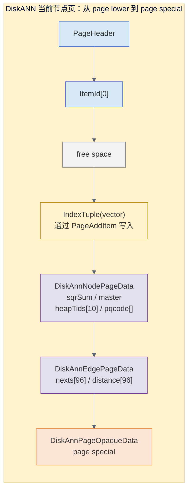
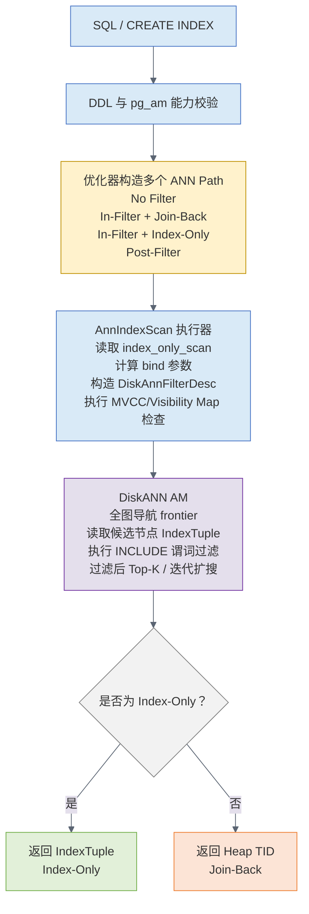
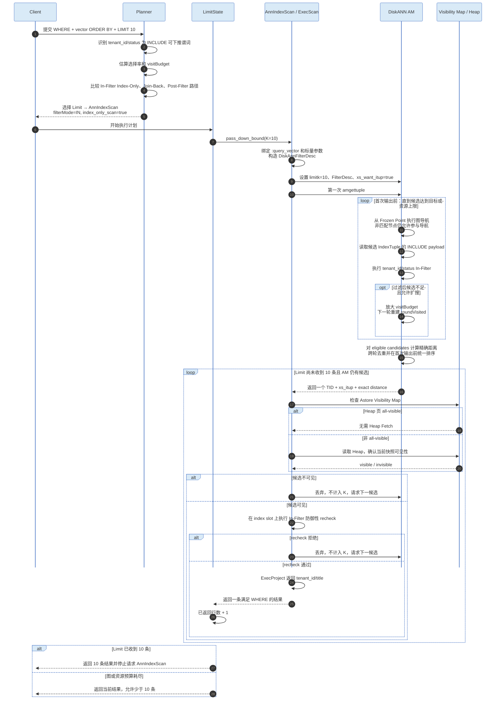
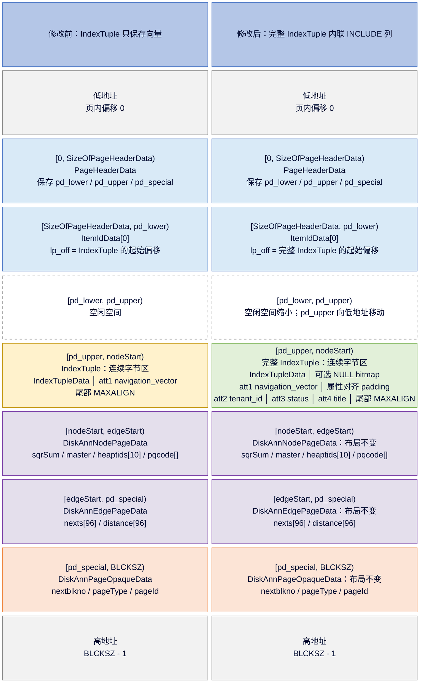
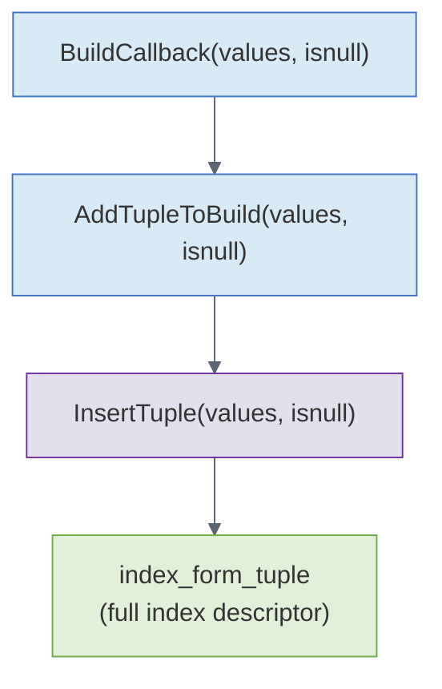
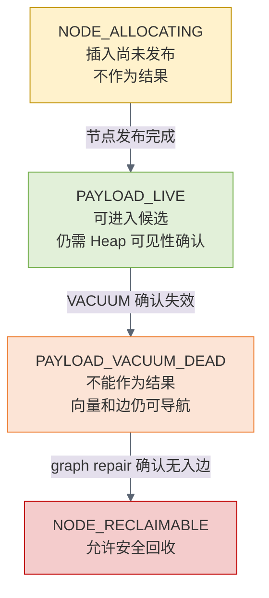
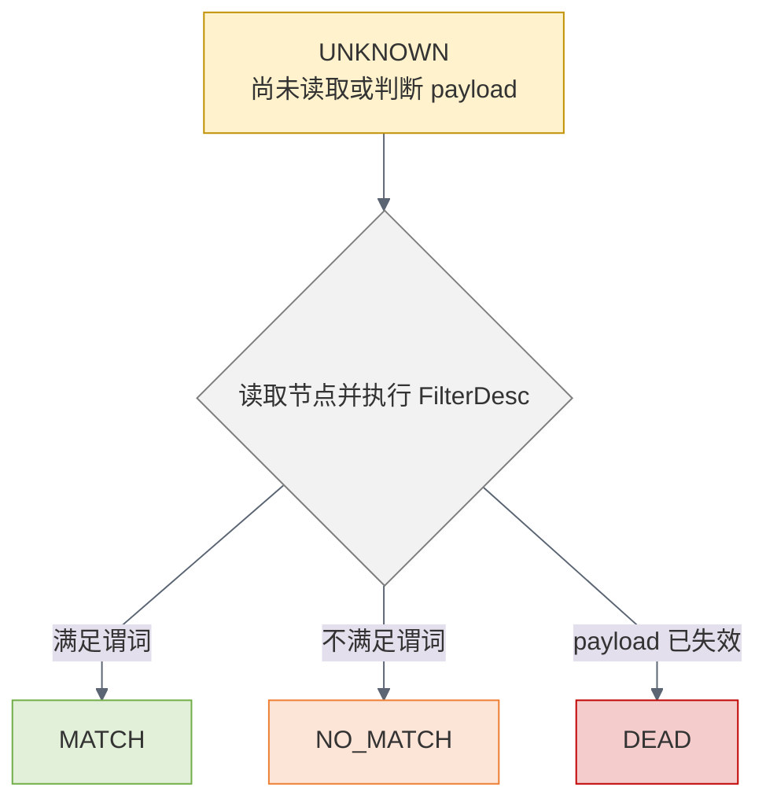
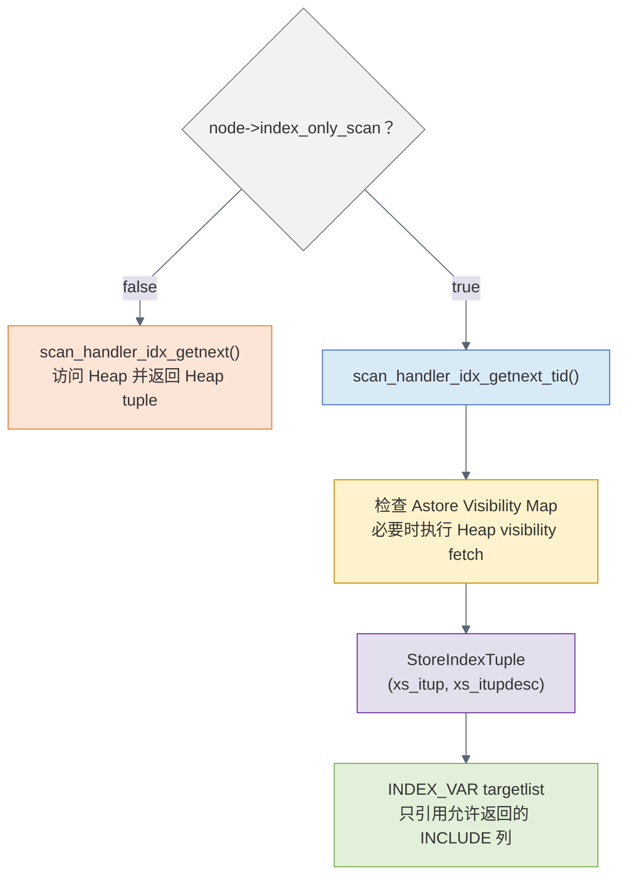
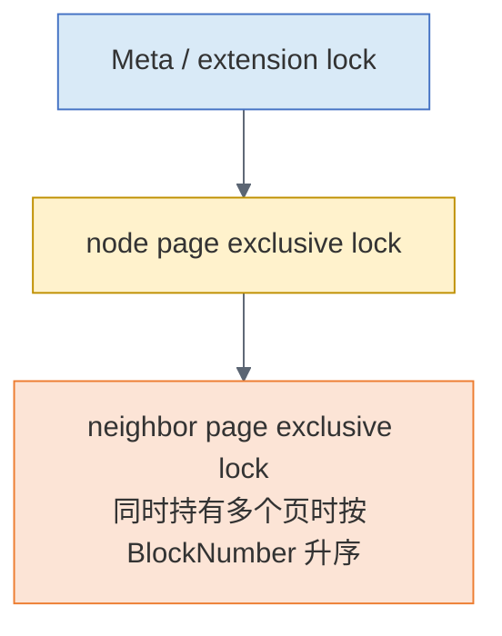

# openGauss DiskANN Included Columns 与 In-Filter 详细设计

## 1. 文档信息

| 项目 | 内容 |
|---|---|
| 状态 | 详细设计 / 实现交接审查版 |
| 基线代码 | `6df94c2ccb779611e55406e8fdb463068eea8b77` |
| 基线描述 | `v5.1.0-6169-g6df94c2ccb`，当前工作区运行版本为 openGauss 7.0.0-RC3 |
| 审查日期 | 2026-08-06 |
| 目标模块 | DiskANN 索引访问方法、优化器、ANN 执行器、DDL/系统表、VACUUM/WAL |
| 目标能力 | `INCLUDE` 覆盖列、ANN Index-Only Scan、DiskANN 图内过滤、按需回表 |
| 非目标 | 文本 BM25 融合、向量与标量相关性感知入口路由、HNSW/IVFFlat 同步改造 |

### 1.1 实现模型使用本设计的前置规则

本文已经按上述 commit 对照代码，但不是可以整段复制进源码的补丁。交给另一个大模型实现时，必须先遵守以下规则，否则很容易出现“局部能编译、完整链路不正确”的结果：

1. 每次开始实现前执行 `git rev-parse HEAD`，必须得到本文基线 commit；若 commit 不同，先重新核对本文列出的函数、字段和条件分支，不能按行号机械修改。
2. 先执行 `git status --short`。工作区已有修改属于使用者，不得覆盖、清理或把无关改动混入本特性；建议在独立分支或独立 worktree 中实现。
3. 文中的结构体代码块表示“目标字段集合”或“增量示意”，不能拿它替换源码中的整个结构体。源码中的 `AnnIndexScan`、`IndexPath`、`AnnIndexScanState` 已有兼容、列存、分区和统计字段，遗漏任一旧字段都会造成 ABI、序列化或旁路回归。
4. `.o`、自动生成 catalog/header、parser 生成物和名称含 `.modified` 的临时文件不是修改源。应修改真实 `.cpp/.h`、catalog 输入和 upgrade/rollback SQL，再用项目构建流程生成产物。
5. 按第 26 节 Phase 0、Phase 1、Phase 2 分开提交；每个阶段先做到单机 debug/release 编译和现有 DiskANN 回归不退化，再进入下一阶段。不要一次同时改磁盘格式、Planner、Executor 和过滤算法后才首次编译。
6. 所有跨层字段都按“生产者 -> copy/out/read/参数收集 -> 消费者 -> EXPLAIN”追踪；所有扫描状态都按“begin -> first gettuple -> rescan -> end -> error cleanup”追踪；所有磁盘状态都按“build -> insert -> scan -> vacuum -> crash/replay -> old-version open”追踪。
7. 本文标为 V1 禁用的 Ustore、分区、cross-bucket、分布式、并行扫描和 OPFusion 必须在 Planner/DDL 处拒绝，并在 Executor/AM 再做运行时防御。不得静默进入旧实现，也不得把未验证分支当作 fallback。

交付实现时，每一个 commit 都应附一张“代码事实核对表”：修改前函数签名、修改后函数签名、全部调用点数量、编译配置、对应测试用例。只给出新增代码而没有调用点和销毁点，不视为完成。

## 2. 摘要

本方案在 openGauss 现有 DiskANN/Vamana 图索引之上实现与 Oracle AI Database 26ai Included Columns 类似的能力：

1. 允许在 DiskANN 索引中声明多列 `INCLUDE`。
2. 将向量、Heap TID 和包含列值保存在同一索引关系内。
3. 当查询所需的可返回列都在索引中时，生成 ANN Index-Only Scan，减少基表访问。
4. 当过滤条件只引用可下推的包含列时，在 DiskANN 索引访问过程中执行过滤。
5. 非匹配节点仍可用于图导航，但不能进入结果集合，避免破坏图连通性和召回率。
6. 当查询还需要未覆盖列时，保留 Heap join-back；标量过滤仍可在索引内提前完成。
7. 通过迭代扩大 DiskANN 搜索预算，尽量保证过滤后仍返回请求的 Top-K。

推荐分两期实现：

- V1：非分区 Astore、小型包含列内联存储、每个 Heap 行对应一个图节点、简单标量谓词 In-Filter、Astore Index-Only；带新能力的计划禁用 OPFusion。
- 后续平台适配：Ustore、分区/分布式、并行扫描和 OPFusion 增强。

本设计明确不引入外置 payload 链、payload overflow page 或共享节点 payload 链。完整 IndexTuple 必须内联在节点页内；超过页面/配置上限时，DDL 能静态确定的直接拒绝，只能在 BUILD/INSERT 才知道的实际值也必须报可诊断错误。用户需要缩减 INCLUDE 列或大小后 REINDEX；任何实现模型都不得自行恢复已删除的链式方案。

按深度代码审查后的第 26 节拆分，实现 Oracle-like INCLUDE + Index-Only + In-Filter 的首个可用版本（Phase 0～2）预计触及 25～35 个源文件，核心代码约 4,000～6,700 行，回归/隔离/故障注入测试约 2,000～3,500 行；连同 Ustore、分区分布式、OPFusion 和 graph repair 的平台适配版本约 6,500～10,500 行核心代码。若再增加“标量相关性感知的图入口路由”，还需要独立的统计、训练/采样、入口目录和成本模型，总量通常会超过 10,000 行。

## 3. Oracle 能力映射

Oracle 26ai 的 HNSW Included Columns 公开语义包括：

- 使用 `INCLUDE` 将非向量列放入向量索引。
- 覆盖查询可以只扫描向量索引而不访问基表。
- 包含列谓词可以出现在 `VECTOR INDEX HNSW SCAN IN-FILTER` 中。
- 如果输出列没有被覆盖，则使用 join-back 访问基表。
- 优化器可在 no-filter、in-filter、pre-filter 和 post-filter 之间选择。

参考：

- Oracle Included Columns with HNSW Indexes：<https://docs.oracle.com/en/database/oracle/oracle-database/26/vecse/included-columns-hnsw-indexes.html>
- Oracle Optimizer Plans for Vector Indexes：<https://docs.oracle.com/en/database/oracle/oracle-database/26/vecse/optimizer-plans-vector-indexes.html>

本设计不假设 Oracle 会依据标量与向量相关性选择单个 HNSW 图内部的入口节点。openGauss 第一阶段也不实现这种路由，只实现“索引内保存属性 + 索引内过滤 + 覆盖返回”。

语义映射如下：

| Oracle 计划/能力 | openGauss 目标 |
|---|---|
| `INCLUDE (price, zip_code)` | `USING diskann (...) INCLUDE (price, zip_code)` |
| `VECTOR INDEX HNSW SCAN` | `Ann Index Scan using ...` |
| `VECTOR INDEX HNSW SCAN IN-FILTER` | `Ann Index Scan ... Filter Mode: In-Filter` |
| 无基表访问 | `Ann Index Only Scan`，受 Visibility Map 约束 |
| join-back | ANN 返回 TID 后访问 Astore/Ustore 基表 |
| post-filter | ANN 候选返回执行器后执行 `Filter` |
| pre-filter | V1 不实现；后续版本可结合分区裁剪或 Bitmap/TID 集合实现 |

## 4. 当前实现分析

### 4.1 DDL 层硬编码限制

`src/gausskernel/optimizer/commands/indexcmds.cpp:1012` 当前明确规定只有 UBtree 可以使用包含列：

```cpp
if (strcmp(stmt->accessMethod, "ubtree") != 0 && CheckIndexIncludingParams(stmt)) {
    ereport(ERROR,
        (errcode(ERRCODE_FEATURE_NOT_SUPPORTED),
            errmsg("create a index with include columns is only supported in ubtree")));
}
```

这段逻辑没有使用 `IndexAmRoutine::amcaninclude`，因此仅修改 DiskANN handler 中的能力位并不足够。

### 4.2 DiskANN AM 能力未开放

`src/gausskernel/storage/access/datavec/diskann.cpp:104-150`：

```cpp
amroutine->amcanmulticol = false;
amroutine->amcaninclude = false;
```

并且没有 `diskanncanreturn`，`pg_am.amcanreturn` 为空。优化器中的 `check_index_only()` 会因为 `index->canreturn == false` 直接拒绝 Index-Only Path。

### 4.3 索引元组只包含向量

`src/gausskernel/storage/access/datavec/diskannbuild.cpp:262-278`：

```cpp
Datum value = PointerGetDatum(vec);
bool isnull[1] = {false};
itup = index_form_tuple(RelationGetDescr(index), &value, isnull);
```

当索引描述符包含多列时，上述长度为 1 的数组会导致越界访问。构建路径还在 `AddTupleToSort()` 中主动把输入压缩成 `Datum insertValue[1]`，丢失了所有其他列。

### 4.4 当前节点页布局

现有页使用一个普通 `IndexTuple` 保存完整向量，随后在同一页的保留区域保存节点元数据和 96 条边：



`DiskAnnPageGetNode(itup)` 根据 `IndexTupleSize(itup)` 计算节点起点，因此把小型 INCLUDE 列直接加入 `IndexTuple` 在布局上是可行的，不必移动节点和边的解析逻辑。

### 4.5 扫描只返回 TID

`src/gausskernel/storage/access/datavec/diskannscan.cpp:155-160`：

```cpp
scan->xs_ctup.t_self = so->candidates[so->curpos].heapTid;
scan->xs_recheck = false;
```

Index-Only 执行器还要求 AM 设置：

```cpp
scan->xs_itup;
scan->xs_itupdesc;
```

索引页 Buffer 在 `diskanngettuple_internal()` 返回前会释放，所以 `xs_itup` 不能直接指向 Buffer 内部，必须复制到扫描生命周期内存中。

### 4.6 重复向量共享一个 payload

`src/include/access/datavec/diskann.h:541-552` 中每个节点可以保存 10 个 Heap TID：

```cpp
ItemPointerData heaptids[DISKANN_HEAPTIDS];
uint8 heaptidsLength;
```

`DiskAnnGraph::FindDuplicateNeighbor()` 会把距离接近 0 的新向量 TID 合并到已有节点。但已有节点只有一个 `IndexTuple`。如果两个 Heap 行向量相同而 `tenant_id` 不同，一份包含列值无法代表两行。

这是覆盖索引正确性的核心阻塞，不可通过简单复制现有 `IndexTuple` 解决。

### 4.7 ANN 路径强制覆盖 Index-Only 类型

`src/gausskernel/optimizer/util/pathnode.cpp:2524`：

```cpp
pathnode->path.pathtype =
    isAnnIndex ? T_AnnIndexScan :
    (indexonly ? T_IndexOnlyScan : T_IndexScan);
```

即使 `check_index_only()` 返回 true，ANN 仍然被标记为 `T_AnnIndexScan`。当前 `AnnIndexScan` 结构虽然已有 `index_only_scan` 字段，但 copy/out/read、计划生成和执行器均未完整使用该字段。

### 4.8 MVCC 和 VACUUM 现状

- Astore Index-Only Scan 依赖 Visibility Map；不是所有可覆盖查询都能做到 `Heap Fetches: 0`。
- `diskannbulkdelete_internal()` 当前直接返回 `NULL`。
- DiskANN 依赖专用 `DeleteDiskAnnIndexTuples()` 和页面 dead 标记处理 DML 删除。
- Ustore 的 Index-Only 需要索引元组版本重检，当前 DiskANN 没有 UBtree 式多版本 payload。

### 4.9 向量 key 不一定可以原样返回

DiskANN 在 `InsertTuple()` 中会调用可选的 `DISKANN_NORM_PROC`。当前 cosine opclass 注册了 `FUNCTION 2 pg_catalog.vector_norm(vector)`，因此写入 IndexTuple 的向量是规范化向量，而不一定是基表原始值：

```text
vector_l2_ops      ：没有 FUNCTION 2，索引保存原向量
vector_ip_ops      ：没有 FUNCTION 2，索引保存原向量
vector_cosine_ops  ：有 FUNCTION 2，索引保存规范化向量
```

因此不能因为 IndexTuple 中存在第一个向量属性，就无条件认为 `SELECT embedding` 可以由覆盖索引返回。否则 cosine 索引可能返回规范化值，违反 SQL 列值语义。

V1 采用保守策略：

- INCLUDE 列可作为覆盖返回列。
- 向量 key 可以用于 AM 内距离计算和 ORDER BY。
- 查询显式投影向量 key 时需要 join-back。
- 后续版本只有在能按 opclass 证明“原样保存”时才可有条件开放向量 key 返回；额外保存原始向量不属于本设计。

### 4.10 `amcanmulticol` 校验会误伤 INCLUDE

`indexcmds.cpp:1302` 当前使用总列数而不是 key 列数判断多列能力：

```cpp
if (numberOfAttributes > 1 && !accessMethodForm->amcanmulticol)
    ereport(ERROR, ...);
```

`numberOfAttributes` 已经包含 `indexIncludingParams`。因此即使放开 4.1 节的 UBtree 白名单，只要 DiskANN 保持 `amcanmulticol=false`，一个 key 加一个 INCLUDE 列仍会被拒绝。正确修复是把这项检查改为 `numberOfKeyAttributes > 1`；不能把 DiskANN 的 `amcanmulticol` 改成 true，否则会错误允许两个可搜索向量 key。

另外，`pg_am` catalog 没有 `amcaninclude` 列，只有 handler 返回的 `IndexAmRoutine` 有该字段。DDL 阶段需要通过 `pg_am.amhandler` 调用 `get_index_amroutine()` 读取能力；对于没有 handler 的内置 AM 保留兼容映射。不能假定修改 handler 标志后 `DefineIndex()` 会自动读取到它。

### 4.11 通用 ScanKey 不能承载 INCLUDE 过滤

`nodeIndexscan.cpp::ExecIndexBuildScanKeys()` 对 `OpExpr` 和 `ScalarArrayOpExpr` 都要求：

```cpp
varattno >= 1 && varattno <= IndexRelationGetNumberOfKeyAttributes(index)
```

并使用 `rd_opfamily[varattno - 1]` 验证操作符。INCLUDE 列不属于 key，也没有对应 opfamily，所以不能把包含列谓词塞进现有 `indexqual`/`ScanKeyData` 链路。In-Filter 必须使用独立的 `infilterqual` 和 `DiskAnnFilterDesc`，否则执行器会报 “bogus index qualification”。

### 4.12 当前删除路径与 MVCC/图连通性冲突

当前行为分成两种：

- 表未设置 `immediate_delete` 时，Heap UPDATE/DELETE 不立即移除 DiskANN 节点；但 `diskannbulkdelete_internal()` 返回 NULL，死 TID 永远得不到正常 VACUUM 清理。
- 设置 `immediate_delete` 时，`tableam.cpp` 调用 `DeleteDiskAnnIndexTuples()`；`DiskAnnMarkDead()` 会删除反向边、清空本节点边并 `ItemIdMarkDead()`。

第二种做法既可能让旧快照漏行，也会在频繁 UPDATE INCLUDE 列时持续破坏图连通性。Oracle-like V1 必须对格式版本 2 禁用 immediate delete，改为 VACUUM callback 判定 Heap TID 对所有快照死亡后仅标记 payload 不可返回，保留向量和边用于导航。

### 4.13 当前迭代扩搜和 rescan 状态不完整

`diskanngettuple_internal()` 会把预算翻倍后再次调用 `diskannsearch()`，但 `so->blocks` 的 visited hash 在轮次间保留；下一轮冻结点已经 visited，可能无法真正扩大搜索。`diskannrescan_internal()` 也只重置 `curpos`，没有清空候选、visited、迭代次数或按新参数重建查询状态。

因此实现 In-Filter 前必须先修复搜索状态机：区分“单轮 visited”和“跨轮 filter/emitted cache”，并在 rescan 时完整重置查询相关状态。

### 4.14 ANN Index-Only 还有三条旁路

除了 4.7 节的 Path 类型问题，还存在：

1. `createplan.cpp` 对 `T_AnnIndexScan` 固定以 `indexonly=false` 调用 `create_indexscan_plan()`。
2. `setrefs.cpp` 的 `T_AnnIndexScan` 分支只执行 `fix_scan_list()`，没有像 `set_indexonlyscan_references()` 那样把 Heap Var 改写为 `INDEX_VAR`。
3. `opfusion_annindexscan.cpp` 只获取 Heap/UHeap tuple，不理解 `xs_itup`、Visibility Map 或 In-Filter 描述符。

所以 V1 必须同时修改 path、createplan、setrefs、executor；并在 `opfusion_util.cpp` 中对 `index_only_scan=true` 或 `filterMode=IN` 的 AnnIndexScan 禁用 Fusion，回退到标准执行器。

### 4.15 现有 ANN Path/Plan 字段并未形成闭环

`IndexPath` 已经定义 `annQuals`、`annQualCols`、`annQualTotalCost` 和 `annQualSelectivity`，但当前代码除 `_outIndexPath()` 外没有生产者或消费者。设计应给这些字段定义 In-Filter 语义并复用，不能再增加一套同义的 `annInFilterQuals/annFilterSelectivity`。

`AnnIndexScan` 也已经含有 `index_only_scan`、`annCount` 和 `int64 limitCount`，但当前状态是：

- `make_annindexscan()` 只赋值 `annCount`，不赋值 `index_only_scan/limitCount`。
- `_copyAnnIndexScan()` 只复制 `annCount`，没有复制 `index_only_scan/limitCount`。
- `_outAnnIndexScanInfo()` 和 `_readAnnIndexScan()` 三者都不序列化。
- 真正用于扫描的 K 是 `nodeLimit.cpp::pass_down_bound()` 写入 `AnnIndexScanState.limitCount`，随后 `AnnIndexNext()` 写入 `IndexScanDesc.limitk`；Plan 中的 `limitCount` 不是可靠状态源。

V1 应明确废弃 Plan 里的 `AnnIndexScan.limitCount` 执行语义并保留为 reserved 0，避免首版同时做共享结构删除；只使用运行时 State 字段。`annCount` 仅用于成本/估算，`index_only_scan` 才是必须受版本保护并完整 copy/out/read 的执行语义字段。

## 5. 设计目标与非目标

### 5.1 必须实现

1. 以下语法可以创建索引：

   ```sql
   CREATE INDEX docs_diskann
   ON docs USING diskann (embedding vector_cosine_ops)
   INCLUDE (tenant_id, status, title);
   ```

2. 支持多个包含列，总索引列数遵守 `INDEX_MAX_KEYS`。
3. 包含列更新能够产生新的正确索引项，旧项不再返回。
4. 覆盖查询可以从索引元组返回包含列；V1 不把可能被规范化的向量 key 作为可返回列。
5. 可下推标量谓词在 DiskANN AM 内执行。
6. 非匹配节点仍参与图导航。
7. 过滤后结果不足 K 时能扩大搜索预算。
8. `EXPLAIN (ANALYZE)` 能区分 In-Filter、Post-Filter、Join-Back 和 Index-Only。
9. 崩溃恢复、并发插入、删除、更新不破坏索引页。
10. 老版本无 INCLUDE DiskANN 索引可以继续读取，或给出明确的重建要求。
11. V1 仅对非分区 Astore 开放能力，并拒绝与 `immediate_delete` 同时使用；其他表形态不得静默走未验证路径。

### 5.2 第一阶段明确不实现

- 任意 SQL 表达式下推。
- 用户自定义易变函数下推。
- JOIN 谓词在 DiskANN AM 内执行。
- 标量值到 DiskANN 入口节点的路由表。
- 为每个标签维护独立子图。
- 对 HNSW 和 IVFFlat 同步提供 INCLUDE。
- Ustore 的 INCLUDE/In-Filter/覆盖扫描。
- Global Partition Index、cross-bucket、分布式 CN/DN 和并行 ANN scan。
- 带 In-Filter 或 Index-Only 的 OPFusion；V1 显式回退标准执行器。
- 严格保证在任意低选择率和大量不可见版本下都返回 K 行；达到搜索上限后 ANN 允许少于 K。

## 6. 用户接口

### 6.1 DDL

V1 沿用 openGauss 已有 INCLUDE 语法，不新增 Oracle 专有语法：

```sql
CREATE INDEX docs_diskann
ON docs USING diskann (embedding vector_cosine_ops)
INCLUDE (tenant_id, category_id, status, title)
WITH (
    index_size = 100,
    enable_pq = true,
    in_filter = true,
    max_inline_payload = 1024
);
```

建议新增 reloptions：

| 参数 | 默认值 | V1 | 说明 |
|---|---:|---|---|
| `in_filter` | `true` | 是 | 是否允许优化器生成索引内过滤路径 |
| `max_inline_payload` | `1024` | 是 | INCLUDE 列允许占用的最大字节数，最终仍受页面实际空间限制 |

V1 的 `payload_storage=inline` 和 `duplicate_payload=separate_node` 是固定格式语义，不暴露成看似可切换但实际上只有一个合法值的 reloption。外置 payload/overflow 方案已排除，不为它预留选项或磁盘字段。

`max_inline_payload` 是写入 MetaPage 的建索引格式参数，V1 不允许通过 `ALTER INDEX ... SET` 原地改变；修改它必须 REINDEX。`in_filter` 只是路径开关，可以动态修改并触发 relcache invalidation。强制 GUC 只能在合法路径集合中选择，不能绕过类型、表形态、操作符白名单或工作版本门禁。

新增 reloption 不仅要扩展 `DiskAnnOptions` 和 `diskannoptions_internal()`，还必须在 `src/gausskernel/storage/access/common/reloptions.cpp` 的 `RELOPT_KIND_DISKANN` 表中注册，否则 `WITH (...)` 会被判为未知参数。

`amcanmulticol` 仍保持 false，因为 INCLUDE 不是可搜索的第二索引 key；将 `amcaninclude` 改为 true，并按 4.10 节把 DDL 多列检查改成只统计 key 列。

### 6.2 查询

完全覆盖：

```sql
EXPLAIN (ANALYZE, COSTS OFF, BUFFERS)
SELECT tenant_id, title
FROM docs
WHERE tenant_id = 42
  AND status = 'PUBLISHED'
ORDER BY embedding <=> :query_vector
LIMIT 10;
```

当 `in_filter=true`、谓词满足下推白名单且优化器选择 In-Filter Path 时，预期计划形态为：

```text
Limit
  ->  Ann Index Only Scan using docs_diskann on docs
        Filter Mode: In-Filter
        Index Filter: ((tenant_id = 42) AND (status = 'PUBLISHED'))
        Order By: (embedding <=> :query_vector)
        Result Order: Strict-Batch
        Search Expansions: <n>
        Initial Search Budget: <n>
        Final Search Budget: <n>
        Rows Removed by Index Filter: <n>
        Filter: ((tenant_id = 42) AND (status = 'PUBLISHED'))
        Rows Removed by Filter: 0
        Heap Fetches: 0
```

这里没有 `Join Back`：`tenant_id/status` 先在 DiskANN payload 上完成 In-Filter，`tenant_id/title` 从完整 IndexTuple 返回。`Filter` 不表示又选择了 Post-Filter Path，而是 V1 故意保留在 `plan.qual` 中的最终正确性复核；对本例完整、精确的 payload，`Rows Removed by Filter` 应为 0。这一显示行为来自基线 `explain.cpp` 对 `AnnIndexScan.plan.qual` 的处理，不应为追求“计划看起来没有 Filter”而删掉复核谓词。`Heap Fetches: 0` 只代表示例数据对应的 Astore Heap 页已经 all-visible；未 VACUUM、并发更新或 Visibility Map 未命中时，计划节点仍是 `Ann Index Only Scan`，但可能显示非零 Heap Fetches 用于可见性确认。

需要回表：

```sql
EXPLAIN (ANALYZE, COSTS OFF, BUFFERS)
SELECT tenant_id, title, body
FROM docs
WHERE tenant_id = 42
ORDER BY embedding <=> :query_vector
LIMIT 10;
```

预期计划形态为：

```text
Limit
  ->  Ann Index Scan using docs_diskann on docs
        Filter Mode: In-Filter
        Index Filter: (tenant_id = 42)
        Join Back: true
        Order By: (embedding <=> :query_vector)
        Result Order: Strict-Batch
        Search Expansions: <n>
        Final Search Budget: <n>
        Rows Removed by Index Filter: <n>
        Filter: (tenant_id = 42)
        Rows Removed by Filter: 0
        Heap Fetches: <n>
```

`body` 不在 INCLUDE 中，因此第二条查询必须使用候选 Heap TID 访问基表；`tenant_id` 仍先在 DiskANN 内完成过滤，取得可见 Heap tuple 后再执行防御性 recheck，最后从 Heap 投影 `body`。如果成本模型判断 In-Filter 不划算，可以选择 `Filter Mode: Post-Filter`；上述是本设计希望在典型小 payload、可下推等值谓词下得到的目标计划，而不是无条件强制计划。

### 6.3 调试控制

建议增加会话级 GUC，仅用于测试、回归和问题定位：

```text
diskann_filter_mode = auto | in_filter | post_filter
diskann_max_filter_expansions = 10
diskann_filter_oversample = 1.5
```

默认 `auto`，不建议将强制模式作为普通业务依赖。

实现时区分索引 reloption 和会话 GUC：

- `in_filter/max_inline_payload` 是持久化索引选项：先在 `storage/access/common/reloptions.cpp` 为 `RELOPT_KIND_DISKANN` 注册，再在 `DiskAnnOptions` 增加字段，最后在 `diskann.cpp::diskannoptions_internal()` 的 `relopt_parse_elt tab[]` 增加正确 `offsetof`。只改其中一处会出现“DDL 接受但 rd_options 读不到”或“未知参数”错误。
- `diskann_filter_mode/max_filter_expansions/filter_oversample` 是 session GUC：定义 session context 字段、线程/session 初始化默认值和 `guc_sql.cpp` 注册项。不要把查询调试 GUC 写进 MetaPage。

`ALTER INDEX ... SET (in_filter=...)` 依赖 relcache invalidation 后生效；`max_inline_payload` 改变的是写入约束，不能让同一索引内出现无法解释的混合承诺。V1 推荐把它定义为建索引时固定选项，ALTER 时拒绝并提示 REINDEX。默认值和上下界必须只定义一处常量，registration、parse 和文档共用，避免三处漂移。

## 7. 总体架构



最重要的算法约束是：

> 标量谓词只控制节点能否进入结果集合，不能阻止不匹配节点作为图导航的中间节点。

否则高选择率过滤可能切断图路径，召回率会显著下降。

### 7.1 向量—标量联合查询的预期时序

以下列完全被 DiskANN key/INCLUDE 覆盖的查询为例：

```sql
SELECT tenant_id, title
FROM docs
WHERE tenant_id = 42
  AND status = 'PUBLISHED'
ORDER BY embedding <=> :query_vector
LIMIT 10;
```

假设索引为：

```sql
CREATE INDEX docs_diskann
ON docs USING diskann (embedding vector_cosine_ops)
INCLUDE (tenant_id, status, title)
WITH (in_filter = true);
```

当优化器选择 `ANN_FILTER_IN + indexOnly` 路径时，预期时序如下。图中的 `ExecScan()` 是 AnnIndexScan 内部复用的通用扫描函数，不是独立计划算子。



关键语义如下：

1. Planner 只把白名单内、且全部来自 INCLUDE 列的标量条件编译为 `DiskAnnFilterDesc`；原始谓词仍保留防御性 recheck。
2. `tenant_id/status` 只决定候选能否进入 `eligibleResults`，不决定图节点能否参与导航。
3. DiskANN 在第一次返回结果前完成所需扩搜、精确距离重排和统一排序，避免后一轮更近候选追加到已输出结果之后。
4. Index-Only 不代表完全不访问 Heap；Visibility Map 未命中时仍需访问 Heap 确认可见性，但输出值来自 `xs_itup`。
5. Limit 只统计可见、通过 recheck 且完成投影的结果；达到搜索上限后允许少于 K，不能用不匹配或不可见行补足数量。

## 8. DDL、AM 与系统表设计

### 8.1 DDL 校验改造

修改 `src/gausskernel/optimizer/commands/indexcmds.cpp`：

1. 删除“只有 ubtree”硬编码。
2. 获取 access method handler 的 `IndexAmRoutine`。
3. 当 `indexIncludingParams != NIL` 时检查 `amcaninclude`。
4. 把 `numberOfAttributes > 1 && !amcanmulticol` 改成 `numberOfKeyAttributes > 1 && !amcanmulticol`。
5. 保留 key 与 INCLUDE 不得相交、总列数不超过 `INDEX_MAX_KEYS` 的通用检查。
6. 针对 DiskANN 增加以下限制：
   - key 列必须恰好一个。
   - key 必须是带 typmod 维度的受支持向量类型。
   - INCLUDE 不允许表达式列，V1 只接受普通表列。
   - INCLUDE 不允许系统列、虚拟列和不稳定生成列。
   - V1 只允许非分区 Astore；Ustore、GPI、cross-bucket 和分布式表明确报 `FEATURE_NOT_SUPPORTED`。
   - 表启用 `immediate_delete` 时拒绝创建格式版本 2 的 INCLUDE DiskANN，避免立即断边和破坏旧快照。
   - `ALTER TABLE` 后续启用 `immediate_delete`、转换到 Ustore、分区化或改变分布属性时，也必须检查依赖索引并拒绝；不能只保护 CREATE INDEX 时刻。

推荐把硬编码改成通用函数：

```cpp
static void CheckAccessMethodIncludeSupport(
    const IndexStmt* stmt,
    const IndexAmRoutine* amroutine);
```

其中带 handler 的 AM 可用 `get_index_amroutine(accessMethodForm->amhandler, accessMethodName)` 获取临时 routine，并在检查后释放；没有 handler 的 UBtree 保留现有兼容判断。这样后续 HNSW/IVFFlat 可以复用，而不是再次添加索引名白名单。`pg_am` 本身没有 `amcaninclude` 字段，不能从 `Form_pg_am` 直接读取该能力。

除 DDL 门禁外，`tableam.cpp/execUtils.cpp` 的运行时删除分派仍必须读取索引格式并跳过 version=2 immediate-delete，作为并发 DDL、升级残留和 catalog 异常下的最后防线。

#### 8.1.1 对照当前代码的落点与对象生命周期

当前 INCLUDE 白名单检查发生在查询 `pg_am` 之前，而 `amcanmulticol` 检查发生在 `SearchSysCache1(AMNAME, ...)` 之后。实现时必须调整执行顺序，不能只在原白名单位置调用一个尚未取得的 handler：

```cpp
/* 伪代码：只表达顺序，不替换 DefineIndex() 的其余逻辑 */
tuple = SearchSysCache1(AMNAME, PointerGetDatum(accessMethodName));
accessMethodForm = (Form_pg_am)GETSTRUCT(tuple);

Oid amhandler = accessMethodForm->amhandler;  /* ReleaseSysCache 前复制 */
bool amcanmulticol = accessMethodForm->amcanmulticol;
IndexAmRoutine *amroutine = NULL;
if (OidIsValid(amhandler))
    amroutine = get_index_amroutine(amhandler, accessMethodName);

CheckAccessMethodIncludeSupport(stmt, amroutine);
if (numberOfKeyAttributes > 1 && !amcanmulticol)
    ereport(ERROR, ...);

pfree_ext(amroutine);
ReleaseSysCache(tuple);
```

关键点：

- `Form_pg_am` 指向 syscache tuple 内部，`ReleaseSysCache(tuple)` 后不得再读取 `accessMethodForm->...`；所需 OID/bool 必须先复制到局部变量。
- `get_index_amroutine()` 返回 handler 构造的 `IndexAmRoutine`，正常路径用完后释放；错误路径由当前内存上下文回收。
- 没有 handler 的旧内置 AM 继续走现有兼容规则；不能为了 DiskANN 删除 UBtree 的 INCLUDE 能力。
- 只把“多 key”判定改为 `numberOfKeyAttributes`。不得把 DiskANN 的 `amcanmulticol` 改为 true，因为那会错误放开 `(embedding1, embedding2)` 两个搜索 key。
- `CheckIndexParamsNumber()`、GPI/CBI 自动附加列和 `allIndexParams` 的顺序必须重新核对。V1 对 GPI/CBI 要给出明确拒绝，不能让自动附加的系统列绕过限制。

完成判据不是“CREATE INDEX 能执行”，而是以下四条同时成立：UBtree INCLUDE 行为不变、DiskANN 一个 key 加 INCLUDE 成功、DiskANN 两个 key 失败、无 handler 的其他 AM 错误行为不变。

### 8.2 DiskANN handler

修改 `diskannhandler()`：

```cpp
amroutine->amcaninclude = true;
strcpy_s(amroutine->amcanreturnfuncname,
         NAMEDATALEN,
         "diskanncanreturn");
```

新增：

```cpp
PGDLLEXPORT PG_FUNCTION_INFO_V1(diskanncanreturn);

Datum diskanncanreturn(PG_FUNCTION_ARGS)
{
    Relation index = (Relation)PG_GETARG_POINTER(0);
    bool hasInclude = index->rd_index->indnatts > index->rd_index->indnkeyatts;
    PG_RETURN_BOOL(hasInclude);
}
```

DiskANN 位于 `builtin_indexes_without_amhandler[]`，所以 `index_can_return()` 实际通过 catalog `amcanreturn` 以一个 `Relation` 参数调用该函数，而不是调用 handler 内无参数的函数指针。V1 只对真正含 INCLUDE 的 DiskANN 返回 true：这可以避免旧格式、无 INCLUDE、可能含一节点多 TID 的索引意外生成 `COUNT(*)` 一类 Index-Only Path，也避免把规范化向量 key 暗示成可覆盖返回。扫描开始时仍要用 MetaPage flag 二次校验格式。

这里有两套能力来源，不能混为一谈：

- `DefineIndex()` 的 INCLUDE DDL 能力来自 `get_index_amroutine(amhandler, ...)` 返回的 `amcaninclude`。
- `check_index_only()` 最终调用 `index_can_return()`；当前 DiskANN 被列入不使用 handler 的内置 AM 集合，因此它读取 `pg_am.amcanreturn`。

所以，仅设置 `amroutine->amcanreturnfuncname` 不会让现有 DiskANN 产生 Index-Only Path；必须同时注册 `diskanncanreturn` 并更新 `pg_am`。反过来，只更新 `pg_am` 也不会放开 INCLUDE DDL。测试必须分别覆盖这两条链路。

即使 `diskanncanreturn()` 返回 true，它也只表示该索引具备返回 IndexTuple 的能力。openGauss 当前 `amcanreturn` 是索引级 bool，不能描述“INCLUDE 列可返回、规范化向量 key 不可返回”。因此优化器还必须实现 13.1 节的逐列 returnable bitmap，不能只依赖该 bool。

### 8.3 catalog 与升级脚本

至少修改：

- `src/include/catalog/pg_am.h`
- `src/common/backend/catalog/builtin_funcs.ini`
- maindb/otherdb upgrade SQL
- 对应 rollback SQL

`pg_am` 的 DiskANN 行需要把 `amcanreturn` 从 `-` 改为 `diskanncanreturn`。

升级 SQL 的核心动作是新增函数并更新已有 `pg_am` 行，而不是新增 catalog 列：

```sql
CREATE FUNCTION pg_catalog.diskanncanreturn(internal)
RETURNS bool
LANGUAGE INTERNAL
AS 'diskanncanreturn';

UPDATE pg_catalog.pg_am
SET amcanreturn = 'pg_catalog.diskanncanreturn'::regproc
WHERE oid = 8303;
```

rollback 的 catalog 顺序相反：先把 `pg_am.amcanreturn` 置为 `0/-`，再 `DROP FUNCTION ... (internal)`；但只有完成下述磁盘格式降级前置检查后才允许执行。

内置函数 OID 必须通过 openGauss 的 OID 分配/冲突检查流程申请，不能在设计稿中随意写死。

`builtin_funcs.ini`、`pg_am.h` 和升级 SQL 中的函数名、参数类型、返回类型必须完全一致。新增 OID 前至少执行全仓 `rg` 检查冲突；不能只在 `builtin_funcs.ini` 注册 C 符号而漏掉新装库的 bootstrap catalog，也不能只写 upgrade SQL 导致新装库与升级库行为不同。C 实现放在 `diskann.cpp`，声明放在 `diskann.h`，并使用与同文件其他入口一致的 `PGDLLEXPORT PG_FUNCTION_INFO_V1(...)` 形式。

升级策略：

- 新安装直接生成正确 catalog。
- 滚动升级先部署能够识别格式版本 2 的二进制和内置函数；只有集群工作版本达到新门槛后，才更新 `pg_am.amcanreturn` 并放开 INCLUDE DDL。旧 DN/旧主备不得打开或写入格式版本 2 索引。
- 已有 DiskANN 索引仍使用磁盘格式版本 1；只有新建带 INCLUDE 的索引使用磁盘格式版本 2 的标志。这里的“格式版本 2”只是 on-disk format 编号，不表示后续功能交付阶段。
- 回滚 SQL 不能单独解决磁盘格式降级。降级到旧二进制前，必须扫描 `pg_index` 找出 `relam=diskann` 且 `indnatts > indnkeyatts` 的索引，要求用户删除这些索引或在不含 INCLUDE 的定义上重建，并确认主备都已回放完成后才能降低工作版本。

这是硬门禁：当前旧代码只在部分 PQ helper 校验 magic，`DiskANNGetMetaPageInfo()` 不校验 version，并会按旧 `sizeof(DiskAnnMetaPageData)` 读取；旧 INSERT 还会把长度为 1 的 `values/isnull` 交给多属性 TupleDesc。不能指望旧节点看到 version=2 后自动安全报错。

## 9. 页面与元组格式

### 9.1 V1 推荐：完整 IndexTuple 内联

对于带 INCLUDE 的索引，使用索引的完整 TupleDesc 形成元组：

```cpp
IndexTuple itup = index_form_tuple(
    RelationGetDescr(index),
    indexValues,
    indexNulls);
```

以下示意图按一个 DiskANN 节点占用一个 8KB 索引页绘制。每个方框表示一段连续的页内字节，纵向位置表示地址从低到高；图中没有链表箭头，也不按实际字节比例缩放。实际长度由向量维度、PQ 参数、NULL 情况和变长列内容决定。

#### 修改前后物理布局对比

先明确：属性 1 与属性 2～4 之间不是链表关系。它们属于同一个 IndexTuple 数据区，按照索引 TupleDesc 的属性顺序连续编码；类型对齐可能在属性之间插入少量 padding，但不存在 `next` 指针。下图左侧是当前格式，右侧是完整 IndexTuple 内联后的格式。修改后以 `INCLUDE (tenant_id, status, title)` 为例。



图内的 `│` 只用于分隔同一连续字节区中的字段，不表示指针。修改前，`index_form_tuple()` 只接收长度为 1 的 `values/isnull` 数组，因此 IndexTuple 中只有 `navigation_vector`；修改后，属性 2～4 紧跟在属性 1 后按规则对齐存放。Heap TID 同时存在于 `IndexTupleData.t_tid` 和 `DiskAnnNodePageData.heaptids[]`，这与属性的连续编码无关。

页内各区域的实际定位公式如下：

| 物理区域 | 起始偏移 | 结束偏移 | 长度/定位方式 |
|---|---:|---:|---|
| PageHeader | `0` | `SizeOfPageHeaderData` | 固定页头 |
| ItemId 数组 | `SizeOfPageHeaderData` | `pd_lower` | 当前节点页只有 `ItemIdData[0]`，其 `lp_off` 指向 IndexTuple |
| Free Space | `pd_lower` | `pd_upper` | IndexTuple 变大后该区域缩小 |
| IndexTuple | `pd_upper` | `nodeStart` | `nodeStart = pd_upper + IndexTupleSize(itup)` |
| Node | `nodeStart` | `edgeStart` | `edgeStart = nodeStart + metaPage->nodeSize` |
| Edge | `edgeStart` | `pd_special` | 长度为 `metaPage->edgeSize` |
| Page Opaque | `pd_special` | `BLCKSZ` | `DiskAnnPageOpaqueData` |

IndexTuple 内部也不是“属性指针数组”。`index_form_tuple()` 按以下方式形成连续字节：

```cpp
Size hoff = IndexInfoFindDataOffset(infomask);
Size dataSize = heap_compute_data_size(indexTupleDesc, values, isnull);
Size tupleSize = MAXALIGN(hoff + dataSize);
```

- `IndexTupleData` 位于元组起始处，保存 `t_tid` 和 `t_info`。
- 任一属性为 NULL 时，header 后存在 NULL bitmap；NULL 属性只占一个 bitmap 位，不保存对应 Datum 字节。
- 非 NULL 属性按 TupleDesc 顺序写入 data area。`navigation_vector` 是 att1，`tenant_id/status/title` 分别是 att2～att4。
- `heap_fill_tuple()` 按每种类型的 `attalign` 插入 padding；变长属性在 IndexTuple 内保存 varlena 头和内联数据。
- `index_getattr()` 根据 TupleDesc、NULL bitmap 和前序属性长度计算目标属性地址，没有链表遍历。

物理变化只有黄色/绿色的 IndexTuple 区域：INCLUDE 列使 `IndexTupleSize(itup)` 增大，`PageAddItem()` 将新的 `pd_upper` 向低地址移动并压缩空闲空间。`ReserveSpace()` 预留的 node、edge 和 page opaque 仍位于页尾，不需要改变三者的磁盘结构。现有定位公式继续成立：

```cpp
DiskAnnNodePage node =
    (DiskAnnNodePage)((char*)itup + IndexTupleSize(itup));
DiskAnnEdgePage edge =
    (DiskAnnEdgePage)((char*)node + metaPage->nodeSize);
```

这里不得再维护第二套 payload offset 公式。`index_form_tuple()` 形成的 `IndexTupleSize(itup)` 已包含最终对齐后的 tuple 长度，`DiskAnnPageGetNode(itup)` 必须继续以它为唯一 node 起点。若又按列宽、`max_inline_payload` 或 `sizeof(Vector)` 手算 node 偏移，NULL bitmap、short varlena 和属性对齐会让读写位置不一致。

当前写页顺序是先用 `ReserveSpace(page, metaPage->itemSize)` 从 `pd_upper` 预留 node+edge，再用 `PageAddItem()` 放 IndexTuple。必须保持这一约定，并在 `PageAddItem()` 成功后从页内的 `ctup` 重新计算 node 地址；不能用写入前临时 `itup` 的内存地址推导页内 node。页面读取方还要先验证页面只有预期 item、ItemId 为 normal、`IndexTupleSize` 没有越过 node/edge/special 边界，再调用现有宏。

因此，实现时不能再把 `metaPage->itemSize` 理解为完整页面项目大小：它只表示 node 与 edge 的预留大小；完整页面占用还必须加上对齐后的完整 IndexTuple、`ItemIdData`、页头和 special space。具体容量校验见 9.3 节。

优点：

- 复用 PostgreSQL/openGauss 现有 `index_form_tuple()`、`index_getattr()`。
- `DiskAnnPageGetNode(itup)` 自动适应变长 IndexTuple。
- Index-Only 执行器可以直接消费该 IndexTuple。
- GenericXLog 全页镜像可以覆盖索引元组变化。

限制：

- INCLUDE 数据必须与向量、节点和边同时放进一个 8KB 页。
- 1536 维 FLOAT32 向量约占 6KB，96 条边约占 772 字节，最大维度下包含列实际预算通常不到约 1KB。
- 大型 TEXT、JSON、BYTEA 不能直接承诺支持。
- `navigation_vector` 对 cosine opclass 是规范化值，V1 不能把它作为基表 `embedding` 的覆盖值返回。

### 9.2 MetaPage 磁盘格式版本 2

建议将 `DISKANN_VERSION` 提升为 2。为了让升级后的二进制仍能读取版本 1，不能在旧字段中间插入成员；新字段必须追加在现有 `frozenBlkno[]` 之后，并保留精确的 V1 前缀布局：

```cpp
enum DiskAnnMetaFlags : uint32 {
    DISKANN_META_HAS_INCLUDE       = 1U << 0,
    DISKANN_META_INLINE_PAYLOAD    = 1U << 1,
    DISKANN_META_ONE_TID_PER_NODE  = 1U << 2,
    DISKANN_META_IN_FILTER         = 1U << 3
};

/* 以下字段追加到现有 DiskAnnMetaPageData.frozenBlkno[] 之后；
 * 现有字段不改名、不重排。旧前缀长度由常量固化，不能再用新 sizeof 推导。 */
typedef struct DiskAnnMetaV2Tail {
    uint32 metaBytes;
    uint32 formatFlags;
    uint16 nIndexAttrs;
    uint16 nKeyAttrs;
    uint32 maxInlinePayload;
} DiskAnnMetaV2Tail;
```

不增加 `EXTERNAL_PAYLOAD`、`payloadPageCount` 或外置页号字段；这些都属于已删除的 payload 链/页方案，保留一个“暂时不用”的格式位反而会诱导后续实现。

不在 MetaPage 重复保存列类型信息。列号、类型、collation 和 TupleDesc 已由 `pg_index`、`pg_attribute` 维护，避免 catalog 与索引页定义不一致。

当前 V1 MetaPage 中含有运行时指针 `DiskPQParams* params`，它虽被写入页面，但扫描/插入会重新构造 PQ 参数，不能把该值当成持久化地址。版本 2 读取函数必须：

1. 校验 magic、version、`pd_lower` 和 `metaBytes` 后再复制。
2. 对 version=1 只读取旧结构长度，并为新字段填默认值。
3. 对 version=2 读取追加字段。
4. 返回内存副本后强制 `params=NULL`，随后按现有 `InitDiskPQParamsOnDisk()` 重建。
5. 对未知高版本报“需要升级二进制/REINDEX”，不能按当前 `sizeof(DiskAnnMetaPageData)` 盲拷贝。
6. 对 version=2 比较 `nIndexAttrs/nKeyAttrs`、HAS_INCLUDE flag 与当前 `rd_index`；不一致按索引损坏报错，不能继续用错误 TupleDesc 解析页面。

同时启用现有但尚未实际使用的 `DiskAnnPageOpaqueData.pageType`：

```text
META / EXTENSION_LOCK / NODE / PQ_TABLE / PQ_CENTROID / PQ_OFFSET
```

每个新页初始化时必须写 pageType。VACUUM 不能靠 block 范围猜测节点页，因为 PQ 页和扩展锁页与节点页位于同一 relation fork。

#### 9.2.1 不能直接照抄的格式陷阱

源码目前只有 `DiskAnnMetaPageData`，没有单独的 V1 磁盘类型。实现时要先为基线 ABI 固化旧格式字段偏移/长度，再增加新格式 reader，至少加入关键 `offsetof` 和旧结构长度的编译期断言。上面的 `DiskAnnMetaV2Tail` 只表达追加字段；实际可直接追加到原 struct，或由 writer 拼接，但不能在旧字段中间插入。

`DiskPQParams *params` 是旧结构中的本机指针，结构还可能含编译器 padding。不能把一个“字段看起来相同”的新 C++ 嵌套结构直接 `memcpy` 后假定磁盘前缀一致。推荐实现 `DiskAnnReadMetaV1()` 和 `DiskAnnReadMetaV2()` 两个 reader：前者只按已固化的旧长度取值，后者按 `metaBytes` 取值；二者都输出一个清零的运行时 `DiskAnnMetaInfo`，并强制 `params=NULL`。

`pageType` 也有兼容陷阱：当前 `DiskAnnInitPage()` 只初始化 `nextblkno/pageId`，旧格式页的 `pageType` 没有可依赖语义。version=1 读取不能因 `pageType==0` 就判坏；只有 MetaPage 已确认 version=2 后，才把 pageType 当强校验。新增枚举值应显式固定，不能依赖枚举声明顺序。

设置 pageType 的调用点包括 `CreateMetaPage()`、`CreateRelationLockPage()`、所有 PQ page creator、串行/并行/在线节点页和 init fork。遗漏任一创建点都可能让 VACUUM 把 PQ/lock 页按 Node 解析。建议把初始化收口为唯一入口：

```cpp
void DiskAnnInitPage(Page page, Size pageSize, DiskAnnPageType pageType);
```

并删除或禁止继续调用无 pageType 参数的版本。格式测试要覆盖 version=1、version=2、未知 version、截断 `pd_lower`、错误 `metaBytes`、错误 pageId 和 version=2 错误 pageType。

### 9.3 页面空间检查

当前代码只检查 `IndexTuple` 自身是否小于页面容量，没有把 `metaPage->itemSize` 纳入同一个条件。必须改为：

```cpp
Size required = MAXALIGN(IndexTupleSize(itup))
              + MAXALIGN(metaPage->nodeSize)
              + MAXALIGN(metaPage->edgeSize)
              + sizeof(ItemIdData)
              + MAXALIGN(sizeof(DiskAnnPageOpaqueData));

if (required > BLCKSZ - MAXALIGN(SizeOfPageHeaderData)) {
    ereport(ERROR,
        (errcode(ERRCODE_PROGRAM_LIMIT_EXCEEDED),
         errmsg("DiskANN index tuple is too large"),
         errdetail("vector and included columns require %zu bytes; page capacity is %d bytes",
                   required, BLCKSZ)));
}
```

不能使用 `Assert` 处理用户输入导致的空间不足；Release 构建中 Assert 可能被关闭。

`max_inline_payload` 的计量口径必须固定为“形成最终 IndexTuple 后，完整 tuple 相对仅含同一规范化向量 key 的 tuple 增加的对齐后字节数”，并在 BUILD/INSERT 共用 helper 中检查：

```text
inlinePayloadBytes = MAXALIGN(IndexTupleSize(fullItup))
                   - MAXALIGN(IndexTupleSize(keyOnlyItup))
```

不能把各 Datum 的 `datumGetSize()` 简单相加，因为 NULL bitmap、短 varlena、压缩和 tuple 对齐都会造成偏差。`max_inline_payload` 只是产品限制；无论它是否通过，都必须再执行本节的真实页面容量检查。

容量 helper 必须在 `DiskAnnPageExtension()` 和 `ReserveSpace()` 之前调用；否则空间不足会先触发 Assert 或留下一个已扩展但未使用的页。在线路径若 `PageAddItem()` 仍失败，要 `GenericXLogAbort(state)` 后释放 Buffer/临时 tuple 再报 ERROR；build 路径按其无 GenericXLog 的约定清理。PQ 分支当前为每个节点 `palloc(pqcode)` 后未释放，修改 tuple helper 时要在 copy 完成后 `pfree(pqcode)`，否则大规模并行建索引会按行泄漏内存。

### 9.4 V1 支持类型

覆盖返回与 In-Filter 支持范围应分开定义：

| 类型 | 覆盖返回 | V1 In-Filter |
|---|---|---|
| `BOOL` | 是 | `=`, `<>` |
| `INT2/INT4/INT8` | 是 | 比较、`IN`、NULL |
| `FLOAT4/FLOAT8` | 是 | 比较、NULL；遵守 NaN 语义 |
| `NUMERIC(p,s)` | 小值 | 比较；无 typmod 或超大值拒绝 V1 |
| `DATE/TIME/TIMESTAMP` | 是 | 比较、范围、NULL |
| `CHAR(n)/VARCHAR(n)` | 限长 | `=`, 范围；保留 collation |
| `UUID` | 是 | `=`, `<>`, `IN` |
| `TEXT/JSON/JSONB/BYTEA` | 本设计不支持 | 不下推 |
| 外部 TOAST 值 | 不允许原样保存外部指针 | V1 DDL 类型限制应避免该输入 |
| 用户自定义类型 | 默认否 | 默认否 |

`index_form_tuple()` 在启用 `TOAST_INDEX_HACK` 时会提取 external varlena 并尝试压缩，但索引不能依赖 Heap TOAST 指针。V1 为了让建索引成功后后续 INSERT 行为可预测，直接拒绝无长度上限的变长类型；即使类型通过 DDL，插入时仍要同时检查 `max_inline_payload`、页面真实剩余空间和 `INDEX_SIZE_MASK`。

## 10. 重复向量设计

### 10.1 V1：带 INCLUDE 时一行一节点

当 MetaPage 含 `DISKANN_META_HAS_INCLUDE` 时：

```cpp
if (metaPage->formatFlags & DISKANN_META_HAS_INCLUDE) {
    /* 不调用 FindDuplicateNeighbor，正常建立独立节点 */
} else if (FindDuplicateNeighbor(...)) {
    return;
}
```

并增加不变量：

```text
带 INCLUDE 的节点：heaptidsLength == 1
冻结导航节点：heaptidsLength == 0
无 INCLUDE 的老格式节点：heaptidsLength <= DISKANN_HEAPTIDS
```

这样每个候选 BlockNumber 都能唯一定位一份 IndexTuple 和一个 Heap TID。

代价是大量完全相同向量不再共享节点。该行为只影响新建的 INCLUDE DiskANN 索引，不改变老索引。

实现落点在 `DiskAnnGraph::Link()`，不是只在 `InsertTuple()`。当前 `FindDuplicateNeighbor()` 由 `diskannutils.cpp::DiskAnnGraph::Link()` 在完成 `IterateToFixedPoint()` 后无条件调用；如果只在写页 helper 中增加判断，新节点随后仍会在 Link 阶段被合并。需要把 `oneTidPerNode/hasInclude` 从 MetaPage 读取后传入 `DiskAnnGraph` 或 `Link()`，并在调用 `FindDuplicateNeighbor()` 的位置跳过。`DiskAnnGraphStore::AddDuplicateNeighbor()` 保留给旧格式使用。

带 INCLUDE 的候选读取时必须把 `heaptidsLength` 当作格式不变量：`1` 表示真实 payload，`0` 表示 frozen/dead/allocating 导航节点，`>1` 表示格式或路由错误并报可诊断 corruption。不能为了兼容旧格式而在 version=2 上循环多个 TID，因为这些 TID 没有各自的 INCLUDE 值。

### 10.2 冻结点处理

当前 `GenerateFrozenPoint()` 会复制一个真实行的 Heap TID。磁盘格式版本 2 的 INCLUDE 索引中，冻结点应仅用于导航：

- 向量值复制自抽样节点。
- Heap TID 设置为 Invalid。
- INCLUDE 列全部设为 NULL。
- `heaptidsLength = 0`。
- `FindDuplicateNeighbor()` 不对格式版本 2 的 INCLUDE 索引执行，因此真实行不会被折叠到冻结点。

这可以防止冻结点的空 payload 被当成真实结果返回。

构建和首条在线 INSERT 有两条独立冻结点路径，都要修改：

- `GenerateFrozenPoint()` 当前从真实节点取得 `hctid`，再原样传给 `InsertVectorIntoPage()`；必须改为显式 Invalid TID 和全 NULL INCLUDE 数组。
- `diskanninsert_internal()` 在 `nfrozen==0` 时再次调用 `InsertTuple(index, values, &invalidTid, ...)`。虽然 TID 无效，当前 `values` 仍含真实 INCLUDE；必须改用专用 `DiskAnnInsertFrozenNode()`，不能复用真实行 values。

`InsertVectorIntoPage()` 当前在形成 IndexTuple 后无条件执行 `itup->t_tid = *heaptid`。新 helper 不能通过传 `NULL` 表示 frozen 后继续解引用；应接受有效的 `ItemPointer` 对象并检查 `ItemPointerIsValid()`，或直接对 `itup->t_tid` 调用 `ItemPointerSetInvalid()`。

本设计不引入“共享图节点 + 重复向量 payload 链”。带 INCLUDE 的索引始终采用“一行一个图节点”；无 INCLUDE 的旧格式继续保留现有合并行为。

## 11. 构建与插入路径

### 11.1 函数签名调整

当前链路会丢失 `isnull` 和包含列，建议统一调整为：

```cpp
BlockNumber InsertTuple(
    Relation index,
    Datum* values,
    const bool* isnull,
    ItemPointer heaptid,
    DiskAnnMetaPage metaPage,
    bool building);

static BlockNumber InsertVectorIntoPage(
    Relation index,
    Datum* indexValues,
    const bool* indexNulls,
    Vector* normalizedVector,
    double sqrSum,
    ItemPointer heaptid,
    DiskAnnMetaPage metaPage,
    bool building);
```

`InsertTuple()` 创建临时数组，避免原地修改上层 `values`：

```cpp
Datum indexValues[INDEX_MAX_KEYS];
bool indexNulls[INDEX_MAX_KEYS];

memcpy(indexValues, values, natts * sizeof(Datum));
memcpy(indexNulls, isnull, natts * sizeof(bool));
indexValues[0] = normalizedVectorDatum;
indexNulls[0] = false;
```

实际 openGauss 源码优先使用 `memcpy_s` 并检查返回值；上面两行 `memcpy` 只表示复制语义。局部数组只复制 Datum 值/指针，并不取得 by-reference INCLUDE Datum 的所有权。`DiskAnnFormIndexTuple()` 必须在 `BuildCallback()` 的 `tmpCtx` 被 reset 之前同步完成 `index_form_tuple()`，不得把 `Datum*`、`isnull*` 或其中的 varlena 指针保存进 `blocksList`、并行共享区或 Graph 对象。

归一化向量是 helper 新分配的值，可以在 tuple form 完成后释放；来自 callback/INSERT 调用者的 INCLUDE Datum 不能在 helper 中 `pfree`。对 detoast/normalize 产生的新地址要用显式 ownership 标志区分，避免既泄漏又误释放调用者数据。

数组长度必须取 `RelationGetDescr(index)->natts`，而不是 key 数；`IndexTuple.t_tid` 与 `DiskAnnNodePageData.heaptids[0]` 必须写同一个 Heap TID。若 key 为 NULL 或归一化检查失败，函数返回 `InvalidBlockNumber`，调用者不得继续 `graph.Link()`、更新 MetaPage 或增加 `indtuples`。

建议把形成元组和写页拆为两个 helper：

```cpp
IndexTuple DiskAnnFormIndexTuple(...);   /* 复制全部属性，只替换导航向量 */
BlockNumber DiskAnnInsertNodePage(...);  /* 空间检查、pageType、WAL、节点状态 */
```

这样 DELETE/VACUUM、冻结点和 scan 返回 tuple 不再各自手写长度为 1 的 `values/isnull` 数组。

### 11.2 串行构建

`BuildCallback()` 已经从 `tableam_index_build_scan()` 收到全部 `values/isnull`，只需完整传递：



当前 `AddTupleToSort()` 名称具有误导性：它没有使用 tuplesort，而是立即创建页面并把 BlockNumber 加入 `blocksList`。推荐在本次修改中更名为 `AddTupleToBuild()`，并把 `isnull` 加入签名；若不更名，至少在注释中明确它不能延迟保存 callback Datum。

还有一个容易漏掉的失败分支：现有函数无条件 `blocksList.push_back(blkno)` 并增加 `indtuples`。增加 INCLUDE 后，key NULL、零范数向量、超页或格式校验可能使插入失败；只有 `BlockNumberIsValid(blkno)` 时才能入表和计数。并行 worker 也必须在取得 spinlock 之前完成该判断，shared list 中绝不能出现 `InvalidBlockNumber`。

### 11.3 并行构建

当前并行 worker 重新调用 `BuildIndexInfo(indexRel)` 并执行相同 callback，因此完整值传递可以自然复用。需要验证：

- worker 的 Index TupleDesc 与 leader 一致。
- 磁盘格式版本 2 的 MetaPage 在启动 worker 之前完成。
- formatFlags 对所有 worker 可见。
- payload 超限错误能让全部 worker 正确退出并清理共享状态。

并行共享结构 `DiskAnnShared.blocksList` 只能保存 `BlockNumber`。不得因为 INCLUDE 而把 `IndexTuple`、Datum 指针或 TupleDesc 放进该共享对象；worker 的 callback 临时上下文会在每行后 reset，而普通 palloc 指针也不能直接跨 worker 地址空间使用。MetaPage 中的 `formatFlags/nIndexAttrs/nKeyAttrs` 必须由 worker从磁盘重新读取并验证，不以 leader 本地结构指针作为权威。

`diskannbuildempty_internal()` 传入 `INIT_FORKNUM`，但当前 `CreateMetaPage()`、`CreateRelationLockPage()`、`DiskAnnPageExtension()` 多处硬编码 `MAIN_FORKNUM`。V1 必须让 forkNum 沿构建调用链传递到底层 ReadBuffer/FSM/WAL helper；否则 unlogged relation 的 init fork 与 main fork 格式可能不一致。

这里不是只改 `CreateMetaPage()` 的一个参数。实现模型要用 `rg 'MAIN_FORKNUM|ReadBuffer\(|ReadBufferExtended\(' diskann*.cpp diskann.h` 做一次构建路径审计，把 `forkNum` 存入 `DiskAnnBuildState` 并传到 lock page、PQ page、node extension、MetaPage update、GraphStore build-time 读写和最终 `LogNewpageRange()`。在线 INSERT/scan/VACUUM 仍使用 main fork。任何一个 buildempty helper 落回 main fork，unlogged relation 重启后都会出现 init fork 缺页或格式不一致。

### 11.4 在线 INSERT

`diskanninsert_internal()` 已收到所有列的 `values/isnull`，需要：

1. 完整形成 IndexTuple。
2. 在写页前验证 payload 大小。
3. 格式版本 2 的 INCLUDE 索引不执行重复向量合并。
4. GenericXLog 同时覆盖 IndexTuple、node 和 edge 初始化。
5. 失败时不更新 MetaPage `insertPage`。
6. 新页先写 `NODE_ALLOCATING`，完成邻边链接后再以单页 WAL 切换为 `NODE_LIVE`；扫描可通过 ALLOCATING 节点导航，但不能将其作为结果。

图链接会修改多页，现有代码用多个 GenericXLog 记录，无法与节点创建组成单个原子 WAL record。`NODE_ALLOCATING -> NODE_LIVE` 是发布协议，不应在文档中承诺“整个图插入原子完成”。崩溃后遗留的 ALLOCATING 节点由 VACUUM/REINDEX 检测并修复或保持为仅导航节点。

在线 INSERT 还要补齐资源和异常路径。`InitDiskPQParamsOnDisk()` 返回一个 palloc 的 `DiskPQParams` 包装对象，其中 table/centroid/offset 数组由 Relation cache 持有；调用者只释放包装对象，不能对这些数组调用 `FreeDiskPQParams()`。`DiskAnnGraphStore` 由 `New(...)` 创建后必须在所有正常路径 `delete`，错误路径由 `PG_TRY/PG_CATCH` 或专用 context 保证清理。新增 INCLUDE 错误不能让每次 INSERT 累积 PQ wrapper/GraphStore 内存。

实现顺序必须是：读取并校验 MetaPage -> 形成完整 tuple 并做容量检查 -> 创建 ALLOCATING 节点 -> 必要时创建纯导航 frozen -> Link -> 发布 LIVE。`blkno==InvalidBlockNumber` 时立即退出，不能执行当前代码后续的 `graph.Link(blkno, ...)`。任何 ERROR 都依靠事务回滚撤销 WAL 页修改，但 C++ 对象和非当前 context 资源仍需要明确销毁。

### 11.5 UPDATE

只修改 INCLUDE 列也必须视为索引列修改：

```sql
UPDATE docs SET status = 'ARCHIVED' WHERE id = 1;
```

预期行为：

1. Heap 新版本写入。
2. 新版本建立新 IndexTuple/节点。
3. 旧节点在普通 DML 路径中保留；新快照通过 Heap 可见性排除它，旧快照仍可看到旧版本。
4. VACUUM callback 确认旧 TID 对所有快照死亡后，将旧 payload 标记为不再返回，但继续保留节点和边用于导航。

需要确认 HOT 更新判定把 INCLUDE 属性计入 indexed attributes。openGauss 通用 `pg_index.indkey` 已包含 INCLUDE 列，原则上可以阻止错误 HOT，但必须添加回归用例。

格式版本 2 的 INCLUDE DiskANN 不得进入 `DeleteDiskAnnIndexTuples()` immediate-delete 路径；这既是 MVCC 要求，也是保持图连通性的要求。

## 12. 删除与 VACUUM

### 12.1 删除定位

V1 不再通过向量 ANN 查询定位待删节点。立即删除既昂贵，又可能因为近似搜索或相同向量而找错节点。正常 UPDATE/DELETE 只修改 Heap；随后 `diskannbulkdelete_internal()` 顺序扫描 pageType=NODE 的页面，并把 `IndexTuple.t_tid` 交给 VACUUM callback。

格式版本 2 一行一节点，因此以下不变量必须成立：

```text
IndexTuple.t_tid == node.heaptids[0]
node.heaptidsLength == 1        // live payload
node.heaptidsLength == 0        // frozen 或 vacuum-dead payload
```

向量和 payload 的二进制相等只能用于 `amcheck` 诊断，不能作为删除身份；规范化、压缩 varlena 和同向量多行都会使这种比较不可靠。

### 12.2 Tombstone 语义

复用 `DiskAnnNodePageData.deleted` 定义格式版本 2 的位状态：



V1 不使用 `ItemIdMarkDead()` 表示 `PAYLOAD_VACUUM_DEAD`。`LP_DEAD` 是通用页面项状态，当前 `IsMarkDeleted()` 会据此改变搜索行为，未来页面整理也可能回收该 item；payload 生命周期必须由节点状态显式表达。搜索逻辑必须：

- 不把 dead 节点加入结果。
- 仍可展开 dead 节点的邻居。
- 不执行 dead 节点的 payload filter。

为避免把旧字段当 bool 使用，给 `DiskAnnNodePageData.deleted` 定义显式且固定的 version=2 状态值，例如 `0=ALLOCATING, 1=LIVE, 2=VACUUM_DEAD, 3=RECLAIMABLE`，并通过 `DiskAnnNodeGetState()/DiskAnnNodeCanReturn()` helper 访问。所有新节点字段都要显式初始化，不能依赖 `PageInit()` 后保留区碰巧为 0。version=1 仍走旧的 ItemId/tag 解释，不能用新 enum 重释旧页。

当前直接判死的真实入口不是 `node->deleted`，而是 `diskannscan.cpp` 调用 `diskannutils.cpp::IsMarkDeleted()`，后者读 `ItemIdIsDead()`；`diskanndelete.cpp` 则调用 `ItemIdMarkDead()` 并清边。格式 2 必须在 `IsMarkDeleted()` 或替代 helper 中按 MetaPage version 分流，搜索、iterator、返回候选、VACUUM 都调用同一组状态 helper。实现后执行 `rg 'IsMarkDeleted|ItemIdIsDead|ItemIdMarkDead|\.deleted' diskann*` 逐项审计：格式 2 不得从任一旁路再进入 LP_DEAD/清边语义。

### 12.3 VACUUM

`diskannbulkdelete_internal()` 不能继续返回 NULL。V1 最低要求：

1. 扫描 relation fork，只处理 pageType=NODE、`ItemIdIsNormal(FirstOffsetNumber)` 且状态为 `PAYLOAD_LIVE` 的页；坏页或缺失 item 进入可诊断损坏路径，不能盲解引用。
2. 使用 callback 判断 `IndexTuple.t_tid` 是否已对所有快照失效。
3. 在同一页面 GenericXLog 中将状态改为 `PAYLOAD_VACUUM_DEAD`、`heaptidsLength=0`，但保留 `t_tid` 供诊断。
4. 正确填充 `IndexBulkDeleteResult` 的 `num_pages`、`tuples_removed`、`num_index_tuples` 和空页统计。
5. 保留向量、PQ code、节点和全部边；不调用 `EraseEdgeFromGraph()`。
6. V1 不把 dead 节点页放入 FSM，也不复用/截断这些页面，因为当前没有入边引用计数，无法证明安全回收。

`diskannvacuumcleanup_internal()` 负责汇总统计和给出 dead ratio；超过阈值时在日志/视图中建议 `REINDEX`。只调用 `FreeSpaceMapVacuum()` 不能解决图节点回收。

#### 12.3.1 当前函数位置与实现骨架

当前 `diskannbulkdelete_internal()` 和 `diskannvacuumcleanup_internal()` 实际定义在 `diskann.cpp`，而 `diskanndelete.cpp` 是 immediate-delete/断边路径。实现时要么在 `diskann.cpp` 完成 deferred VACUUM，要么新建 `diskannvacuum.cpp` 并从原文件移走定义、同步 Makefile；不能在 `diskanndelete.cpp` 再定义同名函数造成重复符号。

V1 非分区 Astore 的 callback 固定使用：

```cpp
callback(&itup->t_tid, callbackState, InvalidOid, InvalidBktId)
```

扫描骨架还必须处理这些细节：

- `stats==NULL` 时先 `palloc0`；`info->analyze_only` 时不得修改页。
- 使用 `info->strategy` 或 bulk-read strategy 读取，循环中调用 `vacuum_delay_point()`，并在每一条 continue/error-safe 分支释放 Buffer。
- version=2 先校验 pageId/pageType/ItemId/tuple 边界；frozen、ALLOCATING 和已 DEAD 节点不调用 callback。
- callback 返回 true 后，在 exclusive page lock 和一个 GenericXLog record 内只改 payload 状态和 `heaptidsLength`，不 `ItemIdMarkDead()`、不清边、不加入 FSM。
- `num_pages` 统计 relation 实际块数；`tuples_removed` 是本轮新 tombstone 数；`num_index_tuples` 是仍可对应 Heap 行的 LIVE payload 数，不包括 frozen/dead 导航节点；`pages_deleted/pages_free` 在 V1 保持 0。
- `amvacuumcleanup` 可能在没有执行 `ambulkdelete` 时被直接调用。此时不能只返回全 0；至少做一次只读 pageType 计数，或明确设置 `estimated_count=true` 并用 `info->num_heap_tuples`，保证 `pg_class` 统计不会被错误清零。

立即删除的运行时门控应放在 `execUtils.cpp::ExecOpenIndices()` 设置 `ri_hasDiskannIndex` 的位置：只有 `immediateDelete && relam==DISKANN && !DiskAnnIndexUsesDeferredDelete(indexDesc)` 才置 true。`tableam.cpp` 的删除/更新调用点再做一次格式校验。仅在 `DiskAnnMarkDead()` 内 return 太晚，因为上层已为所有 DiskANN 进入昂贵的专用删除循环。

后续版本可以增加后台 graph repair：

- 为高 dead ratio 节点重新选择邻居。
- 重建冻结入口点。
- 达到阈值时建议 REINDEX。

## 13. 优化器设计

### 13.1 IndexOptInfo

现有 `IndexOptInfo` 已有：

```cpp
int ncolumns;
int nkeycolumns;
List* indextlist;
bool canreturn;
bool isAnnIndex;
```

因此可以通过 `[nkeycolumns, ncolumns)` 识别 INCLUDE 列，不需要新增 catalog。但是当前 `bool canreturn` 粒度过粗，建议在 `IndexOptInfo` 增加：

```cpp
Bitmapset* returnableHeapAttrs;
```

该 bitmap 的成员不是 index position，而是与 `check_index_only()` 的 `attrs_used` 相同的 Heap 属性编码：

```cpp
for (int i = index->nkeycolumns; i < index->ncolumns; ++i) {
    AttrNumber heapAttno = index->indexkeys[i];
    if (heapAttno > 0)
        returnableHeapAttrs = bms_add_member(
            returnableHeapAttrs,
            heapAttno - FirstLowInvalidHeapAttributeNumber);
}
```

DiskANN V1 不加入 key 列。向量 key 虽不在 `returnableHeapAttrs` 中，仍可以被 AM 用于 ORDER BY 距离计算。该 bitmap 只回答“能否把索引中的值当作基表列值返回”。非 DiskANN AM 继续按现有 `canreturn` 语义填充全部可返回列，避免改变已有 Index-Only 行为。

复用 `IndexPath` 已有的以下字段保存 In-Filter Path 信息：

```cpp
List* annQuals;                 /* 可下推 RestrictInfo/Expr，必须统一一种节点形态 */
List* annQualCols;              /* 对应的 INCLUDE index attno */
Cost annQualTotalCost;          /* payload 比较总成本 */
Selectivity annQualSelectivity; /* 联合选择率 */
```

其中 `annQuals` 在 `build_index_paths()` 内保存 RestrictInfo，进入 `createplan` 时剥离成可序列化 Expr；不能让同一个字段在不同阶段混装两种节点形态。现有 `_outIndexPath()` 已输出这些字段，但目前没有生产者/消费者，V1 需要补齐 copy/调试输出的一致性测试。

仅在 `IndexPath` 增加：

```cpp
typedef enum AnnFilterMode {
    ANN_FILTER_NONE,
    ANN_FILTER_IN,
    ANN_FILTER_POST
} AnnFilterMode;

bool indexOnly;
AnnFilterMode annFilterMode;
double annVisitBudget;
```

V1 不在枚举中预留 `ANN_FILTER_PRE`：本文的 pre-filter 明确是后续范围，提前加入枚举容易让 planner 或序列化出现“有取值、无生产者/消费者”的半实现状态。后续实现 pre-filter 时再连同 Path 生成、成本、Plan 版本和 executor 一起加入。

不能用上面的片段替换 `IndexPath`：基线结构已经有 `isAnnIndex/annQuals/annQualCols/annQualTotalCost/annQualSelectivity/annCount/allcost/is_ustore`。实际增量只有 `indexOnly/annFilterMode/annVisitBudget`，并且 `create_index_path()` 对每条普通、并行和反向路径都要显式初始化。`create_index_path()` 当前接收 `bool indexonly` 却没有把它存入 `IndexPath`，这是首先要补的断点。

`returnableHeapAttrs` 也必须在 `IndexOptInfo` 的所有构造/复制入口中完整处理。基线不是只有 `plancat.cpp::get_relation_info()` 一个入口：

- `plancat.cpp` 在打开真实索引后根据 `relam/nkeycolumns/indexkeys` 填充 DiskANN bitmap。
- `copyfuncs.cpp::_copyPartialIndexOptInfo()` 必须使用 `COPY_BITMAPSET_FIELD(returnableHeapAttrs)`，否则 plan management/选择率提取复制后会丢失覆盖信息。
- `hypopg_index.cpp::hypo_injectHypotheticalIndex()` 要显式初始化为 `NULL`；V1 不为假设 DiskANN 索引宣告返回列，除非 hypopg 也实现了 INCLUDE 元数据和相同的能力判定。

bitmap member 使用 Heap attno 编码，不是 index position；表达式 key（`indexkeys[i]==0`）和系统列默认不加入。它由 planner MemoryContext 管理，不要在 path 仍引用时手工 `bms_free()`。现有 AM 的 `check_index_only()` 行为不能因新增 bitmap 改变，建议新增 DiskANN 专用 `check_ann_index_only()`，待回归稳定后再考虑抽象通用逻辑。

还要注意基线 `check_index_only()` 的真实语义：它先用单个 `index->canreturn` 做 AM 级开关，然后把 `indexkeys[0..ncolumns)` 全部当成可返回列。因此不能仅让 `index_can_return()` 返回 true 就直接复用它；那会把 DiskANN 向量 key 也误判为可从 PQ/压缩节点无损返回。`check_ann_index_only()` 须自己收集 `attrs_used`，并仅与 `returnableHeapAttrs` 比较。

### 13.2 可下推谓词判定

新增：

```cpp
static bool match_clause_to_ann_include(
    PlannerInfo* root,
    RestrictInfo* rinfo,
    IndexOptInfo* index,
    AnnFilterClause* result);
```

V1 仅接受 AND 连接的以下表达式：

- `included_col op Const`
- `included_col op Param`（V1 仅 `PARAM_EXTERN`；嵌套循环 `PARAM_EXEC` 延后）
- `Const op included_col`，规范化后交换方向
- `included_col IS NULL / IS NOT NULL`
- `included_col IN (Const/Param...)`
- 简单 `BooleanTest`

额外要求：

- 只引用当前基表。
- 左侧列存在于索引 INCLUDE 列中。
- 操作符函数必须 immutable，并在内置类型/操作符白名单中；仅有 `provolatile='i'` 不足以允许任意扩展函数进入 storage AM。
- collation 可从 Index TupleDesc 和表达式确定。
- 不含 SubPlan、SRF、volatile function、whole-row Var。
- 不含未覆盖列。

OR、NOT、LIKE、正则、JSON path、用户函数先保留为 post-filter。

### 13.3 生成多条路径

对同一个 DiskANN 索引可以生成：

1. `ANN_FILTER_IN + indexOnly`
2. `ANN_FILTER_IN + joinBack`
3. `ANN_FILTER_POST`
4. 无过滤路径

不要把 in-filter 作为唯一执行方式；让成本模型选择。

实现位置在 `build_index_paths()` 已完成 ORDER BY 匹配之后。INCLUDE 谓词不能放入 `index_clauses`，而是分类到现有 `IndexPath.annQuals/annQualCols`。至少构造两条可比较路径：

```text
Post Path：annQuals=NIL，所有标量谓词留在 qpqual
In Path  ：annQuals 保存可下推副本，原谓词仍留在 qpqual/plan.qual 做 executor recheck
```

V1 推荐保留原谓词在 `plan.qual`，不要从 `qpqual` 删除后再另造一套完整 SQL 求值器。AM 的 FilterDesc 只是“提前拒绝的副本”；`ExecScan()` 在最终 Heap slot 或 index slot 上自然执行 `plan.qual`，它是结果正确性的唯一权威。这样不需要维护第二个可能与 `plan.qual` 漂移的 `iss_InFilterRecheckQual`。重复求值只作用于少量返回候选，V1 接受这点开销。

V1 不接收引用外表 Var 的谓词，因此不增加 `outer_relids`；以后支持参数化 In-Filter 时，必须把这些谓词的外部 relids 和 upper Params 合并进 Path，否则嵌套循环 rescan 会得到错误的非参数化路径。

### 13.4 Index-Only 判定

复用 `check_index_only()` 的基本列覆盖判断，但 ANN 使用逐列 `returnableHeapAttrs`：

1. 收集非 resjunk SELECT 输出、join、executor residual qual 和 In-Filter recheck 真正需要读取的基表属性。
2. 仅当向量距离表达式只作为 AM 消费的 resjunk ORDER BY 时，才不把向量 key 当作“必须覆盖返回”的属性。
3. 检查剩余属性是否是 `returnableHeapAttrs` 的子集。
4. 如果查询显式投影 `embedding`，V1 判定为需要 join-back。
5. 如果显式投影 `embedding <=> :q` 的距离值，V1 同样 join-back；以后可通过 `xs_orderbyvals` 单独优化。
6. 有 row mark、`FOR UPDATE/SHARE`、目标表 DML 或需要 EPQ 的路径不得生成 ANN Index-Only。
7. ANN Path 不能再丢失 `indexonly` 标志。

推荐保留 `T_AnnIndexScan`，正式启用已有的 `AnnIndexScan.index_only_scan`，原因是：

- ANN 执行器已有 `annCount` 和 `limitCount`。
- `nodeLimit.cpp`、Top-K 改写和 bypass executor 识别 `AnnIndexScan`。
- 直接改成普通 `T_IndexOnlyScan` 容易绕过 ANN 特有的迭代搜索预算。

因此需要补齐：

- `IndexPath.indexOnly`
- `IndexOptInfo.returnableHeapAttrs`
- `create_plan()` 的 `T_AnnIndexScan` 分支把 `IndexPath.indexOnly` 传给 `create_indexscan_plan()`
- `create_indexscan_plan()` 必须先判断 `best_path->isAnnIndex`，即使 indexonly=true 也创建 `AnnIndexScan`，不能落入普通 `make_indexonlyscan()`
- `AnnIndexScan.indextlist`
- `setrefs.cpp` 为 index-only Ann 路径调用等价于 `set_indexonlyscan_references()` 的 targetlist/qual `INDEX_VAR` 重写
- copy/out/read/setrefs/stream plan 的新字段序列化

当前 `create_indexscan_plan()` 先判断 `indexonly`，因此 ANN 覆盖路径会被建成普通 `IndexOnlyScan`。必须改成以下优先级，而不只是给 `make_annindexscan()` 多传一个 bool：

```cpp
if (best_path->isAnnIndex) {
    scan_plan = (Scan *)make_annindexscan(...,
        best_path->indexOnly,
        best_path->indexinfo->indextlist,
        ...);
} else if (indexonly) {
    scan_plan = (Scan *)make_indexonlyscan(...);
} else {
    scan_plan = (Scan *)make_indexscan(...);
}
```

基线 `AnnIndexScan` 已经有 `index_only_scan`，但 `make_annindexscan()` 没有初始化它，copy/out/read 也没有闭环。不要新增 `T_AnnIndexOnlyScan`；`createplan.cpp` 中 `ENABLE_MULTIPLE_NODES` 下存在的孤立 `T_AnnIndexOnlyScan` 引用应作为编译配置问题单独核对，不能以它为模板扩散新 NodeTag。涉及共享 Plan 结构的补丁至少要编译 single-node 和 `ENABLE_MULTIPLE_NODES` 两种配置，即使 V1 运行时禁用分布式。

### 13.5 成本模型

定义：

```text
N       = 表行数
K       = LIMIT
s       = 标量过滤选择率，0 < s <= 1
d       = 预估 dead/invisible 比例
L0      = diskann_probes 或初始候选预算
Lfilter = ceil(K / (max(s, s_min) * max(1-d, d_min))) * oversample
```

候选预算：

```text
visitBudget = clamp(max(L0, Lfilter), L0, maxSearchBudget)
```

路径成本近似：

```text
C_in = C_graph(visitBudget)
     + C_index_payload_eval(visitedCandidates)
     + C_visibility(K)
     + C_heap_joinback(K, uncoveredColumns)

C_post = C_graph(L0)
       + C_heap_fetch(L0)
       + C_executor_filter(L0)
       + penalty_if_expected_matches_less_than_K
```

选择率使用基础表 `pg_statistic`，第一阶段不在向量索引中重复维护标量直方图。

当前 `diskanncostestimate_internal()` 只调用 `genericcostestimate()`，而 `cost_index()` 中 `annCount=limit/selectivity` 的特殊逻辑只对 HNSW 生效。实现时应把 DiskANN 的图访问、payload 比较、可见性和 join-back 成本放进 DiskANN cost estimator，并从扩展后的 IndexPath 读取 filter mode；不要只改公共 HNSW 分支后假设 DiskANN 会自动采用新成本。

这里的 `s` 是基表全局选择率，而图搜索实际关心的是查询向量附近的条件选择率 `s_q = P(filter | near(query))`。聚簇标签、随机标签和负相关标签可以有相同的全局 `s`，但需要完全不同的搜索预算。V1 没有 landmark/region 统计，因此不可以在成本代码中伪造 `s_q`：只能使用全局 `s` 作基线，保留 in/post/精确路径并用最大预算封顶风险。第 25 节的三类标签数据必须分开报告，不能把平均值写回为一个看似精确的成本常数。

建议规则：

- 列完全覆盖、谓词便宜：优先 In-Filter。
- 谓词非常低选择率时扩大预算，但设置上限；不能无限扫描整个图。
- 谓词昂贵或不可下推：Post-Filter。
- 查询无 LIMIT：默认不使用 DiskANN ANN Path。
- 预估 `K/s > N` 时提高成本，必要时选择顺序扫描或精确向量排序。

成本实现还要防止以下数值和归属错误：

- 将 `s` clamp 到 `[1/max(N,1), 1]`；ANALYZE 缺失、选择率为 0/NaN、`N==0` 都不能产生除零或无穷预算。
- `LIMIT NULL/ALL/0`、参数化 LIMIT 和 OFFSET 要分别处理。规划期未知 K 使用 `count_est` 或保守默认值；运行期 K 只通过 State 下传，不能写回共享 Plan。
- DiskANN 大部分工作在第一行前完成，因此 startup cost 接近批搜索总成本；不能把同一批 graph visit 同时计入 `genericcostestimate()` 的全部 index tuple 成本和自定义成本两次。
- Index-Only 的 Heap 可见性成本使用 `allvisfrac`；join-back 按预估可见且过滤通过的候选计费，不按全部 visited 节点计 Heap fetch。
- 当前公共 `cost_index()` 的 ANN 特殊分支只覆盖 HNSW。DiskANN estimator 必须有独立回归，不能只观察最终选择了 ANN 路径就认为成本字段正确。
- 极严过滤下，如果 `visitBudget` 接近 N，应把“SeqScan/标量过滤后精确距离排序”保留为可比较路径；不能为凑 K 强制选择近似图扫描。

## 14. Plan Node 设计

基线 `AnnIndexScan` 已经包含 `indexid/indexname/indexqual*/indexorderby*/indexorderdir/indexscan_relid/idx_cstorequal/cstorequal/targetlist/index_only_scan/is_ustore/selectivity/is_partial/annCount/limitCount`。不得用下面的设计片段替换整个结构；实际只追加：

```cpp
List* indextlist;          /* 完整 index column 描述，供 INDEX_VAR/setrefs/EXPLAIN */
List* infilterqual;        /* 已改写为 INDEX_VAR/index-attno 的 AM 编译输入 */
List* infilterqualorig;    /* 原始 Heap 表达式，仅用于 EXPLAIN/诊断 */
AnnFilterMode filterMode;
double annVisitBudget;     /* 规划估算，不是运行期 K */
```

已有 `index_only_scan` 字段继续使用；已有列存/分区兼容字段原样保留。`infilterqual` 是 AM 的提前过滤副本，原始 SQL 谓词仍保留在 `scan.plan.qual`，由 `ExecScan()` 做最终 recheck。

`needs_join_back` 不单独持久化，它就是 `!index_only_scan`，保存两个可互相矛盾的 bool 没有价值。`limitCount` 继续使用现有 `AnnIndexScanState.limitCount`：`nodeLimit.cpp::pass_down_bound()` 在首次取数前动态设置它，不能把 prepared statement 的运行时 LIMIT 固化到 Plan Node。

当前 `AnnIndexScan` Plan 结构中虽然也有一个 `int64 limitCount`，但 `make/copy/out/read` 均未形成有效闭环，执行器也不从它初始化 State。V1 为降低共享结构兼容风险，保留该字段但标成 reserved、由 `make_annindexscan()` 显式置 0，禁止读取为执行语义。运行时唯一权威值是 `AnnIndexScanState.limitCount -> IndexScanDesc.limitk`；后续单独版本再决定是否删除旧字段。

注意当前代码只在 `_copyAnnIndexScan()` 复制 `annCount`，但 out/read 没有序列化它；`index_only_scan` 也没有完整 copy/out/read。本次必须同步修改：

- `src/common/backend/nodes/copyfuncs.cpp`
- `src/common/backend/nodes/outfuncs.cpp`
- `src/common/backend/nodes/readfuncs.cpp`
- `src/gausskernel/optimizer/plan/setrefs.cpp`
- 工作版本号和跨节点计划兼容逻辑

按基线代码逐项核对后的最小传播表如下：

| 字段 | make/createplan | copy | out/read | setrefs / walker | executor / EXPLAIN |
|---|---|---|---|---|---|
| `index_only_scan`（已有） | 必须显式赋值 | 当前缺失 | 当前缺失 | 决定 INDEX_VAR 分支 | 决定 VM/xs_itup 分支与计划名 |
| `indextlist`（新增） | 来自 `IndexOptInfo.indextlist` | 深拷贝 | 工作版本门控 | 自身保持 Heap Var，供映射 | 初始化完整 index slot |
| `infilterqual`（新增） | INCLUDE Var 改为 index attno/INDEX_VAR | 深拷贝 | 工作版本门控 | 修正参数/rtoffset，纳入 SubPlan walker | 编译 FilterDesc |
| `infilterqualorig`（新增） | 保留原 Heap Expr | 深拷贝 | 工作版本门控 | 普通 fix_scan/仅 EXPLAIN | 显示 Index Filter |
| `filterMode/annVisitBudget` | 每条 Path 显式赋值 | 标量复制 | 工作版本门控 | 无 Expr，但要计 plan memory | 执行门控/统计 |
| `annCount`（已有） | 已产生 | 当前已复制 | 当前缺失 | 参数 walker 无需处理 | 只作估算 |

`setrefs.cpp` 不能继续只对 Ann 节点调用 `fix_scan_list()`。当 `index_only_scan=true` 时，应仿照 `set_indexonlyscan_references()`：用 `indextlist` 建 `indexed_tlist`，把 `scan.plan.targetlist` 和 `scan.plan.qual` 通过 `fix_upper_expr(..., INDEX_VAR, ...)` 改写；`indexqual/indexorderby/infilterqual` 已是 index 列形式，只做 rtoffset/参数修正；`indextlist` 自身仍保持 Heap Var。`index_only_scan=false` 的 join-back 分支继续当前普通 scan 处理。

新增字段的 out/read 必须使用新的 working version gate，并给旧计划默认值：`index_only_scan=false`、`indextlist=NIL`、`infilterqual=NIL`、`filterMode=NONE`。`IF_EXIST` 只能解决文本字段缺失，不能代替 CN/DN 工作版本门禁；新 CN 在旧 DN 上必须禁用生成该路径。

`annCount/annVisitBudget` 是规划期估算，不替代运行时 K。常量 LIMIT 可参与路径成本计算；参数化 LIMIT/OFFSET 必须在 `ExecLimit` 每次 rescan 求值后重新下传，`AnnIndexNext()` 应先写 `scan->limitk`，再安装/刷新 filter 并触发第一次批搜索。

旧版本计划反序列化时，新字段默认 `NIL/NONE/false`；新 CN 不得向旧 DN 下发包含这些字段的计划。

`AnnIndexScanState` 增加：

```cpp
List* iss_InFilterQual;
DiskAnnFilterDesc* iss_FilterDesc;
Buffer iss_VMBuffer;
long iss_HeapFetches;
long iss_FilterEvaluated;
long iss_FilterRejected;
long iss_VisibilityRejected;
long iss_SearchExpansions;
bool iss_IndexOnly;
```

不要额外创建 `iss_IndexTupleSlot`：V1 以 `ss.ss_ScanTupleSlot` 为唯一结果源。join-back 模式该 slot 是 Heap TupleDesc；index-only 模式该 slot 是 `ExecTypeFromTL(indextlist)` 形成的完整 index TupleDesc。再维护第二个 slot 会让 `ExecScan` 的 qual/projection 读错 tuple。若可见性检查需要临时 Heap slot，Astore 路径的 `IndexFetchSlot()` 不使用传入 slot；V1 又禁止 Ustore，因此无需长期第二 slot。

所有 Plan 表达式字段必须加入参数/SubPlan walker，而不只是 copy/out/read。至少核对 `subselect.cpp::finalize_primnode`、`setrefs.cpp`、`streamplan_utils.cpp::check_eval`、`planmem_walker.cpp`、gplan cache、EXPLAIN 和 SQL advisor；否则 `infilterqual` 中的 `PARAM_EXTERN` 可能没有初始化，或 prepared plan 复制后字段丢失。只有仓库确实存在相应 node visitor 时才修改，不要凭名字创建一套平行框架。

## 15. In-Filter 表达形式

### 15.1 不直接把 ExprState 放入 AM

不建议让 storage/access 层直接调用完整 executor `ExecQual()`，原因是：

- AM 会在持有索引 Buffer 锁时执行用户表达式。
- 任意表达式可能分配内存、抛错或访问其他关系。
- executor 与 AM 耦合过深，难以在并行和恢复路径复用。

V1 使用受限的、ScanKey 风格的过滤描述符：

```cpp
typedef enum DiskAnnFilterKind {
    DISKANN_FILTER_OP,
    DISKANN_FILTER_IS_NULL,
    DISKANN_FILTER_IS_NOT_NULL,
    DISKANN_FILTER_ARRAY_ANY
} DiskAnnFilterKind;

typedef struct DiskAnnFilterKey {
    AttrNumber indexAttno;
    DiskAnnFilterKind kind;
    Oid operatorOid;
    Oid functionOid;
    Oid collation;
    Oid leftType;
    Oid rightType;
    FmgrInfo function;
    Datum argument;
    bool argumentIsNull;
    bool argumentByVal;
    int16 argumentLen;
    bool functionStrict;
} DiskAnnFilterKey;

typedef struct DiskAnnFilterDesc {
    int nkeys;
    DiskAnnFilterKey* keys;
    Selectivity estimatedSelectivity;
    uint32 maxExpansions;
} DiskAnnFilterDesc;
```

上述 `DiskAnnFilterDesc` 是 executor/AM 扫描生命周期内的运行时对象，绝不能直接挂进 Plan、copy/out/read 或发送到 DN。`FmgrInfo` 内含进程地址和内存上下文指针；Plan 中只保存可序列化的 Expr/OID/enum。`ExecInitAnnIndexScan()` 打开索引后，根据 `infilterqual` 解析 operator OID，通过 `get_opcode()` 得到函数 OID，并在 scan-owned context 中执行 `fmgr_info_cxt()`。

FilterDesc 构造时要验证 operator 左右类型、collation、strict/immutable 属性和白名单，而不是信任 Planner 传入 OID。比较函数的 `FmgrInfo` 可跨 rescan 复用；参数 Datum 不可。by-value 参数直接复制，by-reference 参数在 filter parameter context 中 detoast 后用 `datumCopy()` 深拷贝，每次 rescan 先 reset 参数 context 再重建。数组 ANY 不能把 `ArrayType*` 指向 runtime ExprContext。

V1 只支持 AND。OR 可以在后续版本编译成小型布尔表达式树。FilterDesc 不再复制保存 K；搜索目标统一读取 `IndexScanDesc.limitk`，避免 prepared statement/rescan 时 descriptor 与 LIMIT 出现两个不一致的状态源。

过滤器必须实现 SQL WHERE 的三值逻辑，而不是 C++ bool：只有 TRUE 进入 eligibleResults，FALSE 和 NULL 都拒绝。具体包括：

- strict 比较任一操作数为 NULL 时结果为 NULL；`IS NULL/IS NOT NULL` 单独处理。
- `ScalarArrayOpExpr ANY` 有任一 TRUE 才通过；无 TRUE 但含 NULL 时为 NULL；空数组为 FALSE；NULL 数组为 NULL。
- NaN、定长 CHAR 尾空格、collation 和 NUMERIC 异常值全部调用 catalog 解析出的原始比较函数语义，不自行按字节比较。
- 规划器插入的合法隐式 cast 在 executor 初始化时先求值为 operator 右参数类型；AM 只接收已核验的类型 OID 和 Datum。

### 15.2 参数与 rescan

`Param` 的值由 `nodeAnnIndexscan.cpp` 在执行器层求值，并复制到扫描内存上下文。每次 rescan：

1. 重新计算 runtime keys。
2. 重建或刷新 `DiskAnnFilterDesc` 参数值。
3. 清空 DiskANN candidates、visited set、迭代次数。
4. 保留已编译的操作符 `FmgrInfo`。

这里需要两个不同的 context：长期 `filterFnCtx` 保存 `FmgrInfo`，短期 `filterArgCtx` 保存当前参数。不能 reset 一个同时保存 `FmgrInfo` 和参数的 context。错误中止由 scan context 统一回收；正常 `ExecEndAnnIndexScan()` 先结束 AM scan，再删除 executor filter context。

`ExecLimit` 会在每次执行/rescan 对参数化 LIMIT/OFFSET 求值，并由 `pass_down_bound()` 写入 `AnnIndexScanState.limitCount`。第一次 `AnnIndexNext()` 必须先把它复制到 `IndexScanDesc.limitk`，再调用 `ann_index_set_filter()`；不能在 `ExecInitAnnIndexScan()` 过早固化 K。

`PARAM_EXEC`/外表 Var 在 V1 不下推；`PARAM_EXTERN`、常量数组和 prepared statement 参数可由独立 `ExprContext` 计算。by-reference 参数必须用 `datumCopy()` 并在需要时 detoast，不能把指向 executor per-tuple context 的地址直接交给 AM。`LIMIT` 运行值可能在 `ExecInitAnnIndexScan()` 之后才由 `nodeLimit.cpp::pass_down_bound()` 设置，因此 FilterDesc 安装和首次 batch prepare 要延迟到第一次 `AnnIndexNext()`；rescan 后重新读取 `node->limitCount`。

### 15.3 AM 传递接口

推荐增加 ANN 专用通用接口，而不是从执行器直接访问 `DiskAnnScanOpaque`：

```cpp
void ann_index_set_filter(
    IndexScanDesc scan,
    const AnnIndexFilterDesc* filter);
```

`indexam.cpp` 根据 AM OID 分派到：

```cpp
void diskann_set_filter(
    IndexScanDesc scan,
    const DiskAnnFilterDesc* filter);
```

后续 HNSW 可以实现同一上层接口。

这里不能复用 `ExecIndexBuildScanKeys()`：该函数会拒绝 attno 大于 `indnkeyatts` 的条件，并要求标量列存在 opfamily。`ann_index_set_filter()` 只在 executor 初始化/rescan 边界调用，AM 扫描期间不反向依赖 PlanState。

### 15.4 必须保留返回候选 recheck

In-Filter 是提前拒绝机制，不是删除 SQL 语义的理由。V1 将可下推谓词保留在普通 `plan.qual`：

- Join-Back：`AnnIndexNext()` 取得可见 Heap tuple 后，外层 `ExecScan()` 按 Heap Var 重检。
- Index-Only：setrefs 通过 `indextlist` 把同一 `plan.qual` 改写为 `INDEX_VAR`，`ExecScan()` 在完整索引 slot 上重检。
- `AnnIndexRecheck()` 继续负责原有 indexqual 的 EPQ recheck；带 row mark/EPQ 要求的查询在 V1 不生成 ANN Index-Only。

AM 对完整 payload 做精确比较时仍设置 `xs_recheck=false`；这只表示 indexqual 不是 lossy，不代表可以从 `plan.qual` 删除 In-Filter 原谓词。RLS/security quals 从不复制进 FilterDesc，仍只在 executor 执行。

AM 侧读取 payload 时，固定 by-value Datum 可以在锁内取值后直接保存；所有 by-reference Datum 必须在 shared lock 下按属性类型深拷贝到 scratch context，解锁后才调用 `FunctionCall2Coll()`。不得把 `index_getattr()` 返回的页内指针带出 Buffer pin/lock，也不得在锁内调用用户可见函数。过滤完成后返回候选前仍要重新锁页检查 node state/TID，处理并发 VACUUM tombstone。

## 16. DiskANN 搜索算法改造

### 16.1 两类集合必须分离

概念上维护：

- `frontier`：按向量距离排序的图导航候选，包含匹配和不匹配节点。
- `eligibleResults`：通过标量过滤且可作为结果的候选。

现有 `NeighborPriorityQueue` 可以继续作为 frontier；新增结果容器，或者在每次搜索结束后对 frontier 做索引内过滤。

V1 推荐“延迟过滤”：

1. `SearchFixedPoint()` 保持图导航语义不变。
2. 对 frontier 中的候选读取 IndexTuple。
3. 在 AM 内执行 INCLUDE 谓词。
4. 只有通过过滤的节点进入 `so->candidates`。
5. 结果不足时扩大 frontier 容量并继续搜索。

该策略只对潜在近邻读取 payload，避免对所有访问节点执行标量表达式。

### 16.2 伪代码

```cpp
bool diskanngettuple_internal(IndexScanDesc scan, ScanDirection dir)
{
    DiskAnnScanOpaque so = (DiskAnnScanOpaque)scan->opaque;

    if (!so->batchPrepared)
        PrepareFilteredBatchBeforeFirstOutput(so); // 先完成扩搜和全批排序

    while (so->curpos < so->candidates.size()) {
        DiskAnnCandidate* c = &so->candidates[so->curpos++];

        /* 重新加 shared lock，防止候选形成后被 VACUUM 标死 */
        MemoryContextReset(so->returnTupleCtx);
        IndexTuple itup = CopyLiveCandidateTupleToContext(
            so, c->nodeBlkno, c->heapTid, so->returnTupleCtx);
        if (itup == NULL)
            continue;

        scan->xs_ctup.t_self = c->heapTid;
        scan->xs_recheck = false;
        scan->xs_orderbyvals[0] = Float8GetDatum(c->exactDistance);
        scan->xs_orderbynulls[0] = false;
        scan->xs_recheckorderby = false;

        if (scan->xs_want_itup) {
            scan->xs_itup = itup;
            scan->xs_itupdesc = RelationGetDescr(so->rel);
        }
        return true;
    }
    return false;
}
```

`DiskAnnCandidate` V1 只保存 `nodeBlkno/heapTid/double exactDistance`，不为所有候选长期保存 IndexTuple。过滤时在 shared lock 下复制所需 Datum，释放 Buffer 后再调用比较函数；返回时重新校验节点状态和 TID，并把完整 IndexTuple 直接复制到独立 `returnTupleCtx`。该 context 在读取下一候选之前重置，因此 `xs_itup` 的有效期符合“直到下一次 amgettuple 调用”；不能让它指向已释放 Buffer，也不能重置同时保存 visited/candidate 的 `tmpCtx`。AM 同时填充精确的 `xs_orderbyvals/xs_orderbynulls`，PQ 已完成 exact rerank 时设置 `xs_recheckorderby=false`。

`CopyLiveCandidateTupleToContext()` 不能只是 `index_copytuple()` 一行。它要在 shared lock 下依次验证 pageId/pageType、FirstOffsetNumber 的 ItemId 为 normal、IndexTuple/node/edge 边界、状态为 LIVE、version=2 的 `heaptidsLength==1`、`IndexTuple.t_tid == candidate.heapTid == node.heaptids[0]`，然后切到 `returnTupleCtx` 执行 `index_copytuple()`。解锁后才把副本赋给 `scan->xs_itup`。任何校验失败都丢弃候选或报 corruption，不能留下上一次调用的 `xs_itup`；每次 gettuple 开头先置 `scan->xs_itup=NULL`。

当前 `GetDistance()` 把 `DatumGetFloat8()` 返回值收窄为 `float`。图导航/PQ 的近似距离可以继续用 float，但最终 rerank、候选字段和排序比较器必须全程使用 double；距离相等时可用 Heap TID 作为稳定 tie-break。否则非常接近的向量会因精度截断而破坏执行计划宣称的 exact batch order。

重构搜索时还会遇到三个基线陷阱：

1. `CreateIterator()` 的 slave 分支在释放 `masterBuf` 后把 `edges` 留成 master 页内指针；旧格式 duplicate/slave 节点可能 use-after-unlock。version=2 INCLUDE 节点应拒绝 slave；version=1 兼容扫描要么持有 master buffer 到 iterator release，要么把 edge 数组复制到 batch context。
2. `VamanaVertexNbIterator` 既有手工 `CreateIterator()` 工厂又有 C++ 构造函数，二者初始化成员的方式并不等价；构造函数还存在局部 `nodeBuf` 遮蔽成员的风险。不要在重构中直接把工厂替换成 constructor，必须先统一对象初始化/销毁并做旧格式测试。
3. 当前搜索发现 dead item 后执行 `queue->remove(idx)`，随后仍使用原 `Neighbor* n`。remove 会移动底层数组，指针语义不再可靠；而本设计要求 dead payload 节点仍参与导航。V1 应保留它在 frontier 中用于展开，只在 eligible result 阶段拒绝，避免边断裂和悬空指针。

`GetDistance()` 和邻居 iterator 当前可能在持有 index Buffer shared lock 时调用距离 support function。最终实现应像 FilterDesc 一样，在锁内复制向量/PQ code/必要 node 字段，解锁后再调用 support function；不能因为当前 opclass 是内置函数就把锁内函数调用固化为新接口约定。

`diskannbeginscan_internal()` 还要无条件设置 `scan->xs_itupdesc = RelationGetDescr(index)`；executor 会在 begin 之后决定是否设置 `xs_want_itup=true`。AM 只在 `xs_want_itup` 为 true 时复制完整 IndexTuple，但 TID、精确距离和排序字段始终要正确填充。DiskANN 声明 `amcanbackward=false`，gettuple 收到 Backward 应明确报错，不能静默当作正向。

### 16.3 迭代扩搜

初始预算：

```cpp
initial = Max(diskann_probes,
              ceil(limitK / estimatedSelectivity * oversample));
```

后续：

```cpp
next = Min(current * 2, maxBudget);
```

停止条件：

- 已有至少 `candidateTarget = ceil(K / visibleFraction) * oversample` 个过滤后候选。
- 达到最大迭代次数。
- 达到索引节点数。
- frontier 不再增长。
- 查询被取消或 statement timeout。

每一轮必须创建新的 `roundVisited`；跨轮只保留 `filterCache` 和 `candidateSeen`。若复用当前 `so->blocks`，下一轮冻结点已被标记 visited，预算翻倍不会真正扩搜。`diskannrescan_internal()` 则必须清空 candidates、两个 hash、`curIterNum`、`batchPrepared` 和旧返回 tuple，并重新读取 ORDER BY/runtime filter 参数。

当前 opaque 只有一个 `tmpCtx`，其中同时分配 queue 和 visited hash；直接 `MemoryContextReset(tmpCtx)` 会让 C++ 容器/hash 指针悬空。V1 至少拆成：

```text
scanCtx        ：queue、PQ 参数包装、长期 FmgrInfo，endscan 删除
batchCtx       ：query copy、round visited、candidate/filter cache、排序数组，rescan 重置
returnTupleCtx ：当前 xs_itup 副本，每次 gettuple 前重置
```

`DiskAnnScanOpaqueData`、`NeighborPriorityQueue` 内含 `VectorList`，不是可随意 `memset/palloc0` 后当纯 C struct 使用的对象。基线代码通过逐字段赋值手工初始化；新增字段后要么继续逐个初始化并在 endscan 对每个 VectorList 调用正确的 `clear()`，要么用项目认可的 `New(context)`/placement construction 和对应销毁方式统一重构。不能对含 C++ 容器的整个 opaque 做 `memset_s`，也不能先 delete context 再调用容器 clear。

`NeighborPriorityQueue::reserve()` 当前只改变 `_capacity`，不会重建 visited，也不会自动清理旧轮状态。每轮先 `queue->clear()`，设置本轮 capacity，创建新的 `roundVisited`，再从 frozen 点开始；跨轮 `candidateSeen/filterCache` 独立保留。`blockhash_create()` 所在 context 被 reset 后必须重新 create，不能继续使用旧指针。

beginscan 中 `InitDiskPQParamsOnDisk()` 返回 palloc wrapper；当前代码把 `*tmpDiskPQParams` 复制进 opaque 后没有释放 wrapper。应在复制后 `pfree(tmpDiskPQParams)`，但不能释放其中指向 Relation cache 的 PQ 数组。endscan 只销毁 scan 自己的容器/context，Relation close/invalidation 负责缓存数组生命周期。

当前 `GetScanValue()` 假定 ORDER BY Datum 已 detoast，并在 cosine 时把 `DirectFunctionCall1Coll()` 返回的 by-reference Datum 留在当前 context。实现时校验 `numberOfOrderBys==1`、NULL query 和维度，主动 detoast/normalize 后把 query 深拷贝到 `batchCtx`，rescan 时释放。不能只保留 Assert：prepared 参数可能来自不同生命周期，Release 构建也可能不执行 Assert。

V1 在返回第一行之前完成所有需要的扩搜并对 eligible candidates 进行一次 exact-distance 排序。一旦开始输出，不再追加新候选，否则后续更近候选可能出现在已经输出的更远候选之后，违反路径宣称的 ORDER BY。由于 Heap 可见性仍可能拒绝部分候选，达到预算上限后最终结果可以少于 K；后续版本若要在输出后继续扩搜，必须增加可证明的距离下界，或由 Ann executor 物化并重新排序全部可见候选。

`scan->limitk <= 0` 必须在准备 batch 前定义：`LIMIT 0` 直接返回空；无 LIMIT/LIMIT ALL 默认不生成 ANN Path；参数为 NULL 按 SQL LIMIT ALL 处理并走 planner fallback。计算 `ceil(K/s)` 前先做有符号范围校验，再转换到 `uint32`，避免负数或超大 int64 溢出为巨额容量。OFFSET 要按 `K+offset` 估算候选目标，但最终仍由上层 Limit 丢弃 offset 行。

### 16.4 Filter cache

同一节点可能在多轮扩搜中重复出现。建议在本次查询的 `so->batchCtx` 建立：

```cpp
blockhash<BlockNumber, FilterMatchState>
```

状态：



避免重复读取和比较包含列。

另建 `candidateSeen<BlockNumber>`，避免当前 `VectorList::contains()` 在候选增长时产生 O(n²) 去重成本。

### 16.5 PQ 路径

启用 PQ 时：

- PQ 距离仍用于图导航。
- INCLUDE filter 不参与 PQ 编码。
- 候选通过 filter 后再计算完整向量精确距离。
- 可以先过滤再 exact rerank，减少完整向量距离计算。
- 非匹配节点仍要保留其 PQ 导航距离。

## 17. Index-Only 执行器

### 17.1 复用 AnnIndexScan，而非普通 IndexOnlyScan

在 `AnnIndexNext()` 中根据 `node->index_only_scan` 分支：



可以从 `nodeIndexonlyscan.cpp::IndexOnlyNext()` 抽取公共 helper，避免复制 MVCC 逻辑：

```cpp
bool IndexOnlyCheckVisibility(
    IndexScanDesc scan,
    TupleTableSlot* slot,
    Buffer* vmBuffer,
    long* heapFetches,
    EState* estate);
```

该 helper 的 V1 边界只包含非分区 Astore：Visibility Map、必要时 `IndexFetchSlot()`、HOT continuation 检查和 predicate page lock。不要把 `IndexOnlyNext()` 整个函数复制进 ANN；原函数还包含 GPI、CBI、Ustore、分区切换和 version scan 分支，而 V1 已门控这些能力。若抽取会扩大标准 IndexOnlyScan 回归面，也可先在 `nodeAnnIndexscan.cpp` 实现一个命名明确的 `AnnIndexOnlyCheckVisibilityAstore()`，逐行对照标准路径并加隔离测试。

基线 `IndexOnlyNext()` 用局部 `HeapTuple tuple=NULL` 判断是否做 page predicate lock，但 Astore 的 `IndexFetchSlot()` 只返回 bool，局部 `tuple` 没有被赋值。新 helper 不要复制这个哨兵写法；显式维护 `bool heapVisited`：真正访问 Heap 后为 true，仅在 VM 命中、完全未访问 Heap 时调用 `PredicateLockPage()`。

不能让 `StoreIndexTuple()` 只形成部分列：该函数要求 scan slot natts 与完整索引 TupleDesc 一致。正确做法是用 `ExecTypeFromTL(node->indextlist)` 初始化完整 index scan slot，再由 setrefs 后的 targetlist/qual 仅引用合法的 `INDEX_VAR` 位置。向量 key 可以存在于 slot 中，但规划器不得为显式 `embedding` 输出生成 Index-Only。

`ExecInitAnnIndexScan()` 必须在初始化阶段就按计划选择 slot 语义，不能在取数循环中临时切换：

- `index_only_scan=false`：保留当前 Heap TupleDesc 的 `ss_ScanTupleSlot` 和 Heap/UHeap join-back。
- `index_only_scan=true`：像 `ExecInitIndexOnlyScan()` 一样，用 `ExecTypeFromTL(node->indextlist)` 建完整索引 slot，并让 setrefs 后的 targetlist、普通 qual 和 In-Filter recheck 全部引用 `INDEX_VAR`。

这段分支位于当前 `ExecInitScanTupleSlot()` 后、`ExecAssignScanType()` 处：join-back 继续 `CreateTupleDescCopy(RelationGetDescr(current_relation))`，index-only 改用 `ExecTypeFromTL(node->indextlist, false, false)`。这样 EXPLAIN ONLY 不需要打开真实索引也能形成 slot。`StoreIndexTuple()` 会 Assert slot natts 与 `xs_itupdesc->natts` 一致，因此 `indextlist` 必须是一列不漏的完整索引描述，不是查询投影子集。

`infilterqual` 在 Plan 中是供 FilterDesc 编译的 index-attno 形式，`infilterqualorig` 是原始 Heap 表达式；最终 recheck 使用仍保留在 `scan.plan.qual` 中的原谓词。join-back 的 plan.qual 保持 Heap Var，index-only 经 setrefs 改写为 `INDEX_VAR`。storage AM 不能直接解释 ExprState，而是由 executor 把 `infilterqual` 编译成 FilterDesc。

Index-Only 分支在初始化及后续分区支持中的每次切换后，对每一个 IndexScanDesc 都必须设置 `xs_want_itup=true`。结束、rescan 和切换关系时释放 `iss_VMBuffer`；AM 在下一次 gettuple 前才可重置 `returnTupleCtx`。

基线 `diskannbeginscan_internal()` 返回的是底层 `IndexScanDesc`，外层 handler 可能包装为 GPI/CBI scan；设置时使用 `GetIndexScanDesc(node->iss_ScanDesc)->xs_want_itup=true`。顺序是 beginscan -> 设置 `xs_want_itup` -> rescan。AM beginscan 同时设置 `xs_itupdesc`。`iss_VMBuffer` 初始化为 `InvalidBuffer`，在 End、ReScan、错误清理和未来分区切换前释放；不能把 VM pin 留到 Relation close 之后。

### 17.2 Astore 语义

即使所有列都被覆盖，Astore 也必须确认 Heap tuple 对当前快照可见：

- Heap 页 all-visible：直接使用 IndexTuple。
- 非 all-visible：访问 Heap 检查可见性，但输出值仍来自 IndexTuple。
- `VACUUM` 后常见稳定数据可达到 `Heap Fetches: 0`。
- TimeCapsule/version scan、禁用 Astore index-only 的配置必须强制 Heap visibility fetch。
- 未访问 Heap 时，像 `nodeIndexonlyscan.cpp` 一样取得 Heap page predicate lock，保持 Serializable 语义。

因此文档和 EXPLAIN 必须避免承诺所有覆盖查询绝对不读 Heap。

对于 DiskANN V1，Astore Index-Only 只覆盖 INCLUDE 列。向量 key 仍保存在 IndexTuple 中供 AM 计算距离，但 executor 不得把规范化 key 当作原始表列输出。

### 17.3 Ustore 语义

V1 对 Ustore 整体禁用 INCLUDE/In-Filter，不只是禁用 Index-Only。当前 UHeap UPDATE/DELETE 走 `ExecUHeapDeleteIndexTuplesGuts()`/`index_delete()`，而 DiskANN 没有可用的 `amdelete` 和 UBtree 式多版本 payload，不能证明索引内标量值与可见 Ustore 版本一致。

后续版本若要开放，需要实现 DiskANN 的 Ustore delete/version recheck，并提供类似 UBtree 的 `xs_recheck_itup` 和 visible-version 校验；在此之前 DDL 必须报明确错误。

### 17.4 Join-back

当查询选择未覆盖列时：

1. DiskANN AM 执行向量检索和包含列过滤。
2. 返回通过过滤的 Heap TID。
3. `AnnIndexNext()` 访问 Heap。
4. 执行剩余 post-filter。
5. 投影未覆盖列。

可下推谓词仍保留在普通 `plan.qual`，原始形式另存于 `infilterqualorig` 供 EXPLAIN，AM 编译副本存于 `infilterqual`。`AnnIndexNext()` 只负责返回可见 tuple；外层 `ExecScan()` 对 `plan.qual` 做最终 recheck 和其他 post-filter。不要在 `AnnIndexNext()` 再执行同一 plan.qual，否则会与 `ExecScan()` 重复两次。

## 18. MVCC 与一致性

### 18.1 原则

DiskANN payload 不是 MVCC 可见性的最终权威。最终结果仍必须通过 Heap/Visibility Map 确认。

索引内过滤可能读取以下项：

- 当前可见版本。
- 已删除但尚未回收的旧版本。
- 并发事务新插入但对当前快照不可见的版本。

处理规则：

1. 过滤可以提前拒绝索引项。
2. 过滤通过不等于最终可见。
3. 最终输出前必须执行标准可见性检查。
4. 不可见候选不计入 K，执行器继续消费 AM 在首次输出前准备的 oversampled batch；batch/预算耗尽时允许少于 K。
5. 不可见或 dead 节点仍可以作为图导航节点。

### 18.2 快照一致性

IndexTuple payload 必须与它的 Heap TID 对应同一 Heap 版本。INSERT/UPDATE 的通用索引维护传入的 `values` 和 `heap_tid` 满足这一条件，DiskANN 不能把不同 TID 的 payload 合并。

INCLUDE 属性已经出现在 `pg_index.indkey` 中，修改它应阻止 HOT；只修改未索引属性可以继续 HOT，因为索引 payload 没有变化。必须用两个并发快照验证旧/新版本，而不能只做单会话 UPDATE 后查询。格式版本 2 禁用 `immediate_delete`，旧索引项只能由 VACUUM callback 在全局安全时标记 payload-dead。

### 18.3 Predicate recheck

V1 In-Filter 对完整、非 lossy INCLUDE 值执行，因此 AM 的 `xs_recheck=false`；同时仍由普通 `plan.qual` 执行 15.4 节的返回候选 recheck。以下情况不得进入 V1 In-Filter，必须退化为 post-filter：

- payload 使用截断字符串。
- collation 比较不能在 AM 内精确复现。
- 使用 Bloom/signature 类辅助过滤。

## 19. WAL、恢复与并发

### 19.1 V1 inline payload

V1 仍使用当前 GenericXLog 页面机制：

- 新页：完整 IndexTuple + node + edge 作为一个页面变更。
- 在线插入：`GENERIC_XLOG_FULL_IMAGE`。
- payload 不单独记录逻辑 WAL。
- MetaPage flag 和版本修改必须写 WAL。
- 图的多页互连不是单条 WAL 原子操作，以 `NODE_ALLOCATING/NODE_LIVE` 发布协议处理部分完成状态。
- unlogged relation 的 init fork 必须使用同一格式和正确 forkNum。

当前代码的 WAL 模式分成两类，不能统一按在线路径理解：BUILD 期间主要 `MarkBufferDirty()`，结束时 `LogNewpageRange()`；在线 INSERT/边更新使用 GenericXLog。`BuildIndex(..., forkNum)` 虽然已有参数，但 `CreateMetaPage()`、`CreateRelationLockPage()`、`DiskAnnPageExtension()`、`DiskAnnUpdateMetaPage()` 以及部分 PQ/Graph helper 仍硬编码 `MAIN_FORKNUM`，其中有的函数甚至接收 forkNum 却没有使用。Phase 0 必须先修完这条链，再提升磁盘版本。

建议在 `DiskAnnBuildState` 保存唯一 `forkNum`，build-time helper 不再接受可缺省的 MAIN；在线函数则明确断言 main fork。最终 `LogNewpageRange(index, forkNum, 0, RelationGetNumberOfBlocksInFork(index, forkNum), true)` 的 block count 必须与实际写入同一 fork。恢复测试不仅检查“能启动”，还要在 unlogged restart 后读取 Meta/PQ/frozen/node 页面并完成一次查询和 INSERT。

### 19.2 锁顺序

目标锁顺序：



现有 immediate-delete 在持有目标页 exclusive lock 时逐个锁邻居并断边，存在锁序和图破坏问题；格式版本 2 删除路径不再执行该流程。过滤扫描只取得 shared buffer lock。不能在持有 shared lock 时执行比较函数，即使它是内置 immutable：固定长度 by-reference 和变长 Datum 都先用 `datumCopy()`/detoast 复制到 scan context，释放 Buffer 后再调用 `FunctionCall2Coll()`。

VACUUM 可能在候选批形成后把 payload 标死，所以 gettuple 返回候选前必须重新加 shared lock 检查状态/TID。事务回滚产生的索引节点依赖 Heap 可见性被排除，之后由 VACUUM 转成 payload-dead；不能立即物理回收其图页。

### 19.3 崩溃测试

至少在以下注入点执行 crash/restart：

- IndexTuple 加页后、边写入前。
- 邻居已指向新节点、`NODE_LIVE` 发布前。
- duplicate 检测后、节点链接前。
- VACUUM payload-dead 状态 WAL 前后。
- MetaPage 更新 insertPage 前后。
- init fork 创建 MetaPage/PQ/节点页的各阶段。

每个故障注入点都要验证三件事：redo 后页面通过 version/pageType/边界校验、ALLOCATING 节点不会作为结果、索引仍能 DROP/REINDEX。若当前 GenericXLog 无法保证某个多页状态，恢复代码只能把它降级为导航节点或要求 REINDEX，不能猜测补写 payload。

## 20. 分区、并行与分布式计划

### 20.1 分区索引

V1 在 DDL 阶段拒绝分区表上的 INCLUDE DiskANN。后续版本开放时，对每个 DiskANN index relation 独立保存 INCLUDE payload：

- Local index：每个索引分区独立图和 payload。
- Global index：TID/partition 标识必须沿用现有 GPI 机制。
- 分区裁剪发生在进入 DiskANN 图扫描前，属于 pre-routing，不等同于图内标量入口选择。

### 20.2 并行构建

非分区 Astore 可继续使用现有并行建图，但必须新增带 INCLUDE 的一致性测试。各 worker 只写自己创建的节点页，完整 IndexTuple 跟随节点页，不引入新的共享 payload cache；任一 worker 的 payload 超限错误必须使 leader 取消并清理整个 build。

### 20.3 并行扫描

当前 `amcanparallel=false`，V1 不改变。后续如果支持：

- 多入口或分区图可分发给 worker。
- 每个 worker 返回本地过滤后 Top-K。
- Gather Merge 合并全局 Top-K。
- bind filter descriptor 必须可复制到 worker。

### 20.4 CN/DN 计划序列化

新增 Plan 字段必须受工作版本号保护。重点更新：

- `_copyAnnIndexScan`
- `_outAnnIndexScanInfo`
- `_readAnnIndexScan`
- stream plan shipping
- gplan cache

V1 功能门控为 single-node。后续版本开放 CN/DN 前，混合版本集群中旧 DN 不识别新字段时，CN 必须禁用 In-Filter/Index-Only 路径或要求版本门槛；每个 DN 的 local K 还必须按分布和过滤选择率 oversample，CN 才能合并全局 Top-K。

### 20.5 OPFusion

`opfusion_annindexscan.cpp` 当前始终构造 Heap/UHeap slot 并调用普通 index getnext。V1 在 `opfusion_util.cpp` 识别到以下任一条件时返回非 Fusion 类型，交给标准 executor：

```text
AnnIndexScan.index_only_scan == true
AnnIndexScan.filterMode == ANN_FILTER_IN
```

后续版本若要恢复 Fusion，必须补齐 FilterDesc 参数刷新、`xs_want_itup`、VM 可见性、predicate lock、完整 index slot 和统计，不能只复制一个 bool。

## 21. EXPLAIN 与可观测性

### 21.1 目标计划

完全覆盖：

```text
Limit
  -> Ann Index Only Scan using docs_diskann on docs
       Filter Mode: In-Filter
       Index Filter: ((tenant_id = 42) AND (status = 'PUBLISHED'))
       Order By: (embedding <=> $1)
       Search Expansions: 2
       Search Budget: 320
       Result Order: Strict-Batch
       Candidates Visited: 320
       Candidates Rejected by Index Filter: 287
       Candidates Rejected by Visibility: 0
       Heap Fetches: 0
```

需要回表：

```text
Limit
  -> Ann Index Scan using docs_diskann on docs
       Filter Mode: In-Filter
       Index Filter: (tenant_id = 42)
       Join Back: true
       Order By: (embedding <=> $1)
```

Post-filter：

```text
Limit
  -> Ann Index Scan using docs_diskann on docs
       Filter Mode: Post-Filter
       Order By: (embedding <=> $1)
       Filter: expensive_udf(body)
       Rows Removed by Filter: 90
```

### 21.2 统计字段

`AnnIndexScanState`/instrumentation 增加：

- `Candidates Visited`
- `Candidates Exact-Reranked`
- `Index Filter Evaluations`
- `Rows Removed by Index Filter`
- `Rows Removed by Visibility`
- `Search Expansions`
- `Initial/Final Search Budget`
- `Result Order`（V1 为 `Strict-Batch`）
- `Heap Fetches`

这些统计是验证成本模型和召回问题的必要条件。

返回候选的最终复核不新增一个 instrumentation 槽位：它仍在 `plan.qual` 中，由 `ExecScan()` 计入现有 `Rows Removed by Filter`。`Rows Removed by Index Filter` 只计 AM 在 payload 上提前拒绝的候选。两者不得重复计数，否则 EXPLAIN 无法用来校验成本模型。

## 22. 错误处理与安全

### 22.1 明确错误

需要提供可诊断错误，而不是 Assert 或通用 PageAddItem 失败：

- INCLUDE 类型不支持。
- 完整索引项超过页面容量。
- INCLUDE 索引遇到不兼容旧格式。
- In-Filter 操作符不支持。
- bind 参数类型与列类型不匹配。
- 完整 IndexTuple 越界、截断或其 natts 与 MetaPage/`rd_index` 不一致。

### 22.2 表达式安全

- 仅下推白名单形态和 immutable 比较操作符。
- 不在 Buffer lock 内运行任意 SQL 函数。
- 对 collation、NULL、NaN 和异常 numeric 做回归。
- SECURITY DEFINER、RLS 等谓词不能被错误移除；RLS 应作为 executor 层安全谓词，V1 默认不下推。

## 23. 代码修改清单

### 23.1 必改文件

| 文件 | 修改内容 |
|---|---|
| `src/gausskernel/optimizer/commands/indexcmds.cpp` | 通用 AM INCLUDE 校验、DiskANN 类型/大小约束 |
| `src/gausskernel/storage/access/common/reloptions.cpp` | 注册 `in_filter`、`max_inline_payload` |
| `src/gausskernel/storage/access/datavec/diskann.cpp` | AM flags、canreturn、insert 参数传递、reloptions |
| `src/gausskernel/storage/access/datavec/diskannbuild.cpp` | 完整 IndexTuple、并行构建、冻结点、forkNum、空间检查、发布状态 |
| `src/gausskernel/storage/access/datavec/diskannscan.cpp` | filter、每轮 visited、严格批排序、rescan、返回 xs_itup、统计 |
| `src/gausskernel/storage/access/datavec/diskannutils.cpp` | duplicate 策略、payload 访问、dead 节点语义 |
| `src/gausskernel/storage/access/datavec/diskanndelete.cpp` | 保留旧格式 immediate-delete；格式 V2 运行时拒绝进入 ANN 定位/断边路径 |
| `src/gausskernel/storage/access/datavec/diskann.cpp` 或新增 `diskannvacuum.cpp` | 当前 bulkdelete/vacuumcleanup 定义在 `diskann.cpp`；实现 pageType 扫描和 payload tombstone，不能重复定义符号 |
| `src/include/access/datavec/diskann.h` | format flags、pageType、filter desc、scan state、接口声明 |
| `src/gausskernel/storage/access/index/indexam.cpp` / `src/include/access/genam.h` | ANN filter 传递接口（若采用通用 wrapper） |
| `src/gausskernel/storage/access/table/tableam.cpp` / `src/gausskernel/runtime/executor/execUtils.cpp` | 格式 V2 immediate-delete 门控 |
| `src/include/catalog/pg_am.h` | 注册 diskanncanreturn |
| `src/common/backend/catalog/builtin_funcs.ini` | 内置函数 catalog |
| upgrade/rollback SQL | 已安装数据库 catalog 升级 |
| `src/gausskernel/optimizer/path/indxpath.cpp` | 覆盖判断、include filter 分类 |
| `src/gausskernel/optimizer/util/plancat.cpp` | 为 DiskANN 填充逐列 `returnableHeapAttrs` |
| `src/common/backend/nodes/copyfuncs.cpp` | `_copyPartialIndexOptInfo()` 深拷贝 `returnableHeapAttrs`，同时补齐 AnnIndexScan Plan 字段 |
| `src/gausskernel/dbmind/kernel/hypopg_index.cpp` | 假设索引显式初始化逐列返回能力；V1 默认不为假设 DiskANN 开启覆盖返回 |
| `src/gausskernel/optimizer/util/pathnode.cpp` | 保存 ANN indexOnly/filter mode |
| `src/gausskernel/optimizer/path/costsize.cpp` / DiskANN cost estimator | 过滤 ANN 成本模型、HNSW-only 现状修正 |
| `src/gausskernel/optimizer/plan/createplan.cpp` | AnnIndexScan 新字段、ANN index-only 分支 |
| `src/gausskernel/optimizer/plan/setrefs.cpp` | ANN Index-Only 的 `INDEX_VAR` 重写 |
| `src/include/nodes/relation.h` | `IndexOptInfo.returnableHeapAttrs`；复用 IndexPath `annQual*`，新增 indexOnly/filterMode/visitBudget |
| `src/include/nodes/plannodes.h` | AnnIndexScan 新字段 |
| `src/include/nodes/execnodes.h` | AnnIndexScanState 新字段 |
| `src/common/backend/nodes/outfuncs.cpp` / `readfuncs.cpp` | 按 working version 成对序列化/反序列化 AnnIndexScan 新字段，旧版本填安全默认值 |
| `src/gausskernel/optimizer/util/planmem_walker.cpp` | 遍历新表达式并计入列表/bitmap 内存 |
| `src/gausskernel/optimizer/plan/streamplan_utils.cpp` / `stream_remove.cpp` | 审计 AnnIndexScan 的表达式遍历与 stream 能力判定；V1 门控后仍不得丢失 Param/SubPlan |
| `src/gausskernel/runtime/executor/nodeAnnIndexscan.cpp` | Index-Only、filter 参数、visibility |
| `src/gausskernel/runtime/executor/nodeIndexonlyscan.cpp` | 可选抽取 Astore 可见性 helper；若不抽取则只作为严格对照，避免复制 GPI/Ustore/分区旁路 |
| `src/gausskernel/runtime/opfusion/opfusion_util.cpp` | V1 禁用新型 Ann 路径 Fusion |
| `src/gausskernel/optimizer/commands/explain.cpp` | 新计划名称与统计 |
| gplan cache / SQL advisor / 跨节点计划路径 | 只修改代码中确实存在的 AnnIndexScan visitor；表达式字段不得丢 Param/SubPlan，新计划不下发给旧 DN |
| `src/gausskernel/storage/access/datavec/Makefile` | 编译新增 filter 源文件 |
| `src/test/regress/sql/diskann_vector.sql` | 功能、DML、计划、边界测试 |
| `src/test/regress/expected/diskann_vector.out` | 预期输出 |

另一个模型在完成文件修改后，必须以符号为单位再次执行 `rg`：`InsertTuple`、`InsertVectorIntoPage`、`DiskAnnInitPage`、`DiskAnnGraph::Link`、`make_annindexscan`、`scan_handler_idx_beginscan`、`T_AnnIndexScan`。表格只列主要文件，不代表全量调用点；特别是 header inline/template、`#ifdef ENABLE_MULTIPLE_NODES` 分支和 OPFusion 很容易被普通单机编译漏掉。

### 23.2 建议新增文件

为了避免继续扩大 `diskannscan.cpp`：

```text
src/gausskernel/storage/access/datavec/diskannfilter.cpp
src/include/access/datavec/diskannfilter.h
```

职责：

- FilterDesc 构造后的 AM 侧验证。
- IndexTuple attribute 读取。
- NULL、比较、IN 判断。
- filter cache。
- 统计。

executor 侧从 Plan Expr 编译 FilterDesc 的代码应放在 `nodeAnnIndexscan.cpp` 或新增 `annIndexFilter.cpp`，不能让 storage 层依赖 ExprState。

## 24. 测试设计

### 24.1 DDL

- 一个 INCLUDE 列。
- 多个 INCLUDE 列。
- 31/`INDEX_MAX_KEYS` 边界。
- key 与 INCLUDE 重复。
- 表达式 INCLUDE 拒绝。
- 支持和不支持类型。
- payload 超页错误信息。
- `amcanmulticol=false` 下一个 key + 多个 INCLUDE 可以创建，两个 key 仍被拒绝。
- Ustore、分区、GPI、cross-bucket、分布式表和 `immediate_delete` 组合按 V1 约束被拒绝。
- 索引创建后再 `ALTER TABLE` 打开 `immediate_delete`、转换表形态或分布属性仍被拒绝；运行时分派也不会进入 immediate-delete。
- 临时表、unlogged init fork、普通/并行构建。
- `in_filter`、`max_inline_payload` 的默认值、上下界和未知 reloption。
- `ALTER INDEX` 可切换 `in_filter` 并触发 relcache invalidation；原地修改 `max_inline_payload` 被拒绝并提示 REINDEX。
- DROP/ALTER INCLUDE 列、修改列类型/typmod/collation 的依赖行为；需要重建时给出标准依赖错误或自动重建路径。

### 24.2 覆盖扫描

- 只投影 INCLUDE 列。
- 显式投影向量 key，确认 V1 走 join-back；cosine opclass 返回值必须与 Heap 中原始向量一致，不能返回规范化索引键。
- 投影未覆盖列，确认 join-back。
- 显式投影距离表达式，确认 V1 join-back；仅 resjunk ORDER BY 不应阻止覆盖。
- `COUNT(*) ... ORDER BY ... LIMIT` 或只返回 INCLUDE 的零/少列投影。
- `VACUUM` 前后检查 Heap Fetches。
- NULL payload。
- 变长字符串边界。

### 24.3 In-Filter

- 等于、不等于、范围、IN、NULL。
- 多列 AND。
- bind 参数和 prepared statement rescan。
- 同一 prepared statement 连续使用完全不同的 query vector/filter，确认 candidates、visited、filter cache 没有串查询。
- 不支持表达式退化为 post-filter。
- 低/中/高选择率。
- 过滤结果少于 K、等于 K、大于 K。
- 过滤后完全无结果。
- 每轮 visited 确实增长；预算翻倍不是空转。
- 输出 exact distance 单调不降，确认首次输出后没有追加更近候选。
- 构造仅在 float32 舍入后相等的近距离，确认 double exact rerank 与精确 SQL 排序一致。
- pushed filter 与 executor recheck 的结果完全一致。

### 24.4 重复向量

构造相同 embedding、不同 payload：

```sql
INSERT INTO docs VALUES
  (1, 10, 'A', '[1,2,3]'),
  (2, 20, 'B', '[1,2,3]');
```

分别过滤 `tenant_id=10/20`，必须返回正确行和正确 payload；不能共享第一行的值。

### 24.5 DML/MVCC

- 更新向量。
- 只更新 INCLUDE 列。
- 只更新未索引列，验证允许的 HOT 与 payload 不变。
- 删除最近邻。
- 并发插入后不同快照查询。
- rollback INSERT/UPDATE/DELETE。
- 长事务持有旧快照后 VACUUM。
- 两会话验证：旧快照仍能通过索引看到旧版本，新快照看到新版本。
- 表 reloption `immediate_delete` 不得进入格式版本 2 路径。
- VACUUM 与候选批读取并发，返回前状态/TID 二次检查生效。
- 大量更新/删除后 dead 节点仍可导航，召回率不因断边突降。
- REINDEX。

### 24.6 WAL/恢复

- 建索引过程中 crash。
- 在线插入过程中 crash。
- payload/edge 写入故障注入。
- checkpoint + restart 后查询一致。
- standby replay 后结果一致。
- `NODE_ALLOCATING`、`PAYLOAD_VACUUM_DEAD` 恢复后的状态机。
- unlogged relation 重启后从 init fork 恢复格式版本 2。

### 24.7 召回率

对每类过滤选择率计算：

```text
G       = exact filtered result count
denom   = min(K, G)
recall@K = |ANN_filtered_topK ∩ exact_filtered_topK| / denom   // denom > 0
```

`G=0` 时不计算 recall，单独验收 ANN 返回空集。`0<G<K` 时必须以 `G` 作分母；继续除以 K 会把“所有可用结果都已返回”误判为低召回。精确集合使用同一距离类型、同一 WHERE 谓词，并以 Heap TID/业务主键识别行，不能只比较距离值。

至少覆盖：

- 标量与向量高相关。
- 标量与向量无相关。
- 标量与向量负相关。
- 聚簇标签和随机标签。
- 30%/60% payload-dead 的更新删除 churn 数据集。

重点验证非匹配节点仍参与导航的实现没有降低基础 DiskANN recall。

### 24.8 计划、旁路与兼容

- `create_plan()` 对 ANN index-only 仍生成 `T_AnnIndexScan`，且 `index_only_scan=true`。
- setrefs 后输出/recheck Var 为正确的 `INDEX_VAR`，ORDER BY key 仍交给 AM。
- copy/out/read 往返及现有 AnnIndexScan visitor 遍历后，`indextlist`、filter mode、index-only、annCount 不丢失；基线没有 AnnIndexScan 专用 equal visitor，不为满足清单而虚构一个。
- 参数化 LIMIT/OFFSET 在连续执行和 rescan 时重新下传到 State/`scan->limitk`；Plan 中保留的兼容 `limitCount`（若未删除）始终不参与执行。
- 带新能力的计划不进入 `SELECT_FOR_ANN_FUSION`；普通 ANN 查询的原 Fusion 行为不回退。
- 旧磁盘格式版本 1 可读；未知高版本、截断 MetaPage、错误 pageType 给出可诊断错误。
- 集群工作版本未达到门槛时拒绝 CREATE INCLUDE DiskANN；存在格式版本 2 索引时拒绝降级。
- `EXPLAIN (ANALYZE)` 计数满足：visited >= filter evaluated >= eligible，Heap Fetches 与 VM 状态一致。

### 24.9 实现交接的编译、静态检查与分阶段验收

另一个模型不能只运行新增 SQL。每个 Phase 的最低验证矩阵如下：

| 阶段 | 必须编译 | 必须运行 | 失败时禁止进入下一阶段 |
|---|---|---|---|
| Phase 0 | debug + cassert、release；single-node；共享 Node 修改后再编译 multiple-nodes | 现有 `diskann_vector`、旧格式 open/insert/search、unlogged restart、prepared rescan | 任一旧 DiskANN 回归或 init fork 错误 |
| Phase 1 | 上述全部；catalog/upgrade 生成流程；memcheck 优先 | DDL、完整 tuple、duplicate、frozen、Index-Only、VM/MVCC、copy/out/read round-trip | Heap/index slot natts 不一致、旧快照漏行、计划字段丢失 |
| Phase 2 | debug/release/memcheck；新增 filter 源文件 Makefile | 三值逻辑、prepared 参数、多轮扩搜、严格顺序、EXPLAIN 统计、极严过滤 fallback | 输出失序、rescan 串值、Buffer/Datum 生命周期错误 |

仓库标准入口以 `README.md` 为准，例如：

```bash
sh build.sh -m debug -3rd <binarylibs-path>
sh build.sh -m release -3rd <binarylibs-path>
sh build.sh -m memcheck -3rd <binarylibs-path>
```

使用已有配置树做增量开发时可以先编译受影响目录，但合入前必须做一次干净的全量构建。multiple-nodes 使用仓库 CMake/构建参数 `ENABLE_MULTIPLE_NODES` 的独立 build 目录，不能在同一目录反复切换宏后相信旧对象已失效。

每次提交前至少执行：

```bash
git diff --check
rg -n 'Datum .+\[1\]|bool .+\[1\]' src/gausskernel/storage/access/datavec/diskann* src/include/access/datavec/diskann.h
rg -n 'MAIN_FORKNUM' src/gausskernel/storage/access/datavec/diskann* src/include/access/datavec/diskann.h
rg -n 'IsMarkDeleted|ItemIdIsDead|ItemIdMarkDead|\.deleted' src/gausskernel/storage/access/datavec/diskann* src/include/access/datavec/diskann.h
rg -n 'T_AnnIndexScan|AnnIndexScan' src/common src/gausskernel src/include
```

这些 `rg` 结果不是要求全部为零，而是要求逐条分类并记录：长度 1 数组是否只用于明确的旧格式/key-only helper，MAIN fork 是否只在在线路径，格式 2 是否已完全脱离 LP_DEAD/清边旁路，所有 Plan visitor 是否已处理新表达式字段。

建议新增以下自动化断言/测试钩子：

- build/insert 后 version=2 真实节点断言 `heaptidsLength==1`，frozen 断言为 0。
- page reader 在 debug/release 都执行边界校验，不把正确性寄托在 Assert。
- rescan 前后记录 query hash、visited count、batch generation，确认 generation 变化且旧 cache 不可见。
- 测试 AM 在返回前释放 index Buffer 后，`xs_itup` 仍可被 `StoreIndexTuple()` 使用；memcheck 下无 use-after-free。
- 强制 VM hit/miss 两条路径，验证 `heapVisited` 和 PredicateLockPage 分支。
- 升级库和新装库分别查询 `pg_am.amcanreturn`/`pg_proc`，结果完全一致。

## 25. 性能基准与验收标准

### 25.1 基准维度

```text
数据量：1M / 10M / 100M
维度：128 / 768 / 1536
K：10 / 100
过滤选择率：50% / 10% / 1% / 0.1%
payload：16B / 64B / 256B / 1KB
PQ：on / off
```

可直接使用 SIFT1M 的 128 维向量，但 SIFT1M 本身没有能验证 In-Filter 收益的标量标签，必须用固定 seed 补三套可重放标签：

1. `random_label`：独立随机指定 tenant，表示向量与标量无关。
2. `cluster_label`：先对向量聚类，以 cluster/region 作 tenant，表示正相关。
3. `anti_label`：让查询近邻区域主要属于其他 tenant，表示负相关/困难过滤。

每套标签分别生成 50%/10%/1%/0.1% 选择率，将 seed、生成脚本、行数和每标签频数作为测试产物保存。没有这些产物，不能用“SIFT1M 跑得更快”作为可复现结论。

### 25.2 测量方法

对每个数据组合至少跑四组：

| 组 | 强制方式 | 用途 |
|---|---|---|
| A | `diskann_filter_mode=post_filter` | 当前 ANN + Heap post-filter 基线 |
| B | `in_filter` + join-back | 单独衡量索引内提前过滤 |
| C | `in_filter` + index-only | 衡量过滤与覆盖返回的合并收益 |
| D | 禁用 ANN，WHERE 后精确距离排序 | 产生 ground truth，不与 ANN 直接比性能 |

比较 A/B/C 时先固定 `diskann_probes`、最大预算、K、snapshot 和数据顺序，并用 EXPLAIN 记录实际 `Candidates Visited`；只有实际 visited 在事先规定的容差（建议 ±5%）内才可称为“等预算”结果。然后分别调参到相同 recall 档位（例如 0.90/0.95）比较延迟，这是“等召回”结果。不得把 B/C 的实际 visited 大幅调高后，仍声称它与 A 是等预算对比。

每组至少 1 轮预热 + 5 轮正式运行，每轮不少于 1,000 个固定 query；同时报告 median/P95/P99、QPS、recall@K、Heap Fetches、Buffer read/hit、visited/filter-rejected/expansions、索引大小和构建时间。热缓存与重启后冷缓存分开报告，不混成一个平均值。

### 25.3 验收标准建议

功能：

- 所有覆盖结果与强制精确查询的标量值一致。
- 重复向量不同 payload 不串值。
- 更新/删除不返回不可见版本。
- crash/restart 后索引可用。
- 旧快照不因 UPDATE/DELETE 漏行，VACUUM 后 dead payload 仍保持图可导航。

计划：

- 覆盖列齐全时能够生成 `Ann Index Only Scan`。
- 简单包含列谓词显示 `Index Filter`。
- 未覆盖列显示 join-back。
- 不支持谓词显示普通 `Filter`。
- ANN Index-Only 仍是 `T_AnnIndexScan`，输出 exact distance 单调不降。
- 新型路径不进入 OPFusion；Ustore/分区/分布式按 V1 门控拒绝。

性能：

- SIFT1M/128D、K=10、10% 选择率、64B payload、热缓存且 recall 相比 A 组下降不超过 1 个百分点的前提下，C 组相比 A 组 P95 延迟至少下降 20%；若未达到，特性不能以“显著加速”名义验收，必须保留原始数据并解释 visited/PQ/Heap I/O 瓶颈。
- 稳定、`VACUUM FREEZE` 后且无并发写入的覆盖扫描，`Heap Fetches=0`；VM 故意清除的对照组必须显示非零 Heap Fetches 且结果一致。
- 无过滤查询性能回退控制在 3% 以内。
- 64B payload 时 INCLUDE 索引构建 P95 时间相对无 INCLUDE 增幅不超过 15%；16B/64B/256B/1KB 的索引大小和构建时间必须报告原始数据，不用单一百分比掩盖高维时的页面上限。

召回：

- 相同搜索预算下不低于当前 DiskANN 无过滤基线的合理误差范围。
- 过滤后不足候选目标时在首次输出前按配置扩搜；达到最大预算仍少于 K 时在 EXPLAIN 统计中可见，而不是误报已满足 K。

## 26. 分阶段实施

### Phase 0：准备与重构

目标：先修复新能力依赖的状态机和格式基础，不开放用户语法。

- 抽取 DiskANN tuple form/copy helper。
- 抽取页面空间检查。
- 为 scan opaque 增加安全的 tuple 生命周期管理。
- 修复 rescan/逐轮 visited、候选去重和首次输出前排序。
- 增加 MetaPage version-aware 读取、pageType、forkNum 传递。
- 建立 deferred VACUUM tombstone；格式 V2 禁用 immediate-delete 断边。
- 补齐当前 duplicate、冻结点、删除、旧快照和 unlogged 回归。

预计核心代码：700～1,200 行，测试 400～700 行。

### Phase 1：INCLUDE + 覆盖返回

- 放开 DDL。
- `amcaninclude=true`、`diskanncanreturn`。
- 完整 IndexTuple。
- 一行一节点 duplicate 策略。
- AnnIndexScan index-only 分支。
- Astore Visibility Map。
- predicate lock、TimeCapsule/rowmark 门控。
- createplan/setrefs/copy/out/read 完整链路。
- 禁用新路径 OPFusion，限制为非分区 Astore/single-node。
- EXPLAIN Heap Fetches。

预计新增/修改：1,500～2,500 行核心代码，700～1,200 行测试。

### Phase 2：In-Filter

- 谓词分类。
- FilterDesc 和 bind rescan。
- AM 内过滤。
- 首次输出前迭代扩搜、严格批排序、完整 rescan。
- executor 返回候选 recheck。
- 成本模型、EXPLAIN 统计。

预计新增/修改：1,800～3,000 行核心代码，900～1,600 行测试。

### Phase 3：平台适配与运维能力

- VACUUM 回收和 graph repair。
- Ustore 覆盖扫描。
- 分区/GPI/cross-bucket、并行扫描、分布式 Top-K 和 OPFusion 增强。

预计新增/修改：2,500～4,500 行核心代码。该估算不包含外置 payload 链/页，因为本设计明确不实现它。

## 27. 风险与决策

| 风险 | 影响 | 设计决策 |
|---|---|---|
| 相同向量不同 payload | 错误返回标量值 | V1 INCLUDE 索引禁止节点合并 |
| payload 超过单页或 `max_inline_payload` | INSERT/BUILD 失败 | 报可诊断错误；缩减 INCLUDE 列/大小后 REINDEX，不 fallback 到外置链/页 |
| 过滤剪断图 | recall 大幅下降 | 非匹配节点仍参与导航 |
| 过滤后不足 K | 少结果 | 首次输出前迭代扩大预算；达到上限后明确允许少于 K |
| 旧/不可见索引项 | 错误结果 | Heap/VM 最终确认，不可见项不计 K |
| immediate delete 断边/破坏旧快照 | 漏行、recall 下降 | 格式 V2 禁用；VACUUM 只标 payload-dead |
| Ustore 版本语义 | payload 与可见版本不一致 | V1 拒绝；后续版本实现版本 recheck 后开放 |
| cosine 索引键已规范化 | 覆盖扫描可能返回非原始向量 | V1 只将 INCLUDE 列标记为 returnable；显式投影向量时 join-back |
| ANN Path 丢失 indexOnly | 仍然回表 | 启用 AnnIndexScan 自带 index_only_scan 字段 |
| visited 跨轮/跨 rescan 泄漏 | 扩搜空转或参数串查询 | roundVisited 与跨轮 cache 分离，rescan 全量重置 |
| 扩搜后追加更近候选 | ORDER BY 失序 | V1 首次输出前完成扩搜和 exact sort |
| exact distance 收窄为 float | 近距离候选次序错误 | 导航可用 float，最终 rerank/返回统一 double |
| MetaPage 直接扩大结构 | 旧索引误读/指针污染 | 保留 V1 前缀、追加字段、按 version/metaBytes 解析 |
| 后续 ALTER 绕过建索引门禁 | immediate-delete/Ustore 进入未实现路径 | 结构 DDL 依赖检查 + 运行时格式二次门控 |
| OPFusion 绕过新 executor | 回表或错误过滤 | V1 对新型路径禁用 Fusion |
| 计划跨版本不兼容 | CN/DN 反序列化失败 | 工作版本号门槛与字段序列化保护 |
| 任意函数在 Buffer lock 内执行 | 死锁/延迟/安全风险 | V1 使用受限 FilterDesc |
| 成本估计不准 | 错选路径 | 同时保留 in/post path，并提供统计/GUC |

## 28. 推荐最终语义

第一阶段对用户承诺的准确语义应是：

> DiskANN `INCLUDE` 将非键列的值保存在向量索引中。优化器可以使用这些值在 DiskANN 索引访问期间执行受支持的标量过滤，并在查询完全被索引覆盖时从索引返回结果。Astore 查询是否完全避免 Heap 访问仍取决于 Visibility Map；V1 仅支持非分区 Astore/single-node，Ustore 和分布式场景在后续版本开放。

不要将第一阶段描述为：

- 标量决定 DiskANN 图入口。
- 标量改变图拓扑。
- 任意 SQL 谓词都能下推。
- 覆盖索引绝对不访问 Heap。

## 29. 示例端到端行为

建表和索引：

```sql
CREATE TABLE kb_docs (
    id          BIGINT,
    tenant_id   INT,
    category_id INT,
    status      VARCHAR(16),
    title       VARCHAR(128),
    body        TEXT,
    embedding   VECTOR(768)
);

CREATE INDEX kb_docs_diskann
ON kb_docs USING diskann (embedding vector_cosine_ops)
INCLUDE (tenant_id, category_id, status, title)
WITH (
    index_size = 100,
    enable_pq = true,
    in_filter = true,
    max_inline_payload = 1024
);
```

覆盖 + In-Filter：

```sql
SELECT tenant_id, category_id, title
FROM kb_docs
WHERE tenant_id = 42
  AND status = 'PUBLISHED'
ORDER BY embedding <=> :query_vector
LIMIT 10;
```

预期：

```text
Ann Index Only Scan
Index Filter: tenant_id = 42 AND status = 'PUBLISHED'
Order By: embedding <=> :query_vector
```

In-Filter + Join-Back：

```sql
SELECT title, body
FROM kb_docs
WHERE tenant_id = 42
ORDER BY embedding <=> :query_vector
LIMIT 10;
```

预期：

```text
Ann Index Scan
Index Filter: tenant_id = 42
Join Back: true
```

不可下推 Post-Filter：

```sql
SELECT title
FROM kb_docs
WHERE regexp_like(title, :pattern)
ORDER BY embedding <=> :query_vector
LIMIT 10;
```

预期：

```text
Ann Index Scan
Filter Mode: Post-Filter
Filter: regexp_like(title, :pattern)
```

## 30. 结论

openGauss 当前 DiskANN 已经使用普通 `IndexTuple` 保存完整向量，且节点位置跟随 `IndexTupleSize`，因此加入小型 INCLUDE 列不需要重写节点页的基本寻址方式。真正的工作量集中在以下六处：

1. 让完整 values/isnull 贯穿构建和 DML。
2. 解决“一节点多 TID、但只有一份 payload”的重复向量问题。
3. 用 deferred VACUUM tombstone 取代格式版本 2 的 immediate-delete 断边，保证旧快照和图连通性。
4. 修复逐轮 visited/rescan/候选排序状态机，在首次输出前完成受限扩搜。
5. 让 ANN AM 返回 `xs_itup`，并贯通 Path、createplan、setrefs、Ann executor、MVCC/predicate lock 和计划序列化。
6. 将受支持的包含列谓词编译为 AM 可安全执行的过滤描述符，同时保留返回候选 recheck。

推荐先交付“非分区 Astore + 内联小 payload + 一行一节点 + 简单谓词 + 标准 executor”的 V1。它能够形成与 Oracle Included Columns/In-Filter 类似、但语义边界清晰的首个可用版本；后续只扩展 Ustore、分区分布式和 OPFusion 等平台适配，不恢复外置 payload 链/页。

## 31. 深度代码审查结论与合入门禁

本设计已经覆盖从 DDL 到恢复测试的主要代码链，但“文档完备”不等于“实现已经被证明正确”。提交实现时，以下门禁缺一不可：

| 门禁 | 代码事实 | 合入判定 |
|---|---|---|
| DDL 能力 | 当前总列数触发 `amcanmulticol`，`pg_am` 无 `amcaninclude` | 一个 key + INCLUDE 成功，两个 key 失败；handler 能力检查生效 |
| 磁盘兼容 | 当前 MetaPage 按 `sizeof` 盲拷贝且含运行时指针 | 磁盘格式 1/2 双格式测试通过，未知/截断版本安全报错，params 不被反序列化使用 |
| 升降级 | 旧二进制不校验 version，可能写坏多属性 tuple | 工作版本门槛前不开放 DDL；存在格式 V2 索引时禁止降级 |
| 范围冻结 | 文档曾残留外置 payload 链/页的字段和 Phase 描述 | 只允许节点页内联；无 external flag/page count/源文件/隐式 fallback，超限可诊断报错 |
| 元组正确性 | build/insert/delete 多处长度为 1 的数组 | 所有路径使用完整 natts/isnull；cosine 原向量不从索引错误输出 |
| 节点身份 | 当前相同向量合并多 TID | INCLUDE 索引严格一行一节点；冻结点无 TID/payload |
| 节点状态 | 当前扫描通过 `ItemIdIsDead()`、删除通过 `ItemIdMarkDead()` | 格式 2 所有路径统一走 version-aware state helper，dead payload 仍可导航且不清边 |
| 搜索状态 | visited 跨扩搜轮次保留，rescan 只重置 curpos | prepared rescan 不串查询，预算增长带来真实 visited 增长 |
| 输出顺序 | 现有实现可能在候选耗尽后追加新批 | 首次输出前完成扩搜和 exact sort，返回距离单调不降 |
| In-Filter | 通用 ScanKey 拒绝 INCLUDE attno | 独立 FilterDesc；Buffer 解锁后比较；原谓词保留在 plan.qual 并由 ExecScan recheck |
| 复核与统计 | 基线 EXPLAIN 将 `AnnIndexScan.plan.qual` 显示为 `Filter` | `Index Filter` 计 AM 提前拒绝，`Rows Removed by Filter` 计 ExecScan 复核，不删 qual、不重复计数 |
| Index-Only | Ann Path/createplan/setrefs 当前固定普通回表语义 | `T_AnnIndexScan + index_only_scan`、INDEX_VAR、xs_itup、VM、predicate lock 全链路通过 |
| 逐列覆盖能力 | `check_index_only()` 把全部 indexkeys 当可返回列 | DiskANN 专用 bitmap 在 plancat/copy/hypopg 全生命周期正确，向量 key 不被误判为无损覆盖 |
| LIMIT 状态 | Plan/State 同时存在 limitCount，但只有 State 由 Limit 下传 | 参数化 LIMIT rescan 正确；Plan 字段删除或永远不作为执行状态 |
| MVCC/删除 | immediate-delete 断边；bulkdelete 返回 NULL | 双快照不漏旧版本；VACUUM 只标 payload-dead；高 churn 召回不突降 |
| 旁路 | OPFusion/Ustore/分区/分布式不理解新状态 | V1 明确门控，不能静默进入未实现路径 |
| WAL/fork | 多页链接非原子，INIT_FORKNUM 传递不完整 | 发布状态 crash test、standby replay、unlogged restart 全部通过 |
| 可重现收益 | SIFT1M 无原生标量标签，“明显提升”不可验收 | 固定 seed 的 random/cluster/anti 标签；A/B/C/D 对照；等 visited/等 recall 分开报告 |

仍需通过原型标定、不能仅凭设计稿写死的参数有：

- `max_inline_payload` 在不同维度/PQ 配置下的实际安全上限。
- `visibleFraction`、filter oversample、最大搜索预算和成本常数。
- dead ratio 触发 REINDEX/graph repair 的阈值。
- 支持的 collation/operator 白名单及其性能。

在上述门禁通过之前，该能力应放在 feature flag 下，默认关闭；不能仅凭出现 `Ann Index Only Scan` 计划节点就宣称与 Oracle 行为等价。
